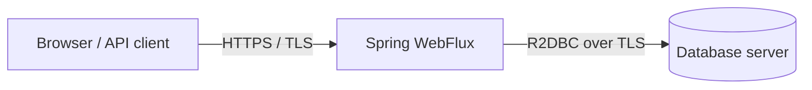
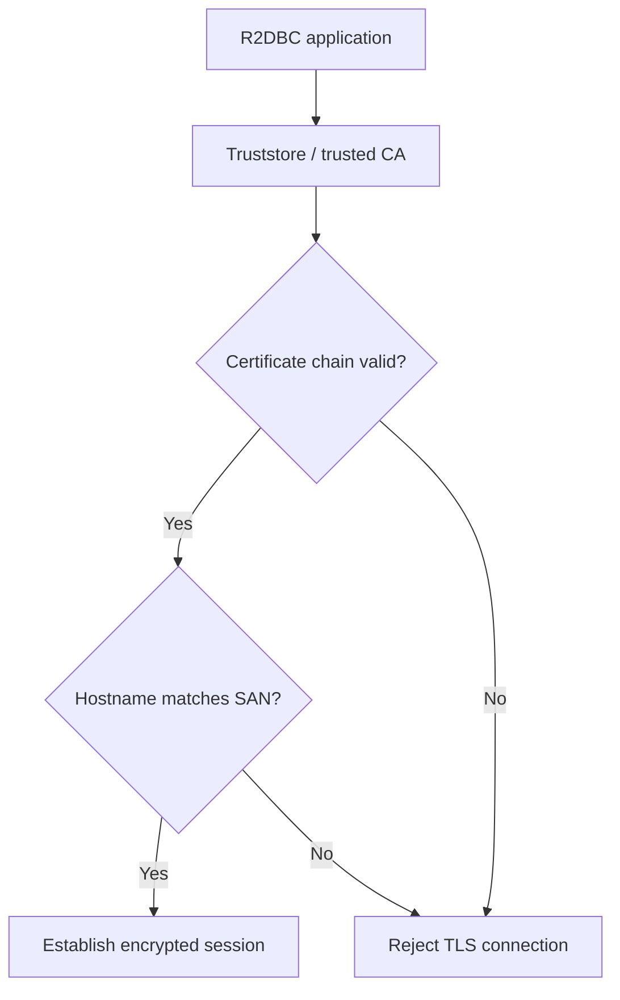
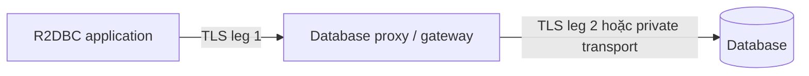

# Bảo vệ dữ liệu trên đường truyền bằng TLS

Ứng dụng Spring Data R2DBC thường chạy ở một máy hoặc container, còn database nằm trên một máy chủ, cluster hoặc dịch vụ cloud khác. Khi ứng dụng gửi username, password, câu SQL, bind parameter và dữ liệu trả về qua mạng, kết nối cần được bảo vệ để người khác không thể đọc hoặc sửa dữ liệu trên đường truyền.

TLS (Transport Layer Security) mã hóa và xác thực kết nối giữa R2DBC client và database server. Cấu hình an toàn cần làm đủ hai việc: bật mã hóa và xác minh danh tính server bằng certificate chain cùng hostname. Chỉ bật SSL/TLS mà bỏ qua xác minh certificate có thể vẫn để ứng dụng kết nối tới một server giả mạo.

Trong Spring Data R2DBC, TLS được cấu hình ở lớp R2DBC driver/`ConnectionFactory`, không phải bằng cách thêm một annotation vào Repository. Mỗi driver có option, truststore và cách chỉ định certificate riêng. Vì vậy, cần cấu hình theo đúng database và driver đang dùng, kiểm thử cả trường hợp kết nối hợp lệ lẫn certificate sai, và có kế hoạch xoay vòng certificate mà không làm gián đoạn pool.

## 1. TLS bảo vệ điều gì?

TLS thiết lập một kênh liên lạc được mã hóa giữa client và server. Trong kết nối R2DBC, kênh đó có thể bảo vệ:

- Thông tin xác thực gửi tới database.
- SQL statement và bind parameter.
- Dữ liệu hàng được database trả về.
- Thông tin giao thức và một số metadata của phiên làm việc.

TLS cũng cung cấp kiểm tra tính toàn vẹn để phát hiện dữ liệu bị thay đổi trên đường truyền. Khi xác minh certificate server được bật, client có thể kiểm tra rằng nó đang nói chuyện với server sở hữu danh tính được certificate cấp.

TLS không thay thế các biện pháp bảo mật khác. Nó không tự bảo vệ dữ liệu đang lưu trên ổ đĩa, không cấp quyền truy cập bảng, không ngăn SQL injection và không mã hóa dữ liệu sau khi ứng dụng đã nhận nó vào bộ nhớ. Vẫn cần database roles, least privilege, secret management, encryption at rest, network segmentation và kiểm soát truy cập ở tầng ứng dụng.

## 2. Phân biệt TLS tới database với HTTPS của API

Một ứng dụng WebFlux có thể có hai kết nối TLS độc lập:

1. Trình duyệt hoặc service gọi HTTPS tới API Spring Boot.
2. Ứng dụng Spring Boot mở kết nối R2DBC có TLS tới database.

Việc cấu hình HTTPS cho cổng WebFlux không tự bật TLS cho kết nối database. Tương tự, R2DBC TLS không bảo vệ request từ trình duyệt tới API.



Mỗi đoạn truyền dữ liệu cần được bảo vệ riêng. Nếu giữa ứng dụng và database có proxy, service mesh hoặc database gateway, cần xác định TLS kết thúc ở đâu và có mã hóa tiếp chặng proxy-to-database hay không.

## 3. TLS handshake trong kết nối R2DBC

Khi R2DBC driver tạo một kết nối bảo mật, quá trình TLS handshake thường gồm các bước khái quát:

1. Client và server thương lượng phiên bản TLS và cipher suite có thể dùng.
2. Server gửi certificate chain để chứng minh danh tính.
3. Client xác minh certificate chain theo trust anchor đã cấu hình.
4. Client kiểm tra hostname mà ứng dụng kết nối có khớp với Subject Alternative Name (SAN) của certificate hay không, nếu chế độ xác minh hostname được bật.
5. Hai bên thiết lập khóa phiên và hoàn tất handshake.
6. Giao thức R2DBC/database tiếp tục trao đổi bên trong kênh TLS.

TLS handshake diễn ra khi một connection vật lý được tạo. Với connection pool, các request sau có thể tái sử dụng connection đã handshake thành công; không phải mỗi câu SQL đều thực hiện một handshake mới.

## 4. Encryption và certificate verification là hai việc khác nhau

Một cấu hình có thể mã hóa kết nối nhưng không xác minh đầy đủ server certificate. Đây là khác biệt quan trọng:

| Chế độ khái quát | Mã hóa đường truyền | Xác minh CA chain | Xác minh hostname |
|---|---:|---:|---:|
| TLS tắt | Không | Không | Không |
| TLS bật, bỏ qua certificate validation | Có | Không | Không |
| Verify CA | Có | Có | Không nhất thiết |
| Verify full/identity | Có | Có | Có |

Trong production, nên chọn chế độ xác minh certificate chain và hostname. Nếu chỉ yêu cầu TLS nhưng chấp nhận certificate bất kỳ, kẻ tấn công có thể dựng một server giả và ứng dụng vẫn thiết lập kết nối mã hóa với server đó.

Tên option cụ thể thay đổi theo driver. Ví dụ, PostgreSQL R2DBC có các chế độ `sslMode` như `VERIFY_CA` và `VERIFY_FULL`; MySQL driver có thể dùng các chế độ tương tự như `VERIFY_CA`/`VERIFY_IDENTITY`; SQL Server driver có các option encryption và trust certificate riêng. Không được coi tên option của một driver là cú pháp chung của R2DBC.

## 5. Certificate chain và truststore

Certificate server thường được ký bởi một Certificate Authority (CA). Client cần tin CA gốc hoặc CA trung gian phù hợp để xác minh chain.



Truststore là nơi client lấy các CA được tin cậy. Trong Java, trust material có thể được cung cấp qua JSSE truststore hoặc cấu hình SSL riêng của driver. Không phải mọi R2DBC driver đều đọc cùng một truststore theo cùng một cách; hãy xác nhận tài liệu driver và phiên bản đang dùng.

Các khái niệm cần phân biệt:

- **Server certificate:** certificate server trình cho client.
- **Private key:** khóa bí mật tương ứng với server certificate; phải được bảo vệ trên server.
- **CA certificate:** certificate dùng làm trust anchor hoặc intermediate để xác minh chain.
- **Truststore:** nơi client lưu CA được tin cậy.
- **Keystore/client key material:** nơi lưu certificate và private key của client nếu dùng mutual TLS.
- **SAN:** danh sách hostname/IP mà certificate hợp lệ cho phép sử dụng.

Ứng dụng thường chỉ cần CA certificate trong truststore để xác minh server. Nếu dùng mutual TLS, client còn cần certificate và private key riêng.

## 6. Hostname verification và Subject Alternative Name

Certificate phải hợp lệ cho hostname mà ứng dụng dùng để kết nối. Nếu ứng dụng kết nối tới `db.prod.example.internal`, certificate server cần có SAN tương ứng, ví dụ `DNS:db.prod.example.internal`.

Một số lỗi thường gặp:

- Ứng dụng kết nối bằng IP nhưng certificate chỉ có SAN DNS.
- Ứng dụng dùng alias DNS khác hostname trong certificate.
- Load balancer trả certificate cho một hostname khác.
- Certificate đã hết hạn hoặc chưa có hiệu lực.
- Certificate chain thiếu intermediate CA.

Trong production, ưu tiên kết nối bằng DNS name ổn định nằm trong SAN của certificate. Không tắt hostname verification chỉ để làm cho kết nối qua IP hoặc alias hoạt động. Hãy cấp certificate đúng danh tính hoặc cấu hình hostname hợp lệ theo hướng dẫn của driver.

Hostname verification giúp chống tình huống client kết nối nhầm endpoint. Chỉ xác minh CA mà không xác minh hostname có thể chấp nhận một certificate hợp lệ do CA tin cậy cấp cho một server khác.

## 7. Chọn phiên bản TLS và cipher suite

Ứng dụng và database cần có ít nhất một phiên bản TLS và cipher suite chung. Với hệ thống hiện đại, nên tuân thủ baseline bảo mật của tổ chức, thường ưu tiên TLS 1.2 trở lên và TLS 1.3 khi cả hai phía hỗ trợ.

Không nên tự đặt một danh sách cipher suite tùy ý nếu chưa kiểm tra tương thích giữa JDK, R2DBC driver, database server và hệ điều hành. Một cấu hình quá hẹp có thể làm handshake thất bại; một cấu hình quá cũ có thể cho phép thuật toán yếu.

Hãy quản lý policy TLS ở nơi phù hợp:

- Database server hoặc managed database configuration.
- JDK/JSSE security policy.
- R2DBC driver nếu driver cho phép cấu hình TLS protocol/cipher.
- Proxy hoặc service mesh nếu TLS kết thúc tại lớp đó.

Không giả định một property `tlsVersion` hoặc `cipherSuites` giống nhau giữa mọi driver. Kiểm tra tài liệu chính thức của đúng phiên bản đang triển khai.

## 8. Cấu hình TLS cho Spring Data R2DBC

Spring Boot đọc cấu hình kết nối R2DBC qua namespace `spring.r2dbc.*`. URL và option TLS được chuyển tới R2DBC driver. Ví dụ khung cấu hình PostgreSQL:

```yaml
spring:
  r2dbc:
    url: "r2dbc:postgresql://db.prod.example.internal:5432/app_db?sslMode=VERIFY_FULL"
    username: ${DB_USERNAME}
    password: ${DB_PASSWORD}
```

`sslMode=VERIFY_FULL` là option đặc thù của R2DBC PostgreSQL driver. Nó minh họa chế độ yêu cầu xác minh certificate và hostname; cần kiểm tra đúng option và cách cung cấp CA certificate theo phiên bản driver của dự án.

Không đưa username/password thật vào URL hoặc source code. Dùng secret manager, mounted secret hoặc biến môi trường được quản lý an toàn. Nếu credential chứa ký tự đặc biệt, tránh nối chuỗi URI thủ công khiến ký tự bị hiểu sai hoặc log lộ bí mật.

Không có một query parameter TLS portable cho tất cả R2DBC driver. Cấu hình của PostgreSQL không thể sao chép nguyên xi sang MySQL hoặc SQL Server.

## 9. Cấu hình truststore Java

Một số driver dùng Java Secure Socket Extension (JSSE) và có thể sử dụng default truststore hoặc truststore được chỉ định qua JVM. Ví dụ khi tổ chức cung cấp truststore PKCS12:

```text
-Djavax.net.ssl.trustStore=/run/secrets/db-truststore.p12
-Djavax.net.ssl.trustStoreType=PKCS12
```

Nếu truststore có password, truyền password qua cơ chế secret/configuration của môi trường chạy và theo cách driver/JDK hỗ trợ; không commit password vào repository hoặc ghi vào log. Tránh đặt password nhạy cảm trực tiếp trong command line nếu môi trường có thể hiển thị process arguments.

Các system property JSSE là cấu hình cấp JVM và có thể ảnh hưởng nhiều kết nối TLS trong cùng process, không chỉ R2DBC. Nếu ứng dụng kết nối nhiều dịch vụ với các CA khác nhau, cần xem xét truststore riêng hoặc SSL context riêng nếu driver hỗ trợ, thay vì thay đổi global truststore mà không đánh giá tác động.

Một số driver cung cấp option riêng như file CA, certificate, private key hoặc truststore. Khi driver có cơ chế riêng, tuân theo tài liệu driver thay vì mặc định rằng nó sẽ đọc JSSE property.

## 10. Cấu hình R2DBC PostgreSQL

R2DBC PostgreSQL có option TLS riêng, trong đó `sslMode` điều khiển mức xác minh. Các chế độ thường gặp:

| `sslMode` | Ý nghĩa khái quát |
|---|---|
| `DISABLE` | Không dùng TLS |
| `ALLOW` | Cho phép kết nối không TLS theo negotiation của driver/server |
| `PREFER` | Ưu tiên TLS nhưng có thể fallback tùy chế độ |
| `REQUIRE` | Yêu cầu kết nối TLS nhưng không tương đương xác minh đầy đủ hostname |
| `VERIFY_CA` | Yêu cầu TLS và xác minh certificate chain theo CA |
| `VERIFY_FULL` | Xác minh certificate chain và hostname server |

Tên và hành vi chính xác cần xác nhận với phiên bản R2DBC PostgreSQL driver đang dùng. Trong production, chọn mode xác minh đầy đủ, ví dụ:

```yaml
spring:
  r2dbc:
    url: "r2dbc:postgresql://postgres.internal.example:5432/app_db?sslMode=VERIFY_FULL"
```

Driver cần tìm được CA đáng tin cậy. Có thể cấu hình CA qua truststore Java hoặc option certificate riêng của driver theo tài liệu phiên bản. Không giả định `VERIFY_FULL` tự tin mọi CA hoặc tự tải CA từ server.

PostgreSQL server cũng phải được cấu hình TLS và certificate/key hợp lệ. Phía server thường có certificate/key trong cấu hình database và quyền file phù hợp. Nếu server không hỗ trợ TLS theo chính sách yêu cầu, client sẽ không thể hoàn tất kết nối.

Để xác nhận session PostgreSQL đang dùng TLS, có thể truy vấn:

```sql
SELECT ssl, version, cipher
FROM pg_stat_ssl
WHERE pid = pg_backend_pid();
```

`ssl = true` xác nhận session hiện tại dùng SSL/TLS; `version` và `cipher` cung cấp thông tin phiên. Quyền xem một số thống kê có thể phụ thuộc role và phiên bản PostgreSQL.

## 11. Cấu hình R2DBC MySQL

MySQL R2DBC driver có option SSL riêng và cách biểu diễn mode phụ thuộc driver/version. Các chế độ thường được phân biệt theo ý nghĩa:

- Tắt TLS.
- Yêu cầu TLS nhưng không xác minh đầy đủ danh tính server.
- Xác minh CA chain.
- Xác minh CA chain và hostname server.

Với driver hỗ trợ các mode `VERIFY_CA` và `VERIFY_IDENTITY`, mode xác minh identity là lựa chọn cần xem xét cho production. Ví dụ URL dưới đây chỉ minh họa dạng cấu hình, cần đối chiếu tên option với đúng R2DBC MySQL driver đang dùng:

```yaml
spring:
  r2dbc:
    url: "r2dbc:mysql://mysql.internal.example:3306/app_db?sslMode=VERIFY_IDENTITY"
    username: ${DB_USERNAME}
    password: ${DB_PASSWORD}
```

Không dùng URL trên như một cấu hình portable cho MariaDB hoặc driver MySQL khác. Các driver có thể khác về tên option, truststore, certificate path và default TLS mode.

Nếu MySQL server yêu cầu client certificate, cần cấu hình client key/certificate theo cơ chế của driver và server. Không chỉ cấu hình CA server rồi cho rằng mutual TLS đã được bật.

Có thể kiểm tra trạng thái TLS trên session MySQL bằng:

```sql
SHOW SESSION STATUS LIKE 'Ssl_cipher';
SHOW SESSION STATUS LIKE 'Ssl_version';
```

Giá trị cipher/version không rỗng thường cho biết session đã thương lượng TLS. Cần xác nhận cú pháp/metadata theo phiên bản MySQL và quyền truy cập.

## 12. Cấu hình R2DBC SQL Server

SQL Server driver có option riêng để điều khiển encryption và trust certificate. Trong hệ sinh thái Microsoft, hai ý niệm quan trọng là:

- Encryption được bật cho kết nối.
- Client xác minh certificate server thay vì chấp nhận certificate bất kỳ.

Một cấu hình an toàn thường cần encryption bật và `trustServerCertificate` tắt, đồng thời client tin CA ký certificate và hostname certificate khớp endpoint. Ví dụ sau là minh họa ý nghĩa option; cú pháp URI/option phải theo đúng phiên bản Microsoft R2DBC SQL Server driver:

```text
encrypt=true
trustServerCertificate=false
```

Không nhầm cấu hình của Microsoft JDBC driver với R2DBC driver. Cả hai có thể dùng thuật ngữ tương tự nhưng cách truyền option, kiểu dữ liệu và hỗ trợ truststore có thể khác.

Không bật `trustServerCertificate=true` trong production để né lỗi certificate. Tùy driver, tùy chọn này có thể mã hóa traffic nhưng bỏ qua việc xác minh danh tính server, làm mất một phần bảo vệ quan trọng của TLS.

Nếu server dùng certificate nội bộ, cài CA tương ứng vào truststore mà driver/JVM sử dụng. Đảm bảo SAN chứa hostname mà ứng dụng dùng để kết nối.

## 13. Mutual TLS (mTLS)

TLS một chiều thông thường xác minh server với client. Mutual TLS yêu cầu cả client và server xác minh certificate của nhau:

1. Client xác minh certificate server.
2. Server yêu cầu client certificate.
3. Client gửi certificate và chứng minh sở hữu private key tương ứng.
4. Server xác minh client certificate theo CA được server tin cậy.

mTLS có thể hữu ích khi database hoặc gateway yêu cầu danh tính workload bằng certificate ngoài username/password. Nhưng không phải mọi database, R2DBC driver hoặc managed service đều hỗ trợ mTLS theo cùng cách.

Client cần bảo vệ private key, cấu hình certificate chain và cơ chế password/key protection nếu có. Server cần cấu hình CA tin cậy cho client certificate và policy ánh xạ danh tính certificate tới quyền database phù hợp.

Không gửi private key qua repository, image build log hoặc biến môi trường dạng plaintext nếu có secret mount/keystore an toàn hơn. Quyền đọc file private key phải giới hạn cho process cần sử dụng.

## 14. TLS với nhiều ConnectionFactory

Một ứng dụng có thể kết nối nhiều database hoặc nhiều cluster R2DBC. Mỗi `ConnectionFactory` cần có cấu hình TLS phù hợp với endpoint của nó.

Ví dụ cấu trúc property:

```yaml
app:
  databases:
    orders:
      r2dbc-url: ${ORDERS_R2DBC_URL}
      username: ${ORDERS_DB_USERNAME}
      password: ${ORDERS_DB_PASSWORD}
    inventory:
      r2dbc-url: ${INVENTORY_R2DBC_URL}
      username: ${INVENTORY_DB_USERNAME}
      password: ${INVENTORY_DB_PASSWORD}
```

Mỗi URL cần chứa option TLS đúng driver và endpoint. Nếu các database dùng CA khác nhau, có thể cần truststore/SSL context riêng nếu driver hỗ trợ. Không giả định cấu hình TLS của `ordersConnectionFactory` tự áp dụng cho `inventoryConnectionFactory`.

Khi tạo bean bằng `ConnectionFactoryOptions` hoặc `ConnectionFactories`, hãy gắn đúng SSL option và driver-specific option vào từng factory. Sau đó gắn factory vào đúng `R2dbcEntityTemplate`, repository package và transaction manager. Không để repository vô tình dùng một factory chưa bật TLS.

## 15. TLS khi dùng connection pool

R2DBC pool quản lý các connection vật lý đã được mở. TLS handshake diễn ra khi pool tạo connection; các thao tác sau tái sử dụng connection đã bảo mật.

Điều này có một số hệ quả:

- Một kết nối pool được tạo trước khi certificate thay đổi có thể tiếp tục dùng session TLS hiện tại.
- Thay file truststore trên filesystem không nhất thiết làm SSL context đã tạo trong JVM tự nạp lại.
- Thay certificate server không tự buộc tất cả pooled connection thực hiện handshake lại ngay lập tức.
- Connection mới tạo sau khi cấu hình trust/certificate được cập nhật sẽ dùng cấu hình mới nếu driver/SSL context được khởi tạo lại phù hợp.

Vì vậy, xoay vòng certificate cần phối hợp giữa server, truststore và pool lifecycle. Có thể drain/close pool hoặc rolling restart application để các connection mới handshake với certificate mới. Tránh đóng toàn bộ connection đồng thời nếu hệ thống cần duy trì availability; hãy rollout theo từng instance.

`maxLifeTime` của pool có thể giúp giới hạn tuổi connection và thay connection dần, nhưng không thay thế quy trình certificate rotation được kiểm soát. Hãy kiểm tra pool có thật sự tạo connection mới và certificate mới được xác minh.

## 16. Xoay vòng CA và server certificate

Một quy trình rotation an toàn thường có các bước:

1. Phân phối CA mới vào truststore của ứng dụng trong khi CA cũ vẫn còn được tin cậy.
2. Rollout ứng dụng để các instance mới đã tin cả CA cũ và CA mới.
3. Thay server certificate bằng certificate được CA mới ký.
4. Xác nhận kết nối mới qua TLS thành công và hostname verification vẫn đạt.
5. Drain hoặc recycle connection pool theo từng instance để tạo TLS session mới.
6. Theo dõi lỗi handshake, connection creation và certificate validation.
7. Sau khi không còn server/connection dùng certificate cũ, loại CA cũ khỏi truststore theo kế hoạch.

Nếu thay server certificate trước khi mọi client tin CA mới, một số instance có thể mất kết nối. Nếu loại CA cũ quá sớm, connection mới tới server chưa được rotate sẽ thất bại.

Theo dõi `notBefore`, `notAfter`, SAN và issuer của certificate. Cảnh báo trước ngày hết hạn đủ lâu để hoàn tất rollout, kiểm thử và xử lý sự cố.

## 17. TLS termination tại proxy hoặc service mesh

Một số kiến trúc đặt proxy hoặc service mesh giữa ứng dụng và database:



Nếu proxy kết thúc TLS, kết nối từ ứng dụng tới proxy được bảo vệ, nhưng chặng proxy tới database có thể là một kết nối khác. Cần xác định chặng thứ hai có TLS hay không và ai xác minh certificate.

Một số proxy dùng TLS passthrough, khi đó handshake có thể đi xuyên tới database. Một số proxy terminate rồi tạo connection mới. Hai mô hình có security boundary khác nhau.

Không tuyên bố “database connection dùng TLS” chỉ vì client kết nối TLS tới proxy. Hãy xác minh từng hop và cấu hình mã hóa end-to-end hoặc TLS trên cả hai chặng theo threat model.

## 18. TLS và network security bổ trợ nhau

TLS bảo vệ nội dung và danh tính endpoint trên đường truyền, nhưng vẫn nên:

- Đặt database trong private network hoặc subnet không public nếu kiến trúc cho phép.
- Chỉ cho phép inbound database port từ application subnet/security group cần thiết.
- Dùng firewall/network policy để giới hạn nguồn kết nối.
- Không mở database port ra Internet chỉ vì đã bật TLS.
- Dùng credential riêng theo service và quyền tối thiểu.
- Giới hạn số connection và giám sát kết nối bất thường.
- Bật encryption at rest nếu dữ liệu lưu trữ cần được bảo vệ.

TLS và network segmentation giải quyết hai lớp rủi ro khác nhau: TLS bảo vệ session và xác minh endpoint; network policy giảm khả năng một nguồn không được phép tiếp cận endpoint.

## 19. Không tắt xác minh certificate để sửa lỗi kết nối

Một số workaround nguy hiểm thường gặp:

- Chọn mode chỉ mã hóa nhưng không xác minh CA/hostname.
- Bật `trustServerCertificate=true` hoặc tùy chọn tương đương.
- Dùng trust-all `TrustManager`.
- Tắt hostname verification.
- Dùng certificate tự ký mà không phân phối CA đáng tin cậy.
- Bỏ qua lỗi certificate expired hoặc hostname mismatch.

Những cách này có thể làm kết nối hoạt động nhưng làm giảm khả năng phát hiện server giả mạo. Hãy xử lý nguyên nhân gốc:

| Lỗi | Cách khắc phục đúng |
|---|---|
| `PKIX path building failed` | Cài CA/intermediate CA đúng vào truststore hoặc cấu hình trust material của driver |
| Hostname mismatch | Kết nối bằng hostname nằm trong SAN hoặc cấp certificate đúng endpoint |
| Certificate expired | Gia hạn và triển khai certificate mới; kiểm tra đồng hồ hệ thống |
| Missing intermediate | Cấu hình server gửi đầy đủ certificate chain |
| TLS protocol/cipher mismatch | Đồng bộ policy TLS giữa JDK, driver, proxy và database |
| Client certificate rejected | Kiểm tra client certificate chain, EKU, validity, private key và CA server tin cậy |
| Kết nối qua IP thất bại | Dùng DNS SAN hợp lệ hoặc cấp certificate có IP SAN theo yêu cầu |

Nếu cần một test local với self-signed certificate, hãy tạo CA test riêng và tin cậy CA đó trong test truststore. Không dùng trust-all trong code production hoặc để cấu hình test rò sang production.

## 20. Bảo vệ secret và private key

TLS không giúp ích nếu credential hoặc private key bị lộ ở nơi khác. Các nguyên tắc cần tuân thủ:

- Không commit password, keystore password, private key hoặc client certificate secret vào Git.
- Lấy credential từ secret manager hoặc mounted secret.
- Giới hạn file permission cho truststore/keystore và private key.
- Không log R2DBC URL nếu URL chứa credential.
- Redact password, token và certificate private material khỏi exception/config dump.
- Dùng credential riêng cho từng service/database, có rotation và quyền tối thiểu.
- Tránh đưa secret vào command line nếu process list hoặc diagnostic tool có thể đọc được.
- Không bake secret vào Docker image layer.

CA certificate công khai thường không phải bí mật; private key và keystore password là bí mật. Dù CA public không nhạy cảm như private key, vẫn cần kiểm soát nguồn phân phối để tránh trust một CA giả.

## 21. Xác minh TLS thực sự được sử dụng

Không nên chỉ kiểm tra cấu hình property rồi kết luận connection đã mã hóa. Hãy xác nhận trạng thái session trên database hoặc qua driver telemetry.

### PostgreSQL

```sql
SELECT ssl, version, cipher
FROM pg_stat_ssl
WHERE pid = pg_backend_pid();
```

Kỳ vọng `ssl = true` và phiên bản/cipher nằm trong policy được tổ chức chấp nhận.

### MySQL

```sql
SHOW SESSION STATUS LIKE 'Ssl_cipher';
SHOW SESSION STATUS LIKE 'Ssl_version';
```

### SQL Server

SQL Server có metadata kết nối như `encrypt_option` trong DMV `sys.dm_exec_connections`; quyền xem có thể cần grant phù hợp. Hãy đối chiếu session hiện tại theo `connection_id` hoặc session ID, không chỉ xem một connection bất kỳ.

Các câu lệnh kiểm tra là vendor-specific. Dùng chúng trong diagnostic/test tương ứng, không đặt một câu SQL duy nhất vào health check chung cho mọi database.

## 22. Kiểm thử TLS thành công

Integration test TLS nên chạy với database container hoặc môi trường test có certificate thật theo đúng loại cấu hình production. Test cần xác nhận:

1. Container/database server khởi động với TLS enabled.
2. Server certificate có SAN khớp hostname mà client sử dụng.
3. CA ký certificate nằm trong truststore của test client.
4. R2DBC driver kết nối thành công ở chế độ xác minh đầy đủ.
5. Repository có thể thực hiện query và nhận kết quả.
6. Database xác nhận session hiện tại dùng TLS.

Testcontainers mặc định không nhất thiết bật TLS cho database. Chỉ dùng `PostgreSQLContainer` hoặc `MySQLContainer` thông thường không đủ để chứng minh TLS. Cần cấu hình server certificate/key, CA và client truststore; có thể dùng image test tùy chỉnh hoặc container configuration riêng.

Certificate test nên được tạo cho hostname mà container client thực sự dùng. Nếu Testcontainers cấp host/port động, cần chọn cách cấu hình hostname/SAN ổn định hoặc một network alias có thể đưa vào SAN và dùng alias đó làm endpoint. Không tắt hostname verification để né sự khác biệt giữa container host và certificate.

## 23. Kiểm thử TLS thất bại có chủ đích

Một suite bảo mật cần xác nhận client từ chối kết nối khi:

- CA ký server certificate không nằm trong truststore.
- Certificate hết hạn hoặc chưa có hiệu lực.
- Hostname không khớp SAN.
- Server yêu cầu client certificate nhưng client không gửi certificate hợp lệ (khi dùng mTLS).
- Server chỉ cho phép TLS version/cipher mà client không hỗ trợ.
- Server yêu cầu TLS nhưng client cố kết nối plaintext.

Các test âm tính này quan trọng không kém test kết nối thành công. Nếu certificate sai mà test vẫn pass, có thể client đang chạy ở chế độ trust-all hoặc không xác minh danh tính server.

Test có thể xác nhận connection factory không tạo được connection hoặc query phát lỗi TLS handshake/certificate. Không phụ thuộc hoàn toàn vào message text vì driver/JDK có thể thay đổi cách bọc exception; kiểm tra exception cause và trạng thái kết nối theo mức ổn định có thể xác định.

## 24. Test truststore và certificate chain trong Java

Trong môi trường test, có thể tạo CA riêng, ký server certificate cho hostname test và tạo truststore chỉ chứa CA đó. Test client sử dụng truststore này để xác minh server.

Một bộ fixture test có thể gồm:

```text
src/test/resources/tls/
├── test-ca.crt
├── db-server.crt
├── db-server.key
├── wrong-ca.crt
└── db-truststore.p12
```

Private key trong fixture chỉ dùng cho test và không được dùng ở production. Không lưu password truststore thật trong repository; test có thể dùng password giả trong fixture hoặc tạo truststore lúc chạy.

Nếu dùng certificate tự ký, hãy phân phối CA/certificate vào truststore test. Không đặt chế độ bỏ qua xác minh. Nếu dùng mTLS, thêm client certificate/key test và cấu hình database yêu cầu client certificate.

## 25. Kiểm thử pool và certificate rotation

Vì TLS handshake gắn với connection vật lý, cần test cả pool lifecycle:

- Connection đầu tiên được tạo và handshake thành công.
- Connection được tái sử dụng cho nhiều query.
- Connection mới sau khi truststore/certificate được cập nhật dùng material mới.
- Connection cũ được drain/recycle theo chính sách.
- Pool có thể phục hồi sau certificate sai hoặc server restart.
- Một instance được rollout mà không làm toàn bộ service mất connection.

Không chỉ sửa file truststore trong khi ứng dụng đang chạy rồi giả định mọi SSL context đã cập nhật. Nhiều driver tạo SSL context lúc khởi tạo `ConnectionFactory`; khi đó cần tạo lại factory/pool hoặc restart instance theo cách được hỗ trợ.

## 26. Theo dõi lỗi TLS trong production

Các metric/log nên giúp phân biệt:

- TLS handshake failure.
- Certificate chain validation failure.
- Hostname verification failure.
- Connection timeout/network reset.
- Database authentication failure sau khi TLS đã thành công.
- Pool acquire/create connection failure.
- Certificate expiration sắp tới.

Không gộp mọi lỗi thành “database unavailable”. Ví dụ authentication failure không giống certificate failure; pool acquire timeout không giống handshake failure.

Log nên có database endpoint đã redaction, driver/version, thời điểm, connection creation phase và exception cause. Không log private key, password hoặc toàn bộ URL chứa secret.

Theo dõi ngày hết hạn certificate bằng hệ thống certificate inventory/monitoring. Không đợi tới khi connection pool cần tạo connection mới rồi mới phát hiện certificate đã hết hạn.

## 27. TLS và health check

Readiness/health check nên xác nhận ứng dụng có thể tạo hoặc sử dụng kết nối tới database theo đúng TLS policy. Tuy nhiên, không nên tạo connection mới liên tục chỉ để kiểm tra certificate vì điều đó tạo handshake và tải không cần thiết.

Một health check có thể dùng connection pool hiện tại để chạy query nhẹ, nhưng cần cân nhắc:

- Connection đã tồn tại có thể vẫn hoạt động dù certificate server vừa thay đổi.
- Lỗi certificate mới có thể chỉ xuất hiện khi pool tạo connection mới.
- Health check không nên trả thông tin certificate/private configuration cho client công khai.
- Liveness của process khác readiness của database dependency.

Trong quy trình rotation, cần có kiểm tra chủ động tạo connection mới bằng trust material mới, không chỉ query trên connection cũ đã được pool giữ lại.

## 28. Những lỗi cấu hình TLS thường gặp

| Triệu chứng | Nguyên nhân có thể | Hướng xử lý |
|---|---|---|
| Kết nối thành công nhưng không xác minh server | Chỉ bật encryption hoặc dùng trust-all | Chọn chế độ verify CA và hostname |
| `PKIX path building failed` | Thiếu CA/intermediate trong truststore | Cài đúng chain hoặc cấu hình CA theo driver |
| Hostname verification failed | SAN không khớp endpoint | Dùng DNS name đúng hoặc cấp certificate mới |
| TLS handshake failure | Version/cipher/protocol không tương thích | Kiểm tra JDK, driver và server TLS policy |
| Connection mới thất bại sau rotation | Truststore/SSL context chưa cập nhật hoặc CA cũ bị gỡ sớm | Triển khai CA mới trước, recycle pool có kiểm soát |
| Connection cũ vẫn hoạt động sau khi cert hết hạn | Pool tái sử dụng TLS session đã thiết lập | Kiểm tra connection mới và quy trình rotation |
| JDBC chạy TLS nhưng R2DBC không chạy | Cấu hình JDBC và R2DBC độc lập | Cấu hình `spring.r2dbc.*` và đúng R2DBC driver |
| Testcontainers test pass nhưng production TLS lỗi | Container test không bật TLS hoặc dùng trust-all | Tạo test server certificate và negative tests |
| Kết nối qua proxy chỉ mã hóa một chặng | TLS terminate tại proxy, chặng sau plaintext | Bảo vệ và xác minh từng hop |
| Secret lộ trong log | URL chứa credential hoặc debug config dump | Redact và lấy secret từ secret manager |

## 29. Checklist triển khai TLS cho R2DBC

Trước khi đưa kết nối R2DBC lên production, hãy xác nhận:

1. Database server đã bật TLS và có certificate hợp lệ.
2. Ứng dụng dùng đúng hostname nằm trong certificate SAN.
3. R2DBC driver được cấu hình yêu cầu TLS.
4. Client xác minh certificate chain và hostname.
5. Truststore/CA material được phân phối an toàn.
6. Không bật trust-all hoặc bỏ qua hostname verification.
7. TLS protocol/cipher tuân theo policy của tổ chức.
8. Nếu dùng mTLS, client private key được bảo vệ và server xác minh client certificate.
9. Mỗi `ConnectionFactory` có TLS policy phù hợp với endpoint của nó.
10. JDBC migration datasource và R2DBC runtime factory được cấu hình riêng.
11. Pool lifecycle có kế hoạch drain/recycle khi certificate rotation.
12. Test thành công và test certificate sai đều chạy qua R2DBC driver thật.
13. Metrics/log phân biệt TLS, network, authentication và pool errors.
14. Certificate expiry được giám sát và rotation có quy trình.
15. TLS được kiểm tra trên mọi hop nếu có proxy/service mesh.

## 30. Quy trình cấu hình và vận hành

Một quy trình thực tế có thể gồm:

**Bước 1 — Xác định endpoint và driver.** Ghi rõ database engine, R2DBC driver/version, hostname, port và proxy/network path.

**Bước 2 — Cấp certificate server.** Certificate có SAN khớp DNS name ứng dụng sẽ dùng, chain đầy đủ và thời hạn phù hợp.

**Bước 3 — Cấu hình database TLS.** Bật TLS, cài certificate/private key và đặt policy protocol/cipher theo chuẩn tổ chức.

**Bước 4 — Phân phối trust material.** Đưa CA vào truststore hoặc driver-specific trust configuration qua secret/config management.

**Bước 5 — Cấu hình R2DBC.** Bật TLS và chế độ xác minh đầy đủ theo đúng tài liệu driver; dùng `spring.r2dbc.*` hoặc cấu hình `ConnectionFactory` tương ứng.

**Bước 6 — Kiểm tra handshake.** Xác nhận connection thành công, hostname khớp và database session báo TLS đang bật.

**Bước 7 — Kiểm thử lỗi.** Dùng CA sai, hostname sai hoặc certificate hết hạn để xác nhận client từ chối.

**Bước 8 — Kiểm thử pool.** Xác nhận connection reuse, connection creation mới và recycle hoạt động đúng.

**Bước 9 — Thiết lập rotation.** Triển khai CA mới trước, thay server certificate, drain pool theo từng instance và loại CA cũ sau cùng.

**Bước 10 — Giám sát.** Theo dõi handshake failure, connection create failure, TLS version/cipher và certificate expiry.

## 31. Kết luận

TLS bảo vệ dữ liệu khi Spring Data R2DBC trao đổi với database qua mạng bằng cách mã hóa và xác thực kết nối. Cấu hình production cần bật TLS, tin đúng CA và xác minh hostname theo certificate SAN. Chỉ bật encryption hoặc bỏ qua certificate validation chưa đủ để chống server giả mạo.

TLS được cấu hình ở R2DBC driver/`ConnectionFactory`; option cụ thể khác nhau giữa PostgreSQL, MySQL, SQL Server và các driver khác. Hãy dùng đúng driver, truststore hoặc certificate material, quản lý secret an toàn và xác nhận session thực sự dùng TLS. Vì connection pool giữ các kết nối đã handshake, certificate rotation cần phân phối CA mới trước, recycle connection có kiểm soát và kiểm tra cả connection mới. Kết hợp integration test thành công, negative certificate tests, monitoring và bảo vệ từng network hop giúp dữ liệu R2DBC được bảo vệ xuyên suốt quá trình truyền tải.
