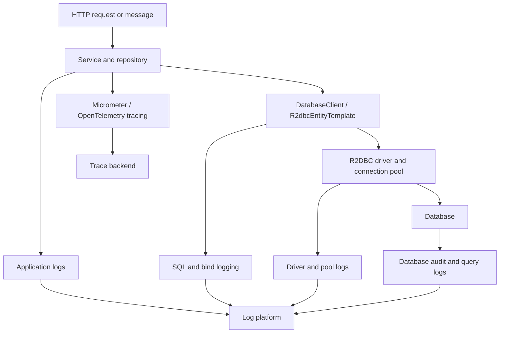

# Che dữ liệu nhạy cảm trong log SQL và dấu vết

Ứng dụng Spring Data R2DBC thường tạo ra nhiều loại dữ liệu quan sát được: log của service, log SQL từ Spring hoặc driver, log của connection pool, trace/span, metric và log ở chính database. Những dữ liệu này giúp điều tra query chậm, lỗi kết nối và hành vi bất thường. Tuy nhiên, nếu ghi toàn bộ câu SQL cùng giá trị bind, nội dung entity hoặc request vào log và trace, hệ thống có thể vô tình lưu mật khẩu, token, email, số điện thoại, dữ liệu thanh toán hoặc thông tin cá nhân ở nơi có phạm vi truy cập rộng hơn database nghiệp vụ.

Mục tiêu không phải là tắt mọi khả năng quan sát. Cần giữ đủ thông tin để biết thao tác nào đã xảy ra, ở đâu, mất bao lâu, trả về bao nhiêu hàng và thất bại theo nhóm lỗi nào, đồng thời loại bỏ hoặc che dữ liệu không cần thiết trước khi dữ liệu rời khỏi ứng dụng. Việc che dữ liệu phải diễn ra tại nguồn phát log/trace; chỉ cấu hình dashboard hoặc hệ thống lưu trữ để ẩn trường sau khi đã gửi đi là quá muộn.

## 1. Những nơi có thể làm lộ dữ liệu nhạy cảm

Trong một request R2DBC, dữ liệu có thể đi qua nhiều lớp quan sát khác nhau:



Các nguồn cần kiểm tra gồm:

- **Application log:** service log request, command, entity hoặc exception bằng SLF4J/Logback/Log4j2.
- **Spring SQL log:** logger của Spring Framework/Spring Data có thể ghi câu SQL, thông tin thực thi hoặc lỗi tùy category và phiên bản.
- **R2DBC driver log:** driver có thể ghi protocol, statement hoặc thông tin tham số ở mức log chi tiết.
- **Connection pool/proxy log:** thư viện pool, proxy hoặc listener có thể ghi SQL và bind values để debug.
- **Trace/span:** instrumentation có thể gắn câu truy vấn, tên database, operation, error message hoặc thuộc tính do ứng dụng tự thêm vào span.
- **Database-side log/audit:** SQL Server, PostgreSQL và hệ quản trị khác có thể ghi statement, session, lỗi hoặc hoạt động audit ở phía server.
- **Error reporting:** exception tracker, dead-letter message hoặc log khi xử lý thất bại có thể lưu nguyên payload.
- **Test/diagnostic artifact:** CI output, file dump, heap dump và bản ghi hỗ trợ sự cố cũng có thể chứa dữ liệu thật.

Không nên chỉ kiểm tra logger của repository rồi kết luận dữ liệu đã an toàn. Một interceptor ở driver hoặc database server có thể ghi lại cùng câu lệnh theo cách khác.

## 2. Xác định dữ liệu nào phải được bảo vệ

Trước khi cấu hình che dữ liệu, hãy phân loại thông tin theo chính sách của ứng dụng và tổ chức. Ví dụ:

| Nhóm dữ liệu | Ví dụ | Cách xử lý trong log/trace |
|---|---|---|
| Bí mật xác thực | Password, API key, access token, refresh token, private key | Không ghi giá trị; không đưa vào span, baggage hoặc exception message. |
| Dữ liệu thanh toán | PAN, CVV, dữ liệu tài khoản thanh toán | Không ghi dữ liệu xác thực thanh toán; chỉ dùng mã tham chiếu được phép. |
| Dữ liệu cá nhân | Email, số điện thoại, địa chỉ, ngày sinh, định danh cá nhân | Loại bỏ hoặc mask theo mục đích và chính sách; hạn chế truy cập. |
| Dữ liệu nghiệp vụ nhạy cảm | Hạn mức, số dư, giá hợp đồng, thông tin nhân sự | Chỉ ghi khi có nhu cầu được phê duyệt; ưu tiên ID tham chiếu và trạng thái. |
| Định danh kỹ thuật | Request ID, trace ID, statement name, mã lỗi | Thường có thể ghi nếu không chứa dữ liệu người dùng và được kiểm soát. |
| Thông tin hệ thống | Host, schema, tên bảng, topology, version | Chỉ ghi mức cần thiết; tránh phơi bày chi tiết nội bộ ra nơi công khai. |

Phân loại cần xét cả dữ liệu trực tiếp và dữ liệu có thể kết hợp để nhận diện một người hoặc một giao dịch. Ví dụ, một mã tenant, timestamp chính xác và địa chỉ IP có thể nhạy cảm khi kết hợp, dù từng trường riêng lẻ không phải bí mật xác thực.

Hãy lập allowlist các thuộc tính được phép ghi. Cách tiếp cận allowlist an toàn hơn việc cố phát hiện mọi chuỗi bí mật bằng regex sau khi toàn bộ object đã được serialize.

## 3. Ưu tiên bind parameter thay vì nối giá trị vào SQL

Giá trị đầu vào phải được bind bằng API R2DBC/Spring thay vì nối trực tiếp vào câu SQL. Điều này giúp tách SQL structure khỏi dữ liệu, giảm nguy cơ SQL injection và làm câu lệnh dễ được nhận diện/cache hơn.

Ví dụ dùng `DatabaseClient`:

```java
Mono<Customer> findByEmail(String email) {
    return databaseClient.sql("""
            SELECT id, display_name
            FROM customer
            WHERE email = :email
            """)
        .bind("email", email)
        .map((row, metadata) -> new Customer(
            row.get("id", UUID.class),
            row.get("display_name", String.class)))
        .one();
}
```

Không tạo SQL bằng cách ghép dữ liệu:

```java
// Không an toàn: giá trị có thể xuất hiện ngay trong SQL text và mở đường cho injection.
String sql = "SELECT id FROM customer WHERE email = '" + email + "'";
```

Bind parameter không tự bảo đảm giá trị sẽ không xuất hiện trong log. Một logger, proxy hoặc driver ở chế độ debug có thể ghi cả statement lẫn giá trị bind. Parameterization bảo vệ cấu trúc SQL; chính sách logging vẫn phải ngăn ghi giá trị nhạy cảm.

Không thể bind tên bảng, tên cột hoặc từ khóa SQL như một value parameter. Nếu cần lựa chọn sort field hoặc identifier động, dùng allowlist cố định trong code; không chèn trực tiếp chuỗi do client gửi vào SQL.

## 4. Không ghi bind values hoặc toàn bộ entity

Một lỗi phổ biến là ghi câu lệnh cùng tham số để thuận tiện debug:

```java
// Không nên: email có thể là dữ liệu cá nhân.
log.debug("Executing customer lookup with email={}", email);

// Không nên: toString() của entity/record có thể chứa token hoặc thông tin cá nhân.
log.debug("Saving customer {}", customer);
```

Không gọi `toString()` trên entity, request DTO, command hoặc map tham số nếu object có thể chứa dữ liệu nhạy cảm. Record Java tự sinh `toString()` từ các component; việc dùng record không làm nội dung trở nên an toàn để log.

Thay vào đó, ghi thông tin tối thiểu theo allowlist:

```java
log.info("customer.lookup completed operation={} durationMs={} found={}",
    "customer.lookupByEmail", duration.toMillis(), found);
```

Ví dụ chỉ ghi tên operation, thời gian và trạng thái có/không có kết quả. Nếu cần liên kết nhiều log, thêm request ID hoặc trace ID đã được tạo ở phía server, không thêm email/token vào message.

## 5. Che dữ liệu ở nơi tạo log

Redaction nên được áp dụng trước khi log event được gửi đến appender, exporter hoặc agent. Nếu chỉ che ở dashboard, bản ghi gốc vẫn có thể nằm trong buffer, queue, archive hoặc hệ thống trung gian.

Các nguyên tắc:

1. Không đưa bí mật vào message hoặc argument ngay từ đầu.
2. Nếu cần ghi một thuộc tính có thể nhận diện người dùng, dùng dạng đã mask theo chính sách hoặc ID tham chiếu ít nhạy cảm hơn.
3. Dùng logger/DTO chuyên dụng chỉ chứa các trường được phép ghi.
4. Thêm bộ lọc redaction tập trung như lớp phòng vệ bổ sung, nhưng không dựa hoàn toàn vào regex.
5. Kiểm tra dữ liệu sau khi format và trước khi gửi tới appender/exporter.
6. Áp dụng cùng chính sách cho log lỗi, trace, baggage, metric label và message queue.

Redaction cần hiểu ngữ cảnh. Thay mọi chuỗi trông giống số điện thoại trong mọi message có thể làm hỏng thông tin kỹ thuật; ngược lại, regex tìm `password=` sẽ bỏ sót token nằm trong JSON hoặc một field có tên khác. Allowlist có schema rõ ràng dễ kiểm soát hơn.

## 6. Tạo DTO log an toàn

Một cách tốt là định nghĩa riêng dữ liệu dành cho log thay vì truyền entity hoặc request vào logger:

```java
public record CustomerLookupLog(
    String operation,
    String requestId,
    boolean found,
    long durationMs
) {}
```

Sau đó ghi đúng các trường đã chọn:

```java
CustomerLookupLog event = new CustomerLookupLog(
    "customer.lookupByEmail",
    requestId,
    customerFound,
    elapsed.toMillis());

log.info("customer lookup {}", event);
```

DTO log không chứa email, password hoặc nội dung row. Nếu cần biết một truy vấn đang nhắm đến tenant nào, hãy xác định xem tenant ID có được phép ghi không và liệu nó có thể tiết lộ cấu trúc khách hàng. Không tự động thêm mọi field vào log DTO chỉ vì nó có sẵn.

Với lỗi, tạo một error event an toàn gồm operation, exception type, mã lỗi nội bộ, SQL state/vendor code nếu được phép và correlation ID. Không đưa toàn bộ request/command vào event lỗi.

## 7. Mask, redact, tokenize và hash không giống nhau

Các kỹ thuật che dữ liệu có mục đích khác nhau:

| Kỹ thuật | Ví dụ | Đặc điểm |
|---|---|---|
| Redact | `email=[REDACTED]` | Loại bỏ hoàn toàn giá trị; an toàn khi không cần phân biệt bản ghi. |
| Mask | `a***@example.com` | Giữ một phần để hỗ trợ người vận hành nhận diện trong trường hợp được phép. |
| Tokenize | `customerRef=tok_8f...` | Thay bằng token tham chiếu; cần hệ thống ánh xạ được bảo vệ riêng. |
| Keyed hash/HMAC | `subjectHash=...` | Có thể liên kết cùng một giá trị qua nhiều log mà không ghi giá trị gốc; cần bảo vệ và xoay khóa. |
| Encryption | Ciphertext | Có thể giải mã khi có khóa; không phải redaction và tăng trách nhiệm quản lý khóa. |

Masking không tự động biến dữ liệu thành vô danh. Ví dụ email chỉ che một phần vẫn có thể nhận diện khi kết hợp với thông tin khác. Hash thường không khóa cũng không an toàn cho dữ liệu có không gian giá trị nhỏ như số điện thoại hoặc email vì có thể dò từ điển. Nếu cần liên kết ổn định, cân nhắc HMAC với khóa riêng được quản lý an toàn, giới hạn mục đích sử dụng và kế hoạch xoay khóa.

Không ghi giá trị bí mật đã mã hóa rồi coi là an toàn. Nếu hệ thống log có thể truy cập khóa giải mã hoặc ciphertext có thể được giải mã về sau, dữ liệu vẫn là thông tin nhạy cảm.

## 8. Cấu hình log SQL trong Spring và driver

Trong môi trường phát triển, có thể cần bật log chi tiết để điều tra câu SQL hoặc lỗi mapping. Tuy nhiên, category logger và mức độ chi tiết phụ thuộc phiên bản Spring Framework, Spring Data R2DBC, driver và thư viện proxy đang dùng.

Một số nguyên tắc cấu hình:

- Chỉ bật mức DEBUG/TRACE cho category cần thiết trong môi trường phát triển hoặc một khoảng điều tra ngắn có kiểm soát.
- Không bật log bind parameter toàn cục trong production.
- Kiểm tra cả logger Spring, logger driver, pool, proxy và thư viện tracing; tắt hoặc cấu hình riêng từng nguồn.
- Không đưa password/connection URL có credentials vào log khởi động hoặc lỗi cấu hình.
- Dùng profile môi trường để tránh cấu hình debug vô tình đi vào production.
- Nếu cần bật tạm, có thời hạn, người chịu trách nhiệm và quy trình tắt/kiểm tra sau sự cố.

Không nên sao chép một tên logger từ ví dụ trên mạng mà chưa xác minh nó thuộc đúng phiên bản dependency đang chạy. Hãy kiểm tra tài liệu của phiên bản hoặc quan sát logger thực tế trong môi trường test bằng dữ liệu giả.

Ví dụ cấu hình profile minh họa:

```yaml
logging:
  level:
    root: INFO
    com.example.orders: INFO
```

Ở môi trường điều tra, chỉ tăng mức cho category cụ thể sau khi đã xác nhận nó không ghi bind values hoặc đã có cơ chế redaction phù hợp. Cấu hình logger ở mức DEBUG không phải một giải pháp masking.

## 9. Kiểm soát log từ R2DBC proxy và connection pool

Các thư viện proxy/observer có thể ghi lại câu lệnh và tham số để đo thời gian hoặc kiểm tra query. Một số pool cũng có logger về acquire, release, timeout và connection lifecycle.

Khi thêm `r2dbc-proxy` hoặc thư viện tương tự:

- Đọc rõ callback/listener nào nhận SQL và bind parameters.
- Chỉ ghi query fingerprint hoặc operation name nếu không cần giá trị thực.
- Tắt listener ghi parameter value ở production.
- Nếu listener có redaction, kiểm tra nó xử lý cả positional và named bind, giá trị null, binary, JSON và nhiều kiểu dữ liệu.
- Không ghi toàn bộ `ConnectionFactoryOptions`, vì cấu hình có thể chứa username, password hoặc connection URL nhạy cảm.
- Kiểm tra log khi connection acquire thất bại; message exception có thể chứa host, database hoặc cấu hình kết nối.

Đo query duration không cần biết giá trị bind. Có thể ghi operation, duration, rows affected và loại kết quả mà không ghi tham số.

## 10. Che SQL statement trong tracing

Tracing giúp theo dõi một request đi qua service, repository, driver và database. Span database có thể chứa tên operation, database system, database name, câu truy vấn hoặc thuộc tính do instrumentation thêm vào. Tên và semantics thuộc tính thay đổi theo phiên bản OpenTelemetry semantic conventions và instrumentation.

Không giả định tracing chỉ ghi thời gian. Kiểm tra span thực tế được tạo bởi agent/instrumentation đang dùng, đặc biệt:

- SQL text hoặc query text.
- Bind parameter hoặc giá trị query được thêm bởi custom instrumentation.
- Error message và exception event.
- Database/schema/table/collection name.
- User-defined span attributes.
- Baggage được truyền từ request qua nhiều service.

Nếu SQL có literal do code nối chuỗi, câu truy vấn được ghi trong span có thể chứa dữ liệu gốc. Ngay cả khi dùng bind parameter, instrumentation hoặc proxy vẫn có thể ghi riêng giá trị bind. Hãy tắt capture giá trị hoặc cấu hình redaction trước exporter.

## 11. Dùng span attributes có allowlist

Thay vì thêm toàn bộ request vào span, chỉ thêm thuộc tính có giá trị chẩn đoán và không nhạy cảm:

```java
Observation.createNotStarted("customer.lookup", observationRegistry)
    .lowCardinalityKeyValue("operation", "customer.lookupById")
    .lowCardinalityKeyValue("result", "found")
    .observe(() -> performLookup(customerId));
```

Đây là ví dụ minh họa Observation API; cách tạo observation và gắn vào reactive context cần theo phiên bản Micrometer/Spring đang dùng. Không thêm `email`, token, password hoặc nội dung entity làm span attribute.

Các giá trị có cardinality cao như user ID, email, order ID hoặc request ID thường không phù hợp làm metric tag. Với trace, một ID tham chiếu có thể hữu ích trong một số trường hợp, nhưng phải đánh giá chính sách riêng tư, khả năng liên kết người dùng và thời gian lưu. Không dùng một giá trị nhạy cảm làm tag chỉ vì tracing backend hỗ trợ tìm kiếm.

Giữ metric label ở mức low-cardinality như operation, outcome, database system hoặc error category. Định danh request có thể đặt ở trace/log correlation field được kiểm soát, không đặt làm metric label.

## 12. Không đưa bí mật vào baggage hoặc context truyền liên service

OpenTelemetry baggage và các cơ chế propagation khác có thể truyền thuộc tính qua nhiều service. Baggage thường được chuyển tiếp trong request context và có thể xuất hiện ở các hệ thống trung gian hoặc được instrumentation sao chép vào span.

Không đưa các dữ liệu sau vào baggage:

- Access token, refresh token, API key hoặc session cookie.
- Password hoặc credential database.
- Email, số điện thoại hoặc dữ liệu cá nhân nếu không có mục đích được phê duyệt.
- Payload request/response hoặc nội dung entity.
- Thông tin thanh toán hoặc bí mật nghiệp vụ.

Chỉ truyền correlation ID hoặc thuộc tính kỹ thuật đã được allowlist. Nếu cần actor context, ưu tiên định danh nội bộ ít nhạy cảm và bảo đảm quyền truy cập trace phù hợp. Baggage không phải kho lưu trữ bảo mật.

## 13. Xử lý exception mà không làm lộ SQL và tham số

Exception từ Spring/driver có thể chứa SQL state, vendor code, tên bảng/cột, câu truy vấn hoặc message do driver tạo. Một số lỗi do ứng dụng tự ném có thể nhúng email, ID hoặc payload vào message.

Không nên log cả request và exception theo cách vô điều kiện:

```java
// Không nên: request.toString() và exception message có thể chứa dữ liệu nhạy cảm.
log.error("Failed to save request {}", request, error);
```

Thay vào đó, ghi operation và mã lỗi đã phân loại:

```java
log.error(
    "customer.save failed operation={} errorType={} requestId={}",
    "customer.save",
    error.getClass().getSimpleName(),
    requestId);
```

Nếu cần stack trace cho điều tra, hãy xác nhận exception chain không chứa secret hoặc dữ liệu cá nhân. Có thể ghi stack trace đã được xử lý qua một error handler chuyên dụng, đồng thời lưu SQL state/vendor code trong trường riêng nếu chính sách cho phép. Không tự xây dựng message exception bằng cách nối giá trị bind.

Không trả SQL, stack trace hoặc chi tiết database cho HTTP client. API nên trả mã lỗi công khai và correlation ID; log nội bộ giữ thông tin chẩn đoán đã được kiểm soát.

## 14. Tách query fingerprint khỏi câu SQL đầy đủ

Trong nhiều trường hợp, người vận hành chỉ cần biết query nào chậm và được gọi bao nhiêu lần. Có thể ghi một query name ổn định hoặc fingerprint của SQL đã chuẩn hóa:

```text
operation=order.findByTenantAndStatus
queryFingerprint=orders.lookup.v2
durationMs=84
rowsReturned=25
outcome=success
```

Query fingerprint nên được tạo từ template hoặc tên operation do code định nghĩa, không phải từ SQL đã được nối literal. Không đưa giá trị bind vào fingerprint; nếu hash toàn bộ SQL có literal, hash vẫn có thể bị dò khi không gian giá trị nhỏ.

Tên operation ổn định thường hữu ích hơn lưu raw SQL trong mọi trace. Khi cần xem SQL chính xác để điều tra, có thể truy cập qua kênh phát triển được kiểm soát, dùng dữ liệu đã ẩn danh và quyền truy cập hạn chế.

## 15. Giảm dữ liệu nhạy cảm trước khi truy vấn

Một cách giảm rủi ro là không lấy các cột nhạy cảm nếu use case không cần chúng. Ví dụ, danh sách khách hàng không nên chọn `password_hash`, `reset_token` hoặc thông tin thanh toán chỉ để hiển thị tên và trạng thái.

```sql
SELECT id, display_name, status
FROM customer
WHERE tenant_id = :tenantId;
```

Thay vì:

```sql
SELECT *
FROM customer
WHERE tenant_id = :tenantId;
```

Projection/DTO nhỏ giúp giảm cả payload lẫn khả năng dữ liệu nhạy cảm xuất hiện trong debugger, object `toString()`, exception hoặc trace tùy biến. Đây là lớp giảm thiểu bổ sung; không thay thế chính sách log và trace.

## 16. Kiểm soát dữ liệu trong metric

Metric thường được lưu lâu và có thể được tổng hợp cho nhiều người dùng. Không dùng email, user ID, order ID, SQL text hoặc token làm label/tag. Cardinality cao làm tăng dung lượng và chi phí backend; đồng thời có thể làm lộ dữ liệu nhận diện.

Các label thường an toàn hơn khi được giới hạn bằng allowlist:

- Tên operation ổn định như `customer.findById`.
- Outcome như `success`, `empty`, `error`.
- Error category như `timeout`, `constraint`, `connection`.
- Database system hoặc pool name đã được kiểm soát.
- Kích thước kết quả theo bucket thay vì ID cụ thể.

Không đưa SQL bind values vào metric. Nếu cần đo phân bố thời gian, dùng histogram theo operation; không cần label theo từng bản ghi.

## 17. Sampling không phải redaction

Sampling giảm số lượng trace được lưu, nhưng trace được chọn vẫn có thể chứa toàn bộ dữ liệu nhạy cảm. Không dùng sampling làm biện pháp che dữ liệu.

Thứ tự bảo vệ nên là:

1. Không thu thập dữ liệu nhạy cảm nếu không cần.
2. Redact/mask tại nguồn trước khi export.
3. Áp dụng allowlist thuộc tính cho span và log.
4. Giới hạn quyền truy cập, retention và export destination.
5. Dùng sampling để kiểm soát lượng trace sau khi dữ liệu đã được làm an toàn.

Nếu redaction chỉ chạy trong trace backend sau khi nhận, dữ liệu đã đi qua agent, collector hoặc network. Hãy áp dụng processor ở vị trí sớm nhất có thể và kiểm tra liệu bản copy trước processor có được lưu hay không.

## 18. Cấu hình log và trace theo môi trường

Môi trường phát triển có thể cần nhiều thông tin hơn production, nhưng vẫn nên dùng dữ liệu giả hoặc đã ẩn danh. Không mặc định môi trường staging an toàn: staging có thể chứa bản sao dữ liệu production và log có thể được gửi đến cùng hệ thống tập trung.

| Môi trường | Cách cấu hình đề xuất |
|---|---|
| Local development | Có thể bật log SQL có kiểm soát; ưu tiên fixture giả và không ghi secret. |
| Automated test | Dùng dữ liệu synthetic; kiểm tra log/trace không chứa canary secret. |
| Staging | Áp dụng cùng chính sách redaction như production nếu có dữ liệu gần production. |
| Production | Mức log mặc định hạn chế; không log bind values; trace attributes theo allowlist; truy cập và retention được kiểm soát. |
| Incident investigation | Bật thêm quan sát trong thời gian giới hạn, với phạm vi cụ thể và kiểm tra dữ liệu trước khi export. |

Không để một profile debug được kích hoạt do biến môi trường sai hoặc do file cấu hình bị merge ngoài ý muốn. Kiểm tra effective logging level và instrumentation options khi ứng dụng khởi động.

## 19. Bảo vệ log backend và trace backend

Redaction tại nguồn là ưu tiên, nhưng hệ thống lưu trữ vẫn cần kiểm soát:

- Phân quyền theo vai trò và mục đích; không cho mọi developer đọc mọi log production.
- Mã hóa dữ liệu khi truyền và khi lưu theo khả năng của nền tảng.
- Đặt retention phù hợp, xóa hoặc archive theo chính sách.
- Kiểm soát export/download và chia sẻ dashboard.
- Theo dõi truy cập bất thường vào log chứa dữ liệu nhạy cảm.
- Tách môi trường/tenant nếu yêu cầu bảo mật cần cô lập.
- Hạn chế quyền của agent/collector và tài khoản gửi log.
- Không gửi log production vào dịch vụ cá nhân hoặc endpoint chưa được phê duyệt.

Nếu phát hiện secret đã bị ghi, cần coi đó là một lần lộ dữ liệu: xác định phạm vi, hạn chế truy cập, xóa/expire bản ghi theo quy trình, và rotate credential/token nếu có khả năng bị lộ. Xóa ở dashboard không chắc đã xóa các bản copy, archive hoặc collector buffer.

## 20. Cấu hình và triển khai redaction theo nhiều lớp

Một thiết kế thực tế có thể chia thành các lớp:

1. **Code:** chỉ log event DTO có allowlist; không log entity, request body hoặc bind values.
2. **Spring/driver:** cấu hình category và mức log phù hợp; tắt capture parameter values trong production.
3. **Observation/tracing:** chỉ thêm span attributes được phê duyệt; lọc SQL text/exception data nếu instrumentation có hỗ trợ.
4. **Collector/exporter:** áp dụng processor redaction làm lớp phòng vệ bổ sung trước khi gửi backend.
5. **Backend:** RBAC, retention, encryption và audit truy cập.

Không có một thuộc tính cấu hình Spring chung nào bảo đảm che mọi tham số ở mọi driver và mọi instrumentation. Tên option và khả năng redaction thay đổi theo thư viện. Cần xác định từng nguồn phát dữ liệu trong dependency graph và cấu hình riêng theo tài liệu phiên bản.

## 21. Ví dụ một service có log an toàn

Ví dụ dưới đây ghi operation, kết quả và thời gian mà không ghi email hoặc toàn bộ entity:

```java
public Mono<CustomerView> findCustomer(String email, String requestId) {
    long startedAt = System.nanoTime();

    return customerRepository.findByEmail(email)
        .map(CustomerView::from)
        .doOnNext(view -> log.info(
            "customer.lookup completed operation={} requestId={} outcome={} durationMs={}",
            "customer.findByEmail",
            requestId,
            "found",
            elapsedMillis(startedAt)))
        .switchIfEmpty(Mono.defer(() -> {
            log.info(
                "customer.lookup completed operation={} requestId={} outcome={} durationMs={}",
                "customer.findByEmail",
                requestId,
                "empty",
                elapsedMillis(startedAt));
            return Mono.empty();
        }))
        .doOnError(error -> log.error(
            "customer.lookup failed operation={} requestId={} errorType={}",
            "customer.findByEmail",
            requestId,
            error.getClass().getSimpleName()));
}

private long elapsedMillis(long startedAt) {
    return TimeUnit.NANOSECONDS.toMillis(System.nanoTime() - startedAt);
}
```

Ví dụ minh họa cách chỉ log outcome, duration và request ID. Trong production, nên dùng observation/metrics chuẩn của ứng dụng thay vì tự viết timer ở mọi method; bảo đảm `requestId` được tạo ở server và không chứa thông tin cá nhân. Nếu muốn ghi exception stack trace, cần áp dụng chính sách exception logging đã nêu ở trên.

`doOnError` là side effect trong reactive chain. Không dùng nó để biến lỗi thành thành công; nếu cần chuyển đổi lỗi, dùng `onErrorMap` hoặc `onErrorResume` có chọn lọc theo hợp đồng service. Log không được chứa giá trị `email` dù query có bind parameter.

## 22. Kiểm thử redaction bằng dữ liệu canary

Không chỉ đọc cấu hình rồi cho rằng dữ liệu đã được che. Hãy tạo dữ liệu kiểm thử có chuỗi canary duy nhất, ví dụ:

```text
password = CANARY_SECRET_PASSWORD_9f3a
email = canary.person@example.invalid
token = CANARY_ACCESS_TOKEN_7b21
```

Thực hiện các thao tác có thể tạo log/trace:

- Query repository có bind email.
- Insert/update entity có field nhạy cảm.
- Gây lỗi unique constraint hoặc lỗi mapping.
- Gây timeout/kết nối thất bại trong môi trường test.
- Chạy qua driver/pool proxy và instrumentation đang dùng.
- Tạo span có baggage/context để xác nhận dữ liệu không bị propagate.

Sau đó kiểm tra mọi output liên quan:

1. Application log và console output.
2. Spring/driver/pool/proxy log.
3. Trace span attributes và exception events.
4. Metric labels/tags.
5. Collector/exporter output hoặc test exporter.
6. Error tracker và dead-letter payload nếu có.

Khẳng định test bằng cách tìm toàn bộ chuỗi canary; test phải thất bại nếu bất kỳ canary nào xuất hiện ở nơi không được phép. Đồng thời xác nhận các trường vận hành cần thiết như operation, duration, outcome và correlation ID vẫn còn để hỗ trợ điều tra.

## 23. Kiểm tra exception và SQL logging khi nâng phiên bản

Nâng Spring Framework, Spring Data, R2DBC driver, pool, tracing agent hoặc collector có thể thay đổi logger category, span attributes hoặc cách exception được tạo. Vì vậy:

- Lưu danh sách dependency và instrumentation đang bật.
- Kiểm tra release note/tài liệu đúng phiên bản.
- Chạy lại canary test trước khi triển khai.
- So sánh span schema và log field trước/sau nâng cấp.
- Kiểm tra cấu hình production đã được áp dụng thực tế, không chỉ file cấu hình trong repository.
- Xác nhận không có logger TRACE hoặc protocol debug vô tình được bật.

Không dựa vào việc một test mock không thấy secret để kết luận driver thật cũng không ghi secret. Cần kiểm tra với R2DBC driver, connection pool và exporter thực tế trong môi trường kiểm thử.

## 24. Quy trình ứng phó khi phát hiện dữ liệu nhạy cảm trong log

Khi phát hiện password, token hoặc dữ liệu cá nhân đã xuất hiện trong log/trace:

1. Xác định loại dữ liệu, thời gian, operation và mọi hệ thống đã nhận bản ghi.
2. Hạn chế quyền truy cập hoặc tạm dừng export nguồn gây lộ nếu cần.
3. Rotate/revoke secret có khả năng bị lộ; đánh giá phạm vi tác động theo quy trình bảo mật.
4. Xác định các bản sao trong collector, queue, archive, backup và trace backend.
5. Xóa hoặc rút ngắn retention theo quy trình được phê duyệt; không giả định xóa một dashboard là đủ.
6. Sửa nguồn phát log/trace và cấu hình instrumentation.
7. Chạy canary test để xác nhận dữ liệu không còn xuất hiện.
8. Ghi nhận nguyên nhân gốc và biện pháp ngăn tái diễn.

Nếu dữ liệu có thể được dùng để đăng nhập hoặc truy cập hệ thống, việc rotate/revoke cần được ưu tiên theo chính sách incident response. Với dữ liệu cá nhân, thực hiện quy trình thông báo/đánh giá theo quy định và chính sách áp dụng cho tổ chức.

## 25. Các anti-pattern cần tránh

| Anti-pattern | Rủi ro | Cách thay thế |
|---|---|---|
| Log toàn bộ request/command/entity | Có thể ghi password, token, PII hoặc payload lớn | Dùng log DTO theo allowlist. |
| Bật DEBUG/TRACE SQL toàn cục trong production | Driver/proxy có thể ghi bind values và SQL nhạy cảm | Bật có phạm vi, thời hạn và kiểm chứng redaction. |
| Nối giá trị người dùng vào SQL | SQL injection và literal có thể bị ghi nguyên văn | Dùng bind parameter. |
| Cho rằng bind parameter tự che log | Instrumentation vẫn có thể log giá trị bind | Kiểm tra và tắt capture bind values. |
| Chỉ mask ở dashboard | Dữ liệu gốc đã đến collector/backend | Redact trước exporter. |
| Đưa token/email vào span hoặc baggage | Dữ liệu được propagate qua nhiều service | Chỉ dùng thuộc tính kỹ thuật allowlist. |
| Dùng hash thường cho email/số điện thoại | Có thể dò từ điển | Redact hoặc HMAC với khóa được quản lý nếu thật sự cần liên kết. |
| Dùng sampling thay redaction | Trace được giữ vẫn chứa secret | Redact trước sampling/export. |
| Log toàn bộ exception message mà không kiểm tra | Message/cause có thể chứa SQL, host hoặc tham số | Ghi error type/code và stack trace theo chính sách. |
| Đưa ID người dùng vào metric tag | Cardinality cao và rủi ro nhận diện | Dùng operation/outcome/error category. |

## 26. Checklist thiết kế log và trace an toàn

Trước khi phát hành một use case R2DBC, hãy xác định:

1. Entity, command và bind parameter nào chứa dữ liệu nhạy cảm?
2. Logger nào có thể ghi SQL hoặc giá trị bind: Spring, driver, pool, proxy hay database server?
3. Trace instrumentation có capture SQL text, exception event hoặc custom attribute nào?
4. Có baggage hoặc context nào đang propagate dữ liệu người dùng không?
5. Log event có dùng allowlist thay vì serialize entity/request không?
6. Redaction chạy trước appender/exporter hay chỉ ở backend?
7. Metric tag có chứa ID, email, SQL hoặc giá trị cardinality cao không?
8. Log backend và trace backend có RBAC, encryption, retention và audit truy cập phù hợp không?
9. Canary test có tìm secret trong log, trace, metric và error output không?
10. Quy trình bật debug tạm thời, tắt lại và xử lý dữ liệu đã lộ đã rõ chưa?

## 27. Nguyên tắc triển khai

Với Spring Data R2DBC, an toàn logging cần được thiết kế xuyên suốt từ service đến database driver và observability backend. Dùng bind parameter để giữ SQL tách khỏi dữ liệu; chỉ log operation, thời gian, outcome, row count và correlation ID đã được phê duyệt; không serialize entity/request hoặc ghi bind values; kiểm tra logger của Spring, driver, pool và proxy; giới hạn span attributes và baggage; redaction trước khi export; và kiểm thử bằng canary secret trên chính stack thực tế.

Log và trace vẫn phải đủ hữu ích để vận hành. Hãy giữ thông tin kỹ thuật có giá trị chẩn đoán, phân loại lỗi ổn định và liên kết request bằng ID an toàn, đồng thời loại bỏ dữ liệu không cần thiết ngay tại nguồn. Kết hợp redaction với quyền truy cập, retention, mã hóa và quy trình incident response sẽ giảm nguy cơ log SQL và dấu vết trở thành một kho lưu trữ bí mật ngoài ý muốn.
