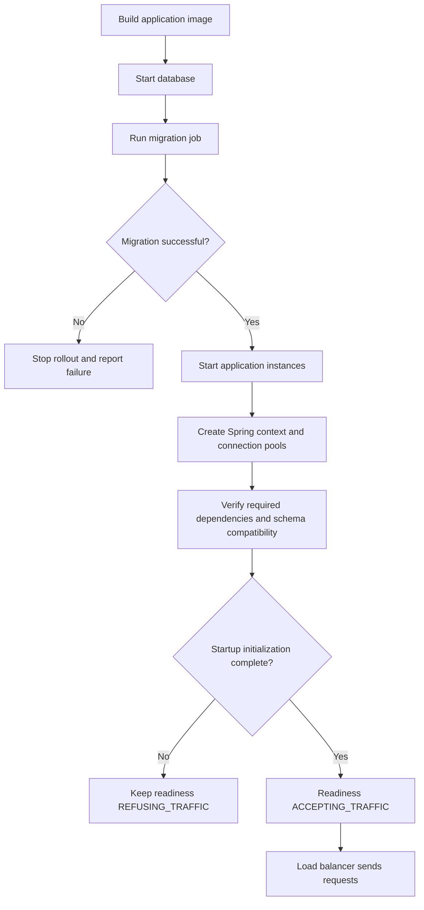
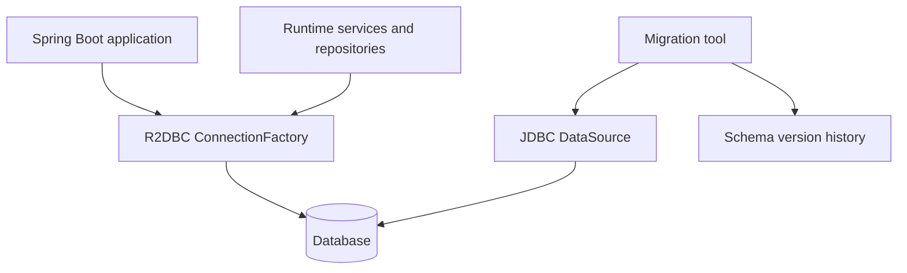
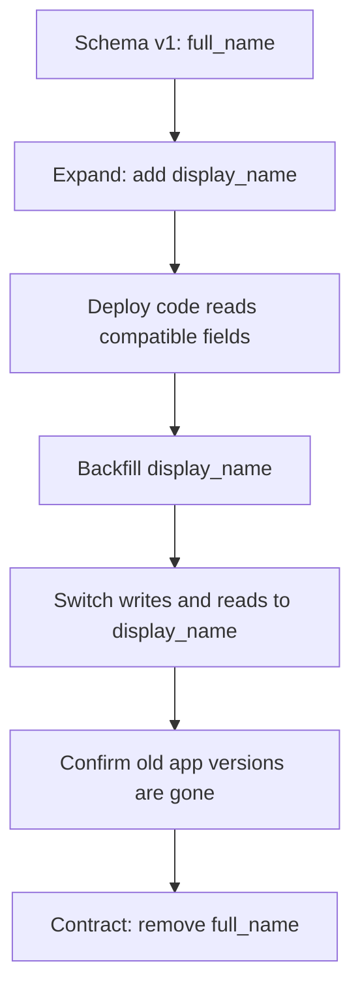

# Phối hợp khởi động ứng dụng, migration và kiểm tra sẵn sàng

Một ứng dụng Spring Data R2DBC chỉ nên nhận traffic khi những điều kiện cần thiết để phục vụ request đã hoàn tất. Các điều kiện đó thường gồm cấu hình đã được nạp, database có thể truy cập, schema ở phiên bản tương thích với code và các bước khởi tạo bắt buộc đã hoàn thành. Nếu ứng dụng mở cổng HTTP trước khi migration xong hoặc đánh dấu pod sẵn sàng quá sớm, request có thể gặp lỗi thiếu bảng/cột ngay sau khi triển khai.

Khởi động ứng dụng, migration schema và readiness là ba việc liên quan nhưng có trách nhiệm khác nhau:

- **Khởi động:** tạo application context, connection factory, repository, service và web server.
- **Migration:** đưa schema database đến phiên bản mong muốn bằng các thay đổi có thứ tự và có thể theo dõi.
- **Readiness:** thông báo cho load balancer/orchestrator rằng instance hiện có thể nhận traffic.

Với Spring Data R2DBC, ứng dụng runtime dùng R2DBC để truy cập database không đồng bộ. Các công cụ migration phổ biến như Flyway hoặc Liquibase thường kết nối database bằng JDBC. Có thể dùng JDBC chỉ cho migration và giữ R2DBC cho runtime, hoặc chạy migration bằng một job độc lập trước khi deploy ứng dụng. Điều quan trọng là phải điều phối để migration hoàn tất và schema tương thích trước khi instance được đưa vào phục vụ.

## 1. Vòng đời triển khai và readiness

Một trình tự triển khai thường gặp:



Sơ đồ là một mô hình triển khai điển hình. Một số ứng dụng chạy migration trong quá trình khởi động thay vì một job riêng; khi đó readiness vẫn phải ở trạng thái từ chối traffic cho đến khi migration và các bước bắt buộc hoàn tất.

Không đồng nhất ba khái niệm sau:

| Khái niệm | Câu hỏi trả lời | Ví dụ |
|---|---|---|
| Process started | Process/JVM đã chạy chưa? | Container đã tạo process Java. |
| Liveness | Ứng dụng có còn sống và có thể tiếp tục chạy không? | Application context không bị lỗi nghiêm trọng, event loop còn hoạt động. |
| Readiness | Instance có thể nhận request nghiệp vụ ngay bây giờ không? | Migration xong, schema tương thích, dependency bắt buộc sẵn sàng. |

Một process có thể đã chạy và liveness tốt nhưng readiness vẫn chưa đạt. Ví dụ database đang migration hoặc service đang nạp dữ liệu cấu hình bắt buộc. Đây là trạng thái hợp lệ; load balancer cần tránh gửi request nghiệp vụ đến instance đó.

## 2. Migration là thay đổi schema có phiên bản

Migration là tập lệnh thay đổi schema theo thứ tự, thường được quản lý bằng version hoặc changelog. Ví dụ:

- Tạo bảng `customer`.
- Thêm cột `status`.
- Tạo index cho truy vấn tìm kiếm.
- Thêm constraint sau khi dữ liệu cũ đã được chuẩn hóa.
- Chuyển dữ liệu sang cấu trúc mới.

Không nên dùng một lệnh `CREATE TABLE IF NOT EXISTS` duy nhất như cơ chế migration production. Khi schema thay đổi qua nhiều phiên bản, ứng dụng cần biết migration nào đã chạy, migration nào còn thiếu, migration nào thất bại và code hiện tại tương thích với phiên bản schema nào.

Các công cụ như Flyway và Liquibase quản lý version/changelog, lịch sử thực thi và một số cơ chế khóa để phối hợp migration. Chọn một công cụ phù hợp với database, quy trình phát hành và năng lực vận hành của nhóm; tránh để nhiều cơ chế cùng sửa một schema mà không có quy tắc sở hữu rõ.

## 3. R2DBC runtime và JDBC migration có thể cùng tồn tại

R2DBC là API truy cập database reactive. Flyway và Liquibase truyền thống thường dùng JDBC để thực thi migration. Vì vậy, một ứng dụng có thể có hai loại kết nối đến cùng database:



R2DBC phục vụ query nghiệp vụ sau khi ứng dụng sẵn sàng. JDBC chỉ được dùng trong giai đoạn migration hoặc trong migration job. Hai kết nối có thể dùng cùng database/schema nhưng có pool, driver và credentials riêng.

Ví dụ dependency Maven cho PostgreSQL khi dùng Flyway qua JDBC và R2DBC runtime:

```xml
<dependency>
    <groupId>org.springframework.boot</groupId>
    <artifactId>spring-boot-starter-data-r2dbc</artifactId>
</dependency>

<dependency>
    <groupId>org.postgresql</groupId>
    <artifactId>r2dbc-postgresql</artifactId>
</dependency>

<dependency>
    <groupId>org.flywaydb</groupId>
    <artifactId>flyway-core</artifactId>
</dependency>

<dependency>
    <groupId>org.flywaydb</groupId>
    <artifactId>flyway-database-postgresql</artifactId>
</dependency>

<dependency>
    <groupId>org.postgresql</groupId>
    <artifactId>postgresql</artifactId>
    <scope>runtime</scope>
</dependency>
```

Dependency module database của Flyway và driver JDBC phụ thuộc phiên bản Flyway/database. Ví dụ trên minh họa một cấu hình PostgreSQL hiện đại; kiểm tra hướng dẫn dependency của phiên bản đang dùng trước khi áp dụng. Với SQL Server hoặc database khác, cần module/driver tương ứng.

Không nên hiểu việc thêm JDBC driver có nghĩa ứng dụng phải chuyển toàn bộ repository sang JDBC. Hai stack có thể tồn tại song song với mục đích riêng.

## 4. Cấu hình Flyway trong ứng dụng dùng R2DBC

Spring Boot có thể cấu hình R2DBC cho runtime và JDBC URL riêng cho Flyway:

```yaml
spring:
  r2dbc:
    url: r2dbc:postgresql://${DB_HOST:localhost}:5432/orders
    username: ${APP_DB_USER}
    password: ${APP_DB_PASSWORD}

  flyway:
    enabled: true
    url: jdbc:postgresql://${DB_HOST:localhost}:5432/orders
    user: ${MIGRATION_DB_USER}
    password: ${MIGRATION_DB_PASSWORD}
    locations: classpath:db/migration
```

`spring.r2dbc.*` cấu hình connection runtime. `spring.flyway.*` cấu hình migration JDBC. Tách `APP_DB_USER` và `MIGRATION_DB_USER` giúp runtime user chỉ có quyền cần thiết cho hoạt động ứng dụng, trong khi migration user có quyền DDL phù hợp.

Nếu không cấu hình URL riêng cho Flyway, Spring Boot có thể cần một `DataSource` JDBC được auto-configure theo cấu hình có sẵn. Khi ứng dụng chỉ khai báo R2DBC, hãy cấu hình Flyway JDBC rõ ràng và bảo đảm driver có trên classpath. Tên property và điều kiện auto-configuration có thể thay đổi theo phiên bản Spring Boot; kiểm tra metadata và tài liệu của phiên bản dự án.

Flyway thường chạy migration trong quá trình khởi tạo application context khi auto-configuration được bật. Khi migration thất bại, startup thường thất bại thay vì cho ứng dụng tiếp tục như thể schema đã sẵn sàng. Đây là hành vi phù hợp khi schema là dependency bắt buộc.

## 5. Liquibase và các công cụ migration khác

Liquibase cũng thường kết nối bằng JDBC và lưu lịch sử change set trong các bảng quản lý riêng. Có thể cấu hình `spring.liquibase.url`, `user`, `password` và `change-log` riêng với `spring.r2dbc.*`.

Các lựa chọn khác gồm:

- Migration tool chạy trong CI/CD pipeline.
- Một container/job riêng chỉ có nhiệm vụ migration.
- Script migration có version do nền tảng triển khai điều khiển.
- Cơ chế migration R2DBC chuyên dụng nếu dự án có yêu cầu và công cụ phù hợp.

Điểm quan trọng là có một nguồn sự thật duy nhất cho lịch sử schema, một quy trình phát hành rõ ràng và cách xác định migration đã thành công. Không để cả Flyway, Liquibase, `schema.sql` và code tự tạo bảng cùng sửa một schema mà không có ranh giới.

## 6. Chạy migration trong app hay bằng job độc lập?

Có hai mô hình chính.

| Mô hình | Ưu điểm | Rủi ro/điều kiện |
|---|---|---|
| Migration khi app khởi động | Cấu hình đơn giản; app tự kiểm tra schema trước khi phục vụ | Nhiều replica có thể cùng khởi động; startup bị kéo dài; runtime image phải có quyền migration. |
| Migration job riêng trước rollout | Tách quyền DDL, log và thời gian migration khỏi app; dễ gate deployment | Pipeline phải đợi job hoàn tất; cần quản lý job failure và retry. |

Với môi trường phát triển hoặc ứng dụng nhỏ chỉ chạy một instance, migration lúc startup có thể tiện. Với production có nhiều replica, quy trình phổ biến hơn là chạy một migration job riêng, chờ thành công rồi mới rollout app.

Nếu vẫn cho từng replica chạy migration lúc startup, công cụ phải có cơ chế khóa/serialization phù hợp và migration phải an toàn khi nhiều process cùng khởi động. Dù công cụ có khóa migration, nhiều instance vẫn có thể cùng chờ, tranh connection hoặc làm startup khó dự đoán. Một migration job duy nhất thường dễ vận hành hơn.

## 7. Điều phối migration job trong CI/CD

Pipeline nên có các bước rõ ràng:

1. Build và kiểm tra image ứng dụng.
2. Khởi chạy database hoặc xác nhận database đích có thể truy cập.
3. Chạy migration job với phiên bản artifact/schema đã được phát hành.
4. Chờ job hoàn tất và kiểm tra exit code.
5. Nếu migration thất bại, dừng rollout và lưu log an toàn để điều tra.
6. Nếu migration thành công, triển khai app version mới.
7. Chờ readiness của các instance mới đạt trước khi chuyển traffic hoàn toàn.
8. Theo dõi lỗi query, latency và trạng thái database sau rollout.

Trong Docker Compose, có thể dùng dependency condition hỗ trợ chờ một service kết thúc thành công, nếu phiên bản Compose đang dùng hỗ trợ:

```yaml
services:
  db:
    image: postgres:16
    healthcheck:
      test: ["CMD-SHELL", "pg_isready -U orders"]
      interval: 5s
      timeout: 3s
      retries: 20

  migrate:
    image: example/orders-migrations:1.4.0
    depends_on:
      db:
        condition: service_healthy

  app:
    image: example/orders-app:1.4.0
    depends_on:
      migrate:
        condition: service_completed_successfully
```

Đây là ví dụ cấu trúc Compose; healthcheck command, image migration và hỗ trợ `service_completed_successfully` phải phù hợp phiên bản Compose. Với Kubernetes, `Job` và `Deployment` là resource độc lập; pipeline hoặc release controller phải đợi Job `Complete` trước khi cho Deployment rollout. Kubernetes không tự suy ra thứ tự phụ thuộc giữa hai resource chỉ vì chúng được apply cùng lúc.

Không nên chạy migration từ init container của mọi application pod nếu không có lý do rõ ràng. Khi rollout nhiều replica, mỗi pod có thể cùng chạy migration. Nếu dùng cách này, phải bảo đảm công cụ khóa migration, thời gian chờ, quyền DDL và xử lý lỗi được kiểm soát.

## 8. Khóa migration và nhiều replica

Khi nhiều process cùng thử migration, có nguy cơ:

- Hai process cùng kiểm tra thấy một version chưa được áp dụng.
- Hai process cùng chạy DDL trên một bảng.
- Một process giữ lock trong khi process khác chờ.
- Pod startup timeout trước khi migration hoàn tất.
- Migration job bị chạy lại sau khi pipeline timeout dù database đã hoàn tất một phần hoặc toàn bộ thay đổi.

Flyway và Liquibase có cơ chế quản lý trạng thái/khóa migration riêng. Không tự thêm một bảng lock thứ hai nếu công cụ đã quản lý concurrency, trừ khi kiến trúc yêu cầu và được thiết kế rõ.

Quy tắc vận hành:

- Chỉ một migration job chủ động cho mỗi database/schema trong một release.
- Dùng lock của công cụ và xác nhận hành vi khi process chết giữa migration.
- Không sửa một migration đã được áp dụng ở môi trường dùng chung; tạo migration mới để sửa tiếp.
- Theo dõi thời gian chờ lock và thời lượng từng migration.
- Có kế hoạch xử lý migration bị treo hoặc trạng thái thất bại; không xóa lịch sử migration tùy tiện.
- Không chạy hai pipeline phát hành độc lập cùng thay đổi một schema nếu chưa có cơ chế serialize.

Migration job phải có timeout và giới hạn tài nguyên phù hợp. Một DDL lock kéo dài có thể làm query nghiệp vụ hoặc rollout bị ảnh hưởng ngay cả khi ứng dụng không trực tiếp chạy migration.

## 9. Tách quyền migration và quyền runtime

Runtime application thường chỉ cần quyền đọc/ghi dữ liệu nghiệp vụ. Migration cần thêm quyền tạo/sửa bảng, index, constraint, sequence hoặc schema. Dùng chung một database user có quyền cao cho cả hai làm tăng hậu quả nếu ứng dụng bị khai thác hoặc cấu hình log để lộ credential.

Mô hình quyền nên tách:

| Principal | Quyền điển hình |
|---|---|
| Migration user | DDL cần cho migration và quyền đọc/ghi bảng lịch sử migration. |
| Runtime user | SELECT/INSERT/UPDATE/DELETE cần cho use case; không cấp DDL nếu không cần. |
| Read-only/reporting user | SELECT trên bảng/view được phép. |
| Health-check user (nếu tách) | Quyền tối thiểu để xác nhận kết nối hoặc truy vấn nhẹ. |

Không cấp `SUPERUSER`, `db_owner` hoặc quyền quản trị tương đương cho runtime user chỉ để migration chạy thuận tiện. Secret migration nên chỉ được cung cấp cho job hoặc giai đoạn triển khai cần nó, và không xuất hiện trong application log.

## 10. Thiết kế migration tương thích với nhiều phiên bản ứng dụng

Trong rolling deployment, phiên bản cũ và mới có thể cùng chạy một lúc. Nếu migration xóa/đổi cột ngay khi app mới bắt đầu, pod cũ vẫn đang chạy có thể gặp lỗi SQL.

Chiến lược **expand–migrate–contract** giảm rủi ro:

1. **Expand:** thêm cột/bảng mới theo cách tương thích ngược, ví dụ cột nullable hoặc có default phù hợp.
2. **Deploy compatible code:** phiên bản mới có thể đọc/ghi cấu trúc cũ và mới theo giai đoạn; phiên bản cũ vẫn hoạt động.
3. **Migrate/backfill:** chuyển dữ liệu cũ sang cấu trúc mới theo batch có thể tiếp tục sau lỗi.
4. **Switch:** chuyển đọc/ghi chính sang cấu trúc mới sau khi dữ liệu đã sẵn sàng.
5. **Contract:** chỉ xóa cột/bảng cũ sau khi mọi instance và job cũ đã ngừng sử dụng.

Ví dụ đổi `full_name` thành `display_name`:



Không gộp thêm cột mới, backfill toàn bộ dữ liệu, đổi code và xóa cột cũ vào một migration duy nhất nếu ứng dụng cần rolling deployment. Migration schema và job backfill dữ liệu lớn có thể nên tách riêng.

## 11. Backfill dữ liệu lớn cần có checkpoint

Một migration thay đổi schema thường có thể hoàn tất nhanh; backfill hàng triệu bản ghi có thể mất nhiều phút hoặc giờ và tạo tải lớn. Nên thiết kế backfill như một job có thể tiếp tục:

- Xử lý theo batch giới hạn.
- Sắp xếp theo khóa ổn định để lưu checkpoint.
- Chỉ cập nhật hàng chưa được chuyển đổi.
- Có thể chạy lại mà không tạo dữ liệu sai (idempotent).
- Đo tiến độ, lỗi và tốc độ xử lý.
- Có giới hạn concurrency và thời gian transaction.
- Không giữ một transaction khổng lồ trong suốt toàn bộ backfill nếu không cần.

Ví dụ ý tưởng cập nhật theo nhóm ID:

```sql
UPDATE customer
SET display_name = full_name
WHERE id > :lastProcessedId
  AND id <= :batchEndId
  AND display_name IS NULL;
```

Đây là ví dụ minh họa; cần xác định khóa, điều kiện và cách xử lý hàng mới được tạo trong lúc backfill. Checkpoint nên được ghi bền vững và chỉ tiến lên sau khi batch commit thành công.

Không dùng readiness của từng pod để biểu diễn tiến độ backfill dài hạn nếu ứng dụng vẫn có thể phục vụ request hợp lệ trong giai đoạn đó. Backfill là trạng thái job; readiness của app nên phản ánh khả năng phục vụ traffic theo hợp đồng hiện tại.

## 12. Thứ tự migration và kiểm tra schema compatibility

Một quy trình migration tốt cần phân biệt:

- **Migration applied:** công cụ đã ghi nhận change set/version thực thi thành công.
- **Schema compatible:** schema hiện tại đáp ứng những gì code đang chạy cần.
- **Data ready:** dữ liệu đã được backfill hoặc chuẩn hóa đủ để use case mới hoạt động.

Ba trạng thái này không luôn xảy ra cùng lúc. Ví dụ, migration thêm cột có thể đã applied nhưng backfill chưa xong. Code mới không nên chuyển sang chỉ đọc cột mới cho đến khi dữ liệu đã sẵn sàng.

Có thể kiểm tra schema version tại startup bằng migration tool hoặc một query metadata nhẹ. Tuy nhiên, không nên chạy migration history query ở mọi readiness probe. Probe thường chạy liên tục; một query kiểm tra schema version mỗi vài giây có thể tạo tải và làm health check phụ thuộc vào logic không cần thiết.

Nếu code cần schema version tối thiểu, hãy xác minh một lần khi khởi động hoặc trong bước deployment. Nếu phiên bản schema không tương thích, fail startup/readiness và cung cấp lỗi có thể điều tra.

## 13. Spring Boot startup và các hook khởi tạo

Spring Boot có nhiều mốc vòng đời:

- Bean được khởi tạo và application context được refresh.
- Web server được khởi tạo/khởi động theo cấu hình ứng dụng.
- `ApplicationRunner` và `CommandLineRunner` chạy sau khi context được chuẩn bị.
- `ApplicationReadyEvent` được phát khi ứng dụng đã hoàn tất quá trình startup theo lifecycle của Boot.

Migration auto-configured như Flyway thường chạy trong quá trình khởi tạo context. Runner có thể dùng cho bước xác minh hoặc warm-up bắt buộc sau khi các bean đã sẵn sàng nhưng trước khi startup hoàn tất.

Ví dụ kiểm tra schema compatibility bằng `ApplicationRunner` với một service reactive:

```java
@Bean
ApplicationRunner verifyRequiredSchema(SchemaCompatibilityService schemaService) {
    return args -> schemaService.verifyRequiredVersion()
        .block(Duration.ofSeconds(15));
}
```

`ApplicationRunner` là API imperative, nên ví dụ chờ publisher bằng `block` có timeout trên startup thread để startup chỉ hoàn tất sau khi kiểm tra xong. Không thực hiện `block()` trên Reactor event-loop thread trong request handler. Nếu schema check thất bại hoặc timeout, startup thất bại và instance chưa được xem là sẵn sàng.

Không gọi `subscribe()` fire-and-forget trong runner:

```java
// Không nên: runner kết thúc ngay, startup có thể đánh dấu ready trước khi query xong.
schemaService.verifyRequiredVersion().subscribe();
```

Nếu cần warm-up bất đồng bộ, hãy thiết kế rõ cách giữ readiness ở `REFUSING_TRAFFIC` cho đến khi hoàn tất và cách xử lý lỗi. Đừng giả định chỉ vì publisher đã được subscribe thì startup sẽ chờ nó.

`@DependsOn` chỉ kiểm soát thứ tự khởi tạo bean; nó không phải cơ chế tổng quát để chờ một migration job từ xa hoặc một workflow bất đồng bộ hoàn tất. Dùng nó cho dependency bean thực sự, không thay thế deployment orchestration.

## 14. Tránh tự chạy migration bất đồng bộ rồi cho app tiếp tục

Một cách triển khai nguy hiểm là tạo bean khởi động, gọi migration publisher bằng `subscribe()`, sau đó để Spring Boot tiếp tục startup. Web server có thể bắt đầu nhận request trong khi migration chưa xong.

Nếu dùng migration tool đồng bộ như Flyway trong auto-configuration, để tool hoàn tất hoặc thất bại trước khi startup hoàn thành. Nếu dùng migration reactive tự viết, runner phải chờ kết quả với timeout hữu hạn hoặc quản lý `ReadinessState` rõ ràng.

Không chạy một script migration lớn trên event loop. Migration thường cần DDL, lock và nhiều thao tác có thể kéo dài; hãy dùng job/tool phù hợp, giới hạn thời gian và theo dõi tiến độ. Reactive không khiến một DDL lock dài trở thành thao tác rẻ.

## 15. Liveness, readiness và startup probe

Spring Boot Actuator hỗ trợ các health group cho liveness và readiness. Có thể bật health probes:

```yaml
management:
  endpoint:
    health:
      probes:
        enabled: true
```

Các endpoint thường dùng:

- `/actuator/health/liveness`
- `/actuator/health/readiness`

Readiness phản ánh khả năng nhận traffic. Liveness phản ánh việc process có còn khỏe để tiếp tục chạy. Không nên đưa mọi dependency bên ngoài vào liveness; nếu database tạm thời mất kết nối, restart toàn bộ pod liên tục có thể làm sự cố nặng hơn.

Kubernetes có thể cấu hình ba loại probe:

```yaml
startupProbe:
  httpGet:
    path: /actuator/health/liveness
    port: http
  periodSeconds: 10
  timeoutSeconds: 3
  failureThreshold: 30

livenessProbe:
  httpGet:
    path: /actuator/health/liveness
    port: http
  periodSeconds: 10
  timeoutSeconds: 3
  failureThreshold: 3

readinessProbe:
  httpGet:
    path: /actuator/health/readiness
    port: http
  periodSeconds: 5
  timeoutSeconds: 3
  failureThreshold: 2
```

Các giá trị thời gian và ngưỡng là ví dụ, cần điều chỉnh theo startup time và SLO. `startupProbe` cho phép ứng dụng khởi động lâu hơn mà chưa bị liveness probe restart quá sớm. `readinessProbe` kiểm tra endpoint riêng để pod chỉ nhận traffic khi readiness đạt.

Nếu Actuator đặt dưới context path hoặc management port riêng, cập nhật URL/port tương ứng và bảo đảm endpoint health không bị expose công khai ngoài ý muốn.

## 16. Có nên đưa database vào readiness?

Nếu database là dependency bắt buộc để xử lý mọi request, readiness thường nên phản ánh khả năng kết nối database. Nếu database chỉ phục vụ một tính năng tùy chọn, có thể không cần loại toàn bộ instance khỏi load balancer khi database phụ mất kết nối.

Ví dụ cấu hình health group có thể bao gồm health contributor của database:

```yaml
management:
  endpoint:
    health:
      probes:
        enabled: true
      group:
        readiness:
          include: readinessState,db
        liveness:
          include: livenessState
```

`db` ở đây là ví dụ tên contributor; ID thực tế có thể khác tùy auto-configuration, JDBC/R2DBC và số lượng connection factory. Kiểm tra danh sách contributor của ứng dụng trước khi cấu hình. Với nhiều database, cần quyết định database nào là bắt buộc và có thể cần custom `ReactiveHealthIndicator` hoặc health group riêng.

Một readiness check nên:

- Thực hiện thao tác nhẹ và có timeout ngắn.
- Kiểm tra dependency thực sự cần cho request.
- Không chạy migration hoặc query count lớn.
- Không ghi credentials/SQL bind vào health detail.
- Không tạo tải lớn khi orchestrator gọi probe liên tục.
- Phân biệt lỗi database bắt buộc và dependency tùy chọn.

Nếu readiness phụ thuộc database, khi database ngừng hoạt động, pod sẽ bị loại khỏi service endpoints nhưng không nhất thiết bị restart. Khi database phục hồi, readiness có thể trở lại tốt và pod được đưa vào phục vụ.

## 17. Liveness không nên phụ thuộc trực tiếp vào database

Liveness trả lời “process này có cần restart để phục hồi không?”. Database tạm thời unavailable thường không phải lý do để restart JVM. Nếu liveness fail theo database health, mọi replica có thể bị restart cùng lúc, làm mất connection pool, tăng tải reconnect và tạo vòng lặp outage.

Thông thường:

- Liveness dựa vào trạng thái ứng dụng nội bộ và các lỗi khiến process không thể phục hồi.
- Readiness có thể bao gồm database hoặc dependency bắt buộc.
- Startup probe cho phép thời gian khởi động/migration dài hơn trước khi áp dụng liveness.

Nếu ứng dụng có trạng thái deadlock nội bộ hoặc worker thiết yếu ngừng hoạt động không thể phục hồi, liveness có thể cần custom indicator. Đừng dùng liveness làm công cụ báo mọi dependency ngoài bị lỗi.

## 18. Quản lý ReadinessState trong khởi tạo tùy chỉnh

Spring Boot có `ApplicationAvailability` và các trạng thái readiness. Ứng dụng có thể phát `AvailabilityChangeEvent` để thay đổi readiness khi một điều kiện bắt buộc thay đổi:

```java
AvailabilityChangeEvent.publish(
    applicationEventPublisher,
    this,
    ReadinessState.REFUSING_TRAFFIC);
```

Khi khởi tạo xong và mọi dependency bắt buộc sẵn sàng, ứng dụng có thể chuyển sang `ACCEPTING_TRAFFIC` theo lifecycle phù hợp. Thực tế, Spring Boot tự quản lý một số chuyển trạng thái readiness quanh `ApplicationReadyEvent`; nếu tự điều khiển, cần hiểu thứ tự event để trạng thái `REFUSING_TRAFFIC` không bị ghi đè ngoài ý muốn.

Nếu có thể, hãy hoàn tất các bước khởi tạo đồng bộ/bounded trong migration auto-configuration hoặc `ApplicationRunner` trước khi `ApplicationReadyEvent` được phát. Dùng custom readiness state cho quy trình warm-up bất đồng bộ thực sự cần thiết, và viết integration test xác nhận endpoint readiness không trả UP trước thời điểm cho phép.

## 19. Health check không thay thế migration

Một query `SELECT 1` thành công chỉ chứng minh database có thể nhận query đơn giản tại thời điểm đó. Nó không chứng minh:

- Bảng và cột mà code cần đã tồn tại.
- Migration mới nhất đã chạy.
- User runtime có quyền trên mọi bảng cần thiết.
- Backfill dữ liệu đã hoàn tất.
- Index hoặc constraint cần thiết đã được tạo.
- Schema tương thích với version ứng dụng đang deploy.

Migration tool hoặc schema compatibility check phải xác nhận những điều kiện này. Health check chỉ xác nhận khả năng phục vụ hiện tại theo hợp đồng được định nghĩa; không dùng một ping query để thay thế quản lý version schema.

## 20. Quản lý lỗi migration

Nếu migration thất bại, cần dừng quy trình rollout và giữ ứng dụng ở trạng thái không nhận traffic theo thiết kế. Đừng bắt lỗi migration rồi tiếp tục startup với giả định schema có thể đã đúng.

Khi xử lý lỗi:

1. Xác định migration version/change set và câu lệnh thất bại.
2. Kiểm tra database có thực hiện một phần thay đổi hay transaction DDL đã rollback theo semantics của hệ quản trị.
3. Xem lịch sử migration và trạng thái lock của công cụ.
4. Kiểm tra lock hoặc transaction đang giữ bởi session khác.
5. Sửa bằng migration mới hoặc quy trình recovery được công cụ hỗ trợ; không chỉnh sửa lịch sử một cách tùy tiện.
6. Chạy lại validation và kiểm thử trên bản sao dữ liệu phù hợp.
7. Chỉ tiếp tục rollout sau khi migration status và schema compatibility đã được xác nhận.

Không phải mọi database đều hỗ trợ transactional DDL giống nhau. Một migration có thể để lại một phần thay đổi nếu database không rollback toàn bộ DDL hoặc script chứa thao tác ngoài transaction. Cần biết semantics của hệ quản trị đang dùng trước khi thiết kế recovery.

## 21. Rollback ứng dụng không đồng nghĩa rollback schema

Sau khi migration đã chạy, quay lại image ứng dụng cũ không tự khôi phục schema cũ. Nếu migration xóa cột hoặc đổi kiểu dữ liệu mà code cũ cần, rollback app có thể làm hệ thống hỏng hơn.

Với rolling deployment, ưu tiên migration tương thích ngược và expand–contract. Nếu cần rollback code, schema mở rộng vẫn nên hỗ trợ cả phiên bản cũ và mới trong thời gian chuyển đổi.

Một số migration có thể có script undo, nhưng rollback dữ liệu thường không đơn giản hoặc có thể làm mất dữ liệu mới. Đối với production, forward fix hoặc migration bù trừ thường an toàn hơn một rollback schema tự động không được kiểm chứng.

## 22. Connection pool và thời điểm kiểm tra database

Tạo `ConnectionFactory` hoặc khởi tạo pool không nhất thiết chứng minh database đã sẵn sàng. Nhiều pool tạo connection theo nhu cầu; kết nối thật có thể chỉ được thử ở query đầu tiên.

Nếu ứng dụng cần xác nhận database ngay lúc startup:

- Thực hiện một query nhẹ với timeout rõ ràng.
- Kiểm tra database/schema bắt buộc, không chỉ kiểm tra DNS hoặc TCP port.
- Không mở nhiều connection cùng lúc chỉ để probe.
- Đặt pool size và acquire timeout phù hợp giới hạn database.
- Phân biệt connection acquisition failure, authentication failure và query failure.
- Đóng/giải phóng resource đúng cách qua reactive pipeline.

Đừng mở transaction dài chỉ để giữ connection “ấm”. Pool warm-up có thể hữu ích trong một số workload, nhưng phải đo và giới hạn; nó không thay thế readiness hoặc migration.

## 23. Warm-up và cache initialization

Một số ứng dụng cần nạp danh mục, cấu hình tenant hoặc dữ liệu tham chiếu vào cache trước khi nhận traffic. Nếu dữ liệu này bắt buộc, phải hoàn tất warm-up trước khi readiness chuyển sang accepting.

Thiết kế warm-up nên:

- Có giới hạn thời gian và số lần retry.
- Có nguồn dữ liệu rõ ràng và xử lý trường hợp rỗng.
- Không tải toàn bộ bảng lớn vào bộ nhớ nếu chỉ cần một phần.
- Có cơ chế refresh sau khi startup nếu dữ liệu thay đổi.
- Không để warm-up lỗi tạm thời làm process restart liên tục.
- Ghi metric thời gian, số bản ghi và kết quả thành công/thất bại.

Nếu cache không bắt buộc để phục vụ request, có thể cho app ready và tải dần, nhưng code phải có fallback đúng khi cache chưa được khởi tạo. Quyết định này là hợp đồng nghiệp vụ, không chỉ là tối ưu startup.

## 24. Nhiều database và readiness tổng hợp

Nếu ứng dụng kết nối đến nhiều database, không nên mặc định mọi database đều là dependency bắt buộc. Ví dụ:

| Database | Vai trò | Ảnh hưởng khi unavailable |
|---|---|---|
| Orders | Ghi/đọc đơn hàng cốt lõi | Instance không thể phục vụ phần lớn request; có thể fail readiness. |
| Reporting | Dashboard tùy chọn | Có thể trả lỗi riêng cho báo cáo hoặc dùng dữ liệu cache; không nhất thiết loại toàn bộ instance. |
| Audit | Lưu nhật ký bắt buộc theo quy định nghiệp vụ | Có thể phải từ chối một số thao tác ghi nếu không thể lưu audit. |

Readiness có thể cần phản ánh dependency cốt lõi thay vì mọi kết nối. Với tính năng tùy chọn, service nên xử lý lỗi theo capability riêng và trả response phù hợp. Với audit database bắt buộc cho một loại lệnh, có thể chỉ từ chối use case đó thay vì làm toàn bộ application unready nếu các chức năng khác vẫn an toàn.

Nếu custom health indicator kiểm tra nhiều database, đặt timeout cho từng check và tổng timeout. Tránh `zip` nhiều health query không giới hạn khiến readiness probe bị treo lâu khi một database không phản hồi.

## 25. Quan sát quá trình startup và migration

Các thông tin vận hành hữu ích gồm:

- Phiên bản ứng dụng và migration version hiện tại.
- Migration job ID, release ID hoặc commit/artifact version.
- Thời gian migration tổng và từng change set.
- Migration thành công/thất bại và loại lỗi.
- Thời gian chờ lock và số lần retry.
- Thời gian tạo connection pool và query kiểm tra database.
- Thời gian warm-up cache hoặc load dữ liệu tham chiếu.
- Thời điểm readiness chuyển từ refusing sang accepting.
- Số lần readiness fail sau khi app đã phục vụ.

Không ghi credentials, connection string chứa password, SQL bind values hoặc payload dữ liệu thật vào log migration. Nếu lỗi DDL cần được ghi lại, dùng chính sách logging đã được kiểm soát và hạn chế quyền truy cập log.

## 26. Kiểm thử thứ tự startup, migration và readiness

Unit test cho một service riêng lẻ không đủ để xác nhận thứ tự triển khai. Nên có integration/deployment test cho các kịch bản:

| Kịch bản | Kết quả mong đợi |
|---|---|
| Database chưa sẵn sàng | Migration job chờ hoặc thất bại theo timeout; app không nhận traffic. |
| Migration thành công | App khởi động với schema tương thích và readiness đạt. |
| Migration thất bại | Rollout dừng; app không được đánh dấu ready. |
| Migration mất nhiều thời gian | Startup/readiness không chuyển sớm; startup probe có ngưỡng phù hợp. |
| Hai migration job cùng chạy | Lock/serialization ngăn thực thi cạnh tranh không an toàn. |
| Pod mới và pod cũ chạy cùng lúc | Schema mở rộng tương thích với cả hai phiên bản trong giai đoạn rollout. |
| Database mất kết nối sau khi app ready | Readiness phản ánh dependency bắt buộc; liveness không restart storm. |
| Database phục hồi | Readiness trở lại tốt và instance được đưa vào traffic. |
| Backfill chưa xong | Code mới chưa chuyển sang phụ thuộc dữ liệu chưa được backfill. |
| Runtime user thiếu quyền | Startup/schema check hoặc use case liên quan báo lỗi rõ, không giả định migration user quyền cao che được vấn đề. |

Kiểm thử migration trên database engine thật hoặc môi trường tương đương. Testcontainers có thể hỗ trợ tạo database tạm; nhưng cấu hình image, phiên bản server và driver nên gần production. H2 không thay thế được kiểm tra DDL, locking, type và transaction semantics của PostgreSQL/SQL Server.

## 27. Checklist trước khi phát hành

Trước khi deploy một phiên bản có thay đổi database, hãy xác nhận:

1. Migration được version hóa và nằm trong artifact/job có thể xác định.
2. Database engine và driver mà migration dùng tương thích với môi trường đích.
3. Migration user tách khỏi runtime user và chỉ được cấp cho job/giai đoạn cần thiết.
4. Pipeline đợi migration job hoàn tất trước khi rollout app.
5. Migration có lock/concurrency control và timeout phù hợp.
6. Schema mới tương thích với app cũ trong thời gian rolling deployment.
7. Backfill lớn có checkpoint, retry và giới hạn tải.
8. Startup chỉ hoàn tất sau các bước bắt buộc; không có `subscribe()` fire-and-forget.
9. Readiness chỉ nhận traffic khi schema và dependency bắt buộc sẵn sàng.
10. Liveness không phụ thuộc mọi database bên ngoài; startup probe đủ thời gian cho startup hợp lệ.
11. Health check nhẹ, có timeout và không chạy migration.
12. Có integration test cho migration success/failure, readiness và schema compatibility.
13. Có kế hoạch forward fix/rollback ứng dụng mà không giả định schema tự rollback.
14. Log và metric không làm lộ credential hoặc dữ liệu nhạy cảm.

## 28. Quy trình khuyến nghị cho Spring Data R2DBC

Một quy trình production có thể tổ chức như sau:

1. Build image ứng dụng và artifact migration từ cùng một release.
2. Chạy migration job duy nhất bằng Flyway/Liquibase qua JDBC hoặc công cụ được chọn.
3. Dùng migration history để xác nhận version đã áp dụng và dừng rollout nếu có lỗi.
4. Chỉ chạy backfill sau khi schema mở rộng tương thích; lưu checkpoint và đo tiến độ.
5. Triển khai app version mới với runtime R2DBC user có quyền tối thiểu.
6. Trong startup, xác minh dependency/schema compatibility bắt buộc bằng thao tác có timeout; chờ hoàn tất trước khi báo ready.
7. Cấu hình readiness để phản ánh database cần thiết cho request; giữ liveness độc lập với lỗi database tạm thời.
8. Đợi readiness của instance mới trước khi chuyển traffic hoàn toàn.
9. Theo dõi migration version, readiness, pool metrics, query errors và latency sau rollout.
10. Chỉ thực hiện contract migration/xóa cấu trúc cũ sau khi mọi app/job cũ đã ngừng sử dụng.

Khởi động ứng dụng, migration và readiness phải được điều phối như một quy trình phát hành thống nhất. Migration đưa schema đến trạng thái có phiên bản; startup xác minh các điều kiện bắt buộc; readiness quyết định instance có thể nhận traffic hay chưa. Với Spring Data R2DBC, có thể dùng R2DBC cho runtime và JDBC cho Flyway/Liquibase, hoặc chạy migration bằng job độc lập trước rollout. Trong production nhiều replica, migration job riêng, quyền DDL tách biệt, schema tương thích ngược và readiness probe có timeout thường tạo ra quy trình dễ kiểm soát hơn. Không để app nhận traffic trước khi schema tương thích, và không dùng liveness để restart hàng loạt chỉ vì database tạm thời gặp sự cố.
