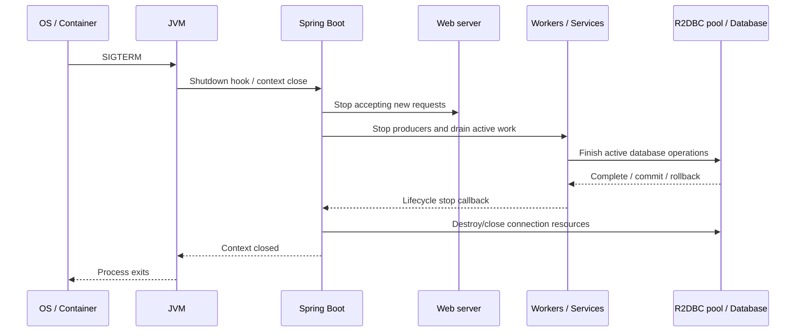

# Đóng ứng dụng có kiểm soát và chờ thao tác đang thực thi

Trong ứng dụng Spring Data Relational R2DBC, một request có thể đang chờ query, đang xử lý nhiều publisher hoặc đang nằm trong transaction khi tiến trình nhận tín hiệu dừng. Nếu ứng dụng tắt ngay lập tức, request có thể bị ngắt giữa chừng, transaction chưa hoàn tất, message chưa được xác nhận hoặc connection chưa được giải phóng đúng cách.

Graceful shutdown (đóng ứng dụng có kiểm soát) là quá trình ngừng nhận công việc mới, cho phép công việc đang chạy hoàn tất trong một khoảng thời gian giới hạn, sau đó đóng các tài nguyên như scheduler, message consumer, connection pool và web server. Trong ứng dụng reactive, cần đặc biệt chú ý subscription, cancellation, Reactor Context và vòng đời connection. Việc trả về `Mono`/`Flux` giúp công việc được quản lý theo publisher; nó không tự bảo đảm mọi thao tác sẽ hoàn tất nếu tiến trình bị buộc dừng hoặc timeout hết hạn.

## 1. Vì sao cần graceful shutdown?

Một ứng dụng đang phục vụ có thể bị dừng do:

- Triển khai phiên bản mới và thay thế instance cũ.
- Container hoặc pod bị scale down.
- Quản trị viên chủ động restart service.
- JVM nhận tín hiệu `SIGTERM`.
- Máy chủ hoặc node cần bảo trì.
- Ứng dụng cần đóng do lỗi hoặc hết tài nguyên.

Nếu dừng ngay, một số tình huống có thể xảy ra:

- Client đã gửi request nhưng chưa nhận response.
- Transaction đã thực hiện một số câu SQL nhưng chưa commit.
- Message đã được lấy khỏi broker nhưng chưa được xử lý/xác nhận.
- Job nền đang ghi dữ liệu và bị hủy giữa chừng.
- Query R2DBC vẫn đang tiêu thụ kết quả khi connection pool bị đóng.
- Một dịch vụ ngoài đã thực hiện side effect nhưng ứng dụng chưa kịp lưu kết quả.

Graceful shutdown giảm khả năng gặp các trạng thái dở dang bằng cách cho ứng dụng một khoảng thời gian để hoàn tất công việc đang thực thi. Nó không tạo ra bảo đảm exactly-once hoặc atomicity giữa nhiều hệ thống; các thao tác quan trọng vẫn cần transaction, idempotency và cơ chế phục hồi phù hợp.

## 2. Mục tiêu của quá trình đóng có kiểm soát

Một quy trình shutdown nên thực hiện theo thứ tự có chủ đích:

1. Báo cho hệ thống điều phối rằng instance sắp ngừng nhận traffic.
2. Ngừng nhận request hoặc công việc mới.
3. Dừng nguồn phát công việc nền như scheduler, poller và message listener.
4. Chờ request, transaction và tác vụ đang chạy hoàn tất trong thời hạn cho phép.
5. Hủy các publisher còn tồn tại khi hết thời hạn và ghi nhận kết quả.
6. Đóng connection pool, client, scheduler và các tài nguyên khác sau khi công việc đã drain.
7. Để JVM kết thúc tiến trình.

Thứ tự cụ thể giữa web server và worker phụ thuộc ứng dụng. Ví dụ, hệ thống có thể ngừng consumer trước để không nhận message mới, đồng thời web server bắt đầu graceful shutdown. Điều quan trọng là không đóng database pool trước khi các thao tác cần database đã được chờ hoặc hủy có kiểm soát.

## 3. Phân biệt shutdown tức thời và graceful shutdown

| Cách dừng | Hành vi | Rủi ro |
| --- | --- | --- |
| Immediate shutdown | Ngừng tiến trình nhanh, không chờ công việc đang chạy | Request/message/job có thể bị gián đoạn |
| Graceful shutdown | Ngừng nhận việc mới, chờ công việc hiện tại trong thời hạn | Có thể vẫn phải hủy việc còn lại khi timeout |
| Forced termination | Hệ điều hành/container kết thúc tiến trình sau deadline | Không có bảo đảm cleanup Java hoặc rollback kịp thời |

Graceful shutdown là cơ chế có giới hạn thời gian. Không nên chờ vô hạn vì một request treo hoặc một publisher không bao giờ hoàn tất có thể giữ tiến trình sống mãi. Khi timeout hết hạn, ứng dụng phải chấp nhận hủy công việc còn lại và dựa vào retry/idempotency để phục hồi.

## 4. Spring Boot graceful shutdown cho web server

Spring Boot hỗ trợ graceful shutdown cho embedded web server. Có thể bật bằng cấu hình:

```yaml
server:
  shutdown: graceful

spring:
  lifecycle:
    timeout-per-shutdown-phase: 30s
```

`server.shutdown: graceful` yêu cầu web server ngừng nhận request mới và cho các request đang xử lý cơ hội hoàn tất. `spring.lifecycle.timeout-per-shutdown-phase` đặt thời gian tối đa cho một shutdown phase do Spring quản lý.

Giá trị `30s` chỉ là ví dụ. Chọn thời hạn dựa trên latency thực tế, loại request, timeout database và giới hạn của môi trường triển khai. Một API đồng bộ ngắn có thể cần ít thời gian hơn một endpoint export lớn; endpoint streaming dài cần một chính sách riêng hoặc không nên được phép giữ vô hạn.

Hỗ trợ và chi tiết dừng server phụ thuộc Spring Boot version và embedded server. Hãy kiểm tra behavior của phiên bản đang dùng, nhất là khi ứng dụng dùng cấu hình server tùy chỉnh, nhiều server port hoặc management server riêng.

## 5. Graceful shutdown không có nghĩa mọi request được bảo đảm hoàn tất

Web server có thể chờ request đang chạy, nhưng request vẫn có thể bị kết thúc khi:

- Shutdown phase hết timeout.
- Container bị buộc dừng trước khi Spring hoàn tất.
- Client đóng kết nối.
- Query hoặc dịch vụ ngoài bị timeout.
- Một publisher phát lỗi.
- Server/driver không thể hoàn tất cleanup trong thời hạn.

Vì vậy, API cần xử lý trường hợp response bị ngắt. Với thao tác ghi quan trọng, client có thể không biết transaction đã commit hay chưa nếu kết nối bị mất đúng lúc response đang được gửi. Dùng idempotency key hoặc business key duy nhất để client có thể retry an toàn và tra cứu kết quả.

## 6. Vòng đời khi Spring nhận tín hiệu dừng

Trong môi trường JVM/container, quy trình phổ biến là:



Đây là sơ đồ khái niệm. Thứ tự thực tế do Spring lifecycle phase, bean dependency, web server và container quyết định. Không giả định mọi bean đều được dừng theo đúng thứ tự trong sơ đồ nếu chưa cấu hình và kiểm thử lifecycle.

Spring quản lý lifecycle của embedded web server và các bean. Khi ứng dụng đóng context, các lifecycle component được yêu cầu dừng theo phase; sau đó bean destruction diễn ra theo quy tắc của container. Các tài nguyên database cần được giữ tới khi công việc phụ thuộc chúng đã hoàn tất.

## 7. Shutdown phase và `SmartLifecycle`

`SmartLifecycle` cho phép bean tham gia quá trình start/stop của Spring context. Nó cung cấp `stop(Runnable callback)` để một thành phần dừng bất đồng bộ và gọi callback khi đã hoàn tất.

Spring lifecycle phase có quy tắc thứ tự: khi start, phase thấp thường được start trước; khi stop, phase cao được dừng trước. Điều này cho phép sắp xếp producer, consumer và tài nguyên phụ thuộc. Tuy nhiên, cần kiểm tra phase của thành phần framework trong phiên bản Spring Boot cụ thể trước khi chọn con số.

Ví dụ một worker coordinator:

```java
public interface DrainableWorker {
    void stopAcceptingNewWork();
    Mono<Void> drainInFlightWork();
}
```

Lifecycle component có thể ngừng nhận việc mới rồi đợi tất cả worker:

```java
@Component
public class WorkerDrainLifecycle implements SmartLifecycle {

    private final List<DrainableWorker> workers;
    private final Duration drainTimeout = Duration.ofSeconds(20);
    private final AtomicBoolean running = new AtomicBoolean(false);

    public WorkerDrainLifecycle(List<DrainableWorker> workers) {
        this.workers = workers;
    }

    @Override
    public void start() {
        running.set(true);
    }

    @Override
    public void stop(Runnable callback) {
        if (!running.compareAndSet(true, false)) {
            callback.run();
            return;
        }

        workers.forEach(DrainableWorker::stopAcceptingNewWork);

        Mono.whenDelayError(workers.stream()
                        .map(DrainableWorker::drainInFlightWork)
                        .toList())
                .timeout(drainTimeout)
                .doOnError(error -> log.error(
                        "Worker drain did not complete cleanly", error))
                .doFinally(signal -> callback.run())
                .subscribe(null, error -> {
                    // The failure has been logged; do not leave it unhandled.
                });
    }

    @Override
    public void stop() {
        stop(() -> { });
    }

    @Override
    public boolean isRunning() {
        return running.get();
    }

    @Override
    public boolean isAutoStartup() {
        return true;
    }

    @Override
    public int getPhase() {
        return 100;
    }
}
```

Đây là khung minh họa; cần bổ sung logger, inject timeout từ cấu hình và chọn phase phù hợp với ứng dụng. Vì `SmartLifecycle.stop(Runnable)` là callback imperative, coordinator phải subscribe đúng một lần vào publisher drain để công việc thực thi rồi gọi callback khi hoàn tất, lỗi hoặc timeout. Đây là một ranh giới lifecycle được quản lý; không áp dụng cách subscribe rời rạc này cho business service.

`Mono.whenDelayError` đợi các publisher hoàn tất và tổng hợp lỗi thay vì dừng ngay khi một worker lỗi. `.timeout(...)` giới hạn thời gian chờ. Khi timeout xảy ra, upstream có thể nhận cancellation; worker cần xử lý tín hiệu đó và cleanup tài nguyên của mình.

## 8. Chọn phase đúng cho worker và database resources

Giả sử ứng dụng có:

- HTTP server nhận request.
- Message consumer tạo công việc ghi database.
- Scheduler chạy job định kỳ.
- R2DBC connection pool phục vụ repository.

Một thứ tự hợp lý thường là:

1. Ngừng các producer tạo việc mới (scheduler, poller, message listener) theo chính sách của ứng dụng.
2. Web server ngừng nhận request mới và drain request đang chạy.
3. Chờ các consumer/job/request hiện tại hoàn tất hoặc đạt deadline.
4. Đóng các tài nguyên mà các publisher đó sử dụng, bao gồm pool R2DBC.

Web server graceful shutdown có lifecycle phase do Spring Boot quản lý. Không chọn phase của worker bằng cách đoán. Kiểm tra phase và behavior của phiên bản Spring Boot, rồi kiểm thử rằng worker dừng ở đúng thời điểm. Nếu nhiều thành phần phụ thuộc nhau, có thể gom chúng vào một coordinator để thứ tự rõ ràng hơn.

Connection pool phải sống đủ lâu để các thao tác đang chạy commit/rollback và release connection. Nếu pool bị dispose trước khi request drain xong, các thao tác có thể lỗi vì không còn lấy được connection hoặc connection đang dùng bị đóng.

## 9. Dừng nhận công việc mới trước khi chờ công việc đang chạy

Chỉ đợi các publisher hiện tại hoàn tất là chưa đủ nếu một scheduler hoặc consumer vẫn tiếp tục tạo publisher mới. Một thành phần cần hai khả năng:

- **Stop admission:** từ chối hoặc không tạo thêm công việc mới.
- **Drain:** đợi các công việc đã nhận hoàn tất.

Ví dụ interface:

```java
public interface DrainableWorker {
    void stopAcceptingNewWork();
    Mono<Void> drainInFlightWork();
}
```

`stopAcceptingNewWork()` cần idempotent vì lifecycle có thể gọi stop nhiều lần hoặc nhiều tín hiệu dừng đến gần nhau. `drainInFlightWork()` nên hoàn tất khi số tác vụ đang chạy về 0 và không còn tác vụ mới được nhận.

Không tạo một `Mono` chờ số lượng active tasks rồi bỏ qua việc đóng admission. Nếu vẫn nhận công việc mới, điều kiện drain có thể không bao giờ đạt được.

## 10. Đếm công việc đang chạy cho worker tự quản lý

Với một worker tự viết, có thể theo dõi số công việc đã nhận nhưng chưa kết thúc. Ví dụ khái niệm:

```java
public final class ActiveWorkTracker {

    private final AtomicInteger active = new AtomicInteger();
    private final AtomicBoolean accepting = new AtomicBoolean(true);
    private final Sinks.One<Void> drained = Sinks.one();

    public <T> Mono<T> track(Mono<T> work) {
        return Mono.defer(() -> {
            if (!accepting.get()) {
                return Mono.error(new RejectedExecutionException(
                        "Application is shutting down"));
            }

            active.incrementAndGet();

            return work.doFinally(signal -> {
                if (active.decrementAndGet() == 0 && !accepting.get()) {
                    drained.tryEmitEmpty();
                }
            });
        });
    }

    public void stopAccepting() {
        accepting.set(false);
        if (active.get() == 0) {
            drained.tryEmitEmpty();
        }
    }

    public Mono<Void> drain() {
        return drained.asMono();
    }
}
```

Đoạn code minh họa nguyên tắc chứ chưa phải một implementation tổng quát an toàn cho mọi race. Trong triển khai thực tế, thao tác kiểm tra `accepting` và tăng `active` phải được đồng bộ nguyên tử để tránh tình huống shutdown chuyển sang trạng thái ngừng nhận việc ngay sau khi worker kiểm tra nhưng trước khi worker đăng ký tác vụ. Có thể dùng lock ngắn, atomic state machine hoặc một admission gate có sẵn trong thư viện.

Một tracker cần bảo đảm:

- Mỗi công việc chỉ tăng active count một lần cho mỗi subscription.
- `doFinally` giảm count trên complete, error và cancel.
- Stop admission và đăng ký công việc không thể race tạo một công việc lọt qua sau khi drain bắt đầu.
- Drain chỉ hoàn tất khi admission đã đóng và active count bằng 0.
- Timeout được quản lý ở coordinator, không chờ vô hạn.

Nếu worker dùng message listener hoặc scheduler framework, ưu tiên API pause/stop/drain có sẵn thay vì tự xây tracker.

## 11. Dùng `Mono.defer` để đếm theo subscription

Publisher reactive thường lazy và có thể được subscribe nhiều lần. Nếu tăng active count khi gọi method thay vì khi subscribe, tracker có thể đếm một publisher chưa bao giờ chạy hoặc đếm sai khi publisher được dùng lại.

`Mono.defer` cho phép đăng ký công việc ngay khi subscription bắt đầu:

```java
public Mono<Result> execute(Command command) {
    return Mono.defer(() -> {
        Admission admission = tracker.tryEnter();
        if (admission == null) {
            return Mono.error(new RejectedExecutionException("Stopping"));
        }

        return performReactiveWork(command)
                .doFinally(signal -> admission.close());
    });
}
```

`Admission` là handle đảm bảo decrement đúng một lần, kể cả khi publisher complete, error hoặc cancel. Việc tạo handle trong `defer` gắn lifecycle với từng subscription. Nếu có retry, mỗi lần subscribe lại cần được tính như một lần thực thi mới và phải giữ nguyên idempotency key nghiệp vụ khi phù hợp.

## 12. WebFlux graceful shutdown và request đang chạy

Với ứng dụng WebFlux, controller trả `Mono`/`Flux` và web server quản lý subscription theo vòng đời HTTP exchange. Khi graceful shutdown bắt đầu, server ngừng nhận request mới và chờ các exchange hiện tại trong thời hạn cấu hình.

Ví dụ controller:

```java
@RestController
@RequestMapping("/orders")
public class OrderController {

    private final OrderService orderService;

    @PostMapping
    public Mono<OrderResponse> create(@RequestBody CreateOrderRequest request) {
        return orderService.create(request);
    }
}
```

Nếu service trả publisher đúng cách, WebFlux có thể theo dõi publisher như một phần của HTTP exchange. Không gọi `subscribe()` trong controller/service rồi trả response trước khi thao tác hoàn tất; server sẽ không còn biết công việc phụ cần được chờ.

Một request bị client hủy hoặc server buộc kết thúc sau timeout có thể làm publisher nhận cancellation. Transaction reactive có thể rollback khi publisher bị hủy theo semantics transaction manager, nhưng driver/database có thể cần thời gian để hủy statement và cleanup. Hãy kiểm thử behavior thực tế.

## 13. Không dùng `@PreDestroy` để chờ publisher bằng cách tùy tiện

`@PreDestroy` là callback đồng bộ. Nó phù hợp với thao tác cleanup đồng bộ ngắn, nhưng không tự hiểu cách subscribe và chờ một `Mono`:

```java
@PreDestroy
void shutdown() {
    worker.stopAndDrain(); // Trả Mono nhưng không subscribe: không chạy.
}
```

Nếu gọi `.block()` trong `@PreDestroy`, có thể chờ được publisher nhưng cần thận trọng: callback đang chạy trên thread lifecycle, timeout phải rõ ràng và tuyệt đối không block event loop. Cách này cũng khó phối hợp với thứ tự lifecycle nhiều bean.

Với tác vụ reactive cần chờ, `SmartLifecycle.stop(Runnable)` thường phù hợp hơn vì callback cho phép thành phần báo hoàn tất bất đồng bộ. Nếu dùng `@PreDestroy` cho resource đồng bộ, không để nó trở thành nơi duy nhất điều phối drain các request hoặc worker.

## 14. Dừng scheduler và job định kỳ

Một scheduler tiếp tục kích hoạt job trong lúc shutdown sẽ liên tục tạo công việc mới, làm drain không bao giờ kết thúc. Hãy dừng trigger trước rồi đợi các lần chạy đã bắt đầu.

Với `@Scheduled`, Spring quản lý scheduler theo lifecycle của application context. Nếu job cần một trình tự drain riêng, có thể dùng một scheduler được quản lý bởi bean lifecycle hoặc một worker coordinator để:

1. Ngăn lần trigger mới.
2. Theo dõi subscription của các lần chạy đang hoạt động.
3. Chờ các lần chạy hiện tại complete/error/cancel.
4. Sau đó đóng scheduler và tài nguyên job sử dụng.

Reactive `@Scheduled` methods có semantics riêng theo phiên bản Spring Framework: publisher được tạo và subscribe theo từng lần trigger; cần đọc tài liệu của phiên bản đang dùng để hiểu cancellation và shutdown. Không giả định chỉ vì method trả `Mono` mà mọi job đang chạy sẽ tự động drain vô hạn.

Ví dụ job trả publisher:

```java
@Scheduled(fixedDelayString = "PT30S")
public Mono<Void> refreshReferenceData() {
    return refreshService.refresh();
}
```

Đừng tự gọi `subscribe()` bên trong method scheduled. Hãy trả publisher cho scheduler quản lý. Nếu cần bảo đảm job không chạy đồng thời hoặc có cơ chế drain riêng, cấu hình scheduler và tracking phù hợp.

## 15. Dừng message consumer trước khi đóng database pool

Message consumer thường lấy message, xử lý bằng R2DBC rồi acknowledge. Khi shutdown:

1. Pause hoặc stop consumer để broker không giao thêm message mới cho instance.
2. Chờ message đã nhận được xử lý và commit transaction.
3. Chỉ acknowledge theo semantics của broker sau khi công việc bền vững hoàn tất.
4. Nếu deadline hết trước khi xử lý xong, để message được redeliver theo chính sách broker.
5. Đóng connection pool sau khi consumer đã dừng và các handler đã drain.

Không acknowledge message trước khi transaction database commit nếu muốn broker có thể redeliver khi ứng dụng chết giữa chừng. Ngược lại, nếu database commit xong nhưng acknowledgement bị mất, broker có thể gửi lại message; handler cần idempotent bằng event ID hoặc business key duy nhất.

API pause/stop của Kafka, RabbitMQ hoặc broker khác khác nhau. Dùng lifecycle hook của framework integration đang sử dụng và kiểm tra timeout/ack behavior theo phiên bản. Không giả định `SmartLifecycle` của ứng dụng tự dừng mọi listener theo cùng một thứ tự nếu có custom container factory.

## 16. Chờ transaction R2DBC hoàn tất

Một reactive transaction hoàn tất khi publisher nằm trong transaction boundary phát terminal signal và transaction manager xử lý commit/rollback. Ví dụ:

```java
public Mono<Order> createOrder(Order order) {
    return transactionalOperator.transactional(
            orderRepository.save(order)
                    .flatMap(saved -> auditRepository.save(
                                    AuditEntry.created(saved.getId()))
                            .thenReturn(saved))
    );
}
```

Publisher bao gồm cả lưu order và audit. Khi shutdown bắt đầu, nếu request vẫn được cho chạy, transaction có cơ hội hoàn tất. Không tách audit bằng `subscribe()` vì khi đó lifecycle của request không đại diện cho toàn bộ công việc.

Nếu publisher hoàn tất bình thường, transaction thường commit. Nếu publisher phát lỗi hoặc bị hủy, transaction manager có thể rollback theo semantics reactive transaction. Tuy nhiên, lỗi kết nối xảy ra đúng lúc commit có thể tạo kết quả không xác định từ góc nhìn ứng dụng: database có thể đã commit nhưng response chưa được nhận. Với thao tác quan trọng, dùng idempotency để client retry và tra cứu trạng thái.

## 17. Không đóng R2DBC pool quá sớm

R2DBC connection pool là tài nguyên dùng chung. Nếu pool bị đóng khi request hoặc worker còn cần connection, các thao tác mới có thể thất bại và connection đang dùng có thể bị ảnh hưởng tùy implementation.

Trình tự hợp lý:

- Ngừng admission của request/worker.
- Chờ publisher và transaction đang chạy hoàn tất hoặc hết deadline.
- Đảm bảo các connection đã được release theo lifecycle Spring/driver.
- Sau đó mới dispose pool hoặc đóng resource tùy chỉnh.

Với pool do Spring Boot auto-configure và quản lý như bean, để Spring container xử lý destruction theo lifecycle đã cấu hình. Không tự gọi dispose từ một service tùy ý trong lúc ứng dụng vẫn nhận traffic.

Nếu ứng dụng tự tạo `ConnectionPool` qua R2DBC Pool, cần tích hợp việc dispose vào bean lifecycle phù hợp. R2DBC Pool cung cấp API dispose tương ứng với phiên bản; một số phiên bản có publisher `disposeLater()` để chờ cleanup bất đồng bộ. Hãy kiểm tra API của dependency đang dùng và gọi đúng một lần sau khi công việc đã drain. Không giả định mọi `ConnectionFactory` đều có API dispose vì SPI cơ bản không yêu cầu mọi factory phải đóng như pool.

## 18. Đóng tài nguyên theo thứ tự phụ thuộc

Các tài nguyên có thể phụ thuộc lẫn nhau:

| Thành phần | Cần dừng khi nào? |
| --- | --- |
| Scheduler/producer | Sớm, để không tạo việc mới |
| Message listener/poller | Ngừng nhận message mới trước khi drain handler |
| HTTP server | Ngừng nhận request mới, drain exchange đang chạy |
| Business worker | Chờ tác vụ đã nhận hoàn tất |
| R2DBC repository/template | Không cần đóng riêng nếu Spring quản lý; cần còn hoạt động trong thời gian drain |
| R2DBC pool/ConnectionFactory tùy chỉnh | Sau khi các thao tác database phụ thuộc đã hoàn tất |
| HTTP client/broker client | Sau khi worker/request không còn dùng chúng |
| Scheduler/event loop tùy chỉnh | Sau khi mọi publisher phụ thuộc đã kết thúc |

Không chỉ dựa vào thứ tự khai báo bean. Dùng dependency/lifecycle phase và integration test để chứng minh resource chưa bị đóng khi publisher còn hoạt động.

## 19. Timeout cho shutdown và timeout cho thao tác

Shutdown timeout, request timeout, query timeout, transaction timeout và pool acquire timeout là các giới hạn khác nhau:

| Timeout | Giới hạn điều gì? |
| --- | --- |
| Request timeout | Thời gian server cho một HTTP request |
| Query/statement timeout | Thời gian thực thi một câu SQL theo driver/database |
| Transaction timeout | Thời gian transaction theo khả năng manager/driver |
| Pool acquire timeout | Thời gian chờ lấy connection |
| Shutdown phase timeout | Thời gian Spring chờ một lifecycle phase dừng |
| Container termination grace period | Tổng thời gian nền tảng cho tiến trình kết thúc trước forced kill |

Không đặt mọi timeout bằng cùng một giá trị một cách máy móc. Ví dụ, shutdown timeout phải đủ dài cho các request được phép hoàn tất nhưng vẫn ngắn hơn thời gian container cho phép kết thúc, có tính cả `preStop` và thời gian JVM cleanup.

Nếu request timeout lớn hơn shutdown deadline, một request hợp lệ vẫn có thể bị hủy khi instance hết thời gian dừng. Nếu cần xử lý dài, chuyển sang job bất đồng bộ có trạng thái bền vững thay vì giữ một HTTP request trong nhiều phút.

## 20. Cấu hình trong Kubernetes

Kubernetes gửi tín hiệu dừng tới container khi pod bị xóa hoặc thay thế, rồi chờ trong `terminationGracePeriodSeconds` trước khi gửi tín hiệu kill mạnh. Có thể cấu hình thời gian chờ đủ lớn:

```yaml
spec:
  terminationGracePeriodSeconds: 45
  containers:
    - name: application
      image: example/order-service:latest
```

Giá trị 45 giây chỉ là ví dụ. Tổng thời gian cần tính gồm:

- Thời gian `preStop` hook nếu có.
- Thời gian endpoint bị loại khỏi traffic/load balancer.
- Spring Boot graceful web server shutdown.
- Dừng consumer và scheduler.
- Drain request/transaction/job.
- Đóng resource và JVM.

Nếu Spring Boot cần 30 giây để drain nhưng Kubernetes chỉ cho 20 giây, container có thể bị kill trước khi Spring hoàn tất. Ngược lại, đặt grace period quá dài có thể làm deployment/scale down kéo dài không cần thiết.

## 21. Readiness và việc ngừng nhận traffic

Khi instance sắp shutdown, cần ngừng đưa request mới tới nó. Trong Kubernetes, readiness probe và endpoint routing giúp loại pod khỏi service endpoints. Tuy nhiên, việc cập nhật endpoint và propagation qua proxy có thể có độ trễ; không nên giả định mọi load balancer ngừng gửi traffic ngay đúng thời điểm SIGTERM.

Spring Boot Actuator có application availability state. Ứng dụng có thể chuyển readiness sang `REFUSING_TRAFFIC` khi bắt đầu dừng nếu cần điều khiển rõ ràng:

```java
AvailabilityChangeEvent.publish(
        applicationContext,
        ReadinessState.REFUSING_TRAFFIC);
```

Ví dụ cần import API availability tương ứng và có `ApplicationContext`. Spring Boot cũng quản lý trạng thái readiness trong lifecycle shutdown theo phiên bản; hãy kiểm tra behavior hiện tại trước khi thêm cơ chế thủ công để tránh phát event trùng hoặc quá muộn.

Readiness chỉ ảnh hưởng tới hệ thống kiểm tra và định tuyến traffic. Nó không tự dừng scheduler, message listener hoặc publisher đang chạy. Các nguồn công việc nền cần được dừng riêng.

## 22. `preStop` hook và thời gian drain

Kubernetes `preStop` hook có thể gọi endpoint nội bộ hoặc chạy một lệnh trước khi container nhận tín hiệu dừng theo lifecycle. Hook này thường được dùng để báo ứng dụng ngừng nhận traffic hoặc chờ load balancer cập nhật endpoints.

Nếu dùng `preStop`, thời gian hook chạy được tính vào `terminationGracePeriodSeconds`. Đừng cấu hình hook chờ 30 giây rồi kỳ vọng Spring vẫn có thêm toàn bộ 45 giây để drain nếu grace period tổng chỉ 45 giây.

Không dùng `preStop` như cơ chế duy nhất để drain transaction. Ứng dụng vẫn cần graceful shutdown nội bộ và deadline rõ ràng. Endpoint điều khiển shutdown, nếu có, phải được bảo vệ và chỉ cho phép nền tảng/identity vận hành gọi.

## 23. Shutdown trong ứng dụng không có web server

Một ứng dụng R2DBC có thể chỉ chạy consumer hoặc scheduler, không có HTTP server. Khi đó `server.shutdown` không có tác dụng cho công việc nền.

Ứng dụng cần lifecycle component để:

1. Ngừng poll/consume công việc mới.
2. Đợi handler hiện tại hoàn tất.
3. Commit transaction và ack message theo đúng thứ tự.
4. Khi deadline hết, hủy handler còn lại và để broker redeliver nếu có thể.
5. Đóng pool sau khi consumer đã dừng.

`SmartLifecycle` phù hợp để tích hợp thành phần này vào Spring context. Các thư viện broker thường có container lifecycle riêng; hãy dùng API của container để pause/stop và đợi active listener hoàn tất.

## 24. Xử lý công việc chưa hoàn tất khi timeout

Khi deadline hết, không phải công việc nào cũng có thể hoàn tất. Hãy xác định behavior theo loại công việc:

| Loại công việc | Hành vi khi hết deadline |
| --- | --- |
| HTTP read request | Hủy publisher, đóng response; client có thể retry |
| HTTP write request | Có thể không rõ commit đã xảy ra chưa; dùng idempotency/business key |
| R2DBC transaction chưa commit | Transaction manager/driver cố rollback khi cancellation/close; xác minh behavior thực tế |
| Message chưa ack | Để broker redeliver theo semantics của nó; handler cần idempotent |
| Job nền có checkpoint | Lưu checkpoint bền vững rồi resume ở instance khác |
| Gọi payment/provider | Tra cứu trạng thái bằng provider reference/idempotency key trước khi retry |
| Export stream | Kết thúc kết nối; client tiếp tục từ cursor/checkpoint nếu API hỗ trợ |

Không ghi nhận một job là hoàn tất chỉ vì subscription đã bị cancel. Cần trạng thái bền vững phân biệt `COMPLETED`, `FAILED`, `CANCELLED` và `UNKNOWN` nếu nghiệp vụ yêu cầu đối soát.

## 25. Idempotency khi client retry sau shutdown

Một trường hợp quan trọng: database đã commit nhưng ứng dụng bị dừng trước khi response đến client. Client thấy lỗi mạng và gửi lại request. Nếu server tạo một thao tác mới, dữ liệu có thể bị trùng.

Với thao tác ghi có side effect, dùng idempotency key ổn định:

```http
POST /orders
Idempotency-Key: 0f2a8a5e-6f2e-4b1b-8e3f-3d44f2d6d0d1
```

Server lưu key cùng request hash và kết quả nghiệp vụ trong cùng transaction với order. Retry cùng key và payload nhận lại kết quả đã lưu. Nếu cùng key nhưng payload khác, trả lỗi xung đột.

Graceful shutdown giảm số request bị ngắt nhưng không loại bỏ trạng thái kết quả không xác định ở ranh giới commit/response. Idempotency giúp hệ thống phục hồi an toàn sau restart, timeout hoặc network failure.

## 26. Không tự gọi `System.exit()` trong lifecycle thông thường

`System.exit()` kết thúc JVM và có thể bỏ qua quá trình đóng Spring context theo cách ứng dụng mong muốn nếu gọi từ business code. Không dùng nó như cách dừng một worker hoặc kết thúc request.

Để dừng ứng dụng có kiểm soát, hãy để Spring Boot nhận tín hiệu shutdown từ JVM/container và đóng `ApplicationContext`, hoặc dùng cơ chế đóng context có chủ đích trong ứng dụng quản trị. Để JVM shutdown hook của Spring thực hiện lifecycle orchestration.

`Runtime.halt()` còn mạnh hơn và bỏ qua shutdown hook; chỉ có thể được dùng trong tình huống vận hành rất đặc biệt, không phải đường đi bình thường của ứng dụng.

## 27. Logging và metric trong shutdown

Shutdown nên có log/metric đủ để biết ứng dụng đã drain tới đâu:

- Thời điểm bắt đầu shutdown và nguồn tín hiệu.
- Readiness chuyển sang refusing traffic.
- Số request đang chạy khi bắt đầu drain (nếu có tracking).
- Số job/message đang xử lý.
- Số worker đã dừng nhận việc mới.
- Thời gian drain từng thành phần.
- Số publisher hoàn tất, lỗi hoặc bị cancel.
- Số transaction commit/rollback trong giai đoạn shutdown nếu đo được.
- Pool acquired/pending trước khi đóng.
- Thành phần nào timeout và phải force stop.
- Thời điểm ApplicationContext đóng xong.

Log cần có correlation ID hoặc worker name để hỗ trợ điều tra. Không log payload nhạy cảm, access token, password hoặc toàn bộ SQL bind values.

Metric nên có tag cardinality thấp như `component`, `outcome` và `phase`. Không gắn request ID, user ID hoặc message ID làm metric tag.

## 28. Kiểm thử graceful shutdown

Test unit của service không đủ để chứng minh toàn bộ ứng dụng shutdown đúng. Cần kiểm thử lifecycle và ít nhất một kịch bản với database/driver thật.

Các kịch bản nên có:

1. Gửi request ngắn rồi trigger shutdown: response hoàn tất bình thường.
2. Gửi request có query R2DBC đang chạy: server chờ request trong thời hạn cấu hình.
3. Bắt đầu transaction nhiều câu SQL rồi trigger shutdown: transaction được commit nếu publisher hoàn tất trong deadline.
4. Làm publisher phát lỗi: transaction rollback và lỗi được ghi nhận.
5. Client disconnect: subscription bị cancel và connection được cleanup theo driver.
6. Job định kỳ đang chạy: không có lần trigger mới sau khi admission đóng; job hiện tại được drain.
7. Message consumer đang xử lý: consumer dừng nhận message mới, handler hoàn tất hoặc message được redeliver.
8. Một worker không bao giờ hoàn tất: timeout kích hoạt và shutdown vẫn tiến triển.
9. Pool chỉ được đóng sau khi publisher phụ thuộc đã kết thúc.
10. Retry request sau shutdown bằng cùng idempotency key không tạo dữ liệu trùng.

Test end-to-end có thể khởi động ứng dụng trên port ngẫu nhiên, gửi request có thời gian điều khiển, phát tín hiệu đóng context hoặc dừng process con bằng `SIGTERM`, rồi xác minh response/log/database. Với test process-level, đặt timeout để tránh suite bị treo.

## 29. Ví dụ kiểm thử request đang chạy

Có thể tạo một endpoint test trả publisher chậm có kiểm soát:

```java
@GetMapping("/slow")
public Mono<String> slow() {
    return Mono.delay(Duration.ofSeconds(2))
            .thenReturn("finished");
}
```

Kịch bản kiểm thử:

1. Gửi request tới `/slow`.
2. Đợi server bắt đầu xử lý request.
3. Trigger graceful shutdown.
4. Xác minh request hoàn tất nếu thời gian còn lại đủ.
5. Xác minh server không nhận request mới.

Đây là ví dụ kiểm tra web lifecycle, không kiểm tra transaction database. Để kiểm tra R2DBC, endpoint/service cần thực hiện query/transaction thực tế và test cần xác minh commit/rollback cùng connection cleanup.

## 30. Kiểm thử worker drain

Với worker tự quản lý, có thể dùng `Sinks.One` trong test để điều khiển thời điểm công việc hoàn tất:

```java
Sinks.One<Void> workGate = Sinks.one();

Mono<Void> activeWork = workGate.asMono();

worker.startWork(activeWork);
worker.stopAcceptingNewWork();

StepVerifier.create(worker.drainInFlightWork())
        .then(() -> workGate.tryEmitEmpty())
        .verifyComplete();
```

Đoạn này minh họa ý tưởng: drain không hoàn tất trước khi công việc đang chạy kết thúc. Implementation thực tế cần có admission gate và tracker đáng tin cậy; test nên kiểm tra cả race giữa `startWork` và `stopAcceptingNewWork`.

## 31. Kiểm thử transaction R2DBC trong shutdown

Một integration test có thể dùng `TransactionalOperator` và publisher được điều khiển để xác minh transaction còn hoạt động trong khi drain:

```java
Mono<Void> writeAndWait = transactionalOperator.transactional(
        repository.save(entity)
                .then(workGate.asMono()));
```

Khi `workGate` hoàn tất trước shutdown deadline, transaction có thể commit. Nếu gate không hoàn tất và shutdown timeout dẫn tới cancellation, transaction manager/driver có thể rollback. Hãy kiểm tra database sau khi transaction boundary kết thúc; không chỉ assert publisher bị cancel.

Không dùng một gate test để giữ transaction lâu trong production. Đây là công cụ kiểm soát thời gian trong integration test nhằm xác minh lifecycle.

## 32. Các lỗi thường gặp

| Lỗi | Hậu quả | Cách xử lý |
| --- | --- | --- |
| Không bật graceful shutdown cho web server | Request đang chạy có thể bị ngắt ngay khi server dừng | Cấu hình `server.shutdown=graceful` và timeout phù hợp |
| Shutdown timeout lớn hơn container grace period | Container bị kill trước khi Spring drain xong | Tính tổng thời gian và đặt deadline nhất quán |
| Chờ worker nhưng vẫn nhận việc mới | Drain có thể không bao giờ kết thúc | Đóng admission trước rồi mới chờ active work |
| Đóng R2DBC pool quá sớm | Query/transaction đang chạy bị lỗi | Drain request/worker trước khi dispose pool |
| Gọi `subscribe()` rời rạc trong service | Lifecycle không biết công việc phụ còn chạy | Trả và nối publisher trong cùng reactive chain |
| Trả `Mono` trong `@PreDestroy` nhưng không subscribe | Cleanup reactive không chạy | Dùng `SmartLifecycle.stop(Runnable)` hoặc cơ chế lifecycle async |
| Dùng `block()` tùy tiện trong shutdown | Có thể chặn event loop hoặc vượt deadline | Điều phối async, đặt timeout và block chỉ ở biên imperative được kiểm soát nếu thật sự cần |
| Không dừng scheduler/consumer | Công việc mới tiếp tục xuất hiện khi shutdown | Pause producer/listener trước drain |
| Ack message trước commit | Message có thể mất khi database chưa ghi bền vững | Ack sau commit; xử lý duplicate bằng idempotency |
| Giả định cancellation luôn rollback ngay lập tức | Driver/database có thể cleanup trễ hoặc commit outcome không rõ | Kiểm thử driver thật và dùng idempotency/đối soát |
| Giữ transaction trong HTTP call hoặc SSE dài | Connection pool bị chiếm lâu | Transaction ngắn, outbox/saga hoặc job nền |
| Dùng `System.exit()` trong business service | Bỏ qua lifecycle orchestration mong muốn | Để Spring context/JVM shutdown hook quản lý |
| Chỉ kiểm thử unit, không trigger shutdown thật | Không phát hiện thứ tự lifecycle và timeout sai | Integration/process-level test với SIGTERM |

## 33. Quy trình thiết kế graceful shutdown cho ứng dụng R2DBC

Khi triển khai đóng có kiểm soát, hãy thực hiện theo thứ tự:

1. Liệt kê nguồn công việc: HTTP, scheduler, message listener, poller và worker nội bộ.
2. Xác định tài nguyên mỗi nguồn dùng: R2DBC pool, HTTP client, broker client, scheduler.
3. Bật graceful shutdown cho web server và cấu hình shutdown phase timeout.
4. Thiết kế readiness/admission để instance không nhận việc mới.
5. Dừng producer, scheduler và consumer theo lifecycle API phù hợp.
6. Theo dõi và drain request/job/message đang hoạt động.
7. Giữ connection pool sống tới khi các transaction/publisher phụ thuộc đã hoàn tất hoặc deadline hết.
8. Khi timeout, hủy công việc còn lại, ghi nhận trạng thái và để broker/client retry theo chính sách.
9. Đóng resource theo dependency order; dùng lifecycle async cho cleanup reactive.
10. Tính shutdown timeout cùng container grace period, `preStop`, request timeout và query timeout.
11. Kiểm thử commit, rollback, cancellation, redelivery, idempotency và pool cleanup.
12. Theo dõi log/metric để biết shutdown hoàn tất hay bị force stop.

## 34. Nguyên tắc thực hành

- Ngừng nhận công việc mới trước khi chờ công việc hiện tại hoàn tất.
- Bật `server.shutdown=graceful` cho ứng dụng Spring Boot có web server.
- Cấu hình `spring.lifecycle.timeout-per-shutdown-phase` và đồng bộ với container termination grace period.
- Dùng `SmartLifecycle.stop(Runnable)` cho thành phần cần drain bất đồng bộ.
- Kiểm tra lifecycle phase của framework trước khi chọn phase cho worker.
- Đếm công việc theo subscription và giảm active count trên complete, error hoặc cancel.
- Dừng scheduler, poller và message listener trước khi đóng tài nguyên chúng sử dụng.
- Đợi transaction R2DBC hoàn tất trước khi dispose connection pool.
- Không gọi `subscribe()` rời rạc trong business service; trả publisher cho caller/framework quản lý.
- Không dùng `@PreDestroy` để bỏ qua reactive lifecycle; tránh `block()` trên event loop.
- Ack message sau khi transaction commit và làm handler idempotent cho redelivery.
- Chấp nhận rằng timeout có thể buộc hủy publisher; dùng idempotency/checkpoint để phục hồi.
- Không giữ transaction trong lúc chờ user, HTTP call hoặc stream vô hạn.
- Không dựa vào `System.exit()` để điều phối shutdown thông thường.
- Kiểm thử shutdown thật, timeout, cancellation, rollback và connection cleanup trên driver/database tương thích production.

## 35. Kết luận

Đóng ứng dụng có kiểm soát trong Spring Data Relational R2DBC là một quy trình lifecycle có thứ tự: ngừng nhận công việc mới, drain request và worker đang chạy, cho transaction reactive cơ hội commit/rollback, rồi mới đóng connection pool và các tài nguyên phụ thuộc. Spring Boot hỗ trợ graceful shutdown cho embedded web server qua `server.shutdown=graceful`; `SmartLifecycle.stop(Runnable)` cho phép các worker reactive báo hoàn tất bất đồng bộ.

Graceful shutdown luôn có deadline. Khi deadline hết, publisher có thể bị cancel và kết quả của một thao tác ghi có thể không rõ ở ranh giới commit/response. Vì vậy, ứng dụng vẫn cần timeout hợp lý, idempotency, message redelivery an toàn và checkpoint/compensation cho công việc dài. Kiểm thử với tín hiệu dừng thật, R2DBC driver và database mục tiêu sẽ giúp xác nhận rằng request được drain, transaction được xử lý đúng và pool chỉ đóng sau khi các thao tác đang chạy không còn phụ thuộc vào nó.
