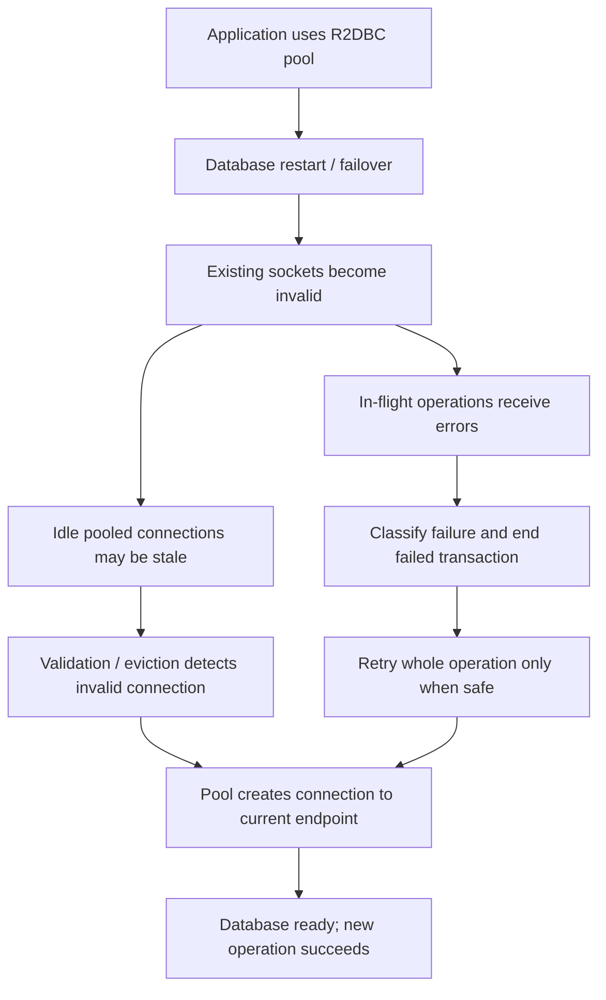
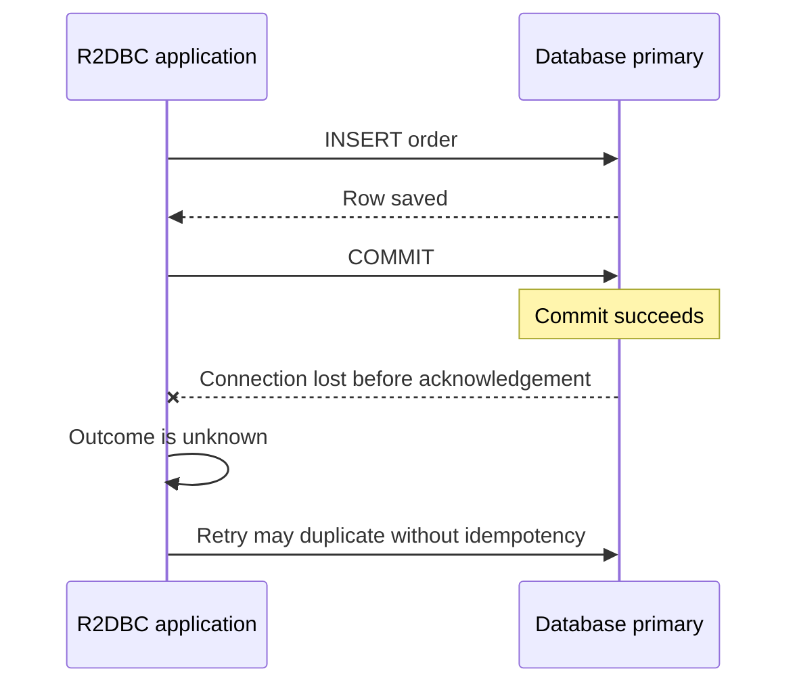
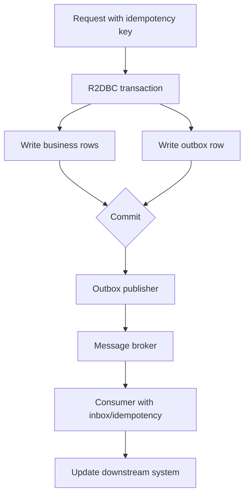

# Xử lý cơ sở dữ liệu khởi động lại hoặc chuyển vai trò

Một ứng dụng Spring Data R2DBC có thể đang xử lý request bình thường thì database khởi động lại, node primary bị lỗi, cluster promote một replica thành primary hoặc endpoint kết nối chuyển sang máy chủ mới. Trong những thời điểm đó, các TCP connection đang mở có thể bị đóng, connection pool có thể giữ connection không còn dùng được, request đang chạy có thể nhận lỗi giữa chừng và transaction có thể ở trạng thái không xác định đối với client.

R2DBC không làm cho kết nối database tự phục hồi một cách trong suốt. Driver và pool quản lý connection, nhưng một thao tác đang chạy vẫn có thể thất bại khi server dừng hoặc đổi vai trò. Ứng dụng cần phân biệt lỗi tạm thời với lỗi nghiệp vụ, bỏ connection hỏng, tạo connection mới qua endpoint hiện tại, retry có giới hạn ở đúng transaction boundary và bảo vệ thao tác ghi bằng idempotency khi không biết commit đã xảy ra hay chưa.

## 1. Những sự kiện nào có thể xảy ra?

“Database restart” và “failover” thường được dùng chung trong hội thoại, nhưng chúng có các failure mode khác nhau:

| Sự kiện | Điều gì xảy ra? | Tác động thường gặp với R2DBC |
|---|---|---|
| Restart database có kế hoạch | Server dừng rồi khởi động lại cùng node | Connection hiện tại bị đóng; request đang chạy có thể lỗi; kết nối mới chỉ thành công khi server sẵn sàng |
| Crash/restart bất ngờ | Process hoặc host dừng đột ngột | Socket reset/timeout, transaction bị ngắt, kết quả commit có thể không xác định |
| Primary failover | Replica/standby được promote thành primary | Connection tới primary cũ mất; endpoint writer có thể đổi IP/host; transaction đang chạy bị lỗi |
| Switchover có kế hoạch | Vai trò primary được chuyển có kiểm soát | Có thể có cửa sổ gián đoạn ngắn; connection cũ cần được thay thế |
| Network partition | Ứng dụng không tới được database nhưng server vẫn chạy | Connection timeout, pool acquire/create thất bại, trạng thái transaction không rõ |
| DNS/endpoint đổi | Endpoint logic trỏ tới node mới | Connection đã mở vẫn gắn với node cũ; connection mới cần phân giải endpoint mới |
| Database chỉ chuyển sang read-only | Node còn hoạt động nhưng không nhận ghi | Read có thể tiếp tục; write nhận lỗi quyền/role hoặc lỗi chỉ đọc |
| Replica lag hoặc replica chưa sẵn sàng | Node mới chưa bắt kịp dữ liệu | Read từ replica có thể trả dữ liệu cũ; không nên dùng replica như writer trước khi promote hoàn tất |

Ứng dụng nên xem đây là những tình huống riêng trong thiết kế vận hành. Retry một lỗi network tạm thời có thể hợp lý; retry một lỗi quyền hoặc SQL sai thường không có ích. Đọc từ replica sau failover cũng có semantics khác ghi vào primary.

## 2. Vòng đời connection khi database khởi động lại

Một R2DBC connection đại diện cho một session vật lý tới database. Connection pool giữ và tái sử dụng các session đó để tránh tạo kết nối mới cho từng query.

Khi database restart:

1. Database ngừng nhận hoặc đóng các session hiện tại.
2. Socket của connection pool có thể nhận FIN/RST, lỗi I/O hoặc chỉ phát hiện mất kết nối khi thao tác tiếp theo được gửi.
3. Connection đang được request sử dụng có thể phát lỗi.
4. Connection đã idle trong pool có thể trở thành stale.
5. Khi server hoạt động lại, pool/driver cần tạo connection vật lý mới.
6. Request mới có thể thành công sau khi endpoint và database sẵn sàng.

Không nên giả định mọi connection stale được phát hiện ngay tại thời điểm server restart. Một connection idle có thể chưa có traffic để nhận ra socket đã chết. Validation khi acquire, eviction và giới hạn tuổi connection giúp giảm khả năng cấp connection stale, nhưng không loại bỏ hoàn toàn race condition: server vẫn có thể dừng ngay sau khi validation hoàn tất.



## 3. Connection pool không thể cứu một transaction đã mất connection

`r2dbc-pool` quản lý việc cấp, tái sử dụng, validate và giải phóng connection. Nó không thể tiếp tục một transaction trên một socket đã bị database đóng. Khi connection trong transaction bị hỏng, ứng dụng thường phải coi transaction đó thất bại và thực hiện lại toàn bộ đơn vị công việc trong transaction mới nếu nghiệp vụ cho phép.

Phân biệt ba thời điểm:

- **Trước khi lấy connection:** pool có thể chờ, validate hoặc tạo connection mới.
- **Sau khi lấy connection nhưng trước khi gửi SQL:** lỗi kết nối thường có thể được xử lý bằng cách bỏ connection và thử một lần chạy mới.
- **Sau khi SQL đã chạy hoặc đang commit:** client có thể không biết database đã áp dụng thay đổi hay chưa; retry cần idempotency hoặc bước xác minh trạng thái.

Không dùng lại một `Connection` hoặc `Statement` đã phát sinh lỗi connection. Không cố tiếp tục câu lệnh tiếp theo trên transaction bị ngắt. Hãy để transaction kết thúc/rollback theo khả năng driver, sau đó tạo transaction mới cho lần thử tiếp theo.

## 4. Cấu hình pool để phát hiện connection stale

R2DBC pool có các tùy chọn giới hạn tuổi và kiểm tra connection. Các thuộc tính phổ biến gồm:

| Thuộc tính | Mục đích |
|---|---|
| `max-size` | Số connection tối đa |
| `max-acquire-time` | Thời gian tối đa chờ lấy connection |
| `max-create-connection-time` | Thời gian tối đa tạo connection mới |
| `max-validation-time` | Thời gian tối đa validate connection |
| `validation-query` | Query dùng để kiểm tra connection khi cấu hình validation cần query |
| `max-idle-time` | Thời gian connection được phép idle trước khi bị loại bỏ theo policy |
| `max-life-time` | Tuổi thọ tối đa của connection |
| `background-eviction-interval` | Chu kỳ chạy eviction nền nếu được cấu hình |

Ví dụ cấu hình minh họa với Spring Boot và `r2dbc-pool`:

```yaml
spring:
  r2dbc:
    url: r2dbc:postgresql://db-writer.internal:5432/app_db
    username: ${DB_USERNAME}
    password: ${DB_PASSWORD}
    pool:
      enabled: true
      initial-size: 5
      max-size: 20
      max-acquire-time: 1s
      max-create-connection-time: 3s
      max-validation-time: 1s
      max-idle-time: 5m
      max-life-time: 30m
      validation-query: SELECT 1
```

Tên property và hỗ trợ bind phụ thuộc phiên bản Spring Boot và `r2dbc-pool`. Kiểm tra metadata/configuration reference của phiên bản dự án trước khi áp dụng. `SELECT 1` là ví dụ phổ biến cho nhiều database, nhưng validation query phải phù hợp engine và quyền của user runtime.

### Vì sao cần max-life-time?

Connection có tuổi thọ hữu hạn giúp pool dần thay các session tồn tại quá lâu. Điều này hữu ích khi hạ tầng có load balancer, NAT, firewall hoặc database service có timeout connection idle/lifetime.

Tuy nhiên, `max-life-time` không phải cơ chế failover tức thì. Nếu connection đang được sử dụng khi hết tuổi, pool có thể chỉ loại bỏ sau khi được trả lại tùy policy. Nó cũng không bảo đảm server đã sẵn sàng khi connection mới được tạo.

### Vì sao cần validation?

Validation có thể phát hiện một connection đã chết trước khi cấp cho request. Nếu driver/pool chỉ kiểm tra trạng thái local, một socket có vẻ mở nhưng peer đã mất có thể vẫn vượt qua kiểm tra. Remote validation hoặc validation query có thể kiểm tra sâu hơn, nhưng tốn một round trip và vẫn có race condition sau khi kiểm tra.

Không bật validation query quá nặng hoặc chạy quá thường xuyên. Hãy cân bằng giữa độ tin cậy của connection và chi phí kiểm tra.

## 5. Pool không tự biết endpoint primary mới nếu cấu hình không hỗ trợ

Sau failover, endpoint writer có thể chuyển sang một node mới. Nếu ứng dụng dùng một hostname logic như `db-writer.internal`, DNS hoặc proxy có thể trỏ hostname đó tới primary hiện tại. Nhưng connection vật lý đã mở vẫn gắn với địa chỉ node cũ; thay đổi DNS không chuyển một TCP session sang host mới.

Để kết nối lại đúng node:

1. Connection cũ phải được phát hiện hỏng hoặc bị loại khỏi pool.
2. Driver/connection factory tạo một connection vật lý mới.
3. DNS/endpoint discovery phải trả địa chỉ writer hiện tại.
4. Authentication và TLS handshake phải thành công với node mới.
5. Database mới phải sẵn sàng nhận traffic theo vai trò của nó.

Nếu ứng dụng dùng IP cố định của primary cũ, pool có thể liên tục tạo connection tới node đã mất vai trò hoặc không còn phục vụ. Ưu tiên endpoint writer ổn định do database cluster/managed service cung cấp, hoặc cơ chế discovery được driver/proxy hỗ trợ.

## 6. DNS cache và connection failover

DNS có thể đổi địa chỉ sau khi primary được promote. Nhưng JVM, DNS resolver, container runtime, sidecar hoặc connection pool có thể cache địa chỉ theo thời gian khác nhau.

Các yếu tố cần kiểm tra:

- DNS TTL do nhà cung cấp endpoint công bố.
- DNS cache policy của JVM/JDK.
- DNS resolver bên trong container/host.
- Driver phân giải hostname lúc tạo mỗi connection hay cache địa chỉ lâu hơn.
- Proxy/load balancer có giữ connection tới node cũ hay tự định tuyến lại.
- Network policy có cho phép kết nối tới node mới hay không.

Không nên hard-code một IP được nhìn thấy trong lần chạy test. Dùng endpoint logic và xác nhận DNS cache behavior theo runtime thực tế. Việc thay DNS không sửa các connection cũ; cần tạo connection mới sau khi failover.

## 7. Dùng endpoint writer/read endpoint đúng vai trò

Một cluster có thể cung cấp endpoint writer và endpoint reader riêng. Endpoint writer trỏ tới node có quyền ghi; reader có thể trỏ tới một hoặc nhiều replica.

| Loại endpoint | Mục đích | Lưu ý |
|---|---|---|
| Writer/primary endpoint | Insert, update, delete và transaction ghi | Sau failover cần trỏ tới primary mới |
| Reader/replica endpoint | Query đọc có thể chấp nhận dữ liệu trễ | Có thể trả dữ liệu chưa được replicate đầy đủ |
| Cluster/proxy endpoint | Định tuyến tới node phù hợp | Hành vi failover phụ thuộc proxy/provider |
| Instance endpoint | Kết nối trực tiếp một node | Có thể không tự theo vai trò sau promotion |

Không dùng reader endpoint cho thao tác cần read-after-write consistency nếu replica lag có thể khiến dữ liệu mới chưa xuất hiện. Cũng không giả định endpoint reader chỉ trả node khỏe hoặc có cùng snapshot với primary nếu nhà cung cấp không cam kết điều đó.

## 8. Failover không phải lúc nào cũng là transparent reconnect

Một số managed database cung cấp hostname ổn định và tự cập nhật DNS/route sau failover. Một số cluster yêu cầu client dùng proxy hoặc driver có multi-host discovery. Một số hệ thống cần ứng dụng khởi tạo connection mới sau khi node mới sẵn sàng.

R2DBC SPI không quy định một cơ chế failover thống nhất cho mọi database. Khả năng tự khám phá node, chuyển endpoint và retry connection phụ thuộc:

- Database engine và topology cluster.
- Managed service/provider.
- R2DBC driver và phiên bản.
- Proxy/load balancer hoặc service discovery.
- Cấu hình DNS và TLS certificate.

Vì vậy, hãy kiểm tra tài liệu của driver/provider và test failover trong môi trường staging. Đừng suy ra một driver hỗ trợ failover chỉ vì JDBC driver cùng nhà cung cấp có tính năng đó.

## 9. Cấu hình ConnectionFactory theo endpoint ổn định

Với một PostgreSQL primary endpoint ổn định do hạ tầng quản lý, Spring Boot có thể dùng URL R2DBC như sau:

```yaml
spring:
  r2dbc:
    url: r2dbc:postgresql://db-writer.internal.example:5432/app_db
    username: ${DB_USERNAME}
    password: ${DB_PASSWORD}
    pool:
      enabled: true
      max-size: 20
      max-acquire-time: 1s
      max-create-connection-time: 3s
```

URL này minh họa endpoint DNS logic; nó không tự cung cấp failover nếu DNS/proxy phía hạ tầng không chuyển sang primary mới. Cần bảo đảm endpoint thực sự được cập nhật theo topology.

Nếu ứng dụng tự cấu hình `ConnectionFactory`, hãy giữ endpoint trong external configuration để có thể thay đổi mà không sửa code. Khi thay endpoint, cần tạo lại pool/factory hoặc rollout instance theo quy trình, không chỉ đổi một biến Java mà mong connection đang mở chuyển host.

## 10. Xử lý connection failure trong reactive pipeline

Khi query nhận lỗi do database restart, publisher phát lỗi và downstream cần xử lý. Không nên nuốt mọi lỗi bằng `onErrorResume` rồi trả một kết quả rỗng giả:

```java
// Không nên: che giấu database outage thành kết quả không có dữ liệu.
return repository.findById(id)
    .onErrorResume(error -> Mono.empty());
```

Điều này khiến client không phân biệt được “không tồn tại” với “database đang không truy cập được”. Hãy giữ lỗi hoặc ánh xạ thành exception nghiệp vụ/hạ tầng rõ ràng:

```java
public Mono<Customer> findCustomer(Long id) {
    return customerRepository.findById(id)
        .onErrorMap(this::isConnectionFailure,
            error -> new DatabaseUnavailableException("Customer store unavailable", error));
}
```

`isConnectionFailure` cần dựa trên exception chain, SQLSTATE hoặc vendor code theo driver; không nên so sánh chuỗi message. Cũng cần phân biệt timeout, authentication failure, constraint violation và SQL syntax error.

## 11. Retry chỉ nên áp dụng cho lỗi tạm thời

Sau restart/failover, một số lỗi có thể tạm thời:

- Connection reset hoặc connection closed.
- Connect timeout trong lúc endpoint chưa sẵn sàng.
- Một số SQLSTATE thuộc nhóm connection exception.
- Serialization failure hoặc deadlock trong transaction cạnh tranh, nếu toàn bộ thao tác có thể retry an toàn.

Các lỗi thường không nên retry nguyên trạng:

- SQL syntax error.
- Table/column không tồn tại.
- Authentication/authorization failure.
- Validation lỗi dữ liệu.
- Unique constraint conflict do request trùng.
- Business rule violation.
- Database read-only khi ứng dụng vẫn gửi write mà không có cơ chế chờ promotion.

Không phải mọi lỗi connection đều có thể retry ngay. Nếu pool đã hết connection và database đang khởi động, retry dày đặc có thể làm tăng tải, tạo nhiều connection attempt và kéo dài outage.

## 12. Retry với backoff và jitter

Reactor cung cấp `retryWhen` và `Retry` để retry có giới hạn. Ví dụ:

```java
Retry databaseRetry = Retry.backoff(3, Duration.ofMillis(200))
    .maxBackoff(Duration.ofSeconds(2))
    .jitter(0.5)
    .filter(this::isTransientDatabaseFailure)
    .onRetryExhaustedThrow((spec, signal) -> signal.failure());

public Mono<Customer> loadCustomer(Long id) {
    return customerRepository.findById(id)
        .retryWhen(databaseRetry);
}
```

Trong ví dụ, `Retry.backoff(3, ...)` cho tối đa ba lần retry sau lần chạy ban đầu. Backoff tăng dần giúp tránh gửi lại request liên tục trong lúc database chưa sẵn sàng; jitter giúp nhiều instance không retry đồng loạt theo cùng nhịp.

`isTransientDatabaseFailure` phải phân loại theo driver/database cụ thể. Không đặt `filter(error -> true)` cho mọi exception. Nếu retry hết số lần, giữ cause gốc để log và trả lỗi phù hợp.

## 13. Retry phải nằm ngoài transaction cần làm lại

Khi connection bị mất trong transaction, transaction cũ không còn là nền tảng an toàn để tiếp tục. Nếu cần retry, thường phải chạy lại toàn bộ đơn vị công việc trong một transaction mới.

Với `TransactionalOperator`, có thể đặt transaction bên trong `Mono.defer` rồi retry publisher bên ngoài:

```java
public Mono<Order> createOrder(CreateOrder command) {
    Mono<Order> oneAttempt = Mono.defer(() ->
        transactionalOperator.transactional(
            orderRepository.save(toOrder(command))
                .flatMap(order -> orderLineRepository.saveAll(
                    toLines(order.id(), command.lines())
                ).then(Mono.just(order)))
        )
    );

    return oneAttempt.retryWhen(databaseRetry);
}
```

Mỗi lần subscribe lại vào `oneAttempt`, `Mono.defer` tạo publisher transaction mới. Retry bao quanh transaction operator nên mỗi attempt có ranh giới transaction riêng.

Không retry một statement ở giữa transaction đã bị hỏng rồi tiếp tục dùng connection cũ. Không nuốt exception để transaction manager tưởng publisher hoàn tất bình thường.

Nếu dùng `@Transactional` reactive, hãy hiểu thứ tự proxy và subscription. Đặt retry operator bên trong method được proxy quản lý có thể khiến các lần retry diễn ra trong cùng transaction context tùy cách composition. Khi cần bảo đảm transaction mới cho mỗi attempt, `TransactionalOperator` đặt bên trong `defer` giúp ranh giới rõ ràng hơn.

## 14. Vấn đề quan trọng nhất: commit không xác định

Giả sử ứng dụng gửi `COMMIT` tới database. Database đã ghi transaction thành công, nhưng ngay sau đó node bị crash trước khi response commit tới client. Client chỉ thấy connection reset.

Ứng dụng không thể suy ra từ lỗi connection rằng transaction đã rollback. Có hai khả năng:

1. Database chưa commit và transaction bị rollback khi connection mất.
2. Database đã commit nhưng client không nhận được xác nhận.

Nếu ứng dụng retry một lệnh tạo đơn hàng mà không có idempotency, có thể tạo hai đơn hàng. Đây là lý do retry thao tác ghi cần được thiết kế theo nghiệp vụ, không chỉ theo exception.



## 15. Dùng idempotency key cho thao tác ghi

Một idempotency key đại diện cho một yêu cầu nghiệp vụ duy nhất. Client gửi key cùng request; server lưu key với kết quả hoặc bản ghi nghiệp vụ trong cùng transaction.

Ví dụ schema:

```sql
CREATE TABLE order_request (
    id BIGINT GENERATED BY DEFAULT AS IDENTITY PRIMARY KEY,
    idempotency_key UUID NOT NULL UNIQUE,
    request_hash VARCHAR(64) NOT NULL,
    order_id BIGINT,
    status VARCHAR(30) NOT NULL,
    created_at TIMESTAMP WITH TIME ZONE NOT NULL DEFAULT CURRENT_TIMESTAMP
);
```

Quy trình:

1. Nhận idempotency key.
2. Kiểm tra request key đã tồn tại chưa.
3. Nếu đã hoàn tất, trả kết quả đã lưu.
4. Nếu chưa tồn tại, tạo request record và dữ liệu nghiệp vụ trong cùng transaction.
5. Nếu hai request đồng thời dùng cùng key, unique constraint chọn một transaction thắng; transaction còn lại đọc lại kết quả hiện có.
6. Nếu timeout xảy ra, lần retry dùng cùng key để tra cứu hoặc hoàn tất theo trạng thái.

`request_hash` giúp phát hiện client dùng lại một key cho payload khác. Không trả kết quả cũ cho một request có cùng key nhưng nội dung khác; trả conflict theo hợp đồng API.

Idempotency cần bao trùm side effect liên quan. Nếu transaction còn gửi email hoặc gọi payment provider bên ngoài, cần outbox hoặc idempotency ở dependency đó; database unique key không thể tự ngăn side effect ngoài transaction.

## 16. Retry đọc và retry ghi có mức rủi ro khác nhau

| Thao tác | Rủi ro khi retry | Khuyến nghị |
|---|---|---|
| SELECT thuần | Thường không tạo side effect, nhưng có thể đọc snapshot khác | Có thể retry transient failure trong deadline |
| INSERT không có idempotency | Có thể tạo bản ghi trùng nếu commit đã xảy ra | Không retry mù; dùng idempotency key/unique business key |
| UPDATE đặt giá trị cố định | Có thể idempotent nếu cùng điều kiện và semantics rõ | Kiểm tra optimistic locking, audit và side effect trước khi retry |
| UPDATE cộng/trừ số lượng | Có thể áp dụng hai lần | Dùng operation ID/ledger hoặc transaction idempotent |
| DELETE | Retry có thể trả row count khác hoặc làm mất dữ liệu mới nếu điều kiện rộng | Xác định semantics và kiểm tra version/key |
| Stored procedure có side effect | Khó biết đã chạy một phần hay hoàn tất | Dùng idempotency/operation log và hợp đồng retry rõ |
| Transaction nhiều statement | Một phần có thể đã chạy trước khi mất kết nối | Retry toàn transaction mới, chỉ khi toàn bộ use case an toàn |

## 17. Phân loại lỗi theo driver và SQLSTATE

Lỗi database nên được phân loại theo cấu trúc exception, SQLSTATE và vendor code nếu có. Không dựa vào nội dung message vì có thể thay đổi theo phiên bản hoặc ngôn ngữ.

Ví dụ với PostgreSQL:

| SQLSTATE | Ý nghĩa thường gặp | Hướng xử lý |
|---|---|---|
| `08xxx` | Connection exception class | Có thể transient; kiểm tra trạng thái endpoint và retry có giới hạn |
| `57P01` | Admin shutdown | Có thể xảy ra khi restart/failover; chờ endpoint sẵn sàng rồi thử lại nếu an toàn |
| `40001` | Serialization failure | Có thể retry toàn transaction mới |
| `40P01` | Deadlock detected | Có thể retry transaction mới với backoff |
| `23505` | Unique violation | Thường là conflict nghiệp vụ; không retry nguyên trạng |
| `28xxx` | Invalid authorization | Sửa credential/quyền; retry thường không giúp |

Các mã này minh họa PostgreSQL và không portable. MySQL, SQL Server và Oracle có vendor code/SQLSTATE mapping riêng. Hãy kiểm tra exception chain mà đúng R2DBC driver trả về và viết classifier theo các lỗi ứng dụng cần xử lý.

Một số driver bọc lỗi trong `R2dbcTransientResourceException`, `R2dbcNonTransientResourceException`, `R2dbcTimeoutException` hoặc exception cụ thể. Đây là tín hiệu hữu ích, nhưng cần kiểm tra cause sâu hơn khi cần phân biệt connection reset, authentication và server shutdown.

## 18. Không retry pool acquire timeout một cách vô hạn

Khi database down, pool có thể không tạo được connection. Nhiều request cùng retry acquire có thể tạo retry storm:

- Hàng nghìn request cùng thức dậy sau cùng một khoảng backoff.
- Nhiều connection attempt dồn vào database vừa khởi động.
- Pending acquire và queue tăng.
- Thread/scheduler và memory bị chiếm bởi publisher chờ retry.
- Database chưa ổn định lại càng khó phục hồi.

Hãy giới hạn retry attempt, dùng exponential backoff và jitter, đặt deadline tổng, giới hạn concurrency và circuit breaker nếu phù hợp. Khi pool đang quá tải, trả lỗi quá tải có kiểm soát thường tốt hơn giữ request vô hạn.

Không retry ngay lỗi `maxAcquireTime` hàng chục lần với backoff bằng 0. Hãy kiểm tra nguyên nhân: pool nhỏ, transaction giữ connection lâu, database chưa sẵn sàng hay endpoint sai.

## 19. Circuit breaker và bulkhead

Circuit breaker theo dõi lỗi và có thể tạm ngừng gọi dependency khi tỷ lệ lỗi vượt ngưỡng. Khi database phục hồi, breaker chuyển sang trạng thái half-open để thử một số request rồi mở lại traffic.

Bulkhead giới hạn số operation đồng thời tới database hoặc một nhóm workload. Hai cơ chế bổ sung cho timeout/retry:

| Cơ chế | Mục tiêu |
|---|---|
| Timeout | Giới hạn thời gian chờ của một operation |
| Retry | Thử lại lỗi transient có điều kiện |
| Backoff/jitter | Giãn thời gian giữa các lần thử và tránh đồng bộ |
| Circuit breaker | Ngừng gọi dependency đang liên tục lỗi |
| Bulkhead | Giới hạn số operation/connection đồng thời |
| Pool | Tái sử dụng và giới hạn connection vật lý |

Không đặt circuit breaker threshold quá thấp khiến một vài lỗi đơn lẻ mở breaker. Cũng không để breaker tự retry mọi lỗi; retry và breaker có mục đích riêng và cần phối hợp theo thứ tự rõ ràng.

Với R2DBC, có thể dùng Resilience4j Reactor operators nếu dự án đã tích hợp. Hãy kiểm tra thứ tự bọc `timeout`, `retry`, `circuitBreaker` và `bulkhead`, vì thứ tự operator ảnh hưởng số lần được tính là một call, latency và exception cuối cùng.

## 20. Health check, readiness và liveness

Không nên dùng một health check duy nhất để quyết định mọi trạng thái của ứng dụng.

- **Liveness:** process còn hoạt động và có thể tiếp tục chạy hay không. Database tạm thời down thường không có nghĩa JVM phải restart ngay.
- **Readiness:** instance có sẵn sàng nhận request cần database hay không.
- **Startup:** ứng dụng đã hoàn thành bước khởi tạo bắt buộc chưa, ví dụ migration hoặc kết nối dependency cần thiết.

Nếu liveness phụ thuộc trực tiếp vào database, một database restart ngắn có thể khiến orchestrator restart đồng loạt mọi application instance. Điều này làm mất cache, tăng connection storm và gây khó phục hồi.

Readiness có thể chuyển false khi database không sẵn sàng để load balancer ngừng gửi traffic tới instance. Khi database phục hồi, readiness cần được cập nhật lại sau khi kết nối thành công.

Ví dụ cấu hình health group trong Spring Boot cần tùy phiên bản và dependency actuator. Không copy một property mà không kiểm tra actuator version và cách health indicator R2DBC được đăng ký.

## 21. Health check không nên tạo tải database quá mức

Một readiness check có thể chạy query nhẹ như `SELECT 1` qua connection pool, nhưng cần giới hạn tần suất và timeout. Nếu mỗi instance chạy health check quá dày, một cluster có hàng trăm instance có thể tạo tải đáng kể khi database vừa khởi động.

Health check cũng cần phân biệt:

- Pool đã có connection sử dụng được.
- Có thể tạo connection mới tới endpoint hiện tại.
- Database đang ở vai trò cho phép thao tác cần thiết.
- Replica đã bắt kịp nếu endpoint phục vụ read-after-write cần điều đó.

Một query thành công trên connection cũ chưa chứng minh endpoint writer mới đã hoạt động. Trong một số quy trình failover, cần chủ động thử tạo connection mới hoặc kiểm tra role/cluster state bằng API được nhà cung cấp hỗ trợ.

Không để health endpoint công khai trả hostname nội bộ, credential, SQL error hoặc thông tin topology nhạy cảm.

## 22. Xử lý read-only window khi promote primary

Trong một số failover, replica được promote nhưng có một khoảng thời gian hệ thống chưa sẵn sàng nhận ghi. Ứng dụng có thể nhận lỗi read-only hoặc lỗi role.

Không nên coi mọi lỗi read-only là transient để retry liên tục. Hãy xác định:

- Cluster đã hoàn tất promotion chưa?
- Writer endpoint đã trỏ đúng node mới chưa?
- Connection pool có còn giữ session tới node cũ không?
- Có cần reconnect hoặc recycle pool không?
- Transaction ghi đã thất bại hay commit không rõ?
- Có thể đọc trạng thái operation bằng idempotency key không?

Nếu provider có API/health signal báo primary readiness, hãy tích hợp signal đó thay vì suy đoán bằng cách gửi write test liên tục. Không ghi vào bảng production chỉ để kiểm tra node có writable.

## 23. Read-after-write và replica lag sau failover

Sau promotion, replica cũ hoặc node mới có thể chưa đồng bộ hoàn toàn tùy replication mode và topology. Nếu ứng dụng ghi vào writer rồi ngay lập tức đọc từ reader endpoint, kết quả có thể chưa thấy thay đổi.

Các chiến lược:

- Đọc từ writer cho luồng cần read-after-write consistency.
- Chỉ chuyển sang replica khi dữ liệu đã được xác nhận bắt kịp theo semantics provider.
- Trả version/commit marker và kiểm tra replica position nếu database/provider hỗ trợ.
- Chấp nhận eventual consistency cho màn hình hoặc báo cáo không yêu cầu đọc ngay dữ liệu mới.
- Không giả định `Mono.zip` hoặc một reactive chain tự bảo đảm hai endpoint nhìn cùng snapshot.

Read/write splitting cần được thiết kế ở tầng routing repository/connection factory. Sau failover, endpoint reader/writer có thể thay đổi vai trò; không giữ cache vai trò node vô thời hạn.

## 24. Transaction đang chạy khi database restart

Một transaction R2DBC đang giữ connection có thể gặp lỗi ở bất kỳ bước nào:

1. Trước câu lệnh đầu tiên.
2. Sau một số câu lệnh nhưng trước commit.
3. Trong khi chờ lock hoặc query result.
4. Trong lúc gửi commit.
5. Sau khi database commit nhưng trước khi client nhận xác nhận.

Trường hợp 1-3 thường dẫn tới transaction bị rollback khi connection bị mất, nhưng ứng dụng vẫn phải xử lý lỗi và không tiếp tục dùng transaction đó. Trường hợp 4-5 có thể không xác định đối với client.

Không cố gọi `rollback()` trên connection đã mất rồi cho rằng rollback chắc chắn thành công. Driver/pool sẽ xử lý resource lỗi theo implementation; ứng dụng nên ghi nhận transaction failure, giải phóng publisher và xác minh trạng thái nghiệp vụ bằng key/operation log khi cần.

## 25. Retry toàn bộ đơn vị nghiệp vụ thay vì từng statement

Nếu transaction gồm:

1. Tạo order.
2. Tạo order lines.
3. Cập nhật số lượng reservation.
4. Ghi outbox event.

Khi lỗi connection giữa bước 3 và commit, không nên chỉ retry bước 3 trong transaction cũ. Hãy chạy lại toàn bộ transaction trong một connection mới, với idempotency/unique constraints bảo vệ khỏi duplicate.

Ví dụ:

```java
public Mono<Order> placeOrder(PlaceOrder command) {
    return Mono.defer(() -> transactionalOperator.transactional(
        orderRepository.save(toOrder(command))
            .flatMap(order -> orderLineRepository.saveAll(
                toLines(order.id(), command.lines())
            ).thenReturn(order))
            .flatMap(order -> inventoryRepository.reserve(
                command.items()
            ).thenReturn(order))
            .flatMap(order -> outboxRepository.save(
                OrderCreatedEvent.from(order, command.idempotencyKey())
            ).thenReturn(order))
    )).retryWhen(databaseRetry);
}
```

Ví dụ giả định tất cả repository dùng cùng `ConnectionFactory` và transaction manager. Nếu `inventoryRepository` kết nối database khác, transaction này không bao trùm inventory; cần thiết kế Saga/outbox hoặc transaction boundary riêng.

Retry chỉ an toàn khi các side effect bên trong có idempotency phù hợp và lỗi được phân loại transient. Đừng tự động retry một transaction chứa email/payment API không idempotent.

## 26. Outbox khi workflow cần phối hợp nhiều hệ thống

Nếu một thao tác database cần phát sự kiện cho hệ thống khác sau khi commit, transactional outbox giúp tránh tình huống database đã commit nhưng message chưa gửi hoặc ngược lại.

Trong cùng transaction R2DBC, ghi dữ liệu nghiệp vụ và outbox record. Một worker sau đó publish event. Consumer dùng idempotency/inbox để xử lý lặp.



Outbox không làm failover biến mất. Nếu database restart trước commit, cả business row và outbox row rollback. Nếu commit thành công nhưng publisher chưa gửi, outbox row còn lại và worker có thể gửi sau khi database phục hồi.

Consumer cần chịu được delivery at-least-once. Không giả định message chỉ đến một lần.

## 27. Graceful shutdown và restart ứng dụng

Khi triển khai database maintenance hoặc failover có kế hoạch, ứng dụng có thể được chuẩn bị để giảm tác động:

1. Ngừng nhận request mới hoặc chuyển readiness false khi cần.
2. Cho request đang chạy hoàn tất trong một khoảng drain có giới hạn.
3. Hủy hoặc kết thúc các operation vượt deadline.
4. Đóng connection pool/`ConnectionFactory` đúng lifecycle khi application shutdown.
5. Sau khi database endpoint ổn định, instance mới tạo connection pool mới.

Spring Boot và container lifecycle có thể quản lý nhiều resource tự động, nhưng custom `ConnectionPool`/`ConnectionFactory` bean cần được đóng đúng cách. Nếu tự tạo pool, hãy khai báo destroy method hoặc lifecycle bean phù hợp để giải phóng connection khi context dừng.

Không restart toàn bộ ứng dụng chỉ vì một query tạm thời thất bại. Restart process không thay thế retry và có thể làm mất trạng thái in-memory hoặc gây connection storm.

## 28. Giới hạn thời gian phục hồi bằng deadline

Retry cần nằm trong ngân sách thời gian của request. Ví dụ request deadline 3 giây, retry 3 lần với backoff 2 giây mỗi lần có thể kéo dài hơn deadline và giữ tài nguyên không cần thiết.

Hãy tính:

- Thời gian acquire connection mỗi attempt.
- Thời gian connect/handshake.
- Thời gian query/transaction.
- Backoff giữa các attempt.
- Thời gian xử lý và trả response.

Ví dụ minh họa:

| Thành phần | Ngân sách |
|---|---:|
| Request deadline | 3.0 s |
| Một attempt database | tối đa 700 ms |
| Backoff lần 1 | 100-200 ms |
| Backoff lần 2 | 200-400 ms |
| Thời gian còn lại | mapping, response và overhead |

Các giá trị cần dựa trên SLA và latency thực tế. Nếu database dự kiến phục hồi trong 30 giây, request HTTP có deadline 3 giây không nên giữ publisher chờ 30 giây; có thể trả lỗi tạm thời và để client/job retry bằng idempotency key.

## 29. Quan sát và cảnh báo khi database restart/failover

Metrics cần giúp nhận biết cả sự cố lẫn quá trình phục hồi:

| Metric | Ý nghĩa |
|---|---|
| Pool acquired/idle/pending connections | Trạng thái pool và mức chờ connection |
| Acquire timeout count | Request không lấy được connection trong deadline |
| Connection create failure | Driver không tạo được session mới |
| Connection validation failure | Pool phát hiện connection không hợp lệ |
| Query error theo SQLSTATE/vendor code | Phân biệt shutdown, network, constraint và SQL error |
| Transaction rollback/failure count | Số transaction bị lỗi trong outage |
| Retry attempts/exhausted count | Retry có hiệu quả hay đang tạo storm |
| Circuit breaker state | Dependency đang mở, half-open hay closed |
| Request latency/error rate | Ảnh hưởng tới người dùng |
| DNS/connect latency | Endpoint discovery hoặc network chậm |
| Database role/replication lag | Trạng thái primary/replica nếu provider cung cấp |

Log sự cố nên có correlation ID, operation name, attempt number, database endpoint đã redaction, exception class, SQLSTATE/vendor code, thời gian chờ và trạng thái retry. Không ghi credential, bind parameter nhạy cảm hoặc toàn bộ connection URL có password.

Khi failover xảy ra, ghi nhận timestamp bắt đầu, thời điểm endpoint writer mới sẵn sàng và thời điểm application pool kết nối lại thành công. Các mốc này giúp đo recovery time objective thực tế.

## 30. Kiểm thử database restart với Testcontainers

Testcontainers có thể dùng để kiểm thử một số failure mode bằng cách dừng/khởi động container. Cần lưu ý restart container không mô phỏng đầy đủ failover của managed cluster, nhưng hữu ích để kiểm tra connection loss và recovery cơ bản.

Một test có thể:

1. Khởi chạy PostgreSQL container.
2. Tạo R2DBC pool và xác nhận query thành công.
3. Giữ một connection hoặc bắt đầu một thao tác đang chạy.
4. Dừng database container.
5. Xác nhận operation đang chạy nhận lỗi hoặc timeout trong giới hạn.
6. Khởi động lại container theo lifecycle test được hỗ trợ.
7. Xác nhận pool loại bỏ connection lỗi và tạo connection mới.
8. Gửi query mới và xác nhận ứng dụng phục hồi.

Test cần quản lý container lifecycle cẩn thận. Không phải mọi Testcontainers database module đều hỗ trợ stop/start rồi giữ nguyên endpoint/mapped port theo cùng semantics; kiểm tra API và version module đang dùng. Nếu container bị recreate với mapped port mới, `ConnectionFactory` cũ có thể vẫn trỏ tới port cũ. Khi đó cần tạo lại factory/pool hoặc dùng endpoint cố định phù hợp với test network.

## 31. Kiểm thử lỗi trong transaction

Một test integration nên kiểm tra:

- Query thất bại khi server dừng.
- Transaction đang mở không tiếp tục được sau connection loss.
- Connection lỗi được giải phóng/loại bỏ khỏi pool.
- Publisher retry tạo transaction mới.
- Dữ liệu không bị nhân đôi khi commit outcome không xác định và request dùng idempotency key.
- Sau khi server sẵn sàng, request mới hoạt động.

Không nên chỉ kiểm tra rằng một exception đã được ném. Cần kiểm tra trạng thái dữ liệu sau restart và behavior của pool.

Với commit uncertainty, test container restart đúng thời điểm commit có thể khó tái lập deterministically. Có thể bổ sung test bằng proxy/network fault injection hoặc test harness có thể cắt kết nối tại thời điểm được kiểm soát. Hãy tách test xác nhận logic idempotency khỏi test ngẫu nhiên dựa vào timing.

## 32. Kiểm thử failover và endpoint promotion

Một database container đơn không có primary/replica failover. Để kiểm tra promotion thực tế, cần môi trường cluster phù hợp hoặc dịch vụ staging được cấu hình tương tự production.

Test failover nên xác nhận:

- Writer endpoint đổi sang primary mới.
- Connection mới được tạo tới endpoint mới.
- Certificate hostname vẫn hợp lệ sau đổi node.
- Read endpoint không bị dùng nhầm cho write.
- Retry/backoff không tạo quá tải.
- Transaction đang chạy thất bại theo semantics dự kiến.
- Idempotency cho phép client gửi lại request ghi mà không tạo duplicate.
- Read-after-write được định tuyến tới writer hoặc chờ replica catch-up theo chính sách.

Nếu nhà cung cấp có failover simulation hoặc maintenance window test, dùng nó trong staging. Không thực hiện chaos failover trên production chỉ để kiểm thử nếu chưa có kế hoạch, phê duyệt và khả năng rollback vận hành phù hợp.

## 33. Chaos testing và fault injection

Fault injection có thể mô phỏng:

- Database process bị dừng.
- TCP connection bị reset.
- Packet bị drop hoặc delay.
- DNS trả endpoint cũ trong một khoảng thời gian.
- Connection pool bị cạn.
- Database từ chối connection mới.
- Primary chuyển read-only hoặc endpoint trả node replica.

Mục tiêu không phải chứng minh ứng dụng không bao giờ lỗi. Mục tiêu là xác nhận lỗi được phát hiện, giới hạn thời gian, không tạo side effect trùng và phục hồi khi dependency hoạt động lại.

Chạy fault injection ở môi trường có giới hạn tác động, với telemetry và dữ liệu test. Đặt thời gian thử nghiệm rõ ràng, bảo đảm cleanup và không để fault proxy ảnh hưởng service khác.

## 34. Không retry lỗi authentication hoặc TLS như lỗi transient

Sau failover, connection mới có thể thất bại vì:

- Credential chưa được đồng bộ tới node mới.
- CA/certificate của endpoint mới khác truststore.
- Hostname của node mới không khớp certificate.
- Database role mới chưa có quyền phù hợp.
- DNS trỏ nhầm endpoint.

Những lỗi này không nên được retry liên tục như connection reset. Chúng cần được phân loại và cảnh báo để xử lý cấu hình, certificate hoặc quyền. Backoff có thể giảm tần suất, nhưng không sửa một certificate sai hay password không hợp lệ.

Trong cluster, bảo đảm các node/endpoint có certificate chain và SAN phù hợp với hostname logic mà ứng dụng dùng. Nếu mỗi node có hostname certificate khác nhau nhưng client kết nối qua writer alias, cần cấu hình SAN hoặc proxy TLS đúng theo thiết kế.

## 35. Những lỗi thường gặp và cách xử lý

| Triệu chứng | Nguyên nhân có thể | Hướng xử lý |
|---|---|---|
| Request đang chạy lỗi ngay khi DB restart | Socket của connection đang dùng bị đóng | Kết thúc transaction lỗi; retry toàn operation nếu an toàn |
| Pool tiếp tục cấp connection hỏng | Connection stale chưa được phát hiện hoặc validation quá yếu | Cấu hình validation/eviction/lifetime phù hợp và test với driver thật |
| DB đã lên nhưng ứng dụng chưa kết nối lại | Endpoint/DNS cache cũ, pool/factory giữ cấu hình cũ hoặc credential sai | Kiểm tra DNS, tạo connection mới, endpoint và auth |
| Retry làm database quá tải sau restart | Nhiều instance retry cùng lúc, không có jitter/limit | Exponential backoff, jitter, bulkhead, circuit breaker và deadline |
| Ghi trùng sau timeout | Commit có thể đã thành công nhưng client không nhận ACK | Idempotency key, unique constraint và tra cứu trạng thái |
| Transaction tiếp tục lỗi sau reconnect | Code vẫn dùng transaction/connection cũ | Retry toàn transaction mới |
| Write thất bại sau promotion | Endpoint vẫn trỏ node cũ/replica hoặc promotion chưa xong | Dùng writer endpoint và kiểm tra role readiness |
| Read không thấy dữ liệu vừa ghi | Query đọc từ replica lag | Read từ writer hoặc chờ replication theo policy |
| Lỗi certificate sau failover | Node mới có cert chain/SAN khác | Chuẩn hóa certificate và trust chain cho writer endpoint |
| Liveness restart toàn bộ app khi DB down | Liveness gắn với dependency database | Tách liveness khỏi readiness |
| Pool acquire timeout kéo dài sau recovery | Connection cũ chưa được loại, pool bị giữ hoặc concurrency quá cao | Kiểm tra pool metrics, release và tạo connection mới |

## 36. Quy trình phục hồi ứng dụng khi database restart hoặc failover

Một quy trình xử lý có thể áp dụng:

**Bước 1 — Phát hiện lỗi.** Thu thập connection exception, timeout, SQLSTATE và metrics pool để xác định database/network đang gián đoạn.

**Bước 2 — Ngừng retry vô hạn.** Giới hạn attempt, dùng backoff/jitter và deadline; mở circuit breaker nếu dependency liên tục lỗi.

**Bước 3 — Đánh dấu readiness phù hợp.** Ngừng nhận request cần database khi dependency chưa sẵn sàng; giữ liveness của process độc lập.

**Bước 4 — Loại connection hỏng.** Để driver/pool giải phóng connection lỗi; không tái sử dụng connection/transaction đã fail.

**Bước 5 — Xác nhận endpoint hiện tại.** Kiểm tra writer endpoint, DNS, proxy, TLS certificate và database role.

**Bước 6 — Tạo connection mới.** Cho pool/ConnectionFactory tạo session tới endpoint hiện tại; kiểm tra validation và authentication.

**Bước 7 — Retry operation an toàn.** Tạo transaction mới cho toàn bộ đơn vị công việc, dùng idempotency key với thao tác ghi.

**Bước 8 — Kiểm tra consistency.** Xác nhận write đã commit hay chưa khi outcome không rõ; định tuyến read-after-write phù hợp.

**Bước 9 — Mở lại traffic từ từ.** Khi database sẵn sàng, giảm dần circuit breaker và readiness; tránh tất cả instance tạo burst connection cùng lúc.

**Bước 10 — Đánh giá sau sự cố.** Ghi recovery time, lỗi retry, pool behavior, data consistency và cập nhật runbook.

## 37. Checklist thiết kế cho production

Trước khi triển khai ứng dụng R2DBC lên môi trường có restart/failover, xác nhận:

1. Ứng dụng dùng endpoint writer/reader đúng vai trò, không hard-code IP node tạm thời.
2. Driver/provider hỗ trợ topology và failover theo cách đã được kiểm thử.
3. DNS TTL/cache và endpoint update behavior được hiểu rõ.
4. Pool có acquire/create/validation/lifetime phù hợp.
5. Connection lỗi không được tái sử dụng trong transaction tiếp theo.
6. Retry chỉ áp dụng cho transient failure và có giới hạn/backoff/jitter.
7. Retry bao quanh transaction mới, không tiếp tục transaction đã mất connection.
8. Write có idempotency hoặc cơ chế xác minh commit outcome.
9. Liveness tách khỏi database readiness.
10. Health check không tạo connection storm hoặc lộ topology nhạy cảm.
11. Read-after-write và replica lag có chính sách rõ.
12. TLS certificate/SAN phù hợp với endpoint sau failover.
13. Pool có lifecycle drain/recycle khi endpoint hoặc certificate thay đổi.
14. Metrics/log phân biệt network, pool, authentication, TLS và SQL errors.
15. Restart/failover được kiểm thử trên môi trường phù hợp trước production.

## 38. Kết luận

Khi database restart hoặc chuyển vai trò, connection vật lý hiện tại có thể mất, transaction đang chạy có thể thất bại và endpoint writer có thể đổi địa chỉ. R2DBC pool giúp quản lý vòng đời connection và tạo connection mới, nhưng không thể tiếp tục transaction đã mất socket hoặc tự bảo đảm mọi driver đều khám phá primary mới.

Hãy dùng endpoint logic do cluster/provider quản lý, hiểu DNS và driver failover behavior, cấu hình validation/lifetime cho pool, phân loại lỗi và retry có giới hạn. Retry phải tạo transaction mới và chỉ thực hiện khi nghiệp vụ an toàn; với thao tác ghi, idempotency key là lớp bảo vệ quan trọng khi commit outcome không xác định. Kết hợp readiness/liveness đúng, backoff/jitter, quan sát pool và kiểm thử restart/failover giúp ứng dụng phục hồi có kiểm soát mà không tạo duplicate hoặc làm database quá tải sau sự cố.
