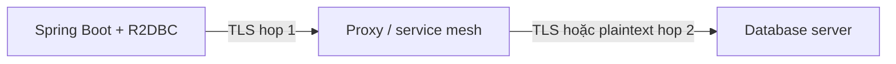
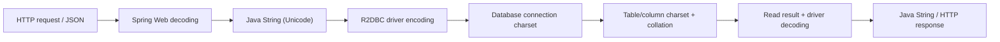

# Kiểm tra cấu hình TLS, múi giờ và encoding khi triển khai

Ứng dụng Spring Data Relational R2DBC có thể chạy ổn định ở máy phát triển nhưng gặp lỗi khi triển khai do ba nhóm cấu hình thường bị xem nhẹ: bảo mật đường truyền, cách diễn giải thời gian và cách mã hóa văn bản. TLS quyết định dữ liệu có được mã hóa và server có được xác thực hay không. Timezone quyết định một timestamp được hiểu là thời điểm tuyệt đối hay giờ địa phương. Encoding quyết định chuỗi Unicode được truyền, lưu và đọc có giữ nguyên ký tự hay không.

Các vấn đề này nằm ở nhiều tầng: JVM, Spring Boot, R2DBC driver, connection pool, database session, schema, HTTP client và môi trường triển khai. Cấu hình đúng ở một tầng không tự bảo đảm các tầng còn lại đúng. Ví dụ, JVM dùng UTC nhưng database session dùng timezone khác; database lưu UTF-8 nhưng cột MySQL dùng collation/charset không phù hợp; URL bật TLS encryption nhưng không xác minh hostname của database.

Khi triển khai, cần kiểm tra bằng connection thật được tạo từ đúng R2DBC driver, đúng pool và đúng cấu hình production. Một test đơn vị hoặc một health check `SELECT 1` không đủ để chứng minh chứng chỉ được xác minh, timestamp round-trip chính xác hoặc dữ liệu Unicode không bị biến dạng.

## 1. Ba nhóm cấu hình và rủi ro thường gặp

| Nhóm | Cần bảo đảm | Lỗi thường gặp |
| --- | --- | --- |
| TLS | Mã hóa đường truyền, xác thực certificate và hostname, quản lý trust/key | Kết nối không mã hóa, chấp nhận certificate không tin cậy, hostname mismatch, chứng chỉ hết hạn |
| Timezone | Quy ước thời gian nhất quán giữa JVM, driver, database session và kiểu SQL | Lệch giờ, mất offset, sai thời điểm quanh DST, timestamp thay đổi khi đọc lại |
| Encoding | Charset Unicode xuyên suốt từ request đến driver và cột database | Ký tự tiếng Việt/emoji bị lỗi, chuỗi bị thay bằng `?`, collation so sánh sai mong đợi |

Ba nhóm này có thể tương tác. Ví dụ, một migration JDBC có thể dùng timezone khác R2DBC runtime; một cột chuỗi có collation khác nhau giữa MySQL và MariaDB; TLS proxy có thể kết thúc mã hóa ở một điểm trung gian thay vì tại database.

## 2. TLS bảo vệ kết nối R2DBC như thế nào?

TLS (Transport Layer Security) tạo một kênh truyền được mã hóa giữa client và server. Với ứng dụng R2DBC, client là driver đang mở connection tới database hoặc proxy database.

TLS thường cung cấp ba thuộc tính:

- **Confidentiality:** dữ liệu SQL, bind parameter và kết quả truyền trên kênh TLS được mã hóa.
- **Integrity:** dữ liệu bị sửa trên đường truyền có thể được phát hiện qua cơ chế bảo vệ của TLS.
- **Server authentication:** client xác minh server sở hữu certificate được tin cậy và, khi bật kiểm tra hostname, certificate phù hợp với tên host đang kết nối.

Một số môi trường còn dùng mutual TLS (mTLS), trong đó client cũng trình certificate để server xác thực danh tính client. mTLS không thay thế username/password hoặc quyền database; nó bổ sung một lớp xác thực ở tầng kết nối.

### Mã hóa không đồng nghĩa xác thực đầy đủ

Chế độ TLS chỉ yêu cầu mã hóa nhưng bỏ qua xác minh certificate có thể bảo vệ dữ liệu khỏi nghe lén thụ động, nhưng không bảo đảm client đang kết nối đúng database. Một proxy giả mạo có thể kết thúc TLS bằng certificate không được xác minh nếu client chấp nhận mọi certificate.

Trong production, ưu tiên chế độ xác minh certificate chain và hostname, thường được gọi là `VERIFY_FULL`, `VERIFY_IDENTITY` hoặc tên tương đương tùy driver. Không suy luận semantics từ tên option; đọc tài liệu driver và xác nhận bằng negative test.

## 3. Xác minh certificate chain và hostname

Để xác minh server certificate, client cần một trust anchor phù hợp, thường là CA certificate đã ký certificate của database hoặc proxy. Quy trình kiểm tra gồm:

1. Server gửi certificate và certificate chain cần thiết.
2. Client kiểm tra chữ ký và chain tới CA mà client tin cậy.
3. Client kiểm tra thời hạn `Not Before`/`Not After`.
4. Client kiểm tra hostname kết nối có khớp Subject Alternative Name (SAN) của certificate.
5. Client và server thương lượng phiên bản TLS/cipher suite được phép.

Hostname verification rất quan trọng. Nếu ứng dụng kết nối `db.prod.internal`, certificate phải có SAN phù hợp với hostname đó. Certificate chỉ chứa tên node khác hoặc IP khác có thể gây lỗi xác minh dù CA chain hợp lệ.

### Dùng hostname ổn định

Trong Kubernetes hoặc cloud, endpoint database thường là DNS name ổn định, ví dụ `db-primary.internal.example`. Dùng DNS name có trong certificate SAN thay vì kết nối tới IP tạm thời nếu certificate không chứa IP đó.

Nếu kết nối qua proxy, service mesh hoặc database gateway, xác minh certificate của endpoint mà driver thực sự kết nối. Nếu TLS kết thúc ở proxy rồi proxy mở kết nối plaintext tới database, cần đánh giá riêng đoạn proxy-to-database; TLS phía client không tự mã hóa đoạn còn lại.

### Không tắt kiểm tra hostname để chữa lỗi certificate

Nếu gặp hostname mismatch, sửa DNS/endpoint hoặc cấp certificate đúng SAN. Không chuyển sang chế độ bỏ xác minh hostname chỉ để ứng dụng kết nối được. Cũng không dùng trust-all certificate verifier trong production.

## 4. Cấu hình TLS phụ thuộc R2DBC driver

R2DBC SPI cung cấp API kết nối chung, nhưng cách bật TLS, chọn trust store, client certificate, protocol và hostname verification do từng driver triển khai. Vì vậy, không có một bộ query parameter URL áp dụng cho mọi database.

Các nhóm option thường gặp:

| Nhóm option | Mục đích |
| --- | --- |
| SSL/TLS mode | Tắt, ưu tiên, bắt buộc hoặc xác minh TLS |
| CA/root certificate | Chỉ định CA tin cậy để xác minh server |
| Client certificate | Certificate client khi dùng mTLS |
| Client private key | Private key tương ứng với client certificate |
| Key password | Mật khẩu bảo vệ private key nếu có |
| TLS protocol/cipher | Giới hạn protocol/cipher suite được phép nếu driver hỗ trợ |
| Hostname verification | Xác minh tên endpoint so với SAN của certificate |

Tên option và cách truyền file certificate có thể khác giữa `r2dbc-postgresql`, `r2dbc-mysql`, MariaDB R2DBC và các driver khác. Hãy dùng đúng tài liệu của artifact và version đang chạy.

### Ví dụ cấu hình Spring Boot ở mức khái niệm

Spring Boot đọc URL và properties của R2DBC driver từ `spring.r2dbc`:

```yaml
spring:
  r2dbc:
    url: ${R2DBC_URL}
    username: ${DB_USERNAME}
    password: ${DB_PASSWORD}
    properties:
      # Các key bên dưới chỉ là chỗ đặt driver-specific options.
      # Tên key/value phải theo driver đang dùng.
      sslMode: ${DB_SSL_MODE}
```

Đây là cấu trúc minh họa. Không copy `sslMode` hoặc giá trị của driver PostgreSQL sang MySQL/MariaDB nếu driver đó dùng tên/enum khác. Một số driver nhận option qua URL query; một số qua `ConnectionFactoryOptions`; một số hỗ trợ file certificate qua property riêng.

Nếu tự tạo `ConnectionFactory`, cần bảo đảm các TLS options được đưa vào đúng factory mà Spring Data repository, `DatabaseClient` và `R2dbcTransactionManager` đang dùng. Tạo một factory có TLS cho health check nhưng để repository dùng factory khác sẽ tạo ra cấu hình không nhất quán.

## 5. Các chế độ TLS thường gặp

Tên gọi thay đổi theo driver, nhưng semantics thường có các mức:

| Mức | Hành vi khái quát | Phù hợp production? |
| --- | --- | --- |
| Disabled | Không dùng TLS | Chỉ khi mạng/kiến trúc có lý do rõ ràng và có biện pháp bảo vệ tương đương |
| Prefer/Allow | Thương lượng hoặc ưu tiên TLS tùy server/driver | Không nên giả định luôn mã hóa; cần hiểu fallback |
| Require | Bắt buộc mã hóa nhưng có thể không xác minh đầy đủ danh tính server | Chưa đủ nếu cần chống server giả mạo |
| Verify CA | Bắt buộc TLS và xác minh certificate chain | Tốt hơn require; cần xem hostname có được kiểm tra không |
| Verify full/identity | Bắt buộc TLS, xác minh chain và hostname | Thường là lựa chọn mong muốn cho client-server production |

Không phải driver nào có đủ tất cả các mức. Một số driver có thể dùng tên `VERIFY_IDENTITY`, một số dùng `VERIFY_FULL`. Hãy xác nhận đúng semantics thay vì chỉ chọn một tên có vẻ mạnh.

### Negative test xác minh TLS thực sự được kiểm tra

Ngoài test kết nối thành công với certificate hợp lệ, hãy kiểm tra kết nối thất bại khi:

- CA không nằm trong trust store.
- Certificate hết hạn.
- Hostname không khớp SAN.
- Server yêu cầu client certificate nhưng client không cung cấp (nếu dùng mTLS).
- Certificate client không được CA server tin cậy.

Negative test chứng minh client không âm thầm chấp nhận certificate sai. Thực hiện trong môi trường test cô lập, không thay certificate của production để thử.

## 6. Quản lý CA certificate và client key

Không hard-code private key hoặc password vào source code, Docker image hay file cấu hình được commit. Dùng secret manager hoặc Kubernetes Secret/volume được quản lý phù hợp.

Một cách tổ chức phổ biến:

```text
/run/secrets/database/
  ca.pem
  client-cert.pem
  client-key.pem
```

Ứng dụng chỉ cần quyền đọc các file cần thiết. Private key nên có permission hạn chế và được mount từ secret store. CA certificate thường không phải bí mật, nhưng vẫn cần bảo vệ integrity vì thay CA có thể thay đổi server nào được tin cậy.

### Trust store của JVM và trust store của driver

Không phải mọi R2DBC driver đều dùng Java default trust store theo cùng cách. Một driver có thể dùng JSSE/JVM trust store; driver khác có thể dùng TLS stack hoặc option riêng. Vì vậy, thêm CA vào `$JAVA_HOME/lib/security/cacerts` chưa chắc đã giải quyết được lỗi nếu driver dùng trust source riêng.

Hãy kiểm tra tài liệu driver để biết:

- Driver có dùng JSSE không.
- Có hỗ trợ trust store path/type/password không.
- Có nhận CA certificate riêng theo connection option không.
- Có hỗ trợ client certificate/private key và định dạng PEM/PKCS#8 nào không.
- Có kiểm tra hostname mặc định hay cần bật rõ ràng không.

Không truyền trust store password qua command line hoặc log. Nếu dùng JVM system properties, đặt qua secret/config an toàn và kiểm soát phạm vi process.

## 7. Certificate rotation và connection pool

R2DBC Pool giữ các connection đã mở để tái sử dụng. Khi certificate server được rotate, các connection TLS đang tồn tại có thể tiếp tục dùng session đã thiết lập; connection mới cần xác minh certificate mới. Tình huống có thể phát sinh lỗi khi:

- CA mới chưa được đưa vào trust store của tất cả instance.
- Server đã chuyển certificate nhưng client vẫn chỉ tin CA cũ.
- Client certificate hết hạn hoặc bị thu hồi.
- Pool giữ connection lâu và không tạo connection mới để nhận cấu hình/certificate mới.
- Một số pod đã cập nhật secret, một số pod vẫn dùng nội dung cũ.

### Quy trình rotation an toàn

Một quy trình CA rotation thường theo hai giai đoạn:

1. Phân phối trust bundle có cả CA cũ và CA mới tới client.
2. Xác nhận mọi instance có thể tạo connection với trust bundle mới.
3. Rotate server certificate sang chain mới.
4. Quan sát kết nối mới, TLS handshake và lỗi certificate.
5. Sau khi không còn server/connection cần CA cũ, loại CA cũ khỏi trust bundle.
6. Recycle/restart pool theo kế hoạch nếu cần để bảo đảm connection mới dùng cấu hình cập nhật.

Với mTLS, phối hợp rotation client certificate và server trust policy tương tự. Không xóa CA cũ trước khi tất cả client/server liên quan đã chuyển xong.

### Pool lifetime và secret reload

Không giả định pool tự reload certificate file khi secret được cập nhật. Tùy driver, TLS context có thể được tạo khi khởi tạo `ConnectionFactory`, khi tạo connection hoặc ở thời điểm khác. Cần xác minh hành vi của driver và cách secret volume cập nhật.

Nếu driver không hỗ trợ reload an toàn, dùng rolling restart hoặc tạo lại connection factory/pool theo cơ chế được hỗ trợ. Đặt `maxLifeTime` có thể giúp connection cũ được thay dần, nhưng không thay thế kế hoạch rotation và không bảo đảm TLS context mới được tải nếu factory không reload.

## 8. TLS và connection qua proxy/service mesh

Trong môi trường có proxy, cần lập sơ đồ từng chặng:



Hãy xác định:

- TLS được kết thúc ở client-side proxy hay database.
- Chặng proxy-to-database có TLS không.
- Client xác minh certificate của proxy hay database.
- Proxy có xác thực client identity/mTLS không.
- Hostname trong certificate tương ứng endpoint nào.
- Health check và metrics quan sát connection tới proxy hay database trực tiếp.

TLS từ ứng dụng tới proxy không tự chứng minh đoạn proxy tới database được mã hóa. Nếu chính sách yêu cầu encryption end-to-end, cấu hình TLS cho từng chặng hoặc dùng kiến trúc bảo đảm proxy không đọc dữ liệu theo threat model đã xác định.

## 9. Timezone có nhiều lớp

Timezone có thể được đặt ở:

1. **Operating system/container:** timezone của máy chạy process.
2. **JVM:** `user.timezone` và `ZoneId.systemDefault()`.
3. **Java type:** `Instant`, `OffsetDateTime`, `LocalDateTime`, `LocalDate`, `ZonedDateTime`.
4. **R2DBC driver:** cách encode/decode temporal type.
5. **Database session:** timezone của connection/session.
6. **Database column type:** `TIMESTAMP`, `TIMESTAMP WITH TIME ZONE`, `DATETIME`, `DATE`, v.v.
7. **Business timezone:** timezone dùng để diễn giải giờ mở cửa, ngày thanh toán, lịch làm việc hoặc ngày báo cáo.

Các lớp này không tự động đồng nhất. Một ứng dụng chạy UTC có thể kết nối tới database session đặt `Asia/Ho_Chi_Minh`; nếu dùng `LocalDateTime` và kiểu SQL không có timezone, không thể biết một giá trị là UTC hay giờ địa phương nếu hợp đồng dữ liệu không nói rõ.

## 10. Chọn Java temporal type theo ý nghĩa dữ liệu

| Java type | Ý nghĩa | Trường hợp phù hợp |
| --- | --- | --- |
| `Instant` | Một thời điểm tuyệt đối trên timeline UTC | Created/updated timestamp, event time, audit timestamp |
| `OffsetDateTime` | Ngày giờ kèm offset UTC | API hoặc dữ liệu cần giữ offset đã cung cấp |
| `ZonedDateTime` | Ngày giờ cùng timezone region và rules | Lịch địa phương cần DST/rules của vùng |
| `LocalDateTime` | Ngày giờ không có offset/timezone | Giờ trên đồng hồ địa phương chưa gắn vùng |
| `LocalDate` | Ngày lịch, không có thời gian | Ngày sinh, ngày hiệu lực, ngày nghiệp vụ |
| `LocalTime` | Giờ trong ngày, không có ngày/vùng | Giờ mở cửa hoặc khung giờ địa phương |
| `Duration` | Khoảng thời gian tuyến tính | Timeout, thời lượng xử lý |
| `Period` | Khoảng thời gian theo lịch | Cộng tháng/năm theo quy tắc lịch |

### Dùng `Instant` cho timestamp kỹ thuật

Các field như `createdAt`, `lastModifiedAt`, `processedAt` thường nên biểu diễn một thời điểm tuyệt đối:

```java
@CreatedDate
@Column("created_at")
private Instant createdAt;
```

Nguồn thời gian có thể dùng `Clock.systemUTC()`:

```java
@Bean
Clock applicationClock() {
    return Clock.systemUTC();
}
```

UTC giúp các instance ở nhiều vùng địa lý tạo timestamp cùng quy ước. Khi hiển thị, chuyển `Instant` sang timezone của người dùng hoặc nghiệp vụ ở tầng presentation.

### Không gắn timezone giả cho `LocalDateTime`

`LocalDateTime` không chứa offset hoặc zone. Giá trị `2026-11-15T09:00` không nói đó là 09:00 UTC, 09:00 tại TP.HCM hay 09:00 ở London. Nếu dữ liệu biểu diễn một thời điểm tuyệt đối, `LocalDateTime` có thể làm mất thông tin cần thiết.

Nếu nghiệp vụ thật sự lưu “09:00 giờ địa phương” như giờ mở cửa, lưu thêm zone ID hoặc xác định zone từ địa điểm. Không tự gắn timezone mặc định của server khi đọc giá trị.

## 11. Timezone JVM và container

Có thể đặt timezone JVM là UTC bằng option:

```text
-Duser.timezone=UTC
```

Hoặc biến môi trường container:

```text
TZ=UTC
```

`TZ` ảnh hưởng timezone của hệ điều hành/container nếu image có timezone data và runtime tôn trọng biến đó; `-Duser.timezone` đặt timezone mặc định của JVM. Không nên dựa vào timezone mặc định để tạo timestamp nghiệp vụ. Dùng `Instant`/`Clock` và chỉ dùng `ZoneId` rõ ràng khi cần diễn giải thời gian địa phương.

Kiểm tra runtime:

```java
log.info("JVM default zone: {}", ZoneId.systemDefault());
log.info("Current instant: {}", Instant.now());
```

Không log toàn bộ environment hoặc system properties vì có thể lộ secret. Chỉ log timezone/locale cần thiết.

### Không thay timezone mặc định giữa lúc ứng dụng đang chạy

`TimeZone.setDefault(...)` hoặc thay đổi system timezone runtime có thể ảnh hưởng nhiều thư viện và thread cùng lúc. Cấu hình timezone nhất quán khi process khởi động, và dùng API Java time với zone rõ ràng cho từng nghiệp vụ.

## 12. Timezone của database session

Ngay cả khi JVM dùng UTC, database session có thể dùng timezone khác. Cần kiểm tra session được tạo bởi R2DBC driver và pool, không chỉ kiểm tra timezone global của database.

### PostgreSQL

Kiểm tra:

```sql
SHOW TimeZone;

SELECT
    current_setting('TimeZone') AS session_timezone,
    now() AS transaction_timestamp,
    clock_timestamp() AS wall_clock_timestamp,
    localtimestamp AS local_timestamp;
```

`now()`/`current_timestamp` trong PostgreSQL gắn với thời điểm bắt đầu transaction; `clock_timestamp()` phản ánh clock tại thời điểm gọi. `localtimestamp` trả timestamp không có timezone theo session semantics.

Có thể đặt timezone session cho một connection bằng:

```sql
SET TIME ZONE 'UTC';
```

Nếu dùng connection pool, lệnh `SET` chỉ ảnh hưởng session/connection hiện tại. Cần bảo đảm mọi connection mới đều được cấu hình hoặc server/database role có default phù hợp. Tránh chạy `SET TIME ZONE` một lần trên một connection ngẫu nhiên rồi cho rằng toàn pool đã được cấu hình.

### MySQL và MariaDB

Kiểm tra:

```sql
SELECT
    @@global.time_zone AS global_timezone,
    @@session.time_zone AS session_timezone,
    @@system_time_zone AS system_timezone,
    NOW(6) AS session_now,
    UTC_TIMESTAMP(6) AS utc_now;
```

Có thể đặt timezone session:

```sql
SET time_zone = '+00:00';
```

Giá trị `SYSTEM` có nghĩa session dùng timezone hệ thống theo cấu hình server. Với ứng dụng production, đặt UTC rõ ràng thường dễ dự đoán hơn. Nếu dùng tên timezone như `Asia/Ho_Chi_Minh`, server cần có timezone tables được nạp và cập nhật; offset `+00:00` không phụ thuộc timezone tables.

### SQL Server và các database khác

Mỗi database có kiểu timestamp và cú pháp timezone riêng. Không dùng câu `SHOW TimeZone` của PostgreSQL hoặc `@@session.time_zone` của MySQL trên database khác. Dùng truy vấn kiểm tra session theo tài liệu database đang chạy.

## 13. Kiểu SQL có hoặc không có timezone

Kiểu SQL quyết định database lưu và diễn giải thời gian thế nào.

### PostgreSQL

- `timestamp without time zone`: lưu các thành phần ngày/giờ, không giữ zone/offset.
- `timestamp with time zone` (`timestamptz`): biểu diễn thời điểm tuyệt đối; PostgreSQL chuẩn hóa nội bộ và hiển thị theo timezone session.
- `date`: chỉ ngày lịch.
- `time with/without time zone`: giờ trong ngày với semantics tương ứng; ít phù hợp để lưu một thời điểm tuyệt đối nếu thiếu ngày.

Ví dụ:

```sql
CREATE TABLE audit_event (
    id BIGINT GENERATED BY DEFAULT AS IDENTITY PRIMARY KEY,
    occurred_at TIMESTAMPTZ NOT NULL,
    local_schedule TIMESTAMP WITHOUT TIME ZONE
);
```

`occurred_at` phù hợp với `Instant`. `local_schedule` cần một quy ước zone bên ngoài nếu nó đại diện giờ địa phương.

### MySQL/MariaDB

- `TIMESTAMP`: server/session thực hiện chuyển đổi timezone khi ghi/đọc theo semantics của engine/version.
- `DATETIME`: lưu thành phần ngày/giờ, không tự lưu timezone.
- `DATE`: ngày lịch.
- `TIME`: thời gian/độ dài theo semantics database; không thay thế một instant.

Ví dụ:

```sql
CREATE TABLE audit_event (
    id BIGINT NOT NULL AUTO_INCREMENT PRIMARY KEY,
    occurred_at TIMESTAMP(6) NOT NULL,
    local_schedule DATETIME(6)
) ENGINE = InnoDB;
```

Khi dùng `TIMESTAMP`, hãy kiểm tra session timezone và giới hạn range của kiểu trên server. Khi dùng `DATETIME`, ứng dụng phải thống nhất giá trị được lưu là UTC hay local time; database không thể tự suy ra zone.

### Không dùng một mapping chung cho mọi database

Một Java `Instant` có thể được map khác nhau theo driver/dialect. Hãy kiểm tra codec và round-trip trên database thật. Đừng giả định `Instant` luôn được ghi vào `TIMESTAMP WITH TIME ZONE` ở mọi hệ quản trị hoặc `LocalDateTime` luôn được chuyển sang UTC.

## 14. Daylight Saving Time (DST) và giờ địa phương

Một số timezone chuyển đồng hồ theo mùa. Điều đó tạo ra hai trường hợp khó:

- **Gap:** một khoảng giờ địa phương không tồn tại khi đồng hồ nhảy tới trước.
- **Overlap:** một khoảng giờ địa phương xuất hiện hai lần khi đồng hồ lùi lại.

Ví dụ một lịch đặt lúc 01:30 tại vùng có DST có thể tương ứng hai instant khác nhau trong ngày overlap. `LocalDateTime` một mình không thể phân biệt hai lần 01:30 đó.

Nếu lưu lịch theo địa điểm, lưu cả `LocalDateTime` và `ZoneId` (ví dụ `Europe/Paris`) hoặc lưu instant đã được xác định cùng quy tắc nghiệp vụ. Nếu lịch cần giữ “giờ địa phương” khi luật DST thay đổi, phải quyết định có tính lại instant theo rules mới hay giữ instant cũ.

Việt Nam hiện không áp dụng DST ở timezone `Asia/Ho_Chi_Minh`, nhưng hệ thống có thể lưu lịch cho người dùng ở nhiều quốc gia. Không hard-code offset `+07:00` cho mọi dữ liệu chỉ vì một deployment đặt tại Việt Nam.

### Kiểm thử DST

Nên có test cho:

- Thời điểm trước/sau chuyển DST.
- Local time nằm trong gap.
- Local time nằm trong overlap.
- Cùng instant hiển thị ở hai timezone khác nhau.
- Thay đổi timezone database (tzdb) giữa các bản JDK nếu nghiệp vụ phụ thuộc lịch địa phương.

## 15. Encoding: từ HTTP đến database

Để lưu tiếng Việt, emoji và ký tự Unicode khác một cách nhất quán, cần kiểm tra toàn bộ đường dữ liệu:



Java `String` biểu diễn text theo UTF-16 code units; khi gửi qua giao thức, driver encode thành byte theo charset/protocol. Database phải nhận và lưu các ký tự đó trong charset hỗ trợ. Khi đọc, driver decode bytes trở lại Java `String`.

Một chỗ cấu hình sai có thể tạo mojibake, mất ký tự, lỗi conversion hoặc so sánh chuỗi không như mong đợi. Không nên dùng `new String(bytes)` hoặc `String.getBytes()` không chỉ định charset khi tự xử lý byte.

### Dùng UTF-8 rõ ràng cho dữ liệu văn bản

Khi tự chuyển đổi byte/text:

```java
byte[] bytes = text.getBytes(StandardCharsets.UTF_8);
String decoded = new String(bytes, StandardCharsets.UTF_8);
```

Đừng phụ thuộc default charset của JVM/OS. Với `String` được bind qua R2DBC, driver thường thực hiện encode theo protocol/connection configuration; không tự chuyển sang byte array nếu không có yêu cầu binary cụ thể.

### JSON và HTTP

JSON hiện đại thường được trao đổi dưới UTF-8. Đảm bảo request/response có content type và charset phù hợp, ví dụ `application/json`, đồng thời không tự decode body bằng charset hệ thống. Spring WebFlux/Jackson thường xử lý JSON qua codec; nếu override codec, kiểm tra encoding.

## 16. Charset và collation trong MySQL/MariaDB

Với MySQL/MariaDB, `utf8mb4` là lựa chọn phổ biến để lưu đầy đủ Unicode, bao gồm ký tự ngoài BMP và emoji. Charset `utf8` trong một số phiên bản MySQL lịch sử chỉ là alias cho biến thể UTF-8 tối đa ba byte, không lưu được mọi Unicode code point. Không dùng tên `utf8` mà chưa xác định semantics của server/version.

Ví dụ tạo database/table:

```sql
CREATE DATABASE app_db
    CHARACTER SET utf8mb4
    COLLATE utf8mb4_unicode_ci;

CREATE TABLE customer (
    id BIGINT NOT NULL AUTO_INCREMENT PRIMARY KEY,
    display_name VARCHAR(200) NOT NULL
) CHARACTER SET utf8mb4
  COLLATE utf8mb4_unicode_ci;
```

Tên collation khả dụng khác nhau theo MySQL/MariaDB version. MySQL 8 có các collation `utf8mb4_0900_*`; MariaDB có bộ collation riêng. Chọn collation theo semantics case/accent sensitivity và kiểm tra nó tồn tại trên đúng server.

### Kiểm tra charset thực tế

```sql
SHOW VARIABLES LIKE 'character_set%';
SHOW VARIABLES LIKE 'collation%';

SELECT
    @@character_set_client,
    @@character_set_connection,
    @@character_set_results,
    @@collation_connection;
```

Kiểm tra cả database, table và column:

```sql
SHOW CREATE TABLE customer;

SELECT
    column_name,
    character_set_name,
    collation_name
FROM information_schema.columns
WHERE table_schema = DATABASE()
  AND table_name = 'customer';
```

Connection charset có thể được driver thương lượng/tự đặt. Không chỉ nhìn default database rồi kết luận connection đang dùng cùng charset.

## 17. Encoding trong PostgreSQL và database khác

PostgreSQL thường dùng server encoding `UTF8` cho ứng dụng Unicode. Có thể kiểm tra:

```sql
SHOW server_encoding;
SHOW client_encoding;
```

Client encoding thường được driver quản lý theo protocol và có thể là UTF8. Nếu server database được tạo với encoding không hỗ trợ dữ liệu cần lưu, đổi client encoding không thể làm server lưu được mọi ký tự.

Kiểm tra database encoding:

```sql
SELECT datname, pg_encoding_to_char(encoding)
FROM pg_database
WHERE datname = current_database();
```

Không dùng cú pháp kiểm tra PostgreSQL cho MySQL/MariaDB. Mỗi database có metadata, charset và collation riêng.

## 18. Charset, collation và semantics so sánh

Charset quyết định tập ký tự có thể mã hóa. Collation quyết định cách so sánh và sắp xếp chuỗi, ví dụ:

- Có phân biệt chữ hoa/thường không.
- Có phân biệt dấu/accent không.
- Quy tắc sắp xếp Unicode.
- Hai chuỗi nào được xem là bằng nhau trong unique constraint.

Hai cột cùng charset nhưng khác collation có thể cho kết quả `ORDER BY`, `LIKE`, `=` hoặc unique constraint khác nhau.

Ví dụ, một collation case-insensitive có thể coi `Lan@example.com` và `lan@example.com` là bằng nhau. Nếu nghiệp vụ yêu cầu phân biệt, chọn collation phù hợp hoặc lưu normalized key riêng.

### Unicode normalization

Một ký tự hiển thị giống nhau có thể có nhiều representation Unicode, ví dụ ký tự dựng sẵn và chuỗi gồm base character cộng combining mark. Nếu ứng dụng cần so sánh canonical equivalence, hãy xác định chính sách normalization (NFC/NFD) ở biên dữ liệu hoặc dùng cơ chế database/collation phù hợp.

Java có `Normalizer`:

```java
String normalized = Normalizer.normalize(
        input,
        Normalizer.Form.NFC
);
```

Chỉ normalize nếu semantics nghiệp vụ cho phép. Không tự ý normalize password, token, chữ ký số hoặc dữ liệu mà byte representation phải được giữ nguyên.

### Độ dài ký tự và độ dài byte

`VARCHAR(200)` thường giới hạn theo ký tự/code point hoặc semantics cụ thể của database, trong khi byte length có thể lớn hơn với UTF-8. Không giả định 200 ký tự luôn chiếm 200 byte. Emoji và ký tự ngoài ASCII có thể dùng nhiều byte hơn.

Kiểm tra cả:

- Giới hạn ký tự của cột.
- Giới hạn byte của index/row/database.
- Giới hạn packet của driver/server.
- Validation ở Java và API.
- Cách database đếm độ dài theo collation/charset.

## 19. Không dùng default charset trong code

Các lỗi thường gặp:

```java
// Không rõ charset phụ thuộc môi trường.
byte[] bytes = text.getBytes();
String value = new String(bytes);
```

Nên chỉ rõ:

```java
byte[] bytes = text.getBytes(StandardCharsets.UTF_8);
String value = new String(bytes, StandardCharsets.UTF_8);
```

Nếu dữ liệu đã là `String`, hãy bind trực tiếp qua R2DBC thay vì encode thành byte rồi decode lại. Chỉ dùng `byte[]` cho dữ liệu binary hoặc protocol yêu cầu bytes.

Không chuyển password, secret hoặc token thành text log để điều tra lỗi encoding. Dùng test fixture an toàn có chứa ký tự Unicode đại diện.

## 20. Binary data không phải text encoding

Các cột `BLOB`, `BYTEA`, `VARBINARY` hoặc binary type lưu byte thô. Không áp dụng collation/charset cho binary data như với text. Nếu lưu file hoặc nội dung đã mã hóa, giữ nguyên byte sequence và metadata content type/encoding riêng.

Ví dụ:

```java
byte[] payload = Files.readAllBytes(path);
```

Khi đọc/ghi `byte[]`, kiểm tra driver codec và giới hạn kích thước. Không convert sang `String` trừ khi định dạng thực sự là text với charset đã biết.

## 21. R2DBC driver và codec temporal/string

Driver chịu trách nhiệm encode Java value thành wire representation và decode database value về Java type. Các kiểu phổ biến như `String`, `Integer`, `Long`, `BigDecimal`, `LocalDate`, `LocalDateTime`, `Instant`, `OffsetDateTime`, `UUID` có mức hỗ trợ khác nhau theo driver/database.

Khi mapping gặp lỗi hoặc lệch giá trị, hãy kiểm tra:

- Driver version và codec được đăng ký.
- SQL type thực tế của cột.
- Java type trong entity/DTO.
- Session timezone và server encoding.
- Precision/scale hoặc fractional seconds của cột.
- Custom converter có đang chuyển đổi thêm không.
- Raw SQL có cast kiểu dữ liệu ngoài dự kiến không.

Không khắc phục mapping sai bằng cách đổi timezone hoặc charset toàn cục nếu nguyên nhân thực tế là Java/SQL type không tương thích.

### Custom conversions

Spring Data R2DBC hỗ trợ custom conversions để chuyển Java type sang kiểu mà driver hiểu. Nếu cần converter cho một temporal type hoặc UUID representation, đăng ký converter ở `R2dbcCustomConversions` theo cấu hình Spring Data của version đang dùng.

Converter nên có semantics rõ ràng, có test round-trip và không phụ thuộc timezone mặc định của máy. Tránh converter chuyển mọi `LocalDateTime` thành UTC mà không biết giá trị đầu vào vốn là giờ địa phương nào.

## 22. Cấu hình timezone khi tạo connection

Một số driver hỗ trợ connection option để đặt timezone/session property. Một số khác yêu cầu câu lệnh khởi tạo session hoặc server/role default. Tên option và cách thiết lập phụ thuộc driver.

Nếu dùng init SQL với connection pool, cần bảo đảm lệnh được chạy cho từng connection mới, không chỉ một connection. Cơ chế `postAllocate`/`preRelease` hoặc connection initialization hook tùy pool/version; kiểm tra API chính thức.

Ví dụ câu lệnh session cho PostgreSQL:

```sql
SET TIME ZONE 'UTC';
```

Ví dụ cho MySQL/MariaDB:

```sql
SET time_zone = '+00:00';
```

Không chạy một câu `SET` trên một connection ngẫu nhiên rồi cho rằng toàn bộ pool đã đồng nhất. Có thể đặt default ở database/user/session template nếu hệ quản trị hỗ trợ, hoặc dùng cơ chế initialization chính thức của pool.

### Session state và pool reuse

Một connection được trả về pool có thể giữ session state như timezone, SQL mode, schema/search path hoặc variables. Nếu request thay đổi session state rồi trả connection về pool mà không reset, request sau có thể nhận cấu hình từ request trước.

Các nguyên tắc:

- Tránh thay đổi session state tùy tiện trong request.
- Nếu phải thay đổi, reset về baseline trước khi release hoặc dùng transaction-local setting khi database hỗ trợ.
- Cấu hình baseline cho mọi connection khi tạo mới.
- Kiểm tra behavior khi connection được tái sử dụng.
- Không dựa vào việc connection mới luôn được tạo cho mỗi request.

## 23. Migration JDBC và runtime R2DBC phải thống nhất

Nhiều ứng dụng dùng Flyway/Liquibase qua JDBC để chạy schema migration, còn runtime dùng R2DBC. Đây là hai connection stack riêng và có thể khác cấu hình:

- JDBC URL và R2DBC URL.
- Driver TLS/trust store.
- Session timezone.
- Client encoding.
- Default schema/database.
- SQL mode và connection initialization.
- Mapping temporal type.

Ví dụ migration tạo `TIMESTAMP WITHOUT TIME ZONE` nhưng runtime map thành `Instant` theo giả định UTC. Nếu không có quy ước rõ, giá trị có thể bị hiểu sai. Tương tự, migration tạo cột charset/collation khác với chuẩn runtime có thể gây lỗi so sánh hoặc insert Unicode.

Hãy chạy migration và runtime integration test trên cùng database engine/version. Xác nhận JDBC migration và R2DBC runtime dùng cùng schema, timezone policy và encoding policy. Không cho rằng cùng hostname/database name đồng nghĩa cùng session settings.

## 24. Kiểm tra TLS từ connection thật

Sau khi cấu hình TLS, cần xác nhận connection mà R2DBC pool tạo ra đang dùng TLS và certificate verification đúng.

### PostgreSQL

Có thể kiểm tra connection hiện tại bằng:

```sql
SELECT
    ssl,
    version,
    cipher,
    bits
FROM pg_stat_ssl
WHERE pid = pg_backend_pid();
```

`ssl = true` cho biết connection hiện tại dùng SSL/TLS theo metadata PostgreSQL. `version` và `cipher` cho biết protocol/cipher đã thương lượng. Truy vấn này không tự chứng minh client đã xác minh hostname; phần đó phải được xác nhận từ driver configuration và negative test.

### MySQL/MariaDB

Có thể kiểm tra session:

```sql
SHOW SESSION STATUS LIKE 'Ssl_cipher';
SHOW SESSION STATUS LIKE 'Ssl_version';
```

Giá trị `Ssl_cipher` rỗng thường cho biết session hiện tại không dùng TLS; kiểm tra theo version/server và driver. Xác nhận thêm server policy, chẳng hạn `require_secure_transport` ở MySQL nếu phiên bản hỗ trợ, hoặc cấu hình tương ứng ở MariaDB.

### Xác minh hostname bằng test lỗi

SQL query không cho biết client đã xác minh hostname. Hãy dùng test kết nối tới hostname không khớp certificate hoặc CA không tin cậy và xác nhận handshake thất bại. Đây là cách kiểm tra behavior phía client.

## 25. Kiểm tra timezone bằng round-trip

Đừng chỉ log `ZoneId.systemDefault()`. Hãy ghi một giá trị thời gian qua đúng R2DBC driver rồi đọc lại.

Ví dụ test với `Instant`:

```java
Instant expected = Instant.parse("2026-11-15T03:30:45.123456Z");

StepVerifier.create(repository.save(new AuditEvent(null, expected)))
        .assertNext(saved ->
                assertThat(saved.occurredAt()).isEqualTo(expected)
        )
        .verifyComplete();
```

Ví dụ giả định cột có precision microsecond và driver hỗ trợ mapping tương ứng. Nếu Java `Instant` có nanoseconds nhưng database chỉ lưu microseconds hoặc milliseconds, giá trị đọc lại có thể bị truncate/round. Test nên chuẩn hóa precision mong đợi theo SQL type.

### Test session timezone

Trong integration test, chạy truy vấn kiểm tra session timezone trên một connection được lấy qua chính connection factory/pool runtime. Lặp lại với nhiều connection hoặc tạo concurrency để xác nhận mọi connection có cùng baseline.

Không dùng một connection riêng được tạo ngoài pool để kiểm tra rồi suy ra pool có cùng timezone. Cần test qua đúng `DatabaseClient`/repository được ứng dụng sử dụng.

## 26. Kiểm tra encoding bằng bộ ký tự đại diện

Một test encoding nên bao gồm nhiều nhóm ký tự:

```java
String sample = "Tiếng Việt: Trường, Nguyễn, Đặng; emoji: 😀; "
        + "combining: e\u0301; symbol: €";
```

Test ghi và đọc lại qua R2DBC:

```java
StepVerifier.create(repository.save(new Message(null, sample)))
        .assertNext(saved -> assertThat(saved.content()).isEqualTo(sample))
        .verifyComplete();
```

Nên kiểm tra:

- Chữ tiếng Việt có dấu ở đầu/giữa/cuối chuỗi.
- Emoji hoặc code point ngoài BMP.
- Ký tự combining mark.
- Ký tự đặc biệt như dấu nháy, dấu gạch, ký hiệu tiền.
- Chuỗi gần giới hạn độ dài cột.
- So sánh equality/unique theo collation mong muốn.
- JSON có chứa Unicode nếu ứng dụng lưu JSON.

Đọc lại đúng chuỗi là cần thiết nhưng chưa đủ để kiểm tra collation. Cần thêm test query equality, sort hoặc unique constraint theo semantics mong muốn.

## 27. Kiểm tra encoding và timezone qua HTTP

Một chuỗi có thể bị hỏng trước khi tới database hoặc sau khi đọc từ database. Để xác định tầng lỗi, test end-to-end có thể:

1. Gửi JSON UTF-8 chứa tiếng Việt/emoji.
2. WebFlux deserialize thành Java `String`.
3. Service lưu qua R2DBC.
4. Đọc lại từ database.
5. Serialize response JSON.
6. So sánh response với input theo code point/string semantics.

Nếu repository round-trip pass nhưng HTTP response fail, kiểm tra codec HTTP, content type, reverse proxy và client. Nếu Java string đúng trước khi save nhưng đọc lại sai, kiểm tra R2DBC driver, connection charset, cột và collation.

### Không chỉ kiểm tra bằng mắt

Một số ký tự nhìn giống nhau nhưng representation khác nhau. Dùng assertion chuỗi/code point hoặc normalization policy, không chỉ chụp screenshot để kết luận. Khi debug, có thể log code point/hex của fixture không nhạy cảm, nhưng không dump dữ liệu người dùng thật.

## 28. Quan sát và chẩn đoán lỗi TLS

Các lỗi TLS thường gặp:

| Lỗi | Nguyên nhân có thể | Hướng xử lý |
| --- | --- | --- |
| Unknown CA / unable to find valid certification path | CA chưa nằm trong trust source của driver/JVM | Cập nhật CA trust bundle đúng nơi driver sử dụng |
| Hostname verification failed | SAN không khớp hostname kết nối | Dùng DNS đúng hoặc cấp certificate có SAN phù hợp |
| Certificate expired/not yet valid | Certificate hết hạn hoặc clock hệ thống sai | Rotate certificate và đồng bộ clock hệ thống |
| Handshake failure | Protocol/cipher không tương thích, certificate/key sai hoặc server policy | Kiểm tra TLS version/cipher và server logs |
| Client certificate required | mTLS được bật nhưng client không gửi certificate hợp lệ | Cấu hình client cert/key và CA trust đúng |
| Connection reset khi handshake | Proxy/firewall/server đóng kết nối hoặc protocol không phù hợp | Kiểm tra network path và server/proxy logs |
| Một số pod lỗi, pod khác bình thường | Secret/certificate/config không đồng nhất giữa replicas | Kiểm tra rollout, secret mount và pool recreation |

Không log private key, password, full connection URL có credential hoặc TLS session secret. Log loại exception, endpoint đã sanitize, certificate fingerprint/expiry nếu policy cho phép và correlation ID.

## 29. Quan sát và chẩn đoán lỗi timezone

| Biểu hiện | Nguyên nhân có thể | Hướng xử lý |
| --- | --- | --- |
| Timestamp lệch đúng vài giờ | JVM/session timezone không thống nhất | Kiểm tra JVM zone, session zone và SQL type |
| Giá trị thay đổi khi đọc từ session khác | Dùng kiểu SQL có conversion theo session timezone | Chuẩn hóa UTC hoặc dùng kiểu/contract phù hợp |
| Mất offset sau khi lưu | Map `OffsetDateTime` vào cột không giữ offset | Lưu instant và zone/offset riêng nếu cần |
| LocalDateTime bị hiểu thành UTC | Không có zone trong dữ liệu nhưng code gắn UTC mặc định | Xác định timezone nghiệp vụ và chuyển đổi rõ ràng |
| Sai giờ quanh DST | Local time gap/overlap hoặc tzdb khác nhau | Dùng `ZoneId` và test DST edge cases |
| Microseconds/nanoseconds thay đổi | SQL precision thấp hơn Java precision | Chuẩn hóa precision hoặc tăng fractional precision của cột |
| Job chạy khác giờ giữa máy | Dựa vào default timezone của host | Dùng `Clock` và zone tường minh |
| Một số request lệch giờ sau pool reuse | Session state không được reset | Đặt baseline cho từng connection và không để session mutation rò rỉ |

## 30. Quan sát và chẩn đoán lỗi encoding

| Biểu hiện | Nguyên nhân có thể | Hướng xử lý |
| --- | --- | --- |
| Tiếng Việt thành `?` | Charset/column không biểu diễn được ký tự hoặc conversion loss | Dùng charset Unicode phù hợp, ví dụ `utf8mb4` ở MySQL/MariaDB |
| Mojibake như `Ã...` | Bytes được decode bằng charset sai hoặc double-encoding | Kiểm tra từng chặng HTTP, Java, driver và database |
| Emoji insert bị lỗi | Charset cũ/3-byte UTF-8 hoặc driver/column không hỗ trợ | Kiểm tra Unicode range và schema charset |
| Insert được nhưng tìm kiếm không đúng | Collation/case/accent semantics khác mong đợi | Kiểm tra collation và normalized key |
| Unique constraint coi hai chuỗi là trùng | Collation case/accent-insensitive | Chọn collation hoặc quy tắc canonical hóa đúng nghiệp vụ |
| Một số ký tự mất sau round-trip | Độ dài cột, byte limit hoặc conversion | Kiểm tra column type, length và codec |
| JDBC migration lưu đúng, R2DBC lưu sai | Session/driver charset khác nhau | Kiểm tra connection settings riêng của hai driver |
| JSON tiếng Việt bị biến dạng | JSON codec hoặc client/server encoding không đồng nhất | Test JSON round-trip qua đúng driver và server |

## 31. Checklist triển khai TLS, timezone và encoding

### TLS

- [ ] Dùng driver R2DBC có hỗ trợ TLS cho database/version thực tế.
- [ ] Bắt buộc TLS nếu chính sách mạng yêu cầu.
- [ ] Xác minh CA chain và hostname; không dùng trust-all verifier.
- [ ] Certificate SAN khớp DNS name ứng dụng kết nối.
- [ ] TLS protocol/cipher đáp ứng chính sách bảo mật.
- [ ] mTLS client certificate/key được mount an toàn nếu cần.
- [ ] Secret/key không nằm trong source code, image hoặc log.
- [ ] Certificate rotation có kế hoạch cập nhật trust bundle và pool.
- [ ] Kiểm tra TLS trên connection được tạo từ R2DBC pool thật.
- [ ] Negative test chứng minh CA/hostname sai làm kết nối thất bại.

### Timezone

- [ ] Có quy ước UTC cho timestamp kỹ thuật.
- [ ] Dùng `Instant` cho thời điểm tuyệt đối; dùng `LocalDateTime` chỉ khi dữ liệu thực sự là giờ địa phương không có zone.
- [ ] Kiểm tra JVM timezone và không dựa vào default để tính nghiệp vụ.
- [ ] Kiểm tra timezone của database session trên connection từ pool.
- [ ] Kiểu SQL phù hợp semantics và driver codec.
- [ ] Cột có fractional precision đủ cho yêu cầu.
- [ ] Mọi connection pool có session baseline nhất quán.
- [ ] Test round-trip, session reuse và DST edge cases nếu có lịch địa phương.
- [ ] JDBC migration và R2DBC runtime có timezone policy thống nhất.

### Encoding

- [ ] HTTP/JSON dùng UTF-8 theo contract.
- [ ] Java code chỉ rõ `StandardCharsets.UTF_8` khi chuyển byte/text.
- [ ] Database server/database/table/column dùng charset Unicode phù hợp.
- [ ] MySQL/MariaDB dùng `utf8mb4` khi cần toàn bộ Unicode.
- [ ] Collation phù hợp case/accent/ordering/unique semantics.
- [ ] Driver connection encoding được kiểm tra bằng session metadata.
- [ ] Test tiếng Việt, emoji, combining mark, ký tự ngoài BMP và chuỗi dài.
- [ ] Test equality/sort/unique, không chỉ test round-trip.
- [ ] Binary payload không bị chuyển thành text ngoài ý muốn.

## 32. Ghi nhớ

- TLS encryption và certificate verification là hai điều cần phân biệt; production nên xác minh CA chain và hostname theo khả năng driver.
- TLS option, trust store, client certificate và hostname verification là driver-specific; không sao chép URL property giữa các R2DBC driver.
- Kiểm tra certificate SAN khớp hostname thực tế, quản lý secret/key an toàn và lập kế hoạch certificate rotation.
- Connection pool có thể giữ TLS connection cũ; secret reload không đồng nghĩa pool/driver tự tạo TLS context mới.
- JVM timezone, database session timezone, Java temporal type và SQL column type là các lớp riêng.
- Dùng `Instant` cho timestamp tuyệt đối; dùng `LocalDateTime` cho giờ địa phương không gắn zone và lưu thêm `ZoneId` khi cần DST rules.
- Kiểm tra session timezone trên connection do R2DBC pool cấp; một câu `SET` trên connection đơn không cấu hình toàn pool.
- PostgreSQL `timestamptz` và MySQL/MariaDB `TIMESTAMP` có semantics riêng; `timestamp without time zone`/`DATETIME` không tự giữ timezone.
- Dùng UTC nhất quán cho timestamp kỹ thuật và kiểm thử round-trip với precision của cột.
- Charset quyết định ký tự có thể biểu diễn; collation quyết định so sánh/sắp xếp và unique semantics.
- Với MySQL/MariaDB, `utf8mb4` phù hợp khi cần lưu đầy đủ Unicode; kiểm tra collation theo server version.
- Dùng `StandardCharsets.UTF_8` khi chuyển bytes/text; không phụ thuộc default charset.
- Test tiếng Việt, emoji, combining mark, JSON, ký tự ngoài BMP và giới hạn độ dài trên database thật.
- JDBC migration và R2DBC runtime là hai connection stack; xác nhận TLS/timezone/encoding policy nhất quán.
- Health check `SELECT 1` không chứng minh certificate verification, timezone mapping hay encoding round-trip; cần kiểm tra riêng từng thuộc tính.

Triển khai R2DBC an toàn và nhất quán cần xác nhận cả đường truyền, cách diễn giải thời gian và dữ liệu văn bản. Bật TLS với xác minh danh tính server, chuẩn hóa timestamp theo UTC nhưng giữ zone nghiệp vụ khi cần, và dùng Unicode charset/collation phù hợp với semantics dữ liệu. Cuối cùng, chạy integration test qua đúng driver, connection pool và database production để chứng minh certificate được xác minh, temporal value round-trip chính xác và chuỗi Unicode được giữ nguyên.
