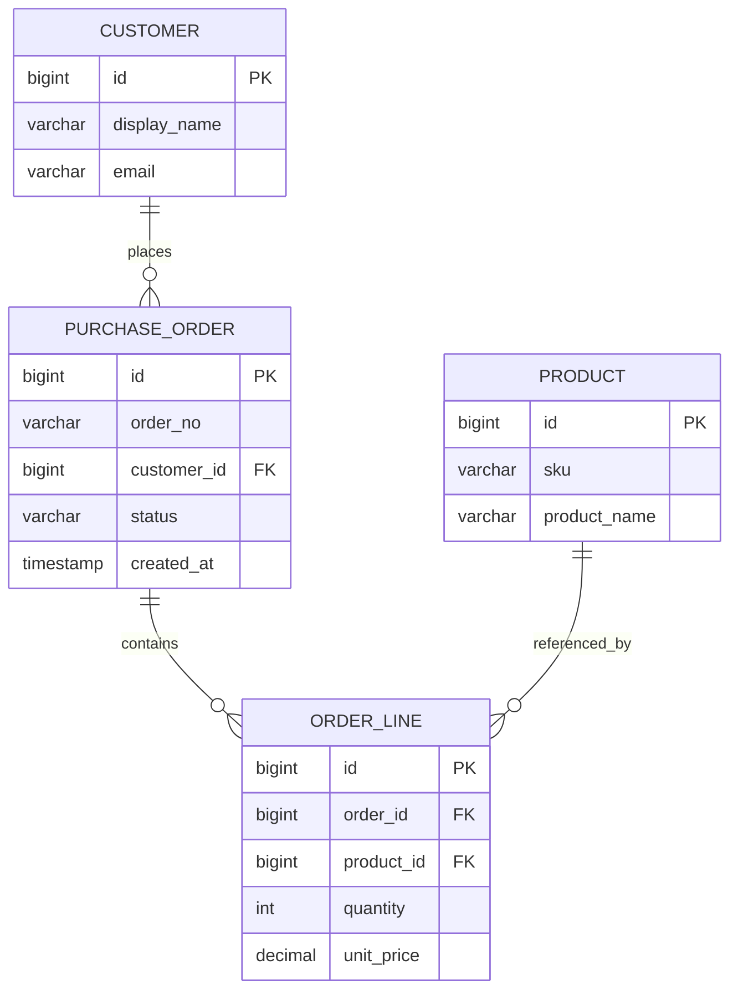

# Đọc quan hệ nhiều bảng bằng mô hình kết quả riêng

Trong ứng dụng Spring Data R2DBC, dữ liệu nghiệp vụ thường nằm ở nhiều bảng có quan hệ với nhau. Một màn hình đơn hàng có thể cần số đơn, tên khách hàng, trạng thái thanh toán, danh sách sản phẩm và tổng số dòng hàng. Nếu chỉ dùng một entity cho từng bảng rồi gọi repository lặp lại để ghép dữ liệu, code dễ phát sinh nhiều round trip, N+1 query và object graph không phù hợp với nhu cầu đọc.

Một cách tiếp cận rõ ràng là tạo **mô hình kết quả riêng** (read model/DTO/projection) cho từng use case đọc. Mô hình này mô tả đúng dữ liệu mà màn hình hoặc API cần, không nhất thiết trùng với entity được lưu trong database. SQL có thể JOIN nhiều bảng, chọn đúng cột, đặt alias rõ ràng rồi ánh xạ từng hàng thành DTO bằng `DatabaseClient` hoặc cơ chế projection phù hợp của Spring Data.

Với quan hệ một-nhiều, cần nhớ một câu JOIN có thể trả nhiều hàng cho cùng một parent. Khi muốn trả một DTO lồng nhau, ứng dụng phải group các hàng theo khóa parent hoặc tải children theo batch rồi ghép lại. R2DBC là reactive data access, không tự động biến một tập hàng JOIN thành object graph như một ORM có lazy/eager relationship mapping.

## 1. Vì sao cần mô hình kết quả riêng?

Entity biểu diễn dữ liệu được lưu và quản lý theo mô hình domain/persistence. DTO đọc biểu diễn dữ liệu cần trả cho một use case cụ thể. Hai mô hình có thể khác nhau hoàn toàn.

Ví dụ, entity `Order` chỉ lưu `customerId`, nhưng trang danh sách cần `customerName`. Entity `OrderLine` lưu `productId`, nhưng response cần `sku` và `productName`. Nếu dùng entity nguyên bản, service có thể phải truy vấn từng quan hệ hoặc tải nhiều cột không cần thiết.

Mô hình kết quả riêng giúp:

- Chỉ lấy các cột cần thiết cho màn hình/API.
- Kết hợp dữ liệu từ nhiều bảng trong một query hoặc một số batch query có kiểm soát.
- Tránh phụ thuộc vào cấu trúc entity persistence.
- Tránh trả dữ liệu nội bộ hoặc cột nhạy cảm ngoài hợp đồng API.
- Tạo kiểu kết quả rõ ràng cho projection, aggregate và báo cáo.
- Giảm số query so với cách gọi repository trong từng phần tử.

| Mô hình | Vai trò | Ví dụ |
|---|---|---|
| Entity | Ánh xạ bảng hoặc aggregate persistence | `Order`, `Customer`, `OrderLine` |
| DTO/read model | Dữ liệu phục vụ một use case đọc | `OrderListItem`, `OrderDetailView` |
| Projection | Một góc nhìn giới hạn trên dữ liệu | `OrderNameProjection` |
| Aggregate response | DTO lồng nhau được ghép từ nhiều hàng | `OrderDetailView` chứa `List<OrderLineView>` |

Không cần tạo DTO cho mọi truy vấn CRUD đơn giản. Dùng mô hình riêng khi dữ liệu trả về là kết quả tổng hợp, JOIN nhiều bảng, projection một phần hoặc hợp đồng API khác với entity.

## 2. Ví dụ mô hình dữ liệu nhiều bảng

Giả sử ứng dụng bán hàng có các bảng:

```sql
CREATE TABLE customer (
    id BIGINT PRIMARY KEY,
    display_name VARCHAR(200) NOT NULL,
    email VARCHAR(255) NOT NULL
);

CREATE TABLE purchase_order (
    id BIGINT PRIMARY KEY,
    order_no VARCHAR(40) NOT NULL,
    customer_id BIGINT NOT NULL REFERENCES customer(id),
    status VARCHAR(30) NOT NULL,
    created_at TIMESTAMP NOT NULL
);

CREATE TABLE product (
    id BIGINT PRIMARY KEY,
    sku VARCHAR(80) NOT NULL,
    product_name VARCHAR(200) NOT NULL
);

CREATE TABLE order_line (
    id BIGINT PRIMARY KEY,
    order_id BIGINT NOT NULL REFERENCES purchase_order(id),
    product_id BIGINT NOT NULL REFERENCES product(id),
    quantity INTEGER NOT NULL,
    unit_price DECIMAL(19, 4) NOT NULL
);
```

Quan hệ:



Một trang danh sách có thể chỉ cần `orderNo`, `customerName`, `status`, `lineCount` và `totalAmount`. Không cần tải toàn bộ `Customer`, `Product` và `OrderLine` entity nếu API không sử dụng tất cả thuộc tính.

## 3. Thiết kế DTO theo use case

DTO nên mô tả hợp đồng đọc thay vì sao chép toàn bộ entity. Ví dụ trang danh sách:

```java
public record OrderListItem(
    Long orderId,
    String orderNo,
    String customerName,
    String status,
    Long lineCount,
    BigDecimal totalAmount
) {}
```

Trang chi tiết có thể cần mô hình lồng nhau:

```java
public record OrderLineView(
    Long lineId,
    Long productId,
    String sku,
    String productName,
    Integer quantity,
    BigDecimal unitPrice
) {}

public record OrderDetailView(
    Long orderId,
    String orderNo,
    String status,
    String customerName,
    String customerEmail,
    Instant createdAt,
    List<OrderLineView> lines
) {}
```

`record` phù hợp với DTO bất biến, đặc biệt khi kết quả chỉ được tạo ra để trả về. Có thể dùng class thông thường nếu cần builder, validation hoặc framework mapping yêu cầu constructor/setter cụ thể.

Không nên dùng entity `Order` làm DTO chỉ vì có thể thêm các trường `customerName`, `lineCount` vào entity. Các trường tổng hợp không thuộc bảng có thể gây nhầm lẫn cho persistence mapping và làm entity phụ thuộc vào một màn hình cụ thể.

## 4. Đọc dữ liệu nhiều bảng bằng JOIN

Với quan hệ nhiều bảng, SQL JOIN cho phép database kết hợp dữ liệu theo khóa liên kết. Ví dụ lấy một dòng cho mỗi order, kèm customer và số lượng/tổng tiền đã tổng hợp từ order lines:

```sql
SELECT o.id AS order_id,
       o.order_no AS order_no,
       o.status AS order_status,
       c.display_name AS customer_name,
       COUNT(l.id) AS line_count,
       COALESCE(SUM(l.quantity * l.unit_price), 0) AS total_amount
FROM purchase_order o
JOIN customer c ON c.id = o.customer_id
LEFT JOIN order_line l ON l.order_id = o.id
WHERE o.id = :orderId
GROUP BY o.id,
         o.order_no,
         o.status,
         c.display_name;
```

`JOIN` lấy thông tin customer; `LEFT JOIN` giữ lại order ngay cả khi chưa có line. `COUNT(l.id)` trả 0 cho order không có line, trong khi `COUNT(*)` sau `LEFT JOIN` có thể trả 1 vì hàng parent vẫn xuất hiện. `COALESCE` biến tổng `NULL` thành 0.

Tên hàm và cú pháp SQL trên khá phổ biến, nhưng kiểu dữ liệu và alias có thể cần điều chỉnh theo database. Khi query dùng vendor-specific function, JSON operator hoặc pagination syntax, hãy đặt implementation sau một adapter theo dialect.

## 5. Dùng DatabaseClient để ánh xạ JOIN sang DTO

`DatabaseClient` phù hợp khi cần SQL tùy chỉnh và muốn kiểm soát rõ việc ánh xạ mỗi hàng sang mô hình kết quả.

```java
@Repository
public class OrderReadRepository {

    private final DatabaseClient databaseClient;

    public OrderReadRepository(DatabaseClient databaseClient) {
        this.databaseClient = databaseClient;
    }

    public Mono<OrderListItem> findOrderListItem(Long orderId) {
        return databaseClient.sql("""
                SELECT o.id AS order_id,
                       o.order_no AS order_no,
                       o.status AS order_status,
                       c.display_name AS customer_name,
                       COUNT(l.id) AS line_count,
                       COALESCE(SUM(l.quantity * l.unit_price), 0) AS total_amount
                FROM purchase_order o
                JOIN customer c ON c.id = o.customer_id
                LEFT JOIN order_line l ON l.order_id = o.id
                WHERE o.id = :orderId
                GROUP BY o.id, o.order_no, o.status, c.display_name
                """)
            .bind("orderId", orderId)
            .map((row, metadata) -> new OrderListItem(
                row.get("order_id", Long.class),
                row.get("order_no", String.class),
                row.get("customer_name", String.class),
                row.get("order_status", String.class),
                row.get("line_count", Long.class),
                row.get("total_amount", BigDecimal.class)
            ))
            .one();
    }
}
```

Trong ví dụ:

- `.sql(...)` nhận câu SQL có named parameter.
- `.bind("orderId", orderId)` bind giá trị, không nối input vào SQL.
- `.map((row, metadata) -> ...)` chuyển mỗi database row thành DTO.
- `.one()` trả `Mono<OrderListItem>`: hoàn tất rỗng nếu không có hàng và phát lỗi nếu query trả nhiều hơn một hàng.

`RowMetadata` có thể dùng để kiểm tra tên và kiểu cột khi cần debug mapping. Với truy vấn JOIN, nên đặt alias riêng cho mọi cột có tên trùng nhau để không nhầm `id`, `status` hoặc `created_at` giữa các bảng.

## 6. Phân biệt one(), first() và all()

`DatabaseClient` cung cấp các cách lấy kết quả khác nhau:

| Phương thức | Kết quả | Hành vi |
|---|---|---|
| `.one()` | `Mono<T>` | Mong đợi tối đa một hàng; lỗi nếu có nhiều hàng |
| `.first()` | `Mono<T>` | Lấy hàng đầu tiên nếu có, bỏ qua các hàng sau |
| `.all()` | `Flux<T>` | Phát tất cả hàng theo thứ tự database trả về |

Chọn method theo cardinality của query. Nếu truy vấn theo primary key hoặc aggregate `GROUP BY` cho đúng một parent, `.one()` giúp phát hiện lỗi query trả nhiều hàng ngoài dự kiến. Nếu query có thể trả nhiều hàng, dùng `.all()`.

Không dùng `.first()` để che giấu việc JOIN đang tạo nhiều hàng ngoài ý muốn. Nếu query phải trả một hàng mà lại có nhiều hàng, cần sửa SQL hoặc group kết quả đúng cách.

## 7. Alias là hợp đồng giữa SQL và DTO

Khi JOIN nhiều bảng, tên cột thường trùng nhau. Ví dụ cả `customer` và `purchase_order` đều có `id`, `created_at`, hoặc `status`. Hãy đặt alias có ý nghĩa:

```sql
SELECT o.id AS order_id,
       c.id AS customer_id,
       l.id AS line_id,
       p.id AS product_id
FROM purchase_order o
JOIN customer c ON c.id = o.customer_id
LEFT JOIN order_line l ON l.order_id = o.id
LEFT JOIN product p ON p.id = l.product_id;
```

Quy tắc đặt alias nên nhất quán:

- Dùng prefix theo vai trò bảng: `order_`, `customer_`, `line_`, `product_`.
- Dùng snake_case đơn giản để giảm khác biệt case handling giữa driver.
- Không dùng reserved word làm alias nếu không cần.
- Alias trong SQL phải khớp key mà `Row.get(...)` đọc.
- Không dựa vào vị trí cột trong result set nếu có thể dùng tên alias.

Alias không chỉ để đọc code dễ hơn; nó là hợp đồng mapping. Khi đổi alias trong SQL, cần cập nhật mapper và test tương ứng.

## 8. Xử lý NULL từ LEFT JOIN

Với `LEFT JOIN`, cột của bảng bên phải có thể `NULL` nếu không có hàng liên quan. DTO/mapper phải phản ánh điều đó.

Ví dụ:

```sql
SELECT o.id AS order_id,
       l.id AS line_id,
       l.quantity AS line_quantity
FROM purchase_order o
LEFT JOIN order_line l ON l.order_id = o.id
WHERE o.id = :orderId;
```

Mapper:

```java
.map((row, metadata) -> {
    Long lineId = row.get("line_id", Long.class);
    Integer quantity = row.get("line_quantity", Integer.class);

    return new OrderLineRow(
        row.get("order_id", Long.class),
        lineId,
        quantity
    );
})
```

DTO:

```java
public record OrderLineRow(
    Long orderId,
    Long lineId,
    Integer quantity
) {}
```

Dùng wrapper `Long`, `Integer`, `Boolean` khi giá trị có thể null. Nếu dùng primitive `long` hoặc `int`, code có thể lỗi khi mapper unbox một giá trị null.

Không chuyển mọi null thành 0 hoặc chuỗi rỗng một cách tự động. Cần phân biệt “không có quan hệ”, “có quan hệ nhưng giá trị chưa đặt” và “giá trị bằng 0”. `COALESCE` chỉ nên dùng khi nghiệp vụ thực sự coi null tương đương một giá trị mặc định.

## 9. Kiểu Java và kiểu SQL trong mapper

`Row.get(column, type)` yêu cầu driver có thể chuyển giá trị sang kiểu Java được chỉ định. Các kiểu thường gặp:

| Kiểu SQL/ý nghĩa | Kiểu Java thường dùng |
|---|---|
| BIGINT | `Long` |
| INTEGER | `Integer` |
| VARCHAR/TEXT | `String` |
| BOOLEAN | `Boolean` |
| DECIMAL/NUMERIC | `BigDecimal` |
| DATE | `LocalDate` |
| TIME | `LocalTime` |
| Timestamp/instant | `LocalDateTime`, `OffsetDateTime` hoặc `Instant` tùy driver/schema |
| UUID | `UUID` nếu driver hỗ trợ trực tiếp |
| JSON/JSONB | Kiểu JSON của driver, `String` hoặc DTO qua converter phù hợp |

Không giả định mọi driver trả timestamp hoặc JSON về cùng một class Java. Kiểm tra mapping theo database/driver thật và dùng converter nếu cần. Với giá trị nullable, mapper cần chấp nhận null.

Đối với tổng hợp `COUNT(*)`, database thường trả kiểu số lớn tương ứng với `Long`; `SUM(DECIMAL)` thường trả `BigDecimal`. Kiểu kết quả của biểu thức SQL có thể khác kiểu cột gốc, nên kiểm tra trên driver mục tiêu.

## 10. Đọc một-một và nhiều-một bằng JOIN

Quan hệ một-một hoặc nhiều-một thường dễ ánh xạ thành một DTO phẳng vì mỗi parent có tối đa một hàng từ bảng liên quan.

Ví dụ order và customer:

```sql
SELECT o.id AS order_id,
       o.order_no,
       o.status,
       c.id AS customer_id,
       c.display_name AS customer_name
FROM purchase_order o
JOIN customer c ON c.id = o.customer_id
WHERE o.id = :orderId;
```

DTO:

```java
public record OrderCustomerView(
    Long orderId,
    String orderNo,
    String status,
    Long customerId,
    String customerName
) {}
```

Mapper có thể đọc từng alias và tạo record. Không cần truy vấn customer riêng nếu chỉ cần một số cột của customer.

Nếu quan hệ là tùy chọn, dùng `LEFT JOIN` và nullable field trong DTO. Nếu quan hệ bắt buộc theo foreign key, `INNER JOIN` thể hiện đúng hợp đồng và có thể giúp loại hàng không hợp lệ.

## 11. Đọc một-nhiều: vì sao JOIN trả nhiều hàng?

Khi một order có nhiều order lines, query JOIN trả một hàng cho mỗi line. Các cột order và customer được lặp lại:

| order_id | order_no | customer_name | line_id | sku |
|---:|---|---|---:|---|
| 10 | ORD-10 | An | 101 | SKU-A |
| 10 | ORD-10 | An | 102 | SKU-B |
| 10 | ORD-10 | An | 103 | SKU-C |

Không thể ánh xạ trực tiếp mỗi hàng thành một `OrderDetailView` với một `List<OrderLineView>` mà không có bước gom nhóm. Nếu cứ tạo một DTO cho mỗi hàng, response sẽ lặp thông tin parent ba lần.

Có hai chiến lược phổ biến:

1. Một JOIN trả dữ liệu phẳng, sau đó group rows theo parent ID trong ứng dụng.
2. Query parent trước, gom IDs, query children theo batch rồi ghép vào DTO.

Chiến lược thứ hai thường dễ quản lý hơn khi parent có nhiều collection hoặc cần phân trang parent. Chiến lược thứ nhất có thể phù hợp cho một aggregate nhỏ hoặc một detail page.

## 12. Chiến lược A: JOIN phẳng rồi group theo parent ID

Định nghĩa row trung gian phản ánh mỗi hàng SQL:

```java
public record OrderDetailRow(
    Long orderId,
    String orderNo,
    String status,
    String customerName,
    Instant createdAt,
    Long lineId,
    Long productId,
    String sku,
    String productName,
    Integer quantity,
    BigDecimal unitPrice
) {}
```

Query:

```sql
SELECT o.id AS order_id,
       o.order_no,
       o.status AS order_status,
       o.created_at,
       c.display_name AS customer_name,
       l.id AS line_id,
       p.id AS product_id,
       p.sku,
       p.product_name,
       l.quantity,
       l.unit_price
FROM purchase_order o
JOIN customer c ON c.id = o.customer_id
LEFT JOIN order_line l ON l.order_id = o.id
LEFT JOIN product p ON p.id = l.product_id
WHERE o.id = :orderId
ORDER BY l.id;
```

Mapper:

```java
private OrderDetailRow mapOrderDetailRow(Row row) {
    return new OrderDetailRow(
        row.get("order_id", Long.class),
        row.get("order_no", String.class),
        row.get("order_status", String.class),
        row.get("customer_name", String.class),
        row.get("created_at", Instant.class),
        row.get("line_id", Long.class),
        row.get("product_id", Long.class),
        row.get("sku", String.class),
        row.get("product_name", String.class),
        row.get("quantity", Integer.class),
        row.get("unit_price", BigDecimal.class)
    );
}
```

Kiểu `created_at` ở đây minh họa trường hợp driver map sang `Instant`; nếu driver trả `LocalDateTime` hoặc `OffsetDateTime`, cần điều chỉnh mapper/converter theo schema và timezone policy.

### Gom nhóm bằng accumulator

```java
final class OrderDetailAccumulator {

    private final Long orderId;
    private final String orderNo;
    private final String status;
    private final String customerName;
    private final Instant createdAt;
    private final Map<Long, OrderLineView> lines = new LinkedHashMap<>();

    OrderDetailAccumulator(OrderDetailRow row) {
        this.orderId = row.orderId();
        this.orderNo = row.orderNo();
        this.status = row.status();
        this.customerName = row.customerName();
        this.createdAt = row.createdAt();
        addLine(row);
    }

    void addLine(OrderDetailRow row) {
        if (row.lineId() == null) {
            return;
        }

        lines.putIfAbsent(row.lineId(), new OrderLineView(
            row.lineId(),
            row.productId(),
            row.sku(),
            row.productName(),
            row.quantity(),
            row.unitPrice()
        ));
    }

    OrderDetailView toView() {
        return new OrderDetailView(
            orderId,
            orderNo,
            status,
            customerName,
            null,
            createdAt,
            List.copyOf(lines.values())
        );
    }
}
```

Ví dụ accumulator giữ `customerEmail` là null vì query minh họa chưa chọn cột email; nếu DTO cần email, thêm `c.email AS customer_email` và trường tương ứng vào row/accumulator. Trong ứng dụng thật, có thể dùng builder riêng để tránh accumulator mutable ở nhiều tầng.

Ghép kết quả:

```java
public Mono<OrderDetailView> findOrderDetail(Long orderId) {
    return databaseClient.sql(ORDER_DETAIL_SQL)
        .bind("orderId", orderId)
        .map((row, metadata) -> mapOrderDetailRow(row))
        .all()
        .collectList()
        .map(rows -> {
            if (rows.isEmpty()) {
                return null;
            }

            OrderDetailAccumulator accumulator =
                new OrderDetailAccumulator(rows.get(0));

            rows.stream().skip(1).forEach(accumulator::addLine);
            return accumulator.toView();
        })
        .flatMap(view -> view == null ? Mono.empty() : Mono.just(view));
}
```

Trong code production, có thể viết rõ hơn bằng `collectList().flatMap(...)` để tránh trả null trong mapper:

```java
public Mono<OrderDetailView> findOrderDetail(Long orderId) {
    return databaseClient.sql(ORDER_DETAIL_SQL)
        .bind("orderId", orderId)
        .map((row, metadata) -> mapOrderDetailRow(row))
        .all()
        .collectList()
        .flatMap(rows -> {
            if (rows.isEmpty()) {
                return Mono.empty();
            }

            OrderDetailAccumulator accumulator =
                new OrderDetailAccumulator(rows.get(0));
            rows.stream().skip(1).forEach(accumulator::addLine);
            return Mono.just(accumulator.toView());
        });
}
```

`LinkedHashMap` giữ thứ tự line theo thứ tự query trả về; `putIfAbsent` tránh duplicate child nếu JOIN thêm một bảng khác làm nhân bản line. Tuy nhiên, nếu query có nhiều collection một-nhiều, row multiplication có thể rất lớn; lúc đó batch fetch riêng từng collection thường tốt hơn.

## 13. Chiến lược B: query parent rồi batch fetch children

Với detail page, có thể query phần header trước:

```java
public record OrderHeader(
    Long orderId,
    String orderNo,
    String status,
    String customerName,
    String customerEmail,
    Instant createdAt
) {}
```

```sql
SELECT o.id AS order_id,
       o.order_no,
       o.status,
       c.display_name AS customer_name,
       c.email AS customer_email,
       o.created_at
FROM purchase_order o
JOIN customer c ON c.id = o.customer_id
WHERE o.id = :orderId;
```

Sau đó query tất cả line của order cùng một lần:

```sql
SELECT l.id AS line_id,
       l.order_id,
       l.product_id,
       p.sku,
       p.product_name,
       l.quantity,
       l.unit_price
FROM order_line l
JOIN product p ON p.id = l.product_id
WHERE l.order_id = :orderId
ORDER BY l.id;
```

Service có thể kết hợp hai publisher:

```java
public Mono<OrderDetailView> findOrderDetail(Long orderId) {
    Mono<OrderHeader> header = findOrderHeader(orderId);
    Flux<OrderLineView> lines = findOrderLines(orderId);

    return header.flatMap(order ->
        lines.collectList()
            .map(orderLines -> new OrderDetailView(
                order.orderId(),
                order.orderNo(),
                order.status(),
                order.customerName(),
                order.customerEmail(),
                order.createdAt(),
                orderLines
            ))
    );
}
```

Đây là hai query cố định cho một detail page, không phải N+1. Nếu header không tồn tại, `flatMap` không chạy và publisher hoàn tất rỗng; query lines không cần được thực hiện nếu publisher được tạo lazy và chỉ subscribe bên trong `flatMap` như ví dụ.

Batch fetch thường dễ đọc hơn khi cần ghép nhiều danh sách con. Tuy nhiên, hai query có thể nhìn thấy dữ liệu ở hai thời điểm khác nhau nếu không nằm trong transaction/snapshot phù hợp.

## 14. Batch fetch children cho cả page parent

Với trang danh sách nhiều orders, không query lines riêng cho từng order. Hãy lấy page parent trước, gom order IDs, sau đó lấy tất cả lines trong một query:

```java
public Mono<List<OrderDetailView>> findOrderPage(String status, int limit, long offset) {
    return findOrderHeaders(status, limit, offset)
        .collectList()
        .flatMap(headers -> {
            if (headers.isEmpty()) {
                return Mono.just(List.of());
            }

            List<Long> orderIds = headers.stream()
                .map(OrderHeader::orderId)
                .toList();

            return findOrderLinesByOrderIds(orderIds)
                .collectMultimap(OrderLineWithOrderId::orderId)
                .map(linesByOrder -> headers.stream()
                    .map(header -> {
                        Collection<OrderLineWithOrderId> lines =
                            linesByOrder.getOrDefault(header.orderId(), List.of());

                        List<OrderLineView> views = lines.stream()
                            .map(OrderLineWithOrderId::line)
                            .toList();

                        return new OrderDetailView(
                            header.orderId(),
                            header.orderNo(),
                            header.status(),
                            header.customerName(),
                            header.customerEmail(),
                            header.createdAt(),
                            views
                        );
                    })
                    .toList());
        });
}
```

`findOrderLinesByOrderIds` có thể dùng named collection parameter:

```java
public Flux<OrderLineWithOrderId> findOrderLinesByOrderIds(List<Long> orderIds) {
    return databaseClient.sql("""
            SELECT l.order_id,
                   l.id AS line_id,
                   l.product_id,
                   p.sku,
                   p.product_name,
                   l.quantity,
                   l.unit_price
            FROM order_line l
            JOIN product p ON p.id = l.product_id
            WHERE l.order_id IN (:orderIds)
            ORDER BY l.order_id, l.id
            """)
        .bind("orderIds", orderIds)
        .map((row, metadata) -> new OrderLineWithOrderId(
            row.get("order_id", Long.class),
            new OrderLineView(
                row.get("line_id", Long.class),
                row.get("product_id", Long.class),
                row.get("sku", String.class),
                row.get("product_name", String.class),
                row.get("quantity", Integer.class),
                row.get("unit_price", BigDecimal.class)
            )
        ))
        .all();
}
```

Named parameter expansion của Spring `DatabaseClient` có thể mở rộng collection thành các bind marker tương ứng. Cần kiểm tra hành vi với phiên bản Spring/driver đang dùng. Không gọi query này với danh sách rỗng; xử lý `headers.isEmpty()` trước như ví dụ. Với số lượng ID rất lớn, chia thành batch nhỏ để tránh giới hạn bind parameter của database.

## 15. Chọn JOIN hay batch fetch?

Không có một chiến lược luôn tốt hơn. Hãy chọn theo cardinality và dữ liệu cần trả:

| Tình huống | Cách thường phù hợp |
|---|---|
| Parent có một customer duy nhất | JOIN và DTO phẳng |
| Cần một vài trường từ bảng liên quan | JOIN projection |
| Parent có một collection nhỏ | JOIN phẳng rồi group, hoặc batch fetch |
| Parent có nhiều collection một-nhiều | Query parent rồi batch fetch từng collection |
| Page parent có nhiều child | Page parent trước, fetch child theo tập ID |
| Báo cáo tổng hợp | SQL aggregate `GROUP BY`, projection DTO |
| Dữ liệu rất lớn/streaming | Query phẳng hoặc batch theo key, tránh collect toàn bộ |

JOIN giảm round trip nhưng có thể nhân số hàng. Batch fetch tăng số query cố định nhưng dễ kiểm soát cardinality và mapping. Hãy đo query plan, bytes truyền về và memory allocation với dữ liệu gần production.

## 16. Tránh Cartesian multiplication khi JOIN nhiều collection

Giả sử một order có 4 lines và 3 payment attempts. JOIN cả hai collection trực tiếp có thể tạo 12 hàng cho cùng một order:

\[
4 \text{ lines} \times 3 \text{ payments} = 12 \text{ joined rows}
\]

Nếu mapper cộng tổng tiền line trên mỗi joined row, tổng có thể bị nhân ba. Nếu group line bằng list mà không deduplicate, mỗi line cũng xuất hiện ba lần.

Các cách xử lý:

- Aggregate từng collection trong subquery trước khi JOIN.
- Query parent trước rồi batch fetch từng collection riêng.
- Dùng `DISTINCT` chỉ khi semantics đúng và hiểu chi phí; `DISTINCT` không phải cách sửa mọi lỗi nhân bản.
- Group theo khóa riêng của từng child và deduplicate khi cần.
- Tránh JOIN nhiều collection lớn trong một query nếu response không cần tất cả cùng lúc.

Ví dụ aggregate line trước:

```sql
SELECT o.id AS order_id,
       o.order_no,
       COALESCE(lines.line_count, 0) AS line_count,
       COALESCE(lines.total_amount, 0) AS total_amount
FROM purchase_order o
LEFT JOIN (
    SELECT order_id,
           COUNT(*) AS line_count,
           SUM(quantity * unit_price) AS total_amount
    FROM order_line
    GROUP BY order_id
) lines ON lines.order_id = o.id
WHERE o.id = :orderId;
```

Subquery chỉ trả tối đa một hàng cho mỗi `order_id`, nên không nhân bản order khi ghép với một bảng khác có cardinality một-một.

## 17. Dùng projection với Spring Data Repository

Với truy vấn đơn giản, Spring Data có thể ánh xạ kết quả vào projection thay vì trả entity đầy đủ. Ví dụ interface projection:

```java
public interface CustomerNameView {
    Long getId();
    String getDisplayName();
}
```

```java
public interface CustomerRepository
        extends ReactiveCrudRepository<Customer, Long> {

    Flux<CustomerNameView> findByDisplayNameContaining(String text);
}
```

Projection giới hạn dữ liệu cần đọc theo thuộc tính được khai báo, tùy cơ chế query/mapping và phiên bản Spring Data. Tên property/alias cần khớp với mapping metadata.

Với custom query có JOIN, có thể khai báo `@Query` trả DTO/projection nếu loại projection và constructor mapping được phiên bản Spring Data R2DBC hỗ trợ:

```java
public interface OrderRepository
        extends ReactiveCrudRepository<Order, Long> {

    @Query("""
        SELECT o.id AS orderId,
               o.order_no AS orderNo,
               c.display_name AS customerName
        FROM purchase_order o
        JOIN customer c ON c.id = o.customer_id
        WHERE o.status = :status
        """)
    Flux<OrderCustomerView> findOrderCustomers(String status);
}
```

Ví dụ cần xác nhận mapping alias/constructor theo phiên bản Spring Data đang dùng và naming strategy của driver. Khi cần kiểm soát rõ từng cột, nullable value, grouping hoặc nhiều collection, `DatabaseClient` với mapper tường minh thường dễ dự đoán hơn.

## 18. Khi nào dùng R2dbcEntityTemplate?

`R2dbcEntityTemplate` hữu ích cho query theo entity metadata, `Query`, `Criteria` và các thao tác CRUD linh hoạt hơn Repository:

```java
Query query = Query.query(
    Criteria.where("status").is("PAID")
).sort(Sort.by(Sort.Order.desc("createdAt")));

Flux<Order> orders = r2dbcEntityTemplate.select(query, Order.class).all();
```

Template phù hợp khi truy vấn chủ yếu nhắm tới một entity/table và cần filter động theo mapping. Nó không phải một ORM relationship loader tự động để dựng mọi graph JOIN nhiều bảng như JPA. Khi cần custom JOIN, aggregate hoặc read model phức tạp, có thể dùng `DatabaseClient` trong cùng module repository.

Có thể kết hợp:

- `ReactiveCrudRepository` cho CRUD cơ bản.
- `R2dbcEntityTemplate` cho criteria/query theo entity.
- `DatabaseClient` cho SQL JOIN, projection và aggregate riêng.

Không cần ép mọi truy vấn vào một abstraction duy nhất nếu điều đó làm SQL khó hiểu hoặc mapping khó kiểm soát.

## 19. Phân biệt aggregate mapping với DTO JOIN

Spring Data Relational tập trung vào aggregate boundary. Aggregate root là điểm vào để thay đổi một nhóm object có quan hệ trong mô hình domain. `@MappedCollection` có thể mô tả collection được lưu theo quan hệ trong aggregate, nhưng nó không tương đương với `@OneToMany` lazy loading của JPA và không phải cơ chế tự động JOIN mọi bảng cho mọi read use case.

DTO JOIN phục vụ một mục tiêu khác:

- Chọn dữ liệu từ nhiều bảng cho một màn hình/API.
- Không yêu cầu các bảng phải là một aggregate có thể thay đổi cùng nhau.
- Có thể tổng hợp, đổi tên hoặc tính toán trường.
- Không nhất thiết phải ánh xạ kết quả thành entity persistence.

Hãy giữ entity/domain model phù hợp với invariant nghiệp vụ, còn read model phù hợp với nhu cầu truy vấn. Với hệ thống có read workload phức tạp, tách command model và query model có thể làm thiết kế rõ ràng hơn.

## 20. Đặt tên và tổ chức lớp read repository

Một cấu trúc có thể dùng:

```text
order/
├── domain/
│   ├── Order.java
│   └── OrderLine.java
├── repository/
│   ├── OrderRepository.java
│   └── OrderReadRepository.java
├── query/
│   ├── OrderListItem.java
│   ├── OrderDetailView.java
│   ├── OrderLineView.java
│   └── OrderReadMapper.java
└── service/
    └── OrderQueryService.java
```

`OrderRepository` có thể là `ReactiveCrudRepository` cho thao tác entity. `OrderReadRepository` chứa SQL đọc nhiều bảng. `OrderQueryService` phối hợp repository/read repository và áp dụng quy tắc use case.

Đặt tên method theo ý nghĩa đọc, ví dụ `findOrderDetail`, `searchOrderList`, `findCustomerBalanceSummary`. Tránh method chung chung như `getData1` hoặc `queryJoin` vì khó hiểu hợp đồng kết quả.

## 21. Tách SQL và mapper để dễ bảo trì

Với query dài, có thể tách SQL constant và mapper method:

```java
private static final String FIND_ORDER_DETAIL = """
    SELECT o.id AS order_id,
           o.order_no,
           o.status AS order_status,
           c.display_name AS customer_name
    FROM purchase_order o
    JOIN customer c ON c.id = o.customer_id
    WHERE o.id = :orderId
    """;

private OrderHeader mapOrderHeader(Row row) {
    return new OrderHeader(
        row.get("order_id", Long.class),
        row.get("order_no", String.class),
        row.get("order_status", String.class),
        row.get("customer_name", String.class),
        null,
        null
    );
}
```

Khi SQL và mapper ở cùng lớp, có thể đối chiếu alias dễ hơn. Nếu query rất phức tạp, tách mapper riêng và viết test mapping với dữ liệu fixture.

Không đưa SQL dài vào controller hoặc service. Controller nên xử lý HTTP; service nên điều phối use case; read repository chịu trách nhiệm SQL và mapping persistence result.

## 22. Bind parameter an toàn và dynamic filter

Giá trị filter phải được bind:

```java
databaseClient.sql("""
        SELECT id, order_no
        FROM purchase_order
        WHERE status = :status
          AND customer_id = :customerId
        """)
    .bind("status", status)
    .bind("customerId", customerId)
    .map((row, metadata) -> ...)
    .all();
```

Không nối chuỗi input vào SQL:

```java
// Không an toàn.
String sql = "SELECT * FROM purchase_order WHERE status = '" + status + "'";
```

Bind parameter không áp dụng cho tên cột, tên bảng hoặc từ khóa SQL. Nếu API cho phép sort động, dùng allow-list:

```java
Map<String, String> sortColumns = Map.of(
    "createdAt", "o.created_at",
    "orderNo", "o.order_no",
    "status", "o.status"
);

String sortColumn = Optional.ofNullable(sortColumns.get(request.sortBy()))
    .orElseThrow(() -> new IllegalArgumentException("Unsupported sort field"));
```

Sau đó chỉ đưa identifier đã được ánh xạ từ allow-list vào phần SQL. Sort direction cũng cần kiểm tra chỉ nhận `ASC` hoặc `DESC`; không nối nguyên chuỗi do client gửi.

## 23. Phân trang khi đọc nhiều bảng

Khi danh sách parent cần hiển thị dữ liệu từ bảng liên quan, hãy phân trang parent trước. Nếu JOIN parent với collection rồi đặt `LIMIT`, database giới hạn số hàng JOIN chứ không phải số parent.

Ví dụ page parent:

```sql
SELECT o.id,
       o.order_no,
       c.display_name AS customer_name
FROM purchase_order o
JOIN customer c ON c.id = o.customer_id
WHERE o.status = :status
ORDER BY o.created_at DESC, o.id DESC
LIMIT :limit OFFSET :offset;
```

Sau đó batch fetch lines cho các `order_id` trong page. Cách này giữ page size đúng theo số order và tránh nhân bản parent do một-nhiều JOIN.

Nếu cần tổng số trang, count query phải đếm parent theo đúng filter, không đếm số hàng sau JOIN collection. Nếu giao diện chỉ cần biết còn dữ liệu, có thể lấy `limit + 1` để tạo slice và tránh count chính xác.

## 24. Consistency khi ghép dữ liệu từ nhiều query

Khi dùng batch fetch, header và children được đọc bằng các statement riêng. Nếu dữ liệu thay đổi giữa hai query, response có thể kết hợp trạng thái từ hai thời điểm.

Ví dụ:

1. Query header đọc order ở trạng thái `NEW`.
2. Một transaction khác thêm hoặc xóa order line.
3. Query child đọc danh sách line mới.

Đối với màn hình thông thường, mức nhất quán này có thể chấp nhận được. Nếu cần header và children phản ánh cùng snapshot, hãy chạy các query trong một reactive transaction với isolation phù hợp và xác nhận semantics của database.

Không giữ transaction mở trong thời gian người dùng xem trang hoặc tương tác. Transaction chỉ nên bao trùm các query cần cùng snapshot trong một request ngắn.

## 25. TransactionalOperator khi cần đọc cùng transaction

Có thể dùng `TransactionalOperator` để bao một chuỗi query R2DBC:

```java
public Mono<OrderDetailView> findConsistentOrderDetail(Long orderId) {
    return transactionalOperator.transactional(
        findOrderHeader(orderId)
            .flatMap(header -> findOrderLines(orderId)
                .collectList()
                .map(lines -> toDetail(header, lines)))
    );
}
```

Hai query cần dùng cùng `ConnectionFactory`/transaction manager để tham gia cùng reactive transaction. Isolation level mặc định của database có thể không tạo snapshot nhất quán xuyên mọi statement; nếu yêu cầu snapshot, cần chọn isolation phù hợp và cân nhắc chi phí lock/MVCC.

Đừng dùng một transaction manager cho các repository kết nối tới database khác nhau rồi mong transaction bao trùm tất cả. Khi dữ liệu nằm ở nhiều database, cần thiết kế consistency ở mức workflow riêng.

## 26. Xử lý aggregate và giá trị tính toán trong DTO

DTO đọc có thể chứa giá trị được tính trong SQL:

```sql
SELECT o.id AS order_id,
       COUNT(l.id) AS line_count,
       COALESCE(SUM(l.quantity), 0) AS total_quantity,
       COALESCE(SUM(l.quantity * l.unit_price), 0) AS total_amount
FROM purchase_order o
LEFT JOIN order_line l ON l.order_id = o.id
WHERE o.id = :orderId
GROUP BY o.id;
```

Ưu điểm là database tính gần dữ liệu và chỉ trả một hàng kết quả. Nhưng cần kiểm tra:

- `COUNT(l.id)` đếm child đúng.
- `SUM` có thể trả `NULL` khi không có giá trị; dùng `COALESCE` nếu hợp đồng yêu cầu 0.
- Kiểu kết quả và precision của `SUM` phù hợp `BigDecimal`/`Long`.
- JOIN thêm bảng một-nhiều không làm nhân số lượng trước khi aggregate.
- Group by bao gồm các cột cần thiết theo dialect.

Nếu phép tính phức tạp là quy tắc domain dùng trong nhiều nơi, có thể cần domain service hoặc read model chuyên biệt thay vì rải SQL expression ở nhiều query.

## 27. Không để DTO đọc trở thành nơi chứa logic ghi

Read model nên phục vụ truy vấn và hiển thị. Không nên lấy `OrderDetailView` làm đối tượng cập nhật rồi lưu ngược trực tiếp vào bảng.

Một DTO có thể chứa dữ liệu tổng hợp hoặc trường từ nhiều bảng mà không có một bảng tương ứng. Nó không có identity persistence hoặc lifecycle như entity. Nếu cần cập nhật, nhận command riêng, xác thực quyền và thay đổi aggregate/entity thông qua repository ghi.

Tách read DTO và command DTO cũng giúp tránh mass assignment, ví dụ client gửi `customerName`, `lineCount` hoặc `totalAmount` để sửa các trường mà server phải tính từ dữ liệu gốc.

## 28. Test mapping của mô hình kết quả riêng

Integration test nên chạy trên database mục tiêu và xác nhận:

- Alias SQL ánh xạ đúng trường DTO.
- Cột nullable từ `LEFT JOIN` được xử lý đúng.
- Parent không có child vẫn xuất hiện khi dùng left join/batch fetch.
- Parent có nhiều child được group đúng và không duplicate.
- JOIN nhiều collection không nhân tổng hoặc nhân dòng.
- `COUNT`, `SUM`, `COALESCE` có kiểu và giá trị đúng.
- Sort/page áp dụng cho parent, không phải hàng JOIN.
- Query dùng bind parameter cho mọi giá trị.
- Transaction/snapshot đáp ứng consistency cần thiết.

Ví dụ test bằng `StepVerifier`:

```java
@Test
void mapsOrderWithCustomerAndLines() {
    StepVerifier.create(orderReadRepository.findOrderDetail(existingOrderId))
        .assertNext(view -> {
            assertThat(view.orderId()).isEqualTo(existingOrderId);
            assertThat(view.customerName()).isEqualTo("An Nguyen");
            assertThat(view.lines()).hasSize(2);
            assertThat(view.lines())
                .extracting(OrderLineView::sku)
                .containsExactly("SKU-A", "SKU-B");
        })
        .verifyComplete();
}
```

Fixture cần tạo order, customer, product và lines có quan hệ rõ ràng. Test cũng nên có trường hợp order không có line và trường hợp order không tồn tại.

## 29. Test để phát hiện N+1 và số query bất thường

Một test có thể đếm statement được phát trong một use case:

1. Tạo một page có 10 orders.
2. Reset query counter/instrumentation.
3. Gọi read service.
4. Xác nhận DTO có đủ customer và line count.
5. Ghi nhận số query.
6. Tăng fixture lên 50 orders và xác nhận query count không tăng tuyến tính theo số order.

Nếu dùng batch fetch, số query có thể tăng theo số batch khi ID vượt giới hạn bind parameter; đó là hành vi có kiểm soát. Mục tiêu là tránh một query riêng cho từng parent.

Không nên chỉ test thời gian chạy trên một máy vì timing dễ dao động. Query count và execution plan thường là tín hiệu ổn định hơn để phát hiện N+1.

## 30. Quan sát hiệu năng của read model

Các metric nên theo dõi:

- Số SQL statement trên mỗi request/use case.
- Query duration p50/p95/p99.
- Số hàng và bytes trả về.
- Pool acquire latency và pending acquire.
- Số lần map/group và lượng dữ liệu được giữ trong bộ nhớ.
- Count query duration so với content query.
- Execution plan của JOIN/aggregate chính.
- Tỷ lệ cache hit nếu read model có cache.

Một query JOIN duy nhất chưa chắc nhanh hơn ba batch query. Nếu JOIN tạo hàng triệu tổ hợp do cardinality, batch query có thể tiết kiệm CPU và memory. Hãy đo cả số round trip lẫn lượng dữ liệu truyền về.

## 31. Những lỗi thường gặp khi đọc nhiều bảng

| Triệu chứng | Nguyên nhân | Cách xử lý |
|---|---|---|
| Service gọi repository trong `flatMap` cho mỗi parent | N+1 query | JOIN projection hoặc batch fetch theo tập ID |
| DTO nhận nhầm ID/status | Nhiều cột trùng tên trong JOIN | Đặt alias riêng cho từng bảng |
| Lỗi khi không có child | Mapper unbox giá trị null | Dùng wrapper và kiểm tra null từ LEFT JOIN |
| Parent bị lặp trong response | JOIN một-nhiều trả nhiều hàng | Group theo parent ID hoặc batch fetch children |
| Tổng tiền bị nhân lên | JOIN nhiều collection làm nhân cardinality | Aggregate từng collection trước hoặc query riêng |
| Order không có line biến mất | Dùng INNER JOIN thay vì LEFT JOIN | Dùng LEFT JOIN hoặc batch fetch |
| Count sai sau JOIN | Đếm hàng JOIN thay vì parent | `COUNT(DISTINCT parent.id)` hoặc `EXISTS` |
| Trang có ít parent hơn limit | LIMIT áp dụng sau JOIN collection | Page parent trước rồi lấy children |
| SQL chạy nhưng DTO field null | Alias không khớp mapper/constructor | Kiểm tra alias và RowMetadata |
| Mapping timestamp lỗi giữa driver | Giả định kiểu Java không đúng driver | Dùng converter và integration test theo database |
| Response trộn trạng thái từ hai thời điểm | Batch queries không cùng snapshot | Transaction/isolation phù hợp nếu cần |
| `IN` query quá lớn | Danh sách ID vượt giới hạn bind | Chia batch hoặc dùng cơ chế array/temp table theo dialect |

## 32. Quy trình thiết kế một read model nhiều bảng

Khi xây dựng use case đọc nhiều bảng, có thể làm theo các bước:

**Bước 1 — Xác định dữ liệu response.** Liệt kê chính xác trường cần trả và nguồn bảng tương ứng.

**Bước 2 — Chọn DTO.** Tạo record/class riêng cho kết quả đọc; dùng nested DTO nếu API cần cấu trúc lồng nhau.

**Bước 3 — Xác định cardinality.** Phân biệt một-một, nhiều-một và một-nhiều; dự đoán số hàng sau JOIN.

**Bước 4 — Chọn cách truy vấn.** Dùng JOIN projection cho dữ liệu phẳng, aggregate SQL cho count/sum, batch fetch cho nhiều collection.

**Bước 5 — Đặt alias rõ ràng.** Dùng tên cột duy nhất và khớp với mapper.

**Bước 6 — Viết mapper tường minh.** Xử lý null, kiểu số, timestamp và JSON theo driver.

**Bước 7 — Group nếu cần.** Gom hàng theo parent key hoặc ghép map children vào page parent.

**Bước 8 — Giới hạn dữ liệu.** Phân trang parent trước, giới hạn page size và chia batch ID khi cần.

**Bước 9 — Xác định consistency.** Dùng reactive transaction/isolation nếu các query phải nhìn cùng snapshot.

**Bước 10 — Kiểm thử và đo lường.** Test mapping/cardinality/query count trên database thật và xem execution plan.

## 33. Kết luận

Đọc quan hệ nhiều bảng bằng mô hình kết quả riêng giúp tách nhu cầu truy vấn khỏi cấu trúc entity lưu trữ. Trong Spring Data R2DBC, có thể dùng Repository projection cho truy vấn đơn giản, `R2dbcEntityTemplate` cho criteria theo entity và `DatabaseClient` cho JOIN, aggregate hoặc read model tùy chỉnh. DTO nên chỉ chứa các trường cần thiết; SQL cần alias rõ ràng và mapper phải xử lý đúng null cùng kiểu dữ liệu của driver.

Với quan hệ một-nhiều, một JOIN thường tạo nhiều hàng cho cùng parent. Hãy group theo parent key hoặc query parent trước rồi batch fetch children, tránh gọi repository riêng trong từng phần tử. Khi phân trang, giới hạn parent trước JOIN collection; khi cần nhiều query cùng snapshot, dùng reactive transaction phù hợp. Kết hợp query count, integration tests và execution plan giúp read model giữ được hiệu năng và semantics ổn định khi dữ liệu tăng.
