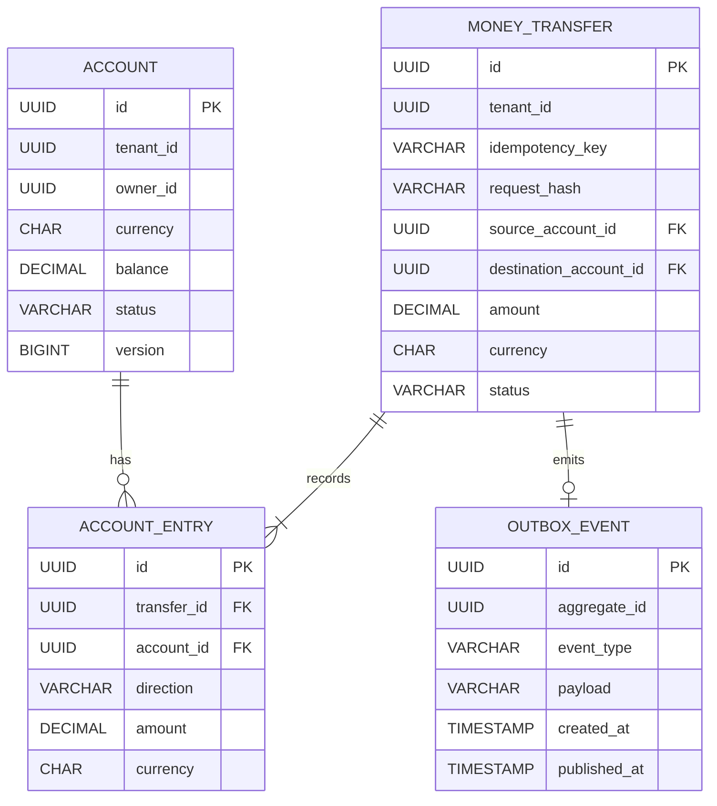

# Xây dựng thao tác chuyển tiền với giao dịch và bất biến dữ liệu

Chuyển tiền là một ví dụ điển hình cho thấy vì sao thao tác database cần được thiết kế quanh **giao dịch (transaction)** và **bất biến dữ liệu (invariant)**. Khi chuyển một khoản tiền từ tài khoản A sang tài khoản B, hệ thống phải bảo đảm tiền bị trừ ở A thì cũng được cộng vào B; không được để tài khoản có số dư âm nếu nghiệp vụ cấm thấu chi; không được ghi nhận cùng một yêu cầu hai lần khi client retry; và không được phát thông báo thành công khi transaction đã rollback.

Với Spring Data R2DBC, các thao tác database được biểu diễn bằng `Mono`/`Flux`. Transaction phải bao trùm toàn bộ reactive pipeline liên quan, dùng đúng `ReactiveTransactionManager` và cùng `ConnectionFactory`. Không gọi `subscribe()` hoặc `block()` giữa các bước chuyển tiền để “chạy cho xong”, vì làm như vậy có thể tách thao tác khỏi transaction context và khiến service trả về trước khi công việc hoàn tất.

Một luồng chuyển tiền an toàn thường gồm:

1. Xác thực người yêu cầu và kiểm tra dữ liệu đầu vào.
2. Đảm bảo yêu cầu có idempotency key để retry không tạo giao dịch trùng.
3. Xác định hai tài khoản hợp lệ và cùng loại tiền.
4. Trừ tiền nguồn bằng một câu `UPDATE` có điều kiện số dư đủ.
5. Cộng tiền đích.
6. Ghi giao dịch và các bút toán ledger tương ứng.
7. Ghi sự kiện outbox nếu cần phát thông báo sau commit.
8. Commit tất cả thay đổi trong cùng transaction.

Nếu bất kỳ bước bắt buộc nào thất bại, transaction phải rollback để số dư, bản ghi chuyển tiền, ledger và outbox không rơi vào trạng thái nửa chừng.

## 1. Xác định bất biến nghiệp vụ trước khi viết code

Trước khi thiết kế repository hoặc SQL, hãy viết ra những điều luôn phải đúng sau mỗi thao tác chuyển tiền thành công.

Với chuyển tiền nội tệ, không thu phí, các bất biến thường gồm:

- Số tiền chuyển phải lớn hơn 0.
- Tài khoản nguồn và tài khoản đích phải khác nhau.
- Hai tài khoản phải tồn tại, đang hoạt động và thuộc đúng tenant/phạm vi nghiệp vụ.
- Người thực hiện phải có quyền chuyển tiền từ tài khoản nguồn.
- Tài khoản nguồn phải có đủ số dư khả dụng.
- Hai tài khoản phải dùng cùng loại tiền nếu không có bước quy đổi ngoại tệ.
- Số dư của mọi tài khoản không được âm nếu nghiệp vụ không cho phép thấu chi.
- Một idempotency key chỉ đại diện cho một yêu cầu với cùng nội dung.
- Một transfer thành công phải có đầy đủ các bút toán tương ứng.
- Các thay đổi số dư, transfer record, ledger và outbox bắt buộc phải commit cùng nhau.

Nếu không có phí và không quy đổi tiền tệ, tổng số dư của hai tài khoản không đổi:

\[
Balance_A^{after} + Balance_B^{after}
= Balance_A^{before} + Balance_B^{before}
\]

Với số tiền chuyển (x > 0):

\[
Balance_A^{after} = Balance_A^{before} - x
\]

\[
Balance_B^{after} = Balance_B^{before} + x
\]

Đây là các bất biến của use case, không chỉ là điều kiện để UI hiển thị. Chúng phải được bảo vệ ở tầng service, câu SQL và constraint database khi có thể.

## 2. Mô hình dữ liệu tối thiểu

Một ví dụ đơn giản có ba nhóm dữ liệu:

- `account`: trạng thái số dư hiện tại.
- `money_transfer`: thông tin một yêu cầu chuyển tiền.
- `account_entry`: các bút toán ghi nợ/ghi có để lưu lịch sử biến động.

Có thể thêm `outbox_event` để phát sự kiện sang hệ thống khác sau khi transaction commit.



Các cột và kiểu dữ liệu cần điều chỉnh theo database. `UUID`, `DECIMAL`, `TIMESTAMP` trong sơ đồ là kiểu khái niệm; SQL Server, PostgreSQL và các hệ quản trị khác có tên kiểu hoặc semantics riêng.

### 2.1 Bảng account

Ví dụ DDL:

```sql
CREATE TABLE account (
    id UUID PRIMARY KEY,
    tenant_id UUID NOT NULL,
    owner_id UUID NOT NULL,
    currency CHAR(3) NOT NULL,
    balance DECIMAL(19, 4) NOT NULL,
    status VARCHAR(20) NOT NULL,
    version BIGINT NOT NULL DEFAULT 0,
    created_at TIMESTAMP NOT NULL,
    modified_at TIMESTAMP NOT NULL,
    CONSTRAINT ck_account_balance_nonnegative CHECK (balance >= 0),
    CONSTRAINT ck_account_status CHECK (status IN ('ACTIVE', 'FROZEN', 'CLOSED'))
);
```

`CHECK (balance >= 0)` là lớp bảo vệ cuối cùng cho invariant không âm. Nếu hệ thống cho phép thấu chi, cần mô hình hóa hạn mức rõ ràng thay vì bỏ constraint mà không có quy tắc thay thế.

`DECIMAL(19,4)` là ví dụ về số thập phân chính xác. Scale thực tế phụ thuộc loại tiền và chính sách lưu trữ. Một số tiền tệ không có chữ số thập phân, một số có 2 hoặc 3 chữ số; hệ thống cần định nghĩa rõ cách chuẩn hóa và làm tròn.

### 2.2 Bảng money_transfer

```sql
CREATE TABLE money_transfer (
    id UUID PRIMARY KEY,
    tenant_id UUID NOT NULL,
    idempotency_key VARCHAR(120) NOT NULL,
    request_hash VARCHAR(64) NOT NULL,
    source_account_id UUID NOT NULL REFERENCES account(id),
    destination_account_id UUID NOT NULL REFERENCES account(id),
    amount DECIMAL(19, 4) NOT NULL,
    currency CHAR(3) NOT NULL,
    status VARCHAR(20) NOT NULL,
    created_at TIMESTAMP NOT NULL,
    completed_at TIMESTAMP,
    CONSTRAINT ck_transfer_amount_positive CHECK (amount > 0),
    CONSTRAINT ck_transfer_different_accounts
        CHECK (source_account_id <> destination_account_id),
    CONSTRAINT uq_transfer_idempotency UNIQUE (tenant_id, idempotency_key)
);
```

Unique constraint trên `(tenant_id, idempotency_key)` giúp database ngăn hai transaction cùng ghi nhận một yêu cầu trong cùng tenant. Nếu idempotency key chỉ có phạm vi người dùng hoặc tài khoản, chọn unique key phù hợp với hợp đồng API, ví dụ `(tenant_id, actor_id, idempotency_key)`.

Không chỉ dựa vào việc client hứa gửi key duy nhất. Database cần thực thi uniqueness vì hai request có thể đến đồng thời ở hai instance khác nhau.

### 2.3 Bảng account_entry cho ledger

```sql
CREATE TABLE account_entry (
    id UUID PRIMARY KEY,
    transfer_id UUID NOT NULL REFERENCES money_transfer(id),
    account_id UUID NOT NULL REFERENCES account(id),
    direction VARCHAR(10) NOT NULL,
    amount DECIMAL(19, 4) NOT NULL,
    currency CHAR(3) NOT NULL,
    created_at TIMESTAMP NOT NULL,
    CONSTRAINT ck_entry_direction CHECK (direction IN ('DEBIT', 'CREDIT')),
    CONSTRAINT ck_entry_amount_positive CHECK (amount > 0),
    CONSTRAINT uq_transfer_account_direction
        UNIQUE (transfer_id, account_id, direction)
);
```

Với một transfer nội tệ, không phí, hệ thống ghi một entry `DEBIT` ở tài khoản nguồn và một entry `CREDIT` ở tài khoản đích. Cả hai entry đều chứa amount dương; trường `direction` xác định ý nghĩa kế toán. Điều này dễ đọc và tránh dùng số âm với semantics không rõ.

Ledger thường được thiết kế append-only: không sửa hoặc xóa entry cũ để “sửa số dư”. Nếu cần điều chỉnh, tạo một giao dịch bù trừ (reversal/adjustment) có tham chiếu tới giao dịch ban đầu.

## 3. Dùng BigDecimal cho tiền

Không dùng `double` hoặc `float` để biểu diễn số tiền vì số dấu phẩy động nhị phân có thể không biểu diễn chính xác nhiều phân số thập phân. Dùng `BigDecimal` ở Java và `DECIMAL`/`NUMERIC` ở database.

```java
BigDecimal amount = new BigDecimal("125.50");
```

Không tạo tiền từ literal double:

```java
// Tránh cách này.
BigDecimal amount = new BigDecimal(125.50);
```

Giá trị nên được tạo từ chuỗi đã validate hoặc từ kiểu dữ liệu thập phân phù hợp. Không để client gửi số tiền dưới dạng floating-point JSON rồi chuyển đổi tùy tiện mà không xác định scale.

### 3.1 Chuẩn hóa scale và rounding

Ứng dụng cần xác định scale theo currency hoặc quy tắc sản phẩm. Ví dụ dùng `Currency` của Java:

```java
BigDecimal normalizeAmount(BigDecimal amount, Currency currency) {
    if (amount == null || amount.signum() <= 0) {
        throw new InvalidTransferAmountException();
    }

    int scale = currency.getDefaultFractionDigits();
    if (scale < 0) {
        throw new UnsupportedCurrencyException(currency.getCurrencyCode());
    }

    try {
        return amount.setScale(scale, RoundingMode.UNNECESSARY);
    } catch (ArithmeticException error) {
        throw new InvalidTransferAmountException(error);
    }
}
```

`RoundingMode.UNNECESSARY` từ chối giá trị có nhiều chữ số thập phân hơn quy tắc currency thay vì âm thầm làm tròn. Nếu sản phẩm cho phép rounding, phải chọn quy tắc rõ ràng và áp dụng nhất quán ở API, service, ledger và database.

`Currency.getDefaultFractionDigits()` là gợi ý chuẩn, không thay thế chính sách tiền tệ của sản phẩm. Một số loại tài sản, đơn vị nội bộ hoặc currency đặc biệt có quy tắc riêng. Hãy quản lý currency và scale được hỗ trợ trong domain.

### 3.2 So sánh BigDecimal

`BigDecimal.equals()` xem cả scale, vì vậy `10.0` và `10.00` không bằng nhau theo `equals`. Khi so sánh giá trị số, dùng `compareTo`:

```java
if (amount.compareTo(BigDecimal.ZERO) <= 0) {
    throw new InvalidTransferAmountException();
}
```

Khi lưu/đọc, kiểm tra database không làm tròn ngoài ý muốn và precision đủ cho số dư tối đa. Nếu cộng tiền vượt precision cột, database phải phát lỗi và transaction phải rollback.

## 4. Tách request, command và actor đã xác thực

Request HTTP có thể chứa:

```json
{
  "sourceAccountId": "...",
  "destinationAccountId": "...",
  "amount": "125.50",
  "currency": "USD",
  "idempotencyKey": "client-generated-unique-key"
}
```

Actor/owner không nên được tin từ request body. Server lấy actor ID từ security context đã xác thực và truyền vào use case. Service phải kiểm tra actor có quyền chuyển tiền từ tài khoản nguồn, đồng thời áp dụng tenant boundary.

Một command nội bộ có thể là:

```java
public record TransferCommand(
    UUID tenantId,
    UUID actorId,
    UUID sourceAccountId,
    UUID destinationAccountId,
    BigDecimal amount,
    Currency currency,
    String idempotencyKey,
    String requestHash
) {}
```

`tenantId` và `actorId` trong command được tạo từ context tin cậy ở server. Không để client tự chọn tenant hoặc actor để vượt qua phân quyền. `requestHash` là fingerprint ổn định của nội dung nghiệp vụ đã chuẩn hóa, không phải password hoặc token.

Trước khi mở transaction, có thể validate các điều kiện thuần túy như:

- amount hợp lệ và đã chuẩn hóa scale.
- source và destination khác nhau.
- currency thuộc danh sách hỗ trợ.
- idempotency key có độ dài/format hợp lệ.
- reason hoặc metadata có giới hạn kích thước nếu API yêu cầu.

Kiểm tra tồn tại, quyền sở hữu và trạng thái account vẫn cần xác nhận từ database trong transaction phù hợp.

## 5. Cấu hình reactive transaction manager

Spring Data R2DBC sử dụng `R2dbcTransactionManager` để quản lý transaction cho một `ConnectionFactory`:

```java
@Configuration
public class R2dbcTransactionConfiguration {

    @Bean
    ReactiveTransactionManager r2dbcTransactionManager(
            ConnectionFactory connectionFactory) {
        return new R2dbcTransactionManager(connectionFactory);
    }

    @Bean
    TransactionalOperator transactionalOperator(
            ReactiveTransactionManager transactionManager) {
        return TransactionalOperator.create(transactionManager);
    }
}
```

Trong ứng dụng có nhiều `ConnectionFactory`, phải chỉ định đúng qualifier cho factory và transaction manager. Một reactive transaction manager chỉ quản lý transaction trên connection factory mà nó được cấu hình.

Spring Boot thường tự cấu hình một số bean theo dependency và property của ứng dụng. Nếu đã có nhiều database hoặc custom configuration, hãy kiểm tra bean thực tế và tránh tạo hai transaction manager không rõ bean nào được chọn.

## 6. Reactive transaction khác transaction imperative ở đâu?

Với reactive transaction, Spring truyền transaction context qua Reactor Context. Các thao tác database tham gia transaction cần nằm trong cùng reactive chain và dùng cùng `ConnectionFactory`.

Không làm như sau:

```java
// Sai: subscribe tách công việc khỏi pipeline do caller quản lý.
accountRepository.debit(sourceId, amount).subscribe();
return accountRepository.credit(destinationId, amount);
```

Không làm như sau:

```java
// Sai: block giữa các bước có thể làm mất reactive composition
// và gây deadlock/blocking trên thread không phù hợp.
Account source = accountRepository.findById(sourceId).block();
```

Hãy nối publisher bằng `flatMap`, `then`, `zip` hoặc operator phù hợp và trả publisher cho Spring/caller:

```java
return debit(sourceId, amount)
    .then(credit(destinationId, amount));
```

Đoạn trên mới chỉ nối thứ tự; để atomic, toàn bộ chain phải nằm trong transaction boundary.

## 7. Chọn @Transactional hay TransactionalOperator

Có hai cách phổ biến.

### 7.1 Annotation @Transactional

```java
@Service
public class TransferService {

    @Transactional(transactionManager = "r2dbcTransactionManager")
    public Mono<TransferReceipt> transfer(TransferCommand command) {
        return executeTransfer(command);
    }
}
```

Spring áp dụng transaction cho publisher reactive được trả về khi method được gọi qua Spring proxy. Cần chú ý:

- Method phải được gọi qua proxy quản lý transaction.
- Self-invocation trong cùng object có thể bỏ qua proxy và không kích hoạt annotation như mong muốn.
- Method phải trả `Mono`/`Flux` để transaction interceptor quản lý vòng đời reactive.
- Không subscribe nội bộ rồi trả về publisher khác.
- Chọn đúng transaction manager khi có nhiều database.

### 7.2 TransactionalOperator

`TransactionalOperator` phù hợp khi muốn thể hiện ranh giới transaction ngay trong reactive chain:

```java
Mono<TransferReceipt> result = transactionalOperator.transactional(
    executeTransfer(command));
```

Cách này dễ kết hợp với retry toàn transaction, xử lý idempotency và các pipeline được tạo động. Không cần bọc cả hai cách annotation và operator cho cùng một thao tác nếu không có lý do rõ ràng; lồng transaction có thể làm semantics khó hiểu.

## 8. Không dựa vào read-then-save để bảo vệ số dư

Một cách dễ viết nhưng có race condition:

```java
return accountRepository.findById(sourceId)
    .flatMap(source -> {
        if (source.getBalance().compareTo(amount) < 0) {
            return Mono.error(new InsufficientFundsException());
        }

        source.setBalance(source.getBalance().subtract(amount));
        return accountRepository.save(source);
    });
```

Hai request có thể cùng đọc số dư 100. Mỗi request muốn chuyển 80; cả hai cùng thấy đủ tiền, sau đó cùng lưu số dư 20 hoặc một giá trị bị ghi đè tùy cơ chế update. Nếu không có locking/version predicate phù hợp, hệ thống có thể chấp nhận hai lệnh vượt quá số dư.

Đọc số dư để hiển thị hoặc kiểm tra sơ bộ không thay thế được một thao tác cập nhật nguyên tử. Điều kiện “số dư vẫn đủ tại đúng thời điểm cập nhật” phải nằm trong câu SQL hoặc được bảo vệ bằng lock/version mechanism.

## 9. Trừ tiền bằng UPDATE có điều kiện

Một mẫu an toàn hơn là để database kiểm tra và trừ trong cùng câu lệnh:

```sql
UPDATE account
SET balance = balance - :amount,
    version = version + 1,
    modified_at = :now
WHERE id = :sourceAccountId
  AND tenant_id = :tenantId
  AND owner_id = :actorId
  AND currency = :currency
  AND status = 'ACTIVE'
  AND balance >= :amount;
```

Database thực hiện predicate và update như một thao tác nguyên tử trên hàng. Nếu hai request cạnh tranh cùng tài khoản, chúng không thể cùng thành công dựa trên một số dư cũ đã đọc trước đó: update sau phải đánh giá điều kiện trên trạng thái hàng phù hợp theo concurrency semantics của database.

Với `DatabaseClient`:

```java
Mono<Long> debit(
        TransferCommand command,
        Instant now) {

    return databaseClient.sql("""
            UPDATE account
            SET balance = balance - :amount,
                version = version + 1,
                modified_at = :now
            WHERE id = :sourceAccountId
              AND tenant_id = :tenantId
              AND owner_id = :actorId
              AND currency = :currency
              AND status = 'ACTIVE'
              AND balance >= :amount
            """)
        .bind("amount", command.amount())
        .bind("now", now)
        .bind("sourceAccountId", command.sourceAccountId())
        .bind("tenantId", command.tenantId())
        .bind("actorId", command.actorId())
        .bind("currency", command.currency().getCurrencyCode())
        .fetch()
        .rowsUpdated();
}
```

Nếu `rowsUpdated` bằng 1, thao tác debit đã cập nhật đúng một hàng. Nếu bằng 0, một trong các điều kiện không còn đúng: account không tồn tại, sai tenant/owner, không hoạt động, currency không khớp hoặc số dư không đủ. Có thể trả lỗi tổng quát để không tiết lộ thông tin tài khoản; nếu nghiệp vụ cần lỗi chi tiết, thực hiện kiểm tra có kiểm soát trong transaction và vẫn giữ điều kiện `balance >= :amount` ở câu UPDATE.

Không lấy số dư ra Java rồi thay bằng giá trị tính sẵn trong câu `SET balance = :newBalance`; cách đó dễ ghi đè thay đổi đồng thời. Hãy cập nhật tương đối trên giá trị hiện tại trong database: `balance = balance - :amount`.

## 10. Cộng tiền đích trong cùng transaction

Sau khi debit thành công, credit tài khoản đích:

```sql
UPDATE account
SET balance = balance + :amount,
    version = version + 1,
    modified_at = :now
WHERE id = :destinationAccountId
  AND tenant_id = :tenantId
  AND currency = :currency
  AND status = 'ACTIVE';
```

Ví dụ Java:

```java
Mono<Long> credit(
        TransferCommand command,
        Instant now) {

    return databaseClient.sql("""
            UPDATE account
            SET balance = balance + :amount,
                version = version + 1,
                modified_at = :now
            WHERE id = :destinationAccountId
              AND tenant_id = :tenantId
              AND currency = :currency
              AND status = 'ACTIVE'
            """)
        .bind("amount", command.amount())
        .bind("now", now)
        .bind("destinationAccountId", command.destinationAccountId())
        .bind("tenantId", command.tenantId())
        .bind("currency", command.currency().getCurrencyCode())
        .fetch()
        .rowsUpdated();
}
```

Nếu credit cập nhật 0 hàng, phải phát lỗi để transaction rollback cả debit. Không được trả thành công chỉ vì tiền nguồn đã bị trừ.

Database constraint về precision/range cũng có thể khiến credit thất bại, ví dụ số dư đích vượt precision cột. Lỗi đó phải làm rollback toàn bộ transfer.

## 11. Kiểm tra số hàng bị ảnh hưởng

Mỗi câu update quan trọng cần xác nhận số hàng đúng theo hợp đồng. Có thể viết helper:

```java
Mono<Void> requireExactlyOne(Mono<Long> rowsUpdated,
                             Supplier<? extends RuntimeException> error) {
    return rowsUpdated.flatMap(count -> {
        if (count == 1L) {
            return Mono.empty();
        }
        return Mono.error(error.get());
    });
}
```

Nếu update nguồn trả 0, phát lỗi nghiệp vụ phù hợp. Nếu update đích trả 0, phát lỗi tài khoản đích không còn đủ điều kiện nhận tiền. Nếu driver trả số hàng khác 1, coi đó là lỗi bất thường cho thao tác theo ID.

Không dùng `onErrorComplete()` hoặc `onErrorResume(error -> Mono.empty())` để bỏ qua lỗi update. Việc không phát exception sẽ khiến pipeline có thể tiếp tục ghi ledger hoặc trả receipt dù số dư chưa được cập nhật đúng.

## 12. Tạo transfer record và idempotency key

Client có thể gửi một lệnh chuyển tiền, server xử lý và commit thành công, nhưng phản hồi HTTP bị mất do timeout. Client không biết kết quả và gửi lại. Nếu server chỉ nhìn thấy một request mới, tiền có thể bị trừ hai lần.

Idempotency key giải quyết tình huống này:

- Client tạo một key duy nhất cho một ý định chuyển tiền.
- Mọi lần retry cùng ý định dùng lại key đó.
- Database có unique constraint trên phạm vi key đã chọn.
- Server lưu fingerprint nội dung request cùng key.
- Nếu key đã tồn tại với cùng fingerprint, trả lại kết quả đã ghi nhận.
- Nếu key được dùng lại cho nội dung khác, trả lỗi conflict.

Không tạo idempotency key mới ở mỗi lần retry. Cũng không dùng một key chung cho nhiều hành động độc lập.

### 12.1 Fingerprint request

Fingerprint nên được tạo từ dữ liệu nghiệp vụ đã chuẩn hóa, ví dụ tenant, actor, source, destination, amount chuẩn scale và currency:

```java
String canonical = String.join("|",
    command.tenantId().toString(),
    command.actorId().toString(),
    command.sourceAccountId().toString(),
    command.destinationAccountId().toString(),
    command.amount().toPlainString(),
    command.currency().getCurrencyCode());

String requestHash = sha256Hex(canonical);
```

`sha256Hex` là helper tạo SHA-256. Nếu fingerprint có chứa dữ liệu có entropy thấp hoặc cần chống dò, cân nhắc HMAC với khóa được quản lý an toàn. Không đưa raw request hoặc secret vào log khi tạo fingerprint.

Canonicalization phải ổn định: cùng một khoản tiền không được tạo hash khác chỉ vì scale `10.0`/`10.00` hoặc khác thứ tự field. Hãy chuẩn hóa trước khi hash.

## 13. Ghi idempotency reservation trong transaction

Ở đầu transaction, tạo `money_transfer` với trạng thái `PROCESSING`:

```sql
INSERT INTO money_transfer (
    id, tenant_id, idempotency_key, request_hash,
    source_account_id, destination_account_id,
    amount, currency, status, created_at
)
VALUES (
    :id, :tenantId, :idempotencyKey, :requestHash,
    :sourceAccountId, :destinationAccountId,
    :amount, :currency, 'PROCESSING', :createdAt
);
```

Bản ghi reservation nằm trong cùng transaction với debit/credit. Khi mọi bước thành công, update trạng thái thành `COMPLETED`. Nếu bất kỳ bước nào thất bại và transaction rollback, reservation cũng rollback; request có thể được thử lại theo chính sách nghiệp vụ.

Nếu muốn lưu cả những lần chuyển tiền thất bại, cần một thiết kế riêng cho lịch sử attempt/failure. Không thể vừa rollback toàn bộ transaction vừa mong bản ghi `FAILED` bên trong transaction đó còn tồn tại. Có thể ghi audit thất bại trong một transaction độc lập sau rollback, nhưng phải tránh để bản ghi thất bại bị hiểu nhầm là một transfer đã thực hiện.

## 14. Xử lý request trùng sau khi transaction kết thúc

Khi hai request cùng idempotency key đến đồng thời, unique constraint quyết định chỉ một transaction được reservation thành công. Request còn lại nhận lỗi duplicate/unique constraint. Sau khi transaction của request trùng kết thúc và rollback, service đọc transfer đã được commit bởi request thắng:

```java
Mono<TransferReceipt> transfer(TransferCommand command) {
    Mono<TransferReceipt> attempt = Mono.defer(() ->
        transactionalOperator.transactional(executeOnce(command)));

    return attempt
        .retryWhen(deadlockRetry())
        .onErrorResume(error -> {
            if (!isIdempotencyKeyConflict(error)) {
                return Mono.error(error);
            }

            return findByIdempotencyKey(
                    command.tenantId(), command.idempotencyKey())
                .switchIfEmpty(Mono.error(error))
                .flatMap(existing -> {
                    if (!existing.requestHash().equals(command.requestHash())) {
                        return Mono.error(new IdempotencyKeyReuseException());
                    }
                    return Mono.just(toReceipt(existing));
                });
        });
}
```

Điểm quan trọng là `onErrorResume` xử lý lỗi duplicate ở **bên ngoài** publisher đã được `TransactionalOperator` bọc. Transaction gây lỗi phải kết thúc/rollback trước khi query đọc kết quả đã tồn tại. Trên một số database, sau lỗi constraint, transaction hiện tại không thể tiếp tục query; vì vậy không truy vấn bản ghi cũ bên trong transaction đã bị đánh dấu lỗi.

`isIdempotencyKeyConflict` phải nhận diện đúng constraint idempotency, không bắt mọi lỗi integrity. Một lỗi foreign key hoặc check constraint không có nghĩa request bị gửi trùng. Exception type, SQL state và constraint name phụ thuộc driver/database; hãy phân loại theo lỗi thực tế của hệ thống.

Nếu bản ghi cùng key có request hash khác, trả conflict thay vì trả kết quả của một transfer khác. Không được dùng key như một cách để client đổi nội dung request mà vẫn nhận kết quả cũ.

## 15. Tạo luồng transfer trong một reactive transaction

Một service có thể điều phối tất cả bước bằng `TransactionalOperator`:

```java
Mono<TransferReceipt> executeOnce(TransferCommand command) {
    UUID transferId = UUID.randomUUID();
    Instant now = clock.instant();

    return validateAccounts(command)
        .then(insertTransferReservation(transferId, command, now))
        .then(requireExactlyOne(
            debit(command, now),
            InsufficientFundsOrSourceUnavailableException::new))
        .then(requireExactlyOne(
            credit(command, now),
            DestinationAccountUnavailableException::new))
        .then(insertDebitEntry(transferId, command, now))
        .then(insertCreditEntry(transferId, command, now))
        .then(markTransferCompleted(transferId, now))
        .then(insertTransferOutboxEvent(transferId, command, now))
        .thenReturn(new TransferReceipt(
            transferId,
            TransferStatus.COMPLETED,
            command.amount(),
            command.currency()));
}
```

Đây là cấu trúc điều phối minh họa. Các helper `validateAccounts`, `insertTransferReservation`, `insertDebitEntry`, `insertCreditEntry`, `markTransferCompleted` và `insertTransferOutboxEvent` đều phải trả publisher được compose; không tự subscribe hoặc tạo transaction riêng. `UUID` và timestamp có thể được tạo một lần cho một attempt logic; nếu retry transaction, cần quyết định rõ ID/time có được giữ ổn định hay tạo lại. Idempotency key mới là định danh ổn định giữa các lần request retry.

Bao bọc transaction và retry ở lớp gọi:

```java
Mono<TransferReceipt> executeTransaction(TransferCommand command) {
    return Mono.defer(() -> transactionalOperator.transactional(
        executeOnce(command)));
}
```

`Mono.defer` tạo publisher giao dịch mới cho mỗi lần subscribe/retry. Khi `executeOnce` phát lỗi trước khi hoàn tất, `TransactionalOperator` rollback các thao tác tham gia transaction.

## 16. Ví dụ service hoàn chỉnh hơn

Đoạn dưới đây thể hiện ranh giới và thứ tự; DTO, SQL mapping và phân loại exception được tách thành helper để dễ đọc:

```java
@Service
public class MoneyTransferService {

    private final TransactionalOperator transactions;
    private final TransferPersistence persistence;
    private final Clock clock;

    public MoneyTransferService(
            TransactionalOperator transactions,
            TransferPersistence persistence,
            Clock clock) {
        this.transactions = transactions;
        this.persistence = persistence;
        this.clock = clock;
    }

    public Mono<TransferReceipt> transfer(TransferCommand command) {
        validateCommand(command);

        Mono<TransferReceipt> attempt = Mono.defer(() ->
            transactions.transactional(executeOnce(command)));

        return attempt
            .retryWhen(deadlockRetry())
            .onErrorResume(error ->
                handleIdempotencyConflict(error, command));
    }

    private Mono<TransferReceipt> executeOnce(TransferCommand command) {
        UUID transferId = UUID.randomUUID();
        Instant now = clock.instant();

        return persistence.validateAccounts(command)
            .then(persistence.insertReservation(transferId, command, now))
            .then(persistence.debit(command, now))
            .flatMap(count -> requireOne(count,
                new InsufficientFundsOrSourceUnavailableException()))
            .then(persistence.credit(command, now))
            .flatMap(count -> requireOne(count,
                new DestinationAccountUnavailableException()))
            .then(persistence.insertLedgerEntries(transferId, command, now))
            .then(persistence.completeTransfer(transferId, now))
            .then(persistence.insertOutboxEvent(transferId, command, now))
            .thenReturn(new TransferReceipt(
                transferId,
                TransferStatus.COMPLETED,
                command.amount(),
                command.currency()));
    }

    private Mono<Void> requireOne(Long count, RuntimeException error) {
        return count == 1L ? Mono.empty() : Mono.error(error);
    }
}
```

`TransferPersistence` là adapter dùng một `DatabaseClient`/`ConnectionFactory` để thực thi các câu SQL. `handleIdempotencyConflict` chỉ đọc kết quả đã commit sau khi transaction thất bại vì đúng unique constraint. `deadlockRetry()` chỉ retry lỗi deadlock/serialization được xác định là tạm thời.

Trong code thật, `validateCommand` nên trả lỗi rõ nếu amount, currency, key hoặc account IDs không hợp lệ. Kiểm tra quyền sở hữu phải nằm trong persistence predicate hoặc truy vấn đáng tin cậy; không dựa vào giá trị owner do client gửi.

## 17. Kiểm tra account trong transaction

Trước khi cập nhật, có thể truy vấn metadata hai tài khoản để phân biệt lỗi:

```sql
SELECT id, tenant_id, owner_id, currency, status
FROM account
WHERE tenant_id = :tenantId
  AND id IN (:sourceAccountId, :destinationAccountId);
```

Service xác nhận:

- Có đủ hai account.
- Account nguồn thuộc actor hiện tại.
- Cả hai account active.
- Currency giống currency của command.
- Hai ID khác nhau.

Truy vấn kiểm tra này cải thiện thông báo nghiệp vụ nhưng không thay thế điều kiện trong `UPDATE`. Account có thể bị freeze hoặc thay đổi trạng thái giữa lúc kiểm tra và update; vì vậy debit/credit vẫn chứa predicate `status = 'ACTIVE'`, currency, tenant và owner tương ứng.

Nếu thông tin sở hữu/currency là bất biến sau khi tạo account, có thể dựa vào constraint/quyền cập nhật để giữ chúng không đổi. Nếu chúng có thể thay đổi đồng thời, cần lock hoặc điều kiện update kiểm tra lại.

## 18. Chọn mức cô lập transaction

Isolation level quyết định các transaction đồng thời nhìn thấy và khóa dữ liệu như thế nào. Mức mặc định thường là `READ_COMMITTED` tùy database/cấu hình. Với chuyển tiền, câu `UPDATE` có điều kiện và constraint database là nền tảng bảo vệ số dư.

Không tự động nâng mọi transfer lên `SERIALIZABLE` mà không đo. Isolation cao hơn có thể tạo nhiều lock, block hoặc serialization failure; ứng dụng cần retry đúng loại lỗi nếu chọn mức đó.

Các điểm cần xác định:

- Conditional update có bảo đảm không debit quá số dư trong database mục tiêu không?
- Hai account có thể bị cập nhật đồng thời bởi nhiều luồng hoặc service khác không?
- Có predicate nghiệp vụ phức tạp trên nhiều hàng cần bảo vệ bằng lock/serializable không?
- Transaction duration có ngắn và không chứa network call bên ngoài không?
- Deadlock/serialization failure được nhận diện và xử lý ra sao?

Nếu dùng `TransactionalOperator` với isolation tùy chỉnh, cấu hình `TransactionDefinition` phù hợp trước khi tạo operator. Không đổi isolation bằng một câu SQL tùy tiện sau khi transaction đã bắt đầu nếu database không hỗ trợ semantics đó.

## 19. Pessimistic locking và SELECT FOR UPDATE

Một phương án là khóa hai hàng account trước khi đọc số dư, sau đó kiểm tra và cập nhật trong transaction. Trên PostgreSQL có thể dùng:

```sql
SELECT id, balance, currency, status
FROM account
WHERE id IN (:sourceAccountId, :destinationAccountId)
ORDER BY id
FOR UPDATE;
```

`FOR UPDATE` giữ row lock đến khi transaction kết thúc. `ORDER BY id` hướng tới việc lấy khóa theo thứ tự nhất quán, giúp giảm deadlock khi nhiều transfer đụng cùng cặp tài khoản.

Cú pháp khóa khác nhau giữa database. SQL Server thường dùng table hints như `UPDLOCK`/`ROWLOCK` theo tình huống; MySQL/InnoDB cũng có semantics riêng. Không giả định một query `FOR UPDATE` chạy giống nhau trên mọi dialect.

Ngay cả khi dùng row lock, vẫn cần:

- Transaction boundary đúng.
- Thời gian giữ lock ngắn.
- Thứ tự lock nhất quán ở mọi use case.
- Kiểm tra số dư và currency trong transaction.
- Constraint bảo vệ invariant ở database.
- Xử lý deadlock/timeout.

Không giữ lock trong lúc gọi HTTP, gửi email hoặc chờ người dùng xác nhận.

## 20. Optimistic locking với @Version

Spring Data Relational hỗ trợ optimistic locking bằng `@Version` trong những thao tác entity được Spring Data quản lý:

```java
@Table("account")
public class Account {

    @Id
    private UUID id;

    private BigDecimal balance;

    @Version
    private Long version;
}
```

Khi lưu entity có version, Spring Data có thể dùng version hiện tại trong điều kiện update và tăng version khi thành công. Nếu dữ liệu đã bị thay đổi bởi transaction khác, update không khớp và có thể phát `OptimisticLockingFailureException`.

Optimistic locking phù hợp khi xung đột hiếm và thao tác được thực hiện qua đường entity mapping hỗ trợ version. Nếu tự viết SQL `UPDATE account SET balance = ...` bằng `DatabaseClient`, `@Version` không tự động thêm predicate hoặc tăng version cho câu SQL đó; phải tự viết `WHERE version = :expectedVersion` và kiểm tra `rowsUpdated()`.

Với số dư tài chính, conditional update `balance >= :amount` trực tiếp trong SQL thường là điều kiện cốt lõi dù có dùng optimistic version hay không. `@Version` không thay thế kiểm tra số dư.

## 21. Deadlock khi hai transfer đi ngược chiều

Giả sử hai transaction chạy đồng thời:

- T1 chuyển từ A sang B: khóa/cập nhật A trước.
- T2 chuyển từ B sang A: khóa/cập nhật B trước.
- T1 tiếp tục cần khóa B.
- T2 tiếp tục cần khóa A.

Hai transaction có thể chờ nhau và database phát hiện deadlock, hủy một transaction. Đây không nhất thiết là lỗi logic; đó là một kết quả concurrency mà ứng dụng cần xử lý.

Các cách giảm deadlock:

- Khóa cả hai account theo thứ tự ID nhất quán trước khi cập nhật.
- Giữ transaction ngắn và tránh query không cần thiết trong lúc đang giữ lock.
- Dùng index cho predicate update để giảm phạm vi khóa.
- Không thực hiện network call trong transaction.
- Retry có giới hạn cho deadlock/serialization failure được nhận diện.

Không retry mọi lỗi. Insufficient funds, account frozen, invalid currency và permission denied không trở nên hợp lệ chỉ vì thử lại.

## 22. Retry toàn bộ transaction, không retry riêng một bước

Nếu transaction bị database rollback vì deadlock, hãy tạo một transaction mới và chạy lại toàn bộ workflow. Không retry riêng câu credit sau khi debit đã bị rollback hoặc sau khi transaction hiện tại đã kết thúc.

Ví dụ Reactor:

```java
Retry deadlockRetry() {
    return Retry.backoff(3, Duration.ofMillis(100))
        .maxBackoff(Duration.ofSeconds(1))
        .filter(this::isRetryableConcurrencyFailure);
}
```

Retry phải bao ngoài transaction publisher:

```java
Mono.defer(() -> transactionalOperator.transactional(executeOnce(command)))
    .retryWhen(deadlockRetry());
```

Mỗi lần subscribe lại tạo transaction mới. `isRetryableConcurrencyFailure` cần nhận diện deadlock/serialization failure theo exception type, SQL state hoặc vendor code của database. Không retry timeout không rõ trạng thái nếu thao tác có thể đã commit; dùng idempotency key để giải quyết trường hợp client không biết kết quả.

Giới hạn số lần retry và dùng backoff để tránh tạo bão request khi database đang chịu tải cao. Ghi metric số lần retry và số transfer thất bại do concurrency.

## 23. Ghi ledger hai bút toán

Sau khi debit và credit thành công, ghi hai ledger entry trong cùng transaction:

```java
Mono<Void> insertLedgerEntries(
        UUID transferId,
        TransferCommand command,
        Instant now) {

    return insertEntry(
            transferId,
            command.sourceAccountId(),
            "DEBIT",
            command.amount(),
            command.currency(),
            now)
        .then(insertEntry(
            transferId,
            command.destinationAccountId(),
            "CREDIT",
            command.amount(),
            command.currency(),
            now));
}
```

Mỗi entry phải tham chiếu transfer ID. Unique constraint trên transfer/account/direction giúp ngăn bút toán trùng cho cùng transfer. Cả hai entry phải được ghi cùng transaction với số dư.

Với một ledger kế toán tổng quát, thường biểu diễn debit/credit theo tài khoản sổ cái (ledger account) và quy tắc cân bằng tổng debit/credit. Ví dụ ở đây chỉ mô tả chuyển tiền giữa hai tài khoản khách hàng. Nếu có phí, thuế, tài khoản clearing hoặc quy đổi ngoại tệ, cần thêm các bút toán tương ứng và xác định rõ invariant kế toán cho từng currency.

## 24. Số dư hiện tại và ledger có vai trò khác nhau

`account.balance` có thể là số dư materialized để đọc nhanh. `account_entry` lưu lịch sử biến động. Hệ thống cần có quy tắc bảo đảm chúng nhất quán:

- Mỗi thay đổi số dư bắt buộc có ledger entry tương ứng.
- Ledger entry không bị sửa/xóa tùy tiện.
- Có thể đối soát số dư với tổng ledger theo quy tắc opening balance và loại entry.
- Điều chỉnh được ghi thành entry mới, không âm thầm sửa lịch sử.
- Có job reconciliation phát hiện chênh lệch và cảnh báo.

Nếu ledger là nguồn sự thật, số dư hiện tại có thể là projection/snapshot được tính hoặc cập nhật theo transaction. Không nên cập nhật balance ở một transaction rồi ghi ledger bất đồng bộ mà không có outbox/consistency mechanism.

## 25. Ghi outbox thay vì gửi message trong transaction

Sau chuyển tiền thành công, hệ thống có thể cần gửi email, thông báo push hoặc event sang service khác. Không gửi trực tiếp trong transaction:

```java
// Không nên: message có thể đã gửi dù transaction database rollback sau đó.
return debit(...)
    .then(credit(...))
    .then(notificationClient.sendTransferCompleted(...));
```

Một HTTP call hoặc broker publish không rollback cùng database. Nếu publish thành công nhưng commit thất bại, hệ thống bên ngoài nhận một transfer không tồn tại. Nếu commit thành công nhưng publish thất bại, thông báo bị mất.

Transactional outbox giải quyết bằng cách ghi event vào bảng outbox trong cùng transaction:

```sql
INSERT INTO outbox_event (
    id, aggregate_id, event_type, payload, created_at, published_at
)
VALUES (
    :id, :transferId, 'TransferCompleted', :payload, :createdAt, NULL
);
```

Worker riêng đọc các event chưa publish, gửi tới broker rồi đánh dấu published. Worker cần xử lý at-least-once delivery; consumer phải idempotent theo event ID vì có thể gửi lại khi worker chết sau khi publish nhưng trước khi cập nhật trạng thái.

Không dùng `AfterSaveCallback` hoặc `doOnSuccess` để gửi side effect và giả định transaction đã commit. Callback sau save không đồng nghĩa after-commit.

## 26. Transaction không trải qua nhiều database tự động

`R2dbcTransactionManager` quản lý một `ConnectionFactory`. Nếu account nằm ở database A, ledger ở database B và outbox ở database C, một transaction R2DBC thông thường không tự commit/rollback tất cả như một giao dịch phân tán.

Để chuyển tiền cần atomicity, nên đặt các dữ liệu bắt buộc của cùng một giao dịch trong cùng transactional database/bounded context nếu kiến trúc cho phép. Nếu phải phối hợp nhiều database hoặc service, cần thiết kế distributed transaction được hỗ trợ hoặc saga với bước bù trừ, outbox và trạng thái workflow rõ ràng.

Không gọi một service ngoài để “cộng tiền đích” giữa lúc database nguồn đang giữ lock rồi mong một transaction local bảo vệ cả hai. Network call có thể timeout, service đích có thể commit nhưng phản hồi bị mất, và transaction nguồn không thể rollback transaction độc lập đó.

## 27. Xử lý phí và chuyển đổi ngoại tệ

Ví dụ cơ bản giả định hai tài khoản cùng currency và không có phí. Nếu có phí, tổng số dư hai tài khoản không còn được bảo toàn theo công thức đơn giản. Cần xác định tài khoản nhận phí và thêm ledger entry tương ứng.

Nếu chuyển đổi ngoại tệ, không thể trừ một amount và cộng cùng một amount vào hai currency khác nhau. Cần lưu:

- Amount và currency nguồn.
- Amount và currency đích.
- Exchange rate và nguồn/timestamp của rate.
- Phí, spread và quy tắc rounding.
- Ledger postings cho từng currency/account.
- Quy tắc xử lý thay đổi tỷ giá sau khi quote được chấp nhận.

Mỗi currency có invariant riêng. Không cộng số dư USD và EUR để khẳng định bảo toàn tiền nếu không quy đổi theo một valuation rule rõ ràng.

## 28. Trạng thái transfer và quy tắc chuyển trạng thái

Một mô hình đơn giản có thể dùng:

| Trạng thái | Ý nghĩa |
|---|---|
| `PROCESSING` | Reservation đã được tạo bên trong transaction đang chạy. |
| `COMPLETED` | Debit, credit, ledger và outbox bắt buộc đã được ghi và transaction commit. |
| `FAILED` | Một attempt thất bại được lưu theo quy trình riêng nếu nghiệp vụ cần lịch sử thất bại. |
| `REVERSED` | Một transfer đã hoàn tất được bù trừ bằng giao dịch reversal. |

Nếu `PROCESSING` được tạo và cập nhật `COMPLETED` trong cùng transaction, transaction khác thường không nhìn thấy trạng thái trung gian đã commit. Nếu workflow có bước xử lý kéo dài bên ngoài database, `PROCESSING` có thể là trạng thái bền vững; khi đó cần lease, timeout, retry, reconciliation và quy tắc hoàn tất rõ ràng. Không dùng cùng semantics cho hai mô hình khác nhau.

Không sửa transfer đã hoàn tất về `FAILED` để che lỗi. Nếu cần đảo giao dịch, tạo reversal record và bút toán ngược có liên kết với transfer gốc.

## 29. Bảo vệ khỏi cập nhật đồng thời và mất cập nhật

Ngoài conditional debit, cần xác định mọi đường code có thể thay đổi balance. Nếu một job khác dùng `SELECT balance` rồi `save` entity cũ, nó có thể ghi đè số dư do transfer vừa cập nhật.

Các quy tắc nên áp dụng:

- Mọi thay đổi balance đi qua một persistence adapter/use case có cùng quy tắc concurrency.
- Không cập nhật balance trực tiếp từ admin script mà bỏ qua ledger.
- Dùng SQL tương đối hoặc version predicate, không ghi đè số dư cũ.
- Nếu dùng optimistic locking, xử lý conflict như một kết quả concurrency.
- Có quyền database hạn chế để tránh ứng dụng khác ghi trực tiếp không theo quy tắc.
- Đối soát ledger và balance định kỳ.

Một invariant chỉ thực sự được bảo vệ nếu mọi đường ghi đều tuân thủ nó. Một method transfer an toàn không giúp ích nếu một endpoint khác vẫn có thể set `balance = 0` mà không ghi ledger.

## 30. Kiểm thử bằng StepVerifier

Vì service trả `Mono<TransferReceipt>`, có thể dùng `StepVerifier` để kiểm tra kết quả:

```java
StepVerifier.create(transferService.transfer(command))
    .assertNext(receipt -> {
        assertThat(receipt.status()).isEqualTo(TransferStatus.COMPLETED);
        assertThat(receipt.amount()).isEqualByComparingTo("25.00");
    })
    .verifyComplete();
```

Test này kiểm tra reactive signal và receipt. Nó chưa chứng minh số dư, ledger hoặc transaction đúng; cần truy vấn database sau khi publisher hoàn tất để xác nhận side effects.

## 31. Integration test cho happy path

Chuẩn bị hai account trong database test:

- A có 100.00 USD.
- B có 20.00 USD.
- Chuyển 30.00 USD từ A sang B.

Sau khi transfer hoàn tất, xác nhận:

- A còn 70.00 USD.
- B có 50.00 USD.
- Một transfer `COMPLETED` được lưu.
- Có đúng hai ledger entry: một `DEBIT`, một `CREDIT`.
- Có một outbox event tương ứng nếu use case yêu cầu.
- Tổng số dư hai account trước và sau bằng nhau.

Nên dùng database thực tế hoặc Testcontainers với cùng loại engine/driver để kiểm tra transaction và constraint. Mock repository không thể chứng minh row lock, isolation hoặc rollback database hoạt động đúng.

## 32. Kiểm thử rollback khi credit thất bại

Tạo tình huống tài khoản đích không hợp lệ hoặc bị đóng giữa các bước theo cách có thể tái hiện. Sau khi service phát lỗi:

- Số dư nguồn phải giữ nguyên.
- Số dư đích phải giữ nguyên.
- Không có transfer `COMPLETED` đã commit.
- Không có ledger entry một phía.
- Không có outbox event cho transfer thất bại.

Đây là test quan trọng nhất để xác nhận debit và credit nằm trong cùng transaction. Nếu source balance giảm dù credit lỗi, transaction boundary hoặc connection/transaction manager đang sai.

## 33. Kiểm thử insufficient funds

Cho A có 10.00 và yêu cầu chuyển 15.00. Kết quả mong đợi:

- Publisher phát lỗi `InsufficientFunds...` hoặc lỗi từ chối theo hợp đồng service.
- Balance A không thay đổi.
- Balance B không thay đổi.
- Không có ledger entry.
- Reservation transfer rollback nếu nó nằm trong cùng transaction.
- Không có outbox event thành công.

Đặc biệt kiểm tra câu `UPDATE ... WHERE balance >= :amount` trả `rowsUpdated = 0` và service không tiếp tục credit.

## 34. Kiểm thử idempotency

Gửi cùng một command hai lần với cùng idempotency key:

1. Lần đầu hoàn tất và trả transfer ID X.
2. Lần thứ hai trả lại kết quả X hoặc kết quả đã lưu theo hợp đồng API.
3. Số dư chỉ thay đổi một lần.
4. Chỉ có một transfer và hai ledger entry cho transfer đó.
5. Chỉ có một outbox event logic cho transfer đó.

Sau đó gửi cùng key nhưng amount hoặc account khác. Hệ thống phải trả conflict và không thay đổi số dư.

Test concurrency quan trọng: phát hai request cùng key đồng thời ở hai subscription và xác nhận unique constraint chỉ cho một reservation. Một request có thể nhận receipt từ transfer đã commit sau khi xử lý duplicate.

## 35. Kiểm thử hai transfer cạnh tranh số dư

Giả sử A có 100.00 và có hai request độc lập, mỗi request muốn chuyển 80.00 từ A sang hai tài khoản đích khác nhau.

Kết quả đúng:

- Chỉ một transfer thành công.
- Transfer còn lại bị từ chối do không đủ số dư hoặc gặp conflict rồi được xử lý theo chính sách.
- A còn 20.00.
- Tổng tiền được ghi có ở hai đích là 80.00, không phải 160.00.
- Không có balance âm.

Có thể chạy hai publisher đồng thời bằng `Mono.whenDelayError` hoặc `Flux.merge` tùy cách test thu thập success/error. Hãy bảo đảm hai request thực sự chạy đồng thời; chạy tuần tự không kiểm tra được race condition.

## 36. Kiểm thử deadlock và retry

Tạo hai transfer ngược chiều giữa A và B hoặc dùng test concurrency có kiểm soát để kích hoạt deadlock trên database hỗ trợ. Xác nhận:

- Database hủy một transaction theo semantics deadlock.
- Service chỉ retry lỗi deadlock được nhận diện.
- Retry tạo transaction mới và chạy lại toàn bộ workflow.
- Idempotency ngăn ghi transfer/ledger trùng.
- Sau khi hoàn tất, các invariant số dư và ledger vẫn đúng.
- Retry có giới hạn và không lặp vô hạn khi database đang quá tải.

Không nên viết test chỉ giả lập một exception deadlock rồi kết luận database lock ordering đúng. Cần integration test trên database thực tế cho locking behavior.

## 37. Kiểm thử transaction với cùng ConnectionFactory

Tất cả thao tác sau phải tham gia cùng transaction nếu yêu cầu atomic:

- Insert transfer reservation.
- Debit account nguồn.
- Credit account đích.
- Insert hai ledger entries.
- Update transfer status.
- Insert outbox event.

Nếu một repository hoặc `DatabaseClient` được cấu hình với `ConnectionFactory` khác, thao tác đó có thể không tham gia transaction đang chạy. Hãy kiểm tra cấu hình bean, qualifier và transaction manager trong integration test.

Không giả định hai `DatabaseClient` dùng cùng URL là cùng transaction resource. Chúng cần tham gia đúng connection/transaction context do Spring quản lý và thường phải dùng cùng `ConnectionFactory` bean phù hợp.

## 38. Xử lý kết quả HTTP

API có thể ánh xạ kết quả theo hợp đồng:

| Trường hợp | HTTP response gợi ý |
|---|---|
| Transfer hoàn tất | `201 Created` hoặc `200 OK` với transfer receipt. |
| Request không hợp lệ, amount không dương | `400 Bad Request`. |
| Không đủ số dư | `422 Unprocessable Content` hoặc mã nghiệp vụ được API quy định. |
| Idempotency key dùng lại với payload khác | `409 Conflict`. |
| Account không tồn tại/không được phép truy cập | `404` hoặc `403` theo chính sách không tiết lộ tài khoản. |
| Deadlock hết số lần retry | Lỗi tạm thời như `503` hoặc mã lỗi server phù hợp. |
| Database unavailable | Thường là `503 Service Unavailable`. |

Không trả SQL, constraint name, stack trace hoặc số dư của tài khoản mà actor không có quyền xem. Ghi log nội bộ với request/trace ID đã được kiểm soát; không ghi token hoặc dữ liệu xác thực.

## 39. Những anti-pattern cần tránh

| Anti-pattern | Hậu quả |
|---|---|
| Debit và credit ở hai transaction riêng | Có thể trừ tiền nguồn nhưng không cộng tiền đích. |
| Đọc balance rồi ghi giá trị mới từ Java | Race condition và lost update. |
| Dùng `double` cho amount | Sai số thập phân. |
| Không có unique idempotency constraint | Retry hoặc request đồng thời có thể chuyển tiền hai lần. |
| Bắt mọi exception rồi trả thành công | Che lỗi persistence và tạo trạng thái sai. |
| Gọi `subscribe()` trong service | Tách thao tác khỏi transaction/caller lifecycle. |
| `block()` giữa reactive chain | Blocking, có thể deadlock hoặc mất transaction context. |
| Gửi email/message trước commit | Side effect có thể tồn tại dù database rollback. |
| Retry riêng credit sau khi debit | Có thể cộng tiền nhiều lần hoặc không nhất quán. |
| Retry mọi lỗi | Lặp lỗi nghiệp vụ và tăng tải database. |
| Ghi ledger ở database khác không có phối hợp | Balance và ledger có thể lệch. |
| Chỉ kiểm tra ở service, không có constraint | Đường ghi khác có thể phá invariant. |
| Tin actor/tenant do client gửi | Có nguy cơ chuyển tiền trái quyền. |
| Giữ row lock khi gọi network | Transaction dài, tăng deadlock và lock contention. |

## 40. Checklist cho một use case chuyển tiền

Trước khi phát hành, hãy xác nhận:

1. Amount dùng `BigDecimal`, scale/currency được chuẩn hóa và amount phải dương.
2. Source và destination khác nhau, cùng tenant và đúng currency.
3. Actor được lấy từ security context tin cậy; quyền sở hữu source được kiểm tra ở server/database.
4. Debit dùng điều kiện `balance >= amount` trong cùng câu UPDATE.
5. Credit thất bại sẽ phát lỗi và rollback debit.
6. Account có constraint bảo vệ balance không âm nếu nghiệp vụ yêu cầu.
7. Transfer có unique idempotency key và request fingerprint.
8. Duplicate key được xử lý sau khi transaction gây lỗi đã kết thúc; payload khác phải conflict.
9. Ledger debit/credit, transfer status và outbox được ghi trong cùng transaction.
10. Tất cả thao tác dùng cùng `ConnectionFactory` và reactive transaction manager.
11. Deadlock retry có giới hạn và retry toàn bộ transaction.
12. Không gửi notification trực tiếp trước commit; dùng outbox nếu cần.
13. Test happy path, rollback, insufficient funds, idempotency và concurrency trên database thực tế.
14. Mọi đường ghi balance khác cũng tuân thủ invariant và ghi ledger.
15. Log/trace không làm lộ account credentials hoặc dữ liệu nhạy cảm.

## 41. Quy trình triển khai theo từng lớp

Có thể xây dựng use case theo thứ tự sau:

1. Định nghĩa invariant và trạng thái hợp lệ của transfer.
2. Thiết kế account, transfer, ledger và outbox schema cùng constraint/index.
3. Viết validation thuần túy cho amount, currency, account IDs và idempotency key.
4. Tạo adapter SQL với conditional debit/credit và kiểm tra `rowsUpdated`.
5. Tạo `ReactiveTransactionManager`/`TransactionalOperator` gắn với đúng `ConnectionFactory`.
6. Compose reservation, debit, credit, ledger, completion và outbox trong một transaction.
7. Xử lý duplicate idempotency và deadlock ở ngoài ranh giới transaction tương ứng.
8. Tạo API lấy actor từ security context và không tin owner ID do client gửi.
9. Viết integration test rollback và concurrency trước khi triển khai traffic thật.
10. Thêm metric cho transfer success/failure, deadlock retry, duplicate key và transaction duration.

Một thao tác chuyển tiền an toàn không chỉ là hai câu `UPDATE`. Nó là một quy trình nghiệp vụ có invariant rõ, được bảo vệ bởi constraint database, câu lệnh cập nhật nguyên tử, idempotency và một reactive transaction bao trùm mọi thay đổi bắt buộc. Spring Data R2DBC cung cấp `R2dbcTransactionManager` và `TransactionalOperator` để compose các bước trong cùng transaction context; `DatabaseClient` cho phép viết conditional update phù hợp với concurrency. Ledger và outbox giúp lưu vết và phát sự kiện bền vững. Khi kết hợp các cơ chế này với retry có chọn lọc, kiểm thử trên database thật và kiểm soát quyền truy cập, hệ thống có thể xử lý request đồng thời, timeout và lỗi giữa chừng mà vẫn giữ số dư cùng lịch sử giao dịch nhất quán.
