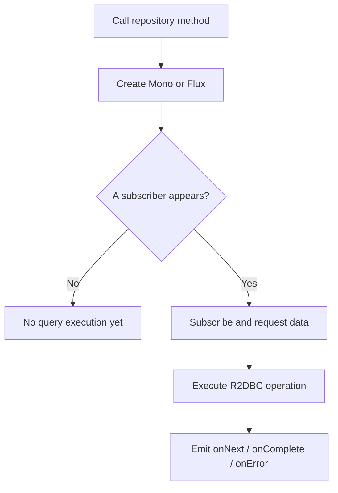

# Truy vấn không chạy hoặc chạy nhiều lần do cách đăng ký

Trong Spring Data Relational R2DBC, repository thường trả về `Mono<T>` hoặc `Flux<T>`. Đây là các publisher reactive: việc gọi method thường chỉ tạo pipeline mô tả công việc; truy vấn database được thực thi khi có subscriber đăng ký và yêu cầu dữ liệu. Vì vậy, một truy vấn có thể không chạy nếu publisher bị bỏ quên, hoặc chạy nhiều lần nếu cùng publisher được subscribe nhiều lần.

Những lỗi thường gặp gồm gọi `subscribe()` bên trong service rồi tiếp tục trả publisher cho WebFlux, gọi `block()` để lấy kết quả rồi trả lại cùng truy vấn, tạo publisher trong `map` nhưng không flatten, hoặc dùng `doOnNext` để gọi repository mà bỏ qua publisher trả về. Ngược lại, nhiều subscription có thể là hành vi có chủ đích khi dùng `retry`, `repeat`, nhiều subscriber hoặc hot/cold publisher. Cần hiểu ai sở hữu subscription và publisher được subscribe bao nhiêu lần trước khi kết luận database hoặc Spring Data chạy sai.

## 1. Publisher reactive không phải kết quả đã có

Một method repository trả `Mono`/`Flux` không trả trực tiếp entity hoặc danh sách entity. Nó trả một mô tả bất đồng bộ về công việc cần thực hiện:

```java
Mono<Customer> customerPublisher = customerRepository.findById(42L);
Flux<Customer> allCustomersPublisher = customerRepository.findAll();
```

Hai dòng trên tạo publisher. Trong mô hình reactive thông thường, database chưa được truy vấn chỉ vì biến được gán. Khi subscriber đăng ký và request dữ liệu, pipeline mới thực thi.

Có thể hình dung:



Publisher thường được gọi là cold khi mỗi subscription bắt đầu một lần thực thi độc lập. Các query publisher của Spring Data R2DBC thường có semantics cold như vậy: mỗi subscription có thể thực hiện lại thao tác database.

## 2. Ai đăng ký subscription trong ứng dụng WebFlux?

Trong một HTTP request được xử lý bởi Spring WebFlux, framework quản lý subscription cho publisher mà controller trả về. Controller nên trả `Mono`/`Flux` để WebFlux kết nối publisher với vòng đời HTTP exchange:

```java
@RestController
@RequestMapping("/customers")
public class CustomerController {

    private final CustomerRepository repository;

    public CustomerController(CustomerRepository repository) {
        this.repository = repository;
    }

    @GetMapping("/{id}")
    public Mono<Customer> findById(@PathVariable Long id) {
        return repository.findById(id);
    }

    @GetMapping
    public Flux<Customer> findAll() {
        return repository.findAll();
    }
}
```

Không cần gọi `subscribe()` trong controller. WebFlux sẽ subscribe publisher để tạo response, truyền lỗi vào cơ chế xử lý lỗi HTTP và hủy subscription khi exchange bị hủy theo lifecycle của server.

Nếu service được gọi từ một thành phần không tự subscribe publisher, caller đó phải chịu trách nhiệm subscribe hoặc nối publisher vào một pipeline khác. Việc tạo publisher mà không có subscriber không kích hoạt query.

## 3. Trường hợp truy vấn không chạy vì publisher bị bỏ quên

Một lỗi cơ bản là gọi repository nhưng không trả hoặc kết hợp publisher:

```java
public Mono<Void> createCustomer(Customer customer) {
    customerRepository.save(customer); // Publisher bị bỏ qua.
    return Mono.empty();
}
```

`save()` trả về `Mono<Customer>`, nhưng code không dùng publisher đó. Vì không có subscription, insert không được thực thi. Method lại trả `Mono.empty()`, nên caller thấy request hoàn tất bình thường dù không có dữ liệu được lưu.

Hãy trả publisher của thao tác:

```java
public Mono<Customer> createCustomer(Customer customer) {
    return customerRepository.save(customer);
}
```

Hoặc nếu chỉ cần kết quả hoàn tất:

```java
public Mono<Void> createCustomer(Customer customer) {
    return customerRepository.save(customer).then();
}
```

`then()` vẫn subscribe và đợi publisher trước hoàn tất khi publisher kết quả được subscribe; nó chỉ bỏ giá trị `Customer` và phát `Mono<Void>`.

## 4. `subscribe()` thủ công bên trong service tạo luồng tách rời

Ví dụ không nên:

```java
public Mono<Customer> createCustomer(Customer customer) {
    customerRepository.save(customer).subscribe();
    return Mono.just(customer);
}
```

Lời gọi `subscribe()` bắt đầu một subscription độc lập. Service trả `Mono.just(customer)` gần như ngay lập tức, không chờ insert hoàn tất. Caller có thể nhận response thành công trước khi database ghi xong hoặc trước khi lỗi insert xuất hiện.

Hậu quả có thể gồm:

- HTTP response không phản ánh kết quả ghi database.
- Lỗi SQL xuất hiện trong luồng phụ và không tới WebFlux error handler.
- Cancellation của HTTP request không hủy thao tác ghi đã subscribe riêng.
- Transaction reactive của caller không bao phủ luồng phụ như mong đợi.
- Test kết thúc trước khi insert hoàn tất.
- Retry hoặc shutdown không kiểm soát được công việc tách rời.

Hãy để caller/framework quản lý subscription bằng cách trả publisher:

```java
public Mono<Customer> createCustomer(Customer customer) {
    return customerRepository.save(customer);
}
```

Trong ứng dụng WebFlux, controller trả publisher; trong service, nối publisher bằng các toán tử Reactor. Chỉ subscribe trực tiếp ở ranh giới thực sự sở hữu công việc độc lập, ví dụ một lifecycle coordinator hoặc ứng dụng command-line tự quản lý subscription và shutdown.

## 5. Vì sao cùng một publisher có thể chạy nhiều lần?

Publisher cold thường thực hiện lại công việc cho mỗi subscription. Ví dụ:

```java
Mono<Customer> customer = customerRepository.findById(42L);

StepVerifier.create(customer)
        .expectNextCount(1)
        .verifyComplete();

StepVerifier.create(customer)
        .expectNextCount(1)
        .verifyComplete();
```

Hai lần `verifyComplete()` tạo hai subscription. Query `findById(42L)` có thể được gửi tới database hai lần. Việc lưu publisher trong biến không biến nó thành kết quả đã cache.

Nếu chỉ cần một lần đọc, hãy tạo một pipeline và chia sẻ kết quả trong chính pipeline đó:

```java
return customerRepository.findById(42L)
        .flatMap(customer -> buildResponse(customer));
```

Không subscribe một lần để log/kiểm tra rồi subscribe lần nữa để trả kết quả. Dùng các operator quan sát như `doOnNext`, `doOnSuccess`, `doOnError` hoặc tracing trong cùng pipeline.

## 6. `block()` cũng là một subscription

`block()` subscribe publisher và chờ kết quả đồng bộ. Nếu sau đó cùng publisher được trả cho WebFlux, WebFlux tạo subscription khác:

```java
public Mono<Customer> findCustomer(Long id) {
    Mono<Customer> publisher = customerRepository.findById(id);

    Customer customer = publisher.block(); // Subscription thứ nhất.

    return publisher; // WebFlux subscribe lần thứ hai.
}
```

Đoạn code này vừa chặn thread, vừa có thể chạy query hai lần. Nếu gọi `block()` trên event-loop thread của WebFlux, ứng dụng còn có thể gặp lỗi blocking hoặc làm giảm khả năng xử lý đồng thời.

Hãy xử lý kết quả bằng reactive operators:

```java
public Mono<CustomerResponse> findCustomer(Long id) {
    return customerRepository.findById(id)
            .map(CustomerResponse::from);
}
```

Các API như `blockOptional()`, `toFuture()` hoặc tự subscribe cũng có thể kích hoạt subscription. Cần xem chúng là điểm bắt đầu thực thi, không phải thao tác đọc một publisher đã có sẵn kết quả.

## 7. `Mono.just()` không tự flatten publisher bên trong

`Mono.just(value)` phát chính value đã được truyền vào. Nếu value là một publisher, kết quả là publisher lồng nhau:

```java
Mono<Mono<Customer>> nested = Mono.just(
        customerRepository.findById(42L));
```

Subscription vào `nested` chỉ phát ra object `Mono<Customer>` bên trong; nó không tự subscribe publisher con, nên query có thể không chạy.

Hãy trả publisher trực tiếp:

```java
Mono<Customer> customer = customerRepository.findById(42L);
```

Hoặc dùng `flatMap` khi một bước tạo ra publisher tiếp theo:

```java
return Mono.just(42L)
        .flatMap(customerRepository::findById);
```

Nếu cần tạo publisher mới cho mỗi subscription, dùng `defer`:

```java
return Mono.defer(() -> customerRepository.findById(42L));
```

`Mono.fromSupplier(() -> customerRepository.findById(id))` cũng tạo `Mono<Mono<Customer>>` vì supplier trả về publisher. `fromSupplier` phù hợp với một giá trị đồng bộ; với một nguồn reactive khác, dùng `defer` hoặc `flatMap`.

## 8. Dùng `map` hay `flatMap` khi gọi repository tiếp theo?

`map` biến đổi giá trị đồng bộ. Nếu hàm mapping trả về publisher, kết quả sẽ là publisher lồng nhau:

```java
Mono<Mono<Order>> wrong = customerRepository.findById(customerId)
        .map(customer -> orderRepository.findLatestByCustomerId(customer.id()));
```

Publisher `orderRepository.findLatestByCustomerId(...)` chỉ được phát như một giá trị; nó chưa được subscribe.

Dùng `flatMap` để nối publisher:

```java
Mono<Order> latestOrder = customerRepository.findById(customerId)
        .flatMap(customer ->
                orderRepository.findLatestByCustomerId(customer.id()));
```

Với `Flux`, `flatMap` có thể subscribe nhiều publisher con đồng thời; nếu cần giữ thứ tự, dùng `concatMap`:

```java
Flux<Order> orders = customerRepository.findAll()
        .concatMap(customer ->
                orderRepository.findByCustomerId(customer.id()));
```

`flatMap`/`concatMap` giải quyết việc nối publisher. Chúng không tự làm một publisher được gọi ở nơi khác chỉ chạy một lần; mỗi subscription vào pipeline cold vẫn có thể chạy lại toàn bộ nguồn.

## 9. `doOnNext` chỉ dành cho side effect đồng bộ

`doOnNext` nhận một giá trị và chạy callback đồng bộ. Nếu callback gọi repository và bỏ qua publisher trả về, thao tác database không được nối vào pipeline:

```java
return customerRepository.save(customer)
        .doOnNext(saved ->
                auditRepository.save(AuditEntry.created(saved.id())));
```

Trong ví dụ, `auditRepository.save(...)` trả `Mono<AuditEntry>` nhưng không có ai subscribe publisher đó. Audit insert không chạy.

Hãy dùng `flatMap` hoặc `then`:

```java
return customerRepository.save(customer)
        .flatMap(saved -> auditRepository.save(
                        AuditEntry.created(saved.id()))
                .thenReturn(saved));
```

Nếu chỉ cần ghi log, `doOnNext` là phù hợp:

```java
return customerRepository.save(customer)
        .doOnNext(saved -> log.info("Customer saved: {}", saved.id()));
```

Quy tắc dễ nhớ: `doOn...` quan sát tín hiệu; `map` biến đổi giá trị đồng bộ; `flatMap` nối một thao tác reactive khác.

## 10. Chọn đúng operator `then`, `thenReturn` và `when`

`then` subscribe publisher trước, bỏ giá trị của nó và chỉ chạy publisher tiếp theo sau khi publisher đầu hoàn tất:

```java
return customerRepository.save(customer)
        .then(auditRepository.save(auditEntry))
        .then();
```

`thenReturn` bỏ giá trị trước và phát một giá trị cố định sau khi hoàn tất:

```java
return customerRepository.save(customer)
        .thenReturn("saved");
```

`Mono.when` subscribe nhiều publisher completion-only và đợi tất cả hoàn tất:

```java
return Mono.when(
        cleanupRepository.deleteExpired(),
        metricsRepository.refreshCounters());
```

Các publisher trong `when` có thể chạy đồng thời. Nếu một publisher lỗi, những publisher khác có thể bị cancel theo semantics của operator. Không dùng `when` khi thao tác cần thứ tự phụ thuộc hoặc phải nhận giá trị kết quả; dùng `flatMap`/`then`/`zip` phù hợp.

## 11. `zip` có thể không chạy hết các query khi một nguồn rỗng

`Mono.zip` cần mỗi nguồn phát một giá trị để tạo tuple. Nếu một nguồn hoàn tất rỗng, `zip` có thể hoàn tất rỗng và hủy các nguồn còn lại:

```java
return Mono.zip(
        customerRepository.findById(customerId),
        settingsRepository.findForCustomer(customerId));
```

Nếu customer không tồn tại, kết quả zip có thể rỗng; query settings không nhất thiết được tiêu thụ đến cùng. Đây là semantics của zip, không phải lỗi driver.

Nếu nghiệp vụ cần mặc định một giá trị khi nguồn rỗng, hãy biểu diễn rõ:

```java
Mono<Customer> customer = customerRepository.findById(customerId);
Mono<CustomerSettings> settings = settingsRepository.findForCustomer(customerId)
        .defaultIfEmpty(CustomerSettings.defaults());

return Mono.zip(customer, settings);
```

Nếu customer bắt buộc phải tồn tại, dùng `switchIfEmpty(Mono.error(...))` để báo lỗi rõ. Nếu cần cả hai thao tác chỉ để hoàn tất, dùng `Mono.when` thay vì zip kết quả.

## 12. `switchIfEmpty` và việc tạo publisher thay thế

`switchIfEmpty` subscribe publisher thay thế khi nguồn chính hoàn tất mà không phát giá trị:

```java
return customerRepository.findByEmail(email)
        .switchIfEmpty(customerRepository.save(new Customer(email)));
```

Với repository R2DBC cold, publisher `save` thường chỉ được subscribe khi nhánh đầu rỗng, nên SQL insert chỉ chạy trong trường hợp đó. Tuy nhiên, biểu thức Java `customerRepository.save(...)` được gọi ngay lúc lắp ráp pipeline. Nếu việc tạo publisher có side effect ngoài reactive contract, nó vẫn xảy ra sớm.

Để trì hoãn cả việc tạo publisher tới khi nhánh thay thế được chọn:

```java
return customerRepository.findByEmail(email)
        .switchIfEmpty(Mono.defer(() ->
                customerRepository.save(new Customer(email))));
```

`defer` đặc biệt hữu ích khi tạo request, timestamp, ID hoặc publisher thay thế cần được tạo mới theo subscription. Không dùng `switchIfEmpty` để thay thế một lỗi database; lỗi không đồng nghĩa với nguồn rỗng.

## 13. Phân biệt query không chạy với query trả kết quả rỗng

Một `Mono` hoàn tất bằng `onComplete` mà không phát `onNext` không nhất thiết có nghĩa query chưa chạy. Ví dụ:

```java
Mono<Customer> result = customerRepository.findById(999999L);
```

Khi publisher được subscribe, query có thể chạy bình thường nhưng không tìm thấy hàng, nên `Mono` hoàn tất rỗng. Cần phân biệt:

| Hiện tượng | Ý nghĩa |
| --- | --- |
| Publisher chưa subscribe | Query chưa được kích hoạt |
| Publisher subscribe nhưng query lỗi | Có `onError`; query có thể đã được gửi hoặc lỗi xảy ra trước khi gửi |
| Query chạy, không có hàng | `Mono` có thể hoàn tất rỗng |
| Query chạy, có hàng | `onNext` rồi `onComplete` |
| `filter` loại phần tử | Nguồn có thể đã phát giá trị nhưng downstream không nhận được |
| `onErrorResume` đổi lỗi thành empty | Lỗi gốc có thể bị che thành kết quả rỗng |

Khi điều tra, quan sát `doOnSubscribe`, `doOnNext`, `doOnSuccess`, `doOnError` và `doFinally`; kết hợp log SQL/driver hoặc database monitoring để xác định query có thực sự được gửi không.

## 14. Nhiều subscription có thể đến từ `retry`

`retry` resubscribe upstream khi có lỗi. Nếu query lỗi tạm thời, cùng publisher có thể chạy lại:

```java
return customerRepository.findById(id)
        .retry(2);
```

`retry(2)` cho phép tối đa hai lần retry sau subscription ban đầu, nên query có thể được thực hiện tối đa ba lần nếu mỗi lần đều lỗi theo điều kiện retry. Với read query, việc đọc lại có thể chấp nhận được; với write, cần xem xét side effect và transaction.

`retryWhen` cho phép chính sách retry có backoff và lọc lỗi:

```java
return customerRepository.findById(id)
        .retryWhen(Retry.backoff(2, Duration.ofMillis(100))
                .filter(this::isTransientFailure));
```

Không retry mọi exception. Lỗi validation, unique constraint hoặc optimistic locking conflict thường cần xử lý nghiệp vụ, không phải retry mù quáng. Retry có thể làm query xuất hiện nhiều lần trong log dù code chỉ gọi repository một lần ở bước assembly.

## 15. Retry thao tác ghi cần idempotency

Nếu publisher thực hiện insert rồi lỗi xảy ra ở ranh giới commit/kết nối, ứng dụng có thể không biết database đã commit hay chưa. Retry có thể tạo bản ghi trùng nếu thao tác không idempotent.

Ví dụ insert order cần business key duy nhất hoặc idempotency key:

```java
return orderRepository.save(order)
        .retryWhen(Retry.backoff(2, Duration.ofMillis(200))
                .filter(this::isTransientFailure));
```

Không thể chỉ nhìn `retryWhen` để kết luận an toàn. Cần thiết kế database constraint và xử lý duplicate theo key ổn định. Với transaction reactive, đặt retry ngoài transaction boundary thường có nghĩa mỗi lần retry tạo lại transaction; vị trí operator ảnh hưởng semantics và phải được kiểm thử.

Không retry optimistic locking conflict bằng cách gửi lại snapshot cũ với version mới. Đọc lại và merge/recalculate theo quy tắc nghiệp vụ, hoặc trả conflict cho client.

## 16. `repeat` chủ động chạy lại publisher sau khi hoàn tất

`repeat` resubscribe khi publisher hoàn tất bình thường:

```java
return jobRepository.findPendingJobs()
        .repeat(3);
```

Đoạn code có thể chạy query nhiều lần sau mỗi lần hoàn tất. `repeat()` không giống `retry()`: retry chạy lại sau lỗi; repeat chạy lại sau complete.

Các biến thể như `repeatWhen` có thể tạo poller hoặc loop. Nếu query được chạy theo chu kỳ, hãy xác định rõ khoảng nghỉ, điều kiện dừng và shutdown lifecycle. Không dùng repeat vô hạn trong một HTTP request thông thường trừ khi endpoint thực sự là stream liên tục.

## 17. Nhiều subscriber trên cùng cold publisher

Một publisher có thể được dùng bởi nhiều nhánh:

```java
Mono<Customer> customer = customerRepository.findById(id);

Mono<String> name = customer.map(Customer::name);
Mono<Boolean> active = customer.map(Customer::active);

return Mono.zip(name, active);
```

Hai nhánh `name` và `active` đều subscribe vào cùng publisher `customer` khi zip subscribe. Vì publisher cold không tự chia sẻ execution, query `findById` có thể chạy hai lần.

Hãy biến đổi một lần rồi tách giá trị:

```java
return customerRepository.findById(id)
        .flatMap(customer -> Mono.zip(
                Mono.just(customer.name()),
                Mono.just(customer.active())));
```

Hoặc dùng `cache()` khi thực sự cần chia sẻ kết quả giữa nhiều subscriber và hiểu rõ cache lifecycle. Thông thường, viết một pipeline duy nhất dễ đọc hơn việc chia một cold publisher thành nhiều nhánh độc lập.

## 18. Chia sẻ kết quả bằng `cache()`

`Mono.cache()` biến nguồn thành publisher chia sẻ kết quả terminal giữa các subscriber tiếp theo:

```java
Mono<Customer> cachedCustomer = customerRepository.findById(id)
        .cache();
```

Nhiều subscriber có thể dùng cùng kết quả được cache thay vì thực hiện query lại. Tuy nhiên, cần chú ý:

- Cache có thể giữ giá trị, lỗi hoặc trạng thái rỗng theo semantics của overload/version.
- Cache không tự biết khi nào dữ liệu database thay đổi.
- `Flux.cache()` có thể giữ nhiều phần tử trong bộ nhớ.
- Cache không có TTL/invalidation phù hợp có thể trả dữ liệu cũ.
- Không cache publisher phụ thuộc tenant/user/security context theo cách chia sẻ giữa request khác nhau.
- Không dùng cache để che việc service subscribe lặp sai thiết kế.

Nếu cần cache, chọn TTL và invalidation rõ ràng, giới hạn bộ nhớ và xác định scope theo key. Với dữ liệu thay đổi thường xuyên, cân nhắc cache abstraction có eviction/invalidation thay vì gọi `.cache()` không thời hạn.

## 19. `share()`, `publish()` và hot publisher

Reactor có các operator chia sẻ subscription như `share()`, `publish()`, `refCount()` hoặc `autoConnect()`. Chúng có semantics khác với cold publisher thông thường:

- `share()` chia sẻ một subscription upstream cho các subscriber đồng thời; subscriber đến sau khi luồng đã kết thúc có thể không nhận lại dữ liệu cũ.
- `publish()` tạo `ConnectableFlux`; cần kết nối hoặc dùng `refCount`/`autoConnect` để bắt đầu nguồn.
- `refCount(n)` kết nối khi có đủ subscriber và có thể ngắt upstream khi số subscriber giảm dưới ngưỡng.
- `autoConnect(n)` kết nối sau khi đạt ngưỡng subscriber và có thể tiếp tục chạy theo semantics của operator.

Ví dụ:

```java
Flux<Customer> shared = customerRepository.findAll()
        .share();
```

Hai subscriber đồng thời có thể chia sẻ một query upstream. Nhưng nếu subscriber thứ nhất đã hoàn tất trước khi subscriber thứ hai đăng ký, subscriber thứ hai không nhất thiết nhận lại toàn bộ danh sách. Nếu cần replay kết quả, phải chọn replay/cache semantics rõ ràng.

Không thêm `share()` chỉ để giảm query mà chưa xác định subscriber lifetime, cancellation và replay. Một subscriber rời đi có thể ảnh hưởng subscription upstream tùy operator.

## 20. `cache()` không phải giải pháp mặc định cho nhiều subscription

Nếu cùng query bị chạy hai lần, trước tiên xác định lý do có hai subscription. Cache có thể che triệu chứng nhưng tạo dữ liệu stale hoặc giữ dữ liệu quá lâu.

Ví dụ không nên cache thao tác ghi:

```java
Mono<Customer> saveOnce = customerRepository.save(customer)
        .cache();
```

Publisher này có thể giữ kết quả của lần save đầu và phát lại cho subscriber sau mà không chạy insert lần nữa. Điều đó đôi khi hữu ích cho một workflow cụ thể, nhưng có thể gây bất ngờ nếu object/publisher được lưu trong singleton service hoặc dùng lại giữa request. Nó cũng có thể giữ lỗi và khiến request sau nhận lỗi cũ.

Đối với thao tác ghi cần idempotency qua nhiều request, dùng idempotency key và database constraint ở tầng nghiệp vụ. Không dùng cache trong memory làm cơ chế bảo đảm không ghi trùng trên nhiều instance.

## 21. Truy vấn nhiều lần do N+1 không phải duplicate subscription

Một trường hợp khác là query chạy nhiều lần có chủ đích theo từng phần tử. Ví dụ:

```java
return customerRepository.findAll()
        .flatMap(customer ->
                orderRepository.findByCustomerId(customer.id()));
```

Nếu có 100 customer, pipeline có thể thực hiện một query lấy customer và 100 query lấy orders. Đây là N+1 query pattern, không nhất thiết do cùng publisher bị subscribe nhiều lần.

Hướng xử lý:

- Truy vấn theo danh sách customer ID bằng `IN` với bind parameters.
- Dùng join/projection phù hợp khi dữ liệu nằm trong cùng database.
- Lấy dữ liệu theo batch có giới hạn.
- Dùng read model nếu cần tổng hợp thường xuyên.
- Giới hạn concurrency của `flatMap` để không tạo quá nhiều query đồng thời.

Phân biệt hai dạng:

| Dạng | Dấu hiệu |
| --- | --- |
| Duplicate subscription | Cùng publisher/query được subscribe nhiều lần, thường có cùng tham số và thời điểm gần nhau |
| N+1 query | Một query gốc phát nhiều phần tử, mỗi phần tử kích hoạt một query khác với tham số khác nhau |
| Retry/repeat | Cùng query được chạy lại theo chính sách lỗi hoặc hoàn tất |
| Client gửi request nhiều lần | Có nhiều HTTP request riêng biệt và mỗi request tạo pipeline mới |

## 22. Client hoặc gateway có thể gửi request nhiều lần

Không phải mọi truy vấn lặp đều xuất phát từ Reactor. Client có thể gửi hai request do double-click, retry mạng, retry interceptor, prefetch UI hoặc refresh trang. Gateway/load balancer cũng có thể retry một số request theo cấu hình.

Hãy kiểm tra:

- HTTP access log và request/correlation ID.
- Số lần controller được gọi.
- Client retry policy và timeout.
- Nút submit có bị bấm hai lần không.
- Gateway có retry method/request đó không.
- Một message broker có redeliver message không.

Nếu mỗi request đều hợp lệ nhưng thao tác ghi không được phép lặp, dùng idempotency key hoặc unique business key. Không dùng `Mono.cache()` trong singleton để cố gộp request của mọi người dùng.

## 23. `@Transactional` và subscription tách rời

Reactive transaction được truyền qua Reactor Context và gắn với subscription. Ví dụ service trả publisher:

```java
@Transactional
public Mono<Order> createOrder(Order order) {
    return orderRepository.save(order)
            .flatMap(saved -> auditRepository.save(
                            AuditEntry.created(saved.id()))
                    .thenReturn(saved));
}
```

Transaction interceptor có thể bao publisher được method trả về. Nếu code gọi `subscribe()` riêng:

```java
@Transactional
public Mono<Order> createOrder(Order order) {
    orderRepository.save(order).subscribe();
    return Mono.just(order);
}
```

thao tác save không được nối vào publisher mà transaction interceptor quản lý. Nó có thể chạy ngoài transaction context, lỗi không tới caller và method trả về trước khi save hoàn tất.

Nếu có nhiều subscription vào publisher trả về từ method transactional, mỗi subscription có thể tạo một transaction riêng. Không giữ một publisher transactional trong field rồi subscribe lại nhiều lần với kỳ vọng dùng chung một transaction.

## 24. Tự tạo publisher trong constructor hoặc `@PostConstruct`

Gọi repository trong constructor hoặc `@PostConstruct` rồi bỏ publisher không làm query chạy:

```java
@Component
public class StartupComponent {

    public StartupComponent(CustomerRepository repository) {
        repository.findAll(); // Publisher bị bỏ qua.
    }
}
```

Nếu cần công việc khởi động, hãy dùng một lifecycle phù hợp và quản lý subscription/hoàn tất rõ ràng. Ví dụ `ApplicationRunner` là API imperative; nếu cần chạy reactive work, có thể subscribe ở ranh giới startup được quản lý và chờ hoàn tất theo cách phù hợp với ứng dụng, hoặc dùng `SmartLifecycle` để báo hoàn tất bất đồng bộ.

Không gọi `block()` tùy tiện trong constructor hoặc `@PostConstruct`, đặc biệt trên event-loop thread. Không tạo một startup publisher rồi bỏ quên nó.

## 25. Tạo publisher có side effect ngoài subscription

Reactive API nên trì hoãn side effect tới subscription. Tuy nhiên, code Java trong lúc lắp ráp pipeline vẫn được thực thi ngay. Ví dụ:

```java
Mono<Customer> publisher = buildPublisher();
```

Lời gọi `buildPublisher()` xảy ra ngay lúc chạy dòng code. Nếu method này tự ghi log, tăng counter, tạo file hoặc gọi API đồng bộ trước khi trả `Mono`, các side effect đó xảy ra ngay dù publisher chưa được subscribe.

Dùng `defer` để trì hoãn công việc theo subscription:

```java
Mono<Customer> publisher = Mono.defer(() -> {
    log.debug("Starting customer lookup");
    return customerRepository.findById(42L);
});
```

Mỗi subscription sẽ chạy phần thân `defer` và tạo publisher nguồn mới. Điều này cũng có nghĩa mỗi subscription có thể chạy query mới; `defer` trì hoãn, không cache hoặc bảo đảm chỉ chạy một lần.

## 26. Gọi repository trong `doOnSuccess` cũng không nối publisher

`doOnSuccess` là callback quan sát kết quả `Mono`; giá trị trả về của callback bị bỏ qua. Không dùng nó để thực hiện thao tác reactive phụ:

```java
return customerRepository.save(customer)
        .doOnSuccess(saved ->
                notificationRepository.save(
                        Notification.created(saved.id())));
```

Notification publisher không được subscribe. Nếu cần thao tác phụ hoàn tất trước khi pipeline kết thúc, dùng `flatMap`/`then`:

```java
return customerRepository.save(customer)
        .flatMap(saved -> notificationRepository.save(
                        Notification.created(saved.id()))
                .thenReturn(saved));
```

Nếu notification là side effect bên ngoài cần thực hiện sau commit, cân nhắc outbox. Không gửi email/HTTP trong transaction chỉ để giữ thứ tự; hãy xác định yêu cầu atomicity và khả năng retry.

## 27. `doOnSubscribe` và `doFinally` để quan sát subscription

Khi điều tra query chạy nhiều lần, có thể thêm log trong cùng pipeline:

```java
public Mono<Customer> findCustomer(Long id) {
    return Mono.defer(() -> {
        String executionId = UUID.randomUUID().toString();

        return customerRepository.findById(id)
                .doOnSubscribe(subscription ->
                        log.debug("Customer query subscribed: executionId={}", executionId))
                .doOnNext(customer ->
                        log.debug("Customer query emitted: executionId={}", executionId))
                .doOnError(error ->
                        log.warn("Customer query failed: executionId={}", executionId, error))
                .doFinally(signal ->
                        log.debug("Customer query finished: executionId={}, signal={}",
                                executionId, signal));
    });
}
```

Vì `defer` tạo execution ID theo subscription, log có thể giúp phân biệt hai lần thực thi của cùng method. Trong production, không cần tạo UUID cho mọi query nếu tracing đã cung cấp trace/span ID; chọn instrumentation có overhead phù hợp.

`doOnSubscribe` cho biết subscriber đã đăng ký vào vị trí operator đó. Nó không tự chứng minh SQL đã tới database. Kết hợp với log SQL, R2DBC observation hoặc database activity để xác nhận query execution.

## 28. Dùng `checkpoint()` và Reactor `log()` khi debug

`checkpoint()` có thể thêm điểm nhận diện vào assembly trace để dễ tìm nguồn lỗi:

```java
return customerRepository.findById(id)
        .flatMap(this::loadOrders)
        .checkpoint("load-customer-and-orders");
```

`log()` ghi các Reactive Streams signal như subscribe, request, onNext, onComplete, onError và cancel:

```java
return customerRepository.findById(id)
        .log("customer-query")
        .map(CustomerResponse::from);
```

Dùng `log()` có chọn lọc vì output có thể nhiều và chứa thông tin nhạy cảm. `Hooks.onOperatorDebug()` có thể bổ sung assembly information nhưng có overhead; không bật toàn cục trong production nếu chưa đánh giá.

## 29. Đọc SQL log và database activity để xác định số lần thực thi

Log ở tầng Reactor cho biết subscription; log SQL/driver cho biết câu lệnh được gửi; database activity/statistics cho biết database đã nhận và thực thi query. Ba góc nhìn bổ sung nhau.

Khi điều tra, ghi nhận:

- HTTP request ID hoặc trace ID.
- Controller/service method được gọi bao nhiêu lần.
- Publisher có bao nhiêu subscription.
- Query name hoặc SQL fingerprint.
- Bind parameter đã được che dữ liệu nhạy cảm.
- Thời điểm bắt đầu, kết thúc, lỗi và cancellation.
- Số hàng trả về và số hàng bị cập nhật.

Không log password, token hoặc toàn bộ dữ liệu cá nhân. Dùng SQL fingerprint/operation name thay vì ghi mọi giá trị bind.

Nếu controller chỉ được gọi một lần nhưng cùng query xuất hiện hai lần, xem xét multiple subscription, retry hoặc nhánh publisher. Nếu controller được gọi hai lần với hai request ID, điều tra client/gateway. Nếu một query customer dẫn tới nhiều query order với customer ID khác nhau, đó có thể là N+1.

## 30. Kiểm thử một publisher được subscribe bao nhiêu lần

Có thể dùng `doOnSubscribe` với `AtomicInteger` để kiểm tra số subscription trong unit test:

```java
AtomicInteger subscriptions = new AtomicInteger();

Mono<String> publisher = Mono.defer(() -> {
    subscriptions.incrementAndGet();
    return Mono.just("value");
});

StepVerifier.create(publisher)
        .expectNext("value")
        .verifyComplete();

assertThat(subscriptions).hasValue(1);
```

Nếu subscribe lần thứ hai, counter tăng lên 2. Đây là test semantics publisher, chưa chứng minh số SQL thực tế của repository.

Để kiểm tra query thật, dùng integration test với database tương thích production. Có thể ghi nhận query count qua instrumentation/driver hoặc một bảng test riêng. Không dùng mock repository để kết luận driver chỉ thực hiện một statement.

## 31. `StepVerifier` cũng subscribe khi verify

`StepVerifier.create(publisher)` cấu hình một kịch bản kiểm thử; subscription được thực hiện khi gọi `verify()`, `verifyComplete()`, `verifyError()` hoặc phương thức terminal tương ứng.

Ví dụ:

```java
StepVerifier.FirstStep<Customer> scenario =
        StepVerifier.create(customerRepository.findById(id));

scenario.expectNextCount(1).verifyComplete();
```

Nếu gọi `verifyComplete()` lần nữa trên một verifier mới được tạo từ cùng cold publisher, query có thể chạy lại. Tránh gọi verify nhiều lần chỉ để kiểm tra thêm một assertion; đặt tất cả expectation trong cùng một kịch bản.

Trong test, cũng tránh gọi `.block()` để kiểm tra kết quả rồi dùng cùng publisher trong `StepVerifier`; hai thao tác đó là hai subscription riêng.

## 32. Dùng `cache()` hoặc `share()` có chủ đích

Nếu thực sự cần chia sẻ một lần đọc giữa nhiều nhánh, có thể cân nhắc:

```java
Mono<Customer> sharedCustomer = customerRepository.findById(id)
        .cache(Duration.ofSeconds(2));
```

TTL giới hạn thời gian cache, nhưng cần hiểu rằng các subscriber trong thời gian đó có thể nhận cùng kết quả cũ. Với dữ liệu cần consistency mạnh, cache có thể không phù hợp.

`share()` thường phù hợp hơn với các subscriber đồng thời của một stream đang hoạt động, còn `cache()` phù hợp với việc replay kết quả đã phát theo chính sách cache. Chúng không thay thế idempotency cho write và không nên đặt tùy tiện trong singleton bean nếu kết quả phụ thuộc user/tenant.

## 33. Nhiều query do `flatMap` và N+1

Ví dụ:

```java
return customerRepository.findAll()
        .flatMap(customer ->
                orderRepository.findByCustomerId(customer.id()));
```

Nếu có N customer, có thể có 1 query customer và N query order. Để giảm số query, có thể lấy ID trước rồi truy vấn theo nhóm:

```java
return customerRepository.findAll()
        .map(Customer::id)
        .collectList()
        .flatMapMany(ids -> {
            if (ids.isEmpty()) {
                return Flux.empty();
            }

            return orderRepository.findByCustomerIdIn(ids);
        });
```

Đoạn ví dụ gom ID vào list nên phù hợp khi số customer được giới hạn. Với tập dữ liệu lớn, dùng batch có kích thước giới hạn hoặc join/projection thay vì gom tất cả ID.

N+1 không phải lúc nào cũng giải quyết bằng `cache()`: mỗi customer có ID khác nhau và query con là công việc riêng. Hãy tối ưu query shape hoặc batch strategy.

## 34. Tránh query lặp do controller hoặc service gọi hai lần

Một lỗi assembly đơn giản:

```java
public Mono<CustomerResponse> get(Long id) {
    Mono<Customer> first = customerRepository.findById(id);
    Mono<Customer> second = customerRepository.findById(id);

    return Mono.zip(first, second)
            .map(tuple -> CustomerResponse.from(tuple.getT1()));
}
```

Hai lời gọi repository tạo hai publisher khác nhau; `zip` subscribe cả hai, nên có hai query. Nếu chỉ cần một entity, gọi repository một lần:

```java
public Mono<CustomerResponse> get(Long id) {
    return customerRepository.findById(id)
            .map(CustomerResponse::from);
}
```

Nếu cần hai phép biến đổi từ cùng một entity, thực hiện trong một `map` hoặc `flatMap` sau một lần đọc. Không tạo hai repository call giống nhau chỉ vì hai nhánh cần hai thuộc tính khác nhau.

## 35. Tách query assembly khỏi query execution

Trong code review và debug, phân biệt ba thời điểm:

1. **Assembly:** gọi method và xây operator chain.
2. **Subscription:** subscriber đăng ký; nguồn cold bắt đầu công việc.
3. **Signal processing:** dữ liệu, lỗi hoặc completion đi qua pipeline.

Ví dụ:

```java
Mono<Customer> customer = Mono.defer(() -> {
    log.debug("Assembly source for customer lookup");
    return customerRepository.findById(42L);
});

log.debug("Publisher has been created");
```

Log `Publisher has been created` xuất hiện khi lắp ráp. Log bên trong `defer` xuất hiện khi subscription bắt đầu. SQL thực tế được gửi sau đó theo execution path của Spring Data/driver.

Đặt log ở đúng giai đoạn sẽ tránh kết luận sai rằng query đã chạy chỉ vì repository method được gọi.

## 36. Lỗi do publisher bị hủy trước khi query hoàn tất

Một query có thể được subscribe nhưng không hoàn tất vì downstream cancel:

- Client HTTP đóng kết nối.
- `take(1)` chỉ cần phần tử đầu tiên rồi hủy nguồn.
- `timeout` phát lỗi và cancel upstream.
- `zip` hoàn tất sớm khi một nguồn rỗng.
- `switchMap` chuyển sang publisher mới và hủy publisher cũ.
- Một nhánh lỗi khiến operator hủy các nhánh còn lại.

Ví dụ:

```java
return customerRepository.findAll()
        .take(1);
```

Query đã được chạy, nhưng downstream chỉ yêu cầu một phần tử rồi cancel phần còn lại. Đây không phải trường hợp query chưa subscribe. Với R2DBC, driver có thể hủy statement/result theo khả năng hỗ trợ; hãy quan sát cancellation và cleanup.

## 37. `take`, `next`, `first` và các operator giới hạn dữ liệu

Các operator như `next()`, `take(n)` hoặc `takeWhile(...)` có thể kết thúc subscription sớm:

```java
Mono<Customer> firstCustomer = customerRepository.findAll().next();
```

Nguồn `findAll()` được subscribe, nhưng sau phần tử đầu tiên downstream cancel phần còn lại. Nếu query không có `ORDER BY`, “first” không nhất thiết là bản ghi ổn định giữa các lần chạy.

Nếu mục tiêu là lấy một hàng theo điều kiện, ưu tiên repository method/SQL có giới hạn và thứ tự phù hợp thay vì phát cả bảng rồi lấy `.next()`:

```java
Mono<Customer> customer = customerRepository.findFirstByActiveTrueOrderByIdAsc();
```

Tên derived query cần phù hợp entity và khả năng Spring Data version. Query giới hạn ở database thường tiết kiệm hơn việc hủy stream sau khi nhận phần tử đầu.

## 38. `onErrorResume` có thể làm query trông như không chạy

Một pipeline có thể bắt lỗi rồi trả empty:

```java
return customerRepository.findById(id)
        .onErrorResume(error -> Mono.empty());
```

Nếu query lỗi do connection, SQL hoặc mapping, caller chỉ thấy publisher hoàn tất rỗng. Điều này dễ bị hiểu nhầm là không có dữ liệu hoặc query không chạy.

Trong giai đoạn chẩn đoán, ghi nhận lỗi trước khi chuyển đổi:

```java
return customerRepository.findById(id)
        .doOnError(error -> log.error("Customer lookup failed", error))
        .onErrorResume(CustomerNotFoundException.class, error -> Mono.empty());
```

Chỉ xử lý những exception mà nghiệp vụ hiểu rõ. Không nuốt mọi lỗi database thành `Mono.empty()`.

## 39. Kiểm tra controller có bị gọi nhiều lần không

Khi query xuất hiện nhiều lần, trước tiên kiểm tra số HTTP request. Mỗi request thường tạo một subscription cho publisher của controller. Nếu có hai request, hai lần query có thể hoàn toàn đúng theo thiết kế.

Có thể thêm request correlation ID và log tại controller:

```java
@GetMapping("/{id}")
public Mono<Customer> get(
        @PathVariable Long id,
        ServerWebExchange exchange) {

    String requestId = exchange.getRequest().getId();

    return customerRepository.findById(id)
            .doOnSubscribe(subscription ->
                    log.debug("get customer subscribed: requestId={}", requestId));
}
```

API của request ID phụ thuộc Spring WebFlux version; có thể dùng tracing MDC/context hoặc header correlation ID do gateway cấp. Không dùng request ID làm metric tag có cardinality cao.

## 40. Đừng dùng một `Mono` trong field của singleton service để chia sẻ trạng thái request

Ví dụ nguy hiểm:

```java
@Service
public class CustomerService {

    private final Mono<Customer> customer = customerRepository.findById(42L);
}
```

Publisher được tạo khi bean khởi tạo và được dùng chung giữa mọi request. Nếu publisher cold, mỗi subscription vẫn có thể chạy query; nếu được `.cache()` thì kết quả có thể bị chia sẻ giữa user/tenant và trở nên stale. Cả hai semantics đều có thể sai nếu dữ liệu phụ thuộc request.

Hãy tạo publisher theo request:

```java
public Mono<Customer> findCustomer(Long id) {
    return customerRepository.findById(id);
}
```

Chỉ cache dữ liệu dùng chung khi scope, key, TTL, invalidation và quyền truy cập đã được thiết kế rõ.

## 41. Query có thể được gọi một lần nhưng subscription lặp do `retry` hoặc `repeat`

Khi log ở assembly chỉ thấy một lời gọi method nhưng database ghi nhận nhiều query, kiểm tra các operator có khả năng resubscribe:

- `retry`, `retryWhen`.
- `repeat`, `repeatWhen`.
- `cacheInvalidateIf` hoặc operator cache/invalidation liên quan nếu có.
- `refCount`/reconnect logic của hot publisher.
- `Flux.defer` bên trong polling loop.

Thêm log subscription ở nguồn và log retry signal để xác định. Với `retryWhen`, có thể ghi số lần retry và exception class, không ghi dữ liệu nhạy cảm.

## 42. Transaction reactive và retry cần đặt đúng ranh giới

Nếu một thao tác gồm nhiều câu SQL trong transaction, retry cần được đặt theo ý định:

```java
Mono<Order> oneTransaction = transactionalOperator.transactional(
        orderRepository.save(order)
                .flatMap(saved -> auditRepository.save(
                                AuditEntry.created(saved.id()))
                        .thenReturn(saved)));

return oneTransaction.retryWhen(retryPolicy);
```

Trong cách này, retry bao publisher transaction; mỗi subscription lại chạy transaction boundary. Nếu retry đặt bên trong operator, các lần resubscribe có thể xảy ra trong cùng transaction context tùy cách chain được cấu tạo, và database có thể đã đánh dấu transaction lỗi sau statement failure.

Không áp dụng một vị trí retry chung cho mọi lỗi. Kiểm thử transaction/driver thật, giới hạn retry, lọc transient error và bảo đảm write idempotent. Khi commit outcome không rõ, dùng idempotency key để tra cứu trước khi ghi lại.

## 43. Cách xác định nguồn query lặp theo từng lớp

Một quy trình chẩn đoán hữu ích:

1. Đếm HTTP request/message/job invocation ở ranh giới vào.
2. Đếm số lần controller/service method được gọi.
3. Đếm subscription bằng `doOnSubscribe`/tracing.
4. Ghi nhận `retry`/`repeat` signal và cancellation.
5. Ghi SQL fingerprint và bind parameters đã redact.
6. So sánh query count với số phần tử upstream để phát hiện N+1.
7. Kiểm tra nhiều nhánh cùng subscribe một cold publisher.
8. Kiểm tra `block()`, `toFuture()` và `subscribe()` thủ công.
9. Kiểm tra cache/share operator và subscriber timing.
10. Dùng integration test để xác nhận số statement thực tế trên database.

Không bắt đầu bằng cách thêm `.cache()` hoặc tăng connection pool. Trước tiên xác định publisher nào được subscribe và vì sao.

## 44. Các lỗi thường gặp

| Lỗi | Hiện tượng | Cách xử lý |
| --- | --- | --- |
| Gọi repository rồi bỏ publisher | Query không chạy | Trả publisher hoặc nối bằng `then`/`flatMap` |
| Gọi `subscribe()` trong service rồi trả publisher khác | Query chạy nền, lỗi bị tách, có thể chạy thêm lần nữa | Trả publisher và để caller/framework subscribe |
| Gọi `block()` rồi trả lại publisher | Blocking và query có thể chạy hai lần | Dùng `map`/`flatMap` trong cùng chain |
| Bọc publisher bằng `Mono.just()` | Tạo `Mono<Mono<T>>`; publisher con không được subscribe | Trả publisher trực tiếp hoặc dùng `flatMap`/`defer` |
| Gọi repository trong `map` | Tạo publisher lồng nhau | Dùng `flatMap` hoặc `concatMap` |
| Gọi repository trong `doOnNext`/`doOnSuccess` | Publisher phụ bị bỏ qua | Dùng `flatMap`/`then` |
| Subscribe cùng cold publisher hai lần | Query chạy hai lần | Dùng một pipeline hoặc chia sẻ kết quả có chủ đích |
| Dùng `retry`/`repeat` không để ý | Query được thực thi lại | Giới hạn, lọc lỗi và đo retry/resubscription |
| Chia một publisher thành nhiều nhánh rồi zip | Nguồn cold có thể bị subscribe nhiều lần | Đọc một lần rồi biến đổi trong cùng nhánh hoặc cache có chủ đích |
| `zip` có nguồn rỗng | Nhánh khác có thể bị cancel | Dùng default/error semantics phù hợp hoặc `when` |
| `onErrorResume` đổi mọi lỗi thành empty | Query lỗi bị hiểu nhầm là không có dữ liệu | Log và chỉ xử lý exception đã phân loại |
| `flatMap` gọi query cho từng row | N+1 query | Join, projection hoặc batch theo ID |
| Client/gateway gửi request lặp | Mỗi request tạo một query mới | Kiểm tra request ID và dùng idempotency cho write |
| Dùng `.cache()` toàn cục | Dữ liệu stale hoặc rò scope tenant | Chọn cache key/TTL/invalidation rõ ràng |

## 45. Quy trình viết service reactive đúng

Khi một service cần thực hiện nhiều thao tác R2DBC, hãy:

1. Xác định kết quả service cần trả và để method trả `Mono`/`Flux` tương ứng.
2. Không gọi `subscribe()` hoặc `block()` bên trong business service.
3. Dùng `map` cho biến đổi đồng bộ; dùng `flatMap` cho thao tác trả publisher.
4. Dùng `then` khi chỉ cần đợi thao tác trước hoàn tất và bỏ giá trị.
5. Dùng `zip` khi mọi nguồn cần phát giá trị; xử lý rõ trường hợp nguồn rỗng.
6. Dùng `Mono.defer` khi cần trì hoãn tạo publisher hoặc tạo state theo từng subscription.
7. Không tạo hai nhánh cold publisher nếu chỉ cần một lần đọc.
8. Xem xét `retry`/`repeat` như cơ chế tạo subscription mới.
9. Dùng cache/share chỉ khi cần chia sẻ kết quả và đã thiết kế lifetime/invalidation.
10. Giới hạn query theo batch để tránh N+1 và quá nhiều subscription đồng thời.
11. Giữ mọi thao tác cần cùng transaction trong cùng reactive chain.
12. Quan sát subscription, SQL execution và terminal signal bằng log/trace có kiểm soát.

## 46. Nguyên tắc thực hành

- Gọi repository method thường tạo publisher; query được kích hoạt khi có subscription.
- Trong WebFlux, trả `Mono`/`Flux` để framework quản lý subscription của HTTP exchange.
- Không bỏ publisher trả về từ repository.
- Không gọi `subscribe()` hoặc `block()` trong service/controller reactive thông thường.
- `Mono.just(publisher)` tạo publisher lồng nhau; dùng publisher trực tiếp hoặc `defer`.
- Dùng `flatMap`/`concatMap` khi hàm trả publisher; `map` chỉ cho biến đổi đồng bộ.
- Không gọi repository trong `doOnNext`/`doOnSuccess` nếu cần chờ kết quả; dùng operator kết hợp.
- Mỗi subscription vào cold publisher có thể chạy lại query.
- `retry` và `repeat` chủ động resubscribe; write cần idempotency.
- `zip` cần mỗi nguồn phát giá trị; nguồn rỗng có thể làm hủy nhánh khác.
- Dùng `cache`/`share` có chủ đích, với TTL, invalidation, scope và memory rõ ràng.
- Phân biệt duplicate subscription, retry, N+1 query và nhiều HTTP request.
- Dùng `doOnSubscribe`, `doFinally`, tracing và SQL fingerprint để chẩn đoán.
- Kiểm thử subscription semantics bằng `StepVerifier` và số statement bằng integration test.
- Giữ transaction reactive và các thao tác database phụ thuộc trong cùng pipeline.

## 47. Kết luận

Trong Spring Data Relational R2DBC, publisher mô tả công việc; subscription mới kích hoạt truy vấn. Query không chạy khi publisher bị bỏ quên, bị bọc thành publisher lồng nhau mà không flatten, hoặc thao tác reactive phụ được gọi trong callback đồng bộ rồi bỏ qua. Query chạy nhiều lần khi cold publisher được subscribe nhiều lần, khi code gọi `block()`/`subscribe()` thêm lần nữa, hoặc khi `retry`/`repeat`, nhiều nhánh hay nhiều HTTP request tạo subscription mới.

Hãy để WebFlux hoặc caller ở ranh giới phù hợp quản lý subscription, nối thao tác bằng `flatMap`, `then`, `zip` hoặc operator đúng semantics, và không tách business work bằng `subscribe()` thủ công. Khi điều tra, tách assembly, subscription, SQL execution và result signal; phân biệt duplicate subscription với N+1 và request lặp. Kiểm thử trên publisher lẫn database thật, đồng thời dùng retry/idempotency và cache/invalidation có chủ đích để giữ hành vi truy vấn dễ dự đoán.
