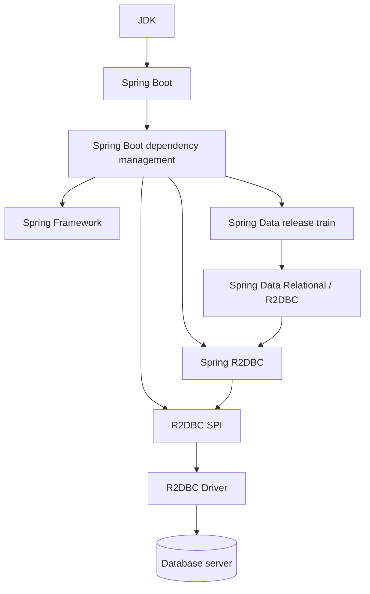

# Chọn phiên bản Spring Boot, Spring Data và trình điều khiển tương thích

Khi khởi tạo một ứng dụng Spring Data R2DBC, việc chọn phiên bản không chỉ là chọn phiên bản mới nhất của từng thư viện. Spring Boot, Spring Framework, Spring Data Relational, Spring R2DBC, R2DBC SPI và driver cơ sở dữ liệu tạo thành một nhóm phụ thuộc có quan hệ với nhau. Nếu tự nâng hoặc hạ từng thành phần mà không xét nhóm này, ứng dụng có thể gặp lỗi biên dịch, lỗi khởi động hoặc lỗi chỉ xuất hiện khi thực thi truy vấn.

Cách an toàn cho một ứng dụng Spring Boot là chọn một dòng Spring Boot phù hợp với JDK và yêu cầu triển khai, sau đó để dependency management của Spring Boot cung cấp các phiên bản Spring Framework, Spring Data và những thư viện đã được quản lý. Tiếp theo, chọn driver R2DBC đúng với hệ quản trị cơ sở dữ liệu và kiểm tra driver đó tương thích với R2DBC SPI, JDK và phiên bản máy chủ đang dùng.

## 1. Hiểu các lớp phiên bản cần phối hợp

Một ứng dụng R2DBC có nhiều lớp dependency. Không phải lớp nào cũng được nâng cấp độc lập.

| Thành phần | Vai trò trong ứng dụng | Cách chọn phiên bản |
|---|---|---|
| JDK | Môi trường chạy và biên dịch Java | Chọn phiên bản nằm trong dải hỗ trợ của dòng Spring Boot đã chọn |
| Spring Boot | Cung cấp auto-configuration, starter và dependency management | Chọn một bản phát hành ổn định còn phù hợp với chính sách hỗ trợ của dự án |
| Spring Framework | Cung cấp container, transaction và tích hợp reactive | Để Spring Boot BOM quản lý |
| Spring Data Relational / R2DBC | Cung cấp mapping, template và Repository | Dùng phiên bản thuộc Spring Data release train được Spring Boot quản lý |
| Spring R2DBC và R2DBC SPI | Cung cấp abstraction kết nối và thực thi SQL reactive | Giữ phiên bản tương thích với Spring Data và driver; ưu tiên phiên bản được BOM quản lý |
| R2DBC driver | Kết nối với PostgreSQL, H2 hoặc hệ quản trị khác | Kiểm tra hỗ trợ SPI, JDK và phiên bản máy chủ; ưu tiên phiên bản được Boot BOM quản lý |
| Cơ sở dữ liệu | Lưu trữ và thực thi SQL | Chọn phiên bản máy chủ được driver hỗ trợ và đã được kiểm thử |

Có thể hình dung quan hệ phụ thuộc như sau:



Sơ đồ thể hiện các mối quan hệ chính, không phải cây dependency đầy đủ của mọi phiên bản. Dependency thực tế còn có Reactor, logging, pool và những thư viện hỗ trợ khác. Điểm quan trọng là Spring Boot BOM đã lựa chọn một tập hợp phiên bản được kiểm thử cùng nhau; việc ghi đè một mắt xích có thể làm mất sự đồng bộ đó.

## 2. Bắt đầu từ JDK và dòng Spring Boot

JDK là ràng buộc đầu tiên vì Spring Boot quy định phiên bản Java tối thiểu và dải phiên bản được hỗ trợ cho từng bản phát hành. Ví dụ, Spring Boot 3 yêu cầu Java 17 trở lên. Các dòng Spring Boot cũ hơn có yêu cầu Java khác, vì vậy không nên suy ra khả năng chạy chỉ từ phiên bản Spring Data hoặc driver.

Trước khi chọn phiên bản, hãy xác định:

- JDK được cài trong môi trường phát triển, CI và production.
- Dự án có thể nâng JDK hay phải duy trì một phiên bản Java hiện hữu.
- Phiên bản Maven hoặc Gradle đang dùng có tương thích với Spring Boot Gradle/Maven plugin hay không.
- Dự án cần dùng thư viện nội bộ hoặc Spring Cloud nào có ma trận tương thích riêng.
- Dòng Spring Boot dự kiến còn nhận bản sửa lỗi và cập nhật bảo mật trong thời gian dự án cần duy trì hay không.

Sau đó chọn một bản phát hành ổn định của Spring Boot đáp ứng các ràng buộc trên. Với dự án mới, nên dùng một dòng Spring Boot đang được hỗ trợ và một bản phát hành ổn định trong dòng đó. Tránh chọn bản milestone, release candidate hoặc snapshot cho môi trường production, trừ khi dự án chủ động thử nghiệm tính năng chưa phát hành.

Không nên chọn riêng Spring Framework hoặc Spring Data trước rồi tìm một Spring Boot bất kỳ để ghép vào. Spring Boot đã xác định các phiên bản nền tảng mà nó được xây dựng và kiểm thử cùng.

## 3. Spring Boot quản lý phiên bản Spring Data như thế nào?

Spring Data R2DBC thuộc hệ sinh thái Spring Data Relational. Nó sử dụng các thành phần chung của Spring Data, Spring Framework và Spring R2DBC. Các module Spring Data được phát hành theo những release train để giữ sự tương thích giữa các module, chẳng hạn Spring Data Commons và Spring Data Relational.

Khi sử dụng Spring Boot, dependency management của Boot chọn Spring Data release train tương ứng. Vì vậy, ứng dụng thường chỉ cần khai báo starter:

```text
org.springframework.boot:spring-boot-starter-data-r2dbc
```

Starter này đưa các thành phần Spring cần thiết cho Spring Data R2DBC vào dependency graph. Ứng dụng không cần tự thêm phiên bản riêng cho `spring-data-r2dbc`, `spring-data-relational`, `spring-data-commons` hoặc `spring-r2dbc` trong cấu hình thông thường.

Ví dụ, nếu một dự án đang dùng Spring Boot thuộc một dòng cụ thể, hãy xem Spring Boot dependency versions hoặc dependency management report để biết Spring Data release train nào được quản lý. Không lấy một phiên bản Spring Data mới nhất từ Maven Central rồi gắn vào Boot cũ mà chưa kiểm tra ma trận tương thích.

**Nguyên tắc quan trọng:** trong một ứng dụng Spring Boot, hãy xem phiên bản Spring Boot là điểm chọn phiên bản nền tảng. Chỉ ghi đè phiên bản Spring Data khi có lý do kỹ thuật rõ ràng, đã xác minh tương thích và có kiểm thử cho toàn bộ nhóm module liên quan.

## 4. Phân biệt Spring Data R2DBC, Spring R2DBC và R2DBC SPI

Tên các dependency khá giống nhau nên dễ bị nhầm:

| Thành phần | Phạm vi trách nhiệm |
|---|---|
| Spring Data R2DBC (`spring-data-r2dbc`) | Repository reactive, mapping entity, query derivation và tích hợp với Spring Data Relational |
| Spring Data Relational (`spring-data-relational`) | Metadata quan hệ, mapping context và các abstraction dùng chung cho mô hình dữ liệu quan hệ của Spring Data |
| Spring R2DBC (`spring-r2dbc`) | Tích hợp R2DBC SPI với Spring, bao gồm `DatabaseClient` và hỗ trợ transaction |
| R2DBC SPI (`r2dbc-spi`) | Hợp đồng cấp thấp mà driver R2DBC hiện thực, gồm `ConnectionFactory`, `Connection`, `Statement`, `Result` và các kiểu liên quan |
| R2DBC driver | Phần triển khai cụ thể để giao tiếp với một hệ quản trị cơ sở dữ liệu |

Các thành phần này liên hệ trực tiếp với nhau. Spring Data R2DBC dùng Spring R2DBC để thực thi thao tác dữ liệu; Spring R2DBC làm việc trên SPI; driver cung cấp implementation của SPI. Vì vậy, chỉ nâng `spring-data-r2dbc` mà giữ một `spring-r2dbc` hoặc `r2dbc-spi` không tương thích có thể gây lỗi ở cả thời điểm biên dịch lẫn runtime.

Trong ứng dụng Spring Boot, nên để BOM chọn phiên bản cho cả nhóm. Không cần khai báo `r2dbc-spi` trực tiếp chỉ vì ứng dụng dùng R2DBC. Chỉ thêm dependency trực tiếp khi code thực sự sử dụng API của SPI hoặc có yêu cầu tích hợp cụ thể.

## 5. Chọn R2DBC driver theo hệ quản trị cơ sở dữ liệu

R2DBC SPI là một đặc tả chung; mỗi hệ quản trị cần driver tương ứng. Driver là thành phần thực hiện giao tiếp cụ thể, xử lý kiểu dữ liệu và ánh xạ kết quả theo đặc điểm của cơ sở dữ liệu.

Một số driver thường gặp:

| Hệ quản trị | Driver R2DBC thường dùng | Ghi chú |
|---|---|---|
| PostgreSQL | `org.postgresql:r2dbc-postgresql` | Driver R2DBC dành cho PostgreSQL; không phải JDBC driver `org.postgresql:postgresql` |
| H2 | `io.r2dbc:r2dbc-h2` | Thường dùng trong thử nghiệm hoặc ứng dụng cần cơ sở dữ liệu H2 |
| MySQL | Driver R2DBC do dự án `asyncer` duy trì | Kiểm tra tên artifact và dải phiên bản trong tài liệu của driver đang chọn |
| MariaDB | Driver R2DBC do dự án MariaDB duy trì | Kiểm tra khả năng hỗ trợ phiên bản máy chủ và tính năng SQL cần dùng |
| Microsoft SQL Server | Driver R2DBC dành cho SQL Server | Kiểm tra ma trận hỗ trợ của driver cho phiên bản SQL Server và SPI |
| Oracle Database | Oracle R2DBC driver | Kiểm tra yêu cầu JDK, phiên bản Oracle Database và tính năng được hỗ trợ |

Tên artifact và phạm vi hỗ trợ có thể thay đổi theo thời gian. Trước khi thêm dependency, hãy xác nhận tọa độ Maven chính thức, nhà duy trì, bản phát hành ổn định và tài liệu tương thích từ chính dự án driver. Không chọn một thư viện chỉ vì tên của nó có chứa `r2dbc`.

### Những tiêu chí cần kiểm tra ở driver

**Tương thích với R2DBC SPI.** Driver phải triển khai phiên bản SPI phù hợp với phiên bản mà Spring R2DBC và dependency management đang sử dụng. Một driver mới có thể yêu cầu SPI mới hơn; một driver cũ có thể không hỗ trợ API mà framework mong đợi.

**Tương thích với JDK.** Kiểm tra phiên bản Java tối thiểu của driver. Một ứng dụng chạy trên JDK được Spring Boot hỗ trợ vẫn có thể không chạy được nếu driver yêu cầu JDK mới hơn.

**Tương thích với máy chủ cơ sở dữ liệu.** Đọc ma trận hỗ trợ của driver để biết phiên bản PostgreSQL, MySQL, SQL Server hoặc Oracle nào được hỗ trợ. Cần kiểm tra riêng các tính năng như TLS, xác thực, kiểu dữ liệu đặc thù và giao thức kết nối.

**Tính năng nghiệp vụ cần dùng.** Kiểm tra khả năng xử lý generated key, transaction, batch, JSON, array, large object, timezone, isolation level và cancellation nếu ứng dụng phụ thuộc vào các tính năng đó. Không nên giả định mọi driver đều hỗ trợ mọi tính năng theo cùng một cách.

**Tình trạng duy trì.** Ưu tiên driver có bản phát hành ổn định, tài liệu rõ ràng và hoạt động bảo trì phù hợp với vòng đời của ứng dụng.

## 6. Dùng Spring Boot starter và BOM để tránh lệch phiên bản

Spring Boot cung cấp starter và BOM (Bill of Materials) để giảm việc khai báo phiên bản thủ công. BOM là tập hợp dependency cùng phiên bản đã được chọn trước. Khi dependency nằm trong BOM, Maven hoặc Gradle có thể lấy phiên bản do BOM quản lý mà không cần ghi phiên bản ngay tại từng dependency.

### Ví dụ với Gradle

Với Gradle và Spring Boot plugin, có thể cấu hình như sau:

```groovy
plugins {
    id 'java'
    id 'org.springframework.boot' version '<spring-boot-version>'
    id 'io.spring.dependency-management' version '<dependency-management-plugin-version>'
}

group = 'com.example'
version = '1.0.0'

java {
    toolchain {
        languageVersion = JavaLanguageVersion.of(17)
    }
}

dependencies {
    implementation 'org.springframework.boot:spring-boot-starter-data-r2dbc'

    runtimeOnly 'org.postgresql:r2dbc-postgresql'

    testImplementation 'org.springframework.boot:spring-boot-starter-test'
}
```

Thay `<spring-boot-version>` bằng phiên bản Spring Boot mà dự án đã chọn và `<dependency-management-plugin-version>` bằng phiên bản plugin phù hợp với cấu hình build. Ví dụ dùng Java 17 vì đây là mức tối thiểu của Spring Boot 3; nếu chọn một dòng Boot khác, cần đặt toolchain theo yêu cầu của dòng đó.

`runtimeOnly` phù hợp với driver khi code ứng dụng không trực tiếp tham chiếu các lớp riêng của driver. Nếu driver không nằm trong dependency management của Spring Boot đang dùng, cần khai báo phiên bản tương thích theo tài liệu chính thức của driver.

### Ví dụ với Maven

Nếu dự án không dùng `spring-boot-starter-parent`, có thể import trực tiếp Spring Boot BOM. Ví dụ phần liên quan trong `pom.xml`:

```xml
<properties>
    <spring-boot.version>REPLACE_WITH_SELECTED_VERSION</spring-boot.version>
</properties>

<dependencyManagement>
    <dependencies>
        <dependency>
            <groupId>org.springframework.boot</groupId>
            <artifactId>spring-boot-dependencies</artifactId>
            <version>${spring-boot.version}</version>
            <type>pom</type>
            <scope>import</scope>
        </dependency>
    </dependencies>
</dependencyManagement>

<dependencies>
    <dependency>
        <groupId>org.springframework.boot</groupId>
        <artifactId>spring-boot-starter-data-r2dbc</artifactId>
    </dependency>

    <dependency>
        <groupId>org.postgresql</groupId>
        <artifactId>r2dbc-postgresql</artifactId>
        <scope>runtime</scope>
    </dependency>
</dependencies>
```

Thay `REPLACE_WITH_SELECTED_VERSION` bằng phiên bản Spring Boot cụ thể. Nếu dự án dùng `spring-boot-starter-parent`, có thể dùng parent thay cho cách import BOM ở trên; không cần dùng đồng thời cả hai cách chỉ để nhận dependency management.

Không cần khai báo `<version>` cho starter hoặc driver khi phiên bản tương ứng đã được BOM quản lý. Nếu driver không được BOM quản lý, hãy thêm phiên bản driver đã xác minh vào dependency đó.

## 7. Khi nào cần khai báo phiên bản driver thủ công?

Không phải mọi driver đều luôn có phiên bản trong mọi bản Spring Boot. Một số trường hợp dự án dùng driver mới hơn để hỗ trợ một tính năng hoặc hệ quản trị mới, hoặc driver chưa được đưa vào BOM của dòng Boot đang dùng.

Trước khi ghi đè, hãy làm theo thứ tự:

1. Kiểm tra dependency management của Spring Boot để biết driver đã được quản lý hay chưa.
2. Đọc tài liệu driver để xác định phiên bản R2DBC SPI, JDK và máy chủ cơ sở dữ liệu được hỗ trợ.
3. Kiểm tra phiên bản SPI thực tế mà Spring R2DBC và các dependency khác đang sử dụng.
4. Đọc release notes của driver để biết thay đổi tương thích hoặc thay đổi hành vi.
5. Chạy kiểm thử tích hợp với đúng loại cơ sở dữ liệu và phiên bản máy chủ dự kiến triển khai.

Nếu cần override, chỉ override dependency thực sự cần thiết và ghi lại lý do trong cấu hình build hoặc tài liệu dự án. Tránh ép một phiên bản `r2dbc-spi` riêng để làm cho driver biên dịch được khi chưa chứng minh toàn bộ framework tương thích với SPI đó.

## 8. Không nhầm driver R2DBC với driver JDBC

Tên driver và URL kết nối thường là nơi phát sinh nhầm lẫn. JDBC và R2DBC là hai API khác nhau:

| Mục đích | Ví dụ PostgreSQL |
|---|---|
| Driver R2DBC | `org.postgresql:r2dbc-postgresql` |
| Driver JDBC | `org.postgresql:postgresql` |
| URL R2DBC | `r2dbc:postgresql://localhost:5432/customer_db` |
| URL JDBC | `jdbc:postgresql://localhost:5432/customer_db` |

Spring Data R2DBC cần driver R2DBC để truy cập cơ sở dữ liệu. Thêm JDBC driver không làm cho `ConnectionFactory` hoạt động và cũng không thay thế R2DBC driver.

Một dự án vẫn có thể cần JDBC driver cho công cụ migration hoặc một thành phần khác chạy bằng JDBC, chẳng hạn khi công cụ migration được cấu hình dùng JDBC. Trong trường hợp đó, hai driver có thể cùng xuất hiện trong dependency graph vì chúng phục vụ hai mục đích khác nhau. Cần cấu hình đúng URL và công cụ tương ứng cho từng đường kết nối.

## 9. Những lỗi thường gặp do chọn phiên bản không tương thích

| Biểu hiện | Nguyên nhân có thể | Cách kiểm tra và xử lý |
|---|---|---|
| Build báo không tìm thấy class hoặc method | Spring Data, Spring Framework hoặc Spring R2DBC lệch phiên bản | Kiểm tra dependency tree; bỏ các override không cần thiết và dùng phiên bản từ Boot BOM |
| Lỗi `NoSuchMethodError` hoặc `NoClassDefFoundError` khi khởi động | Runtime classpath chứa các phiên bản không tương thích hoặc bị trùng | Xác định dependency kéo phiên bản khác vào; dùng dependency insight để tìm nguồn và điều chỉnh dependency management |
| Không tạo được `ConnectionFactory` | Thiếu driver, driver không được phát hiện hoặc URL sai scheme | Xác nhận driver có trên runtime classpath và URL dùng scheme `r2dbc:` phù hợp |
| Driver báo không tương thích SPI | Driver và `r2dbc-spi` thuộc các thế hệ không tương thích | Kiểm tra yêu cầu SPI của driver và phiên bản thực tế được resolve |
| Kết nối được nhưng lỗi khi đọc/ghi một kiểu dữ liệu | Driver hoặc máy chủ không hỗ trợ kiểu dữ liệu/tính năng theo cách ứng dụng mong đợi | Kiểm tra tài liệu driver, mapping và kiểm thử trên đúng phiên bản database |
| Chạy được local nhưng lỗi trên production | JDK, database server, TLS, authentication hoặc cấu hình pool khác môi trường | Đồng nhất phiên bản runtime và kiểm thử trên cấu hình gần production |

Không nên xử lý các lỗi kiểu `NoSuchMethodError` bằng cách thêm ngẫu nhiên một dependency mới. Hãy tìm dependency nào đã đưa phiên bản không phù hợp vào runtime classpath trước khi sửa.

## 10. Kiểm tra dependency tree sau khi cấu hình

Sau khi thêm starter và driver, hãy xác minh phiên bản thực tế mà build tool đã chọn. File build khai báo dependency chưa chắc phản ánh chính xác dependency cuối cùng vì BOM, dependency bắc cầu, constraint và exclusion có thể làm thay đổi kết quả.

### Với Gradle

Xem dependency graph của runtime:

```bash
./gradlew dependencies --configuration runtimeClasspath
```

Tìm phiên bản của Spring Data R2DBC:

```bash
./gradlew dependencyInsight \
  --dependency spring-data-r2dbc \
  --configuration runtimeClasspath
```

Kiểm tra SPI và driver:

```bash
./gradlew dependencyInsight \
  --dependency r2dbc-spi \
  --configuration runtimeClasspath

./gradlew dependencyInsight \
  --dependency r2dbc-postgresql \
  --configuration runtimeClasspath
```

Lệnh `dependencyInsight` cho biết phiên bản được chọn và lý do phiên bản đó xuất hiện, ví dụ do BOM, constraint hoặc một dependency bắc cầu.

### Với Maven

Xem toàn bộ dependency tree:

```bash
./mvnw dependency:tree
```

Lọc các nhóm dependency liên quan:

```bash
./mvnw dependency:tree \
  -Dincludes=org.springframework.boot,org.springframework.data,org.springframework,io.r2dbc,org.postgresql
```

Nếu phiên bản resolve không như mong đợi, kiểm tra `dependencyManagement`, parent POM, BOM được import và các dependency khai báo version trực tiếp. Có thể xem effective POM để biết cấu hình quản lý cuối cùng sau khi Maven hợp nhất các POM.

## 11. Kiểm thử tương thích trên môi trường thực tế

Dependency tree cho biết build tool đã chọn những phiên bản nào, nhưng không chứng minh driver hoạt động đúng với database server. Cần có kiểm thử tích hợp trên đúng loại hệ quản trị và phiên bản dự kiến triển khai.

Một bộ kiểm thử cơ bản nên bao gồm:

- Tạo `ConnectionFactory` và mở kết nối thành công bằng URL R2DBC.
- Thực hiện truy vấn có bind parameter và đọc kết quả.
- Insert dữ liệu có generated key, sau đó đọc lại entity.
- Kiểm tra các kiểu dữ liệu mà miền nghiệp vụ sử dụng, đặc biệt là thời gian, số thập phân, JSON hoặc kiểu đặc thù của database.
- Thực hiện commit và rollback để xác nhận transaction hoạt động.
- Kiểm tra lỗi kết nối, timeout và hành vi khi publisher bị hủy nếu ứng dụng cần xử lý các tình huống này.
- Kiểm tra TLS, cơ chế xác thực và cấu hình pool giống môi trường triển khai.

Có thể dùng Testcontainers hoặc một database test riêng để chạy integration test. Nếu dùng H2 cho test nhưng production chạy PostgreSQL, kết quả test H2 không thể thay thế việc kiểm tra trên PostgreSQL: SQL dialect, kiểu dữ liệu và hành vi driver có thể khác nhau.

Khi nâng phiên bản Boot hoặc driver, chạy lại bộ integration test trên phiên bản database thực tế. Một thay đổi phiên bản có thể ảnh hưởng đến mapping, bind parameter, generated value, transaction hoặc hành vi kết nối dù code ứng dụng không đổi.

## 12. Quy trình lựa chọn phiên bản cho dự án mới

Có thể áp dụng quy trình sau để đưa ra một cấu hình nhất quán:

**Bước 1 — Ghi nhận môi trường.** Xác định JDK, build tool, hệ quản trị cơ sở dữ liệu, phiên bản máy chủ và những thư viện nền tảng khác mà dự án phải sử dụng.

**Bước 2 — Chọn Spring Boot.** Chọn dòng Boot ổn định phù hợp với JDK và chính sách hỗ trợ của dự án. Kiểm tra yêu cầu phiên bản Maven/Gradle và các ma trận tương thích của thư viện liên quan.

**Bước 3 — Dùng starter chính thức.** Thêm `spring-boot-starter-data-r2dbc` để nhận các thành phần Spring Data R2DBC và cấu hình nền tảng do Boot quản lý.

**Bước 4 — Chọn driver đúng database.** Thêm R2DBC driver do dự án driver chính thức duy trì. Kiểm tra SPI, JDK, database server và tính năng cần dùng.

**Bước 5 — Giữ BOM nhất quán.** Để Boot quản lý Spring Framework, Spring Data, Spring R2DBC, Reactor và các dependency đã có trong BOM. Chỉ khai báo version riêng khi dependency chưa được quản lý hoặc có yêu cầu override đã được xác minh.

**Bước 6 — Kiểm tra dependency graph.** Dùng `dependencies`, `dependencyInsight` hoặc `mvn dependency:tree` để xác nhận phiên bản runtime đã resolve.

**Bước 7 — Chạy integration test.** Kết nối với đúng loại và phiên bản database, kiểm tra truy vấn, mapping, transaction và các tính năng đặc thù.

**Bước 8 — Ghi nhận cấu hình đã chọn.** Lưu phiên bản JDK, Spring Boot, driver, database server và kết quả kiểm thử trong tài liệu dự án. Khi nâng cấp, dùng cấu hình này làm mốc so sánh.

## 13. Ví dụ một cấu hình lựa chọn có kiểm soát

Giả sử dự án mới dùng Java 17 và PostgreSQL. Nhóm phát triển chọn một bản Spring Boot 3.x ổn định còn phù hợp với thời gian duy trì của dự án. Từ phiên bản Boot đã chọn, nhóm dùng dependency management tương ứng để nhận Spring Framework, Spring Data release train, Spring R2DBC, Reactor và R2DBC SPI.

Sau đó, nhóm thêm `spring-boot-starter-data-r2dbc` và PostgreSQL R2DBC driver. Nếu driver đã có trong Boot BOM, không khai báo version riêng. Nếu driver cần phiên bản mới hơn để hỗ trợ PostgreSQL server đang dùng, nhóm kiểm tra release notes, yêu cầu SPI và JDK trước khi override. Cuối cùng, nhóm chạy dependency insight để xác nhận chỉ có một phiên bản phù hợp của các thư viện cốt lõi và chạy integration test trên đúng phiên bản PostgreSQL dự kiến triển khai.

Ví dụ này không gắn một số phiên bản cụ thể vì phiên bản ổn định, chính sách hỗ trợ và ma trận tương thích thay đổi theo thời gian. Khi triển khai một dự án thực tế, hãy tra bảng dependency versions và tài liệu tương thích của đúng bản Spring Boot và driver đã chọn.

## 14. Nguyên tắc duy trì phiên bản sau khi dự án chạy ổn định

Sau khi cấu hình hoạt động, cần duy trì dependency theo một quy trình nâng cấp có kiểm soát:

- Theo dõi bản vá của dòng Spring Boot đang sử dụng và cập nhật trong cùng dòng khi phù hợp.
- Khi nâng major hoặc chuyển dòng Boot, đọc hướng dẫn migration và kiểm tra thay đổi của Spring Framework, Spring Data và JDK.
- Không tự nâng riêng một module Spring Data nếu chưa kiểm tra release train của các module liên quan.
- Theo dõi bản phát hành driver và thông báo tương thích với database server.
- Dùng dependency locking hoặc cơ chế khóa phiên bản của build tool nếu dự án cần tái lập chính xác dependency graph giữa các môi trường.
- Chạy integration test trước khi đưa thay đổi dependency vào production.

Chọn đúng phiên bản giúp ứng dụng có một nền tảng nhất quán: Spring Boot quản lý các thư viện Spring theo BOM, Spring Data Relational và Spring R2DBC làm việc trên phiên bản SPI tương thích, còn driver kết nối đúng hệ quản trị và phiên bản máy chủ. Khi hiểu rõ quan hệ này, việc khởi tạo, kiểm tra và nâng cấp ứng dụng R2DBC sẽ dễ dự đoán và ít phát sinh lỗi phụ thuộc hơn.
