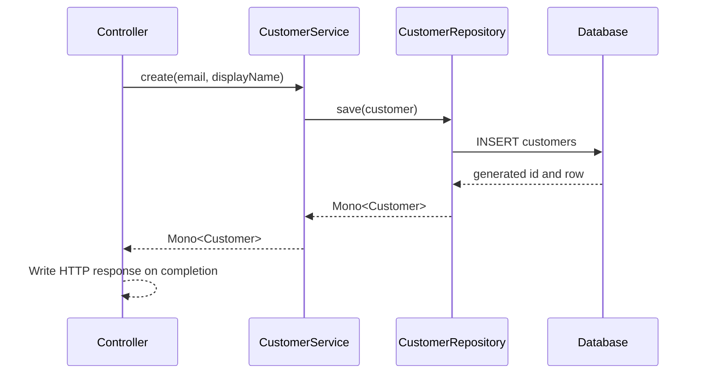

# Tổ chức các lớp cấu hình, thực thể, Repository và dịch vụ

Khi xây dựng ứng dụng với Spring Data R2DBC, nên chia mã nguồn thành những phần có trách nhiệm rõ ràng: cấu hình kết nối và hạ tầng R2DBC, lớp thực thể ánh xạ với bảng, Repository thực hiện thao tác dữ liệu và Service điều phối nghiệp vụ. Cách tổ chức này giúp ứng dụng dễ đọc, dễ kiểm thử và có thể thay đổi truy vấn hoặc cấu hình database mà không làm lan rộng thay đổi sang toàn bộ hệ thống.

Điểm cần nhớ là Spring Data R2DBC sử dụng mô hình reactive. Repository thường trả về `Mono<T>` hoặc `Flux<T>`, vì vậy Service cũng nên giữ kiểu trả về reactive và kết hợp các thao tác bằng Reactor. Không nên biến kết quả thành đối tượng đồng bộ bằng cách gọi `.block()` ở giữa các tầng.

## 1. Vai trò của từng lớp

Một luồng xử lý phổ biến có thể biểu diễn như sau:

```text
HTTP Controller / Message Handler
                |
                v
          Service layer
       (quy tắc nghiệp vụ)
                |
                v
        Repository interface
       (truy vấn và ghi dữ liệu)
                |
                v
        Spring Data R2DBC
                |
                v
          R2DBC driver
                |
                v
        Relational database

Configuration
  |-- ConnectionFactory và kết nối
  |-- Mapping, converters (khi cần)
  |-- Transaction manager
  `-- Repository scanning (khi cần tùy chỉnh)
```

| Thành phần | Trách nhiệm chính | Ví dụ |
|---|---|---|
| Configuration | Khai báo và tùy chỉnh hạ tầng dùng chung | Kết nối R2DBC, transaction manager, converter |
| Entity | Mô tả dữ liệu được lưu trong bảng | `Customer`, `Order` |
| Repository | Cung cấp thao tác đọc, ghi và truy vấn | `CustomerRepository` |
| Service | Thực hiện quy tắc nghiệp vụ và phối hợp Repository | `CustomerService` |
| Controller / Handler | Nhận đầu vào và chuyển kết quả ra giao thức bên ngoài | REST endpoint hoặc message handler |

Controller được đưa vào sơ đồ để làm rõ luồng gọi, dù trọng tâm của bài này là bốn phần Configuration, Entity, Repository và Service.

## 2. Tổ chức package trong dự án

Với một ứng dụng nhỏ, có thể bắt đầu bằng cấu trúc theo lớp như sau:

```text
com.example.store
├── StoreApplication.java
├── config
│   └── R2dbcConfiguration.java
├── entity
│   └── Customer.java
├── repository
│   └── CustomerRepository.java
├── service
│   └── CustomerService.java
└── controller
    └── CustomerController.java
```

Khi ứng dụng lớn hơn, có thể nhóm theo tính năng để những thành phần liên quan nằm gần nhau:

```text
com.example.store
├── StoreApplication.java
├── config
│   └── R2dbcConfiguration.java
└── customer
    ├── CustomerController.java
    ├── CustomerService.java
    ├── CustomerRepository.java
    ├── Customer.java
    └── CustomerRequest.java
```

Cả hai cách đều có thể sử dụng tốt. Cấu trúc theo lớp phù hợp với dự án nhỏ, ít tính năng. Cấu trúc theo tính năng giúp tránh việc một package `service` hoặc `repository` trở thành nơi chứa hàng chục lớp không liên quan khi hệ thống phát triển. Nên chọn một quy ước nhất quán với dự án.

Đặt lớp khởi động Spring Boot ở package gốc để component scanning mặc định bao phủ các package con. Nếu đặt Configuration, Service hoặc Controller bên ngoài phạm vi quét, Spring có thể không tạo bean như mong đợi.

## 3. Lớp cấu hình R2DBC

### 3.1. Khai báo dependency

Ứng dụng cần Spring Data R2DBC và driver tương ứng với hệ quản trị cơ sở dữ liệu. Ví dụ với Gradle Kotlin DSL và PostgreSQL:

```kotlin
dependencies {
    implementation("org.springframework.boot:spring-boot-starter-data-r2dbc")
    runtimeOnly("org.postgresql:r2dbc-postgresql")
}
```

Nếu dùng Maven, khai báo các artifact tương ứng trong `pom.xml`. Nên để Spring Boot dependency management quản lý phiên bản thư viện tương thích thay vì tự chọn phiên bản riêng cho từng dependency.

Nếu ứng dụng cung cấp API HTTP reactive, có thể thêm `spring-boot-starter-webflux`. WebFlux không phải điều kiện bắt buộc để dùng Spring Data R2DBC; R2DBC cũng có thể được gọi từ những thành phần khác trong ứng dụng.

### 3.2. Cấu hình kết nối bằng application.yml

Trong trường hợp thông thường, Spring Boot tự cấu hình `ConnectionFactory`, các thành phần Spring Data R2DBC và repository dựa trên dependency cùng thuộc tính cấu hình. Ví dụ:

```yaml
spring:
  r2dbc:
    url: r2dbc:postgresql://${DB_HOST:localhost}:${DB_PORT:5432}/${DB_NAME:store}
    username: ${DB_USERNAME}
    password: ${DB_PASSWORD}
```

Các thuộc tính quan trọng:

- `spring.r2dbc.url` xác định driver và địa chỉ database bằng URL có scheme `r2dbc:`.
- `spring.r2dbc.username` và `spring.r2dbc.password` cung cấp thông tin xác thực.
- Các placeholder `${...}` cho phép đưa thông tin theo môi trường vào biến môi trường thay vì ghi mật khẩu trực tiếp trong mã nguồn.

Với PostgreSQL, URL có dạng `r2dbc:postgresql://host:port/database`. Với database khác, scheme và driver phải tương ứng, ví dụ driver R2DBC của Microsoft SQL Server hoặc MySQL. URL JDBC bắt đầu bằng `jdbc:` thuộc cơ chế JDBC và không thể thay thế trực tiếp cho URL R2DBC.

Khi dùng cấu hình chuẩn của Spring Boot, thường không cần tự tạo `ConnectionFactory`, `DatabaseClient`, `R2dbcEntityTemplate` hay repository bean. Framework tạo các thành phần này dựa trên cấu hình và dependency. Tránh khai báo lại các bean đã được auto-configuration cung cấp nếu không có nhu cầu tùy chỉnh cụ thể.

### 3.3. Khi nào cần lớp @Configuration?

Tạo lớp Java cấu hình khi cần thay đổi hành vi mặc định hoặc bổ sung bean riêng. Ví dụ, nếu cần khai báo transaction manager tường minh:

```java
package com.example.store.config;

import io.r2dbc.spi.ConnectionFactory;
import org.springframework.context.annotation.Bean;
import org.springframework.context.annotation.Configuration;
import org.springframework.r2dbc.connection.R2dbcTransactionManager;
import org.springframework.transaction.ReactiveTransactionManager;

@Configuration
public class R2dbcConfiguration {

    @Bean
    public ReactiveTransactionManager reactiveTransactionManager(
            ConnectionFactory connectionFactory) {
        return new R2dbcTransactionManager(connectionFactory);
    }
}
```

Trong nhiều ứng dụng Spring Boot, transaction manager R2DBC cũng có thể được auto-configure. Chỉ thêm bean như ví dụ khi cần cấu hình tường minh hoặc khi ứng dụng không có transaction manager phù hợp; không tạo bean trùng lặp một cách máy móc.

Một số nhu cầu khác có thể cần cấu hình riêng:

- **Custom conversions:** chuyển đổi kiểu dữ liệu Java đặc thù sang kiểu database và ngược lại.
- **Naming hoặc mapping:** điều chỉnh cách ánh xạ thuộc tính với cột, schema hoặc bảng.
- **ConnectionFactory:** cấu hình kết nối đặc biệt, nhiều database hoặc thông số riêng của driver.
- **Repository scanning:** chỉ định package chứa repository khi cách quét mặc định không phù hợp.

`@EnableR2dbcRepositories` cho phép chỉ định phạm vi quét repository trong cấu hình thủ công. Với ứng dụng Spring Boot dùng auto-configuration tiêu chuẩn, thường không cần thêm annotation này. Nếu chủ động cấu hình repository scanning, cần bảo đảm không đăng ký cùng một tập repository từ hai cấu hình khác nhau.

### 3.4. Phân biệt cấu hình ứng dụng và cấu hình schema

`application.yml` khai báo cách ứng dụng kết nối và hoạt động; nó không thay thế việc thiết kế và quản lý schema. Bảng, khóa chính, khóa ngoại, index và thay đổi cấu trúc dữ liệu nên được quản lý bằng migration có phiên bản, chẳng hạn Flyway hoặc Liquibase theo quy trình của dự án.

Không nên dựa vào việc tự động tạo schema trong môi trường production. Khi ứng dụng sử dụng R2DBC để truy cập dữ liệu lúc chạy, công cụ migration vẫn có thể sử dụng JDBC để thay đổi schema trong bước triển khai. Đây là hai nhiệm vụ khác nhau.

## 4. Lớp Entity ánh xạ với bảng

Entity biểu diễn dữ liệu được Spring Data Relational lưu trữ. Các annotation ánh xạ được khai báo trong package `org.springframework.data.relational.core.mapping` và `org.springframework.data.annotation`.

### 4.1. Các annotation thường dùng

| Annotation | Ý nghĩa |
|---|---|
| `@Table("customers")` | Ánh xạ class với bảng `customers` |
| `@Id` | Đánh dấu thuộc tính định danh của entity |
| `@Column("display_name")` | Ánh xạ thuộc tính với cột có tên cụ thể |
| `@Transient` | Loại thuộc tính khỏi quá trình ánh xạ lưu trữ |
| `@Version` | Đánh dấu thuộc tính version để hỗ trợ optimistic locking |

Nếu quy tắc đặt tên mặc định đã khớp với schema, có thể không cần ghi `@Column` cho mọi thuộc tính. Khi tên cột trong database khác tên thuộc tính Java, khai báo tường minh giúp mã nguồn dễ hiểu hơn.

### 4.2. Ví dụ entity Customer

```java
package com.example.store.entity;

import org.springframework.data.annotation.Id;
import org.springframework.data.relational.core.mapping.Column;
import org.springframework.data.relational.core.mapping.Table;

@Table("customers")
public record Customer(
        @Id Long id,
        String email,
        @Column("display_name") String displayName
) {
}
```

Trong ví dụ này:

- `Customer` ánh xạ với bảng `customers`.
- `id` là khóa định danh. Nếu database tự sinh khóa, giá trị đầu vào có thể chưa có; kết quả `save` trả về entity đã được lưu với định danh do database sinh ra.
- `email` ánh xạ theo quy tắc tên cột mặc định.
- `displayName` ánh xạ rõ ràng tới cột `display_name`.

Spring Data Relational hỗ trợ entity bất biến và Java record. Khi cập nhật record, tạo một instance mới với các giá trị cần giữ lại và giá trị thay đổi. Nếu dự án dùng class mutable, cần cung cấp constructor và thuộc tính theo cách Spring Data có thể materialize entity; không nên giả định các cơ chế của JPA như persistence context hoặc dirty checking sẽ tự hoạt động.

### 4.3. Entity không phải DTO

Entity phục vụ ánh xạ và lưu trữ. DTO phục vụ trao đổi dữ liệu qua API hoặc giữa các thành phần. Hai loại có thể có trường giống nhau nhưng không nhất thiết phải dùng chung một class.

Ví dụ request tạo khách hàng:

```java
package com.example.store.customer;

public record CreateCustomerRequest(
        String email,
        String displayName
) {
}
```

Request không cần chứa `id` do database sinh. Tách DTO khỏi entity giúp API không phụ thuộc trực tiếp vào schema lưu trữ, đồng thời tránh để dữ liệu đầu vào bên ngoài quyết định những thuộc tính nội bộ như khóa chính hoặc version.

### 4.4. Thiết kế entity theo mô hình quan hệ

Spring Data R2DBC thuộc Spring Data Relational, không phải ORM đầy đủ như JPA/Hibernate. Không nên kỳ vọng `@OneToMany`, `@ManyToOne`, lazy loading hoặc persistence context hoạt động như trong JPA. Với dữ liệu ở nhiều bảng, cần thiết kế aggregate và truy vấn rõ ràng; có thể thực hiện truy vấn riêng hoặc dùng SQL tùy chỉnh để lấy dữ liệu kết hợp.

Một số nguyên tắc hữu ích:

- Dùng `@Id` cho định danh và để ràng buộc khóa chính được định nghĩa trong database.
- Khai báo constraint `UNIQUE`, `NOT NULL` và khóa ngoại trong schema để bảo vệ tính toàn vẹn dữ liệu.
- Chọn kiểu Java tương thích với kiểu cột và driver của database.
- Chỉ đưa các trường thực sự thuộc entity vào mapping; dữ liệu tính toán tạm thời có thể đặt ở DTO hoặc đánh dấu `@Transient` khi phù hợp.
- Xác định aggregate root và quy tắc lưu dữ liệu liên quan trước khi xây dựng các thao tác ghi nhiều bảng.

## 5. Lớp Repository

Repository là điểm truy cập dữ liệu của tầng ứng dụng. Với Spring Data R2DBC, repository thường là interface kế thừa `ReactiveCrudRepository` hoặc một interface reactive phù hợp khác. Spring Data tạo implementation tại thời điểm chạy dựa trên khai báo này.

### 5.1. Repository CRUD cơ bản

```java
package com.example.store.repository;

import com.example.store.entity.Customer;
import org.springframework.data.repository.reactive.ReactiveCrudRepository;
import reactor.core.publisher.Flux;
import reactor.core.publisher.Mono;

public interface CustomerRepository
        extends ReactiveCrudRepository<Customer, Long> {

    Mono<Customer> findByEmail(String email);

    Flux<Customer> findByDisplayNameContaining(String keyword);
}
```

Hai tham số generic của `ReactiveCrudRepository<Customer, Long>` lần lượt là kiểu entity và kiểu của khóa chính. Interface cung cấp sẵn các thao tác như `save`, `findById`, `findAll`, `existsById`, `count`, `deleteById` và `delete`.

Các phương thức truy vấn được suy ra từ tên phương thức gọi là *derived query methods*. Ví dụ `findByEmail` tạo truy vấn theo thuộc tính `email`; `findByDisplayNameContaining` tìm những bản ghi có `displayName` chứa chuỗi được truyền vào. Tên phương thức phải khớp với thuộc tính entity và khả năng hỗ trợ của Spring Data Relational.

Nếu `email` phải duy nhất, hãy đặt unique constraint trong schema. Khi đó `Mono<Customer>` diễn đạt đúng ý nghĩa một kết quả tối đa. Nếu dữ liệu không bảo đảm duy nhất, cần thiết kế kiểu trả về và quy tắc xử lý phù hợp.

### 5.2. Viết truy vấn SQL tùy chỉnh

Khi derived query không diễn đạt được yêu cầu hoặc cần kiểm soát SQL, có thể dùng `@Query`:

```java
package com.example.store.repository;

import com.example.store.entity.Customer;
import org.springframework.data.r2dbc.repository.Query;
import org.springframework.data.repository.query.Param;
import org.springframework.data.repository.reactive.ReactiveCrudRepository;
import reactor.core.publisher.Flux;

public interface CustomerRepository
        extends ReactiveCrudRepository<Customer, Long> {

    @Query("SELECT * FROM customers " +
           "WHERE display_name LIKE :pattern ORDER BY id")
    Flux<Customer> searchByDisplayName(@Param("pattern") String pattern);
}
```

Giá trị `pattern` được truyền từ tham số, ví dụ `%An%` để tìm chuỗi có chứa `An`. Việc bind tham số giúp tách dữ liệu đầu vào khỏi cấu trúc câu SQL. Không nối trực tiếp dữ liệu người dùng vào chuỗi SQL để tạo điều kiện truy vấn.

Tên cột và tên bảng trong SQL tùy chỉnh phải khớp với schema thật. Cú pháp SQL, hàm và khả năng hỗ trợ có thể khác nhau giữa các hệ quản trị cơ sở dữ liệu; hãy kiểm tra truy vấn trên database mục tiêu.

### 5.3. Khi nào dùng DatabaseClient?

`DatabaseClient` cung cấp API truy vấn SQL ở mức thấp hơn repository. Nó phù hợp khi cần:

- Thực hiện câu SQL tùy chỉnh khó biểu diễn bằng derived query.
- Chạy truy vấn tổng hợp hoặc truy vấn trả về projection đặc biệt.
- Điều khiển rõ ràng việc bind tham số và ánh xạ kết quả.
- Thao tác với dữ liệu không phù hợp để biểu diễn thành một repository method thông thường.

Repository vẫn là lựa chọn rõ ràng cho thao tác CRUD và truy vấn gắn với một aggregate. Có thể dùng `DatabaseClient` trong một lớp truy cập dữ liệu chuyên biệt khi câu SQL phức tạp; tránh đưa SQL rải rác vào nhiều Service.

### 5.4. Kiểu trả về reactive

| Kiểu trả về | Ý nghĩa thường gặp |
|---|---|
| `Mono<Customer>` | Không có hoặc có tối đa một khách hàng |
| `Flux<Customer>` | Luồng gồm không hoặc nhiều khách hàng |
| `Mono<Void>` | Hoàn tất một thao tác không cần phát dữ liệu |
| `Mono<Long>` | Một giá trị số, ví dụ kết quả đếm |

Publisher thường lazy: gọi phương thức repository tạo pipeline; thao tác được thực thi khi có subscriber. Do đó, không nên gọi repository rồi bỏ publisher mà không kết hợp nó vào luồng xử lý của ứng dụng.

## 6. Lớp Service

Service chứa quy tắc nghiệp vụ và phối hợp một hoặc nhiều Repository. Controller không nên trực tiếp thực hiện nhiều truy vấn rồi tự quyết định quy tắc nghiệp vụ; việc đặt logic ở Service giúp có một nơi rõ ràng để kiểm thử và tái sử dụng.

### 6.1. Service cơ bản

```java
package com.example.store.service;

import com.example.store.entity.Customer;
import com.example.store.repository.CustomerRepository;
import org.springframework.stereotype.Service;
import reactor.core.publisher.Flux;
import reactor.core.publisher.Mono;

@Service
public class CustomerService {

    private final CustomerRepository customerRepository;

    public CustomerService(CustomerRepository customerRepository) {
        this.customerRepository = customerRepository;
    }

    public Mono<Customer> create(String email, String displayName) {
        Customer customer = new Customer(null, email, displayName);
        return customerRepository.save(customer);
    }

    public Mono<Customer> findById(Long id) {
        return customerRepository.findById(id)
                .switchIfEmpty(Mono.error(
                        new IllegalArgumentException("Customer not found: " + id)));
    }

    public Flux<Customer> searchByName(String keyword) {
        return customerRepository.findByDisplayNameContaining(keyword);
    }

    public Mono<Customer> rename(Long id, String newDisplayName) {
        return customerRepository.findById(id)
                .switchIfEmpty(Mono.error(
                        new IllegalArgumentException("Customer not found: " + id)))
                .flatMap(current -> {
                    Customer updated = new Customer(
                            current.id(), current.email(), newDisplayName);
                    return customerRepository.save(updated);
                });
    }

    public Mono<Void> delete(Long id) {
        return customerRepository.deleteById(id);
    }
}
```

Ví dụ trên minh họa cách Service giữ nguyên kiểu reactive của Repository:

- `create` tạo entity mới rồi trả publisher từ `save`.
- `findById` chuyển trường hợp không có dữ liệu thành lỗi nghiệp vụ.
- `searchByName` trả về `Flux` để tầng gọi xử lý danh sách kết quả.
- `rename` dùng `flatMap` vì thao tác bên trong tiếp tục trả về một `Mono<Customer>`.
- `delete` trả về `Mono<Void>` biểu diễn thời điểm thao tác xóa hoàn tất.

Trong ứng dụng thực tế, nên dùng exception nghiệp vụ riêng thay cho `IllegalArgumentException`, đồng thời xác thực dữ liệu đầu vào và ánh xạ lỗi thành phản hồi phù hợp ở tầng giao tiếp. Cũng cần xác định rõ hành vi khi xóa một ID không tồn tại: một số nghiệp vụ xem thao tác đó là thành công idempotent, nghiệp vụ khác yêu cầu trả về lỗi.

### 6.2. Dependency injection qua constructor

Ví dụ sử dụng constructor injection để nhận `CustomerRepository`. Đây là cách phù hợp vì dependency được thể hiện rõ trong constructor, có thể khai báo `final` và dễ tạo Service trong unit test.

Tránh tạo repository bằng `new CustomerRepositoryImpl(...)` hoặc truy cập ApplicationContext trực tiếp. Spring quản lý vòng đời bean và cung cấp implementation repository đã được cấu hình.

Không nhất thiết phải tạo interface và lớp `CustomerServiceImpl` cho mọi Service. Một interface riêng hữu ích khi có nhiều implementation, cần một hợp đồng được dùng ở nhiều module hoặc cần tách ranh giới kiến trúc rõ ràng. Với nghiệp vụ đơn giản, một class `@Service` thường dễ đọc hơn.

### 6.3. Kết hợp nhiều Repository

Một nghiệp vụ có thể cần nhiều thao tác dữ liệu. Hãy kết hợp publisher bằng toán tử Reactor để giữ thứ tự và xử lý lỗi trong cùng pipeline.

Ví dụ minh họa việc lưu khách hàng rồi mới tạo bản ghi phụ thuộc:

```java
public Mono<Customer> registerCustomer(String email, String displayName) {
    Customer customer = new Customer(null, email, displayName);

    return customerRepository.save(customer)
            .flatMap(saved -> profileRepository.save(
                    new CustomerProfile(null, saved.id(), "BASIC"))
                    .thenReturn(saved));
}
```

`flatMap` nối thao tác lưu hồ sơ vào sau khi khách hàng đã được lưu. `thenReturn(saved)` đợi thao tác thứ hai hoàn tất rồi phát lại khách hàng đã lưu. Nếu hai thao tác phải cùng thành công hoặc cùng thất bại, cần đặt chúng trong một transaction reactive.

Không gọi `subscribe()` bên trong Service để tự chạy từng thao tác. Làm vậy tách pipeline khỏi luồng gọi, khiến tầng bên ngoài khó biết khi nào công việc hoàn tất và khó nhận lỗi. Hãy trả publisher về cho tầng gọi.

## 7. Transaction trong Service

Khi một nghiệp vụ bao gồm nhiều lệnh ghi cần tính nguyên tử, hãy sử dụng transaction manager R2DBC. Có thể đánh dấu phương thức Service trả về `Mono` hoặc `Flux` bằng `@Transactional`:

```java
import org.springframework.stereotype.Service;
import org.springframework.transaction.annotation.Transactional;
import reactor.core.publisher.Mono;

@Service
public class OrderService {

    private final OrderRepository orderRepository;
    private final InventoryRepository inventoryRepository;

    public OrderService(
            OrderRepository orderRepository,
            InventoryRepository inventoryRepository) {
        this.orderRepository = orderRepository;
        this.inventoryRepository = inventoryRepository;
    }

    @Transactional
    public Mono<Order> placeOrder(Order order) {
        return inventoryRepository.reserve(order)
                .then(orderRepository.save(order));
    }
}
```

Đây là ví dụ minh họa ranh giới transaction; logic kiểm tra tồn kho, cập nhật số lượng và xử lý cạnh tranh cần được thiết kế theo schema và quy tắc nghiệp vụ cụ thể.

Transaction reactive sử dụng Reactor Context để truyền ngữ cảnh giao dịch qua pipeline. Vì vậy:

- Phải trả publisher từ phương thức được quản lý transaction để framework kiểm soát quá trình thực thi.
- Các thao tác tham gia transaction cần nằm trong pipeline reactive được kết hợp đúng cách.
- Không tự `subscribe()` hoặc tách một nhánh bất đồng bộ độc lập nếu nhánh đó phải cùng transaction.
- Không gọi `.block()` để nối các bước trong pipeline.
- Kiểm thử cả trường hợp thành công và trường hợp phát sinh lỗi để xác nhận rollback.

Nếu cần điều khiển transaction trực tiếp trong code, có thể tìm hiểu `TransactionalOperator`. Với trường hợp thông thường, `@Transactional` trên phương thức Service reactive là cách khai báo dễ đọc.

## 8. Luồng gọi giữa các lớp

Khi một client yêu cầu tạo khách hàng, luồng xử lý có thể diễn ra như sau:

1. Controller nhận request và kiểm tra cấu trúc dữ liệu đầu vào.
2. Controller gọi `CustomerService.create(...)`.
3. Service áp dụng quy tắc nghiệp vụ và tạo `Customer`.
4. Service gọi `CustomerRepository.save(...)`.
5. Spring Data R2DBC ánh xạ entity thành câu lệnh phù hợp và sử dụng driver để gửi tới database.
6. Kết quả được ánh xạ lại thành entity và phát qua `Mono`.
7. Service trả publisher cho Controller; tầng HTTP chuyển kết quả thành response khi pipeline hoàn tất.

Sơ đồ tương tác:



Configuration được sử dụng ở bước khởi tạo ứng dụng để tạo và kết nối các bean hạ tầng. Nó không phải một tầng nghiệp vụ được gọi lại trong mỗi request.

## 9. Kiểm thử từng lớp

Tổ chức lớp rõ ràng giúp chọn đúng phạm vi kiểm thử:

| Thành phần | Cách kiểm thử phù hợp | Nội dung cần xác nhận |
|---|---|---|
| Configuration | Application context hoặc integration test | Bean kết nối, repository và transaction manager được tạo đúng |
| Entity | Mapping/integration test | Tên bảng, cột, kiểu dữ liệu và khóa được ánh xạ đúng |
| Repository | `@DataR2dbcTest` và database phù hợp | SQL, derived query, mapping và ràng buộc dữ liệu |
| Service | Unit test với mock repository và `StepVerifier` | Quy tắc nghiệp vụ, trường hợp rỗng, lỗi và thứ tự pipeline |
| Transaction | Integration test với database | Commit và rollback đúng khi một thao tác thất bại |

Ví dụ kiểm thử Service bằng Reactor Test:

```java
StepVerifier.create(customerService.findById(10L))
        .expectNextMatches(customer -> customer.id().equals(10L))
        .verifyComplete();
```

`StepVerifier` đăng ký vào publisher và kiểm tra các signal mà pipeline phát ra. Khi kiểm thử repository, nên dùng cùng loại database hoặc database tương thích với môi trường triển khai vì cú pháp SQL, kiểu dữ liệu và hành vi driver có thể khác nhau.

## 10. Những lỗi tổ chức thường gặp

### Khai báo mọi bean bằng tay

Spring Boot đã auto-configure nhiều thành phần R2DBC khi dependency và thuộc tính hợp lệ. Tự tạo lại `ConnectionFactory`, `DatabaseClient`, template hoặc repository có thể gây xung đột hoặc khiến cấu hình khó theo dõi. Chỉ bổ sung Java configuration khi có nhu cầu thực tế.

### Đặt logic nghiệp vụ trong Repository

Repository nên tập trung vào truy vấn và thao tác lưu trữ. Quy tắc như kiểm tra điều kiện đặt hàng, tính phí, phối hợp nhiều aggregate hoặc quyết định trạng thái thuộc về Service hoặc một thành phần nghiệp vụ phù hợp.

### Đưa SQL vào Controller

Controller nên điều phối giao thức vào/ra. Đặt SQL và mapping dữ liệu ở Repository hoặc thành phần truy cập dữ liệu chuyên biệt giúp thay đổi endpoint không làm ảnh hưởng cách truy vấn database.

### Dùng entity làm request/response cho mọi API

Việc dùng trực tiếp entity có thể làm lộ cấu trúc lưu trữ và khiến API thay đổi theo schema. Dùng DTO cho dữ liệu đầu vào và đầu ra khi có ranh giới API rõ ràng.

### Xử lý reactive như code đồng bộ

Gọi `.block()` để lấy entity rồi gọi repository tiếp theo sẽ làm mất lợi ích của pipeline reactive và có thể chặn event-loop. Dùng `map`, `flatMap`, `then`, `switchIfEmpty` và các toán tử phù hợp để kết hợp công việc.

### Cho rằng quan hệ entity tự động giống JPA

R2DBC không cung cấp đầy đủ ORM behavior của JPA. Cần chủ động viết truy vấn cho dữ liệu liên quan, xác định aggregate và dùng transaction khi nghiệp vụ yêu cầu nhiều thao tác ghi nguyên tử.

## 11. Checklist khi khởi tạo cấu trúc dự án

- [ ] Dependency Spring Data R2DBC và driver khớp với database mục tiêu.
- [ ] `application.yml` dùng URL `r2dbc:` và lấy thông tin xác thực từ môi trường.
- [ ] Package khởi động Spring Boot bao phủ các package chứa bean.
- [ ] Java Configuration chỉ khai báo phần cần tùy chỉnh, tránh trùng auto-configuration.
- [ ] Entity có `@Table`, `@Id` và mapping cột phù hợp schema.
- [ ] Schema được quản lý bằng migration và có constraint cần thiết.
- [ ] Repository kế thừa reactive repository phù hợp và dùng kiểu trả về `Mono` / `Flux`.
- [ ] Truy vấn tùy chỉnh bind tham số thay vì ghép chuỗi đầu vào thành SQL.
- [ ] Service dùng constructor injection và chứa quy tắc nghiệp vụ.
- [ ] Các thao tác nhiều bước được kết hợp bằng Reactor và có transaction khi cần.
- [ ] Không gọi `subscribe()` tùy tiện hoặc `.block()` trong đường xử lý reactive.
- [ ] Có kiểm thử repository, service và transaction trên database phù hợp.

Khi các thành phần được tách đúng trách nhiệm, ứng dụng Spring Data R2DBC có luồng phụ thuộc dễ theo dõi: Configuration khởi tạo hạ tầng, Entity mô tả dữ liệu, Repository cung cấp truy cập dữ liệu và Service thực hiện nghiệp vụ. Đây là nền tảng để bổ sung Controller, kiểm thử, transaction và các truy vấn phức tạp mà không làm các lớp phụ thuộc chặt vào nhau.
