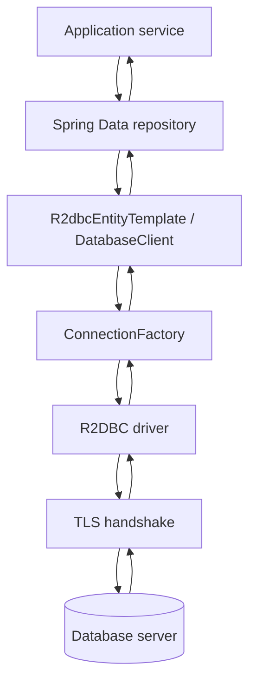
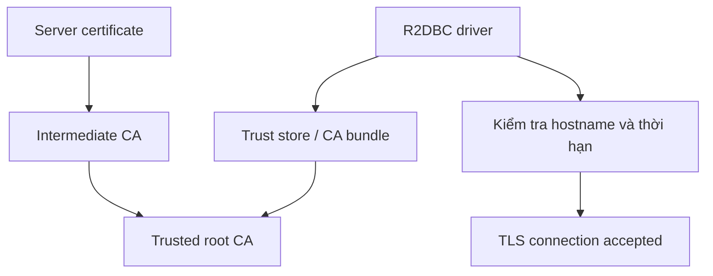

# Cấu hình TLS và các tùy chọn riêng của trình điều khiển

Spring Data Relational R2DBC truy cập cơ sở dữ liệu thông qua R2DBC driver và `ConnectionFactory`. TLS được cấu hình ở tầng kết nối này. Repository và service tiếp tục dùng `Mono`, `Flux` và các API Spring Data như bình thường; chúng không cần tự tạo socket TLS hoặc quản lý chứng thư.

Cấu hình TLS cần giải quyết ba việc: mã hóa dữ liệu trên đường truyền, xác minh ứng dụng đang kết nối đúng máy chủ cơ sở dữ liệu và, nếu hệ thống yêu cầu, xác minh danh tính ứng dụng bằng chứng thư client. Driver còn có các tùy chọn như timeout, keepalive, application name, schema và giới hạn truy vấn. Những tùy chọn này phải được chọn theo hệ quản trị, driver và tải thực tế.

## 1. TLS nằm ở đâu trong kiến trúc R2DBC?



`ConnectionFactory` tạo các kết nối mà Spring Data sử dụng. Driver hiểu URL, option riêng, giao thức của hệ quản trị và cách thiết lập TLS. Khi tạo kết nối vật lý, driver thực hiện handshake với máy chủ, thương lượng phiên bản TLS và thuật toán mã hóa, rồi dùng kênh đã thiết lập để truyền dữ liệu giao thức cơ sở dữ liệu.

Vì vậy:

- Cấu hình TLS thuộc về driver hoặc `ConnectionFactory`, không phải từng repository.
- SQL và dữ liệu truy vấn được truyền qua kết nối đã mã hóa khi TLS được bật và handshake thành công.
- Mỗi driver có tên option, giá trị mặc định và cách đọc trust material riêng.
- Dùng R2DBC không đồng nghĩa kết nối đã được mã hóa. Phải cấu hình và xác minh rõ chế độ TLS.

TLS bảo vệ dữ liệu khi truyền giữa ứng dụng và máy chủ. Nó không thay thế mã hóa dữ liệu lưu trên đĩa, kiểm soát quyền truy cập SQL, quản lý secret hoặc phân quyền mạng.

## 2. Ba mục tiêu của cấu hình TLS

### Mã hóa đường truyền

TLS mã hóa dữ liệu trao đổi giữa client và server, giúp người quan sát trên mạng không đọc được nội dung SQL, kết quả truy vấn hoặc thông tin xác thực gửi qua kết nối. Mã hóa chỉ có tác dụng nếu hai đầu thực sự thiết lập TLS và không có cơ chế cho phép hạ cấp xuống kết nối rõ.

### Xác minh danh tính máy chủ

Client cần xác minh chứng thư server gửi đến. Việc này gồm kiểm tra chuỗi chứng thư dẫn đến CA được tin cậy và thời hạn hiệu lực. Client cũng cần xác minh tên máy chủ mà ứng dụng yêu cầu có khớp với tên trong chứng thư, thường nằm trong Subject Alternative Name (SAN).

Nếu cấu hình kết nối bằng tên DNS `db.internal.example`, chứng thư phải hợp lệ cho tên đó. Kết nối bằng địa chỉ IP đòi hỏi chứng thư có SAN kiểu IP tương ứng. Mã hóa mà không xác minh máy chủ có thể khiến ứng dụng thiết lập một kênh mã hóa tới máy chủ giả mạo.

### Xác minh danh tính client

Trong mutual TLS (mTLS), server cũng yêu cầu client trình chứng thư. Server xác minh chứng thư client theo CA và chính sách của nó. Cơ sở dữ liệu có thể kết hợp danh tính chứng thư với cơ chế xác thực tài khoản riêng, tùy sản phẩm và cấu hình.

mTLS bổ sung xác thực ở cấp kết nối. Nó không tự động thay thế username/password hoặc cơ chế phân quyền database nếu hệ quản trị vẫn yêu cầu những thông tin đó.

## 3. Các chế độ SSL/TLS thường gặp

Tên chế độ khác nhau giữa các driver, nhưng ý nghĩa khái quát thường như sau:

| Chế độ | Hành vi | Nhận xét |
| --- | --- | --- |
| Disabled | Không dùng TLS. | Chỉ phù hợp với môi trường được kiểm soát và có lý do rõ ràng. |
| Preferred / Allow | Ưu tiên TLS nhưng có thể cho phép kết nối không mã hóa. | Có nguy cơ hạ cấp; cần hiểu thứ tự thử kết nối của driver. |
| Required | Bắt buộc mã hóa bằng TLS. | Có thể chưa xác minh CA hoặc hostname, tùy driver. |
| Verify CA | Bắt buộc TLS và xác minh chuỗi chứng thư tới CA tin cậy. | Có thể chưa xác minh hostname. |
| Verify Full / Verify Identity | Bắt buộc TLS, xác minh CA và hostname. | Thường phù hợp với kết nối production cần xác thực server. |

Không được giả định hai driver dùng cùng một tên chế độ thì có hành vi hoàn toàn giống nhau. Ví dụ, PostgreSQL R2DBC có thể dùng `VERIFY_FULL`, trong khi một driver MySQL có thể dùng `VERIFY_IDENTITY`. Hãy đọc tài liệu đúng phiên bản driver đang triển khai.

Một số chế độ `REQUIRE` hoặc `PREFERRED` có ý nghĩa lịch sử riêng theo từng hệ quản trị. Đừng chọn chỉ vì tên có vẻ đủ an toàn; cần biết rõ chế độ đó có xác minh CA và hostname hay không.

## 4. Chứng thư và trust chain

Trong TLS, server gửi chứng thư của nó và thường kèm các chứng thư trung gian cần thiết. Client cần có trust anchor phù hợp để xác minh chuỗi này.

- **Server certificate:** chứng thư máy chủ, chứa public key và danh tính server.
- **Intermediate CA:** CA trung gian ký chứng thư server hoặc CA cấp dưới.
- **Root CA:** CA gốc được client tin cậy.
- **Client certificate:** chứng thư ứng dụng gửi cho server trong mTLS.
- **Client private key:** khóa riêng tương ứng với client certificate; phải được bảo vệ như secret.



Client cần tin cậy CA đã ký chứng thư server. Nếu doanh nghiệp dùng private CA, CA đó phải được đưa vào trust store hoặc cấu hình theo cách driver hỗ trợ. Không nên đưa trực tiếp chứng thư leaf của một máy chủ vào trust store như giải pháp lâu dài nếu hệ thống có quy trình CA rõ ràng; pinning leaf certificate có thể làm việc gia hạn chứng thư khó vận hành.

Một chứng thư hợp lệ về chữ ký vẫn có thể bị từ chối nếu đã hết hạn, chưa đến thời điểm hiệu lực, thiếu intermediate certificate hoặc không khớp hostname. Đồng hồ hệ thống sai cũng có thể làm kiểm tra thời hạn thất bại.

## 5. Cấu hình PostgreSQL R2DBC

PostgreSQL R2DBC driver có các tùy chọn riêng cho chế độ TLS và đường dẫn chứng thư. Một cấu hình có thể yêu cầu xác minh đầy đủ danh tính server:

```yaml
spring:
  r2dbc:
    url: "r2dbc:postgresql://db.internal.example:5432/orders?sslMode=VERIFY_FULL&sslRootCert=%2Frun%2Fsecrets%2Fpostgres-root-ca.crt"
    username: ${DB_USERNAME}
    password: ${DB_PASSWORD}
```

Trong ví dụ:

- `r2dbc:postgresql` chọn PostgreSQL R2DBC driver.
- `sslMode=VERIFY_FULL` yêu cầu TLS và xác minh chuỗi chứng thư cùng hostname.
- `sslRootCert` trỏ đến CA tin cậy dùng để xác minh chứng thư server.
- Username và password được cấp từ secret configuration, tách khỏi URL.

Tên tham số và định dạng đường dẫn cần được đối chiếu với phiên bản `r2dbc-postgresql` đang dùng. Giá trị URL phải được URL-encode khi chứa ký tự đặc biệt. Nếu driver hoặc nền tảng cung cấp cách cấu hình qua `ConnectionFactoryOptions`, có thể truyền tùy chọn tương đương bằng API đó.

### mTLS với PostgreSQL

Khi PostgreSQL được cấu hình yêu cầu chứng thư client, driver có thể cần đường dẫn chứng thư và khóa riêng của client. Các tùy chọn thường gặp trong PostgreSQL R2DBC driver gồm `sslCert`, `sslKey` và `sslPassword` bên cạnh chế độ TLS và CA.

Ví dụ minh họa:

```yaml
spring:
  r2dbc:
    url: "r2dbc:postgresql://db.internal.example:5432/orders?sslMode=VERIFY_FULL&sslRootCert=%2Frun%2Fsecrets%2Fpostgres-root-ca.crt&sslCert=%2Frun%2Fsecrets%2Fapp-client.crt&sslKey=%2Frun%2Fsecrets%2Fapp-client.key"
    username: ${DB_USERNAME}
    password: ${DB_PASSWORD}
```

Nếu private key được mã hóa, driver có thể cần thêm mật khẩu khóa riêng theo option mà phiên bản đó hỗ trợ. Không đặt mật khẩu khóa trong source code hoặc file cấu hình được commit.

Chỉ thêm client certificate ở phía ứng dụng là chưa đủ. Máy chủ PostgreSQL cũng phải được cấu hình TLS và chính sách xác thực phù hợp, ví dụ quy tắc trong `pg_hba.conf` khi sử dụng certificate authentication. Kiểm tra cấu hình server, CA được tin cậy, danh tính chứng thư và ánh xạ user theo hướng dẫn PostgreSQL.

## 6. Cấu hình MySQL R2DBC

Các driver MySQL R2DBC có thể cung cấp chế độ TLS và cách chỉ định CA hoặc chứng thư riêng theo API của từng dự án. Với driver `io.asyncer:r2dbc-mysql`, một cấu hình có thể sử dụng chế độ xác minh danh tính server trong URL:

```yaml
spring:
  r2dbc:
    url: "r2dbc:mysql://db.internal.example:3306/orders?sslMode=VERIFY_IDENTITY"
    username: ${DB_USERNAME}
    password: ${DB_PASSWORD}
```

`VERIFY_IDENTITY` là tên chế độ thường dùng trong driver MySQL hỗ trợ xác minh CA và hostname. Cần kiểm tra tài liệu phiên bản driver đang dùng để biết CA mặc định được lấy từ đâu và tên chính xác của option bổ sung nếu cần cung cấp CA bundle hoặc chứng thư client.

Không sao chép nguyên các option PostgreSQL như `sslRootCert`, `sslCert` hoặc `sslKey` sang MySQL nếu tài liệu driver không định nghĩa các tên đó. Một driver có thể dùng tên khác, kiểu giá trị khác hoặc cấu hình trust store theo cách khác.

Nếu triển khai một driver MySQL R2DBC khác, trước tiên xác định artifact và phiên bản thực tế trong dependency tree. Tên scheme `r2dbc:mysql` không đủ để kết luận toàn bộ bộ option TLS giống nhau giữa các implementation.

## 7. Tùy chọn riêng của driver và R2DBC SPI

R2DBC SPI định nghĩa cách ứng dụng tạo `ConnectionFactory` và truyền các thông tin kết nối chung như driver, host, port, database, user và password. Driver có thể mở rộng bộ option bằng những thuộc tính riêng để biểu diễn tính năng của hệ quản trị.

| Nhóm | Ví dụ về ý nghĩa | Cần xác minh |
| --- | --- | --- |
| TLS | Bật TLS, chế độ xác minh, CA, client certificate. | Tên option, mức xác minh và định dạng file. |
| Timeout | Thời gian chờ kết nối hoặc thực thi. | Đơn vị, phạm vi áp dụng và giá trị mặc định. |
| Network | TCP keepalive, socket timeout, proxy nếu hỗ trợ. | Driver có expose option hay dùng cấu hình JVM/hệ điều hành. |
| Session | Database, schema, application name, isolation mặc định. | Tên option và thời điểm áp dụng. |
| Query | Statement timeout, fetch size, prepared statement cache. | Có thể là option driver, API statement hoặc cấu hình server. |
| Pool | Kích thước pool, thời gian chờ lấy connection, tuổi thọ kết nối. | Thường là cấu hình pool bao ngoài, không phải option TLS của driver. |

Không phải mọi tùy chọn đều là thuộc tính chuẩn của R2DBC SPI. Một số được driver đọc từ URL, một số được truyền qua `ConnectionFactoryOptions`, một số lại thuộc `ConnectionPoolConfiguration` hoặc cấu hình server.

Khi dùng Spring Boot, thuộc tính `spring.r2dbc.url` là điểm cấu hình kết nối phổ biến. Các query parameter trong URL được driver phân tích theo cú pháp riêng. Spring Boot cũng hỗ trợ các thuộc tính R2DBC bổ sung tùy phiên bản; hãy kiểm tra metadata và tài liệu của phiên bản Spring Boot trong dự án thay vì giả định một tên property luôn có sẵn.

Nếu tạo `ConnectionFactory` bằng Java, có thể xây dựng `ConnectionFactoryOptions` với option chuẩn rồi thêm option mà driver cụ thể nhận diện. Tên option, kiểu dữ liệu và cách khởi tạo phải lấy từ tài liệu hoặc constant của driver đó. Tránh tạo chuỗi cấu hình dùng chung cho nhiều database vendor nếu các option không có cùng ngữ nghĩa.

## 8. Tách cấu hình kết nối khỏi cấu hình pool

Connection pool quản lý việc tái sử dụng các kết nối vật lý. Driver thiết lập TLS khi tạo kết nối vật lý; pool giữ và cấp lại kết nối đã được thiết lập cho các thao tác sau.

Ví dụ cấu hình pool trong Spring Boot:

```yaml
spring:
  r2dbc:
    pool:
      enabled: true
      initial-size: 2
      max-size: 20
      max-idle-time: 30m
```

Các giá trị trên chỉ minh họa cấu trúc cấu hình. Kích thước pool phải dựa trên số request đồng thời, thời gian truy vấn, giới hạn kết nối database và tổng số instance ứng dụng. Không tăng `max-size` tùy tiện vì nhiều connection có thể làm database quá tải.

Cần phân biệt:

- `sslMode`, CA và client certificate là cấu hình TLS của driver.
- `initial-size`, `max-size`, `max-idle-time` là cấu hình vòng đời connection pool.
- `connect-timeout` hoặc statement timeout có thể thuộc driver, SPI hay pool tùy API và phiên bản.

TLS handshake thường xảy ra khi tạo kết nối vật lý mới, không phải mỗi lần lấy connection đã có sẵn từ pool. Vì vậy, một pool đang hoạt động có thể tiếp tục sử dụng kết nối đã thiết lập sau khi chứng thư được thay trên máy chủ. Muốn áp dụng chứng thư mới, cần có kế hoạch tái tạo kết nối và làm mới pool theo cách an toàn.

## 9. Quản lý chứng thư và secret

Chứng thư CA có thể là cấu hình được triển khai cùng ứng dụng nếu chính sách tổ chức cho phép. Client private key, mật khẩu private key và thông tin xác thực database cần được quản lý như secret.

- Lấy password và private key từ secret manager hoặc cơ chế mount secret của nền tảng.
- Giới hạn quyền đọc file chứa private key cho user chạy ứng dụng.
- Không commit private key, password, token hoặc nội dung secret vào Git.
- Tránh đưa credential vào URL nếu log hoặc exception có thể ghi lại URL đầy đủ.
- Hạn chế in `ConnectionFactoryOptions` hoặc cấu hình kết nối có thông tin nhạy cảm vào log.
- Đặt quyền và thời hạn phù hợp cho chứng thư; theo dõi ngày hết hạn.
- Có quy trình gia hạn và luân chuyển chứng thư trước thời điểm hết hạn.

Nếu URL có chứa tham số đường dẫn hoặc giá trị có ký tự đặc biệt, phải URL-encode đúng cách. Tuy nhiên, URL-encoding không phải là cơ chế bảo vệ secret. Một chuỗi đã encode vẫn có thể bị log hoặc hiển thị trong diagnostics.

Không nên tạo file cấu hình production có password thật rồi chỉ dựa vào việc file đó không được commit. Secret cần được cấp qua kênh quản lý riêng và có thể luân chuyển.

## 10. Phiên bản TLS, hostname và môi trường mạng

TLS được thương lượng giữa client và server. Driver thường dựa trên thư viện TLS của nó hoặc TLS provider của JVM. Phiên bản TLS và bộ cipher thực tế phụ thuộc driver, runtime, server và chính sách bảo mật.

Một số điểm cần kiểm tra:

- Server và client có ít nhất một phiên bản TLS chung được phép hay không.
- Chứng thư server có SAN khớp hostname được cấu hình hay không.
- Client có nhận đủ intermediate certificate không.
- CA được cấu hình có đúng với CA ký chứng thư hiện tại không.
- DNS có phân giải tới endpoint dự kiến không.
- Firewall hoặc proxy trung gian có làm gián đoạn handshake không.
- Server có yêu cầu SNI hoặc chính sách client certificate đặc biệt không, nếu kiến trúc sử dụng những tính năng đó.

Trong môi trường container, đường dẫn CA hoặc client key trong cấu hình phải tồn tại bên trong container và có quyền đọc phù hợp. Đường dẫn trên máy host không tự động tồn tại trong container. Khi dùng Kubernetes hoặc nền tảng điều phối tương tự, mount secret và cấu hình volume phải nhất quán với đường dẫn mà driver nhận.

Nếu kết nối đi qua proxy, service mesh hoặc TLS termination gateway, hãy xác định nơi TLS kết thúc và nơi kết nối được mã hóa lại. Một kết nối ứng dụng đến proxy được mã hóa không có nghĩa chặng proxy đến database cũng tự động được mã hóa.

## 11. Kiểm thử cấu hình TLS

Không nên chỉ kiểm tra ứng dụng khởi động thành công. Một cấu hình có thể tạo kết nối được nhưng vẫn đang ở chế độ không xác minh danh tính server. Cần kiểm tra cả trường hợp hợp lệ và trường hợp phải bị từ chối.

| Tình huống | Kết quả mong đợi |
| --- | --- |
| CA tin cậy, hostname khớp, chứng thư còn hạn | Kết nối thành công. |
| CA không được tin cậy | Handshake thất bại. |
| Chứng thư đã hết hạn | Handshake thất bại. |
| Hostname không khớp SAN | Chế độ xác minh danh tính phải từ chối kết nối. |
| Server không hỗ trợ TLS nhưng client yêu cầu TLS | Kết nối thất bại. |
| Server yêu cầu client certificate nhưng client không có chứng thư hợp lệ | Kết nối thất bại. |
| Chứng thư client hợp lệ và được server tin cậy | Handshake mTLS có thể thành công nếu các điều kiện xác thực khác cũng hợp lệ. |

Có thể dùng một môi trường database tích hợp có cấu hình TLS tương tự production để kiểm thử. Với Testcontainers, cần chuẩn bị cấu hình server, CA và chứng thư phù hợp; image mặc định không nhất thiết bật TLS hoặc mTLS.

Kiểm thử repository bằng mock không xác minh TLS. Cần tạo kết nối R2DBC thật bằng đúng driver, cấu hình và loại database dự kiến triển khai. Khi cần xác nhận hành vi xác thực, hãy thử cả chứng thư sai hoặc hostname sai trong môi trường kiểm thử có kiểm soát.

## 12. Chẩn đoán lỗi TLS thường gặp

| Triệu chứng | Nguyên nhân có thể | Hướng kiểm tra |
| --- | --- | --- |
| `PKIX path building failed` | Không tìm được chuỗi chứng thư dẫn tới CA được tin cậy. | Kiểm tra CA bundle, intermediate certificate và trust store mà driver sử dụng. |
| Hostname verification failed | Tên DNS hoặc IP kết nối không khớp SAN trong chứng thư. | Dùng hostname có trong chứng thư hoặc cấp lại certificate đúng SAN. |
| Certificate expired / not yet valid | Chứng thư hết hạn hoặc đồng hồ hệ thống sai. | Kiểm tra thời hạn certificate và đồng bộ thời gian. |
| `handshake_failure` | Hai đầu không thống nhất được giao thức, cipher hoặc yêu cầu xác thực. | Kiểm tra phiên bản TLS, cấu hình server, client certificate và log TLS. |
| Connection refused / timeout | Endpoint, mạng, firewall hoặc server không lắng nghe. | Kiểm tra DNS, port, route và trạng thái database trước khi điều tra certificate. |
| Client certificate rejected | Server không tin cậy CA client hoặc chứng thư không đáp ứng chính sách. | Kiểm tra CA client, key pair, quyền file và quy tắc xác thực server. |

Log có thể giúp xác định giai đoạn lỗi, nhưng không bật chế độ debug TLS rộng trong production nếu nó có thể tiết lộ thông tin nhạy cảm hoặc tạo lượng log quá lớn. Không ghi private key, password hay nội dung secret khi chẩn đoán.

## 13. Những lựa chọn cần tránh

Một số cấu hình có thể làm kết nối hoạt động nhanh chóng nhưng giảm mức bảo vệ:

- Tắt TLS trong production chỉ để tránh lỗi chứng thư.
- Chấp nhận mọi chứng thư hoặc bật tùy chọn tương đương `trustServerCertificate` mà không có đánh giá rủi ro.
- Dùng chế độ chỉ mã hóa nhưng bỏ qua xác minh danh tính server khi yêu cầu bảo mật cần chống giả mạo endpoint.
- Cho phép fallback về plaintext trong mạng có thể bị quan sát hoặc can thiệp.
- Dùng hostname không khớp certificate rồi vô hiệu hóa hostname verification để sửa lỗi.
- Dùng private key chung cho nhiều ứng dụng mà không có quy trình luân chuyển.
- Đặt password hoặc key password trực tiếp trong source code, URL hoặc log.
- Coi cấu hình TLS ở một chặng mạng là bằng chứng mọi chặng còn lại đều đã mã hóa.

Trong môi trường phát triển, nếu dùng CA nội bộ hoặc certificate tự ký, hãy tạo trust chain riêng cho môi trường đó và cấu hình client tin cậy CA tương ứng. Cách này giữ được bước xác minh trong khi vẫn cho phép phát triển với chứng thư không do CA công cộng cấp.

## 14. Quy trình triển khai TLS cho R2DBC

1. **Xác định driver thực tế:** kiểm tra artifact, phiên bản và database vendor.
2. **Xác định chính sách bảo mật:** yêu cầu TLS, xác minh CA, xác minh hostname và có cần mTLS hay không.
3. **Chuẩn bị chứng thư:** CA bundle, server certificate, client certificate và private key nếu cần.
4. **Cấu hình driver:** dùng đúng option và cú pháp URL theo tài liệu phiên bản driver.
5. **Cấp secret:** mount hoặc inject password và key an toàn; kiểm soát quyền truy cập file.
6. **Cấu hình pool:** chọn giới hạn kết nối và thời gian chờ theo tải; xem xét vòng đời connection khi xoay chứng thư.
7. **Kiểm thử tích hợp:** xác minh kết nối thành công với certificate đúng và thất bại với certificate hoặc hostname sai.
8. **Quan sát vận hành:** theo dõi lỗi handshake, thời gian tạo connection, số connection và thời hạn chứng thư.
9. **Lập kế hoạch luân chuyển:** gia hạn CA và certificate, cập nhật trust material rồi tái tạo connection theo lịch.

## 15. Kết nối TLS với các tùy chọn vận hành khác

TLS là một phần của cấu hình kết nối, nhưng driver R2DBC còn nhiều option ảnh hưởng đến độ ổn định.

### Connection timeout

Thời gian chờ thiết lập kết nối cần phù hợp với độ trễ mạng và quá trình TLS handshake. Nếu đặt quá ngắn, kết nối có thể thất bại trong lúc server bận hoặc đang xử lý handshake. Nếu đặt quá dài, request có thể chờ lâu khi endpoint không khả dụng.

### Statement timeout

Statement timeout giới hạn thời gian thực thi câu lệnh ở cấp driver hoặc database. Nó khác với connection timeout và khác với timeout của publisher. Cần xác định rõ lớp nào áp dụng timeout và server có hủy truy vấn khi client timeout hay không.

### Keepalive và connection lifetime

TCP keepalive có thể giúp phát hiện kết nối mạng đã chết sau một khoảng thời gian. Connection lifetime trong pool giúp thay mới kết nối theo chính sách. Các option này không thay thế TLS verification, nhưng ảnh hưởng đến việc phát hiện kết nối hỏng và áp dụng certificate rotation.

### Application name và session options

Một số driver cho phép gắn application name hoặc thiết lập schema/session option. Các giá trị này giúp quan sát truy vấn theo dịch vụ và kiểm soát ngữ cảnh session. Chúng không nên được nhầm với tùy chọn TLS.

Các option vận hành phải được đặt theo khả năng của driver cụ thể. Không nên thêm một property chỉ vì nó tồn tại trong JDBC driver cùng vendor; JDBC và R2DBC là hai driver riêng, có thể có bộ option khác nhau.

Cấu hình TLS tốt đặt đúng trách nhiệm ở tầng `ConnectionFactory` và driver: mã hóa kết nối, xác minh CA và hostname, bổ sung client certificate khi cần. Khi kết hợp với quản lý secret, connection pool, kiểm thử negative case và quy trình luân chuyển chứng thư, ứng dụng Spring Data R2DBC có thể duy trì kết nối an toàn mà không làm phức tạp code repository hoặc service.

