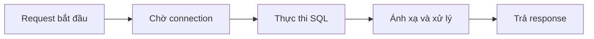

# Thiết lập thời gian chờ kết nối và thời gian chờ thực thi

Trong ứng dụng Spring Data R2DBC, một thao tác truy cập cơ sở dữ liệu có thể phải chờ ở nhiều giai đoạn: chờ lấy kết nối từ pool, chờ tạo kết nối vật lý, chờ xác thực kết nối, chờ cơ sở dữ liệu thực thi SQL và chờ dữ liệu được truyền về ứng dụng. Các khoảng thời gian này có mục đích khác nhau và thường được cấu hình ở những lớp khác nhau.

Thiết lập timeout đúng giúp ứng dụng không giữ tài nguyên quá lâu khi cơ sở dữ liệu chậm, mất kết nối hoặc pool đã hết kết nối khả dụng. Tuy nhiên, một timeout ở tầng ứng dụng không tự động bảo đảm câu SQL đã dừng trên máy chủ. Cần hiểu timeout nào đang được áp dụng, thành phần nào thực thi nó và điều gì xảy ra khi thời hạn kết thúc.

## 1. Phân biệt các loại timeout

Một luồng truy cập dữ liệu thường có các điểm chờ sau:

| Loại timeout | Thời điểm áp dụng | Thành phần thường quản lý |
|---|---|---|
| Connection acquire timeout | Chờ một connection khả dụng từ pool | R2DBC Connection Pool |
| Connection creation/connect timeout | Mở kết nối vật lý tới database, bao gồm các bước mạng và handshake | R2DBC SPI hoặc driver |
| Connection validation timeout | Kiểm tra connection trước khi cấp cho ứng dụng | R2DBC Connection Pool và driver |
| Statement/query timeout | Giới hạn thời gian cơ sở dữ liệu thực thi câu SQL | Driver hoặc cơ sở dữ liệu |
| Reactive timeout | Giới hạn thời gian chờ publisher phát tín hiệu | Reactor trong ứng dụng |
| Transaction timeout | Giới hạn thời gian của một transaction | Spring transaction manager và khả năng của driver |
| Request timeout | Giới hạn tổng thời gian xử lý một yêu cầu từ phía gọi | Web server, gateway hoặc tầng API |

Các timeout này không thay thế lẫn nhau. Ví dụ, query timeout không giúp ích khi request đang chờ một connection trong pool. Ngược lại, acquire timeout không giới hạn thời gian chạy của SQL sau khi connection đã được cấp.

## 2. Connection acquire timeout: thời gian chờ lấy connection từ pool

Khi ứng dụng dùng connection pool, mỗi thao tác cần lấy một connection đang rảnh. Nếu tất cả connection đã được các request khác sử dụng và pool chưa thể cấp thêm connection, thao tác mới phải chờ.

**Connection acquire timeout** giới hạn khoảng thời gian chờ này. Nếu không có connection khả dụng trong thời hạn, pool kết thúc thao tác acquire bằng lỗi. Đây là cơ chế bảo vệ ứng dụng khi tải tăng cao hoặc connection bị giữ quá lâu.

Ví dụ, pool có `max-size` là 10. Nếu 10 connection đều đang được sử dụng, request thứ 11 phải đợi. Khi thời gian chờ vượt `max-acquire-time`, request đó nhận lỗi thay vì tiếp tục nằm trong hàng đợi vô hạn.

### Cấu hình pool trong Spring Boot

Khi ứng dụng có R2DBC Pool trên classpath và pool được bật, có thể cấu hình các thuộc tính trong `application.yml`:

```yaml
spring:
  r2dbc:
    url: r2dbc:postgresql://localhost:5432/app_db
    username: app_user
    password: change_me
    pool:
      enabled: true
      initial-size: 5
      max-size: 20
      max-acquire-time: 2s
      max-create-connection-time: 5s
      max-validation-time: 1s
      max-idle-time: 30m
      max-life-time: 60m
```

Trong ví dụ:

- `initial-size` là số connection ban đầu mà pool tạo.
- `max-size` giới hạn số connection tối đa trong pool.
- `max-acquire-time` giới hạn thời gian chờ lấy connection.
- `max-create-connection-time` giới hạn thời gian tạo connection mới.
- `max-validation-time` giới hạn thời gian kiểm tra connection.
- `max-idle-time` giới hạn thời gian connection có thể ở trạng thái nhàn rỗi.
- `max-life-time` giới hạn tuổi thọ tối đa của connection trong pool.

Các thuộc tính `max-idle-time` và `max-life-time` quản lý vòng đời connection; chúng không phải query timeout. Cấu hình pool chỉ có tác dụng khi dependency và auto-configuration của R2DBC Pool hiện diện, đồng thời pool được bật. Tên và khả năng hỗ trợ thuộc tính cần được đối chiếu với phiên bản Spring Boot và R2DBC Pool của dự án.

Không nên đặt `max-size` thật lớn để tránh acquire timeout mà không xem xét giới hạn connection của database. Nếu ứng dụng có nhiều replica, tổng số connection có thể mở xấp xỉ số replica nhân với `max-size`. Cần tính cả connection dành cho công cụ migration, tác vụ nền và ứng dụng khác.

## 3. Connection creation timeout: thời gian mở kết nối vật lý

Khi pool không có connection rảnh và còn khả năng mở connection mới, nó yêu cầu driver tạo kết nối vật lý tới cơ sở dữ liệu. Quá trình này có thể bao gồm phân giải DNS, mở TCP socket, TLS handshake, xác thực và khởi tạo session.

**Connection creation timeout** giới hạn thời gian tạo kết nối mới. Nó giúp ứng dụng sớm nhận lỗi khi database không thể truy cập, mạng bị gián đoạn hoặc quá trình handshake bị treo.

R2DBC SPI có các tùy chọn kết nối chuẩn, trong đó có `CONNECT_TIMEOUT` ở những phiên bản SPI hỗ trợ. Driver quyết định cách áp dụng tùy chọn và có thể cung cấp thêm thuộc tính riêng. Khi cấu hình bằng Spring Boot, các thuộc tính driver thường được truyền qua URL R2DBC hoặc nhóm `spring.r2dbc.properties.*`, tùy driver và phiên bản.

Không có một tên tham số URL dùng chung cho mọi driver. Ví dụ tên và đơn vị của thuộc tính connect timeout trong PostgreSQL, MySQL hoặc SQL Server có thể khác nhau. Hãy tra tài liệu driver đang sử dụng và kiểm tra xem driver có hỗ trợ tùy chọn `CONNECT_TIMEOUT` hay không.

Khi dùng pool, cần phân biệt `max-create-connection-time` với `max-acquire-time`. Một thao tác acquire có thể phải chờ connection rảnh hoặc chờ pool tạo connection mới. Thời hạn acquire giới hạn việc lấy connection tổng thể; thời hạn create giới hạn riêng bước tạo connection. Nên cấu hình hai giá trị có quan hệ hợp lý để một thao tác không phải chờ lâu hơn ngân sách mà ứng dụng cho phép.

## 4. Connection validation timeout

Pool có thể kiểm tra connection trước khi cấp cho ứng dụng để phát hiện connection đã mất hiệu lực hoặc không còn dùng được. Việc kiểm tra có thể sử dụng cơ chế validation của driver hoặc một validation query tùy cấu hình.

`max-validation-time` giới hạn thời gian dành cho bước kiểm tra này. Nếu validation mất quá lâu hoặc thất bại, pool có thể loại bỏ connection đó và tìm connection khác theo chính sách của pool.

Validation giúp tránh cấp connection hỏng cho request, nhưng cũng tạo thêm công việc. Không nên chọn validation query quá nặng hoặc thực hiện kiểm tra không cần thiết ở mọi lần lấy connection nếu driver đã có cơ chế validation phù hợp. Cần cân nhắc tải database, tần suất kết nối và hành vi của driver.

## 5. Statement timeout và query timeout

Sau khi connection đã được cấp, ứng dụng gửi câu SQL tới cơ sở dữ liệu. **Statement timeout** hoặc **query timeout** giới hạn thời gian câu lệnh được phép thực thi. Khi vượt quá thời hạn, driver hoặc database có thể hủy câu lệnh và trả lỗi về ứng dụng.

R2DBC SPI định nghĩa các abstraction chung cho `Connection`, `Statement` và `Result`, nhưng cách cấu hình timeout cụ thể phụ thuộc vào phiên bản SPI, driver và hệ quản trị cơ sở dữ liệu. Không nên tìm một method giống JDBC `Statement.setQueryTimeout()` rồi giả định mọi driver R2DBC đều có cùng API.

Có ba nơi thường có thể thiết lập giới hạn thực thi:

1. **Driver:** driver cung cấp thuộc tính hoặc API riêng để đặt statement timeout, socket timeout hoặc thời hạn chờ phản hồi.
2. **Database server:** hệ quản trị tự giới hạn thời gian chạy SQL, thời gian chờ lock hoặc thời gian session ở một trạng thái nhất định.
3. **Ứng dụng:** Reactor đặt deadline cho publisher để tầng gọi không chờ vô hạn.

Timeout phía driver hoặc server thường cần thiết khi muốn giới hạn tài nguyên thực thi ở database. Timeout phía ứng dụng hữu ích để kiểm soát trải nghiệm của request, nhưng không nên được xem là bằng chứng rằng server đã dừng câu SQL.

### Ví dụ giới hạn statement ở PostgreSQL

PostgreSQL hỗ trợ `statement_timeout`, giới hạn tổng thời gian một câu lệnh được phép chạy. Có thể cấu hình mặc định cho một role:

```sql
ALTER ROLE app_user SET statement_timeout = '5s';
```

Thiết lập này áp dụng cho các session mới của role đó. Nếu muốn giới hạn trong một transaction cụ thể, có thể dùng:

```sql
SET LOCAL statement_timeout = '5s';
```

`SET LOCAL` chỉ có hiệu lực trong transaction hiện tại và được khôi phục khi transaction kết thúc. Đây là cú pháp riêng của PostgreSQL; hệ quản trị khác có cơ chế và tên cấu hình khác.

PostgreSQL cũng có `lock_timeout` để giới hạn thời gian chờ khóa. `statement_timeout` và `lock_timeout` có mục đích khác nhau: một câu SQL có thể chờ lock quá lâu dù bản thân phần xử lý sau khi lấy lock rất nhanh. Cấu hình lock timeout riêng giúp kiểm soát tình huống tranh chấp khóa.

## 6. Reactive timeout với Project Reactor

Trong tầng ứng dụng, có thể dùng toán tử `timeout` để giới hạn thời gian chờ publisher phát tín hiệu. Ví dụ với `DatabaseClient`:

```java
public Mono<Long> updatePersonName(Long id, String name) {
    return databaseClient.sql("""
            UPDATE people
            SET first_name = :name
            WHERE id = :id
            """)
        .bind("name", name)
        .bind("id", id)
        .fetch()
        .rowsUpdated()
        .timeout(Duration.ofSeconds(3));
}
```

Nếu publisher chưa phát tín hiệu trong thời hạn ba giây, Reactor phát lỗi timeout và hủy subscription upstream. Lỗi do toán tử Reactor tạo thường là `java.util.concurrent.TimeoutException`; lỗi timeout từ driver hoặc database có thể có kiểu exception khác.

Hủy subscription cho phép driver và framework nhận tín hiệu cancellation. Tuy nhiên, việc câu SQL đã dừng ngay trên server hay chưa phụ thuộc khả năng hủy của driver và database. Nếu cần giới hạn thực thi SQL một cách chắc chắn hơn, hãy cấu hình statement timeout ở driver hoặc database bên cạnh reactive timeout.

### Chú ý với Mono và Flux

`Mono.timeout(Duration)` giới hạn thời gian chờ kết quả của một publisher đơn. Với `Flux.timeout(Duration)`, Reactor theo dõi khoảng thời gian giữa các tín hiệu. Nếu Flux đang phát dữ liệu đều đặn, publisher có thể chạy lâu hơn tổng thời gian đã trôi qua mà không timeout, vì mỗi tín hiệu lại bắt đầu một khoảng chờ mới.

Vì vậy, cần xác định mục tiêu là:

- Giới hạn thời gian chờ phần tử tiếp theo của một luồng dữ liệu.
- Giới hạn thời gian chờ một kết quả đơn.
- Giới hạn tổng thời gian của toàn bộ request hoặc transaction.

Không nên dùng `Flux.timeout(Duration)` như một giới hạn tổng thời gian cho toàn bộ luồng dữ liệu nếu ý định là đặt một deadline tuyệt đối. Deadline tổng thể cần được quản lý ở tầng request hoặc bằng cách tổ chức publisher phù hợp với yêu cầu nghiệp vụ.

Có thể cung cấp một publisher dự phòng cho toán tử `timeout`, nhưng cần cân nhắc ý nghĩa nghiệp vụ. Ví dụ, trả về danh sách rỗng khi database timeout có thể khiến người dùng hiểu nhầm rằng không có dữ liệu. Trong nhiều trường hợp, truyền lỗi rõ ràng để tầng API ánh xạ thành phản hồi phù hợp sẽ an toàn hơn.

## 7. Transaction timeout

Một nghiệp vụ có thể thực hiện nhiều câu SQL trong cùng transaction. Khi đó, chỉ giới hạn từng query là chưa đủ nếu tổng thời gian của transaction cũng cần có giới hạn.

Spring hỗ trợ khai báo timeout trên ranh giới transaction, ví dụ:

```java
@Transactional(timeout = 10)
public Mono<Void> transfer(Long sourceId, Long targetId, BigDecimal amount) {
    return accountRepository.debit(sourceId, amount)
        .then(accountRepository.credit(targetId, amount))
        .then();
}
```

Giá trị `timeout` trong annotation được tính bằng giây. Cách timeout transaction được áp dụng phụ thuộc transaction manager, phiên bản R2DBC SPI và khả năng của driver. Một số driver hỗ trợ áp dụng statement timeout hoặc lock timeout trên connection; không nên giả định mọi driver đều thực thi cùng một cách.

Transaction timeout không thay thế connection acquire timeout hoặc request timeout. Cũng không nên dùng một transaction dài để bao quanh các thao tác chờ người dùng, gọi HTTP bên ngoài hoặc xử lý không liên quan tới database. Transaction dài giữ connection và có thể giữ lock lâu, làm giảm khả năng phục vụ request khác.

Với reactive transaction, các thao tác cần thuộc cùng chuỗi publisher trong ranh giới transaction. Nếu tự gọi `subscribe()` bên trong phương thức hoặc tách thao tác sang subscription độc lập, chúng có thể không còn tham gia transaction như dự kiến.

## 8. Request timeout và cách phân bổ ngân sách thời gian

Request timeout là thời hạn tổng thể mà tầng gọi dành cho một yêu cầu. Nó có thể được cấu hình ở API gateway, load balancer, WebFlux server hoặc tầng client. Một request có thể tiêu tốn thời gian cho nhiều công việc:



Ngân sách request cần đủ cho các bước bên trong và một phần thời gian dự phòng cho ánh xạ, nghiệp vụ và truyền response. Các deadline nội bộ nên được chọn sao cho lỗi được phát hiện trước khi tầng ngoài hết thời gian chờ.

Ví dụ một request có ngân sách ba giây có thể dành tối đa khoảng nửa giây để lấy connection, hai giây cho thao tác SQL và phần thời gian còn lại cho xử lý response. Đây chỉ là ví dụ minh họa; con số thực tế phải dựa trên latency đo được, tải hệ thống và yêu cầu nghiệp vụ.

Nếu request timeout ngắn hơn query timeout, tầng HTTP có thể trả lỗi trước khi database nhận được yêu cầu hủy câu SQL. Ngược lại, nếu query timeout ngắn hơn request timeout, ứng dụng có thể nhận lỗi SQL và xử lý nó trong thời gian còn lại của request. Vì vậy, hãy thiết kế thứ tự timeout có chủ đích.

Một nguyên tắc hữu ích là đặt thời hạn cho các thao tác bên trong ngắn hơn deadline tổng thể, đồng thời dành đủ khoảng đệm cho việc xử lý lỗi và hoàn tất response. Với pool, cần xem xét cả acquire time và create connection time để request không chờ quá lâu trước khi SQL bắt đầu.

## 9. Xử lý lỗi timeout và retry

Timeout có thể xuất hiện ở nhiều tầng nên không phải lúc nào cũng có cùng loại exception. Một timeout từ Reactor có thể là `TimeoutException`; timeout từ driver hoặc database có thể được đóng gói thành exception của R2DBC hoặc exception đặc thù của nhà cung cấp.

Khi xử lý lỗi, nên ghi nhận rõ thao tác và giai đoạn đã timeout. Ví dụ: acquire connection, tạo kết nối, validation, thực thi SQL hay deadline request. Thông tin này giúp phân biệt pool bị cạn connection với database xử lý truy vấn chậm.

Không nên tự động retry mọi timeout. Nếu một câu lệnh ghi đã được database thực thi nhưng phản hồi bị mất, ứng dụng có thể không biết transaction đã commit hay chưa. Retry một thao tác ghi không idempotent có thể tạo dữ liệu trùng hoặc thực hiện nghiệp vụ hai lần.

Chỉ retry khi:

- Lỗi được xác định là tạm thời và có thể phục hồi.
- Thao tác có tính idempotent hoặc có cơ chế chống xử lý trùng.
- Số lần retry và tổng thời gian retry nằm trong deadline của request.
- Có backoff để tránh nhiều request đồng loạt dồn tải trở lại database.
- Transaction trước đó đã kết thúc hoặc trạng thái commit được xác định rõ.

Đối với lỗi chờ connection, retry ngay lập tức có thể làm hàng đợi trong pool dài thêm. Cần xem xét tải và sức khỏe database trước khi chọn chiến lược retry.

## 10. Chọn timeout theo mục tiêu vận hành

Không có một bộ giá trị timeout phù hợp cho mọi ứng dụng. Cần căn cứ vào latency bình thường, p95/p99, giới hạn tài nguyên, loại truy vấn và thời hạn mà người dùng chấp nhận.

| Nhu cầu | Timeout cần xem xét | Câu hỏi cần trả lời |
|---|---|---|
| Database không phản hồi khi mở kết nối | Connect/create timeout | Mất bao lâu để xác định endpoint không thể kết nối? |
| Pool thường xuyên hết connection | Acquire timeout | Request nên chờ bao lâu trước khi báo quá tải? |
| Connection có thể đã bị đóng ở phía server | Validation timeout | Kiểm tra connection mất tối đa bao lâu? |
| Truy vấn có thể chạy quá lâu | Statement/query timeout | SQL được phép tiêu tốn tối đa bao nhiêu thời gian và tài nguyên? |
| Publisher không phát tín hiệu | Reactor timeout | Tầng ứng dụng có thể chờ kết quả bao lâu? |
| Nghiệp vụ gồm nhiều câu SQL | Transaction timeout | Một transaction được phép kéo dài tối đa bao lâu? |
| Người dùng hoặc client chờ phản hồi | Request timeout | Tổng thời gian xử lý tối đa của request là bao lâu? |

Không nên đặt timeout quá ngắn chỉ để làm biểu đồ latency đẹp hơn. Timeout thấp hơn thời gian xử lý hợp lệ sẽ tạo lỗi giả, làm tăng retry và gây tải lớn hơn cho hệ thống. Ngược lại, timeout quá dài giữ connection, request và bộ nhớ trong thời gian không cần thiết.

## 11. Theo dõi timeout trong production

Khi vận hành, nên quan sát timeout cùng các chỉ số pool và database:

- Số connection đang sử dụng, số connection rảnh và số connection tối đa.
- Thời gian chờ acquire, số lần acquire timeout và số lần tạo connection thất bại.
- Thời gian validation và số connection bị loại bỏ.
- Latency truy vấn theo nhóm thao tác, số query timeout và các truy vấn chậm.
- Số transaction kéo dài, transaction rollback và lỗi lock timeout.
- Request latency ở p50, p95, p99 cùng tỷ lệ request timeout.

Log nên chứa tên thao tác, loại timeout, thời lượng đã chờ, correlation ID và thông tin lỗi cần thiết. Tránh ghi password, URL có credential hoặc dữ liệu nhạy cảm của người dùng.

Nếu acquire timeout tăng nhưng query latency vẫn bình thường, có thể pool quá nhỏ, connection bị giữ quá lâu hoặc có request tạo tải đột biến. Nếu acquire time bình thường nhưng query timeout tăng, cần xem xét kế hoạch thực thi SQL, index, lock, tải database hoặc thay đổi dữ liệu. Phân loại đúng giúp tránh tăng pool một cách máy móc khi nguyên nhân thực sự là truy vấn chậm.

## 12. Kiểm thử các loại timeout

Nên kiểm thử riêng từng tầng thay vì chỉ kiểm tra một request hết thời gian:

1. **Kiểm thử connect timeout:** dùng địa chỉ database không thể kết nối hoặc môi trường mạng mô phỏng lỗi kết nối để xác nhận thời gian tạo connection bị giới hạn.
2. **Kiểm thử acquire timeout:** dùng pool có kích thước nhỏ, giữ toàn bộ connection trong một thao tác rồi tạo thêm thao tác khác để xác nhận thời gian chờ pool.
3. **Kiểm thử validation timeout:** mô phỏng connection không còn hợp lệ hoặc validation query bị chậm nếu driver và pool hỗ trợ cách kiểm thử này.
4. **Kiểm thử statement timeout:** dùng câu SQL có chủ ý chạy lâu trên database thử nghiệm và xác nhận driver/server trả lỗi trong giới hạn cấu hình.
5. **Kiểm thử reactive timeout:** tạo publisher phát tín hiệu trễ để xác nhận Reactor phát lỗi timeout và xử lý cancellation đúng như mong đợi.
6. **Kiểm thử transaction timeout:** thực hiện nhiều thao tác trong một transaction thử nghiệm để xác nhận hành vi commit, rollback và timeout.
7. **Kiểm thử request deadline:** đặt request chậm hơn ngân sách tổng thể để xác nhận tầng API phản hồi đúng và tài nguyên được giải phóng.

Với PostgreSQL, có thể dùng `SELECT pg_sleep(10)` trong môi trường thử nghiệm để mô phỏng truy vấn chậm. Không chạy câu lệnh mô phỏng độ trễ này trên database production.

Sau khi timeout xảy ra, cần kiểm tra connection có được trả về pool hay bị loại bỏ đúng cách, transaction có được rollback khi cần và câu SQL có thực sự dừng ở server hay không. Đây là các hành vi phụ thuộc driver và database, vì vậy cần kiểm thử trên cùng hệ quản trị dự kiến triển khai.

## 13. Quy trình thiết lập timeout cho một ứng dụng R2DBC

Có thể triển khai theo trình tự sau:

**Bước 1 — Đo thời gian hiện tại.** Thu thập latency truy vấn, thời gian lấy connection, request latency và tỷ lệ lỗi. Chưa nên chọn timeout dựa trên phỏng đoán.

**Bước 2 — Xác định ngân sách request.** Làm rõ thời gian tối đa mà client hoặc nghiệp vụ cho phép một request kéo dài.

**Bước 3 — Cấu hình pool.** Chọn `max-size`, `max-acquire-time`, `max-create-connection-time` và `max-validation-time` dựa trên giới hạn database và latency kết nối.

**Bước 4 — Cấu hình driver.** Đặt connect timeout và các tùy chọn mạng/statement mà driver hỗ trợ. Kiểm tra tài liệu của đúng phiên bản driver.

**Bước 5 — Cấu hình database.** Đặt statement timeout hoặc lock timeout ở phạm vi phù hợp với hệ quản trị và nghiệp vụ. Ưu tiên giới hạn ở server khi cần kiểm soát tài nguyên SQL.

**Bước 6 — Bổ sung reactive deadline.** Dùng Reactor `timeout` cho thao tác hoặc luồng cần giới hạn thời gian chờ ở phía ứng dụng; hiểu rõ khác biệt giữa `Mono` và `Flux`.

**Bước 7 — Cấu hình transaction và request timeout.** Bảo đảm các thời hạn phối hợp với nhau, không để timeout ngoài kết thúc quá sớm trong khi thao tác bên trong vẫn còn chạy.

**Bước 8 — Kiểm thử và quan sát.** Kiểm tra từng tầng timeout, cancellation, rollback, giải phóng connection và metrics sau khi triển khai.

Thiết lập timeout hiệu quả đòi hỏi phân biệt thời gian chờ kết nối với thời gian thực thi SQL và deadline của request. Pool kiểm soát việc cấp connection, driver và database kiểm soát kết nối cùng câu lệnh, còn Reactor giúp giới hạn thời gian chờ publisher trong ứng dụng. Khi phối hợp các giới hạn này theo một ngân sách thời gian rõ ràng, ứng dụng Spring Data R2DBC có thể phản hồi tốt hơn trước sự cố mạng, pool quá tải và truy vấn chậm mà vẫn giữ được tính nhất quán của transaction.
