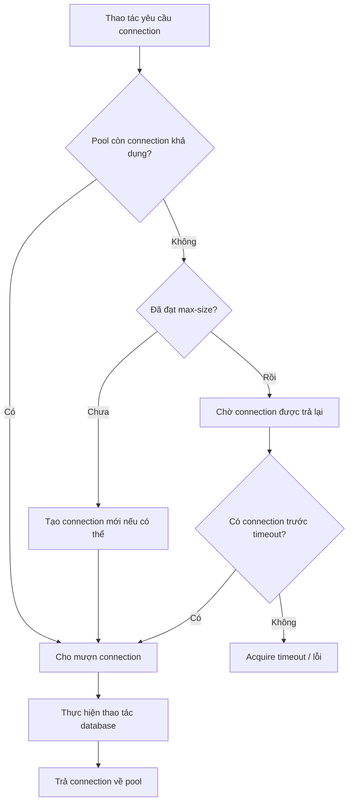

# Cấu hình kích thước ban đầu và số kết nối tối đa

## 1. Vì sao cần cấu hình kích thước connection pool?

Trong Spring Data R2DBC, các thao tác truy cập cơ sở dữ liệu cần một connection. Nếu mỗi thao tác đều tạo một kết nối vật lý mới rồi đóng ngay sau khi hoàn tất, ứng dụng có thể tốn thời gian cho việc thiết lập kết nối và tạo thêm tải cho database. Connection pool giải quyết vấn đề này bằng cách quản lý một nhóm connection để nhiều thao tác lần lượt mượn và trả lại.

Khi dùng R2DBC Pool, hai thuộc tính quan trọng để kiểm soát quy mô pool là:

- `initial-size`: số connection ban đầu mà pool được cấu hình để khởi tạo.
- `max-size`: số connection tối đa mà pool được phép quản lý và cấp phát.

`initial-size` ảnh hưởng đến lượng connection pool chuẩn bị ở giai đoạn khởi tạo. `max-size` đặt giới hạn trên để pool không mở rộng vô hạn khi có nhiều thao tác đồng thời. Hai giá trị này có tác động khác nhau và cần được chọn cùng với giới hạn connection của database, số instance ứng dụng và thời gian mỗi thao tác giữ connection.

## 2. Điều kiện để dùng R2DBC Pool

R2DBC Pool là thành phần quản lý connection riêng của hệ sinh thái R2DBC. Ứng dụng cần có driver R2DBC cho hệ quản trị đang dùng và dependency `r2dbc-pool` tương thích. Với Gradle, ví dụ PostgreSQL:

```kotlin
dependencies {
    implementation("org.springframework.boot:spring-boot-starter-data-r2dbc")
    runtimeOnly("org.postgresql:r2dbc-postgresql")
    runtimeOnly("io.r2dbc:r2dbc-pool")
}
```

Spring Boot có thể tự cấu hình pooled `ConnectionFactory` khi dependency pool hiện diện và cấu hình pool được bật theo phiên bản Boot đang dùng. Cần kiểm tra tài liệu hoặc configuration metadata của đúng phiên bản Spring Boot để xác nhận các thuộc tính được hỗ trợ. Nếu không dùng pool, ứng dụng có thể chỉ sử dụng `ConnectionFactory` do driver cung cấp và không cần các thuộc tính `spring.r2dbc.pool.*`.

## 3. Cấu hình `initial-size` và `max-size`

Ví dụ cấu hình PostgreSQL trong `application.yml`:

```yaml
spring:
  r2dbc:
    url: r2dbc:postgresql://localhost:5432/customer_db
    username: app_user
    password: ${DB_PASSWORD}
    pool:
      enabled: true
      initial-size: 2
      max-size: 10
```

Trong ví dụ này, pool được cấu hình với 2 connection ban đầu và có thể mở rộng đến tối đa 10 connection. Khi tải thấp, pool không cần sử dụng toàn bộ giới hạn 10. Khi có nhiều thao tác cần connection đồng thời, pool có thể tạo thêm connection cho tới khi đạt `max-size`, nếu database và driver cho phép.

`initial-size` phải phù hợp với `max-size`. Hãy đặt số connection ban đầu nhỏ hơn hoặc bằng giới hạn tối đa. Ví dụ `initial-size: 12` cùng `max-size: 8` là cấu hình không hợp lý và có thể bị từ chối khi pool được tạo, tùy cách kiểm tra của phiên bản thư viện.

Các giá trị `2` và `10` chỉ minh họa cú pháp. Chúng không phải cấu hình tối ưu mặc định cho mọi ứng dụng. Kích thước phù hợp phụ thuộc vào số request đồng thời, thời gian giữ connection, số replica, giới hạn của database và các workload khác cùng truy cập database.

### 3.1. `initial-size` — số connection ban đầu

`initial-size` chỉ định số connection pool được yêu cầu khởi tạo ban đầu. Mục đích là giúp pool có sẵn một lượng connection khi bắt đầu phục vụ công việc, thay vì luôn phải chờ tạo connection đầu tiên sau khi request đến.

Ví dụ:

```yaml
spring:
  r2dbc:
    pool:
      initial-size: 3
      max-size: 15
```

Với cấu hình này, pool bắt đầu với quy mô ban đầu là 3 connection và có thể tăng lên tối đa 15 khi nhu cầu tăng. Cách pool tạo connection và thời điểm thực hiện việc khởi tạo phụ thuộc lifecycle của pool và cách ứng dụng khởi động nó.

Một số điểm cần hiểu đúng:

- `initial-size` không phải số connection tối đa. Khi tải tăng, pool có thể mở rộng vượt qua giá trị ban đầu.
- `initial-size` không nhất thiết là số connection luôn được giữ lại trong suốt vòng đời ứng dụng. Connection idle có thể được loại bỏ theo chính sách pool.
- `initial-size` không phải `min-idle`. Nếu muốn cấu hình một mức connection nhàn rỗi tối thiểu được duy trì, hãy xem thuộc tính `min-idle` nếu phiên bản pool và Spring Boot đang dùng hỗ trợ.
- Đặt `initial-size` quá lớn có thể làm nhiều connection được mở ngay từ đầu, kể cả khi ứng dụng chưa có tải tương ứng.

Với môi trường local hoặc một service có tải nhỏ, có thể bắt đầu bằng một giá trị thấp như 1 hoặc 2. Với hệ thống production có lưu lượng ổn định, cần đo nhu cầu thực tế và cân nhắc thời gian khởi động, số replica cũng như giới hạn connection của database trước khi tăng giá trị này.

### 3.2. `max-size` — giới hạn số connection

`max-size` xác định số connection tối đa pool có thể quản lý. Đây là giới hạn bảo vệ database khỏi việc một instance ứng dụng liên tục tạo thêm connection khi có nhiều request đồng thời.

Ví dụ:

```yaml
spring:
  r2dbc:
    pool:
      initial-size: 2
      max-size: 20
```

Pool bắt đầu với 2 connection và có thể tăng dần khi cần, nhưng không vượt quá 20 connection. Con số này bao gồm connection đang được thao tác mượn sử dụng và connection đang nhàn rỗi trong pool; không nên hiểu `max-size` là 20 connection đang hoạt động cộng thêm một nhóm connection idle khác.

Khi tất cả connection đã được cấp cho các thao tác và pool đạt `max-size`, yêu cầu mới phải chờ connection được trả lại. Nếu không có connection được trả trong thời gian chờ cho phép, thao tác lấy connection có thể thất bại với lỗi acquire timeout. Vì vậy, `max-size` vừa giới hạn tài nguyên database vừa ảnh hưởng khả năng phục vụ tải đồng thời của ứng dụng.

Không nên tăng `max-size` chỉ để loại bỏ lỗi timeout. Nếu connection bị giữ lâu do truy vấn chậm, transaction dài hoặc luồng ứng dụng không kết thúc đúng cách, tăng giới hạn có thể làm database phải xử lý nhiều truy vấn đồng thời hơn và khiến tình trạng quá tải nặng thêm.

## 4. Phân biệt các thuộc tính liên quan

Các thuộc tính pool có mục đích khác nhau. Bảng sau giúp tránh nhầm lẫn:

| Thuộc tính | Câu hỏi được trả lời | Tác động |
| --- | --- | --- |
| `initial-size` | Pool bắt đầu với bao nhiêu connection? | Quy mô connection ban đầu |
| `max-size` | Pool được phép có tối đa bao nhiêu connection? | Giới hạn trên của pool |
| `min-idle` | Muốn duy trì tối thiểu bao nhiêu connection ở trạng thái idle? | Mức connection nhàn rỗi tối thiểu, nếu được hỗ trợ |
| `max-idle-time` | Một connection được phép idle tối đa bao lâu? | Thời gian loại bỏ connection nhàn rỗi |
| `max-acquire-time` | Một thao tác được chờ lấy connection tối đa bao lâu? | Giới hạn thời gian chờ acquire |
| `max-life-time` | Một connection được phép tồn tại tối đa bao lâu? | Tuổi thọ tối đa của connection |

Ví dụ cấu hình mở rộng:

```yaml
spring:
  r2dbc:
    pool:
      enabled: true
      initial-size: 2
      min-idle: 2
      max-size: 12
      max-idle-time: 30m
      max-acquire-time: 5s
```

Ở đây, `initial-size` và `min-idle` có thể cùng mang giá trị 2 nhưng không mang cùng ý nghĩa. Một thuộc tính liên quan tới lượng connection ban đầu, thuộc tính còn lại mô tả mức idle cần duy trì theo chính sách pool. Khả năng và hành vi cụ thể của `min-idle` phụ thuộc phiên bản R2DBC Pool và cách Spring Boot bind cấu hình.

## 5. Chọn `max-size` dựa trên giới hạn database

Một pool nằm trong một instance ứng dụng. Nếu ứng dụng chạy nhiều instance, mỗi instance có pool riêng. Vì vậy, phải tính tổng connection có thể được tạo từ tất cả instance chứ không chỉ nhìn `max-size` trong một file YAML.

Giả sử:

- Ứng dụng có 3 replica.
- Mỗi replica cấu hình `max-size: 12`.
- Chưa tính các ứng dụng hoặc công cụ khác truy cập cùng database.

Tổng connection tối đa mà ba pool này có thể yêu cầu là:

\[
3 \times 12 = 36\text{ connections}
\]

Nếu database chỉ cho phép một số lượng connection hữu hạn, phần ngân sách dành cho ứng dụng phải trừ đi kết nối quản trị, job nền, service khác và một phần dự phòng. Ví dụ, database cho phép 100 connection nhưng cần giữ lại 20 cho quản trị và workload khác, ngân sách lý thuyết còn lại cho ứng dụng này là 80. Ba replica với `max-size: 12` có giới hạn tổng 36, thấp hơn ngân sách đó.

Đây chỉ là phép tính giới hạn trên. Khi triển khai thực tế, cần tính cả số replica tăng thêm khi autoscaling, tiến trình migration, batch job, worker nền, các ứng dụng dùng chung database và connection được mở trong thời gian rollout phiên bản mới.

### 5.1. Công thức ngân sách connection

Có thể dùng công thức đơn giản sau để ước lượng giới hạn:

\[
N_{app} \times P_{max} + C_{other} \leq C_{db} - C_{reserve}
\]

Trong đó:

- \(N_{app}\): số instance ứng dụng tối đa có thể chạy cùng lúc.
- \(P_{max}\): `max-size` của mỗi instance.
- \(C_{other}\): số connection tối đa dự kiến từ các ứng dụng, job và công cụ khác.
- \(C_{db}\): giới hạn connection của database.
- \(C_{reserve}\): phần connection dự phòng để quản trị, bảo trì và biến động tải.

Đây là cách phân bổ ngân sách, không phải công thức xác định chính xác số connection tối ưu. Giá trị `P_max` còn cần được kiểm chứng bằng tải thực tế và số thao tác đồng thời.

### 5.2. Ví dụ khi autoscaling

Giả sử service thường chạy 3 replica nhưng có thể scale lên 6 replica. Nếu mỗi replica đặt `max-size: 20`, pool có thể tạo tổng cộng:

| Số replica | `max-size` mỗi replica | Tổng giới hạn |
| ---: | ---: | ---: |
| 3 | 20 | 60 |
| 4 | 20 | 80 |
| 6 | 20 | 120 |

Nếu database chỉ dành 90 connection cho service, cấu hình 20 connection mỗi replica có thể vượt ngân sách khi autoscaling lên 6 replica. Khi đó cần giảm `max-size`, giảm số replica tối đa, tăng ngân sách database nếu có thể, hoặc phân bổ lại connection giữa các workload.

Rollout cũng có thể làm số instance chạy đồng thời cao hơn số replica mong muốn trong một khoảng thời gian. Hãy tính theo số instance tối đa thực tế trong giai đoạn rollout, không chỉ số replica ổn định sau triển khai.

## 6. Chọn giá trị theo tải ứng dụng

Số connection cần thiết phụ thuộc vào số thao tác đồng thời cần truy cập database và thời gian mỗi thao tác giữ connection. Một ứng dụng có nhiều request HTTP không đồng nghĩa tất cả request đều cần connection cùng lúc; một số request chỉ xử lý cache hoặc logic trong bộ nhớ. Ngược lại, một thao tác có thể giữ connection lâu trong transaction hoặc khi đọc một dòng kết quả lớn.

Các yếu tố nên xem xét:

- **Mức đồng thời thực tế:** bao nhiêu thao tác database thường chạy cùng lúc và ở giờ cao điểm.
- **Thời gian giữ connection:** thời gian từ lúc lấy connection đến khi trả lại pool.
- **Độ trễ truy vấn:** truy vấn chậm khiến connection bị chiếm lâu hơn.
- **Transaction:** transaction kéo dài thường giữ connection lâu hơn một truy vấn độc lập.
- **Cách tiêu thụ kết quả:** đọc hoặc xử lý một luồng dữ liệu lâu có thể kéo dài thời gian giữ tài nguyên.
- **Giới hạn database:** database có thể có giới hạn connection, CPU, bộ nhớ hoặc khả năng xử lý đồng thời thấp hơn giới hạn lý thuyết của pool.

Một cách ước lượng ban đầu là dùng định luật Little cho lượng công việc đang xử lý:

\[
L = \lambda \times W
\]

Trong đó \(L\) là số thao tác trung bình đang diễn ra, \(\lambda\) là tốc độ thao tác hoàn tất mỗi giây và \(W\) là thời gian trung bình một thao tác giữ tài nguyên tính bằng giây. Ví dụ, nếu hệ thống thực hiện trung bình 40 thao tác database mỗi giây và mỗi thao tác giữ connection trung bình 0,1 giây, số connection đang được sử dụng trung bình ước tính là:

\[
40 \times 0.1 = 4
\]

Con số 4 là mức sử dụng trung bình theo giả định, không phải giá trị `max-size` nên đặt bằng 4. Tải tăng đột biến, phân bố thời gian truy vấn, transaction dài và mục tiêu độ trễ đều cần thêm khoảng dự phòng. Hãy đo ở giờ cao điểm và kiểm thử tải trước khi quyết định giới hạn.

### 6.1. Không dùng pool lớn để che truy vấn chậm

Giả sử một truy vấn mất 3 giây vì thiếu index và giữ connection trong suốt thời gian đó. Tăng `max-size` có thể cho phép nhiều truy vấn cùng chạy, nhưng database phải xử lý nhiều công việc nặng hơn. Hệ thống có thể chuyển từ chờ connection sang quá tải CPU, I/O hoặc khóa ở database.

Trước khi tăng pool, hãy xem xét:

- SQL thực tế và execution plan.
- Index có hỗ trợ điều kiện lọc và sắp xếp không.
- Transaction có chứa xử lý không liên quan đến database khiến connection bị giữ lâu không.
- Ứng dụng có đọc toàn bộ dữ liệu hoặc xử lý chậm trong khi vẫn giữ connection không.
- Có thao tác nào mở subscription nhưng không kết thúc hoặc không được hủy đúng cách không.

Tối ưu truy vấn và giảm thời gian giữ connection có thể cải thiện thông lượng mà không cần tăng số kết nối.

## 7. Chọn `initial-size` theo thời điểm khởi động và tải nền

`initial-size` quyết định quy mô ban đầu của pool. Một giá trị cao có thể giúp ứng dụng có sẵn connection khi lưu lượng đến ngay sau khi khởi động, nhưng cũng làm tăng lượng kết nối được tạo trong giai đoạn startup.

Khi nhiều replica cùng khởi động, chúng có thể đồng loạt tạo connection ban đầu. Ví dụ, 8 replica với `initial-size: 10` có thể tạo nhu cầu khởi tạo lên tới 80 connection. Nếu database đang khởi động hoặc có nhiều service triển khai cùng lúc, đợt kết nối này có thể tạo ra một đỉnh tải không cần thiết.

Có thể cân nhắc:

- Dùng `initial-size` nhỏ nếu service ít traffic ngay sau khi khởi động hoặc có nhiều replica.
- Dùng giá trị cao hơn nếu service cần sẵn sàng nhanh và tải ban đầu ổn định, sau khi đã xác nhận database đủ khả năng tiếp nhận.
- Tránh đặt `initial-size` bằng `max-size` chỉ vì muốn pool luôn sẵn sàng ở công suất tối đa.
- Kết hợp chiến lược rollout hoặc startup theo đợt nếu nhiều instance cùng kết nối vào một database.

`initial-size` cũng không thay thế cơ chế warm-up ứng dụng. Việc tạo connection thành công chưa chứng minh mọi truy vấn nghiệp vụ, schema hoặc quyền truy cập đều hoạt động đúng.

## 8. Pool xử lý khi chạm `max-size` như thế nào?

Giả sử pool có `max-size: 5` và cả 5 connection đang được các thao tác sử dụng. Khi một thao tác thứ sáu yêu cầu connection, pool không được phép tạo connection thứ sáu. Nó đưa yêu cầu vào trạng thái chờ cho tới khi có connection được trả lại hoặc thời gian acquire hết hạn.



Việc chờ connection không đồng nghĩa với việc tạo thêm thread cho mỗi yêu cầu. API R2DBC biểu diễn quá trình acquire theo hướng reactive. Tuy nhiên, nếu quá nhiều yêu cầu phải chờ, độ trễ của ứng dụng vẫn tăng và có thể gây timeout ở các tầng phía trên.

`max-acquire-time` thường được dùng để giới hạn thời gian chờ lấy connection. Thuộc tính này liên quan đến trải nghiệm khi pool đã đầy, nhưng không làm tăng sức chứa pool. Cần chọn thời gian chờ phù hợp với timeout của request và các tầng mạng để tránh request chờ lâu hơn thời gian caller cho phép.

## 9. Cấu hình mẫu cho các môi trường

### 9.1. Local development

Môi trường local thường có một instance và tải thấp. Có thể bắt đầu với pool nhỏ:

```yaml
spring:
  r2dbc:
    url: r2dbc:postgresql://localhost:5432/customer_db
    username: app_user
    password: ${DB_PASSWORD}
    pool:
      enabled: true
      initial-size: 1
      max-size: 5
      max-acquire-time: 5s
```

Mục đích là đủ connection cho thao tác phát triển và kiểm thử thủ công, đồng thời không chiếm nhiều connection trên database local.

### 9.2. Staging

Staging nên gần với cấu hình production để kiểm thử hành vi dưới tải. Ví dụ:

```yaml
spring:
  r2dbc:
    url: ${R2DBC_URL}
    username: ${R2DBC_USERNAME}
    password: ${R2DBC_PASSWORD}
    pool:
      enabled: true
      initial-size: 2
      max-size: 12
      max-acquire-time: 5s
```

Các giá trị cần được hiệu chỉnh dựa trên số replica staging, ngân sách connection của database staging và kết quả load test. Không nên sao chép nguyên `max-size` production nếu database staging có giới hạn thấp hơn.

### 9.3. Production

Trong production, URL và credential thường được cấp qua biến môi trường hoặc secret manager. Giá trị pool phải được tính theo số replica tối đa và ngân sách connection tổng:

```yaml
spring:
  r2dbc:
    url: ${R2DBC_URL}
    username: ${R2DBC_USERNAME}
    password: ${R2DBC_PASSWORD}
    pool:
      enabled: true
      initial-size: ${R2DBC_POOL_INITIAL_SIZE:2}
      max-size: ${R2DBC_POOL_MAX_SIZE:12}
      max-acquire-time: 5s
```

Việc cho phép thay đổi kích thước pool qua biến môi trường giúp triển khai cùng một artifact ở nhiều môi trường với ngân sách connection khác nhau. Cần giới hạn quyền thay đổi các giá trị này và ghi nhận cấu hình đã áp dụng trong mỗi lần triển khai.

## 10. Quan sát để điều chỉnh pool

Không nên chọn `initial-size` và `max-size` một lần rồi bỏ qua. Hãy quan sát pool trong điều kiện tải bình thường, giờ cao điểm và khi hệ thống tăng replica.

Các số liệu hữu ích, tùy metric được pool và hệ thống giám sát cung cấp, gồm:

| Chỉ số | Ý nghĩa khi theo dõi |
| --- | --- |
| Allocated connections | Tổng connection pool đang quản lý hoặc đã cấp phát |
| Acquired / active connections | Connection đang được thao tác mượn sử dụng |
| Idle connections | Connection đang rảnh và có thể được tái sử dụng |
| Pending acquire | Số yêu cầu đang chờ connection |
| Acquire duration | Thời gian chờ để lấy được connection |
| Acquire timeout count | Số lần không lấy được connection trong thời hạn cho phép |
| Connection creation time | Thời gian cần để tạo connection mới |
| Database active sessions | Số session đang hoạt động nhìn từ phía database |

Diễn giải một số tình huống:

- **Active thấp, idle cao:** pool có thể đang lớn hơn nhu cầu thường xuyên. Cân nhắc giảm `initial-size` hoặc `max-size` sau khi kiểm tra giờ cao điểm.
- **Active thường xuyên chạm `max-size`, pending tăng:** pool có thể thiếu capacity, nhưng cũng có thể truy vấn hoặc transaction giữ connection quá lâu. Kiểm tra database và thời gian giữ connection trước khi tăng giới hạn.
- **Acquire timeout tăng nhưng database còn nhiều capacity:** kiểm tra pool, connection bị giữ, lỗi giải phóng và giới hạn riêng của từng instance.
- **Database có quá nhiều session:** tính lại tổng `max-size` của mọi replica và workload khác; giảm giới hạn hoặc phân bổ lại ngân sách.
- **Startup tạo nhiều connection cùng lúc:** xem lại `initial-size`, số replica khởi động đồng thời và chiến lược rollout.

Nếu dùng Spring Boot Actuator, Micrometer và phiên bản R2DBC Pool có hỗ trợ metric, có thể tích hợp các chỉ số pool vào hệ thống giám sát. Tên metric và cách bật phụ thuộc phiên bản thư viện và cấu hình observability. Không nên giả định một tên metric cố định áp dụng cho mọi phiên bản; hãy kiểm tra endpoint metrics hoặc registry thực tế của ứng dụng.

## 11. Những lỗi cấu hình thường gặp

### `initial-size` lớn hơn `max-size`

Pool không thể vừa khởi tạo số connection lớn hơn giới hạn cho phép vừa tuân thủ `max-size`. Hãy đặt `initial-size` nhỏ hơn hoặc bằng `max-size` và xác nhận giá trị sau khi Spring Boot bind cấu hình.

### Nhầm `initial-size` với `min-idle`

`initial-size` mô tả số connection ban đầu. `min-idle` mô tả mức idle tối thiểu cần duy trì nếu pool hỗ trợ. Nếu muốn pool giữ một lượng connection sẵn sàng trong thời gian ít tải, hãy tìm hiểu `min-idle` và chính sách loại bỏ connection idle của phiên bản đang dùng.

### `max-size` mỗi instance vượt ngân sách toàn hệ thống

Một cấu hình có thể hoạt động khi chạy một instance nhưng vượt giới hạn khi triển khai nhiều replica. Luôn nhân `max-size` với số instance tối đa, rồi cộng connection của các workload khác.

### Tăng `max-size` khi database đã quá tải

Pool lớn hơn có thể đẩy thêm truy vấn tới database. Nếu database đang thiếu CPU, I/O hoặc bị khóa, điều này có thể làm thời gian truy vấn tăng và connection bị giữ lâu hơn. Hãy xác định nút thắt trước khi điều chỉnh.

### Đặt `initial-size` bằng `max-size` không có căn cứ

Làm vậy có thể khiến mọi instance tạo nhiều connection ngay khi khởi động. Chỉ nên làm khi đã có lý do vận hành và ngân sách database đủ đáp ứng.

### Chỉ kiểm tra cấu hình ở local

Local thường chỉ có một instance, ít request và database riêng. Production có autoscaling, nhiều service dùng chung database, rollout và batch job. Hãy kiểm tra giới hạn tổng trong điều kiện triển khai thực tế.

## 12. Quy trình chọn và hiệu chỉnh hai giá trị

Có thể áp dụng trình tự sau khi cấu hình pool cho một service:

1. Xác định giới hạn connection của database và phần ngân sách phải dành cho quản trị, migration, job cùng các ứng dụng khác.
2. Xác định số replica tối đa, bao gồm autoscaling và giai đoạn rollout.
3. Chia ngân sách còn lại cho các instance, rồi chọn `max-size` ban đầu cho mỗi pool.
4. Ước lượng số thao tác database đồng thời và thời gian giữ connection để biết giới hạn vừa chọn có đáp ứng được tải hay không.
5. Chọn `initial-size` nhỏ phù hợp với tải ngay sau startup và khả năng tiếp nhận connection của database.
6. Chạy load test và quan sát active, idle, pending acquire, acquire duration, timeout cùng database sessions.
7. Điều chỉnh từng giá trị và đo lại, tránh thay đổi nhiều thông số cùng lúc khiến khó xác định tác động.
8. Lặp lại kiểm tra khi thay đổi số replica, kiểu workload, thời gian transaction hoặc giới hạn database.

Khi cấu hình `initial-size` và `max-size`, cần xem pool như một ngân sách connection được chia giữa các instance ứng dụng. `initial-size` quyết định lượng connection ban đầu được chuẩn bị; `max-size` giới hạn tổng số connection pool có thể sử dụng. Kết hợp hai giá trị với số replica, thời gian giữ connection và năng lực database sẽ giúp ứng dụng R2DBC xử lý tải đồng thời mà không tạo quá nhiều kết nối tới hệ quản trị cơ sở dữ liệu.
