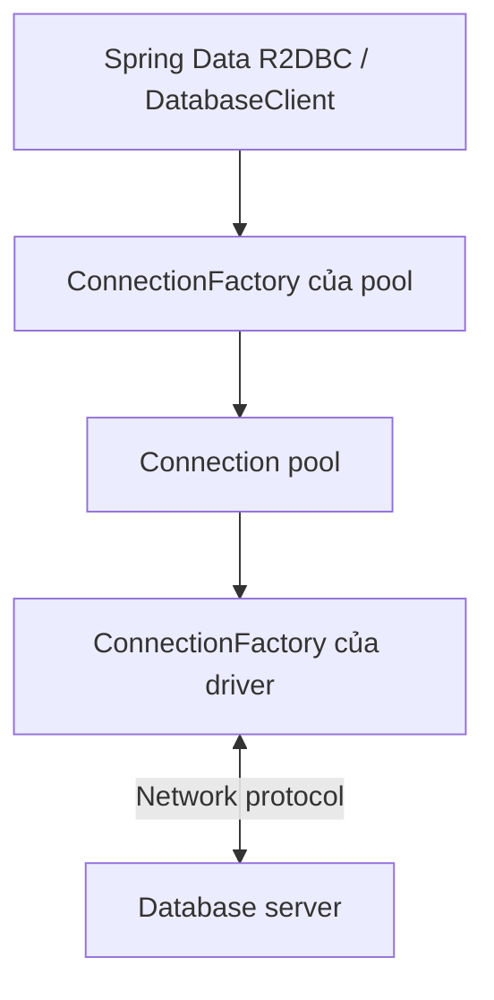
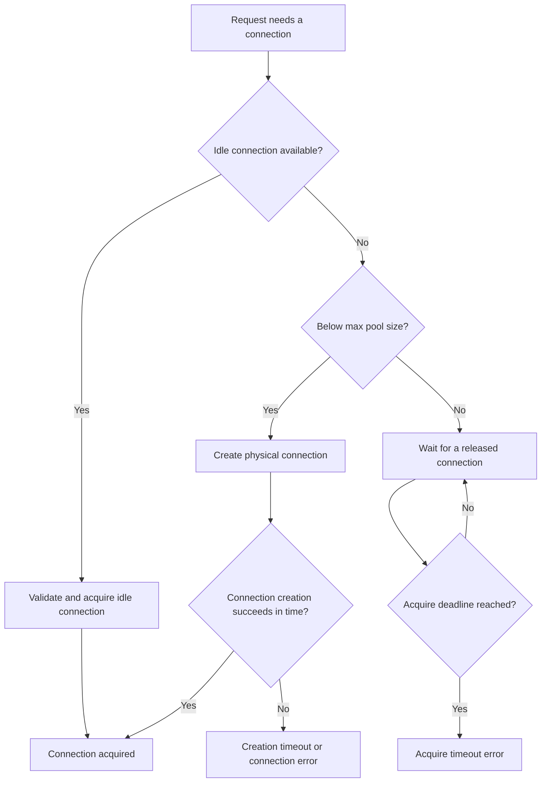

# Thời gian chờ lấy kết nối và chính sách tạo kết nối

Trong ứng dụng Spring Data R2DBC, mỗi thao tác truy cập database cần có một kết nối. Nếu tạo kết nối vật lý mới cho mọi truy vấn, ứng dụng sẽ tốn thời gian thiết lập phiên, xác thực và tài nguyên mạng. Connection pool giải quyết vấn đề này bằng cách giữ một nhóm kết nối có thể tái sử dụng và cấp kết nối cho các thao tác khi cần.

Hai chính sách quan trọng của pool là **thời gian chờ lấy kết nối** và **chính sách tạo kết nối**. Thời gian chờ lấy kết nối xác định một yêu cầu được phép đợi bao lâu để nhận được kết nối. Chính sách tạo kết nối xác định khi nào pool mở kết nối vật lý mới, số lượng tối đa được mở và việc giới hạn thời gian tạo kết nối. Cấu hình hai phần này hợp lý giúp ứng dụng phản hồi có giới hạn khi database chậm, đồng thời tránh tạo quá nhiều kết nối.

## 1. Connection pool quản lý điều gì?

R2DBC SPI định nghĩa `ConnectionFactory` để tạo kết nối. Một driver R2DBC cung cấp factory giao tiếp với hệ quản trị cụ thể. Connection pool có thể bọc factory này và cũng cung cấp một `ConnectionFactory`, nhưng bổ sung khả năng quản lý vòng đời kết nối.

Có thể hình dung kiến trúc:



Pool thường quản lý:

- Kết nối đang được ứng dụng mượn để thực thi truy vấn.
- Kết nối nhàn rỗi đã được trả về và có thể cấp lại.
- Số lượng kết nối vật lý được tạo.
- Hàng đợi các yêu cầu đang chờ kết nối.
- Thời gian chờ lấy kết nối và thời gian tạo kết nối.
- Việc kiểm tra, loại bỏ và tái tạo những kết nối không còn phù hợp.

Khi ứng dụng gọi repository hoặc `DatabaseClient`, Spring Data sử dụng hạ tầng `ConnectionFactory`. Nếu factory đó được bọc bởi pool, pool quyết định cấp một kết nối nhàn rỗi, tạo kết nối mới hay giữ yêu cầu trong hàng đợi. Ứng dụng thường không phải tự chọn một kết nối cụ thể.

Pool không thực thi SQL thay cho database và cũng không làm cho một truy vấn SQL chạy nhanh hơn. Nó giảm chi phí tạo kết nối lặp lại và điều tiết số kết nối đồng thời.

## 2. Vòng đời của một yêu cầu lấy kết nối

Khi một thao tác reactive cần kết nối, pool thường xử lý theo luồng sau:

1. Tìm kết nối nhàn rỗi còn sử dụng được.
2. Nếu có, kiểm tra kết nối theo chính sách đã cấu hình rồi cấp cho yêu cầu.
3. Nếu không có kết nối nhàn rỗi và tổng số kết nối còn dưới giới hạn, pool có thể yêu cầu driver tạo kết nối vật lý mới.
4. Nếu đã đạt giới hạn kết nối, yêu cầu phải đợi một kết nối đang được mượn được trả về.
5. Khi kết nối được trả lại, pool có thể cấp nó cho một yêu cầu đang chờ hoặc đưa vào nhóm nhàn rỗi.
6. Nếu vượt quá thời gian chờ hoặc thời gian tạo kết nối, thao tác nhận lỗi thay vì tiếp tục chờ vô hạn.

Sơ đồ đơn giản:



Đây là mô hình khái niệm. Chi tiết về hàng đợi, xác thực kết nối, số lần thử và việc pool khởi tạo kết nối phụ thuộc phiên bản thư viện pool và driver. Điều quan trọng là phân biệt thời gian chờ được cấp một kết nối với thời gian driver cần để tạo một kết nối mới.

## 3. Thời gian chờ lấy kết nối (maxAcquireTime)

`maxAcquireTime` là giới hạn thời gian một yêu cầu được phép chờ để lấy được kết nối từ pool. Nếu pool không thể cấp kết nối trong khoảng thời gian này, publisher lấy kết nối sẽ kết thúc bằng lỗi timeout.

Tình huống thường gặp:

- Tất cả kết nối đang được các request khác sử dụng.
- Một truy vấn chạy lâu và giữ kết nối trong thời gian dài.
- Ứng dụng có nhiều request đồng thời hơn khả năng phục vụ của pool.
- Kết nối chưa được trả lại vì pipeline reactive chưa kết thúc hoặc tài nguyên bị giữ quá lâu.

Ví dụ, pool có `maxSize = 10` và cả 10 kết nối đang được mượn. Request thứ 11 không thể nhận ngay kết nối mới vì pool đã đạt giới hạn. Request đó phải chờ một kết nối được trả lại. Nếu `maxAcquireTime` là 2 giây và không có kết nối nào được trả trong thời gian cho phép, thao tác lấy kết nối thất bại do timeout.

Ví dụ cấu hình:

```yaml
spring:
  r2dbc:
    pool:
      enabled: true
      max-size: 10
      max-acquire-time: 2s
```

Thời gian `2s` chỉ là giá trị minh họa. Cần chọn theo thời gian phản hồi mà ứng dụng chấp nhận, mức tải và thời gian xử lý bình thường của các truy vấn.

### Vì sao cần giới hạn thời gian chờ?

Nếu yêu cầu chờ quá lâu, tài nguyên ở các tầng phía trên cũng có thể bị giữ lâu: request HTTP, bộ nhớ, context xử lý và các công việc đang chờ. Khi tải tăng, hàng đợi kéo dài có thể khiến thời gian phản hồi xấu đi nhanh chóng.

Một giới hạn hữu ích giúp ứng dụng thất bại có kiểm soát và cho phép tầng gọi quyết định phản hồi phù hợp. Tuy nhiên, timeout quá ngắn có thể làm request thất bại ngay cả khi một kết nối sắp được trả về. Cấu hình phải dựa trên latency thực tế và ngân sách thời gian của request.

## 4. Thời gian tạo kết nối (maxCreateConnectionTime)

`maxCreateConnectionTime` giới hạn thời gian pool chờ driver tạo một kết nối vật lý mới. Việc tạo kết nối có thể bao gồm phân giải hostname, thiết lập kết nối mạng, bắt tay giao thức, xác thực và thiết lập phiên database.

Thời gian tạo kết nối có thể kéo dài hoặc thất bại khi:

- Database đang khởi động hoặc quá tải.
- Hostname không phân giải được hoặc đường mạng không ổn định.
- Firewall hoặc security group chặn cổng database.
- TLS handshake hoặc xác thực mất nhiều thời gian.
- Database đã đạt giới hạn kết nối.
- Thông tin đăng nhập hoặc cấu hình database không hợp lệ.

Ví dụ:

```yaml
spring:
  r2dbc:
    pool:
      max-create-connection-time: 5s
```

Nếu driver không thể tạo kết nối trong thời hạn này, yêu cầu tạo kết nối thất bại và lỗi được truyền qua publisher. Pool không thể biến một database đang mất kết nối thành trạng thái sẵn sàng bằng cách chỉ tăng timeout.

### Phân biệt hai loại timeout

| Thuộc tính | Giới hạn điều gì? | Tình huống điển hình |
| --- | --- | --- |
| `maxAcquireTime` | Thời gian chờ để nhận được kết nối từ pool | Pool đã đầy và request phải đợi kết nối được trả lại |
| `maxCreateConnectionTime` | Thời gian tạo một kết nối vật lý mới | Driver mất quá lâu để kết nối và xác thực với database |

Hai giới hạn có thể cùng được cấu hình. Một yêu cầu có thể thất bại vì không lấy được kết nối đúng hạn, hoặc vì lần tạo kết nối mới thất bại hay vượt quá thời gian tạo cho phép. Khi điều tra, cần xem lỗi gốc và trạng thái pool để xác định giai đoạn bị timeout.

## 5. Chính sách tạo kết nối: ban đầu, theo nhu cầu và giới hạn tối đa

Pool thường kết hợp một số tham số để quyết định số lượng kết nối được tạo và giữ lại.

### initialSize

`initialSize` xác định số kết nối ban đầu mà pool được cấu hình để khởi tạo. Có một lượng kết nối ban đầu có thể giúp những request đầu tiên không phải chờ quá trình tạo kết nối mới. Đổi lại, ứng dụng có thể mở kết nối ngay cả khi chưa có nhiều request.

Ví dụ:

```yaml
spring:
  r2dbc:
    pool:
      initial-size: 2
      max-size: 20
```

Giá trị ban đầu nên phù hợp với mức tải dự kiến và giới hạn kết nối của database. Việc khởi tạo thực tế có thể diễn ra khi pool được tạo hoặc khi nó được sử dụng lần đầu, tùy cách tích hợp và phiên bản thư viện.

### maxSize

`maxSize` đặt giới hạn tổng số kết nối mà pool được phép quản lý. Giới hạn này thường tính cả kết nối đang được mượn và kết nối nhàn rỗi.

Ví dụ, nếu `maxSize = 20`, pool không được mở rộng thành 21 kết nối chỉ vì có thêm một request. Request vượt quá năng lực hiện tại phải chờ kết nối được trả lại hoặc thất bại khi hết thời gian chờ.

Không nên đặt `maxSize` quá cao chỉ để giảm timeout. Mỗi kết nối tiêu thụ tài nguyên ở ứng dụng và database: socket, bộ nhớ, trạng thái phiên, bộ đệm và khả năng xử lý đồng thời của máy chủ.

### Tạo kết nối theo nhu cầu

Khi pool không có kết nối nhàn rỗi nhưng vẫn còn chỗ dưới `maxSize`, pool có thể yêu cầu driver tạo thêm kết nối. Đây là cách mở rộng theo nhu cầu: số kết nối tăng khi tải cần và không vượt quá giới hạn cấu hình.

Khi request kết thúc và kết nối được trả lại, pool có thể giữ kết nối đó ở trạng thái nhàn rỗi để tái sử dụng. Việc tạo mới và tái sử dụng được cân bằng theo cấu hình idle, lifetime và eviction của pool.

### Kết nối tối thiểu và duy trì kết nối nhàn rỗi

Một số pool hoặc phiên bản thư viện cung cấp chính sách duy trì số kết nối nhàn rỗi tối thiểu. Nếu sử dụng tính năng đó, cần hiểu rõ nó có thể làm pool giữ kết nối ngay cả khi tải thấp. Không nên giả định mọi phiên bản hoặc cấu hình Spring Boot đều có cùng thuộc tính; hãy kiểm tra metadata cấu hình và tài liệu đúng phiên bản đang sử dụng.

## 6. Ví dụ cấu hình pool trong Spring Boot

Với driver PostgreSQL và R2DBC Pool có trên runtime classpath, cấu hình minh họa có thể như sau:

```yaml
spring:
  r2dbc:
    url: r2dbc:postgresql://localhost:5432/customer_db
    username: ${DB_USERNAME:app_user}
    password: ${DB_PASSWORD}
    pool:
      enabled: true
      initial-size: 2
      max-size: 20
      max-acquire-time: 2s
      max-create-connection-time: 5s
      max-idle-time: 30m
      max-life-time: 2h
```

Ý nghĩa:

| Thuộc tính | Ý nghĩa |
| --- | --- |
| `enabled` | Bật cấu hình pool khi phiên bản Spring Boot và dependency hỗ trợ |
| `initial-size` | Số kết nối ban đầu cần khởi tạo |
| `max-size` | Giới hạn tổng số kết nối trong pool |
| `max-acquire-time` | Giới hạn thời gian chờ lấy kết nối |
| `max-create-connection-time` | Giới hạn thời gian tạo kết nối mới |
| `max-idle-time` | Giới hạn thời gian một kết nối có thể ở trạng thái nhàn rỗi trước khi bị loại bỏ theo chính sách pool |
| `max-life-time` | Giới hạn tuổi thọ tối đa của kết nối |

Đây là cấu hình ví dụ, không phải bộ giá trị mặc định phù hợp cho mọi ứng dụng. Tên thuộc tính và khả năng hỗ trợ có thể thay đổi theo phiên bản Spring Boot và R2DBC Pool. Hãy kiểm tra cấu hình metadata của dự án đang dùng trước khi áp dụng.

Dependency pool cần có trong runtime. Ví dụ với Gradle khi dự án dùng Spring Boot dependency management:

```groovy
dependencies {
    implementation 'org.springframework.boot:spring-boot-starter-data-r2dbc'
    runtimeOnly 'org.postgresql:r2dbc-postgresql'
    runtimeOnly 'io.r2dbc:r2dbc-pool'
}
```

Không nhầm driver với pool: driver PostgreSQL thực hiện giao tiếp với PostgreSQL; R2DBC Pool quản lý việc cấp phát và tái sử dụng các kết nối do driver tạo.

## 7. Cấu hình pool trực tiếp qua R2DBC Pool API

Khi không dùng auto-configuration của Spring Boot, có thể bọc một `ConnectionFactory` của driver bằng `ConnectionPool`:

```java
import io.r2dbc.pool.ConnectionPool;
import io.r2dbc.pool.ConnectionPoolConfiguration;
import io.r2dbc.spi.ConnectionFactory;

import java.time.Duration;

public ConnectionFactory createPooledFactory(ConnectionFactory driverFactory) {
    ConnectionPoolConfiguration configuration =
            ConnectionPoolConfiguration.builder(driverFactory)
                    .initialSize(2)
                    .maxSize(20)
                    .maxAcquireTime(Duration.ofSeconds(2))
                    .maxCreateConnectionTime(Duration.ofSeconds(5))
                    .maxIdleTime(Duration.ofMinutes(30))
                    .maxLifeTime(Duration.ofHours(2))
                    .build();

    return new ConnectionPool(configuration);
}
```

Phương thức trả về kiểu `ConnectionFactory` vì `ConnectionPool` cung cấp cùng abstraction mà các thành phần Spring Data có thể sử dụng. Ứng dụng có thể truyền factory đã bọc này cho cấu hình `DatabaseClient` hoặc repository infrastructure.

Khi tạo pool thủ công, ứng dụng cũng phải quản lý việc đóng pool khi ứng dụng dừng. Nếu dùng Spring Boot auto-configuration, Spring thường quản lý vòng đời bean theo cấu hình của nó; không tự đóng pool từ service trong khi ứng dụng còn hoạt động.

## 8. Chọn giá trị timeout theo ngân sách thời gian

Không có một giá trị `maxAcquireTime` hay `maxCreateConnectionTime` phù hợp cho mọi hệ thống. Nên bắt đầu từ ngân sách thời gian của request và latency thực tế.

Ví dụ, một endpoint có ngân sách phản hồi 3 giây và cần truy vấn database:

- Thời gian chờ lấy kết nối phải đủ ngắn để còn thời gian thực thi SQL và tạo response.
- Thời gian tạo kết nối mới cần phù hợp với độ trễ mạng và xác thực bình thường.
- Timeout của truy vấn, timeout của pool và timeout của HTTP cần được phối hợp để tránh một tầng vẫn chờ sau khi tầng phía trên đã hết hạn.

Nếu `maxAcquireTime` được đặt 10 giây nhưng HTTP request chỉ còn chờ 3 giây, phần lớn thời gian chờ pool có thể trở nên vô ích. Nếu `maxCreateConnectionTime` quá ngắn so với quá trình TLS handshake hợp lệ của môi trường, kết nối tốt vẫn có thể bị từ chối.

Một cách tiếp cận thực tế:

1. Đo thời gian lấy kết nối ở tải bình thường và tải cao.
2. Xác định ngân sách thời gian tối đa của request.
3. Đặt timeout lấy kết nối thấp hơn phần ngân sách còn lại dành cho database.
4. Đặt timeout tạo kết nối dựa trên thời gian kết nối thực tế, kể cả DNS, TLS và xác thực.
5. Theo dõi timeout trong vận hành và điều chỉnh bằng số liệu.

Timeout là cơ chế giới hạn chờ, không phải cách tăng năng lực xử lý. Nếu timeout thường xuyên xảy ra, cần tìm nguyên nhân như truy vấn chậm, pool quá nhỏ, kết nối bị giữ lâu hoặc database không đủ năng lực.

## 9. Pool size và giới hạn kết nối của database

Kích thước pool phải được tính trong tổng số instance ứng dụng. Nếu một instance có `maxSize = 20` và hệ thống chạy 5 instance, số kết nối tối đa lý thuyết từ các pool đó có thể lên đến 100.

Database còn phải dành kết nối cho:

- Các ứng dụng hoặc dịch vụ khác.
- Công cụ quản trị và giám sát.
- Migration, backup hoặc tác vụ nền.
- Kết nối dự phòng khi triển khai hoặc scale ứng dụng.

Ví dụ, nếu database cho phép tối đa 150 kết nối và có 5 instance ứng dụng, đặt pool mỗi instance ở 40 có thể tạo ra mức trần 200, vượt giới hạn database trước khi tính các client khác. Cần phân bổ giới hạn tổng thể thay vì chỉ nhìn cấu hình của một instance.

Pool lớn hơn không luôn làm throughput cao hơn. Khi database đã bão hòa CPU, I/O hoặc khóa, thêm kết nối đồng thời có thể tăng tranh chấp và làm latency xấu đi. Hãy tăng dần, đo hiệu năng và quan sát tải database.

## 10. Vì sao kết nối bị giữ lâu?

Pool chỉ có thể tái sử dụng kết nối sau khi ứng dụng trả nó lại. Nếu pipeline giữ kết nối quá lâu, các request khác có thể phải chờ dù truy vấn thực tế không quá nặng.

Những nguyên nhân thường gặp:

- Truy vấn đọc quá nhiều hàng và tiêu thụ kết quả chậm.
- Ứng dụng thực hiện một lời gọi HTTP hoặc xử lý ngoài database trong khi vẫn giữ transaction.
- Transaction bao trùm quá nhiều công việc.
- Tự lấy kết nối bằng SPI nhưng không đóng trong mọi nhánh hoàn tất, lỗi và cancellation.
- Dùng `block()` hoặc tự subscribe khiến vòng đời xử lý bị tách khỏi luồng mà framework quản lý.
- Một luồng xử lý bị hủy nhưng tài nguyên không được giải phóng đúng cách.

Với Spring Data R2DBC, hãy giữ transaction ở phạm vi cần thiết và trả publisher xuyên suốt các tầng reactive. Nếu gọi SPI trực tiếp, cần quản lý cleanup cho mọi kết cục. Với một kết nối được cấp từ pool, gọi `close()` thường trả kết nối logic về pool để tái sử dụng, không nhất thiết đóng socket vật lý.

## 11. Kết nối nhàn rỗi, tuổi thọ và xác thực

Ngoài thời gian acquire và create, pool thường có chính sách cho kết nối nhàn rỗi và kết nối đã tồn tại lâu:

- `maxIdleTime` giới hạn thời gian kết nối có thể nằm nhàn rỗi trước khi bị pool loại bỏ theo chính sách.
- `maxLifeTime` giới hạn tuổi thọ tổng thể của kết nối, kể cả khi nó được sử dụng lại.
- Validation có thể kiểm tra kết nối trước khi cấp cho request hoặc theo cơ chế của pool.
- Background eviction có thể dọn kết nối nhàn rỗi hoặc quá hạn theo chu kỳ.

Các chính sách này hữu ích khi database, proxy hoặc network có thể đóng kết nối không hoạt động sau một khoảng thời gian. Nếu pool giữ một kết nối đã bị máy chủ đóng, request tiếp theo có thể nhận lỗi khi sử dụng nó. Cấu hình idle timeout và validation cần cân nhắc timeout phía database hoặc hạ tầng mạng.

Không nên đặt `maxIdleTime` thấp đến mức pool liên tục đóng và tạo lại kết nối trong khi tải vẫn ổn định. Cũng không nên giữ kết nối vô thời hạn nếu database hoặc proxy có giới hạn tuổi thọ riêng.

Validation cũng có chi phí. Một truy vấn kiểm tra hoặc thao tác validation trước mỗi lần cấp kết nối có thể tăng latency và tạo thêm lưu lượng. Chọn validation phù hợp với driver và môi trường, không bật nhiều cơ chế kiểm tra trùng lặp nếu không có lý do.

## 12. Theo dõi hoạt động của pool

Để biết timeout đến từ thiếu kết nối hay database chậm, nên theo dõi các chỉ số của pool nếu thư viện và cấu hình hỗ trợ:

| Chỉ số | Ý nghĩa khi điều tra |
| --- | --- |
| Active connections | Số kết nối đang được mượn |
| Idle connections | Số kết nối đang chờ được tái sử dụng |
| Pending acquisitions | Số yêu cầu đang chờ lấy kết nối |
| Acquire latency | Thời gian từ lúc yêu cầu đến lúc nhận kết nối |
| Acquire timeout count | Số lần không lấy được kết nối đúng hạn |
| Connection creation latency | Thời gian driver tạo kết nối mới |
| Connection creation failures | Số lần tạo kết nối mới thất bại |
| Connection lifetime / idle duration | Kết nối được giữ và nhàn rỗi trong bao lâu |

Một số dấu hiệu:

- Active luôn chạm `maxSize`, pending tăng và idle bằng 0: pool có thể thiếu năng lực hoặc kết nối bị giữ lâu.
- Acquire timeout tăng nhưng truy vấn database nhanh: kiểm tra pool size, thời gian giữ connection và concurrency.
- Creation latency cao hoặc creation failure tăng: kiểm tra mạng, xác thực, database và giới hạn kết nối.
- Idle luôn cao trong khi active thấp: pool có thể được cấu hình lớn hơn nhu cầu; xem xét điều chỉnh nếu tài nguyên database cần được tiết kiệm.

Chỉ số cần được đọc cùng latency truy vấn, CPU, I/O và giới hạn kết nối của database. Một biểu đồ pool riêng lẻ không đủ để kết luận nguyên nhân.

## 13. Xử lý lỗi timeout và khả năng thử lại

Khi không lấy được kết nối, publisher sẽ kết thúc bằng lỗi. Tầng service hoặc web có thể chuyển lỗi thành phản hồi phù hợp, ghi log và phát metric. Cần giữ thông tin nguyên nhân gốc để phân biệt acquire timeout với lỗi tạo kết nối hoặc lỗi SQL.

Không nên tự động retry mọi lỗi timeout mà không giới hạn. Retry ngay lập tức khi pool đã đầy có thể tạo thêm yêu cầu chờ, làm tình trạng quá tải nặng hơn. Nếu nghiệp vụ cho phép retry:

- Giới hạn số lần thử.
- Dùng backoff và jitter để tránh nhiều request thử lại cùng lúc.
- Chỉ retry lỗi có khả năng tạm thời và thao tác an toàn để thử lại.
- Đặt tổng thời gian retry trong ngân sách của request.
- Không retry thao tác ghi có thể đã được thực hiện nếu chưa xác định được trạng thái commit.

Với lỗi tạo kết nối do sai mật khẩu, sai URL hoặc database không tồn tại, retry thường không giải quyết được nguyên nhân. Cần sửa cấu hình hoặc khôi phục hạ tầng.

## 14. Kiểm thử chính sách acquire và create

Có thể kiểm thử các hành vi pool bằng một database test và cấu hình pool có giới hạn nhỏ. Ví dụ, tạo pool với `maxSize = 1`, mượn một kết nối và giữ nó chưa trả về. Yêu cầu lấy kết nối thứ hai sẽ phải chờ; khi thời hạn acquire ngắn, nó có thể kết thúc bằng timeout. Sau đó trả kết nối đầu tiên và xác nhận một yêu cầu mới có thể lấy lại kết nối.

Một kiểm thử tích hợp nên bao gồm:

1. Tạo pool với giới hạn nhỏ, chẳng hạn một hoặc hai kết nối.
2. Lấy hết số kết nối được phép và giữ chúng trong một khoảng thời gian được kiểm soát.
3. Gửi thêm yêu cầu lấy kết nối và xác nhận nó chờ hoặc timeout theo cấu hình.
4. Trả kết nối đã mượn và xác nhận yêu cầu mới có thể tiếp tục.
5. Kiểm thử trường hợp database không thể tạo kết nối để xác nhận lỗi tạo kết nối được truyền về.
6. Đóng pool sau khi kiểm thử để giải phóng tài nguyên.

Có thể dùng Reactor Test để kiểm tra publisher và timeout. Khi kiểm thử timeout, cần kiểm soát thời gian và tránh dùng sleep dài không ổn định. Một test dựa vào database thực tế hoặc container giúp kiểm tra tích hợp driver và pool; mock đơn thuần không chứng minh chính sách pool hoạt động với driver thật.

## 15. Các lỗi cấu hình thường gặp

1. **Đặt maxAcquireTime quá dài.** Request giữ tài nguyên và chờ lâu trong khi không còn đủ thời gian xử lý ở tầng HTTP.
2. **Đặt maxAcquireTime quá ngắn.** Request thất bại dù kết nối có thể sắp được trả về trong điều kiện tải bình thường.
3. **Nhầm acquire timeout với create timeout.** Một lỗi xảy ra khi chờ kết nối được trả lại; lỗi kia xảy ra khi driver đang tạo kết nối mới.
4. **Đặt maxSize vượt quá ngân sách database.** Tổng số kết nối từ nhiều instance có thể vượt giới hạn máy chủ.
5. **Tăng maxSize để che truy vấn chậm.** Kết nối đồng thời tăng có thể làm database quá tải hơn.
6. **Quên thêm dependency pool.** Cấu hình pool không có hiệu lực nếu thư viện cần thiết không có trên runtime classpath hoặc auto-configuration không được bật.
7. **Không trả kết nối về pool.** Kết nối bị giữ khiến active tăng, idle giảm và acquire timeout xuất hiện.
8. **Giữ transaction quá lâu.** Một kết nối có thể bị chiếm trong toàn bộ thời gian transaction, kể cả khi ứng dụng đang làm công việc ngoài database.
9. **Bỏ qua timeout phía database hoặc proxy.** Kết nối có thể bị hạ tầng đóng trước khi pool nhận ra và loại bỏ.
10. **Retry không giới hạn.** Các yêu cầu thử lại có thể tiếp tục làm đầy hàng đợi khi pool hoặc database đang quá tải.

## Quy tắc lựa chọn nhanh

- Dùng `maxAcquireTime` để giới hạn thời gian request chờ lấy một kết nối từ pool.
- Dùng `maxCreateConnectionTime` để giới hạn thời gian driver tạo kết nối vật lý mới.
- Dùng `initialSize` để kiểm soát số kết nối khởi tạo ban đầu.
- Dùng `maxSize` để giới hạn tổng số kết nối mà pool quản lý.
- Dùng idle time, lifetime và validation để quản lý kết nối nhàn rỗi hoặc đã cũ.
- Chọn timeout và kích thước pool theo ngân sách request, tải thực tế, số instance và giới hạn database.
- Theo dõi active, idle, pending, acquire latency và creation failures để điều chỉnh bằng số liệu.

Thời gian chờ lấy kết nối và chính sách tạo kết nối cùng quyết định cách pool phản ứng khi ứng dụng cần truy cập database. Một cấu hình tốt đặt giới hạn rõ ràng cho thời gian chờ và số kết nối, đồng thời trả kết nối về pool ngay khi công việc hoàn tất. Khi timeout xuất hiện, hãy xác định pool đang chờ kết nối được trả lại hay driver không thể tạo kết nối mới, rồi xử lý nguyên nhân ở đúng tầng.
