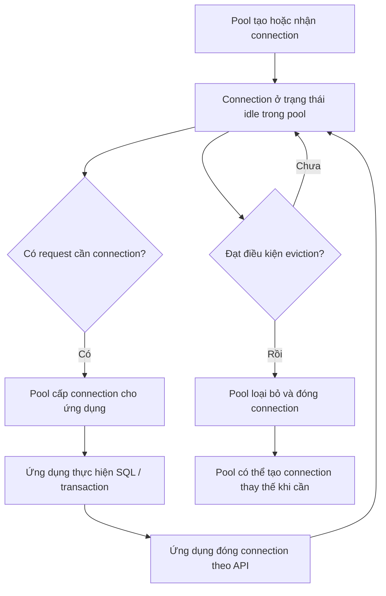

# Thời gian nhàn rỗi, tuổi thọ và thu hồi kết nối

Connection pool trong Spring Data Relational R2DBC giữ một tập kết nối đã được tạo để tái sử dụng giữa các thao tác. Khi một thao tác hoàn tất, ứng dụng trả connection về pool; connection có thể nằm chờ để được cấp cho request tiếp theo. Nếu giữ các connection nhàn rỗi quá lâu hoặc dùng một connection vượt quá tuổi thọ phù hợp, ứng dụng có thể gặp lỗi do database, proxy hoặc hạ tầng mạng đã đóng kết nối ở phía bên kia.

R2DBC Pool cung cấp các giới hạn thời gian để quản lý vòng đời này. Hai giới hạn quan trọng là **thời gian nhàn rỗi tối đa** (`maxIdleTime`) và **tuổi thọ tối đa** (`maxLifeTime`). Cơ chế **eviction** kiểm tra các connection đủ điều kiện bị loại bỏ và giải phóng chúng khỏi pool. Hiểu cách các mốc thời gian bắt đầu, thời điểm pool kiểm tra và cách connection được trả về giúp cấu hình pool ổn định mà không tạo quá nhiều kết nối mới.

## 1. Vòng đời connection trong pool

Một connection được tạo bởi driver và được pool quản lý. Khi ứng dụng cần truy cập database, pool cấp một connection đang rảnh hoặc tạo connection mới nếu còn trong giới hạn. Sau khi thao tác hoàn tất, connection được trả về pool để có thể sử dụng lại.



Trong pool, gọi `Connection.close()` thường có nghĩa là trả connection về pool sau khi hoàn tất việc sử dụng. Pool có thể làm sạch trạng thái phiên, transaction hoặc tài nguyên liên quan trước khi đưa connection trở lại danh sách idle. Khi pool thực sự eviction một connection, nó đóng connection được quản lý và loại bỏ connection đó khỏi tập tài nguyên có thể cấp phát.

Điểm cần phân biệt là connection đang được ứng dụng mượn (acquired/in use) và connection đang chờ trong pool (idle). Thời gian nhàn rỗi được tính khi connection nằm trong pool và sẵn sàng được cấp lại. Một connection đang được sử dụng không phải là idle resource, dù nó đã được tạo từ lâu.

## 2. Thời gian nhàn rỗi tối đa (`maxIdleTime`)

`maxIdleTime` xác định khoảng thời gian tối đa mà một connection được phép nằm nhàn rỗi trong pool trước khi đủ điều kiện bị thu hồi. Mốc thời gian này gắn với trạng thái idle, thường bắt đầu khi connection được trả về pool sau khi ứng dụng sử dụng xong.

Ví dụ, cấu hình `maxIdleTime` là 10 phút có nghĩa connection không nên tiếp tục nằm chờ trong pool quá khoảng thời gian đó. Khi thời gian idle vượt ngưỡng, pool có thể loại bỏ connection trong lần kiểm tra eviction phù hợp. Pool không nhất thiết đóng connection chính xác tại giây thứ 10 phút; thời điểm thực tế còn phụ thuộc chu kỳ kiểm tra và trạng thái của connection.

### Khi nào giới hạn idle hữu ích?

- Database có chính sách đóng các phiên không hoạt động sau một khoảng thời gian.
- Firewall, NAT gateway, load balancer hoặc proxy loại bỏ kết nối TCP nhàn rỗi.
- Ứng dụng có tải không đều, có những khoảng thời gian dài ít request và không cần giữ toàn bộ connection cũ.
- Hệ thống cần giải phóng tài nguyên sau các giai đoạn tải thấp.

Ví dụ, nếu proxy đóng kết nối không hoạt động sau 20 phút, pool có thể đặt `maxIdleTime` thấp hơn mốc đó để chủ động loại bỏ connection trước khi proxy đóng. Nên dành một khoảng đệm thay vì đặt hai giá trị bằng nhau, vì thời điểm timeout và lịch eviction không nhất thiết trùng khớp.

### Idle time không phải thời gian sống tổng cộng

Giả sử connection được tạo lúc 09:00, được dùng từ 09:01 đến 09:03, rồi trả về pool. Nếu `maxIdleTime` là 10 phút, khoảng idle của lần chờ đó bắt đầu khi connection trở lại pool, không phải từ 09:00. Nếu connection được cấp lại lúc 09:08, nó rời trạng thái idle và không còn đủ điều kiện bị thu hồi chỉ vì đã nằm chờ gần 10 phút trong lần đó.

Sau lần sử dụng tiếp theo, connection lại có một khoảng idle mới khi được trả về pool. Giới hạn này nhằm quản lý thời gian chờ không hoạt động, không đặt giới hạn cho tổng tuổi của connection.

## 3. Tuổi thọ tối đa (`maxLifeTime`)

`maxLifeTime` giới hạn tuổi của connection tính từ khi connection được tạo. Khác với `maxIdleTime`, tuổi thọ không bắt đầu lại mỗi lần connection được cấp hoặc trả về pool. Một connection được dùng thường xuyên vẫn tăng tuổi theo thời gian thực.

Ví dụ, connection được tạo lúc 09:00 và có `maxLifeTime` là 2 giờ. Nó đạt mốc tuổi thọ vào khoảng 11:00, bất kể trong hai giờ đó nó đã được dùng bao nhiêu lần hay đã idle trong bao lâu. Khi connection đủ điều kiện thu hồi và được pool kiểm tra ở trạng thái có thể eviction, pool sẽ loại bỏ nó để tránh tái sử dụng một connection đã quá tuổi cấu hình.

### Vì sao cần giới hạn tuổi thọ?

- Một số database hoặc dịch vụ trung gian áp dụng giới hạn tuổi tối đa cho phiên hoặc kết nối.
- Hạ tầng mạng có thể đặt thời gian sống cho connection dài hạn.
- Credential, chứng chỉ hoặc chính sách bảo mật có thể thay đổi theo thời gian; việc xoay vòng connection giúp các kết nối mới nhận cấu hình mới.
- Connection lâu ngày có thể trở nên không phù hợp với trạng thái hiện tại của hạ tầng, dù nó vẫn hoạt động ở thời điểm được tạo.

`maxLifeTime` tạo cơ hội để pool thay connection cũ bằng connection mới. Nó không tự thay đổi credential hoặc chứng chỉ; ứng dụng vẫn cần cập nhật cấu hình và bảo đảm connection mới được tạo từ cấu hình hiệu lực.

### Connection đang được sử dụng khi đạt max lifetime

Giới hạn tuổi thọ là tiêu chí quản lý vòng đời của pool, không nên hiểu là lệnh ngắt cưỡng bức một truy vấn đang chạy đúng vào thời điểm connection đạt ngưỡng. Pool thường chỉ có thể eviction an toàn khi connection đã được trả về hoặc đang ở trạng thái idle có thể thu hồi. Connection đang được mượn có thể tiếp tục phục vụ thao tác hiện tại rồi được loại bỏ khi quay lại pool, tùy implementation và phiên bản.

Do đó, `maxLifeTime` không thay thế timeout cho câu truy vấn hoặc transaction. Nếu một thao tác giữ connection quá lâu, cần xem xét timeout và thiết kế transaction riêng. Cũng không nên dựa vào `maxLifeTime` để bảo đảm một connection đang hoạt động sẽ bị cắt ngay lập tức.

## 4. So sánh `maxIdleTime` và `maxLifeTime`

| Thuộc tính | Mốc bắt đầu tính | Điều kiện chính | Mục tiêu |
| --- | --- | --- | --- |
| `maxIdleTime` | Khi connection được trả về pool và ở trạng thái idle | Idle vượt quá thời gian cấu hình | Không giữ connection chờ quá lâu |
| `maxLifeTime` | Khi connection được tạo | Tuổi tổng cộng vượt quá thời gian cấu hình | Không tái sử dụng connection quá cũ |

Hai giới hạn có thể cùng áp dụng cho một connection. Connection đủ điều kiện eviction khi một trong các tiêu chí cấu hình yêu cầu loại bỏ nó và pool kiểm tra được connection ở trạng thái có thể thu hồi.

Ví dụ cấu hình:

```java
ConnectionPoolConfiguration configuration =
        ConnectionPoolConfiguration.builder(connectionFactory)
                .maxIdleTime(Duration.ofMinutes(10))
                .maxLifeTime(Duration.ofHours(2))
                .build();
```

Trong cấu hình này, một connection mới có tuổi thọ tối đa 2 giờ. Mỗi lần được trả về pool, nó chỉ có thể nằm idle tối đa 10 phút. Nếu connection đạt tuổi thọ 2 giờ trước khi khoảng idle 10 phút kết thúc, giới hạn tuổi thọ cũng có thể khiến nó bị thu hồi ở lần kiểm tra thích hợp.

## 5. Eviction là gì?

Eviction là quá trình pool loại bỏ một connection khỏi tập connection có thể tái sử dụng và giải phóng tài nguyên của connection đó. Pool đánh giá các điều kiện như idle time, lifetime hoặc tính hợp lệ; connection đáp ứng điều kiện thu hồi sẽ được đóng và không được cấp cho request tiếp theo.

Eviction không phải là thao tác xóa dữ liệu trong database, không phải xóa bản ghi và cũng không phải rollback một transaction nghiệp vụ. Nó quản lý tài nguyên kết nối ở tầng pool.

### Kiểm tra định kỳ bằng `backgroundEvictionInterval`

R2DBC Pool có tùy chọn `backgroundEvictionInterval` để xác định chu kỳ chạy tác vụ nền kiểm tra các connection idle có đủ điều kiện eviction hay không. Ví dụ, nếu chu kỳ là một phút, pool có thể kiểm tra các connection idle theo từng lượt cách nhau khoảng một phút.

Chu kỳ kiểm tra ảnh hưởng đến độ trễ giữa thời điểm connection chạm ngưỡng và thời điểm pool thực sự thu hồi nó. Nếu `maxIdleTime` là 10 phút và chu kỳ eviction là 1 phút, connection có thể được loại bỏ ở lượt kiểm tra đầu tiên sau khi quá hạn, thay vì đúng ngay tại mốc 10 phút.

Nếu chu kỳ kiểm tra quá dài, connection quá hạn có thể tiếp tục nằm trong pool cho đến lượt quét tiếp theo. Nếu chu kỳ quá ngắn, pool phải thực hiện kiểm tra nền thường xuyên hơn. Hãy chọn khoảng thời gian phù hợp với số lượng connection, yêu cầu giải phóng tài nguyên và chi phí kiểm tra.

Không nên suy luận rằng chỉ có background eviction mới có thể phát hiện connection hết hạn. Pool còn có thể kiểm tra điều kiện khi xử lý acquisition hoặc các chuyển trạng thái khác tùy phiên bản và implementation. Hãy xem tài liệu đúng phiên bản `r2dbc-pool` để xác định chính xác hành vi khi không cấu hình chu kỳ nền.

### Connection đang idle và connection đang được mượn

Pool thường thực hiện eviction trên các tài nguyên idle vì connection đang được ứng dụng sử dụng chưa thể đóng an toàn mà không ảnh hưởng thao tác đang chạy. Khi connection được trả về pool, pool có thể đánh giá lại tuổi thọ và các điều kiện eviction trước khi cho phép nó trở lại trạng thái idle có thể cấp phát.

Vì vậy, một connection vượt `maxLifeTime` trong lúc đang chạy transaction không đồng nghĩa pool lập tức hủy transaction. Tuy nhiên, sau khi được trả về, connection đó có thể bị loại bỏ thay vì được tái sử dụng.

### Eviction và tạo connection thay thế

Eviction làm giảm số connection hiện có. Khi có request mới, pool có thể tạo connection khác nếu cần và nếu còn trong giới hạn `maxSize`. Một số cấu hình pool còn có kích thước ban đầu hoặc mức idle tối thiểu để chuẩn bị connection sẵn sàng; hành vi duy trì số lượng cụ thể phụ thuộc cấu hình và phiên bản pool.

Không nên xem eviction là cơ chế tự động duy trì chính xác cùng một số connection trong mọi thời điểm. Pool cân bằng giữa connection đang được mượn, connection idle, giới hạn kích thước và nhu cầu tạo connection mới.

## 6. Cấu hình các giới hạn trong R2DBC Pool

R2DBC Pool cung cấp `ConnectionPoolConfiguration` để thiết lập giới hạn và chính sách quản lý connection. Ví dụ:

```java
import io.r2dbc.pool.ConnectionPool;
import io.r2dbc.pool.ConnectionPoolConfiguration;
import io.r2dbc.spi.ConnectionFactory;

import java.time.Duration;

ConnectionPoolConfiguration configuration =
        ConnectionPoolConfiguration.builder(connectionFactory)
                .initialSize(5)
                .maxSize(20)
                .maxIdleTime(Duration.ofMinutes(10))
                .maxLifeTime(Duration.ofHours(2))
                .backgroundEvictionInterval(Duration.ofMinutes(1))
                .build();

ConnectionPool pool = new ConnectionPool(configuration);
```

Ví dụ minh họa cách đặt các mốc thời gian và kích thước. Ứng dụng cần có dependency `r2dbc-pool` tương thích với phiên bản R2DBC SPI và driver đang sử dụng. Các giá trị thời gian cần được chọn theo timeout của database và hạ tầng triển khai, không nên sao chép máy móc.

Các thuộc tính liên quan:

| Thuộc tính | Ý nghĩa |
| --- | --- |
| `initialSize` | Số connection ban đầu pool chuẩn bị |
| `maxSize` | Số connection tối đa pool được phép quản lý |
| `maxIdleTime` | Thời gian idle tối đa trước khi connection đủ điều kiện eviction |
| `maxLifeTime` | Tuổi tối đa tính từ khi connection được tạo |
| `backgroundEvictionInterval` | Chu kỳ tác vụ nền kiểm tra connection idle để eviction |
| `maxAcquireTime` | Thời gian tối đa chờ lấy được connection từ pool |
| `maxCreateConnectionTime` | Thời gian tối đa chờ tạo connection mới |
| `maxValidationTime` | Thời gian tối đa cho thao tác validation nếu được cấu hình |

`maxAcquireTime` và `maxCreateConnectionTime` là timeout cho việc lấy hoặc tạo connection, không phải tuổi thọ hay thời gian nhàn rỗi. Phân biệt chúng giúp tránh dùng sai một timeout để giải quyết vấn đề của timeout khác.

### Cấu hình bằng Spring Boot

Nếu dự án dùng Spring Boot và pool được bật thông qua dependency cùng auto-configuration phù hợp, có thể khai báo một số giới hạn trong `application.yml`:

```yaml
spring:
  r2dbc:
    url: r2dbc:postgresql://localhost:5432/appdb
    username: ${DB_USERNAME}
    password: ${DB_PASSWORD}
    pool:
      enabled: true
      initial-size: 5
      max-size: 20
      max-idle-time: 10m
      max-life-time: 2h
      max-acquire-time: 5s
      max-create-connection-time: 5s
```

Các thuộc tính pool mà Spring Boot hỗ trợ phụ thuộc phiên bản Boot. Nếu cần đặt `backgroundEvictionInterval` hoặc một option mà cấu hình auto-configuration không cung cấp, có thể cần khai báo `ConnectionPool`/`ConnectionPoolConfiguration` thủ công. Kiểm tra metadata cấu hình và tài liệu của phiên bản dự án trước khi dùng thuộc tính YAML.

Khi tự tạo pool, cần bảo đảm các bean sử dụng đúng factory đã được pool bọc, bao gồm `DatabaseClient` và reactive transaction manager. Nếu repository dùng factory không qua pool, các giới hạn idle/lifetime vừa cấu hình sẽ không áp dụng cho những truy vấn của repository đó.

## 7. Chọn thời gian dựa trên timeout của database và hạ tầng

Pool không phải thành phần duy nhất quyết định tuổi thọ của kết nối. Database, proxy, firewall, NAT gateway, load balancer và nền tảng cloud có thể đặt giới hạn riêng. Nếu một thành phần hạ tầng đóng socket trước khi pool nhận ra connection đã quá hạn, lần sử dụng tiếp theo có thể gặp lỗi connection reset hoặc connection closed.

Một nguyên tắc cấu hình thực tế là để pool chủ động thu hồi connection trước mốc timeout của thành phần hạ tầng có giới hạn ngắn nhất, với một khoảng đệm đủ lớn.

Ví dụ giả định:

| Thành phần | Timeout |
| --- | ---: |
| Proxy đóng kết nối idle | 20 phút |
| Pool `maxIdleTime` | 15 phút |
| Chu kỳ background eviction | 1 phút |

Trong ví dụ này, pool bắt đầu xem xét thu hồi connection idle trước mốc 20 phút của proxy. Khoảng đệm giúp giảm khả năng pool cấp lại connection đã bị proxy đóng. Đây chỉ là số liệu minh họa; phải lấy timeout thực tế từ database và hạ tầng đang chạy.

Với `maxLifeTime`, cần xem xét các giới hạn tuổi connection do dịch vụ database hoặc proxy quy định. Nếu hạ tầng có giới hạn tuổi tối đa, đặt `maxLifeTime` thấp hơn giới hạn đó giúp pool thay connection trước khi bị hạ tầng cắt. Nếu không có giới hạn như vậy, vẫn có thể dùng lifetime để xoay vòng connection theo chính sách vận hành, nhưng cần cân nhắc chi phí tạo kết nối.

### Đừng đặt giới hạn quá thấp

`maxIdleTime` hoặc `maxLifeTime` quá ngắn có thể làm pool liên tục đóng và tạo connection mới. Việc thiết lập connection thường tốn thời gian cho DNS, TCP, TLS, xác thực, khởi tạo session và các bước driver khác. Kết quả có thể là:

- Tăng số lần handshake và tải lên database.
- Tăng độ trễ khi request cần chờ connection mới được tạo.
- Tăng số lỗi tạm thời khi database hoặc mạng đang chịu tải.
- Làm connection pool dao động liên tục giữa tạo mới và thu hồi.

### Đừng đặt giới hạn quá dài

Giới hạn quá dài có thể giữ connection stale sau khi proxy hoặc database đã đóng ở phía bên kia. Connection cũ cũng có thể tồn tại lâu hơn chính sách bảo mật hoặc vòng đời credential của hệ thống. Nếu pool chỉ phát hiện lỗi khi connection được sử dụng, request đầu tiên sau khoảng nghỉ có thể phải chịu lỗi hoặc cần retry ở tầng ứng dụng.

Mục tiêu là chọn ngưỡng đủ dài để tái sử dụng hiệu quả, nhưng ngắn hơn các giới hạn bên ngoài có thể làm connection mất hiệu lực.

## 8. Validation và eviction là hai cơ chế khác nhau

Eviction loại bỏ connection theo chính sách vòng đời như idle time và maximum lifetime. Validation kiểm tra connection có còn hợp lệ trước hoặc trong quá trình pool cấp phát, tùy cấu hình và implementation.

Validation có thể giúp phát hiện connection đã bị database hoặc mạng đóng. Tuy nhiên:

- Validation không thay thế `maxIdleTime` hoặc `maxLifeTime`; connection hợp lệ vẫn có thể cần được xoay vòng theo chính sách.
- Validation có chi phí, có thể cần trao đổi với driver hoặc database tùy validation depth/query.
- Connection có thể bị đóng ngay sau khi validation thành công do lỗi mạng xảy ra sau bước kiểm tra. Đây là một race condition không thể loại bỏ hoàn toàn chỉ bằng validation.
- Validation query và cách kiểm tra hợp lệ phụ thuộc driver, database và phiên bản pool.

Vì vậy, nên kết hợp giới hạn thời gian hợp lý với validation phù hợp. Nếu môi trường có proxy đóng connection idle, đặt `maxIdleTime` thấp hơn timeout của proxy thường giúp chủ động hơn là chỉ dựa vào validation sau một khoảng nghỉ dài.

## 9. Quan sát pool để điều chỉnh cấu hình

Không nên chọn `maxIdleTime`, `maxLifeTime` hoặc chu kỳ eviction chỉ dựa vào phỏng đoán. Hãy theo dõi số connection và thời gian chờ để biết pool đang hoạt động như thế nào.

Các số liệu hữu ích gồm:

| Số liệu | Điều cần quan sát |
| --- | --- |
| Connection acquired | Số connection đang được ứng dụng mượn |
| Connection idle | Số connection đang chờ trong pool |
| Connection allocated | Tổng số connection pool đang quản lý hoặc đã cấp phát theo định nghĩa metric |
| Pending acquire | Số request đang chờ connection |
| Acquire duration | Thời gian request chờ lấy connection |
| Connection creation time | Thời gian tạo connection mới |
| Eviction/close count | Tần suất connection bị loại bỏ hoặc đóng |
| Connection errors | Lỗi xảy ra khi lấy, kiểm tra hoặc sử dụng connection |

Tên metric cụ thể phụ thuộc phiên bản pool và tích hợp Micrometer/quan sát đang dùng. Khi đọc dashboard, cần xem mô tả metric để biết nó đo connection đang mượn, connection đã cấp phát hay connection vật lý.

Một số dấu hiệu có thể gợi ý cấu hình chưa phù hợp:

- Eviction và connection creation tăng liên tục: có thể thời gian idle/lifetime quá thấp hoặc pool đang bị churn.
- Lỗi connection closed sau các khoảng nghỉ dài: có thể timeout của proxy/database ngắn hơn chính sách pool, hoặc validation chưa phát hiện connection stale.
- Pending acquire tăng trong khi pool đã chạm `maxSize`: có thể pool quá nhỏ so với tải, connection bị giữ quá lâu hoặc truy vấn/transaction chậm.
- Số connection idle cao kéo dài: có thể pool giữ nhiều connection hơn nhu cầu hoặc thời gian idle quá dài.

Hãy đối chiếu số liệu pool với log database, timeout của proxy và tải request. Chỉ tăng `maxSize` không giải quyết được vấn đề nếu nguyên nhân là connection bị giữ quá lâu hoặc database đã hết khả năng tiếp nhận phiên mới.

## 10. Tình huống minh họa

### Ứng dụng có tải theo giờ

Một dịch vụ có nhiều request trong giờ làm việc và rất ít request ban đêm. Pool giữ connection idle qua nhiều giờ có thể không cần thiết, đặc biệt nếu database hoặc mạng đóng phiên nhàn rỗi. Có thể đặt `maxIdleTime` để pool thu hồi connection sau một khoảng nghỉ hợp lý; khi có request mới, pool tạo connection mới trong giới hạn cho phép.

Không nên đặt idle timeout ngắn đến mức mỗi đợt request đều phải tạo lại toàn bộ connection. Hãy quan sát chu kỳ tải và chi phí mở connection để chọn ngưỡng phù hợp.

### Database proxy giới hạn tuổi kết nối

Một proxy cho phép connection tồn tại tối đa 4 giờ. Pool đặt `maxLifeTime` khoảng 3 giờ 30 phút để thay connection trước giới hạn proxy, có xét thêm khoảng đệm vận hành. Connection đang được mượn khi chạm ngưỡng sẽ được xử lý theo vòng đời pool; giới hạn này không thay thế timeout cho transaction đang chạy.

### Connection bị stale sau khi ứng dụng không có request

Ứng dụng không có request trong thời gian dài. Proxy đóng các socket idle, nhưng pool vẫn còn tham chiếu tới connection. Khi request tiếp theo đến, nếu pool cấp connection cũ mà chưa phát hiện trạng thái stale, thao tác có thể lỗi. Có thể điều chỉnh `maxIdleTime` thấp hơn timeout proxy, cấu hình validation phù hợp và xử lý lỗi kết nối tạm thời ở tầng ứng dụng theo tính an toàn của thao tác.

### Transaction kéo dài vượt max lifetime

Một transaction giữ connection trong thời gian dài. Connection đạt `maxLifeTime` trong lúc vẫn đang được mượn. Không nên kỳ vọng pool cắt ngang transaction ngay lập tức; cần xem lại vì sao transaction kéo dài, timeout nghiệp vụ và khả năng khóa database. Khi connection được trả về, pool có thể loại bỏ nó thay vì đưa lại vào danh sách idle.

## 11. Quy trình cấu hình và kiểm chứng

Khi triển khai chính sách idle/lifetime/eviction, có thể tiến hành theo trình tự sau:

1. Xác định driver, phiên bản `r2dbc-pool` và phiên bản Spring Boot đang dùng.
2. Thu thập timeout idle và lifetime từ database, proxy, firewall, NAT và load balancer.
3. Chọn `maxIdleTime` thấp hơn timeout idle bên ngoài với khoảng đệm phù hợp.
4. Chọn `maxLifeTime` theo giới hạn tuổi connection của hạ tầng và yêu cầu xoay vòng.
5. Chọn `backgroundEvictionInterval` để việc kiểm tra không quá trễ cũng không quá thường xuyên.
6. Xem xét validation, `maxSize`, `maxAcquireTime` và `maxCreateConnectionTime` để cấu hình tổng thể nhất quán.
7. Theo dõi acquired, idle, pending acquire, thời gian tạo connection và lỗi trong môi trường thử nghiệm.
8. Kiểm thử các tình huống idle lâu, connection bị proxy đóng, tải tăng đột biến và transaction kéo dài.

Khi kiểm thử eviction, cần phân biệt thời điểm connection chạm ngưỡng với thời điểm tác vụ nền chạy và thời điểm connection thực sự được đóng. Sự khác biệt này là bình thường nếu pool kiểm tra theo chu kỳ hoặc chỉ eviction khi connection ở trạng thái phù hợp.

## 12. Ghi nhớ

- `maxIdleTime` giới hạn thời gian connection nằm chờ trong pool sau khi được trả về; nó không phải tuổi thọ tổng cộng.
- `maxLifeTime` giới hạn tuổi tính từ lúc connection được tạo, kể cả khi connection được sử dụng thường xuyên.
- `backgroundEvictionInterval` điều khiển chu kỳ tác vụ nền kiểm tra các connection idle đủ điều kiện thu hồi.
- Eviction loại bỏ và đóng connection khỏi pool; nó không xóa dữ liệu và thường không cắt ngang một thao tác đang sử dụng connection.
- Khi dùng pool, `Connection.close()` thường trả connection về pool; pool mới quyết định giữ lại hay thu hồi nó.
- Validation kiểm tra tính hợp lệ của connection; eviction quản lý vòng đời. Hai cơ chế bổ trợ nhau nhưng không thay thế nhau.
- Nên đặt ngưỡng idle/lifetime thấp hơn giới hạn bên ngoài có thể đóng connection, có khoảng đệm phù hợp.
- Giới hạn quá ngắn gây tạo/đóng connection liên tục; giới hạn quá dài làm tăng nguy cơ tái sử dụng connection stale.
- Theo dõi số connection idle, acquired, pending acquire, thời gian tạo và lỗi để điều chỉnh cấu hình theo tải thật.

Khi thiết kế pool R2DBC, hãy xác định rõ thời gian idle bắt đầu lúc nào, tuổi thọ được tính từ đâu và pool kiểm tra eviction vào thời điểm nào. Ba điều đó giúp giải thích vì sao một connection được giữ lại, được cấp lại hoặc bị đóng, đồng thời giúp đặt giới hạn phù hợp với timeout của database và hạ tầng mạng.
