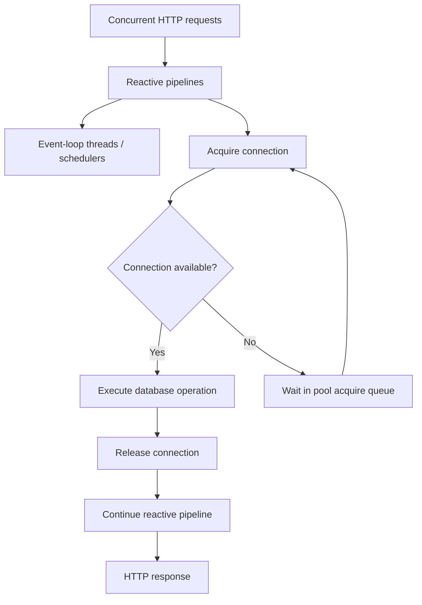

# Quan hệ giữa mức đồng thời của luồng và giới hạn pool

Trong Spring Data Relational R2DBC, số luồng (thread) đang chạy không quyết định trực tiếp số kết nối cơ sở dữ liệu mà ứng dụng có thể sử dụng. R2DBC được thiết kế cho I/O không chặn: một nhóm nhỏ event-loop thread có thể điều phối nhiều request và nhiều thao tác đang chờ dữ liệu. Connection pool lại giới hạn số kết nối database được cấp đồng thời. Hai loại giới hạn này kiểm soát hai tài nguyên khác nhau và cần được cấu hình, quan sát cùng nhau.

Khi có nhiều request cùng truy vấn database hơn số kết nối pool cho phép, các thao tác dư sẽ chờ được cấp connection. Trong ứng dụng reactive, việc chờ cấp connection có thể diễn ra không chặn: event loop vẫn xử lý sự kiện khác trong khi publisher đang chờ. Tuy nhiên, request vẫn phải đợi, hàng đợi có thể tăng và độ trễ có thể vượt timeout. Tăng số thread không tự tạo thêm connection; tăng giới hạn pool cũng không đảm bảo database có đủ năng lực xử lý số truy vấn lớn hơn.

## 1. Phân biệt các mức đồng thời

Để hiểu quan hệ giữa thread và pool, cần phân biệt ít nhất năm khái niệm:

| Khái niệm | Ý nghĩa | Tài nguyên hoặc giới hạn liên quan |
| --- | --- | --- |
| HTTP request concurrency | Số request đang được xử lý cùng thời điểm | Khả năng tiếp nhận request, bộ nhớ, giới hạn ở gateway và ứng dụng |
| Thread concurrency | Số luồng đang thực thi mã tại một thời điểm | Event loop, scheduler, CPU và thread pool |
| Reactive operation concurrency | Số publisher hoặc thao tác bất đồng bộ đang ở trạng thái in-flight | Backpressure, concurrency của toán tử, hàng đợi và bộ nhớ |
| Database operation concurrency | Số thao tác database đang thực sự được thực thi hoặc đang giữ connection | Số connection khả dụng, driver và năng lực database |
| Connection pool size | Số connection tối đa pool có thể cấp đồng thời | `max-size` của pool, cộng với các giới hạn của database và toàn hệ thống |

Các đại lượng này có liên quan nhưng không bằng nhau. Ví dụ, 500 request có thể đang tồn tại trong ứng dụng, nhưng chỉ 15 request đang sử dụng connection database tại một thời điểm. Một số request có thể đang xử lý dữ liệu trong bộ nhớ, chờ HTTP service khác hoặc chờ connection. Một event-loop thread cũng có thể điều phối nhiều request mà không dành riêng một thread cho từng request.



Sơ đồ mô tả luồng khái niệm. Pool có thể cấp connection khi có sẵn hoặc giữ yêu cầu acquire ở trạng thái chờ. Khi thao tác hoàn tất và connection được trả lại pool, một yêu cầu đang chờ có thể nhận connection đó. Với transaction, connection thường được giữ trong suốt phạm vi transaction thay vì chỉ trong một câu SQL.

## 2. Event loop không phải connection pool

Trong cấu hình WebFlux phổ biến dùng Reactor Netty, event-loop thread xử lý sự kiện mạng và điều phối callback. Khi một publisher R2DBC gửi truy vấn và chờ phản hồi, driver sử dụng cơ chế I/O không chặn để event loop không phải ngồi đợi database trả dữ liệu. Khi dữ liệu đến, driver phát tín hiệu tiếp tục pipeline.

Vì vậy, không có quy tắc một request cần một thread riêng hoặc một connection riêng được giữ từ đầu đến cuối request. Một request có thể thực hiện nhiều thao tác reactive nối tiếp, trong khi một nhóm thread nhỏ phục vụ nhiều request. Connection chỉ được sử dụng khi một thao tác cần truy cập database và được trả lại theo vòng đời của thao tác hoặc transaction.

Ví dụ, nếu pool có `max-size: 10`, ứng dụng có thể có hàng trăm request đang hoạt động. Tại một thời điểm, tối đa 10 connection thuộc pool đó được cấp đồng thời. Các request còn lại có thể đang làm việc khác hoặc chờ cấp connection. Chúng không cần chiếm 100 thread chỉ vì có 100 request.

Điều này không có nghĩa event loop có thể làm mọi việc. Nếu callback trên event loop thực hiện `block()`, JDBC, `Thread.sleep()` hoặc một phép tính CPU kéo dài, thread vẫn bị chiếm dụng. Non-blocking I/O chỉ giúp tránh giữ thread trong lúc chờ I/O được triển khai không chặn; nó không biến mã blocking hay CPU-bound thành công việc miễn phí.

## 3. Pool giới hạn số kết nối được cấp đồng thời

Connection pool duy trì và tái sử dụng một tập connection tới database. Thuộc tính `max-size` đặt giới hạn số connection pool có thể tạo/cấp đồng thời. Khi tất cả connection đều đang được sử dụng, yêu cầu acquire tiếp theo phải chờ một connection được trả lại hoặc thất bại nếu vượt giới hạn thời gian chờ.

Ví dụ cấu hình minh họa trong Spring Boot:

```yaml
spring:
  r2dbc:
    url: r2dbc:postgresql://${DB_HOST:localhost}:${DB_PORT:5432}/${DB_NAME:orders}
    username: ${DB_USERNAME:orders_app}
    password: ${DB_PASSWORD}
    pool:
      enabled: true
      initial-size: 5
      max-size: 20
      max-acquire-time: 5s
      max-idle-time: 30m
      max-life-time: 30m
```

Trong ví dụ này, pool có thể cấp tối đa 20 connection. `max-acquire-time` giới hạn thời gian chờ lấy connection theo khả năng hỗ trợ của phiên bản Spring Boot và pool đang dùng. Nếu pool đã bận và không có connection được trả lại trong thời gian này, thao tác acquire có thể phát sinh lỗi timeout. Các thuộc tính cụ thể và giá trị mặc định phụ thuộc phiên bản; cần có dependency pool R2DBC tương thích trên classpath.

Pool size không phải số thread. Connection là tài nguyên phiên làm việc với database; thread là luồng thực thi mã. Một thread có thể xử lý callback cho nhiều connection theo thời điểm khác nhau, và một connection có thể được sử dụng bởi các bước reactive chạy trên những thread khác nhau trong vòng đời của pipeline. Không nên gắn cứng connection với một thread như cách suy nghĩ về một số mô hình JDBC đồng bộ.

## 4. Điều gì xảy ra khi số thao tác vượt quá pool size?

Giả sử một ứng dụng có pool tối đa 10 connection và có 50 thao tác cùng cần database:

1. Tối đa 10 thao tác có thể nhận connection và bắt đầu sử dụng chúng cùng lúc, nếu các connection đều sẵn sàng.
2. Những thao tác còn lại gửi yêu cầu acquire và chờ connection được trả lại.
3. Khi một thao tác hoàn tất, connection được trả về pool; một thao tác đang chờ có thể tiếp tục.
4. Nếu thời gian chờ vượt `max-acquire-time`, thao tác chờ có thể thất bại do timeout.
5. Nếu các thao tác giữ connection lâu hoặc database phản hồi chậm, hàng đợi acquire tăng và độ trễ của request tăng theo.

Đối với ứng dụng reactive, việc chờ acquire thường được biểu diễn bằng publisher và không nhất thiết giữ event-loop thread. Tuy nhiên, chờ không chặn vẫn là chờ: request chưa thể hoàn tất phần công việc phụ thuộc database, bộ nhớ cho trạng thái request vẫn được sử dụng và timeout ở các tầng khác vẫn có thể xảy ra.

Một pool nhỏ không tự động là lỗi. Nếu lưu lượng thấp và truy vấn ngắn, pool nhỏ có thể đủ và giúp giới hạn tải database. Vấn đề xuất hiện khi lưu lượng đến vượt khả năng xử lý trong thời gian dài, hoặc khi connection bị giữ lâu khiến hàng đợi liên tục tăng.

## 5. Mối quan hệ giữa `flatMap` concurrency và pool size

Reactor cho phép giới hạn số publisher con đang được subscribe đồng thời bằng tham số concurrency của `flatMap`. Đây là cách kiểm soát số thao tác nghiệp vụ được khởi chạy cùng lúc ở một đoạn pipeline.

```java
public Flux<Customer> loadCustomers(List<Long> ids) {
    return Flux.fromIterable(ids)
            .flatMap(customerRepository::findById, 8);
}
```

Tham số `8` giới hạn số publisher `findById` đang được xử lý đồng thời bởi đoạn `flatMap` này. Nếu mỗi publisher chỉ thực hiện một truy vấn đơn giản, con số đó có thể giúp điều tiết lượng yêu cầu database được phát ra cùng lúc. Khi pool có 10 connection, concurrency 8 để lại một phần dung lượng cho các thao tác khác trong cùng ứng dụng.

Tuy nhiên, `flatMap` concurrency không phải giới hạn connection chính thức. Một publisher có thể không cần database, có thể thực hiện nhiều truy vấn nối tiếp hoặc có thể giữ transaction qua nhiều bước. Nhiều pipeline khác cũng có thể cùng sử dụng pool. Vì vậy, concurrency 8 ở một `flatMap` không đảm bảo toàn ứng dụng chỉ dùng tối đa 8 connection.

Nếu muốn thực hiện tuần tự, có thể dùng `concatMap`:

```java
public Flux<Customer> loadCustomersSequentially(List<Long> ids) {
    return Flux.fromIterable(ids)
            .concatMap(customerRepository::findById);
}
```

`concatMap` chỉ xử lý publisher con theo thứ tự, không chạy đồng thời nhiều publisher con từ nguồn đó. Cách này giảm áp lực đồng thời lên pool nhưng có thể làm giảm thông lượng nếu các truy vấn độc lập và database còn khả năng xử lý thêm.

Một lựa chọn khác là `flatMapSequential`, cho phép thực hiện các publisher con đồng thời nhưng phát kết quả theo thứ tự nguồn. Nó có thể cần giữ kết quả đã hoàn tất trong bộ nhớ khi phải chờ phần tử trước đó. Chọn toán tử theo yêu cầu về thứ tự, concurrency và bộ nhớ, không chỉ theo kích thước pool.

## 6. Vì sao tăng số thread không giải quyết được pool bị đầy?

Giả sử pool tối đa 10 connection đã bận. Nếu tăng event-loop thread hoặc tạo thêm scheduler thread, số connection vẫn là 10. Các thao tác mới vẫn phải chờ pool cấp connection. Tăng thread có thể làm ứng dụng tiếp nhận hoặc tạo thêm nhiều công việc đồng thời hơn, khiến hàng đợi acquire lớn hơn mà không tăng tốc độ database.

Điều này đặc biệt dễ gây hiểu nhầm khi chuyển từ JDBC sang R2DBC. Với JDBC đồng bộ, một luồng có thể bị giữ trong lúc chờ connection hoặc kết quả truy vấn. Với R2DBC, một thread không phải chờ theo cùng cách, nhưng giới hạn connection và năng lực database vẫn còn nguyên. Non-blocking giúp sử dụng thread hiệu quả hơn; nó không xóa giới hạn của database.

Ngược lại, tăng `max-size` cũng không giải quyết được mọi vấn đề về thread. Nếu event loop bị chặn bởi JDBC, `block()` hoặc xử lý CPU dài, thêm connection chỉ có thể tăng số truy vấn cạnh tranh trong khi thread xử lý sự kiện vẫn bị nghẽn. Cần xác định đúng tài nguyên đang bão hòa trước khi điều chỉnh.

## 7. Connection được giữ trong bao lâu?

Thời gian giữ connection ảnh hưởng trực tiếp tới số connection đồng thời cần thiết. Một truy vấn đơn lẻ thường acquire connection để thực thi rồi trả connection khi hoàn tất. Với transaction reactive, connection thường gắn với transaction context và được giữ cho tới khi transaction commit hoặc rollback.

Ví dụ:

```java
public Mono<Order> createOrder(Order order) {
    return transactionalOperator.transactional(
            orderRepository.save(order)
                    .flatMap(saved -> auditRepository.save(AuditEntry.forOrder(saved))
                            .thenReturn(saved))
    );
}
```

Hai thao tác lưu được thực hiện trong cùng transaction. Connection tham gia transaction có thể được giữ trong cả thời gian thực hiện các bước của transaction. Nếu giữa hai thao tác ứng dụng gọi một dịch vụ HTTP chậm, transaction có thể tiếp tục giữ connection trong lúc chờ dịch vụ đó. Điều này làm giảm số connection sẵn sàng cho request khác.

Vì vậy, transaction nên có phạm vi vừa đủ và không bao gồm các bước chờ hệ thống ngoài nếu không cần thiết. Không gọi `block()` hoặc tự `subscribe()` giữa transaction vì có thể tách thao tác khỏi transaction context và vòng đời do Spring quản lý.

## 8. Ước lượng mức sử dụng connection

Một cách hữu ích để suy nghĩ về nhu cầu connection là định luật Little:

\[
L = \lambda \times W
\]

Trong đó:

- `L` là số thao tác trung bình đang ở trong hệ thống hoặc đang được phục vụ trong phạm vi đo.
- `λ` là tốc độ thao tác đến, ví dụ số thao tác database mỗi giây.
- `W` là thời gian trung bình một thao tác chiếm tài nguyên được đo, tính bằng giây.

Nếu một ứng dụng phát sinh trung bình 100 thao tác database mỗi giây và mỗi thao tác giữ connection trung bình 0,05 giây, số connection đang được sử dụng trung bình theo mô hình đơn giản là:

\[
L = 100 \times 0.05 = 5
\]

Con số 5 là mức trung bình lý thuyết trong điều kiện ổn định, không phải khuyến nghị đặt `max-size` bằng 5. Lưu lượng thường có burst, thời gian truy vấn biến động, transaction có thể giữ connection lâu và các request khác cũng dùng chung pool. Cần có headroom cho đỉnh tải và đo thực tế dưới workload đại diện.

Thời gian `W` phải là thời gian connection thực sự bị chiếm, không nhất thiết là toàn bộ thời gian HTTP request. Nếu một request mất 500 ms nhưng chỉ giữ connection 30 ms, nhu cầu connection khác đáng kể so với trường hợp request giữ connection suốt 500 ms trong transaction.

## 9. Tính giới hạn pool trên nhiều instance

`max-size` thường áp dụng cho một pool trong một instance ứng dụng. Nếu triển khai nhiều instance, tổng số connection tiềm năng tới database là tổng giới hạn của tất cả pool cùng các client khác.

Ví dụ, bốn instance ứng dụng, mỗi instance có `max-size: 20`, có thể sử dụng tối đa khoảng:

\[
4 \times 20 = 80 \text{ connections}
\]

Database còn có thể cần connection cho migration, công cụ quản trị, job nền, dịch vụ khác, monitoring hoặc replica/worker tùy kiến trúc. Vì vậy, không thể chỉ nhìn `max-size` của một instance để kết luận tổng kết nối toàn hệ thống.

Một cách lập ngân sách đơn giản:

1. Xác định giới hạn connection của database và số connection cần dành cho quản trị, migration cùng các dịch vụ khác.
2. Xác định số instance ứng dụng tối đa có thể chạy khi autoscaling hoặc rolling deployment. Trong lúc rollout, số instance có thể tạm thời cao hơn số replica bình thường.
3. Tính phần ngân sách còn lại cho ứng dụng và chia theo số instance tối đa.
4. Đặt `max-size` sao cho tổng giới hạn của tất cả instance vẫn nằm trong ngân sách, đồng thời kiểm tra database có đủ CPU, I/O và năng lực xử lý truy vấn.
5. Kiểm tra lại bằng tải thử và metric thực tế; ngân sách connection chỉ là giới hạn an toàn, không phải mục tiêu phải sử dụng hết.

Ví dụ minh họa: nếu database cho phép tối đa 150 connection và hệ thống dành 30 connection cho các tác vụ khác, phần ngân sách còn lại cho dịch vụ ứng dụng là 120. Nếu có thể chạy tối đa 6 instance, giới hạn bình quân không nên vượt 20 connection mỗi instance theo phép chia đơn giản. Cần tính thêm giai đoạn rolling deployment và các pool khác trước khi chọn giá trị cuối cùng.

## 10. Tại sao không nên đặt pool càng lớn càng tốt?

Mỗi connection đang hoạt động tiêu thụ tài nguyên ở database: bộ nhớ, trạng thái phiên, khả năng lập lịch, khóa và năng lực thực thi truy vấn. Tăng connection có thể giúp nhiều thao tác chạy đồng thời khi database còn dư năng lực. Nhưng sau một điểm, nhiều truy vấn đồng thời hơn có thể làm tăng tranh chấp CPU, I/O, lock và bộ nhớ, khiến từng truy vấn chậm hơn.

Khi truy vấn chậm hơn, connection bị giữ lâu hơn. Điều này làm số connection đang bận tăng, hàng đợi acquire dài hơn và độ trễ tăng. Pool lớn có thể đẩy nhiều công việc vào database đang quá tải, làm tình trạng xấu đi. Mục tiêu là tìm mức concurrency mà database xử lý hiệu quả, không phải làm cho pool luôn có thể cấp connection cho mọi request cùng lúc.

Pool quá nhỏ cũng có chi phí: nếu database còn dư năng lực nhưng tất cả thao tác phải xếp hàng vì pool quá thấp, throughput bị giới hạn không cần thiết. Việc chọn kích thước phù hợp là bài toán cân bằng giữa thời gian giữ connection, lưu lượng, năng lực database và số instance.

## 11. Phân biệt pool saturation với thread starvation

Hai vấn đề này có thể cùng xuất hiện nhưng dấu hiệu khác nhau:

| Dấu hiệu | Pool saturation | Thread starvation hoặc event-loop blocking |
| --- | --- | --- |
| Connection đang active | Thường chạm gần `max-size` | Có thể thấp hoặc cao, tùy nguyên nhân |
| Pending acquire | Thường tăng khi thao tác cần database phải chờ connection | Không nhất thiết tăng |
| Event-loop thread | Có thể vẫn hoạt động và xử lý request khác | Có thể bị giữ trong lời gọi blocking hoặc CPU dài |
| Thread dump | Không nhất thiết có event loop bị kẹt | Có thể thấy `block()`, JDBC, `Thread.sleep()` hoặc mã đồng bộ kéo dài trên event loop |
| Hướng điều tra | Thời gian giữ connection, truy vấn, pool size và năng lực database | Thread dump, blocking call, scheduler và thời gian xử lý CPU |

Nếu pool có nhiều connection idle nhưng request vẫn chậm, nguyên nhân có thể nằm ở thread, network, lock, truy vấn hoặc một dịch vụ phụ thuộc khác. Nếu pool active luôn chạm giới hạn và pending acquire tăng, cần xem thời gian giữ connection, truy vấn và tải database trước khi tăng pool.

## 12. Theo dõi các chỉ số quan trọng

Khi vận hành ứng dụng Spring Data R2DBC, nên quan sát cả pool, database và runtime:

| Chỉ số | Điều cần tìm hiểu |
| --- | --- |
| Active connections | Có bao nhiêu connection đang được pool cấp? Có thường xuyên chạm `max-size` không? |
| Idle connections | Pool có connection rảnh để phục vụ request mới không? |
| Pending acquire | Có bao nhiêu yêu cầu đang chờ connection? Hàng đợi có tăng liên tục không? |
| Acquire latency và timeout | Mất bao lâu để lấy connection? Có lỗi vượt `max-acquire-time` không? |
| Connection creation và validation | Tạo connection mới có lỗi hoặc chậm không? Connection bị loại bỏ quá thường xuyên không? |
| Query latency | Truy vấn nào giữ connection lâu? Độ trễ p95/p99 thay đổi ra sao? |
| Database CPU, I/O và lock waits | Database còn dư năng lực hay đã bão hòa? Có truy vấn chờ khóa không? |
| Event-loop và scheduler metrics | Có thread bị chặn, hàng đợi scheduler tăng hoặc CPU bị sử dụng quá mức không? |

Nếu dùng Micrometer và Spring Boot Actuator, các metric có sẵn phụ thuộc phiên bản, thư viện pool và cách bind metric. Hãy kiểm tra tên metric thực tế được xuất ra thay vì giả định mọi phiên bản có cùng tên. Có thể kết hợp dashboard pool với metric database và tracing để biết request nào giữ connection lâu.

## 13. Điều tiết tải ở tầng reactive

Pool là lớp bảo vệ cuối cho số connection, nhưng ứng dụng cũng nên kiểm soát concurrency trước khi công việc dồn vào hàng đợi acquire.

Ví dụ giới hạn xử lý theo lô:

```java
public Flux<OrderSummary> summarizeOrders(Flux<Long> orderIds) {
    return orderIds
            .flatMap(orderId -> orderRepository.findById(orderId)
                    .map(OrderSummary::from), 12);
}
```

Ở đây, tối đa 12 publisher con từ đoạn `flatMap` được xử lý đồng thời. Giá trị nên được lựa chọn theo pool dùng chung, số truy vấn trong mỗi publisher và mức tải của database. Nếu các publisher khác cũng truy cập cùng pool, cần tính tổng concurrency của chúng.

Đối với luồng đầu vào rất lớn, có thể kết hợp giới hạn batch, phân trang hoặc backpressure để không tạo quá nhiều công việc cùng lúc. Không nên đọc hàng triệu ID thành một danh sách trong bộ nhớ rồi tạo publisher cho tất cả nếu không cần thiết.

Nếu cần giới hạn số request đi vào ứng dụng, có thể dùng giới hạn concurrency ở gateway, bulkhead hoặc cơ chế admission control. Giới hạn ở tầng request giúp tránh tạo quá nhiều pipeline và trạng thái chờ. Pool `max-size` vẫn cần được cấu hình như hàng rào bảo vệ cho database.

## 14. Timeout và retry khi pool bão hòa

Timeout acquire giúp một request không chờ connection vô hạn. Tuy nhiên, timeout quá ngắn có thể làm request thất bại trong các đợt tải tăng ngắn; timeout quá dài có thể giữ nhiều request chờ, tiêu thụ bộ nhớ và làm độ trễ dây chuyền.

Retry cũng cần được kiểm soát. Nếu nhiều request timeout rồi cùng retry ngay lập tức, lượng yêu cầu mới có thể tăng đột biến đúng lúc database đang quá tải. Điều này tạo retry storm và kéo dài thời gian phục hồi. Nếu cần retry, hãy giới hạn số lần, dùng backoff có jitter, chỉ retry lỗi tạm thời phù hợp và cân nhắc idempotency của thao tác ghi.

Timeout ở các tầng cần được phối hợp: thời gian chờ acquire, timeout truy vấn, timeout transaction, timeout HTTP client và deadline của request. Tổng thời gian chờ không nên vượt deadline mà client hoặc gateway cho phép.

## 15. Nhiều pool hoặc nhiều database

Một ứng dụng có thể kết nối nhiều database hoặc tạo nhiều `ConnectionFactory`. Khi đó, mỗi pool có giới hạn riêng. Cần tính tổng số connection theo từng database và từng pool, bao gồm pool dành cho read/write nếu hệ thống tách chúng.

Nếu một service dùng hai pool tới cùng một database, hai giá trị `max-size` cộng lại mới thể hiện giới hạn tiềm năng từ service đó. Nếu pool đọc và pool ghi trỏ tới hai máy chủ khác nhau, cần lập ngân sách riêng cho từng máy chủ. Một pool bị đầy không nhất thiết làm pool khác đầy, nhưng các thao tác nghiệp vụ kết hợp cả hai có thể bị chậm ở pool bão hòa.

Trong transaction, cần bảo đảm các thao tác tham gia đúng transaction manager và connection factory. Không nên giả định một transaction R2DBC đơn giản tự động bao phủ nhiều database hoặc nhiều connection factory độc lập.

## 16. Quy trình điều chỉnh pool và concurrency

Khi cần tăng khả năng xử lý, có thể thực hiện theo trình tự sau:

1. **Đo workload:** xác định request rate, số thao tác database mỗi request, thời gian truy vấn và thời gian giữ connection, bao gồm transaction.
2. **Xác định giới hạn toàn hệ thống:** tính số instance tối đa, `max-size` của mọi pool và ngân sách connection mà database cho phép.
3. **Quan sát trạng thái pool:** kiểm tra active, idle, pending acquire, acquire latency và timeout trong thời điểm tải cao.
4. **Kiểm tra database:** tìm truy vấn chậm, lock wait, CPU hoặc I/O bão hòa. Tối ưu truy vấn và index nếu đó là nút thắt.
5. **Điều tiết concurrency:** giới hạn `flatMap`, batch hoặc request admission để không tạo lượng công việc vượt khả năng phục vụ.
6. **Điều chỉnh pool từng bước:** thay đổi `max-size` trong phạm vi ngân sách toàn hệ thống, sau đó chạy lại tải thử để so sánh throughput, latency và database resource.
7. **Điều chỉnh timeout:** chọn thời gian acquire phù hợp với deadline request và chính sách lỗi; theo dõi timeout sau mỗi thay đổi.
8. **Kiểm tra khi scale và rollout:** bảo đảm tổng connection vẫn an toàn khi tăng replica hoặc chạy đồng thời phiên bản cũ và mới.

Không nên thay đổi đồng thời nhiều giới hạn mà không có số đo trước và sau. Nếu tăng pool làm throughput không tăng nhưng database CPU, lock wait hoặc latency tăng, có thể database đã đạt điểm bão hòa và cần giảm concurrency hoặc tối ưu truy vấn.

## 17. Các hiểu lầm thường gặp

### Một request reactive luôn cần một thread và một connection

Không đúng. Request có thể đi qua nhiều bước reactive trên một số thread khác nhau; connection chỉ được sử dụng khi cần database và có vòng đời riêng. Trong transaction, connection có thể được giữ lâu hơn một thao tác đơn lẻ.

### Tăng event-loop thread sẽ tăng số connection

Không đúng. Thread và connection là hai tài nguyên khác nhau. Pool vẫn giới hạn số connection theo `max-size`.

### R2DBC không chặn nên không cần connection pool

Không đúng. R2DBC giảm nhu cầu giữ thread trong lúc chờ I/O, nhưng database vẫn có giới hạn connection, CPU, I/O và khả năng thực thi truy vấn. Pool giúp tái sử dụng và kiểm soát số kết nối.

### Pool size phải bằng số event-loop thread

Không có quy tắc như vậy. Số connection phù hợp phụ thuộc thời gian giữ connection, tốc độ truy vấn, lưu lượng, transaction và năng lực database, không phải số event-loop thread.

### Pool càng lớn thì throughput càng cao

Không đúng trong mọi trường hợp. Sau điểm bão hòa, tăng connection có thể làm database tranh chấp nhiều hơn và truy vấn chậm hơn. Pool lớn còn nhân lên theo số instance.

### Mỗi `flatMap` concurrency tương ứng một connection

Không chính xác. Concurrency giới hạn publisher con trong một đoạn pipeline. Mỗi publisher có thể dùng không connection, một connection trong một khoảng thời gian hoặc nhiều thao tác nối tiếp; các pipeline khác cũng dùng chung pool.

## 18. Nguyên tắc thực hành

- Phân biệt request concurrency, thread concurrency, reactive operation concurrency và số connection đang được cấp.
- Dùng pool `max-size` để giới hạn connection, không dùng số thread để suy ra pool size.
- Hiểu rằng thao tác chờ acquire trong reactive có thể không giữ event-loop thread, nhưng vẫn làm request chờ và tiêu thụ trạng thái/bộ nhớ.
- Giữ transaction ngắn và tránh chờ dịch vụ ngoài trong lúc connection đang bị giữ nếu không cần thiết.
- Dùng concurrency của `flatMap`, batch, phân trang hoặc admission control để điều tiết tải ở tầng ứng dụng.
- Tính tổng connection trên tất cả instance và tất cả pool, kể cả giai đoạn autoscaling và rolling deployment.
- Chọn pool size theo thời gian giữ connection, throughput, năng lực database và ngân sách kết nối; không đặt bằng số thread theo cảm tính.
- Theo dõi active, idle, pending acquire, acquire latency, query latency và metric database.
- Chỉ tăng pool khi database còn khả năng xử lý thêm; nếu database đã bão hòa, ưu tiên tối ưu truy vấn hoặc giảm concurrency.
- Phối hợp timeout và retry để tránh hàng đợi kéo dài và retry storm.

## 19. Kết luận

Mức đồng thời của thread và giới hạn connection pool kiểm soát hai phần khác nhau của ứng dụng. R2DBC cho phép một nhóm thread nhỏ điều phối nhiều pipeline và request trong khi I/O database đang chờ. Connection pool giới hạn số phiên kết nối được cấp đồng thời; các thao tác vượt giới hạn phải chờ hoặc timeout. Vì vậy, ứng dụng reactive có thể có nhiều request hơn pool size mà vẫn không cần một thread riêng cho từng request, nhưng thông lượng database vẫn bị giới hạn bởi số connection và năng lực máy chủ.

Kích thước pool nên được xác định từ thời gian giữ connection, tốc độ thao tác, transaction, số instance và ngân sách kết nối của database. Kết hợp giới hạn concurrency ở tầng reactive với metric pool và metric database sẽ giúp hệ thống duy trì tải ổn định, tránh cả việc để pool quá nhỏ lẫn việc đẩy quá nhiều kết nối vào database.
