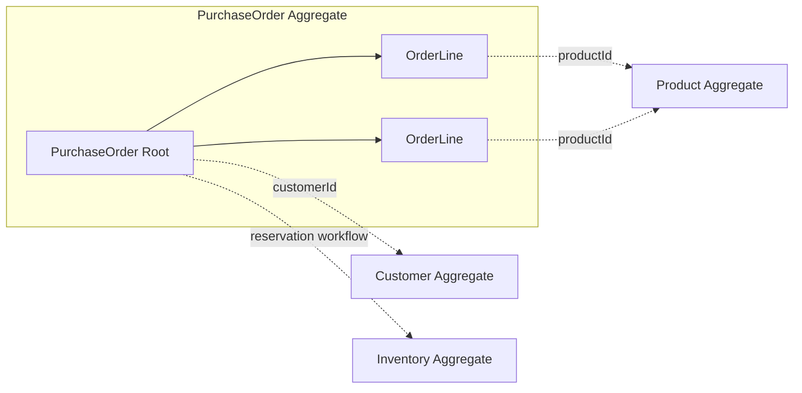

# Chọn ranh giới aggregate và trách nhiệm của dịch vụ ứng dụng

## 1. Aggregate trong mô hình dữ liệu là gì?

Trong Domain-Driven Design (DDD), **aggregate** là một nhóm đối tượng domain được xem như một đơn vị nhất quán. Nhóm này có một đối tượng gốc gọi là **aggregate root**. Các thao tác bên ngoài đi qua aggregate root để thay đổi trạng thái của nhóm và bảo vệ các quy tắc nghiệp vụ của nó.

Aggregate giúp trả lời ba câu hỏi thiết kế quan trọng:

- Những đối tượng nào phải được thay đổi cùng nhau để một quy tắc nghiệp vụ luôn đúng?
- Đối tượng nào chịu trách nhiệm kiểm soát những thay đổi đó?
- Đâu là ranh giới của một đơn vị cập nhật và nhất quán dữ liệu?

Ví dụ, một đơn hàng có thể gồm thông tin đơn hàng và nhiều dòng hàng. Quy tắc như “không thể xác nhận đơn hàng rỗng” cần được bảo vệ cùng với trạng thái và danh sách dòng hàng. Khi đó `PurchaseOrder` có thể là aggregate root, còn `OrderLine` là đối tượng thuộc aggregate của đơn hàng.

Ngược lại, `Customer`, `Product` và `Inventory` thường có vòng đời và quy tắc thay đổi độc lập. Một đơn hàng không nhất thiết phải chứa toàn bộ object `Customer`, `Product` hoặc `Inventory` bên trong aggregate của nó. Đơn hàng có thể giữ ID của các aggregate đó và phối hợp với chúng qua dịch vụ ứng dụng.

Aggregate không đơn thuần là một nhóm bảng có khóa ngoại. Đây là ranh giới mô hình domain và ranh giới nhất quán nghiệp vụ. Cấu trúc bảng có thể hỗ trợ aggregate, nhưng không tự quyết định aggregate nên được thiết kế thế nào.

## 2. Aggregate root và trách nhiệm bảo vệ invariant

**Invariant** là quy tắc phải luôn đúng đối với trạng thái của domain. Aggregate root chịu trách nhiệm bảo vệ invariant của aggregate bằng cách kiểm soát các thao tác thay đổi trạng thái.

Giả sử đơn hàng có các quy tắc:

- Chỉ đơn hàng đang ở trạng thái `DRAFT` mới được thêm hoặc bỏ dòng hàng.
- Số lượng mỗi dòng hàng phải lớn hơn 0.
- Đơn hàng phải có ít nhất một dòng hàng mới được xác nhận.
- Một đơn hàng đã xác nhận không thể quay lại trạng thái nháp bằng thao tác chỉnh sửa thông thường.

Nếu service hoặc controller có thể sửa trực tiếp danh sách dòng hàng và trạng thái, các quy tắc trên dễ bị bỏ qua. Thay vào đó, aggregate root cung cấp phương thức nghiệp vụ để kiểm soát mọi thay đổi.

Ví dụ minh họa:

```java
public class PurchaseOrder {

    private Long id;
    private OrderStatus status;
    private final List<OrderLine> lines = new ArrayList<>();

    public void addLine(Long productId, int quantity, BigDecimal unitPrice) {
        if (status != OrderStatus.DRAFT) {
            throw new IllegalStateException("Only draft orders can be changed");
        }
        if (quantity <= 0) {
            throw new IllegalArgumentException("Quantity must be positive");
        }
        if (unitPrice == null || unitPrice.signum() < 0) {
            throw new IllegalArgumentException("Unit price must not be negative");
        }

        lines.add(new OrderLine(productId, quantity, unitPrice));
    }

    public void confirm() {
        if (status != OrderStatus.DRAFT) {
            throw new IllegalStateException("Order is not a draft");
        }
        if (lines.isEmpty()) {
            throw new IllegalStateException("An empty order cannot be confirmed");
        }

        status = OrderStatus.CONFIRMED;
    }
}
```

Đây là ví dụ rút gọn; trong ứng dụng thực tế cần định nghĩa constructor, kiểu ID, getter, mapping và exception domain phù hợp. Ý chính là `addLine` và `confirm` đặt quy tắc tại nơi có đủ thông tin để bảo vệ trạng thái đơn hàng.

Controller có thể gọi service ứng dụng, nhưng không nên tự kiểm tra rồi sửa từng field của aggregate. Nếu nhiều luồng gọi khác nhau cùng thực hiện một nghiệp vụ, việc đặt quy tắc trong aggregate root giúp chúng dùng chung một cách bảo vệ invariant.

## 3. Cách chọn ranh giới aggregate

Không nên gom mọi object có liên quan vào một aggregate lớn. Ranh giới nên được chọn dựa trên quy tắc nghiệp vụ và tính nhất quán cần có, thay vì dựa trên việc các bảng có quan hệ với nhau.

### 3.1. Gom các đối tượng phải thay đổi cùng nhau

Nếu một thao tác nghiệp vụ phải cập nhật nhiều object để giữ một invariant và không thể chấp nhận trạng thái trung gian, các object đó thường thuộc cùng aggregate.

Ví dụ, `PurchaseOrder` và `OrderLine` có thể cùng aggregate nếu dòng hàng không có vòng đời độc lập, chỉ tồn tại trong đơn hàng và phải được thêm/bỏ theo quy tắc của đơn hàng. Khi xác nhận đơn hàng, root có thể kiểm tra toàn bộ dòng hàng trước khi đổi trạng thái.

### 3.2. Tách đối tượng có vòng đời độc lập

Nếu một đối tượng có thể được tạo, cập nhật, tìm kiếm hoặc xóa độc lập theo nghiệp vụ, nó thường phù hợp với aggregate riêng.

Ví dụ:

- `Customer` có thể thay đổi địa chỉ và thông tin liên hệ mà không cần tải tất cả đơn hàng.
- `Product` có thể đổi tên hoặc mô tả mà không cần cập nhật mọi đơn hàng cũ.
- `Inventory` có thể được cập nhật bởi quy trình nhập hàng, bán hàng và điều chỉnh kho.
- `PurchaseOrder` có trạng thái và vòng đời riêng từ nháp tới xác nhận, giao hàng hoặc hủy.

Những aggregate này có thể liên quan trong cùng một use case, nhưng không vì thế mà phải trở thành một aggregate duy nhất.

### 3.3. Xem xét tải dữ liệu và mức đồng thời

Khi tải một aggregate, ứng dụng cần lấy dữ liệu đủ để thực hiện hành vi nghiệp vụ. Nếu aggregate quá lớn, mỗi thao tác có thể phải đọc nhiều dữ liệu không liên quan, giữ connection lâu và tạo nhiều xung đột cập nhật.

Một aggregate có hàng chục nghìn dòng con thường là dấu hiệu cần xem lại ranh giới. Có thể một số dữ liệu nên trở thành aggregate riêng, một phần chỉ nên được truy vấn theo nhu cầu, hoặc quy trình cần xử lý theo batch.

Ranh giới nhỏ hơn có thể giảm phạm vi cập nhật và xung đột, nhưng làm tăng nhu cầu phối hợp giữa các aggregate. Thiết kế cần cân bằng tính nhất quán tức thời với độ phức tạp của quy trình phân tán.

### 3.4. Một aggregate có một root truy cập từ bên ngoài

Các đối tượng nằm bên trong aggregate được thay đổi thông qua root. Nếu `OrderLine` thuộc aggregate `PurchaseOrder`, các thành phần bên ngoài không nên tự tìm và sửa một dòng hàng như một thực thể độc lập. Chúng yêu cầu `PurchaseOrder` thực hiện thao tác phù hợp.

Nếu một dòng hàng cần được sửa độc lập, có trạng thái riêng, được nhiều aggregate tham chiếu trực tiếp hoặc có vòng đời riêng, hãy đánh giá xem nó có thực sự là một aggregate độc lập hay không. Khi tách ra, cần xác định rõ quy tắc nhất quán mới.

## 4. Ví dụ mô hình đơn hàng

Một mô hình bán hàng có thể chia thành các aggregate như sau:



Trong ví dụ:

- `PurchaseOrder` là root của đơn hàng.
- `OrderLine` thuộc đơn hàng và không có vòng đời độc lập.
- `Customer`, `Product` và `Inventory` là các aggregate riêng.
- Đơn hàng lưu `customerId` và mỗi dòng hàng lưu `productId` thay vì giữ object graph đầy đủ của các aggregate khác.

Khi khách hàng đổi địa chỉ, không cần tải và lưu mọi đơn hàng của họ. Khi sản phẩm đổi tên, các đơn hàng cũ vẫn giữ snapshot thông tin cần thiết tại thời điểm đặt hàng, nếu nghiệp vụ yêu cầu. Khi cần kiểm tra tồn kho, dịch vụ ứng dụng gọi use case của aggregate tồn kho hoặc một dịch vụ tương ứng.

Đối với đơn hàng, có thể lưu snapshot như tên sản phẩm, đơn giá và thuế tại thời điểm đặt. Snapshot này là dữ liệu lịch sử thuộc đơn hàng, khác với việc nhúng toàn bộ aggregate `Product` vào `PurchaseOrder`. Việc chọn snapshot nào phụ thuộc yêu cầu hóa đơn, kiểm toán và cách tính lại đơn hàng.

## 5. Tham chiếu giữa các aggregate

Một aggregate thường tham chiếu aggregate khác bằng định danh. Cách này giữ ranh giới rõ ràng và tránh vô tình mở rộng phạm vi tải, sửa hoặc lưu.

Ví dụ:

```java
public class PurchaseOrder {
    private Long id;
    private Long customerId;
    private OrderStatus status;
    private List<OrderLine> lines;
}

public class OrderLine {
    private Long productId;
    private int quantity;
    private BigDecimal unitPrice;
}
```

`PurchaseOrder` giữ `customerId`, còn `OrderLine` giữ `productId`. Khi cần tên khách hàng để hiển thị, ứng dụng có thể truy vấn `Customer` theo ID hoặc dùng projection/read model phù hợp. Khi cần giá hiện tại của sản phẩm, ứng dụng truy vấn `Product` hoặc gọi dịch vụ định giá theo quy tắc nghiệp vụ.

Tham chiếu bằng ID không có nghĩa không được dùng JOIN trong mọi truy vấn. Một truy vấn đọc có thể JOIN nhiều bảng để tạo màn hình hoặc báo cáo. Điều cần tránh là biến một aggregate thành object graph có quyền cập nhật tùy tiện các aggregate khác. Mô hình ghi và mô hình đọc có thể có cách truy xuất khác nhau.

### 5.1. Không giữ bản sao mutable của aggregate khác

Nếu `PurchaseOrder` giữ toàn bộ object `Customer` có thể sửa được, một thao tác cập nhật đơn hàng có nguy cơ vô tình thay đổi thông tin khách hàng hoặc lưu lại trạng thái khách hàng đã cũ. Giữ ID và dữ liệu snapshot cần thiết giúp phân biệt rõ:

- Thông tin tham chiếu tới aggregate khác, ví dụ `customerId`.
- Dữ liệu lịch sử thuộc aggregate hiện tại, ví dụ `customerNameAtPurchase` nếu cần lưu trên đơn hàng.
- Dữ liệu hiện tại cần truy vấn từ aggregate khác khi hiển thị hoặc xử lý.

### 5.2. Xử lý khi aggregate được tham chiếu không tồn tại

ID là tham chiếu logic; database có thể có hoặc không có foreign key tùy thiết kế. Khi tạo đơn hàng với `customerId`, use case cần xác định cách kiểm tra khách hàng tồn tại và có đủ điều kiện đặt hàng hay không.

Nếu việc kiểm tra và tạo đơn hàng cần nhất quán tức thời trong cùng database, có thể thực hiện chúng trong một transaction phù hợp. Nếu các aggregate nằm ở service hoặc database khác nhau, không thể dựa vào một transaction R2DBC cục bộ để bảo đảm tính nguyên tử xuyên hệ thống; cần quy trình phối hợp và xử lý tình huống tham chiếu bị thay đổi sau khi kiểm tra.

## 6. Aggregate và repository trong Spring Data R2DBC

Trong Spring Data Relational, repository thường được định nghĩa cho aggregate root. Repository cung cấp cách tải và lưu root; các object thuộc aggregate được ánh xạ theo metadata quan hệ.

Ví dụ khai báo rút gọn:

```java
@Table("purchase_order")
public class PurchaseOrder {

    @Id
    private Long id;

    @Version
    private Long version;

    private Long customerId;

    private OrderStatus status;

    @MappedCollection(idColumn = "order_id")
    private List<OrderLine> lines = new ArrayList<>();

    // Domain methods and constructors
}
```

```java
public interface PurchaseOrderRepository
        extends ReactiveCrudRepository<PurchaseOrder, Long> {
}
```

`@Table` ánh xạ root tới bảng `purchase_order`; `@Id` đánh dấu định danh; `@Version` hỗ trợ optimistic locking khi được mapping và database hỗ trợ; `@MappedCollection` mô tả collection các object thuộc aggregate theo mapping quan hệ của Spring Data Relational.

Trong mô hình này, `OrderLine` được lưu như thành phần của `PurchaseOrder`. Thông thường, ứng dụng chỉ cần `PurchaseOrderRepository` để thao tác với aggregate đơn hàng; không tạo `OrderLineRepository` nếu dòng hàng không có vòng đời độc lập.

Spring Data Relational có quy tắc riêng cho cách lưu aggregate, bao gồm việc xử lý các object được ánh xạ qua `@MappedCollection`. Câu lệnh SQL cụ thể và cách insert/update/delete các hàng con phụ thuộc phiên bản, mapping và thao tác được gọi. Cần kiểm tra schema, SQL và hành vi của phiên bản Spring Data R2DBC đang dùng, đặc biệt khi collection lớn hoặc có yêu cầu hiệu năng đặc biệt.

Một repository khác có thể được định nghĩa cho `Product` hoặc `Customer` nếu đó là aggregate root riêng:

```java
public interface ProductRepository
        extends ReactiveCrudRepository<Product, Long> {
}

public interface CustomerRepository
        extends ReactiveCrudRepository<Customer, Long> {
}
```

Việc có nhiều repository không đồng nghĩa mọi use case phải gọi tất cả chúng. Dịch vụ ứng dụng chỉ phối hợp các aggregate cần thiết cho một hành động nghiệp vụ cụ thể.

## 7. Trách nhiệm của dịch vụ ứng dụng

**Application service** (dịch vụ ứng dụng) thực hiện một use case của hệ thống. Nó điều phối các bước cần thiết để hoàn thành hành động, nhưng không nên trở thành nơi chứa toàn bộ quy tắc nội tại của domain.

Các trách nhiệm thường thuộc application service:

- Nhận command hoặc dữ liệu đầu vào của use case.
- Xác định aggregate/repository cần dùng.
- Tải aggregate root cần thiết.
- Gọi phương thức domain để thực hiện thay đổi hợp lệ.
- Điều phối nhiều aggregate hoặc dịch vụ bên ngoài khi use case cần.
- Xác định ranh giới transaction ở tầng ứng dụng.
- Lưu aggregate và phát hành hoặc chuyển tiếp sự kiện theo quy trình.
- Chuyển kết quả domain thành kiểu kết quả phù hợp với tầng gọi.

Application service thường không nên tự viết lại invariant như “đơn hàng đã xác nhận thì không thể thêm dòng hàng”. Quy tắc đó thuộc `PurchaseOrder`. Service gọi `order.addLine(...)` và để aggregate tự bảo vệ trạng thái.

### 7.1. Ví dụ service chỉ điều phối một aggregate

```java
@Service
public class OrderApplicationService {

    private final PurchaseOrderRepository orderRepository;

    public OrderApplicationService(PurchaseOrderRepository orderRepository) {
        this.orderRepository = orderRepository;
    }

    @Transactional
    public Mono<PurchaseOrder> addLine(AddOrderLineCommand command) {
        return orderRepository.findById(command.orderId())
                .switchIfEmpty(Mono.error(
                        new OrderNotFoundException(command.orderId())))
                .flatMap(order -> {
                    order.addLine(
                            command.productId(),
                            command.quantity(),
                            command.unitPrice());
                    return orderRepository.save(order);
                });
    }
}
```

Ví dụ này minh họa trách nhiệm điều phối. Trong ứng dụng thực tế, `unitPrice` không nên mặc nhiên được tin từ request bên ngoài; service cần lấy giá từ nguồn có thẩm quyền hoặc xác thực snapshot giá theo quy tắc nghiệp vụ. Transaction annotation cần được đặt trên bean được Spring quản lý và phương thức phải trả publisher để reactive transaction interceptor quản lý vòng đời.

Application service không gọi `subscribe()` bên trong phương thức. Nó trả `Mono<PurchaseOrder>` để tầng gọi hoặc framework quản lý subscription. Nhờ đó, lỗi và transaction có thể gắn với vòng đời publisher.

### 7.2. Ví dụ service phối hợp hai aggregate

Một use case có thể cần đọc sản phẩm để lấy giá hiện tại rồi thêm dòng hàng vào đơn hàng. `Product` và `PurchaseOrder` vẫn là hai aggregate riêng; service chỉ điều phối chúng:

```java
@Service
public class OrderApplicationService {

    private final ProductRepository productRepository;
    private final PurchaseOrderRepository orderRepository;

    public OrderApplicationService(
            ProductRepository productRepository,
            PurchaseOrderRepository orderRepository) {
        this.productRepository = productRepository;
        this.orderRepository = orderRepository;
    }

    @Transactional
    public Mono<PurchaseOrder> addProduct(AddProductToOrderCommand command) {
        return Mono.zip(
                        productRepository.findById(command.productId())
                                .switchIfEmpty(Mono.error(
                                        new ProductNotFoundException(command.productId()))),
                        orderRepository.findById(command.orderId())
                                .switchIfEmpty(Mono.error(
                                        new OrderNotFoundException(command.orderId())))
                )
                .flatMap(tuple -> {
                    Product product = tuple.getT1();
                    PurchaseOrder order = tuple.getT2();

                    order.addLine(
                            product.getId(),
                            command.quantity(),
                            product.getCurrentPrice());

                    return orderRepository.save(order);
                });
    }
}
```

Ví dụ giả định hai repository cùng tham gia một reactive transaction và giá sản phẩm được đọc theo chính sách nhất quán của use case. Nếu giá cần được khóa hoặc bảo đảm không thay đổi giữa lúc đọc và lúc xác nhận, phải bổ sung cơ chế phù hợp như version, kiểm tra lại giá hoặc một quy trình định giá riêng. Transaction cơ sở dữ liệu không tự giải quyết mọi quy tắc nghiệp vụ liên quan đến thay đổi đồng thời.

Nếu `Product` nằm ở dịch vụ hoặc database khác, `@Transactional` của R2DBC không tạo transaction phân tán giữa hai hệ thống. Khi đó cần thiết kế giao tiếp, timeout, retry, idempotency và xử lý thất bại riêng.

## 8. Application service khác Domain service như thế nào?

Hai loại service này có tên gần nhau nhưng phục vụ các mục đích khác nhau.

| Thành phần | Trọng tâm | Ví dụ trách nhiệm |
| --- | --- | --- |
| Application service | Điều phối use case và hạ tầng ứng dụng | Tải đơn hàng, gọi domain method, quản lý transaction, lưu kết quả |
| Domain service | Quy tắc domain không tự nhiên thuộc về một entity hoặc value object cụ thể | Tính chính sách phân bổ chiết khấu giữa nhiều thành phần domain |
| Aggregate root/entity | Trạng thái và hành vi gắn với một đối tượng domain | Kiểm tra đơn hàng có thể xác nhận hay không |
| Repository | Tải và lưu aggregate root | Tìm đơn hàng theo ID, lưu đơn hàng |

Domain service nên chứa logic nghiệp vụ thuần, có thể được kiểm thử mà không cần khởi động Spring hoặc kết nối database. Application service có thể gọi domain service khi một quy tắc không thuộc riêng một aggregate nào.

Không nên tạo một lớp `OrderService` rồi đưa mọi logic vào đó chỉ vì không muốn viết method trong entity. Nếu quy tắc thuộc trạng thái của đơn hàng, hãy đặt nó trong aggregate root. Nếu quy tắc là điều phối các bước của use case, hãy đặt nó trong application service. Nếu quy tắc domain liên quan nhiều đối tượng nhưng không thuộc tự nhiên về một đối tượng nào, cân nhắc domain service.

## 9. Ranh giới transaction và nhất quán dữ liệu

Aggregate thường được thiết kế sao cho các invariant của nó có thể được bảo vệ trong một đơn vị cập nhật. Với Spring Data R2DBC, transaction reactive cho phép nhiều thao tác database tham gia cùng transaction nếu chúng dùng cùng transaction manager và cùng reactive context.

Ví dụ một thao tác thay đổi trạng thái đơn hàng và các dòng hàng thuộc cùng aggregate có thể được thực hiện trong một transaction:

```java
@Transactional
public Mono<PurchaseOrder> confirmOrder(Long orderId) {
    return orderRepository.findById(orderId)
            .switchIfEmpty(Mono.error(new OrderNotFoundException(orderId)))
            .flatMap(order -> {
                order.confirm();
                return orderRepository.save(order);
            });
}
```

Nếu lưu thất bại, transaction có thể rollback các câu lệnh đã thực hiện trong transaction đó. Nếu hoàn tất bình thường, transaction commit. Phương thức trả publisher để Spring quản lý vòng đời reactive transaction.

### 9.1. Một aggregate trong một transaction là nguyên tắc thiết kế hữu ích

DDD thường khuyến khích cập nhật một aggregate trong một transaction để giữ phạm vi nhất quán nhỏ và dễ hiểu. Đây là nguyên tắc thiết kế, không phải giới hạn kỹ thuật tuyệt đối của R2DBC.

Một transaction có thể cập nhật nhiều aggregate trong cùng database, nhưng làm vậy tạo ra sự phụ thuộc chặt giữa chúng và tăng khả năng xung đột. Chỉ nên chọn khi nghiệp vụ thực sự cần tính nguyên tử tức thời và có thể chấp nhận chi phí khóa, thời gian giữ connection cùng mức đồng thời thấp hơn.

Nếu hai aggregate có thể thay đổi độc lập và chỉ cần hội tụ trạng thái sau một khoảng thời gian, hãy cân nhắc cập nhật riêng và dùng domain event, outbox hoặc quy trình điều phối để đồng bộ.

### 9.2. Khi cần nhất quán cuối cùng

Giả sử xác nhận đơn hàng cần giữ hàng trong kho. `PurchaseOrder` và `Inventory` có thể là hai aggregate riêng. Use case có thể diễn ra theo các bước:

1. Ghi nhận yêu cầu xác nhận đơn hàng.
2. Gửi yêu cầu giữ hàng tới aggregate tồn kho.
3. Nếu giữ hàng thành công, chuyển đơn hàng sang trạng thái đã xác nhận.
4. Nếu giữ hàng thất bại, giữ đơn hàng ở trạng thái phù hợp hoặc chuyển sang trạng thái cần xử lý.
5. Nếu một bước lỗi sau khi bước trước đã commit, thực hiện hành động bù hoặc retry có kiểm soát.

Đây là dạng quy trình nhiều bước (saga/process manager). Mỗi bước có thể commit transaction riêng. Hệ thống cần trạng thái trung gian, idempotency key và khả năng xử lý thông điệp lặp hoặc đến trễ.

Không nên mở một transaction R2DBC trong thời gian dài để chờ gọi HTTP tới dịch vụ kho hoặc cổng thanh toán. Transaction database không bao phủ được hệ thống từ xa và việc giữ connection trong khi chờ mạng làm tăng thời gian chiếm tài nguyên.

## 10. Cập nhật đồng thời và optimistic locking

Hai request có thể cùng tải một aggregate, cùng sửa rồi cùng lưu. Nếu không có cơ chế phát hiện xung đột, lần lưu sau có thể ghi đè thay đổi của lần lưu trước.

Spring Data Relational hỗ trợ optimistic locking thông qua `@Version` trên aggregate root:

```java
@Table("purchase_order")
public class PurchaseOrder {

    @Id
    private Long id;

    @Version
    private Long version;

    private OrderStatus status;
}
```

Khi lưu, Spring Data sử dụng giá trị version để kiểm tra bản ghi vẫn ở phiên bản mà entity đã đọc. Nếu một thao tác khác đã cập nhật trước, thao tác hiện tại có thể thất bại với lỗi optimistic locking thay vì âm thầm ghi đè dữ liệu.

Application service cần quyết định cách phản hồi xung đột: trả lỗi để client tải lại và thử lại, hoặc chạy lại use case theo chính sách nghiệp vụ. Không nên retry mù quáng một lệnh ghi nếu trạng thái mới có thể làm cho hành động không còn hợp lệ.

Optimistic locking đặc biệt hữu ích khi aggregate được đọc thường xuyên nhưng ít cập nhật đồng thời. Nếu xung đột xảy ra liên tục, cần xem lại ranh giới aggregate, mức đồng thời hoặc chiến lược cập nhật.

## 11. Sự kiện domain và phối hợp giữa các aggregate

Khi một aggregate hoàn thành thay đổi quan trọng, nó có thể ghi nhận domain event như `OrderConfirmed`. Event biểu diễn một sự việc đã xảy ra trong domain và cho phép thành phần khác phản ứng mà không cần aggregate phát sinh event biết trực tiếp tất cả consumer.

Ví dụ:

```java
public record OrderConfirmed(Long orderId, Long customerId) {
}
```

Sau khi đơn hàng được xác nhận, hệ thống có thể cần:

- Gửi thông báo cho khách hàng.
- Yêu cầu dịch vụ kho chuẩn bị hàng.
- Cập nhật read model cho màn hình quản trị.
- Gửi thông tin tới hệ thống phân tích.

Nếu các side effect này chạy trực tiếp trước khi transaction commit, có thể xảy ra tình huống thông báo đã gửi nhưng transaction lưu đơn hàng bị rollback. Một hướng xử lý là transactional outbox: ghi thay đổi aggregate và bản ghi event vào cùng database transaction; một tiến trình khác đọc outbox rồi phát event. Cách này giúp tránh mất event giữa thời điểm commit dữ liệu và gửi thông điệp.

Consumer nên xử lý idempotent vì event có thể được gửi lại. Cần có event ID, trạng thái xử lý hoặc khóa nghiệp vụ để tránh tạo side effect trùng lặp.

## 12. Đọc dữ liệu khác với ranh giới cập nhật aggregate

Ranh giới aggregate chủ yếu hướng dẫn cách thay đổi trạng thái và bảo vệ invariant. Nó không có nghĩa mọi truy vấn đọc đều phải tải toàn bộ aggregate root.

Ví dụ màn hình danh sách đơn hàng có thể chỉ cần:

- ID đơn hàng.
- Tên khách hàng.
- Ngày tạo.
- Trạng thái.
- Tổng tiền.

Thay vì tải toàn bộ `PurchaseOrder` và mọi `OrderLine`, ứng dụng có thể dùng projection, DTO query hoặc truy vấn SQL qua `DatabaseClient` để lấy đúng các cột cần hiển thị.

Đây là cách phân biệt mô hình ghi (write model) với mô hình đọc (read model). Mô hình ghi bảo vệ hành vi và invariant của aggregate; mô hình đọc tối ưu dữ liệu cho màn hình, tìm kiếm và báo cáo. Một truy vấn đọc có thể JOIN nhiều aggregate hoặc bảng mà không làm thay đổi ranh giới aggregate trong mô hình domain.

Với Spring Data R2DBC, có thể dùng repository projection hoặc `DatabaseClient` cho truy vấn đọc chuyên biệt. Cần bảo đảm đường ghi vẫn đi qua aggregate root khi thao tác ảnh hưởng invariant.

## 13. Dấu hiệu aggregate quá lớn hoặc quá nhỏ

### Dấu hiệu aggregate quá lớn

- Một thao tác nhỏ phải tải rất nhiều object không liên quan.
- Nhiều người dùng cập nhật các phần khác nhau nhưng liên tục xung đột trên cùng root.
- Aggregate có collection tăng không giới hạn theo thời gian.
- Việc lưu một thay đổi nhỏ tạo ra nhiều câu lệnh hoặc cập nhật dữ liệu lớn.
- Transaction giữ connection lâu vì phải đọc và ghi quá nhiều dữ liệu.

Hướng xem xét là tách những phần có vòng đời riêng thành aggregate khác, giữ tham chiếu bằng ID hoặc chuyển dữ liệu lịch sử sang read model. Không tách chỉ vì số lượng bảng nhiều; cần xác định invariant nào thực sự cần được bảo vệ cùng nhau.

### Dấu hiệu aggregate quá nhỏ

- Một invariant luôn cần cập nhật nhiều aggregate nhưng không có quy trình nhất quán rõ ràng.
- Nhiều use case phải phối hợp nhiều repository chỉ để thực hiện một thay đổi nội bộ đơn giản.
- Hệ thống liên tục phải sửa chữa trạng thái trung gian do các phần đáng lẽ phải thay đổi cùng nhau bị tách rời.

Hướng xem xét là gom các object liên quan nếu chúng thực sự cần thay đổi nguyên tử để giữ một quy tắc domain. Nếu không thể gom do giới hạn hệ thống hoặc nhu cầu phân tán, hãy mô hình hóa quy trình nhiều bước một cách rõ ràng.

## 14. Những nhầm lẫn thường gặp

### Aggregate đồng nghĩa với một bảng

Một aggregate có thể được ánh xạ thành nhiều bảng. Một bảng cũng có thể chứa dữ liệu phục vụ nhiều khái niệm domain. Ranh giới aggregate được quyết định bởi hành vi và invariant, không phải số lượng bảng.

### Mọi object có quan hệ khóa ngoại phải nằm cùng aggregate

Khóa ngoại thể hiện quan hệ dữ liệu ở database. Aggregate thể hiện ranh giới nhất quán trong domain. `PurchaseOrder` có thể tham chiếu `Customer` bằng ID dù hai object được lưu ở hai bảng và thuộc hai aggregate khác nhau.

### Application service phải chứa mọi quy tắc nghiệp vụ

Application service điều phối use case. Quy tắc bảo vệ trạng thái nên nằm trong aggregate/entity hoặc domain service phù hợp. Nếu mọi điều kiện đều nằm trong application service, các đường gọi khác nhau có thể vô tình bỏ qua quy tắc.

### Một transaction có thể bảo đảm nhất quán xuyên nhiều microservice

Reactive transaction manager của R2DBC quản lý transaction database trong phạm vi connection và context được cấu hình. Nó không tự tạo transaction phân tán qua HTTP, message broker hoặc database độc lập. Quy trình xuyên hệ thống cần saga, outbox hoặc cơ chế phối hợp tương ứng.

### Dùng ID nghĩa là không được JOIN

Tham chiếu bằng ID giúp giữ ranh giới cập nhật. Truy vấn đọc vẫn có thể JOIN hoặc dùng projection để tối ưu dữ liệu trả về.

### Repository cho mọi class

Repository thường dành cho aggregate root. Object con chỉ có repository riêng khi nó thực sự có vòng đời và ranh giới nhất quán độc lập.

## 15. Cách áp dụng khi thiết kế một use case R2DBC

Khi bắt đầu một chức năng mới, có thể đi theo các bước sau:

1. Mô tả hành động nghiệp vụ bằng ngôn ngữ domain, ví dụ “thêm sản phẩm vào đơn hàng” hoặc “xác nhận đơn hàng”.
2. Liệt kê các invariant cần đúng trước và sau hành động.
3. Xác định object nào có đủ thông tin để bảo vệ từng invariant; object đó thường là aggregate root.
4. Tách các object có vòng đời độc lập thành aggregate riêng và dùng ID để tham chiếu.
5. Xác định thao tác nào cần nhất quán tức thời trong một transaction và thao tác nào có thể xử lý cuối cùng.
6. Định nghĩa repository cho aggregate root, mapping entity và quan hệ object con bằng Spring Data Relational.
7. Viết application service để tải aggregate, gọi domain method, phối hợp dịch vụ cần thiết và quản lý reactive transaction.
8. Dùng `Mono` hoặc `Flux` xuyên suốt use case; trả publisher cho tầng gọi thay vì tự `subscribe()` hoặc `block()` trong luồng reactive.
9. Bổ sung optimistic locking, idempotency, domain event hoặc outbox khi yêu cầu đồng thời và phối hợp nhiều bước cần đến chúng.
10. Kiểm thử invariant ở mức domain và kiểm thử tích hợp persistence/transaction với driver và database thực tế.

Chọn đúng ranh giới aggregate giúp các quy tắc nghiệp vụ được bảo vệ tại nơi có thẩm quyền, giảm việc tải và cập nhật dữ liệu không liên quan. Application service giữ vai trò điều phối use case, còn aggregate root giữ trách nhiệm bảo vệ trạng thái của chính aggregate. Trong Spring Data R2DBC, repository và reactive transaction cung cấp cơ chế tải, lưu và phối hợp các thao tác đó; thiết kế domain vẫn quyết định object nào được thay đổi cùng nhau và khi nào cần một quy trình phối hợp giữa nhiều aggregate.
