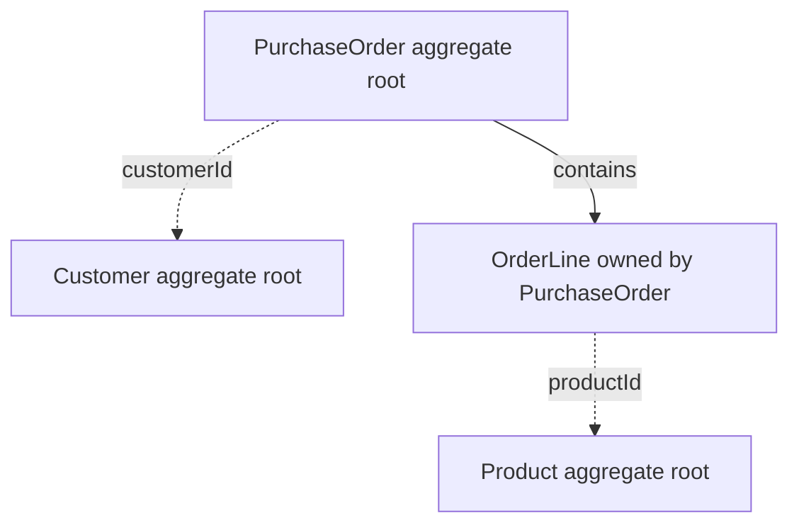

# Biểu diễn quan hệ bằng định danh thay vì giả định quản lý đồ thị đối tượng

Trong mô hình quan hệ, hai bản ghi liên kết với nhau bằng khóa chính và khóa ngoại. Khi thiết kế ứng dụng Spring Data R2DBC, một cách biểu diễn rõ ràng là lưu **định danh của đối tượng được tham chiếu** trong entity hiện tại. Ví dụ, một đơn hàng lưu `customerId` để chỉ khách hàng sở hữu đơn hàng. Khi cần thông tin khách hàng, ứng dụng chủ động truy vấn khách hàng bằng định danh đó.

Cách làm này phù hợp với mô hình aggregate của Spring Data Relational. Một aggregate root quản lý dữ liệu thuộc phạm vi của nó; tham chiếu sang một aggregate khác được biểu diễn bằng ID. Spring Data R2DBC không hoạt động như một ORM đầy đủ có thể tự tải và đồng bộ toàn bộ đồ thị đối tượng thông qua các quan hệ kiểu `@ManyToOne`, `@OneToMany` hoặc lazy loading. Ứng dụng quyết định lúc nào cần truy vấn thêm, dùng truy vấn join nào và kết quả đọc được sẽ được ghép thành DTO hay read model ra sao.

## 1. Quan hệ trong database và tham chiếu trong Java

Giả sử hệ thống bán hàng có hai bảng:

```sql
CREATE TABLE customer (
    id BIGINT GENERATED BY DEFAULT AS IDENTITY PRIMARY KEY,
    name VARCHAR(200) NOT NULL
);

CREATE TABLE purchase_order (
    id BIGINT GENERATED BY DEFAULT AS IDENTITY PRIMARY KEY,
    customer_id BIGINT NOT NULL,
    status VARCHAR(30) NOT NULL,
    created_at TIMESTAMP NOT NULL,
    CONSTRAINT fk_purchase_order_customer
        FOREIGN KEY (customer_id) REFERENCES customer(id)
);
```

Cột `purchase_order.customer_id` là khóa ngoại tham chiếu đến `customer.id`. Ở tầng database, quan hệ được bảo vệ bằng constraint. Ở tầng Java, entity đơn hàng có thể lưu giá trị `customerId`:

```java
@Table("customer")
public record Customer(
        @Id Long id,
        String name
) {}

@Table("purchase_order")
public record PurchaseOrder(
        @Id Long id,
        @Column("customer_id") Long customerId,
        String status,
        @Column("created_at") LocalDateTime createdAt
) {}
```

Trong ví dụ, `PurchaseOrder` giữ một giá trị `Long customerId`. Nó không giữ một đối tượng `Customer` được kỳ vọng sẽ tự tải từ database. Khi đọc đơn hàng, Spring Data R2DBC ánh xạ cột `customer_id` thành giá trị định danh.

Hai lớp liên quan đến nhau theo hai cách ở hai tầng:

- Database bảo đảm `customer_id` trỏ đến một khách hàng tồn tại bằng khóa ngoại.
- Mã Java dùng `customerId` để yêu cầu một truy vấn khách hàng khi nghiệp vụ cần thông tin đó.

Định danh là một giá trị dữ liệu bình thường. Nó có thể được truyền qua service, lưu trong message, dùng để gọi repository hoặc đưa vào DTO mà không cần giữ một object graph lớn trong bộ nhớ.

## 2. Vì sao không nên giả định ORM quản lý đồ thị đối tượng?

Trong một ORM như Hibernate, lập trình viên thường khai báo quan hệ giữa entity bằng annotation như `@ManyToOne`, `@OneToMany` và có thể cấu hình lazy loading, cascade hoặc dirty checking. ORM quản lý persistence context và có thể tải thêm đối tượng khi một quan hệ được truy cập.

Spring Data R2DBC sử dụng mô hình ánh xạ quan hệ đơn giản hơn:

- Không có persistence context theo kiểu ORM để theo dõi toàn bộ đồ thị entity.
- Không có lazy loading tự động khi truy cập thuộc tính quan hệ.
- Không tự động đồng bộ thay đổi trên mọi đối tượng liên quan như dirty checking của ORM.
- Không tự động cascade thao tác lưu/xóa qua các aggregate root khác.
- Việc lấy dữ liệu từ nhiều bảng cần được thể hiện bằng truy vấn hoặc các thao tác repository mà ứng dụng chủ động phối hợp.

Điều này không có nghĩa ứng dụng không thể trả về một object chứa nhiều thông tin. Ứng dụng vẫn có thể tạo DTO `OrderDetail` gồm đơn hàng và khách hàng, nhưng cần chủ động lấy dữ liệu và ghép kết quả.

Ví dụ, khai báo sau thể hiện một kỳ vọng kiểu ORM:

```java
// Không xem đây là quan hệ tự động được Spring Data R2DBC quản lý.
class PurchaseOrder {
    private Long id;
    private Customer customer;
}
```

Nếu `customer` là một aggregate root độc lập, mô hình rõ ràng hơn là:

```java
class PurchaseOrder {
    private Long id;
    private Long customerId;
}
```

Khi cần hiển thị tên khách hàng, service hoặc truy vấn đọc sẽ tải thông tin đó một cách tường minh.

## 3. Aggregate root và ranh giới sở hữu dữ liệu

Aggregate là một ranh giới nhất quán trong domain model. Aggregate root là đối tượng mà ứng dụng dùng để truy cập và thay đổi các thành phần thuộc aggregate. Trong Spring Data Relational, aggregate root là điểm bắt đầu cho việc lưu và tải một aggregate.

Ví dụ:

- `Customer` có thể là một aggregate root độc lập.
- `PurchaseOrder` có thể là một aggregate root độc lập.
- `OrderLine` có thể là thành phần thuộc aggregate `PurchaseOrder`, nếu vòng đời và quy tắc nghiệp vụ của nó phụ thuộc vào đơn hàng.
- `Product` thường là aggregate root riêng; một dòng đơn hàng lưu `productId` thay vì sở hữu toàn bộ product.

Sơ đồ:



Mũi tên liền thể hiện thành phần thuộc cùng aggregate trong ví dụ. Mũi tên nét đứt thể hiện tham chiếu bằng định danh đến aggregate độc lập.

Khi thay đổi một aggregate, ứng dụng nên tuân thủ quy tắc nhất quán của chính aggregate đó. Ví dụ, thêm dòng hàng vào đơn hàng có thể là thao tác trên `PurchaseOrder`; đổi thông tin khách hàng là thao tác trên `Customer`. Không nên giả định việc lưu đơn hàng sẽ tự động lưu hoặc cập nhật khách hàng được tham chiếu.

Ranh giới aggregate là quyết định domain, không chỉ là quyết định đặt annotation. Nếu hai đối tượng luôn phải thay đổi cùng nhau và cần bảo đảm nhất quán trong cùng một thao tác, cần xem xét chúng có thực sự thuộc cùng aggregate hay không. Nếu chúng là hai aggregate riêng, hãy xác định quy trình phối hợp và giao dịch phù hợp.

## 4. Quan hệ bên trong aggregate và quan hệ giữa các aggregate

Không phải mọi quan hệ đều cần chuyển thành ID. Cần phân biệt thành phần thuộc cùng aggregate với tham chiếu đến aggregate độc lập.

### Thành phần thuộc cùng aggregate

Một đơn hàng thường sở hữu các dòng hàng. Dòng hàng không có ý nghĩa độc lập ngoài đơn hàng và có vòng đời phụ thuộc vào đơn hàng. Spring Data Relational có thể ánh xạ collection thuộc aggregate bằng `@MappedCollection`.

Ví dụ minh họa:

```java
@Table("purchase_order")
public class PurchaseOrder {

    @Id
    private Long id;

    private String status;

    @MappedCollection(idColumn = "order_id")
    private List<OrderLine> lines = new ArrayList<>();

    // constructors, getters and domain methods
}

public class OrderLine {

    @Column("product_id")
    private Long productId;

    private int quantity;

    private BigDecimal unitPrice;

    // constructors and accessors
}
```

Ở đây, `OrderLine` là dữ liệu thuộc aggregate `PurchaseOrder`. Cột `order_id` trong bảng dòng hàng liên kết các dòng với aggregate root. Tên bảng và cấu hình cột thực tế cần khớp schema; có thể cấu hình thêm `keyColumn` khi cần lưu khóa của collection như Map.

### Tham chiếu đến aggregate khác

Khách hàng và sản phẩm có vòng đời riêng. Đơn hàng chỉ cần biết khách hàng nào đặt và dòng hàng chỉ cần biết sản phẩm nào được mua:

```java
@Table("purchase_order")
public record PurchaseOrder(
        @Id Long id,
        @Column("customer_id") Long customerId,
        String status
) {}

public record OrderLine(
        @Column("product_id") Long productId,
        int quantity,
        BigDecimal unitPrice
) {}
```

Không cần nhúng toàn bộ `Customer` hoặc `Product` vào aggregate chỉ để biểu diễn quan hệ. Khi cần dữ liệu mô tả, ứng dụng đọc aggregate liên quan bằng ID.

## 5. Tải đối tượng được tham chiếu bằng repository

Giả sử repository được khai báo như sau:

```java
public interface PurchaseOrderRepository
        extends ReactiveCrudRepository<PurchaseOrder, Long> {
}

public interface CustomerRepository
        extends ReactiveCrudRepository<Customer, Long> {
}
```

Một service có thể tải đơn hàng trước, sau đó dùng `customerId` để tải khách hàng:

```java
public record OrderDetail(
        Long orderId,
        String status,
        Long customerId,
        String customerName
) {}

@Service
public class OrderQueryService {

    private final PurchaseOrderRepository orderRepository;
    private final CustomerRepository customerRepository;

    public OrderQueryService(
            PurchaseOrderRepository orderRepository,
            CustomerRepository customerRepository) {
        this.orderRepository = orderRepository;
        this.customerRepository = customerRepository;
    }

    public Mono<OrderDetail> findOrderDetail(Long orderId) {
        return orderRepository.findById(orderId)
                .switchIfEmpty(Mono.error(
                        new OrderNotFoundException(orderId)
                ))
                .flatMap(order ->
                        customerRepository.findById(order.customerId())
                                .switchIfEmpty(Mono.error(
                                        new CustomerNotFoundException(
                                                order.customerId()
                                        )
                                ))
                                .map(customer -> new OrderDetail(
                                        order.id(),
                                        order.status(),
                                        customer.id(),
                                        customer.name()
                                ))
                );
    }
}
```

Luồng xử lý có hai truy vấn tuần tự:

1. Tìm đơn hàng theo khóa chính.
2. Đọc `customerId` từ đơn hàng và tìm khách hàng.
3. Ghép hai kết quả thành `OrderDetail`.

Mỗi repository trả về publisher. `flatMap` nối truy vấn khách hàng vào luồng sau khi có đơn hàng; không cần gọi `block()` để lấy ID rồi mới truy vấn.

Ví dụ này cũng phân biệt hai trường hợp không tìm thấy: đơn hàng không tồn tại và khách hàng được tham chiếu không tồn tại. Với schema có foreign key và dữ liệu hợp lệ, trường hợp thứ hai không nên xảy ra, nhưng vẫn cần xử lý vì dữ liệu cũ, constraint bị thiếu hoặc lỗi tích hợp có thể tạo ra tình huống bất thường.

## 6. Dùng truy vấn JOIN cho read model

Nếu màn hình thường xuyên cần thông tin đơn hàng và tên khách hàng cùng lúc, hai truy vấn tuần tự có thể không phải cách hiệu quả nhất. Có thể viết một câu SQL JOIN và ánh xạ trực tiếp thành DTO:

```java
public Mono<OrderDetail> findOrderDetail(Long orderId) {
    return databaseClient.sql("""
            SELECT o.id AS order_id,
                   o.status AS order_status,
                   c.id AS customer_id,
                   c.name AS customer_name
            FROM purchase_order o
            JOIN customer c ON c.id = o.customer_id
            WHERE o.id = :orderId
            """)
            .bind("orderId", orderId)
            .map((row, metadata) -> new OrderDetail(
                    row.get("order_id", Long.class),
                    row.get("order_status", String.class),
                    row.get("customer_id", Long.class),
                    row.get("customer_name", String.class)
            ))
            .one();
}
```

Truy vấn JOIN có một lượt truy vấn và một lần round trip đến database cho trường hợp này. `DatabaseClient` trả về DTO mà không yêu cầu tạo một đồ thị entity có quan hệ tự tải.

Chọn `JOIN` khi dữ liệu cần hiển thị có thể được lấy hiệu quả bằng một truy vấn. Chọn nhiều repository call khi cần logic nghiệp vụ tách biệt, cần tải aggregate theo từng bước hoặc muốn tái sử dụng các thao tác domain. Quyết định phụ thuộc vào mục tiêu đọc dữ liệu, số lượng bản ghi và cách database thực thi SQL.

Nếu dùng `LEFT JOIN`, cần chú ý cột của phía được nối có thể là `null`. Kiểu Java và cách ánh xạ phải cho phép trường hợp đó. Với `INNER JOIN`, hàng đơn hàng không có khách hàng hợp lệ sẽ không xuất hiện trong kết quả.

## 7. Tránh N+1 khi tải nhiều đối tượng

Một lỗi hiệu năng phổ biến là tải danh sách đơn hàng rồi truy vấn khách hàng riêng cho từng đơn:

```java
public Flux<OrderDetail> findRecentOrderDetails() {
    return orderRepository.findAll()
            .flatMap(order ->
                    customerRepository.findById(order.customerId())
                            .map(customer -> new OrderDetail(
                                    order.id(),
                                    order.status(),
                                    customer.id(),
                                    customer.name()
                            ))
            );
}
```

Nếu có 100 đơn hàng, cách viết này có thể tạo một truy vấn lấy đơn hàng và thêm khoảng 100 truy vấn khách hàng. Đây là vấn đề N+1 query. `flatMap` cho phép các truy vấn con chạy bất đồng bộ và có thể đồng thời, nhưng không làm biến mất số lần truy vấn.

Các lựa chọn thường dùng:

- Dùng một câu SQL JOIN để lấy dữ liệu cần cho danh sách.
- Lấy danh sách ID rồi truy vấn theo lô bằng một phương thức phù hợp, chẳng hạn `findAllById(ids)`.
- Dùng một query chuyên biệt trả về projection hoặc DTO thay vì tải từng aggregate đầy đủ.
- Phân trang dữ liệu để giới hạn số bản ghi cần ghép.

Ví dụ repository có truy vấn chuyên biệt:

```java
public interface PurchaseOrderRepository
        extends ReactiveCrudRepository<PurchaseOrder, Long> {

    @Query("""
            SELECT o.id AS order_id,
                   o.status AS order_status,
                   c.id AS customer_id,
                   c.name AS customer_name
            FROM purchase_order o
            JOIN customer c ON c.id = o.customer_id
            WHERE o.status = :status
            ORDER BY o.created_at DESC
            """)
    Flux<OrderDetail> findDetailsByStatus(String status);
}
```

Khả năng ánh xạ projection phụ thuộc kiểu projection và phiên bản Spring Data Relational đang dùng. Nếu mapping trực tiếp một DTO không phù hợp với cách khai báo repository của dự án, có thể triển khai cùng câu SQL bằng `DatabaseClient` và ánh xạ rõ ràng như ví dụ trước.

Khi truy vấn theo lô, cần giữ ý thức về kích thước danh sách ID. Gom hàng chục nghìn đơn hàng vào một collection rồi bind tất cả ID có thể tạo câu truy vấn lớn và tốn bộ nhớ. Nên phân trang hoặc xử lý theo từng lô có giới hạn.

## 8. Ghi dữ liệu có tham chiếu bằng ID

Khi tạo đơn hàng, service cần xác định khách hàng tồn tại và ghi `customerId` vào đơn hàng. Việc lưu đơn hàng không tự động lưu khách hàng được tham chiếu.

Ví dụ:

```java
public Mono<PurchaseOrder> createOrder(Long customerId, String status) {
    return customerRepository.findById(customerId)
            .switchIfEmpty(Mono.error(
                    new CustomerNotFoundException(customerId)
            ))
            .then(Mono.defer(() ->
                    orderRepository.save(new PurchaseOrder(
                            null,
                            customerId,
                            status
                    ))
            ));
}
```

`then(Mono.defer(...))` chỉ thực hiện việc lưu đơn hàng sau khi publisher kiểm tra khách hàng hoàn tất thành công. Nếu không có khách hàng, publisher lỗi và phần lưu đơn hàng không được thực thi.

Foreign key ở database vẫn rất quan trọng. Việc kiểm tra trước bằng repository giúp trả lỗi nghiệp vụ dễ hiểu, nhưng có thể xảy ra race condition: khách hàng bị xóa sau khi kiểm tra và trước khi insert đơn hàng. Constraint foreign key bảo vệ tính toàn vẹn tại thời điểm ghi thực tế.

Nếu nghiệp vụ yêu cầu kiểm tra và ghi trong một transaction, có thể dùng reactive transaction:

```java
@Transactional
public Mono<PurchaseOrder> createOrder(Long customerId, String status) {
    return customerRepository.findById(customerId)
            .switchIfEmpty(Mono.error(
                    new CustomerNotFoundException(customerId)
            ))
            .then(Mono.defer(() ->
                    orderRepository.save(new PurchaseOrder(
                            null,
                            customerId,
                            status
                    ))
            ));
}
```

Với phương thức reactive trả `Mono` hoặc `Flux`, Spring có thể áp dụng transaction reactive qua transaction manager phù hợp. Transaction không thay thế foreign key; nó điều phối nhiều thao tác database thành một đơn vị commit/rollback theo cấu hình và mức isolation của database.

## 9. Xử lý khi aggregate được tham chiếu không tồn tại

Khi một entity lưu ID của aggregate khác, ứng dụng cần xác định hành vi nếu ID không còn hợp lệ.

Ví dụ:

- Khi hiển thị đơn hàng, có thể trả lỗi dữ liệu không nhất quán nếu khách hàng bị thiếu.
- Khi xóa khách hàng, database có thể từ chối do foreign key đang được tham chiếu.
- Nghiệp vụ có thể cấm xóa khách hàng đã có đơn hàng, hoặc cho phép lưu trạng thái đã ngừng hoạt động.
- Trong một số hệ thống, lịch sử đơn hàng giữ snapshot tên và địa chỉ tại thời điểm mua để dữ liệu lịch sử không thay đổi khi hồ sơ khách hàng được cập nhật.

Không nên chọn `ON DELETE CASCADE` một cách máy móc. Xóa một khách hàng có thể không được phép xóa các đơn hàng lịch sử. Quy tắc xóa phải phản ánh nghiệp vụ và được thực hiện nhất quán giữa database với service.

Nếu một tham chiếu là tùy chọn, cột khóa ngoại có thể nullable và entity dùng kiểu nullable tương ứng:

```java
@Table("purchase_order")
public record PurchaseOrder(
        @Id Long id,
        @Column("customer_id") Long customerId,
        String status
) {}
```

Ở ví dụ trên, `customerId` có thể là `null` nếu schema cho phép. Khi đọc chi tiết, service cần phân biệt đơn hàng không có khách hàng gắn với nó với trường hợp có ID nhưng không tìm thấy khách hàng.

## 10. Định danh và snapshot dữ liệu lịch sử

Không phải lúc nào chỉ lưu ID cũng đủ cho yêu cầu nghiệp vụ. Ví dụ, đơn hàng cần lưu tên người nhận và địa chỉ giao hàng tại thời điểm đặt. Nếu chỉ tham chiếu đến hồ sơ khách hàng, khi khách hàng đổi địa chỉ thì màn hình lịch sử có thể hiển thị địa chỉ mới thay vì địa chỉ đã dùng lúc mua.

Một mô hình thường gặp là kết hợp:

- `customerId` để biết khách hàng nào đặt đơn.
- Các trường snapshot như `shipping_name`, `shipping_address` để lưu thông tin giao hàng tại thời điểm tạo đơn.

```sql
CREATE TABLE purchase_order (
    id BIGINT GENERATED BY DEFAULT AS IDENTITY PRIMARY KEY,
    customer_id BIGINT NOT NULL REFERENCES customer(id),
    shipping_name VARCHAR(200) NOT NULL,
    shipping_address VARCHAR(500) NOT NULL,
    status VARCHAR(30) NOT NULL
);
```

Snapshot không phải là bản sao toàn bộ aggregate. Chỉ lưu những giá trị cần giữ nguyên theo ngữ nghĩa lịch sử. Cần xác định rõ trường nào luôn lấy theo hồ sơ hiện tại và trường nào phải phản ánh sự kiện đã xảy ra trong quá khứ.

## 11. Giao dịch và ranh giới nhất quán

Tham chiếu bằng ID không có nghĩa là không bao giờ cần transaction giữa nhiều thao tác. Nếu một use case phải tạo đơn hàng và ghi một bản ghi khác trong cùng database, transaction reactive có thể bảo đảm cả hai thao tác commit hoặc rollback cùng nhau.

Ví dụ về nguyên tắc:

```java
@Transactional
public Mono<PurchaseOrder> createOrderAndAudit(
        Long customerId,
        String status) {

    return customerRepository.findById(customerId)
            .switchIfEmpty(Mono.error(
                    new CustomerNotFoundException(customerId)
            ))
            .then(orderRepository.save(
                    new PurchaseOrder(null, customerId, status)
            ))
            .flatMap(order ->
                    auditRepository.save(
                            new OrderAudit(null, order.id(), "CREATED")
                    ).thenReturn(order)
            );
}
```

Ví dụ giả định `OrderAudit` và `PurchaseOrder` cùng được quản lý trong một database và transaction manager reactive phù hợp. Nếu các aggregate nằm ở các dịch vụ hoặc database độc lập, một transaction local không thể tự bảo đảm tính nguyên tử xuyên hệ thống; cần cân nhắc sự kiện, outbox hoặc quy trình saga tùy yêu cầu.

Không nên giữ transaction mở trong lúc gọi dịch vụ HTTP bên ngoài nếu có thể tránh. Việc đó giữ connection và transaction lâu, làm tăng nguy cơ pool cạn kết nối và khóa database.

## 12. Thiết kế DTO và API theo nhu cầu đọc

Entity persistence và response API không bắt buộc có cùng cấu trúc. Một entity đơn hàng có thể chỉ lưu `customerId`, trong khi API trả về thông tin khách hàng đã được truy vấn:

```json
{
  "id": 501,
  "status": "CONFIRMED",
  "customer": {
    "id": 42,
    "name": "Nguyen An"
  }
}
```

DTO này được tạo bởi service hoặc query handler. Nó không chứng minh entity đơn hàng có một quan hệ object được tự động tải.

Với các màn hình khác nhau, có thể tạo các read model khác nhau:

- Danh sách đơn hàng chỉ cần `orderId`, `status` và `customerName`.
- Màn hình chi tiết cần thêm địa chỉ, dòng hàng và tổng tiền.
- Báo cáo cần nhóm theo khách hàng hoặc trạng thái.

Một truy vấn JOIN hoặc projection chuyên biệt có thể phục vụ từng read model hiệu quả hơn việc tải toàn bộ đồ thị entity rồi loại bỏ phần dữ liệu không dùng.

## 13. Kiểm thử mô hình tham chiếu bằng ID

Kiểm thử nên xác nhận cả dữ liệu được lưu và cách service giải quyết tham chiếu:

1. Tạo khách hàng và lưu để nhận ID.
2. Tạo đơn hàng với `customerId` vừa nhận.
3. Đọc lại đơn hàng và xác nhận giá trị `customerId`.
4. Gọi service chi tiết và xác nhận DTO chứa thông tin khách hàng.
5. Kiểm tra trường hợp khách hàng không tồn tại.
6. Kiểm tra foreign key từ chối một ID không hợp lệ nếu schema có constraint.

Ví dụ kiểm thử publisher bằng Reactor Test:

```java
StepVerifier.create(orderQueryService.findOrderDetail(orderId))
        .assertNext(detail -> {
            assertEquals(orderId, detail.orderId());
            assertEquals(customerId, detail.customerId());
            assertEquals("An", detail.customerName());
        })
        .verifyComplete();
```

Vì đây là kiểm thử tương tác database, cần dữ liệu test cô lập và dọn dẹp sau mỗi test hoặc dùng transaction test phù hợp. Đối với truy vấn JOIN, cần kiểm tra cả trường hợp không có hàng, quan hệ bị thiếu và các cột nullable nếu có.

## 14. Các nhầm lẫn thường gặp

1. **Coi trường `customerId` là một quan hệ tự động.** Đây chỉ là định danh; muốn có `Customer` phải truy vấn hoặc JOIN.
2. **Dùng annotation ORM như thể R2DBC có lazy loading.** Không giả định `@ManyToOne` hoặc `@OneToMany` sẽ tự tải đối tượng liên quan trong Spring Data R2DBC.
3. **Lưu aggregate này và mong aggregate khác tự được lưu.** Mỗi aggregate root có vòng đời persistence riêng; hãy lưu rõ ràng từng phần cần thay đổi.
4. **Không tạo foreign key vì Java đã kiểm tra ID.** Kiểm tra ở service không thay thế constraint ở database.
5. **Dùng `flatMap` cho mỗi hàng mà không để ý N+1.** Reactive concurrency không làm giảm số truy vấn.
6. **JOIN mọi bảng trong mọi truy vấn.** Chỉ lấy dữ liệu cần cho use case; truy vấn ghi và đọc có thể có mục tiêu khác nhau.
7. **Nhầm thành phần thuộc aggregate với aggregate độc lập.** Dòng hàng có thể thuộc đơn hàng, còn khách hàng và sản phẩm thường có vòng đời riêng.
8. **Không xác định quy tắc xóa.** Cascade ở database có thể xóa lịch sử mà nghiệp vụ cần giữ.
9. **Chỉ lưu ID trong khi cần snapshot lịch sử.** Một số dữ liệu như địa chỉ giao hàng tại thời điểm đặt hàng cần được lưu riêng.
10. **Gọi `block()` để lấy ID rồi truy vấn tiếp.** Dùng `flatMap`, `zip` hoặc toán tử reactive phù hợp để giữ pipeline không chặn.

## Quy tắc thiết kế

- Dùng khóa chính/khóa ngoại ở database để biểu diễn và bảo vệ quan hệ dữ liệu.
- Trong entity, lưu ID của aggregate độc lập được tham chiếu.
- Dùng `@MappedCollection` cho collection thuộc cùng aggregate khi mô hình domain phù hợp.
- Tải aggregate liên quan bằng repository hoặc truy vấn JOIN khi use case cần.
- Tạo DTO/read model theo nhu cầu của API thay vì yêu cầu persistence entity mang toàn bộ object graph.
- Tránh N+1 bằng JOIN, projection hoặc truy vấn theo lô có giới hạn.
- Giữ transaction reactive ngắn và xác định rõ ranh giới nhất quán.
- Lưu snapshot cho dữ liệu cần giữ nguyên theo thời điểm phát sinh nghiệp vụ.

Biểu diễn quan hệ bằng định danh giúp mô hình Spring Data R2DBC phản ánh rõ cấu trúc quan hệ và ranh giới aggregate. Database chịu trách nhiệm bảo đảm liên kết bằng khóa ngoại; ứng dụng chủ động quyết định lúc nào cần tải đối tượng được tham chiếu và cách ghép dữ liệu cho từng use case. Cách tiếp cận này làm rõ số lượng truy vấn, vòng đời dữ liệu và hành vi nhất quán thay vì dựa vào giả định rằng một object graph sẽ tự được quản lý như trong ORM.
