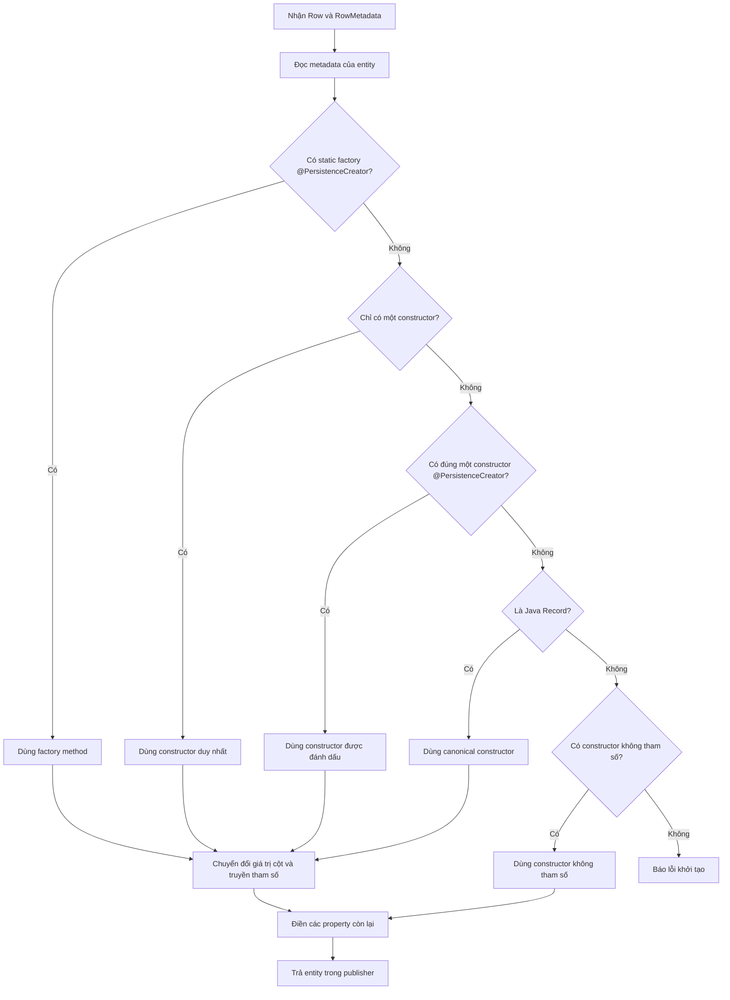

# Quy tắc chọn constructor và khởi tạo thực thể từ kết quả

Spring Data R2DBC chuyển dữ liệu nhận được từ database thành các đối tượng Java thông qua cơ chế mapping của Spring Data Relational. Khi một truy vấn trả về một hàng dữ liệu, framework phải xác định class cần tạo, chọn constructor hoặc factory method phù hợp, chuyển đổi giá trị từng cột và gán chúng vào các thuộc tính của thực thể.

Quy tắc chọn constructor ảnh hưởng trực tiếp đến cách entity được khởi tạo. Nếu class có nhiều constructor, tham số không khớp tên thuộc tính hoặc có trường bất biến, ứng dụng có thể gặp lỗi mapping dù câu SQL chạy thành công.

Bài học này giải thích cách Spring Data chọn constructor, cách tên tham số được liên kết với thuộc tính, cách `Row` được chuyển thành entity và những điểm cần lưu ý với entity bất biến, Java record và khóa chính được database sinh tự động.

## 1. Entity được khởi tạo như thế nào?

Trong Spring Data R2DBC, một truy vấn repository thường trả về `Mono<T>` hoặc `Flux<T>`. Khi driver nhận được kết quả, Spring Data sử dụng mapping infrastructure để chuyển mỗi hàng trong kết quả thành một đối tượng thuộc kiểu `T`.

Luồng khái quát:

1. Repository hoặc `DatabaseClient` thực thi câu SQL.
2. R2DBC driver trả về `Result`, trong đó có các `Row` và metadata của cột.
3. Spring Data đọc metadata của entity để biết bảng, thuộc tính, kiểu dữ liệu và quy tắc mapping.
4. Framework lấy giá trị từ các cột, chuyển đổi sang kiểu Java tương ứng.
5. Framework chọn constructor hoặc factory method để tạo entity.
6. Các thuộc tính chưa được khởi tạo qua constructor được gán bằng cơ chế property population phù hợp.
7. Entity đã tạo được phát ra trong publisher reactive.

Ví dụ, với bảng `customers`:

```sql
CREATE TABLE customers (
    id BIGINT PRIMARY KEY,
    first_name VARCHAR(100),
    email VARCHAR(180)
);
```

Entity tương ứng:

```java
@Table("customers")
public class Customer {

    @Id
    private Long id;

    @Column("first_name")
    private String firstName;

    private String email;

    // Constructor và accessor được lược bớt.
}
```

Khi truy vấn trả về một hàng, Spring Data cần biết cách tạo `Customer`, sau đó gán `id`, `firstName` và `email` từ dữ liệu của hàng đó.

## 2. Quy tắc chọn constructor và factory method

Spring Data sử dụng một thuật toán xác định để chọn cách tạo entity. Các quy tắc phổ biến được xét theo thứ tự sau:

1. Nếu class có một static factory method được đánh dấu `@PersistenceCreator`, framework sử dụng factory method đó.
2. Nếu class chỉ có một constructor, constructor đó được sử dụng.
3. Nếu class có nhiều constructor và đúng một constructor được đánh dấu `@PersistenceCreator`, constructor đó được sử dụng.
4. Với Java record, canonical constructor được sử dụng.
5. Nếu không có trường hợp nào ở trên và class có constructor không tham số, constructor không tham số được sử dụng; các constructor còn lại bị bỏ qua.
6. Nếu không có cách tạo phù hợp, quá trình khởi tạo entity thất bại.

`@PersistenceCreator` thuộc package `org.springframework.data.annotation`. Annotation này cho Spring Data biết constructor hoặc factory method nào được dành cho mục đích materialization dữ liệu.

### 2.1. Class chỉ có một constructor

Nếu class chỉ khai báo một constructor, Spring Data sử dụng constructor đó, kể cả khi constructor có tham số.

```java
@Table("customers")
public class Customer {

    @Id
    private final Long id;
    private final String name;
    private final String email;

    public Customer(Long id, String name, String email) {
        this.id = id;
        this.name = name;
        this.email = email;
    }

    public Long getId() {
        return id;
    }

    public String getName() {
        return name;
    }

    public String getEmail() {
        return email;
    }
}
```

Đây là một entity bất biến: các field là `final`, không có setter và được khởi tạo ngay trong constructor. Spring Data lấy giá trị từ hàng dữ liệu rồi truyền vào constructor.

### 2.2. Class có nhiều constructor

Khi class có nhiều constructor, nên đánh dấu rõ constructor dùng để đọc dữ liệu bằng `@PersistenceCreator`.

```java
import org.springframework.data.annotation.Id;
import org.springframework.data.annotation.PersistenceCreator;
import org.springframework.data.relational.core.mapping.Table;

@Table("customers")
public class Customer {

    @Id
    private final Long id;
    private final String name;
    private final String email;

    public Customer(String name, String email) {
        this(null, name, email);
    }

    @PersistenceCreator
    public Customer(Long id, String name, String email) {
        this.id = id;
        this.name = name;
        this.email = email;
    }

    public Long getId() {
        return id;
    }

    public String getName() {
        return name;
    }

    public String getEmail() {
        return email;
    }
}
```

Constructor hai tham số thuận tiện cho code nghiệp vụ tạo mới khách hàng. Constructor ba tham số nhận cả `id` được chọn để Spring Data tái tạo entity từ database.

Nếu có nhiều constructor nhưng không đánh dấu constructor phù hợp, Spring Data có thể dùng constructor không tham số nếu class cung cấp constructor đó. Điều này có thể khiến framework khởi tạo object rỗng rồi gán thuộc tính qua field hoặc setter, thay vì gọi constructor đầy đủ mà lập trình viên mong muốn.

### 2.3. Static factory method

Có thể dùng static factory method được đánh dấu `@PersistenceCreator` khi muốn kiểm soát cách tạo object hoặc che giấu constructor.

```java
@Table("customers")
public class Customer {

    @Id
    private final Long id;
    private final String name;

    private Customer(Long id, String name) {
        this.id = id;
        this.name = name;
    }

    @PersistenceCreator
    public static Customer fromDatabase(Long id, String name) {
        return new Customer(id, name);
    }

    public static Customer newCustomer(String name) {
        return new Customer(null, name);
    }

    public Long getId() {
        return id;
    }

    public String getName() {
        return name;
    }
}
```

Factory method phải là static và trả về kiểu entity tương ứng. Các tham số của factory method được ánh xạ theo tên thuộc tính giống như tham số constructor.

### 2.4. Constructor không tham số

Nếu không có constructor đơn lẻ, constructor được đánh dấu hoặc factory method phù hợp, Spring Data có thể dùng constructor không tham số. Sau khi tạo object, framework điền các thuộc tính còn lại.

```java
@Table("customers")
public class Customer {

    @Id
    private Long id;
    private String name;

    public Customer() {
    }

    public Customer(String name) {
        this.name = name;
    }

    public Long getId() {
        return id;
    }

    public String getName() {
        return name;
    }

    public void setId(Long id) {
        this.id = id;
    }

    public void setName(String name) {
        this.name = name;
    }
}
```

Với class trên, nếu không có `@PersistenceCreator`, constructor không tham số được dùng và các thuộc tính được gán sau đó. Nếu muốn dùng constructor một tham số để tạo entity từ dữ liệu, hãy đánh dấu constructor đó.

### 2.5. Java record

Java record là kiểu dữ liệu bất biến có canonical constructor được sinh tự động. Spring Data sử dụng canonical constructor để khởi tạo record.

```java
import org.springframework.data.annotation.Id;
import org.springframework.data.relational.core.mapping.Table;

@Table("customers")
public record Customer(
        @Id Long id,
        String name,
        String email
) {
}
```

Tên component của record đồng thời là tên tham số canonical constructor và có metadata rõ ràng. Vì vậy, record thường phù hợp với entity hoặc projection bất biến có cấu trúc đơn giản.

Record không có setter. Khi database sinh khóa chính hoặc một giá trị cần cập nhật sau khi tạo record, hãy sử dụng đối tượng được trả về từ thao tác lưu thay vì giả định record ban đầu sẽ được thay đổi tại chỗ.

### 2.6. Kotlin data class

Với Kotlin, Spring Data ưu tiên primary constructor của data class. Các tham số trong primary constructor được ánh xạ theo tên property.

```kotlin
@Table("customers")
data class Customer(
    @Id val id: Long? = null,
    val name: String,
    val email: String
)
```

Kotlin hỗ trợ default parameter và nullability trong ngôn ngữ. Khả năng sử dụng đầy đủ metadata Kotlin phụ thuộc việc dự án có Kotlin reflection và các dependency cần thiết hay không. Khi có nhiều constructor hoặc secondary constructor phục vụ nghiệp vụ, hãy kiểm tra quy tắc chọn primary constructor và dùng annotation phù hợp nếu cần chỉ định cách tạo entity.

## 3. `@PersistenceCreator` và cách dùng

`@PersistenceCreator` là annotation để đánh dấu constructor hoặc static factory method mà Spring Data nên dùng khi materialize object.

Import:

```java
import org.springframework.data.annotation.PersistenceCreator;
```

Một số nguyên tắc:

- Dùng khi class có nhiều constructor và muốn chỉ rõ constructor dành cho mapping.
- Có thể đặt trên static factory method nếu muốn tạo object qua factory.
- Không đánh dấu nhiều constructor/factory method như thể tất cả đều là lựa chọn hợp lệ; framework cần một lựa chọn rõ ràng.
- Annotation không tự sửa tên tham số. Tên tham số vẫn phải khớp với property mà Spring Data cần khởi tạo.
- Nếu class chỉ có một constructor, thường không cần annotation.

Không nhầm `@PersistenceCreator` với `@Id`, `@Table` hoặc `@Column`. Các annotation này có vai trò khác nhau:

| Annotation | Vai trò |
| --- | --- |
| `@PersistenceCreator` | Chỉ định constructor hoặc factory method dùng để tạo object |
| `@Table` | Ánh xạ entity tới bảng database |
| `@Column` | Ánh xạ property tới cột database |
| `@Id` | Đánh dấu property khóa chính |
| `@Version` | Đánh dấu property version phục vụ optimistic locking |

## 4. Ánh xạ tham số constructor với thuộc tính

Sau khi chọn constructor, Spring Data cần liên kết từng tham số với property tương ứng của entity. Tên tham số là yếu tố quan trọng.

Ví dụ:

```java
public Customer(Long id, String firstName, String email) {
    this.id = id;
    this.firstName = firstName;
    this.email = email;
}
```

Spring Data cần xác định được `id`, `firstName` và `email` là các property tương ứng. Trong Java, hãy bật compiler option `-parameters` để giữ lại tên tham số trong bytecode.

Với Gradle:

```groovy
tasks.withType(JavaCompile).configureEach {
    options.compilerArgs.add("-parameters")
}
```

Với Maven Compiler Plugin:

```xml
<plugin>
    <groupId>org.apache.maven.plugins</groupId>
    <artifactId>maven-compiler-plugin</artifactId>
    <configuration>
        <parameters>true</parameters>
    </configuration>
</plugin>
```

Một lựa chọn khác trong một số trường hợp là annotation `@ConstructorProperties` của Java Beans để khai báo rõ tên property theo thứ tự tham số. Tuy nhiên, với dự án mới, bật `-parameters` là cách cấu hình đơn giản và dễ duy trì.

### 4.1. Tên tham số phải khớp property, không nhất thiết khớp tên cột SQL

Spring Data phân biệt tên property trong entity và tên cột vật lý. Ví dụ:

```java
@Table("customers")
public class Customer {

    @Id
    private final Long id;

    @Column("first_name")
    private final String firstName;

    private final String email;

    public Customer(Long id, String firstName, String email) {
        this.id = id;
        this.firstName = firstName;
        this.email = email;
    }
}
```

Constructor dùng tên `firstName`, tức tên property Java. Annotation `@Column("first_name")` chỉ định cột vật lý trong database. Không cần đổi tham số thành `first_name`.

Nếu không dùng `@Column`, Spring Data Relational áp dụng naming strategy mặc định để ánh xạ tên property Java sang tên cột. Với tên camelCase, quy ước mặc định thường chuyển thành snake_case, ví dụ `firstName` thành `first_name`. Có thể cấu hình naming strategy khác cho toàn ứng dụng.

### 4.2. Kiểu tham số và chuyển đổi dữ liệu

Ngoài tên, giá trị cột phải chuyển đổi được sang kiểu tham số. Ví dụ cột `BIGINT` thường được ánh xạ sang `Long`, cột `VARCHAR` sang `String`, cột thời gian sang kiểu thời gian tương thích.

Nếu database trả về kiểu không tương thích, có thể cần custom converter. Spring Data R2DBC hỗ trợ `R2dbcCustomConversions` và các converter đọc/ghi để chuyển đổi kiểu dữ liệu đặc thù.

Không nên dùng kiểu primitive như `long`, `int` cho property có thể nhận SQL `NULL`, bởi primitive Java không thể biểu diễn null. Dùng wrapper `Long`, `Integer` hoặc kiểu phù hợp để tránh lỗi khi materialize dữ liệu nullable.

## 5. Cách Spring Data điền các property sau constructor

Không phải mọi property đều nhất thiết phải là tham số constructor. Sau khi tạo instance, Spring Data có thể gán các property còn lại thông qua property population.

Với các property chưa được khởi tạo trong constructor, framework lựa chọn cơ chế ghi theo metadata và khả năng truy cập của entity. Các cách phổ biến gồm:

- Gọi setter nếu property có setter phù hợp.
- Gán trực tiếp vào field nếu mapping metadata sử dụng field access.
- Gọi wither nếu entity bất biến cung cấp phương thức tạo bản sao với một property mới.
- Tạo instance mới qua constructor khi cần cập nhật một property bất biến không có wither.

### 5.1. Entity mutable dùng setter

```java
@Table("customers")
public class Customer {

    @Id
    private Long id;
    private String name;

    public Customer() {
    }

    public Long getId() {
        return id;
    }

    public String getName() {
        return name;
    }

    public void setId(Long id) {
        this.id = id;
    }

    public void setName(String name) {
        this.name = name;
    }
}
```

Spring Data có thể gọi constructor không tham số, sau đó điền `id` và `name` qua setter hoặc field access theo mapping metadata.

### 5.2. Entity immutable dùng wither

Một entity bất biến có thể cung cấp wither để tạo instance mới khi cần cập nhật property:

```java
@Table("customers")
public class Customer {

    @Id
    private final Long id;
    private final String name;

    @PersistenceCreator
    public Customer(Long id, String name) {
        this.id = id;
        this.name = name;
    }

    public Customer withId(Long newId) {
        return new Customer(newId, this.name);
    }

    public Long getId() {
        return id;
    }

    public String getName() {
        return name;
    }
}
```

`withId` không thay đổi object hiện tại. Nó trả về một object mới với ID đã cập nhật. Cách này phù hợp với mô hình immutable và có thể được Spring Data sử dụng khi cần thiết lập giá trị được sinh ra sau khi insert.

### 5.3. Constructor-only và property bất biến

Nếu property bất biến không được truyền qua constructor và cũng không có wither, framework không thể thay đổi property đó theo cách thông thường. Vì vậy, hãy đưa các property cần thiết vào persistence constructor hoặc cung cấp cơ chế tạo bản sao phù hợp.

Với entity có nhiều thuộc tính bất biến, constructor đầy đủ thường giúp mapping rõ ràng và giảm lỗi do quên gán field.

## 6. Từ R2DBC `Row` thành entity

Ở tầng R2DBC SPI, kết quả truy vấn gồm các `Row` và `RowMetadata`. Spring Data R2DBC sử dụng `MappingR2dbcConverter` cùng metadata mapping để chuyển từng hàng thành entity.

### 6.1. Repository tự động materialize entity

Ví dụ repository:

```java
public interface CustomerRepository
        extends ReactiveCrudRepository<Customer, Long> {

    Flux<Customer> findByEmailEndingWith(String suffix);
}
```

Spring Data tạo implementation và ánh xạ các cột kết quả sang `Customer`. Ứng dụng chỉ nhận `Flux<Customer>`, không cần tự đọc từng `Row`.

### 6.2. Mapping với `DatabaseClient`

Khi dùng `DatabaseClient`, có thể yêu cầu mapping trực tiếp sang kiểu entity:

```java
public Flux<Customer> findAll(DatabaseClient client) {
    return client.sql("SELECT id, first_name, email FROM customers")
            .map((row, metadata) -> {
                Long id = row.get("id", Long.class);
                String firstName = row.get("first_name", String.class);
                String email = row.get("email", String.class);
                return new Customer(id, firstName, email);
            })
            .all();
}
```

Đoạn code trên minh họa mapping thủ công. Khi số lượng cột hoặc quy tắc chuyển đổi tăng, có thể dùng `MappingR2dbcConverter` hoặc repository để tái sử dụng metadata mapping thay vì tự đọc từng cột.

`Row` là dữ liệu gắn với lần đọc kết quả của driver. Hãy đọc giá trị trong callback mapping và trả về đối tượng đã chuyển đổi; không giữ `Row` để sử dụng sau khi callback kết thúc.

### 6.3. Chọn cột đầy đủ cho constructor

Nếu persistence constructor cần `id`, `firstName` và `email`, câu SQL nên trả về đủ các cột tương ứng:

```sql
SELECT id, first_name, email
FROM customers
WHERE id = :id;
```

Nếu truy vấn chỉ chọn một phần cột, các tham số constructor tương ứng với cột không có trong kết quả có thể không được cấp giá trị như mong muốn. Đặc biệt với primitive hoặc property không nullable, việc thiếu dữ liệu có thể dẫn đến lỗi hoặc giá trị không hợp lệ.

Nếu cần đọc một tập cột nhỏ, hãy tạo projection/DTO có constructor phù hợp với tập cột đó, hoặc dùng phép ánh xạ thủ công rõ ràng.

### 6.4. SQL NULL và giá trị không có trong kết quả

SQL `NULL` là một giá trị có mặt trong hàng dữ liệu nhưng không có giá trị cụ thể. Nó khác với trường hợp câu SQL không trả về cột đó.

Khi cột nullable được ánh xạ sang kiểu Java, hãy dùng kiểu có thể biểu diễn null như `Long`, `Integer`, `String` hoặc kiểu reference phù hợp. Với primitive, cần bảo đảm database luôn trả giá trị không null hoặc chuyển đổi rõ ràng trước khi khởi tạo.

Nếu nghiệp vụ cần phân biệt giá trị null với việc không chọn cột, hãy thiết kế projection và câu SQL rõ ràng thay vì dựa vào hành vi ngầm của constructor.

## 7. Khóa chính được sinh tự động và entity immutable

Với bảng có identity/auto-increment, entity thường được tạo mới với ID là `null`. Khi insert, database sinh ID và Spring Data lấy giá trị trả về để cập nhật entity.

Ví dụ:

```java
@Table("customers")
public record Customer(
        @Id Long id,
        String name,
        String email
) {
}
```

Tạo mới:

```java
Customer draft = new Customer(null, "Lan", "lan@example.com");

Mono<Customer> saved = repository.save(draft);
```

Giá trị được phát ra từ `save()` là entity được lưu, có thể chứa ID do database sinh. Vì entity immutable, không giả định `draft` bị thay đổi tại chỗ.

Hãy sử dụng đối tượng trả về:

```java
return repository.save(draft)
        .doOnNext(savedCustomer ->
                log.info("Created customer with id {}", savedCustomer.id()));
```

Với entity class immutable không phải record, có thể dùng wither cho property ID hoặc cơ chế copy/constructor phù hợp. Với entity mutable, ID có thể được ghi qua setter hoặc field access.

Không tự gán ID trước khi insert nếu database được cấu hình tự sinh khóa chính, trừ khi nghiệp vụ và chiến lược ID của dự án yêu cầu ID do ứng dụng cấp.

## 8. Ánh xạ version và các giá trị do database quản lý

Ngoài ID, một số property có thể được framework hoặc database cập nhật trong quá trình lưu, chẳng hạn version dùng cho optimistic locking.

```java
@Table("customers")
public class Customer {

    @Id
    private final Long id;

    @Version
    private final Long version;

    private final String name;

    @PersistenceCreator
    public Customer(Long id, Long version, String name) {
        this.id = id;
        this.version = version;
        this.name = name;
    }

    public Customer withId(Long id) {
        return new Customer(id, version, name);
    }

    public Customer withVersion(Long version) {
        return new Customer(id, version, name);
    }

    public Long getId() {
        return id;
    }

    public Long getVersion() {
        return version;
    }

    public String getName() {
        return name;
    }
}
```

Ví dụ này minh họa cách thiết kế immutable entity có wither. Kiểu version và giá trị ban đầu phải phù hợp với cấu hình Spring Data Relational và schema thực tế. Khi lưu, hãy dùng entity được trả về để giữ lại ID/version mới nhất.

## 9. Custom conversion khi kiểu database không khớp trực tiếp

Không phải kiểu dữ liệu trong database nào cũng ánh xạ trực tiếp sang kiểu domain mong muốn. Ví dụ, ứng dụng có thể lưu trạng thái enum bằng chuỗi, một value object bằng một cột hoặc một kiểu dữ liệu đặc thù của database.

Spring Data R2DBC hỗ trợ custom conversions. Có thể định nghĩa converter đọc từ giá trị database sang kiểu Java và converter ghi từ kiểu Java sang giá trị database.

Ví dụ converter đọc enum từ chuỗi:

```java
@ReadingConverter
public class StringToCustomerStatusConverter
        implements Converter<String, CustomerStatus> {

    @Override
    public CustomerStatus convert(String source) {
        return CustomerStatus.valueOf(source);
    }
}
```

Converter ghi theo chiều ngược lại:

```java
@WritingConverter
public class CustomerStatusToStringConverter
        implements Converter<CustomerStatus, String> {

    @Override
    public String convert(CustomerStatus source) {
        return source.name();
    }
}
```

Đăng ký converter trong `R2dbcCustomConversions` theo cơ chế cấu hình phù hợp với phiên bản Spring Data của dự án. Converter đọc/ghi giúp constructor nhận đúng kiểu domain mà không phải tự chuyển đổi từng cột trong mọi repository.

## 10. Những lỗi thường gặp khi chọn constructor

| Triệu chứng | Nguyên nhân có thể | Cách xử lý |
| --- | --- | --- |
| Không khởi tạo được entity | Có nhiều constructor nhưng không có lựa chọn rõ ràng | Đánh dấu persistence constructor bằng `@PersistenceCreator` hoặc cung cấp constructor không tham số theo ý đồ |
| Constructor nhận giá trị null ngoài dự kiến | Tên tham số không được giữ hoặc không khớp property | Bật `-parameters`, kiểm tra tên tham số và metadata |
| Mapping lỗi với primitive | Cột SQL có thể null nhưng constructor dùng primitive | Dùng wrapper hoặc bảo đảm cột không null |
| Entity có field null sau khi đọc | Property không được truyền vào constructor và không có cách gán phù hợp | Đưa property vào constructor hoặc thêm setter/field mapping/wither |
| Record không nhận ID mới sau insert | Code tiếp tục dùng record đầu vào thay vì kết quả `save()` | Dùng entity được phát ra từ `save()` |
| Cột không được tìm thấy | Tên cột vật lý và quy tắc mapping không khớp | Kiểm tra `@Column`, naming strategy và câu SELECT |
| Giá trị sai kiểu | Kiểu database không chuyển đổi được sang kiểu tham số | Dùng kiểu tương thích hoặc custom converter |
| Constructor đúng nhưng query không map được | SQL chỉ trả một phần cột cần cho entity | Chọn đủ cột hoặc dùng projection/DTO riêng |

### 10.1. Lombok và constructor tự sinh

Lombok có thể tạo constructor thông qua `@NoArgsConstructor`, `@RequiredArgsConstructor` hoặc `@AllArgsConstructor`. Khi kết hợp nhiều annotation, class có thể có nhiều constructor mà lập trình viên không nhìn thấy trực tiếp trong source code.

Ví dụ:

```java
@NoArgsConstructor
@AllArgsConstructor
@Getter
@Setter
public class Customer {
    private Long id;
    private String name;
}
```

Ở đây có cả constructor không tham số và constructor đầy đủ. Nếu muốn Spring Data sử dụng constructor đầy đủ, cần chỉ định rõ constructor được sinh hoặc viết constructor tường minh và đánh dấu `@PersistenceCreator` khi phù hợp.

Không nên thêm `@AllArgsConstructor` một cách máy móc cho mọi entity. Hãy xác định constructor nào dành cho tạo mới trong nghiệp vụ và constructor nào dành cho materialization từ database.

## 11. Kiểm thử constructor mapping

Nên có kiểm thử tích hợp để xác nhận entity được tạo đúng từ dữ liệu database, đặc biệt khi class có nhiều constructor, immutable property hoặc custom converter.

### 11.1. Kiểm thử repository với StepVerifier

Ví dụ:

```java
@DataR2dbcTest
class CustomerRepositoryTest {

    @Autowired
    CustomerRepository repository;

    @Test
    void shouldMaterializeCustomerUsingPersistenceCreator() {
        Customer customer = new Customer(null, "Lan", "lan@example.com");

        StepVerifier.create(repository.save(customer)
                        .flatMap(saved -> repository.findById(saved.getId())))
                .assertNext(found -> {
                    assertThat(found.getName()).isEqualTo("Lan");
                    assertThat(found.getEmail()).isEqualTo("lan@example.com");
                })
                .verifyComplete();
    }
}
```

Test cần có database R2DBC, schema và dữ liệu phù hợp. `StepVerifier` xác nhận publisher phát ra entity đúng rồi hoàn tất, không cần gọi `.block()` trong code ứng dụng.

### 11.2. Các tình huống nên kiểm tra

- Entity có một constructor tham số.
- Entity có nhiều constructor và một constructor được đánh dấu `@PersistenceCreator`.
- Entity có constructor không tham số và setter.
- Java record với canonical constructor.
- Property nullable và property bắt buộc.
- Tên property camelCase được ánh xạ sang tên cột snake_case.
- Custom converter cho enum hoặc value object.
- ID và version được cập nhật sau thao tác lưu.
- Query projection chỉ chọn một phần cột.

Các kiểm thử này giúp phát hiện lỗi mapping khi thay đổi constructor, thêm Lombok annotation hoặc đổi schema.

## 12. Khuyến nghị thiết kế entity

Khi thiết kế entity cho Spring Data R2DBC, có thể áp dụng các nguyên tắc sau:

1. Ưu tiên một constructor rõ ràng nếu class đơn giản.
2. Dùng `@PersistenceCreator` khi có nhiều constructor hoặc factory method.
3. Bật `-parameters` cho Java để Spring Data đọc được tên tham số.
4. Giữ tên tham số khớp với tên property Java; dùng `@Column` để ánh xạ tên cột vật lý.
5. Với entity immutable, truyền các property cần thiết qua constructor và cung cấp wither nếu cần cập nhật giá trị do database sinh.
6. Dùng wrapper cho property có thể nhận SQL `NULL`.
7. Luôn sử dụng entity trả về từ `save()` khi ID hoặc version có thể thay đổi.
8. Dùng projection/DTO riêng khi câu query chỉ trả về một phần dữ liệu.
9. Viết integration test cho các quy tắc mapping quan trọng.

## 13. Luồng chọn constructor và materialize entity



Sơ đồ thể hiện các trường hợp chính của quy tắc tạo object. Khi áp dụng vào dự án, hãy đối chiếu tài liệu Spring Data đúng phiên bản vì một số chi tiết hỗ trợ ngôn ngữ hoặc mapping có thể khác theo phiên bản.

## 14. Kết luận

Spring Data R2DBC sử dụng mapping infrastructure của Spring Data Relational để biến từng hàng kết quả thành entity. Framework chọn constructor hoặc factory method theo quy tắc ưu tiên; khi có nhiều constructor, `@PersistenceCreator` giúp chỉ định rõ cách tạo object. Tên tham số phải ánh xạ được tới property, kiểu dữ liệu phải chuyển đổi được và các property chưa nằm trong constructor cần có cơ chế population phù hợp.

Với entity immutable, record hoặc entity có ID/version do database cập nhật, hãy thiết kế constructor và wither phù hợp, đồng thời sử dụng đối tượng được trả về từ `save()`. Khi query chỉ lấy một phần cột, hãy dùng projection/DTO riêng hoặc ánh xạ thủ công có chủ đích. Kiểm thử tích hợp với database thực tế giúp bảo đảm các quy tắc khởi tạo hoạt động đúng khi schema và model thay đổi.
