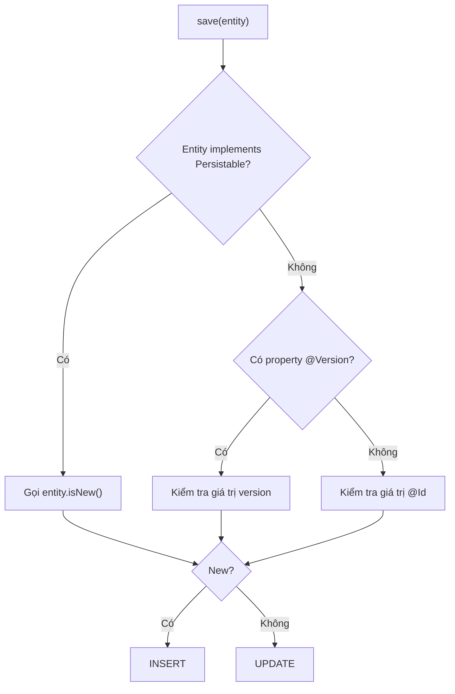

# Cơ chế mặc định xác định thực thể mới

Khi gọi `save(entity)` trong Spring Data Relational R2DBC, framework cần quyết định entity đang đại diện cho một bản ghi mới hay một bản ghi đã tồn tại. Quyết định này xác định thao tác tiếp theo là `INSERT` hay `UPDATE`. Spring Data gọi quá trình đó là *entity state detection* hoặc *newness detection*.

Spring Data không mặc định truy vấn database để kiểm tra xem ID đã tồn tại hay chưa. Thay vào đó, framework sử dụng trạng thái của entity theo một quy tắc có thứ tự ưu tiên: nếu entity tự triển khai `Persistable`, dùng `isNew()` của entity; nếu không, xem xét thuộc tính `@Version`; nếu không có version property, dùng identifier được đánh dấu bằng `@Id`.

Hiểu đúng quy tắc này đặc biệt quan trọng khi dùng khóa do database sinh, UUID được cấp ở ứng dụng, entity có `@Version` hoặc mô hình bất biến. Một entity có ID khác `null` chưa chắc đã là entity cũ, và một entity có ID `null` cũng chưa chắc được xem là mới nếu trạng thái version hoặc chiến lược tùy chỉnh nói khác.

## 1. Vì sao Spring Data cần xác định entity mới?

Repository cung cấp phương thức `save` để lưu entity mà không bắt buộc người gọi phải chọn riêng `insert` hoặc `update`:

```java
public interface CustomerRepository
        extends ReactiveCrudRepository<Customer, Long> {
}
```

Khi gọi:

```java
Mono<Customer> result = customerRepository.save(customer);
```

Spring Data cần biết nên tạo câu lệnh nào:

- **Entity mới:** tạo hàng mới bằng `INSERT`.
- **Entity đã tồn tại:** cập nhật hàng tương ứng bằng `UPDATE`, thường dựa trên identifier.

Việc chọn đúng thao tác tránh tình huống insert trùng khóa hoặc update một hàng chưa tồn tại. Nó cũng quyết định khi nào database có cơ hội sinh khóa mới và khi nào Spring Data áp dụng cơ chế optimistic locking.

Trong R2DBC, `save` trả về publisher như `Mono<T>`. Việc quyết định và thực thi SQL diễn ra trong quá trình tiêu thụ publisher. Chỉ tạo `Mono` chưa thực thi thao tác lưu; subscriber mới khởi động pipeline.

## 2. Thứ tự ưu tiên của cơ chế mặc định

Với entity không cung cấp chiến lược tùy chỉnh, Spring Data Relational sử dụng thứ tự sau:

1. Nếu entity triển khai `Persistable`, dùng kết quả `isNew()` do entity cung cấp.
2. Nếu entity không triển khai `Persistable` nhưng có property được đánh dấu `@Version`, dùng giá trị version để xác định trạng thái mới/cũ.
3. Nếu entity không có `@Version`, dùng giá trị property được đánh dấu `@Id`.

Có thể hình dung bằng sơ đồ:



Thứ tự này rất quan trọng. Khi entity có `@Version`, Spring Data ưu tiên version property cho newness detection thay vì chỉ nhìn ID. Khi entity triển khai `Persistable`, kết quả `isNew()` là nguồn quyết định theo chiến lược tùy chỉnh.

## 3. Không triển khai `Persistable` và không có `@Version`: kiểm tra ID

Nếu entity không triển khai `Persistable` và không khai báo version property, Spring Data sử dụng identifier được đánh dấu bằng `@Id`.

Quy tắc thông thường:

- ID là `null` thì entity được xem là mới.
- Nếu ID là kiểu số nguyên thủy như `long`, giá trị mặc định `0` được xem là mới.
- ID có giá trị khác `null` (hoặc khác `0` với kiểu số nguyên thủy) thì entity được xem là đã tồn tại.

Ví dụ entity dùng khóa do database sinh:

```java
import org.springframework.data.annotation.Id;
import org.springframework.data.relational.core.mapping.Table;

@Table("customer")
public class Customer {

    @Id
    private Long id;

    private String name;

    public Customer() {
    }

    public Customer(String name) {
        this.name = name;
    }

    public Customer(Long id, String name) {
        this.id = id;
        this.name = name;
    }

    public Long getId() {
        return id;
    }

    public String getName() {
        return name;
    }

    public void setId(Long id) {
        this.id = id;
    }

    public void setName(String name) {
        this.name = name;
    }
}
```

Khi tạo `new Customer("Lan")`, giá trị `id` mặc định là `null`. Spring Data nhận diện entity là mới và chọn insert khi publisher được subscribe.

Ngược lại:

```java
Customer existing = new Customer();
existing.setId(42L);
existing.setName("Lan updated");

Mono<Customer> result = customerRepository.save(existing);
```

Với chiến lược ID mặc định, ID `42L` khác `null` khiến entity được xem là đã tồn tại. `save` chọn update theo ID. Framework không cần thực hiện một câu `SELECT` trước chỉ để hỏi ID này đã có trong database chưa.

### ID primitive và ID wrapper

ID kiểu wrapper như `Long` có thể biểu diễn trạng thái chưa được gán bằng `null`. ID kiểu primitive như `long` không thể null nên có giá trị mặc định là `0`.

| Khai báo ID | Giá trị ban đầu | Nhận diện mặc định khi không có `@Version` |
| --- | --- | --- |
| `Long id` | `null` | Mới |
| `Long id` | `25L` | Đã tồn tại |
| `long id` | `0` | Mới |
| `long id` | `25` | Đã tồn tại |

Với khóa được database sinh, kiểu wrapper thường diễn tả ý nghĩa rõ hơn vì `null` biểu thị chưa có ID. Không nên gán một giá trị giả cho ID wrapper để biểu thị entity mới.

Giá trị `0` chỉ là quy ước nhận diện newness cho identifier kiểu primitive trong chiến lược mặc định. Nếu `0` là một khóa nghiệp vụ hợp lệ, hãy chọn kiểu wrapper hoặc cung cấp chiến lược trạng thái tường minh để tránh nhập nhằng.

## 4. Khi có `@Version`: version được ưu tiên hơn ID

Spring Data Relational hỗ trợ optimistic locking bằng property được đánh dấu `@Version`. Property này lưu phiên bản của hàng và giúp phát hiện một entity đã bị cập nhật bởi transaction khác.

Version property cũng tham gia vào newness detection. Nếu entity có `@Version`, Spring Data dùng version để xác định entity mới/cũ trước khi xét ID:

- Version kiểu wrapper là `null` thì entity được xem là mới.
- Version kiểu số nguyên primitive có giá trị `0` thì entity được xem là mới.
- Version đã có giá trị (hoặc primitive khác `0`) thì entity được xem là đã tồn tại.

Ví dụ:

```java
import org.springframework.data.annotation.Id;
import org.springframework.data.annotation.Version;
import org.springframework.data.relational.core.mapping.Table;

@Table("inventory")
public class InventoryItem {

    @Id
    private Long id;

    @Version
    private Long version;

    private Integer quantity;

    public InventoryItem() {
    }

    public InventoryItem(Long id, Long version, Integer quantity) {
        this.id = id;
        this.version = version;
        this.quantity = quantity;
    }
}
```

Giả sử entity có `id = 100L` nhưng `version = null`. Theo chiến lược mặc định có `@Version`, entity vẫn được xem là mới vì version là thuộc tính được ưu tiên. Đây là lý do không thể chỉ nhìn ID để suy ra `save` sẽ insert hay update.

Ngược lại, entity có `id = null` nhưng version đã mang giá trị hiện hữu sẽ bị phân loại là entity cũ theo chiến lược version. Trạng thái đó thường không hợp lệ với một entity cần cập nhật vì thiếu identifier; hãy giữ ID và version nhất quán.

### Version trong INSERT và UPDATE

Khi insert entity mới có version property, Spring Data quản lý giá trị version ban đầu theo mapping và kiểu version được hỗ trợ. Khi cập nhật entity đã có version, câu lệnh update có thể dùng cả ID và version hiện tại trong điều kiện để bảo đảm hàng chưa bị thay đổi kể từ lúc entity được đọc.

Khái quát:

```sql
UPDATE inventory
SET quantity = ?, version = ?
WHERE id = ? AND version = ?
```

Nếu một transaction khác đã cập nhật hàng và version thay đổi, điều kiện `WHERE` không còn khớp. Thao tác cập nhật không tác động hàng như mong đợi và Spring Data có thể phát `OptimisticLockingFailureException`.

Không nên tự tăng version trong code nghiệp vụ nếu Spring Data đang quản lý optimistic locking cho entity. Hãy để framework quản lý version theo quy tắc của nó và dùng entity được phát ra từ thao tác lưu tiếp theo trong pipeline.

## 5. `save` không kiểm tra sự tồn tại thực tế của ID

Newness detection dựa trên trạng thái của entity, không phải truy vấn kiểm tra database. Vì vậy, hai tình huống sau có thể xảy ra:

**Entity được xem là cũ nhưng hàng không tồn tại.** Ví dụ ID khác `null`, không có `@Version`, và entity không triển khai `Persistable`. Spring Data chọn update. Nếu không có hàng mang ID đó, update không thể tạo hàng mới thay thế. Với versioning, trường hợp không cập nhật được hàng có thể được báo bằng lỗi optimistic locking.

**Entity được xem là mới nhưng khóa đã tồn tại.** Spring Data chọn insert. Nếu database đã có hàng với khóa đó, constraint primary key sẽ từ chối insert và publisher phát lỗi từ database/driver.

Do đó, `isNew` không phải là phép kiểm tra `existsById`. Hai khái niệm có mục đích khác nhau:

| Cơ chế | Câu hỏi được trả lời |
| --- | --- |
| Newness detection | Spring Data nên thực hiện INSERT hay UPDATE cho entity này? |
| `existsById(id)` | Database có hàng mang ID này hay không? |

Nếu nghiệp vụ cần bảo đảm ID chưa tồn tại trước khi tạo hàng, có thể kiểm tra bằng API phù hợp hoặc dựa vào constraint duy nhất của database để xử lý cạnh tranh. Một thao tác `existsById` trước `save` không tự loại bỏ race condition: một transaction khác vẫn có thể chèn cùng ID sau bước kiểm tra. Constraint ở database vẫn là hàng rào cuối cùng.

## 6. Entity có ID được gán sẵn

Một số hệ thống tự tạo ID trong ứng dụng thay vì chờ database sinh, ví dụ UUID:

```java
UUID id = UUID.randomUUID();
AssignedCustomer customer = new AssignedCustomer(id, "Lan");
```

Giả sử entity `AssignedCustomer` có property `@Id` kiểu `UUID` và không có `@Version` hoặc `Persistable`:

```java
@Table("customer")
public class AssignedCustomer {

    @Id
    private UUID id;

    private String name;

    public AssignedCustomer(UUID id, String name) {
        this.id = id;
        this.name = name;
    }
}
```

Nếu entity không có `@Version` và không triển khai `Persistable`, ID khác `null` khiến chiến lược mặc định xem entity là cũ. Khi gọi `save`, Spring Data chọn update, dù hàng đó chưa từng được insert.

Đây là tình huống phổ biến khi chuyển từ ID database-generated sang UUID do ứng dụng cấp. Cần quyết định rõ entity mới được nhận diện bằng cách nào.

### Cách 1: Dùng thao tác insert tường minh

Nếu đoạn code chắc chắn đang tạo hàng mới, có thể dùng `R2dbcEntityTemplate.insert(...)`:

```java
Mono<Customer> inserted = entityTemplate.insert(
        new AssignedCustomer(UUID.randomUUID(), "Lan")
);
```

Thao tác insert biểu đạt trực tiếp ý định tạo hàng, không cần dựa vào newness detection của `save`. Nếu khóa đã tồn tại, database vẫn từ chối theo constraint.

### Cách 2: Triển khai `Persistable<ID>`

`Persistable<ID>` cho phép entity tự cung cấp identifier và trạng thái mới/cũ qua `getId()` và `isNew()`. Khi entity triển khai interface này, Spring Data dùng `isNew()` thay cho chiến lược mặc định dựa trên version/ID.

Ví dụ với UUID được tạo ở ứng dụng:

```java
import java.util.UUID;

import org.springframework.data.annotation.Id;
import org.springframework.data.annotation.Transient;
import org.springframework.data.domain.Persistable;
import org.springframework.data.relational.core.mapping.Table;

@Table("customer")
public class Customer implements Persistable<UUID> {

    @Id
    private UUID id;

    private String name;

    @Transient
    private boolean newEntity = true;

    protected Customer() {
    }

    public Customer(UUID id, String name) {
        this.id = id;
        this.name = name;
    }

    @Override
    public UUID getId() {
        return id;
    }

    @Override
    public boolean isNew() {
        return newEntity;
    }

    public void markNotNew() {
        this.newEntity = false;
    }
}
```

Property `newEntity` được đánh dấu `@Transient` để không ánh xạ thành cột database. Ứng dụng phải quản lý việc chuyển trạng thái sau khi insert thành công. Ví dụ trong một service:

```java
public Mono<Customer> createCustomer(Customer customer) {
    return customerRepository.save(customer)
            .doOnNext(Customer::markNotNew);
}
```

`doOnNext` chỉ thay đổi trạng thái sau khi publisher save phát ra entity đã lưu. Nếu thao tác insert lỗi, callback này không chạy và entity vẫn giữ trạng thái mới. Trong ứng dụng có entity bất biến hoặc nhiều đường lưu, hãy thiết kế việc cập nhật trạng thái sao cho phù hợp; có thể dùng callback/lifecycle mechanism của Spring Data thay vì thay đổi object trực tiếp.

`Persistable` là cơ chế tùy chỉnh mạnh, vì vậy `isNew()` phải phản ánh đúng trạng thái persistence. Nếu luôn trả về `true`, mọi lần `save` đều cố insert. Nếu luôn trả về `false`, entity mới sẽ bị xử lý như update. Cả hai đều có thể gây lỗi dữ liệu.

## 7. Entity bất biến và constructor

Entity bất biến thường không có setter và các property được cung cấp qua constructor. Newness detection vẫn dựa trên metadata của entity: `Persistable`, version property hoặc ID property theo thứ tự ưu tiên đã nêu.

Ví dụ một record có ID database-generated:

```java
import org.springframework.data.annotation.Id;
import org.springframework.data.relational.core.mapping.Table;

@Table("customer")
public record Customer(@Id Long id, String name) {
}
```

Khi tạo `new Customer(null, "Lan")`, ID null làm entity được xem là mới nếu không có version property và không triển khai `Persistable`. Sau insert, Spring Data có thể tạo instance mới chứa ID do database trả về. Hãy dùng instance được phát ra từ `save`:

```java
return customerRepository.save(new Customer(null, "Lan"))
        .flatMap(saved -> customerRepository.findById(saved.id()));
```

Với immutable entity dùng UUID được gán trước, giá trị ID có sẵn vẫn có thể làm chiến lược mặc định nhận diện entity là cũ. Có thể dùng `Persistable` với trạng thái newness được quản lý phù hợp hoặc gọi thao tác insert tường minh.

## 8. Mối quan hệ giữa newness detection và optimistic locking

`@Version` có hai vai trò liên quan nhưng khác nhau:

1. **Nhận diện entity mới:** version null (hoặc zero với kiểu primitive) được dùng để phân loại entity mới trong chiến lược mặc định.
2. **Kiểm soát cập nhật đồng thời:** version hiện tại được đưa vào điều kiện cập nhật và tăng theo quy tắc optimistic locking.

Ví dụ một entity mới:

```java
InventoryItem item = new InventoryItem(10L, null, 5);
```

Với entity này, version null khiến chiến lược mặc định xem nó là mới dù ID đã có giá trị. Khi insert thành công, Spring Data quản lý version khởi tạo theo mapping. Sau khi đọc lại entity, version có giá trị và entity được xem là đã tồn tại cho lần `save` tiếp theo.

Điều này cho thấy không nên tự gán version tùy tiện. Nếu version được khởi tạo sai, framework có thể phân loại entity sai hoặc tạo điều kiện optimistic locking không đúng. Hãy để Spring Data quản lý version trừ khi có yêu cầu đặc biệt được hỗ trợ rõ ràng.

Nếu entity triển khai `Persistable`, `isNew()` được ưu tiên hơn cả version và ID. Điều đó có nghĩa ứng dụng chịu trách nhiệm bảo đảm trạng thái `isNew()` phù hợp với vòng đời entity, đồng thời vẫn để Spring Data dùng `@Version` cho optimistic locking khi thực hiện update.

## 9. Cách kiểm tra trạng thái mới/cũ

Khi một lời gọi `save` chọn sai insert hoặc update, hãy xác định chiến lược thực tế mà entity đang sử dụng.

**Entity có triển khai `Persistable` không?** Nếu có, đọc `isNew()` tại thời điểm gọi `save`. Kiểm tra property trạng thái có bị đánh dấu sai hoặc chưa được chuyển sau insert không.

**Entity có `@Version` không?** Nếu có, kiểm tra giá trị version trước khi gọi `save`. Version property được ưu tiên hơn ID trong chiến lược mặc định.

**Nếu không có hai trường hợp trên, ID đang là gì?** Kiểm tra đúng property có `@Id`, kiểu dữ liệu, giá trị null/zero và kiểu generic `ID` của repository.

**Schema có khớp mapping không?** Kiểm tra cột primary key, kiểu dữ liệu, generated identity/sequence và các constraint liên quan.

Có thể ghi log trạng thái ở tầng service khi điều tra, nhưng tránh ghi dữ liệu nhạy cảm. Nếu dùng `Persistable`, log cả giá trị ID và `isNew()` sẽ giúp nhìn thấy trực tiếp quyết định của entity.

## 10. Kiểm thử newness detection và `save`

Các kiểm thử nên chứng minh cả hai nhánh insert/update và những trường hợp đặc biệt về ID/version.

### Entity có ID null được insert

```java
StepVerifier.create(customerRepository.save(new Customer(null, "Lan")))
        .assertNext(saved -> {
            assertThat(saved.getId()).isNotNull();
            assertThat(saved.getName()).isEqualTo("Lan");
        })
        .verifyComplete();
```

Ví dụ này giả định schema có cơ chế sinh ID và driver hỗ trợ trả generated values. Publisher cần được verify để truy vấn thực thi.

### Entity có ID được gán sẵn được xem là cũ

Với entity không có `@Version` và không triển khai `Persistable`, có thể kiểm tra rằng `save` chọn nhánh update bằng cách chuẩn bị hàng tương ứng trước, thay đổi thuộc tính rồi lưu lại. Sau đó đọc lại theo ID và xác nhận giá trị đã thay đổi.

Nếu entity có ID được gán nhưng chưa tồn tại, đừng chỉ dựa vào test `save` để mong đợi insert. Hãy kiểm tra chiến lược newness hoặc dùng API insert tường minh.

### Version được ưu tiên hơn ID

Tạo entity có `@Version` wrapper đang null và ID đã có giá trị, sau đó xác nhận hành vi insert theo chiến lược version. Kiểm tra tiếp entity sau insert/đọc lại có version được thiết lập và lần save tiếp theo đi theo nhánh update.

### `Persistable` cung cấp trạng thái tùy chỉnh

Kiểm tra `isNew()` trả true trước insert, trạng thái chuyển sau khi lưu thành công, và lần save tiếp theo không cố insert lại. Cũng cần kiểm tra đường lỗi: nếu insert thất bại, entity không được đánh dấu đã lưu một cách sai lệch.

## 11. Các lỗi thường gặp

| Biểu hiện | Nguyên nhân có thể | Hướng xử lý |
| --- | --- | --- |
| `save` chạy UPDATE dù muốn INSERT | ID được gán trước và entity không có version/Persistable | Dùng insert tường minh hoặc triển khai `Persistable` |
| `save` chạy INSERT dù muốn UPDATE | ID null/primitive zero hoặc version null/primitive zero | Kiểm tra trạng thái ID/version trước khi lưu |
| Insert bị lỗi duplicate key | Entity bị xem là mới nhưng khóa đã tồn tại | Kiểm tra `isNew`, ID và constraint database |
| Update không tác động hàng | Entity bị xem là cũ nhưng hàng không tồn tại hoặc ID sai | Xác minh hàng, ID và dùng insert nếu ý định là tạo mới |
| Assigned UUID luôn bị xem là cũ | ID khác null và không có chiến lược tùy chỉnh | Dùng `Persistable` hoặc `R2dbcEntityTemplate.insert` |
| `Persistable` liên tục insert | `isNew()` luôn trả true hoặc trạng thái không được cập nhật | Chuyển trạng thái sau insert thành công |
| Optimistic locking thất bại | Version cũ, entity stale hoặc update không còn khớp version | Đọc lại entity mới nhất và xử lý xung đột theo nghiệp vụ |
| Version làm kết quả khác với ID | Version property được ưu tiên trong newness detection | Kiểm tra version trước khi kết luận từ ID |

Một lưu ý quan trọng: không dùng `existsById` như cách sửa mặc định cho newness detection. Truy vấn tồn tại và quyết định insert/update là hai việc khác nhau; nếu cần trạng thái nghiệp vụ chính xác, hãy biểu diễn nó bằng entity state hoặc chọn thao tác rõ ràng.

## 12. Chọn chiến lược phù hợp

| Kiểu entity | Chiến lược phù hợp thường gặp |
| --- | --- |
| ID do database sinh, wrapper ID ban đầu null | Dùng mặc định dựa trên `@Id` |
| Entity có `@Version` và version được quản lý bởi Spring Data | Dùng mặc định dựa trên version |
| UUID được cấp ở ứng dụng nhưng entity mới đã có ID | Dùng `Persistable` hoặc thao tác insert tường minh |
| Entity bất biến với ID database-generated | Dùng ID null và tiêu thụ instance được phát ra từ `save` |
| Cần luôn tạo hàng mới ở một thao tác cụ thể | Dùng `R2dbcEntityTemplate.insert` hoặc SQL insert tường minh |
| Trạng thái mới/cũ phụ thuộc quy tắc nghiệp vụ riêng | Triển khai `Persistable` và quản lý vòng đời trạng thái cẩn thận |

Không có một chiến lược phù hợp cho mọi entity. Với khóa do database sinh, quy tắc mặc định dựa trên ID thường đơn giản. Với assigned ID, cần thể hiện rõ entity mới bằng `Persistable` hoặc gọi insert. Với entity dùng optimistic locking, cần hiểu version property được ưu tiên trong quá trình nhận diện trạng thái.

## 13. Ghi nhớ

- Newness detection quyết định `save` thực hiện INSERT hay UPDATE.
- Spring Data không mặc định truy vấn database để xác minh ID có tồn tại trước khi chọn thao tác.
- Nếu entity triển khai `Persistable`, `isNew()` do entity cung cấp được dùng để quyết định trạng thái.
- Nếu không triển khai `Persistable` nhưng có `@Version`, version được ưu tiên hơn ID: null (hoặc zero với kiểu primitive) thường biểu thị entity mới.
- Nếu không có `@Version`, Spring Data dùng `@Id`: null (hoặc zero với kiểu số nguyên thủy) thường biểu thị entity mới.
- ID có giá trị không tự chứng minh hàng đã tồn tại; nó chỉ ảnh hưởng tới quy tắc nhận diện mặc định.
- Assigned UUID thường cần `Persistable` hoặc thao tác insert tường minh nếu entity mới đã có ID.
- `@Version` vừa tham gia newness detection vừa hỗ trợ optimistic locking; không tự quản lý version bằng code nghiệp vụ nếu Spring Data đang đảm nhiệm việc đó.
- `existsById` kiểm tra dữ liệu trong database, còn `isNew` quyết định loại thao tác lưu; hai khái niệm không thay thế nhau.
- Với R2DBC, publisher từ `save` chỉ thực thi khi được subscribe; hãy kiểm thử bằng cách tiêu thụ publisher và kiểm tra cả nhánh insert lẫn update.

Khi cần giải thích vì sao `save` chọn INSERT hoặc UPDATE, hãy kiểm tra theo thứ tự `Persistable`, `@Version`, rồi `@Id`. Đó là thứ tự quyết định trạng thái mới/cũ của entity trong cơ chế mặc định Spring Data Relational và là cơ sở để xử lý đúng các trường hợp ID do database sinh, ID được gán trước và optimistic locking.
