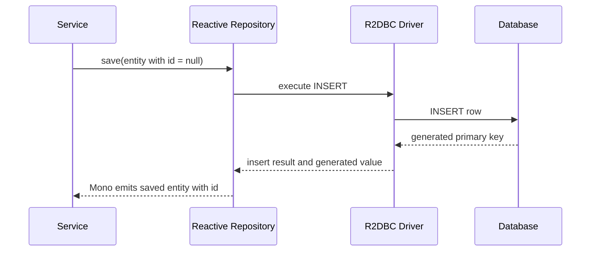

# Nhận khóa do cơ sở dữ liệu sinh sau khi insert

Trong Spring Data Relational R2DBC, một bảng thường có khóa chính được cơ sở dữ liệu tự sinh khi thêm bản ghi mới. Ví dụ, PostgreSQL có cột `IDENTITY`, MySQL có `AUTO_INCREMENT`. Khi ứng dụng insert một entity mà chưa có ID, database tạo giá trị khóa chính và trả giá trị đó qua driver R2DBC. Spring Data R2DBC ánh xạ khóa được sinh vào entity kết quả và phát entity đó qua `Mono`.

Điểm quan trọng là phải tiếp tục xử lý từ entity được phát ra sau thao tác insert. Lệnh lưu dữ liệu là bất đồng bộ; ID chưa có ngay tại thời điểm tạo entity đầu vào hoặc gọi `save()`. Chỉ sau khi publisher hoàn tất thao tác insert và phát kết quả, ứng dụng mới có thể dùng khóa chính được sinh để tạo dữ liệu liên quan, trả HTTP response hoặc ghi log nghiệp vụ.

## 1. Khóa chính do database sinh là gì?

Khóa chính (primary key) định danh duy nhất một hàng trong bảng. Ứng dụng có thể tự cấp giá trị khóa, ví dụ tạo UUID trước khi insert, hoặc để database sinh khóa khi insert. Với khóa số tự tăng, database quản lý bộ sinh giá trị và cấp một ID mới cho mỗi hàng.

Ví dụ PostgreSQL:

```sql
CREATE TABLE customer (
    id BIGINT GENERATED BY DEFAULT AS IDENTITY PRIMARY KEY,
    name VARCHAR(200) NOT NULL,
    email VARCHAR(320) NOT NULL
);
```

`GENERATED BY DEFAULT AS IDENTITY` khai báo cột `id` là cột identity. Khi câu lệnh insert không cung cấp `id`, PostgreSQL sinh giá trị cho cột này. `PRIMARY KEY` bảo đảm giá trị không trùng và không null.

Với MySQL, khai báo tương đương thường dùng `AUTO_INCREMENT`:

```sql
CREATE TABLE customer (
    id BIGINT NOT NULL AUTO_INCREMENT,
    name VARCHAR(200) NOT NULL,
    email VARCHAR(320) NOT NULL,
    PRIMARY KEY (id)
);
```

Cú pháp khai báo cột tự sinh phụ thuộc hệ quản trị. Spring Data R2DBC không tự tạo chiến lược identity chỉ vì entity có trường `id`; schema database phải được thiết kế đúng, thường được quản lý bằng migration.

## 2. Khai báo ID trong entity

Spring Data Relational dùng annotation `@Id` để nhận diện thuộc tính khóa chính. Với khóa do database sinh, nên dùng kiểu tham chiếu như `Long` để biểu diễn rõ trạng thái chưa có ID bằng `null`.

```java
import org.springframework.data.annotation.Id;
import org.springframework.data.relational.core.mapping.Table;

@Table("customer")
public class Customer {

    @Id
    private Long id;

    private String name;

    private String email;

    public Customer(Long id, String name, String email) {
        this.id = id;
        this.name = name;
        this.email = email;
    }

    public Long getId() {
        return id;
    }

    public String getName() {
        return name;
    }

    public String getEmail() {
        return email;
    }
}
```

`@Id` ở đây là annotation của Spring Data (`org.springframework.data.annotation.Id`), không phải annotation `@Id` của JPA. Spring Data Relational dùng metadata này khi xác định khóa và xây dựng thao tác persistence.

Không cần thêm `@GeneratedValue` của JPA để yêu cầu Spring Data R2DBC sinh khóa. Cơ chế sinh khóa được khai báo trong schema database (identity, auto increment, sequence hoặc default phù hợp); Spring Data và driver xử lý việc lấy generated value theo dialect.

Với entity mới, tạo đối tượng chưa có ID:

```java
Customer customer = new Customer(null, "An Nguyen", "an@example.com");
```

`id == null` giúp Spring Data nhận diện entity là mới theo cơ chế mặc định dựa trên ID. Khi insert thành công, database cấp khóa và Spring Data đưa khóa đó vào entity kết quả.

### Vì sao nên dùng `Long` thay cho `long`?

Kiểu nguyên thủy `long` luôn có giá trị số, mặc định là `0`. Nó không biểu diễn được trạng thái chưa có ID bằng `null`. Spring Data có quy tắc nhận diện giá trị mặc định của kiểu nguyên thủy trong một số trường hợp, nhưng kiểu tham chiếu làm trạng thái mới rõ ràng hơn và tránh nhầm `0` với một ID đã được cấp. Với khóa identity, `Long` thường là lựa chọn dễ hiểu.

## 3. Khai báo repository

Repository reactive có thể kế thừa `ReactiveCrudRepository`:

```java
import org.springframework.data.repository.reactive.ReactiveCrudRepository;

public interface CustomerRepository
        extends ReactiveCrudRepository<Customer, Long> {
}
```

Tham số kiểu thứ nhất là entity `Customer`; tham số thứ hai là kiểu của ID (`Long`). Phương thức `save` trả về `Mono<Customer>`, bởi thao tác insert cần thời gian thực hiện và có thể phát sinh lỗi từ database hoặc driver.

## 4. Nhận ID qua `save()`

Với entity mới có ID null, `save()` thực hiện insert theo cơ chế nhận diện new entity của Spring Data. Hãy dùng entity được phát ra từ `Mono` trả về:

```java
public Mono<Customer> createCustomer(String name, String email) {
    Customer customer = new Customer(null, name, email);

    return customerRepository.save(customer);
}
```

Khi insert hoàn tất, publisher phát `Customer` đã có khóa chính. Ví dụ tầng gọi có thể đọc ID bằng `map`:

```java
public Mono<Long> createCustomerAndReturnId(String name, String email) {
    Customer customer = new Customer(null, name, email);

    return customerRepository.save(customer)
            .map(Customer::getId);
}
```

Luồng thực thi ở mức khái niệm:



Giá trị ID được nhận từ kết quả insert của database/driver. Ứng dụng không cần tự đoán ID tiếp theo hoặc thực hiện một truy vấn riêng sau khi insert.

## 5. Dùng entity được trả về, không đọc ID quá sớm

Lời gọi `save()` trả về publisher; nó chưa có nghĩa insert đã hoàn tất ngay tại dòng code đó:

```java
Customer customer = new Customer(null, "An Nguyen", "an@example.com");
Mono<Customer> savedPublisher = customerRepository.save(customer);

// Tại đây chưa thể giả định ID đã được database cấp.
```

Không nên viết logic phụ thuộc ID ngay sau khi gọi `save()`:

```java
Customer customer = new Customer(null, "An Nguyen", "an@example.com");
Mono<Customer> saved = customerRepository.save(customer);

Long id = customer.getId(); // Không dùng cách này để lấy ID sinh.
```

Đối tượng đầu vào không phải nguồn đáng tin cậy để đọc khóa vừa sinh trước khi publisher hoàn tất. Với entity bất biến, Spring Data có thể tạo instance mới chứa ID thay vì thay đổi instance ban đầu. Ngay cả khi entity mutable, code vẫn phải dựa trên giá trị được phát ra từ publisher để bảo đảm đúng thứ tự thực thi.

Đúng cách:

```java
return customerRepository.save(customer)
        .flatMap(savedCustomer -> {
            Long generatedId = savedCustomer.getId();
            return createWelcomeRecord(generatedId)
                    .thenReturn(savedCustomer);
        });
```

`flatMap` chỉ chạy callback khi `save` phát entity kết quả. Vì vậy `generatedId` đã sẵn sàng để sử dụng trong bước tiếp theo.

## 6. Nhận ID với `R2dbcEntityTemplate`

Khi không dùng repository hoặc cần thao tác entity tùy biến, `R2dbcEntityTemplate` cũng trả về entity sau insert:

```java
import org.springframework.data.r2dbc.core.R2dbcEntityTemplate;
import org.springframework.stereotype.Service;
import reactor.core.publisher.Mono;

@Service
public class CustomerWriteService {

    private final R2dbcEntityTemplate template;

    public CustomerWriteService(R2dbcEntityTemplate template) {
        this.template = template;
    }

    public Mono<Customer> insert(Customer customer) {
        return template.insert(Customer.class).using(customer);
    }
}
```

`using(customer)` thực hiện thao tác insert và phát entity đã được xử lý theo metadata ánh xạ, bao gồm khóa được database sinh nếu driver và dialect hỗ trợ trả về generated value.

Có thể lấy ID trực tiếp từ kết quả:

```java
public Mono<Long> insertAndGetId(Customer customer) {
    return template.insert(Customer.class)
            .using(customer)
            .map(Customer::getId);
}
```

Về mặt sử dụng, repository và template đều cho phép tiếp tục xử lý bằng `Mono`. Chọn repository cho CRUD thông thường; chọn template khi cần query DSL hoặc kiểm soát thao tác entity linh hoạt hơn.

## 7. Điều gì xảy ra bên dưới khi database sinh khóa?

Ở mức thấp, driver R2DBC gửi câu lệnh insert tới database. Database tạo giá trị identity/sequence và driver cung cấp generated value theo khả năng của hệ quản trị và driver. Spring Data Relational sử dụng dialect cùng metadata entity để yêu cầu và ánh xạ giá trị đó vào thuộc tính `@Id`.

R2DBC SPI có cơ chế `Statement.returnGeneratedValues(...)` để yêu cầu driver trả về các cột được sinh. Cách thực thi cụ thể khác nhau theo driver. Một số database hỗ trợ cú pháp `RETURNING`; một số driver dùng cơ chế generated keys tương ứng của hệ quản trị. Ứng dụng thông thường không cần gọi SPI này trực tiếp khi dùng repository hoặc `R2dbcEntityTemplate`.

Ví dụ PostgreSQL có thể thực hiện câu lệnh:

```sql
INSERT INTO customer (name, email)
VALUES ('An Nguyen', 'an@example.com')
RETURNING id;
```

`RETURNING id` yêu cầu PostgreSQL trả về khóa vừa sinh trong cùng thao tác insert. Điều này an toàn khi có nhiều insert đồng thời vì giá trị được trả về thuộc chính hàng mà câu lệnh vừa thêm.

Khả năng lấy generated values phụ thuộc database, driver và dialect tương thích. Nếu ID vẫn null sau insert, cần kiểm tra schema, annotation, kiểu dữ liệu, phiên bản driver và khả năng trả generated values của hệ quản trị. Không nên tự thêm một truy vấn `SELECT` dựa trên thời điểm insert nếu chưa hiểu cơ chế driver.

## 8. Dùng ID sinh để lưu bản ghi liên quan

Một tình huống phổ biến là tạo một bản ghi cha trước, sau đó dùng ID của nó để tạo các bản ghi con. Ví dụ, một order có nhiều order line:

```java
public Mono<Order> createOrder(NewOrderCommand command) {
    Order order = new Order(null, command.customerId(), command.createdAt());

    return orderRepository.save(order)
            .flatMap(savedOrder -> {
                Flux<OrderLine> lines = Flux.fromIterable(command.lines())
                        .map(line -> new OrderLine(
                                null,
                                savedOrder.getId(),
                                line.productId(),
                                line.quantity()
                        ));

                return orderLineRepository.saveAll(lines)
                        .then(Mono.just(savedOrder));
            });
}
```

Ở đây, `savedOrder.getId()` là khóa do database cấp. Mỗi `OrderLine` nhận ID order đó làm khóa ngoại. `saveAll` phát các entity line đã lưu; `.then(Mono.just(savedOrder))` đợi publisher lưu các dòng hoàn tất rồi mới phát lại order.

Nếu order và order line phải được lưu nguyên tử, hãy bọc toàn bộ pipeline trong transaction reactive:

```java
public Mono<Order> createOrder(NewOrderCommand command) {
    Order order = new Order(null, command.customerId(), command.createdAt());

    return transactionalOperator.transactional(
            orderRepository.save(order)
                    .flatMap(savedOrder -> {
                        Flux<OrderLine> lines = Flux.fromIterable(command.lines())
                                .map(line -> new OrderLine(
                                        null,
                                        savedOrder.getId(),
                                        line.productId(),
                                        line.quantity()
                                ));

                        return orderLineRepository.saveAll(lines)
                                .then(Mono.just(savedOrder));
                    })
    );
}
```

Nếu một dòng con vi phạm constraint hoặc insert thất bại, lỗi đi qua publisher và transaction manager có thể rollback các thao tác đã tham gia transaction. Không gọi `subscribe()` riêng cho `saveAll` vì như vậy các lệnh insert con có thể tách khỏi transaction và service không còn kiểm soát được thời điểm hoàn tất.

## 9. Phân biệt ID database sinh với ID ứng dụng tự cấp

Không phải mọi hệ thống đều dùng khóa số tự tăng. Một số hệ thống tạo UUID ở ứng dụng trước khi ghi:

```java
UUID id = UUID.randomUUID();
Customer customer = new Customer(id, "An Nguyen", "an@example.com");
```

Với ID do ứng dụng cấp, khóa đã có trước khi insert. Điều này khác với identity do database sinh. Lợi ích của UUID là có thể tạo ID mà không cần round trip tới database trước khi biết định danh; đổi lại, cần chọn kiểu lưu trữ, index và chiến lược sinh UUID phù hợp.

Nếu ứng dụng cấp ID nhưng dùng `repository.save()`, Spring Data cần biết entity là mới để chọn insert thay vì update. Cơ chế mặc định thường dựa trên trạng thái ID và version property nếu có. Khi ID đã khác null, Spring Data có thể xem entity là đã tồn tại. Nếu cần ID tự cấp nhưng vẫn muốn dùng `save()` cho entity mới, có thể triển khai `Persistable<ID>` và định nghĩa `isNew()` theo vòng đời entity, hoặc dùng thao tác insert rõ ràng khi thích hợp.

Với ID database sinh, hãy để ID null trước insert và dùng kết quả trả về. Không gán một giá trị giả vào ID chỉ để tránh null; điều đó có thể khiến Spring Data chọn đường update hoặc tạo lỗi khóa trùng.

## 10. `save()` có thể insert hoặc update

`ReactiveCrudRepository.save()` không có nghĩa lúc nào cũng phát lệnh insert. Spring Data kiểm tra entity có mới hay không để quyết định insert hay update. Với entity có ID null và không có quy tắc newness tùy chỉnh, entity thường được xem là mới. Với ID đã có, entity có thể được xem là đã tồn tại và đi theo đường update.

Điều này có ý nghĩa khi làm việc với khóa database sinh:

```java
Customer newCustomer = new Customer(null, "An Nguyen", "an@example.com");
Mono<Customer> inserted = customerRepository.save(newCustomer);
```

Đây là trường hợp phù hợp cho insert mới. Nhưng nếu vô tình gán `id` trước khi gọi `save`, repository có thể thực hiện update. Nếu mục tiêu chắc chắn là insert, có thể dùng API insert của template hoặc repository theo thiết kế phù hợp.

Không nên dùng `save()` như một cách “thử insert, nếu lỗi thì update” trừ khi có logic nghiệp vụ rõ ràng. Hãy hiểu newness detection của entity, đặc biệt khi dùng assigned ID, version property hoặc `Persistable`.

## 11. Vì sao không dùng `SELECT MAX(id)` để lấy khóa vừa sinh?

Một cách làm không an toàn là insert xong rồi chạy:

```sql
SELECT MAX(id) FROM customer;
```

Kết quả là ID lớn nhất của bảng tại thời điểm truy vấn, không đảm bảo thuộc về insert của request hiện tại. Nếu request khác insert giữa hai câu lệnh, `MAX(id)` có thể trả ID của request kia.

Tương tự, không nên dựa vào việc tính `id + 1`, đọc sequence thủ công mà không theo cơ chế của database, hoặc giả định ID được cấp liên tục không có khoảng trống. Transaction rollback, cache sequence và thao tác đồng thời có thể làm ID có khoảng trống; tính liên tục không phải thuộc tính mà khóa chính bảo đảm.

Hãy dùng generated value được trả về từ chính thao tác insert (`save()` hoặc `template.insert(...)`). Driver/database chịu trách nhiệm liên kết giá trị được sinh với đúng hàng vừa thêm.

## 12. Cấu hình schema và kiểu dữ liệu phải tương thích

Entity và schema cần thống nhất về kiểu ID. Ví dụ `Long` trong Java thường tương ứng với `BIGINT` trong database. Nếu database sinh UUID, kiểu Java và converter cần phù hợp với kiểu UUID được driver hỗ trợ.

Ví dụ PostgreSQL với khóa số identity:

```sql
CREATE TABLE product (
    id BIGINT GENERATED ALWAYS AS IDENTITY PRIMARY KEY,
    name VARCHAR(200) NOT NULL
);
```

`GENERATED ALWAYS` yêu cầu database sinh giá trị trong các insert thông thường; nếu muốn cho phép ứng dụng cung cấp giá trị tường minh trong những trường hợp được kiểm soát, PostgreSQL có lựa chọn `BY DEFAULT`. Hãy chọn theo chính sách định danh của hệ thống.

Ví dụ MySQL:

```sql
CREATE TABLE product (
    id BIGINT NOT NULL AUTO_INCREMENT,
    name VARCHAR(200) NOT NULL,
    PRIMARY KEY (id)
);
```

Không khai báo cột `id` thành `NOT NULL` đơn thuần rồi kỳ vọng database tự tăng. Schema cần cơ chế identity/auto increment/sequence hoặc default expression phù hợp với hệ quản trị.

## 13. Dùng SQL trực tiếp và lấy generated key

Khi dùng `DatabaseClient` thay vì repository/template, ứng dụng chịu trách nhiệm rõ hơn về SQL và cách đọc kết quả. Với PostgreSQL, có thể dùng `RETURNING`:

```java
public Mono<Long> insertCustomer(String name, String email) {
    return databaseClient.sql("""
            INSERT INTO customer (name, email)
            VALUES (:name, :email)
            RETURNING id
            """)
            .bind("name", name)
            .bind("email", email)
            .map((row, metadata) -> row.get("id", Long.class))
            .one();
}
```

Ví dụ trên phụ thuộc PostgreSQL và cú pháp text block của Java 15 trở lên. `RETURNING id` trả khóa của hàng được insert trong cùng câu lệnh. Với database hoặc driver khác, cú pháp và API lấy generated values có thể khác; cần tham khảo tài liệu tương ứng.

Khi dùng `DatabaseClient`, không nối trực tiếp dữ liệu đầu vào vào SQL. Hãy bind tham số như ví dụ để tránh lỗi escape và SQL injection. Nếu cần ánh xạ toàn bộ entity, repository hoặc `R2dbcEntityTemplate` thường giảm công việc chuyển đổi thủ công.

## 14. Xử lý trường hợp insert thất bại

Publisher insert có thể phát lỗi thay vì phát entity. Nguyên nhân thường gặp gồm:

- Vi phạm unique constraint hoặc foreign key.
- Cột `NOT NULL` không được cung cấp giá trị.
- Kiểu dữ liệu không tương thích hoặc dữ liệu vượt độ dài cột.
- Database không thể kết nối, timeout hoặc transaction bị rollback.
- Cấu hình identity/sequence hoặc generated value không tương thích với driver.

Có thể chuyển lỗi hạ tầng thành lỗi nghiệp vụ tại service:

```java
public Mono<Customer> createCustomer(String name, String email) {
    Customer customer = new Customer(null, name, email);

    return customerRepository.save(customer)
            .onErrorMap(DuplicateKeyException.class,
                    error -> new EmailAlreadyRegisteredException());
}
```

Đoạn mã chỉ minh họa xử lý duplicate key. Cần xác nhận driver và exception translation của phiên bản Spring Data đang dùng; không nên chuyển mọi lỗi database thành cùng một lỗi nghiệp vụ. Các lỗi khác nên được phân loại và ánh xạ theo hợp đồng API.

Nếu insert lỗi, không có entity kết quả và cũng không có generated ID hợp lệ để tiếp tục tạo dữ liệu liên quan. Hãy để lỗi đi qua pipeline hoặc xử lý bằng toán tử như `onErrorMap`, `onErrorResume` tại ranh giới thích hợp.

## 15. Các lỗi thường gặp khi nhận ID sinh

| Biểu hiện | Nguyên nhân có thể | Cách xử lý |
| --- | --- | --- |
| ID trong entity kết quả vẫn null | Thiếu `@Id`, schema không cấu hình identity, driver/dialect không trả generated values hoặc kiểu dữ liệu không tương thích | Kiểm tra mapping, DDL, phiên bản driver và khả năng generated keys |
| ID của entity đầu vào vẫn null | Đang đọc object gốc thay vì entity được publisher phát ra; entity immutable có thể được tạo instance mới | Dùng `savedEntity` trong `map`/`flatMap` |
| Repository thực hiện update thay vì insert | ID đã được gán hoặc newness detection đánh giá entity là đã tồn tại | Để ID null cho identity; kiểm tra version/`Persistable.isNew()` hoặc dùng insert rõ ràng |
| Không nhận được kết quả khi gọi service | Publisher chưa được subscribe bởi framework hoặc tầng gọi | Trả `Mono` về controller/tầng gọi và để framework quản lý subscription |
| Không lấy đúng ID bằng truy vấn tiếp theo | Dùng `SELECT MAX(id)` hoặc giả định ID tăng liên tục | Dùng generated value từ chính insert |
| Insert cha xong nhưng insert con thất bại | Khóa ngoại sai, publisher con bị tách, hoặc transaction không bao quanh cả hai | Dùng ID từ entity đã lưu và ghép thao tác trong cùng transaction reactive |
| Code hoạt động với database này nhưng không hoạt động với database khác | Khác biệt về identity, generated key, `RETURNING` hoặc hỗ trợ của driver | Kiểm tra dialect và driver cụ thể bằng integration test |

## 16. Kiểm thử việc nhận khóa sinh

Unit test có thể xác minh service dùng ID từ entity kết quả và ghép các bước tiếp theo đúng thứ tự. Tuy nhiên, mock repository trả về một entity có ID không chứng minh driver/database thực sự trả generated key.

Nên có integration test với database tương thích R2DBC:

1. Tạo schema có cột identity/auto increment theo đúng hệ quản trị.
2. Tạo entity mới với ID null.
3. Gọi repository `save()` hoặc template `insert()` và verify publisher phát entity có ID khác null.
4. Đọc lại bản ghi bằng ID đó để xác nhận hàng đã được lưu.
5. Tạo nhiều entity đồng thời và xác minh mỗi kết quả nhận đúng ID riêng.
6. Kiểm tra thao tác lưu bản ghi con dùng ID của entity cha được phát ra.
7. Kiểm tra lỗi constraint và rollback khi một thao tác trong transaction thất bại.

Có thể dùng Reactor Test `StepVerifier` để xác minh kết quả reactive:

```java
StepVerifier.create(customerService.createCustomer("An Nguyen", "an@example.com"))
        .assertNext(saved -> {
            assertThat(saved.getId()).isNotNull();
            assertThat(saved.getName()).isEqualTo("An Nguyen");
        })
        .verifyComplete();
```

Đoạn test giả định dùng AssertJ và Reactor Test. Integration test cần chạy với đúng driver và database mà ứng dụng dự kiến hỗ trợ, vì hành vi trả generated key phụ thuộc dialect và driver.

## 17. Nguyên tắc thực hành

- Đánh dấu khóa chính bằng `org.springframework.data.annotation.Id`.
- Với khóa identity do database sinh, tạo entity mới với ID null; kiểu wrapper như `Long` biểu diễn trạng thái này rõ ràng.
- Khai báo cột identity/auto increment/sequence/default phù hợp trong schema database bằng migration.
- Dùng đúng R2DBC driver và phiên bản tương thích với hệ quản trị.
- Dùng entity được phát ra từ `repository.save()` hoặc `R2dbcEntityTemplate.insert()` để lấy khóa sinh.
- Dùng `map` khi chỉ cần chuyển kết quả thành ID; dùng `flatMap` khi cần thực hiện thao tác reactive tiếp theo với ID đó.
- Không đọc ID ngay sau khi tạo entity hoặc gọi `save()`; publisher phải hoàn tất insert trước.
- Không giả định entity đầu vào luôn được mutate; dựa trên entity kết quả, nhất là với mô hình immutable.
- Không dùng `SELECT MAX(id)`, `id + 1` hoặc sequence thủ công để đoán khóa của insert hiện tại.
- Phân biệt ID database sinh với ID do ứng dụng cấp và hiểu newness detection của `save()`.
- Ghép insert cha và con trong cùng reactive transaction khi cần tính nguyên tử.
- Kiểm thử generated key bằng integration test trên database/driver thật hoặc môi trường tương thích.

## 18. Kết luận

Khi dùng khóa chính do database sinh, entity mới cần được đánh dấu rõ bằng trạng thái ID chưa có, thường là `null`. Spring Data R2DBC dùng `@Id`, metadata và dialect để thực hiện insert; driver trả generated value từ database và Spring Data phát entity kết quả có khóa chính. Repository `save()` và `R2dbcEntityTemplate.insert()` đều cho phép tiếp tục xử lý qua publisher reactive.

Hãy lấy ID từ entity được phát ra, sau đó dùng `map` hoặc `flatMap` để nối các thao tác phụ thuộc vào khóa đó. Cách làm này giữ đúng thứ tự bất đồng bộ, an toàn khi nhiều insert đồng thời và phù hợp với transaction reactive. Database schema, driver và kiểu mapping phải tương thích để generated key được trả về chính xác.
