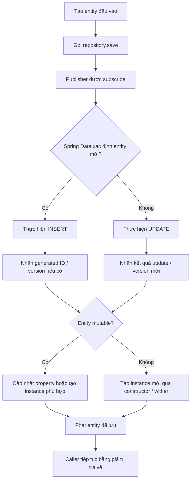

# Phân biệt thực thể được truyền vào với thực thể được trả về sau khi lưu

Trong Spring Data R2DBC, phương thức `save()` nhận một entity và trả về một publisher chứa entity đã được lưu. Entity được truyền vào và entity được phát ra từ `save()` có thể là cùng một object hoặc hai object khác nhau, tùy cách entity được thiết kế và cách Spring Data cập nhật các giá trị do database sinh ra.

Điểm này đặc biệt quan trọng với entity bất biến. Một record hoặc class chỉ có field `final` không thể được cập nhật trực tiếp khi database sinh khóa chính hay khi version thay đổi. Spring Data có thể tạo một instance mới chứa các giá trị mới và phát instance đó qua `Mono` hoặc `Flux`.

Vì vậy, hãy luôn tiếp tục xử lý bằng entity được trả về từ `save()`. Đừng giả định object đầu vào đã được thay đổi tại chỗ hoặc đã có ID mới ngay sau khi gọi phương thức.

## 1. `save()` làm gì trong Spring Data R2DBC?

Repository reactive thường khai báo `save()` thông qua `ReactiveCrudRepository`:

```java
public interface CustomerRepository
        extends ReactiveCrudRepository<Customer, Long> {
}
```

Phương thức `save()` có dạng tổng quát:

```java
<S extends T> Mono<S> save(S entity);
```

Nó nhận entity và trả về `Mono` chứa entity sau khi thao tác lưu hoàn tất. Với `saveAll()`, kết quả là một `Flux` chứa các entity đã lưu.

Spring Data cần quyết định entity đang đại diện cho một bản ghi mới hay một bản ghi đã tồn tại:

- Entity mới thường được lưu bằng thao tác `INSERT`.
- Entity đã tồn tại thường được lưu bằng thao tác `UPDATE`.

Đây là thao tác lưu theo trạng thái mới/cũ của entity, không phải một lệnh upsert tổng quát đảm bảo database tự chọn insert hay update theo mọi loại khóa duy nhất. Cách xác định trạng thái mới và câu SQL được thực thi phụ thuộc metadata của entity, chiến lược định danh và driver/database.

### 1.1. `save()` là reactive và lazy

Gọi `save()` chỉ tạo publisher mô tả thao tác. Việc truy cập database bắt đầu khi publisher được subscribe.

```java
Customer customer = new Customer(null, "Lan", "lan@example.com");

Mono<Customer> result = repository.save(customer);
```

Ở thời điểm tạo biến `result`, không nên giả định câu SQL đã được thực thi hoặc `customer` đã có ID. Thao tác sẽ chạy khi publisher được framework web, một pipeline khác hoặc một subscriber tiêu thụ.

Trong ứng dụng reactive, hãy kết hợp publisher bằng `map`, `flatMap`, `zip` và các toán tử phù hợp. Không gọi `.block()` chỉ để lấy entity đồng bộ trong luồng request WebFlux.

## 2. Entity được truyền vào và entity được trả về khác nhau ở đâu?

Có thể phân biệt hai vai trò:

| Entity | Ý nghĩa |
| --- | --- |
| Entity đầu vào | Object mà ứng dụng truyền cho `save()`; nó thể hiện dữ liệu và trạng thái trước khi lưu |
| Entity đầu ra | Object được phát ra khi thao tác lưu hoàn tất; nó có thể chứa ID, version hoặc các giá trị đã được cập nhật trong quá trình lưu |

Với entity mutable, Spring Data có thể ghi giá trị mới vào field hoặc property của object đầu vào. Khi đó entity được trả về thường có cùng tham chiếu với object đầu vào.

Với entity immutable, Spring Data không thể thay đổi field bất biến tại chỗ. Framework tạo một instance mới thông qua constructor, wither hoặc cơ chế copy phù hợp rồi trả instance đó. Entity đầu vào vẫn giữ giá trị ban đầu.

Không nên viết code phụ thuộc vào việc hai biến có cùng tham chiếu hay không. Hãy coi giá trị trả về là phiên bản entity có hiệu lực sau khi lưu.

## 3. Ví dụ với entity mutable

Entity mutable có thể thay đổi các thuộc tính sau khi được tạo:

```java
import org.springframework.data.annotation.Id;
import org.springframework.data.relational.core.mapping.Table;

@Table("customers")
public class Customer {

    @Id
    private Long id;

    private String name;
    private String email;

    public Customer() {
    }

    public Customer(Long id, String name, String email) {
        this.id = id;
        this.name = name;
        this.email = email;
    }

    public Long getId() {
        return id;
    }

    public void setId(Long id) {
        this.id = id;
    }

    public String getName() {
        return name;
    }

    public void setName(String name) {
        this.name = name;
    }

    public String getEmail() {
        return email;
    }

    public void setEmail(String email) {
        this.email = email;
    }
}
```

Giả sử database sinh `id` khi insert. Có thể gọi:

```java
Customer input = new Customer(null, "Lan", "lan@example.com");

return repository.save(input)
        .map(saved -> {
            log.info("Saved customer id={}", saved.getId());
            return saved;
        });
```

Spring Data có thể điền ID được sinh vào entity mutable và phát entity đã lưu. Tuy nhiên, nên đọc ID từ biến `saved` trong pipeline. Điều này giúp code không phụ thuộc vào chi tiết liệu framework có sửa trực tiếp object đầu vào hay trả một instance khác.

Không nên viết:

```java
repository.save(input);
return input;
```

Đoạn code này bỏ qua publisher từ `save()`. Vì publisher lazy nên thao tác lưu có thể chưa được thực thi; ngay cả khi đã được subscribe ở nơi khác, `input` cũng không phải nguồn đáng tin cậy để lấy các giá trị mới sau lưu.

## 4. Ví dụ với entity immutable

Entity immutable không cho phép thay đổi trạng thái sau khi khởi tạo. Đây là thiết kế hữu ích khi muốn object dễ dự đoán, tránh thay đổi ngoài ý muốn và biểu diễn dữ liệu theo giá trị.

### 4.1. Dùng Java record

```java
import org.springframework.data.annotation.Id;
import org.springframework.data.relational.core.mapping.Table;

@Table("customers")
public record Customer(
        @Id Long id,
        String name,
        String email
) {
}
```

Tạo entity mới:

```java
Customer input = new Customer(null, "Lan", "lan@example.com");
```

Khi lưu, database có thể sinh ID. Record không có setter và component `id` không thể thay đổi sau khi tạo. Spring Data sử dụng cơ chế tạo instance mới với ID đã nhận được và phát instance đó từ `save()`.

```java
return repository.save(input)
        .doOnNext(saved -> {
            log.info("Generated id: {}", saved.id());
        });
```

Sau khi lưu:

- `input.id()` vẫn là `null`.
- `saved.id()` chứa ID được database sinh nếu driver và cấu hình hỗ trợ trả về giá trị đó.
- `saved` là entity cần tiếp tục sử dụng trong các bước nghiệp vụ tiếp theo.

### 4.2. Dùng class immutable và wither

Với class thông thường, có thể cung cấp một wither để tạo instance mới có giá trị được cập nhật:

```java
@Table("customers")
public class Customer {

    @Id
    private final Long id;
    private final String name;
    private final String email;

    @PersistenceCreator
    public Customer(Long id, String name, String email) {
        this.id = id;
        this.name = name;
        this.email = email;
    }

    public Customer withId(Long newId) {
        return new Customer(newId, name, email);
    }

    public Long getId() {
        return id;
    }

    public String getName() {
        return name;
    }

    public String getEmail() {
        return email;
    }
}
```

`withId()` không sửa object hiện tại. Nó tạo một object mới với cùng dữ liệu nghiệp vụ nhưng có ID khác. Spring Data có thể sử dụng wither hoặc cơ chế tạo bản sao tương ứng để áp dụng giá trị được sinh.

Khi dùng immutable entity, hãy đưa các thuộc tính cần thiết vào persistence constructor và cung cấp wither cho giá trị mà framework cần cập nhật sau insert/update nếu thiết kế entity yêu cầu.

## 5. Khóa chính được sinh tự động

Một bảng có identity/auto-increment thường sinh khóa chính khi insert. Entity đầu vào thường để ID là `null`:

```java
Customer draft = new Customer(null, "Lan", "lan@example.com");
```

Sau khi lưu, database trả giá trị được sinh thông qua cơ chế generated values mà driver hỗ trợ. Spring Data gán giá trị đó vào entity được lưu và phát entity qua publisher.

```java
Mono<Customer> savedPublisher = repository.save(draft);

return savedPublisher.flatMap(saved -> {
    Long generatedId = saved.getId();
    return auditService.recordCustomerCreated(generatedId)
            .thenReturn(saved);
});
```

Ví dụ này minh họa cách dùng ID sau khi insert hoàn tất. `flatMap` chỉ chạy sau khi `save()` phát ra entity đã lưu.

### 5.1. Không đọc ID quá sớm

Đoạn code sau không an toàn:

```java
Customer input = new Customer(null, "Lan", "lan@example.com");
Mono<Customer> saved = repository.save(input);

Long id = input.getId(); // Chưa có bảo đảm ID đã được sinh.
```

Publisher chưa chắc đã được subscribe, do đó câu SQL có thể chưa chạy. Ngay cả khi publisher được subscribe ở nơi khác, với entity immutable thì object đầu vào vẫn giữ ID cũ.

Hãy đọc ID trong callback xử lý giá trị phát ra:

```java
return repository.save(input)
        .map(saved -> saved.getId());
```

### 5.2. Không tự gán ID nếu database chịu trách nhiệm sinh ID

Nếu ứng dụng gán một ID khác `null` cho entity, Spring Data có thể xem entity là đã tồn tại và chọn thao tác update, tùy chiến lược xác định trạng thái mới/cũ. Vì vậy, với khóa chính do database sinh, hãy để ID ở trạng thái mới theo quy ước của entity.

Nếu nghiệp vụ cần ID do ứng dụng cấp, chẳng hạn UUID, hãy cấu hình chiến lược newness rõ ràng để Spring Data vẫn nhận biết entity cần insert.

## 6. Cách Spring Data xác định entity mới hay đã tồn tại

`save()` cần biết nên insert hay update. Spring Data Relational sử dụng cơ chế xác định trạng thái mới của entity trước khi thực hiện thao tác.

### 6.1. Dựa vào thuộc tính `@Id`

Với entity thông thường không có version property và không triển khai `Persistable`, giá trị ID là căn cứ quan trọng:

- ID là `null`: entity thường được xem là mới và được insert.
- ID có giá trị: entity thường được xem là đã tồn tại và được update.

Với ID kiểu primitive, không thể biểu diễn `null`; giá trị mặc định như `0` có thể được dùng để nhận biết trạng thái mới theo chiến lược của Spring Data. Dù vậy, wrapper như `Long` thường diễn đạt rõ ràng hơn khi ID được database sinh.

### 6.2. Thuộc tính `@Version`

Nếu entity có thuộc tính `@Version`, Spring Data có thể dùng version để xác định trạng thái mới trước khi xét ID. Giá trị version chưa được khởi tạo (ví dụ `null`, hoặc giá trị mặc định phù hợp với kiểu primitive) biểu thị entity mới theo chiến lược version.

Version cũng được dùng để thực hiện optimistic locking khi update. Khi lưu thành công, version được cập nhật và entity trả về chứa giá trị version mới.

```java
@Table("customers")
public record Customer(
        @Id Long id,
        @Version Long version,
        String name
) {
}
```

Khi làm việc với version, hãy luôn sử dụng entity được trả về từ `save()` cho lần cập nhật tiếp theo. Dùng lại entity cũ có thể gửi version lỗi thời và dẫn đến lỗi optimistic locking.

### 6.3. Dùng `Persistable` khi ID được ứng dụng gán

Với UUID hoặc khóa chính do ứng dụng tạo trước khi insert, ID đã có giá trị ngay cả khi bản ghi chưa tồn tại. Nếu chỉ dựa vào ID, Spring Data có thể xem entity là cũ và thực hiện update.

Trong trường hợp đó, entity có thể triển khai `Persistable<ID>` để tự cung cấp trạng thái mới thông qua `isNew()`:

```java
public class Customer implements Persistable<UUID> {

    @Id
    private UUID id;

    @Transient
    private boolean newEntity = true;

    private String name;

    @Override
    public UUID getId() {
        return id;
    }

    @Override
    public boolean isNew() {
        return newEntity;
    }

    // Constructor, getter và các phương thức cập nhật trạng thái được lược bớt.
}
```

`@Transient` đánh dấu cờ `newEntity` không phải cột database. Khi triển khai cách này, ứng dụng phải quản lý thời điểm cờ chuyển sang `false` sau khi lưu thành công, thông qua lifecycle callback hoặc cơ chế phù hợp với thiết kế. Nếu cờ luôn là `true`, những lần `save()` tiếp theo có thể tiếp tục được xem là insert.

Không cần triển khai `Persistable` cho entity dùng ID database sinh theo quy ước thông thường. Chỉ dùng khi chiến lược định danh của ứng dụng cần kiểm soát newness rõ ràng.

## 7. Version và entity trả về sau khi update

`@Version` hỗ trợ optimistic locking. Khi hai thao tác cùng cập nhật một bản ghi, version giúp phát hiện trường hợp một thao tác đang dùng dữ liệu cũ.

Ví dụ entity:

```java
@Table("customers")
public class Customer {

    @Id
    private final Long id;

    @Version
    private final Long version;

    private final String name;

    @PersistenceCreator
    public Customer(Long id, Long version, String name) {
        this.id = id;
        this.version = version;
        this.name = name;
    }

    public Customer withVersion(Long newVersion) {
        return new Customer(id, newVersion, name);
    }

    public Long getId() {
        return id;
    }

    public Long getVersion() {
        return version;
    }

    public String getName() {
        return name;
    }
}
```

Khi update thành công, version tăng theo quy tắc của Spring Data Relational. Với immutable entity, giá trị version mới được đặt vào instance mới. Hãy dùng entity phát ra từ `save()` thay cho entity trước khi update.

Nếu database phát hiện không có hàng nào khớp với ID và version dự kiến, Spring Data có thể phát sinh `OptimisticLockingFailureException`. Đây là tín hiệu cho biết entity đã cũ hoặc bản ghi đã bị thay đổi/xóa bởi một thao tác khác.

## 8. Tiếp tục pipeline bằng entity đã lưu

Vì `save()` trả về publisher, cách đúng là kết hợp các thao tác phụ thuộc vào ID hoặc version mới bên trong pipeline.

### 8.1. Dùng `flatMap` khi bước tiếp theo cũng bất đồng bộ

```java
public Mono<CustomerView> createCustomer(CreateCustomerRequest request) {
    Customer customer = new Customer(null, request.name(), request.email());

    return customerRepository.save(customer)
            .flatMap(saved -> preferenceService.createDefault(saved.getId())
                    .thenReturn(new CustomerView(
                            saved.getId(),
                            saved.getName(),
                            saved.getEmail()
                    )));
}
```

`flatMap` nhận entity đã lưu, sau đó gọi service khác bằng ID thực tế. Không cần chặn luồng để chờ kết quả từ repository.

### 8.2. Dùng `map` khi chỉ chuyển đổi giá trị

```java
public Mono<CustomerResponse> create(CreateCustomerRequest request) {
    Customer customer = new Customer(null, request.name(), request.email());

    return repository.save(customer)
            .map(saved -> new CustomerResponse(
                    saved.getId(),
                    saved.getName(),
                    saved.getEmail()
            ));
}
```

`map` phù hợp khi bước tiếp theo là phép chuyển đổi đồng bộ, ví dụ tạo DTO từ entity đã lưu.

### 8.3. Trả entity đã lưu từ controller

```java
@PostMapping("/customers")
public Mono<Customer> create(@RequestBody CreateCustomerRequest request) {
    Customer customer = new Customer(null, request.name(), request.email());
    return repository.save(customer);
}
```

Spring WebFlux subscribe publisher và ghi giá trị được phát ra vào HTTP response. Controller không cần gọi `.block()` hoặc tự subscribe.

### 8.4. Không tách subscription khỏi luồng chính

Một anti-pattern khác là:

```java
public Customer create(CreateCustomerRequest request) {
    Customer customer = new Customer(null, request.name(), request.email());
    repository.save(customer).subscribe();
    return customer;
}
```

Đoạn code này tạo subscription độc lập, trả object đầu vào ngay lập tức và không chờ kết quả lưu. Lỗi database có thể không được truyền về caller, ID có thể chưa có, và transaction/request context có thể không còn như mong đợi.

Hãy trả publisher từ service/controller hoặc kết hợp publisher trong một pipeline có chủ sở hữu rõ ràng.

## 9. `saveAll()` cũng trả về các entity sau lưu

Với nhiều entity, `saveAll()` trả về `Flux<S>`:

```java
Flux<Customer> saveAll(Iterable<Customer> entities);
```

Khi database sinh ID hoặc entity immutable cần được tạo lại, các phần tử phát ra từ `saveAll()` là nguồn dữ liệu cần dùng tiếp.

```java
return repository.saveAll(customers)
        .map(saved -> new CustomerSummary(saved.getId(), saved.getName()))
        .collectList();
```

Đừng bỏ qua `Flux` kết quả và tiếp tục xử lý danh sách đầu vào với giả định mọi object đã được cập nhật. Ngoài ra, `saveAll()` không nhất thiết là một transaction nguyên tử cho toàn bộ danh sách trừ khi ứng dụng đặt ranh giới transaction phù hợp.

## 10. `save()` không phải cơ chế refresh entity

Spring Data Relational không có persistence context kiểu JPA để tự động theo dõi mọi thay đổi object và đồng bộ lại object khi database thay đổi.

`save()` thực hiện insert hoặc update theo trạng thái entity và trả entity sau thao tác lưu. Không nên mặc định nó sẽ tải lại toàn bộ hàng sau khi database chạy trigger, computed column hoặc cập nhật các cột khác.

Nếu cần giá trị do database tính toán hoặc cập nhật ngoài những giá trị Spring Data nhận được từ thao tác lưu, hãy truy vấn lại một cách rõ ràng:

```java
return repository.save(customer)
        .flatMap(saved -> repository.findById(saved.getId()));
```

Khả năng trả về generated values ngoài ID phụ thuộc database, driver và câu lệnh được tạo. Nếu nghiệp vụ phụ thuộc vào giá trị default hoặc trigger, hãy kiểm tra hành vi của database/driver và thực hiện select sau lưu khi cần.

## 11. Những lỗi thường gặp

| Triệu chứng | Nguyên nhân | Cách xử lý |
| --- | --- | --- |
| ID vẫn là `null` sau khi gọi `save()` | Publisher chưa được subscribe hoặc code đang đọc entity đầu vào quá sớm | Đọc ID từ entity phát ra trong `map`/`flatMap` |
| ID của entity đầu vào vẫn null | Entity immutable và Spring Data trả một instance mới | Dùng entity được trả về từ `save()` |
| Bản ghi mới bị xử lý như update | ID đã có giá trị và newness detection xem entity là cũ | Kiểm tra ID, `@Version` hoặc triển khai `Persistable` khi cần |
| Nhiều lần insert cùng một entity | `Persistable.isNew()` vẫn trả về `true` sau lần lưu đầu | Cập nhật trạng thái newness sau khi lưu thành công |
| Update dùng version cũ bị lỗi | Caller tiếp tục dùng entity trước khi save | Dùng entity trả về có version mới |
| Lỗi không được truyền về controller | Service gọi `subscribe()` độc lập rồi trả object đồng bộ | Trả publisher và kết hợp trong pipeline |
| Trigger/default column chưa xuất hiện trên object | Save không tự refresh mọi cột database | Query lại bản ghi khi cần giá trị sau trigger/default |
| `save()` không insert dù ID đã được gán | Spring Data xem entity là đã tồn tại | Chọn chiến lược newness phù hợp với ID do ứng dụng cấp |

## 12. Kiểm thử sự khác nhau giữa entity đầu vào và entity đầu ra

Nên kiểm thử hành vi này với database R2DBC thực tế, nhất là khi entity bất biến hoặc dùng generated ID/version.

### 12.1. Kiểm thử entity mutable

```java
@DataR2dbcTest
class CustomerRepositoryTest {

    @Autowired
    CustomerRepository repository;

    @Test
    void shouldReturnSavedCustomerWithGeneratedId() {
        Customer input = new Customer(null, "Lan", "lan@example.com");

        StepVerifier.create(repository.save(input))
                .assertNext(saved -> {
                    assertThat(saved.getId()).isNotNull();
                    assertThat(saved.getName()).isEqualTo("Lan");
                })
                .verifyComplete();
    }
}
```

Test này kiểm tra kết quả từ publisher có ID và dữ liệu nghiệp vụ phù hợp. Không cần khẳng định `saved == input`, vì identity của object không phải hợp đồng mà code nghiệp vụ nên phụ thuộc.

### 12.2. Kiểm thử entity immutable

Với record hoặc class immutable, có thể kiểm tra object đầu vào vẫn giữ giá trị cũ và entity trả về có ID:

```java
@Test
void shouldUseReturnedRecordAfterInsert() {
    Customer input = new Customer(null, "Lan", "lan@example.com");

    StepVerifier.create(repository.save(input))
            .assertNext(saved -> {
                assertThat(input.id()).isNull();
                assertThat(saved.id()).isNotNull();
                assertThat(saved.name()).isEqualTo(input.name());
            })
            .verifyComplete();
}
```

Test này cần entity `Customer` là record và database có cơ chế sinh ID tương thích với driver. Nó minh họa vì sao caller phải dùng giá trị được phát ra từ `save()`.

### 12.3. Kiểm thử version

Với entity có `@Version`, hãy kiểm tra version ban đầu, version sau insert và version sau update theo quy tắc của phiên bản Spring Data đang dùng. Đồng thời kiểm tra trường hợp hai bản sao cùng version cạnh tranh update để xác nhận optimistic locking hoạt động như mong đợi.

Không nên hardcode một giả định version cho mọi kiểu dữ liệu và phiên bản. Dùng assertion dựa trên chiến lược version được cấu hình trong dự án.

## 13. Hướng dẫn chọn cách sử dụng

| Tình huống | Cách làm |
| --- | --- |
| Entity mutable, database sinh ID | Dùng entity phát ra từ `save()` để lấy ID và xử lý tiếp |
| Entity immutable hoặc Java record | Luôn thay object đầu vào bằng entity trả về trong pipeline |
| Entity có `@Version` | Dùng entity trả về sau mỗi lần lưu để giữ version mới nhất |
| Ứng dụng gán UUID trước insert | Cấu hình newness rõ ràng, cân nhắc `Persistable` |
| Cần gọi service khác bằng ID vừa sinh | Dùng `flatMap` sau `save()` |
| Chỉ cần tạo DTO từ entity vừa lưu | Dùng `map` sau `save()` |
| Cần giá trị do trigger/default cập nhật | Query lại sau lưu nếu driver không trả các giá trị đó |
| Lưu nhiều entity | Tiêu thụ các phần tử từ `saveAll()` thay vì giả định input list đã được cập nhật |

## 14. Luồng xử lý từ entity đầu vào đến entity sau lưu



Sơ đồ thể hiện luồng khái quát. Chi tiết câu SQL, generated values và cách cập nhật object phụ thuộc mapping metadata, kiểu entity và khả năng của driver/database.

## 15. Kết luận

Trong Spring Data R2DBC, entity truyền vào `save()` là trạng thái trước khi lưu; entity được phát ra từ publisher là trạng thái sau thao tác lưu. Với entity mutable, Spring Data có thể cập nhật các thuộc tính trên object. Với entity immutable, framework tạo một instance mới để mang ID, version hoặc giá trị được cập nhật.

Hãy luôn trả về và sử dụng entity từ `save()` hoặc `saveAll()`. Đọc ID và version trong `map`/`flatMap` sau khi publisher phát ra kết quả, xác định rõ chiến lược entity mới/cũ khi dùng ID tự sinh ở ứng dụng, và query lại khi cần các giá trị database không được trả về từ thao tác lưu. Cách làm này giúp pipeline reactive giữ đúng dữ liệu và tránh lỗi do sử dụng object đầu vào đã lỗi thời.
