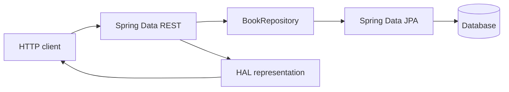

# From Domain Model to Repository, Collection Resource, and Item Resource

Spring Data REST turns Spring Data repositories allowed to be exported into a REST API discoverable through hypermedia links. Starting from a **Book** entity and a **BookRepository** interface, an application can provide a collection resource **/books**, an item resource **/books/{id}**, CRUD operations, and search resources without writing a separate CRUD controller.

This article follows the flow: domain model → repository → exported endpoints → HAL representation → operations on collection and item resources.

## 1. Four concepts to distinguish

| Component | Role | Example |
|---|---|---|
| Domain model | Describes data and relationships in the business domain | **Book**, containing **id**, **title**, **isbn** |
| Repository | Provides data query and persistence operations | **BookRepository extends JpaRepository<Book, Long>** |
| Collection resource | Represents a set of entities | **GET /books**, **POST /books** |
| Item resource | Represents a specific entity | **GET /books/1**, **PATCH /books/1** |

High-level processing flow:



Entities and repositories still belong to the Spring Data model. Spring Data REST is the layer that exports repositories as HTTP resources, maps appropriate repository operations to HTTP methods, and builds links for clients to discover the API.

## 2. Creating a sample application

The example uses Java 17, Spring Boot 3.5.x, Spring Data JPA, and H2 so it can run standalone. Use the Spring Boot parent to manage compatible starter versions.

Minimal structure:

```text
books-rest/
├── pom.xml
└── src/
    └── main/
        ├── java/com/example/books/
        │   ├── BookApiApplication.java
        │   ├── Book.java
        │   └── BookRepository.java
        └── resources/
            └── application.properties
```

**pom.xml**

```xml
<project xmlns="http://maven.apache.org/POM/4.0.0"
         xmlns:xsi="http://www.w3.org/2001/XMLSchema-instance"
         xsi:schemaLocation="http://maven.apache.org/POM/4.0.0
         https://maven.apache.org/xsd/maven-4.0.0.xsd">
    <modelVersion>4.0.0</modelVersion>

    <parent>
        <groupId>org.springframework.boot</groupId>
        <artifactId>spring-boot-starter-parent</artifactId>
        <version>3.5.5</version>
        <relativePath/>
    </parent>

    <groupId>com.example</groupId>
    <artifactId>books-rest</artifactId>
    <version>0.0.1-SNAPSHOT</version>

    <properties>
        <java.version>17</java.version>
    </properties>

    <dependencies>
        <dependency>
            <groupId>org.springframework.boot</groupId>
            <artifactId>spring-boot-starter-data-jpa</artifactId>
        </dependency>
        <dependency>
            <groupId>org.springframework.boot</groupId>
            <artifactId>spring-boot-starter-data-rest</artifactId>
        </dependency>
        <dependency>
            <groupId>com.h2database</groupId>
            <artifactId>h2</artifactId>
            <scope>runtime</scope>
        </dependency>
    </dependencies>
</project>
```

**src/main/resources/application.properties**

```properties
spring.datasource.url=jdbc:h2:mem:bookdb;DB_CLOSE_DELAY=-1
spring.datasource.username=sa
spring.datasource.password=
spring.jpa.hibernate.ddl-auto=create-drop
```

**spring-boot-starter-data-rest** enables Spring Data REST auto-configuration in a Spring Boot application. **spring-boot-starter-data-jpa** provides JPA repositories and database connectivity. H2 creates an in-memory database for testing.

## 3. Declaring the domain model

**Book.java**

```java
package com.example.books;

import jakarta.persistence.Column;
import jakarta.persistence.Entity;
import jakarta.persistence.GeneratedValue;
import jakarta.persistence.GenerationType;
import jakarta.persistence.Id;
import jakarta.persistence.Table;

@Entity
@Table(name = "books")
public class Book {

    @Id
    @GeneratedValue(strategy = GenerationType.IDENTITY)
    private Long id;

    @Column(nullable = false)
    private String title;

    @Column(nullable = false, unique = true)
    private String isbn;

    protected Book() {
        // No-arg constructor for JPA.
    }

    public Book(String title, String isbn) {
        this.title = title;
        this.isbn = isbn;
    }

    public Long getId() {
        return id;
    }

    public String getTitle() {
        return title;
    }

    public void setTitle(String title) {
        this.title = title;
    }

    public String getIsbn() {
        return isbn;
    }

    public void setIsbn(String isbn) {
        this.isbn = isbn;
    }
}
```

**Book** is an entity mapped by JPA to the **books** table. **id** is the database-generated primary key. The two properties **title** and **isbn** hold business data. The no-arg constructor lets JPA instantiate the entity; the other constructor helps create sample data.

Spring Data REST uses the domain model and Spring Data metadata to generate representations. With this simple entity, **title** and **isbn** appear in JSON. The primary key is normally expressed through the URI in the **self** link rather than appearing as a regular JSON property.

## 4. Declaring the repository and exporting it as a REST resource

**BookRepository.java**

```java
package com.example.books;

import org.springframework.data.domain.Page;
import org.springframework.data.domain.Pageable;
import org.springframework.data.jpa.repository.JpaRepository;
import org.springframework.data.repository.query.Param;
import org.springframework.data.rest.core.annotation.RepositoryRestResource;
import org.springframework.data.rest.core.annotation.RestResource;

@RepositoryRestResource(
    collectionResourceRel = "books",
    path = "books"
)
public interface BookRepository extends JpaRepository<Book, Long> {

    @RestResource(path = "by-title", rel = "by-title")
    Page<Book> findByTitleContainingIgnoreCase(
        @Param("title") String title,
        Pageable pageable
    );
}
```

**JpaRepository<Book, Long>** provides save, find, pagination, and delete operations for the **Book** entity. Spring Data generates the implementation at application startup; you do not need to write a repository implementation class manually.

**@RepositoryRestResource** marks the repository as exported and lets you configure the collection relation name and path. Here:

- **path = "books"** sets the collection path to **/books**.
- **collectionResourceRel = "books"** sets the HAL relation name for elements in the collection to **books**.

Without customization, Spring Data REST typically derives the path from the simple name of the domain class by lowercasing and pluralizing it. Thus, the **Book** entity normally gets the collection path **/books**.

The **findByTitleContainingIgnoreCase** method is a derived query method. Spring Data JPA derives the search condition from the method name. Spring Data REST exports this method as a query resource at **/books/search/by-title**. **@RestResource** sets a readable path and relation name; **@Param("title")** defines a stable query parameter name.

## 5. Starting the application and seeding sample data

**BookApiApplication.java**

```java
package com.example.books;

import java.util.List;

import org.springframework.boot.CommandLineRunner;
import org.springframework.boot.SpringApplication;
import org.springframework.boot.autoconfigure.SpringBootApplication;
import org.springframework.context.annotation.Bean;

@SpringBootApplication
public class BookApiApplication {

    public static void main(String[] args) {
        SpringApplication.run(BookApiApplication.class, args);
    }

    @Bean
    CommandLineRunner seedBooks(BookRepository repository) {
        return args -> {
            if (repository.count() == 0) {
                repository.saveAll(List.of(
                    new Book("Clean Code", "9780132350884"),
                    new Book("Effective Java", "9780134685991")
                ));
            }
        };
    }
}
```

Run the application from the directory containing **pom.xml**:

```bash
mvn spring-boot:run
```

After the application starts, the API is located at the root path **/** by default. You can start exploring from the root resource:

```bash
curl -i -H "Accept: application/hal+json" http://localhost:8080/
```

The root resource returns links to exported resources. With the repository above, look for the **books** relation inside **_links**; the client uses that relation's URL to access the collection. The root resource may also provide a **profile** relation to discover API metadata.

## 6. Collection resource: /books

The collection resource represents the set of **Book** instances managed by the repository.

### Reading the list

```bash
curl -i -H "Accept: application/hal+json" http://localhost:8080/books
```

The HAL response has the following general structure (actual URIs and IDs depend on the run):

```json
{
  "_embedded": {
    "books": [
      {
        "title": "Clean Code",
        "isbn": "9780132350884",
        "_links": {
          "self": {
            "href": "http://localhost:8080/books/1"
          }
        }
      },
      {
        "title": "Effective Java",
        "isbn": "9780134685991",
        "_links": {
          "self": {
            "href": "http://localhost:8080/books/2"
          }
        }
      }
    ]
  },
  "_links": {
    "self": {
      "href": "http://localhost:8080/books"
    }
  },
  "page": {
    "size": 20,
    "totalElements": 2,
    "totalPages": 1,
    "number": 0
  }
}
```

Key parts:

- **_embedded.books** holds the embedded items in the collection. The name **books** comes from **collectionResourceRel**.
- Each item has a **self** link pointing to the item resource's URI.
- **_links** contains links for the client to continue navigating.
- **page** contains pagination metadata. Page numbers start at **0**.

### Pagination and sorting

When a repository supports **Pageable** or **PagingAndSortingRepository**, the collection can accept the following parameters:

- **page**: page number, defaulting to **0**.
- **size**: number of elements per page, typically defaulting to **20**.
- **sort**: property and sort direction, such as **title,asc** or **title,desc**.

Example retrieving the first page, at most 5 books, sorted by title ascending:

```bash
curl -H "Accept: application/hal+json" "http://localhost:8080/books?page=0&size=5&sort=title,asc"
```

Paginated responses may provide **first**, **prev**, **self**, **next**, and **last** relations depending on the page position. Read these links from the response to navigate; there is no need to assemble the next page URL manually.

### Creating an entity

Use **POST** on the collection resource to create a new **Book**:

```bash
curl -i -X POST http://localhost:8080/books -H "Content-Type: application/json" -H "Accept: application/hal+json" --data-raw '{"title":"Refactoring","isbn":"9780201485677"}'
```

The request body contains the writable properties of the entity. Spring Data REST converts the request into an entity and invokes the repository's **save** operation. When creation succeeds, the response typically has status **201 Created** and a **Location** header pointing to the new item resource. Whether a response body is returned also depends on the **Accept** header and **returnBodyOnCreate** configuration.

The collection resource supports **GET** and **POST**. Sending **PUT**, **PATCH**, or **DELETE** directly to **/books** typically returns **405 Method Not Allowed**; those operations belong to item resources.

## 7. Item resource: /books/{id}

An item resource represents a single entity. If the book creation response returns **Location: http://localhost:8080/books/3**, that URI is the address for reading and updating the newly created item.

### Reading an entity

```bash
curl -i -H "Accept: application/hal+json" http://localhost:8080/books/1
```

The response includes the **Book** properties along with the **self** link:

```json
{
  "title": "Clean Code",
  "isbn": "9780132350884",
  "_links": {
    "self": {
      "href": "http://localhost:8080/books/1"
    }
  }
}
```

**GET /books/1** is handled via the repository's find-by-ID method, such as **findById**. If the ID does not exist, the client receives a corresponding error response instead of an entity.

### Full replacement with PUT

**PUT** represents submitting a replacement state for the item. Send all properties you want to retain:

```bash
curl -i -X PUT http://localhost:8080/books/1 -H "Content-Type: application/json" -H "Accept: application/hal+json" --data-raw '{"title":"Clean Code, Revised","isbn":"9780132350884"}'
```

Do not treat **PUT** as a single-field update. If properties are omitted, the new state may lose old values depending on binding behavior and the entity model.

### Partial update with PATCH

**PATCH** is used when you only want to change part of the state:

```bash
curl -i -X PATCH http://localhost:8080/books/1 -H "Content-Type: application/merge-patch+json" -H "Accept: application/hal+json" --data-raw '{"title":"Clean Code: Updated"}'
```

In this example only **title** is sent. Other properties are not requested to change. Spring Data REST supports patch media types such as **application/merge-patch+json** and **application/patch+json**; choose the media type matching the patch format sent by the client.

### Deleting an item

**DELETE /books/{id}** deletes the corresponding entity via the exported delete method:

```bash
curl -i -X DELETE http://localhost:8080/books/1
```

Because this operation modifies data, the client needs appropriate permissions. The response is typically **204 No Content** or **200 OK** depending on the **Accept** header and response body configuration.

### HTTP method mapping table

| Resource | HTTP method | Meaning |
|---|---|---|
| **/books** | **GET** | Read list, usually paginated |
| **/books** | **POST** | Create a new entity |
| **/books/{id}** | **GET** | Read a single entity |
| **/books/{id}** | **PUT** | Replace item state |
| **/books/{id}** | **PATCH** | Partially update item |
| **/books/{id}** | **DELETE** | Delete item |

**GET** usually returns **200 OK**; **POST** creating a new resource usually returns **201 Created**. Responses for **PUT**, **PATCH**, and **DELETE** may be **200 OK** or **204 No Content** depending on configuration and headers sent by the client.

## 8. Query resources: searching through repository methods

Spring Data REST can export repository query methods as read-only endpoints. With **findByTitleContainingIgnoreCase** above:

- **GET /books/search** lists exported query resources.
- **GET /books/search/by-title?title=clean** invokes the query finding titles containing **clean**, case-insensitively.
- You can add **page**, **size**, and **sort** because the method accepts **Pageable** and returns **Page<Book>**.

Example:

```bash
curl -H "Accept: application/hal+json" "http://localhost:8080/books/search/by-title?title=clean&page=0&size=10&sort=title,asc"
```

This is a query resource that only supports **GET**. The URL name and relation name can be customized with **@RestResource** on the method.

## 9. Links between domain objects

Suppose **Book** has an **author** relationship property pointing to an **Author** entity, and the application also exports **AuthorRepository**. The book item resource can provide an **author** relation pointing to the association resource:

```json
{
  "title": "Clean Code",
  "_links": {
    "self": {
      "href": "http://localhost:8080/books/1"
    },
    "author": {
      "href": "http://localhost:8080/books/1/author"
    }
  }
}
```

The client can call **GET /books/1/author** to read the relationship state. To assign an existing author to the book, the association resource accepts the author's URI as **text/uri-list**:

```bash
curl -i -X PUT http://localhost:8080/books/1/author -H "Content-Type: text/uri-list" --data "http://localhost:8080/authors/1"
```

For one-to-many or many-to-many relationships, **POST** to the association resource adds an element to the collection association. **PUT** assigns URIs to the association; **DELETE** removes the link if the relationship allows null/empty values. This is an operation on links between resources, distinct from creating a new entity with **POST /books**.

## 10. Customizing the exported API surface

Spring Data REST provides annotations and configuration to control the API:

- **@RepositoryRestResource(path = "books")**: sets the collection path.
- **collectionResourceRel = "books"**: sets the relation used inside **_embedded**.
- **@RestResource(path = "by-title", rel = "by-title")**: sets the path and relation for a query method.
- **@RepositoryRestResource(exported = false)**: does not export the repository.
- **@RestResource(exported = false)**: does not export the corresponding method or association.
- **spring.data.rest.base-path=/api**: sets the base path, turning **/books** into **/api/books**.

For example, to hide a method from the REST API while keeping it in the repository for internal code:

```java
@RestResource(exported = false)
@Override
void deleteById(Long id);
```

Use this override example only when the corresponding method exists in the parent interface and the signature matches the Spring Data version in use. For more complex exposure control requirements, configure **RepositoryRestConfigurer** or exposure configuration.

## 11. Data control and business boundaries

Exporting repositories can produce a CRUD API very quickly, but it also means exported methods become an HTTP surface that clients can invoke. Before taking the API to production, decide clearly:

1. Which repositories are allowed to be exported. Do not export a repository just because it exists in a package.
2. Which clients are allowed to read, create, edit, or delete each resource type. Integrate Spring Security and business authorization rules.
3. Which properties are allowed to appear in JSON. Do not let passwords, tokens, secrets, or internal data leak into responses.
4. Which methods are allowed to be called over HTTP. You can hide methods with **exported = false** or disable HTTP methods via exposure configuration.
5. Which business rules must run before writing. If an operation must check multiple conditions, coordinate multiple aggregates, or trigger side effects, place the logic in the service/domain layer and provide an appropriate endpoint instead of relying solely on default CRUD.

**@JsonIgnore** can prevent a property from being serialized normally, but a projection can re-expose that property if declared carelessly. A projection is a way to create a selective view; it does not replace authorization. Review every projection and every response containing sensitive data.

Spring Data REST works well when repository CRUD reflects the exact operations clients need. It does not automatically turn every business rule into a semantically rich API. For workflows such as payments, approvals, state transitions, or multi-step processes, a command endpoint via a controller/service usually expresses intent more clearly than exposing **save** or **delete** directly.

## 12. Common errors and how to check

| Symptom | Common cause | How to check |
|---|---|---|
| **/books** missing at root | Repository is not exported, not public, or marked **exported = false** | Check annotations and repository detection strategy |
| Receiving **405 Method Not Allowed** | Corresponding method is missing or hidden from REST exposure | Check repository methods and **@RestResource(exported = false)** |
| POST fails to create entity | JSON has wrong property names, missing required data, or violates database constraints | Check request body, validation, and error logs |
| No data visible in collection | Database has no records yet or query is paginated on another page | Call collection with **page=0**, check **page.totalElements** |
| Query resource does not appear | Repository has no exported query methods or method is hidden | Call **/books/search** and check annotations |
| Client hand-built URL fails | Path or relation has been customized | Start from the root resource and follow **_links** |
| Response has no body after write | **Accept** header or return-body configuration | Send **Accept: application/hal+json**; read **Location** after creation |
| Unwanted field exposed | Entity or projection is exporting that field | Check JSON, Jackson annotations, projections, and authorization |

When debugging, check in order: root resource → collection resource → item resource → query/association links. This helps determine whether the issue lies in repository exposure, data, methods, or relationships between resources.

## 13. Practice exercises

1. Add a **publicationYear** property to **Book**, restart the application, and observe the changes in **GET /books** and **GET /books/{id}**.
2. Add a **findByIsbn** query method and verify the new link in **GET /books/search**.
3. Hide a method using **@RestResource(exported = false)**, then try calling the corresponding HTTP method and explain the response.
4. Set **spring.data.rest.base-path=/api**, then re-discover the API starting from **/api**.
5. Create an **Author** entity, add the **Book.author** relationship, export **AuthorRepository**, and try reading/assigning the relationship via the association resource.

## References

- [Spring Data REST — Getting Started](https://docs.spring.io/spring-data/rest/reference/introduction/getting-started.html)
- [Spring Data REST — Repository Resources](https://docs.spring.io/spring-data/rest/reference/repository-resources.html)
- [Spring Data REST — Paging and Sorting](https://docs.spring.io/spring-data/rest/reference/paging-and-sorting.html)
- [Spring Data REST — Projections and Excerpts](https://docs.spring.io/spring-data/rest/reference/projections-excerpts.html)
