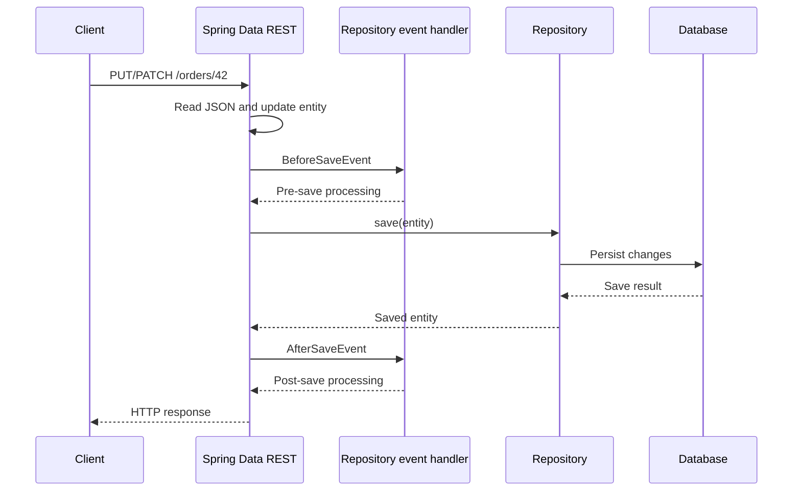

# BeforeSaveEvent and AfterSaveEvent When Updating Resources

When a client updates a resource exported by Spring Data REST using PUT or PATCH, the repository must receive the modified entity and perform a save operation. Spring Data REST publishes repository events around this operation so the application can attach logic at the exact moment needed. Two important events for the update flow are `BeforeSaveEvent` and `AfterSaveEvent`.

`BeforeSaveEvent` is published before the entity is saved; `AfterSaveEvent` is published after the repository's save operation has been called and returned. They provide extension points for tasks tied to the entity update lifecycle, such as preparing auxiliary data or recording changes.

## 1. Position of the Two Events in the Update Flow

For an item resource update request, the high-level flow is typically:



This diagram locates responsibilities at a high level. Specific steps also depend on the endpoint, repository implementation, transaction, and application configuration. GET does not pass through this update event pair. POST creating an entity normally publishes the `BeforeCreateEvent` / `AfterCreateEvent` pair. Association changes have their own `BeforeLinkSaveEvent` / `AfterLinkSaveEvent` pair.

The Save events are used when Spring Data REST processes an entity save operation under its corresponding lifecycle. A custom controller or service calling a repository directly does not automatically go through the same Spring Data REST event publishing flow; if events are needed in a custom path, the application must design appropriate event publishing.

## 2. BeforeSaveEvent: Processing Before Repository Save

`BeforeSaveEvent` allows the application to intervene on the entity before the repository performs the save. A handler can:

- Normalize input data, such as trimming whitespace on text fields.
- Assign server-managed metadata, if that is an appropriate responsibility for the lifecycle handler.
- Compute or update a derived value that must be saved with the entity.
- Perform additional checks required before the save operation.

Example:

```java
@Component
@RepositoryEventHandler(Order.class)
public class OrderEventHandler {

    @HandleBeforeSave
    public void beforeSave(Order order) {
        if (order.getReference() != null) {
            order.setReference(
                order.getReference().trim()
            );
        }
    }
}
```

`@RepositoryEventHandler(Order.class)` restricts the handler to the `Order` domain type. The `@HandleBeforeSave` annotation marks the method that handles the event before saving. Spring Data REST detects handlers registered in the application context and invokes the method matching the processed entity.

If the logic is simply a data rule that needs to return clear field errors, consider Bean Validation or a Spring `Validator` registered with the appropriate validator bean, such as `beforeSaveValidator`. Event handlers are better suited for lifecycle logic or entity preparation operations. Do not use a handler as a replacement for all domain validation.

If a handler throws an exception before saving, the request flow cannot proceed as a successful update. Exceptions must be mapped to an appropriate response; do not expose stack traces or internal details to the client.

## 3. AfterSaveEvent: Reacting After the Save Operation

`AfterSaveEvent` is published after the repository save returns. Handlers can use this event to perform post-processing work tied to the newly saved entity, for example:

- Writing an auxiliary audit record.
- Updating a read model or derived data within the same application.
- Publishing an application event for another component to process.
- Preparing information for a subsequent workflow.

Example:

```java
@Component
@RepositoryEventHandler(Order.class)
public class OrderEventHandler {

    @HandleAfterSave
    public void afterSave(Order order) {
        // Record update details or publish an internal event.
        // Keep the handler short and avoid long network tasks.
    }
}
```

The name `AfterSaveEvent` indicates that the repository save operation has completed at the repository API level. Do not automatically infer that any transaction wrapping the request has committed at the time the handler runs. Transactions may be managed at another layer or wrap the repository operation.

If a task must only run after the transaction commits successfully, use an appropriate transaction-aware event, such as `@TransactionalEventListener(phase = TransactionPhase.AFTER_COMMIT)`, and ensure the event is published inside an active transaction. This mechanism must be designed and tested against the application's actual transaction boundaries.

## 4. Registering Handlers and Separating Methods

A single handler can process both before and after events for the same entity:

```java
@Component
@RepositoryEventHandler(Order.class)
public class OrderEventHandler {

    @HandleBeforeSave
    public void beforeSave(Order order) {
        // Prepare the entity before saving.
    }

    @HandleAfterSave
    public void afterSave(Order order) {
        // React after repository save returns.
    }
}
```

Handlers can be split by responsibility if a domain type has multiple groups of logic. Regardless of how they are organized, handler methods should be small, easy to read, and inject only the dependencies they genuinely need.

Several notes on registration:

- The handler class must be a Spring bean, commonly using `@Component`.
- Use `@RepositoryEventHandler` to specify the domain type the handler processes.
- Use `@HandleBeforeSave` and `@HandleAfterSave` annotations on the respective methods.
- Ensure the package is component-scanned and the handler is present in the application context.
- Verify the exact entity type being handled, especially when inheritance is used or multiple repositories export the same domain type.

There is no need to register a generic listener for every event if you are only handling updates for one entity. Scoping handlers by type and event prevents logic from running unintentionally on other operations.

## 5. Distinguishing Save Events from Create and Link Events

Spring Data REST has multiple repository events; picking the wrong event can cause logic not to run or to run on an unexpected operation.

| Event | Timing | Common Scenario |
|---|---|---|
| `BeforeCreateEvent` | Before creating a new entity | POST creating an item |
| `AfterCreateEvent` | After creation operation | Post-processing after create |
| `BeforeSaveEvent` | Before saving an entity | PUT/PATCH updating an item |
| `AfterSaveEvent` | After save operation | Post-processing after update/save |
| `BeforeLinkSaveEvent` | Before saving association changes | Modifying links |
| `AfterLinkSaveEvent` | After saving association changes | Link post-processing |
| `BeforeDeleteEvent` | Before deleting an entity | DELETE |
| `AfterDeleteEvent` | After deletion operation | Post-processing after delete |

If you need handling specifically upon new creation, use Create events. If you need handling when a client attaches or changes associations, look at LinkSave events. Do not assume every entity-related change goes through `BeforeSaveEvent` / `AfterSaveEvent`.

## 6. Save Events and Validators Have Different Responsibilities

Both validators and event handlers can run before save, but their purposes differ:

| Mechanism | Primary Responsibility | Usage |
|---|---|---|
| `beforeSaveValidator` | Check whether the entity is valid before saving | Produce field/global errors and reject invalid data |
| `@HandleBeforeSave` | Execute pre-save lifecycle logic | Normalize or prepare the entity |
| `@HandleAfterSave` | React after repository save returns | Audit, publish application events, or update auxiliary data |

For example, the rule `quantity must be greater than 0` is validation. Normalizing a reference code before saving can be pre-save logic. Recording an "order was updated" event can be after-save logic or a domain event depending on the design.

Placing validation in the right place gives clients clear errors and prevents invalid data from reaching persistence. Event handlers should not silently fix every input error to make a request appear successful.

## 7. Transactions, Side Effects, and Error Handling

Before/after events do not create a new transaction on their own, nor does the event name define the full transaction boundary. Repository methods may run in their own transaction or participate in an enclosing transaction. Inspect the actual configuration before relying on rollback or commit timing.

Some practical guidelines:

1. Keep handlers short; avoid calling HTTP services or performing long network tasks on the request thread.
2. If updating data in the same database and atomicity is required, define the operation's transaction boundary explicitly.
3. If sending emails or messages to external systems, design for retries and duplicate events.
4. If notifications must only be sent after commit, use a transaction-aware listener or an appropriate outbox.
5. Do not assume an exception in after-save always has the same rollback outcome across all configurations; that depends on transaction boundaries and exception policies.
6. Do not perform irreversible side effects before knowing the primary change can commit successfully.

For example, a handler sending an email directly after save could send the email even if an outer transaction later rolls back, depending on how transactions and events are configured. For critical work, the outbox pattern helps persist events in the same data transaction and deliver them externally in a durable manner.

## 8. Testing BeforeSaveEvent and AfterSaveEvent

Test both that the handlers are invoked at the right time and the final state of the entity. Cases to cover include:

- PUT updating a valid item: before-save and after-save handlers are invoked according to the lifecycle.
- PATCH updating partial fields: handlers receive the entity after the request is applied as supported by the endpoint.
- POST creating a new item: confirm Create events are used per contract, not confused with update events.
- Association changes: confirm corresponding LinkSave events.
- Validator rejects data: repository does not complete a successful save.
- Before-save handler throws an exception: request is rejected according to exception mapping.
- After-save handler performs a side effect: verify transaction timing and failure behavior.
- Custom controller calling repository directly: confirm whether that path publishes events instead of assuming Spring Data REST lifecycle applies automatically.

Use integration tests with an HTTP client and repository test fixtures to verify events in the actual running web configuration. Unit tests calling handler methods directly do not prove that Spring Data REST publishes the events and registers the handler properly.

## 9. Implementation Checklist

1. Determine whether the operation is an item update, creation, deletion, or association change.
2. Use `@HandleBeforeSave` for logic that must run before repository save.
3. Use `@HandleAfterSave` for reactions after repository save returns.
4. Register the handler as a Spring bean and scope it with the appropriate domain type.
5. Put data rules in a validator or the domain layer; do not use event handlers as a substitute for validation.
6. Identify transaction boundaries before performing side effects.
7. Use an after-commit listener or outbox when external work must run only after commit.
8. Test against real Spring Data REST endpoints, including PUT/PATCH and related events.

`BeforeSaveEvent` and `AfterSaveEvent` provide two clear extension points around resource updates: one before the repository saves the entity and one after the save operation returns. Choosing the right events and keeping validators, transactions, and side effects in their proper responsibilities makes update flows in Spring Data REST easier to control and test.
