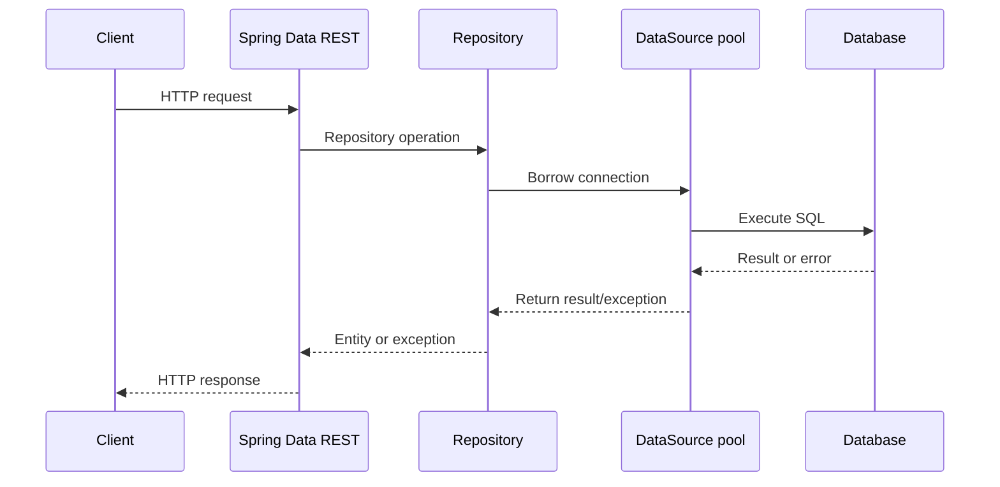

# Managing Timeouts, Connection Pools, and Datastore Errors in Spring Data REST

Spring Data REST exposes HTTP endpoints from Spring Data repositories, but the exporter itself does not manage the datastore's connection pool. With Spring Data JPA/JDBC, the path is typically HTTP request → Spring Data REST → repository → DataSource/connection pool → JDBC driver → database. When requests are slow or failing, identify which layer is waiting before changing timeouts or increasing pool sizes.



## 1. Distinguishing Timeout Types

Timeouts have different scopes. Setting one timeout does not automatically bound all steps in a request.

| Timeout Type | Where Controlled | Meaning |
|---|---|---|
| Waiting for a connection in the pool | HikariCP `connection-timeout` or equivalent pool property | Time spent waiting for an idle connection from the pool |
| Network connection to database | JDBC driver, URL/driver properties, TCP/network | Time to open a new connection or wait for data over the socket |
| SQL/query execution | Database, JDBC statement, JPA provider, or query hint | Time a statement or query is allowed to run |
| Transaction | Transaction manager, e.g. `@Transactional(timeout = 5)` | Transaction limit in seconds if supported by the transaction manager |
| HTTP/client/gateway | HTTP client, reverse proxy, load balancer | Time the caller waits for a response |

HikariCP `connection-timeout` only bounds the time spent borrowing a connection from the pool. When the pool reaches maximum size and no idle connections remain, `getConnection()` waits up to this duration and then throws SQLException. It does not replace the JDBC driver's connect timeout or socket/read timeout. If the database or network stops responding, configure timeouts at the driver and network infrastructure layers per your driver's documentation.

Similarly, an expired HTTP client timeout does not guarantee the server-side SQL statement was cancelled or the transaction rolled back. For write operations, design for idempotency and verify state before retrying when the client does not know whether the request committed.

## 2. Configuring the Connection Pool

### Which Pool Does Spring Boot Choose?

Spring Boot prefers HikariCP when it is on the classpath, falling back to Tomcat JDBC pool, Commons DBCP2, and Oracle UCP. Boot's JDBC/JPA starters typically pull in HikariCP automatically. Standard DataSource configuration lives under `spring.datasource.*`; Hikari-specific settings live under `spring.datasource.hikari.*`.

If the application declares its own DataSource bean, Spring Boot no longer performs standard DataSource auto-configuration. In that case, verify your custom pool setup and the property prefix of the actual implementation. With Spring Data MongoDB, Redis, or other datastores, use the corresponding driver's pool/client settings; `spring.datasource.hikari.*` applies only to Hikari JDBC.

The example below illustrates bounded values for a JDBC application. These numbers are illustrative only; tune them based on your database, instance count, and load test results:

```yaml
spring:
  datasource:
    url: jdbc:postgresql://localhost:5432/app
    hikari:
      connection-timeout: 3000
      validation-timeout: 1000
      maximum-pool-size: 12
      max-lifetime: 1740000
      leak-detection-threshold: 60000
```

| Property | Meaning and Usage |
|---|---|
| `connection-timeout` | Maximum wait time for an idle connection in the pool, in ms. Hikari defaults to 30 seconds; current minimum is 250 ms. Lowering this helps requests fail fast when the pool saturates, but does not fix slow queries or database outages. |
| `validation-timeout` | Time to validate that a connection is still alive; must be less than `connection-timeout`. |
| `maximum-pool-size` | Maximum total connections, including both active and idle connections. Once reached, new requests wait or time out. |
| `max-lifetime` | Maximum lifetime of a connection in the pool. Set slightly shorter than any connection lifetime limit imposed by the database, proxy, or network. |
| `leak-detection-threshold` | After this duration, Hikari logs a suspected connection leak. Disabled by default; enable temporarily during investigations, since valid long transactions can also trigger warnings. |

HikariCP can use `keepalive-time` to periodically test idle connections so they are not closed by the database or network due to inactivity. This value must be less than `max-lifetime`; keepalive affects idle connections only. Do not enable or tune these parameters by guesswork: check database/proxy and driver limits first.

### Choosing Pool Size

`maximum-pool-size` caps real connections to the database, not HTTP workers or concurrent users. Sum all connections that can be opened across every application instance, background job, migration, and operational tool; the total must fit within the database's `max_connections` budget.

Do not increase pool size immediately upon seeing timeouts. An oversized pool increases CPU, I/O, lock, and memory contention on the database, lowering throughput. Measure active/idle/waiting counts, query times, CPU, and locks at the database, then test several configurations with a load test matching production workloads. HikariCP recommends starting with a small pool and tuning via benchmarks rather than allocating one connection per request.

## 3. Keeping Connections and Transactions Short-Lived

Connections must be returned to the pool as soon as work finishes. `JdbcTemplate` manages acquiring and releasing JDBC resources automatically; when using raw JDBC directly, close connections, statements, and result sets with try-with-resources:

```java
try (Connection connection = dataSource.getConnection();
     PreparedStatement statement = connection.prepareStatement(sql);
     ResultSet resultSet = statement.executeQuery()) {

    while (resultSet.next()) {
        // Map the required results
    }
}
```

With JPA/repositories, watch out for long transactions, lazy loading outside transactions, unclosed streams/scrolls, and background tasks holding an entity manager open too long. Avoid calling HTTP services, writing files, or waiting on users while holding a transaction or connection. If external service calls are needed, consider splitting them before or after the transaction.

You can set a transaction timeout on service methods:

```java
@Transactional(timeout = 5)
public void updateInventory(...) {
    // Perform concise database operations
}
```

`@Transactional` timeout is measured in seconds and depends on the transaction manager. It does not replace JDBC driver, statement, or HTTP client timeouts. Also verify whether your transaction manager/provider propagates the timeout down to database operations as expected.

## 4. Classifying and Handling Datastore Errors

Spring translates many technology-specific exceptions such as SQLException, JPA, or Hibernate exceptions into a unified exception hierarchy rooted at `DataAccessException`. Translated exceptions retain the original exception as their cause, allowing logs and diagnostics to inspect SQLState/vendor codes without coupling business layers directly to a specific driver.

Common categories:

- `DataAccessResourceFailureException`: failure accessing the data resource, such as a database or connection outage.
- `DataIntegrityViolationException`: constraint, unique key, or data integrity violation.
- `QueryTimeoutException` or lock exceptions: statement/query exceeded timeout or failed to acquire a lock; exact subclasses depend on provider and driver.
- Other `DataAccessException`: persistence errors outside specific categories or unrecognized by the translator.

Do not assume every driver produces the exact same subclass. When diagnosing, log the exception type, root cause, SQLState/vendor code, pool name, request ID, and timestamp; never log passwords or secret connection details.

At the HTTP boundary, define a clear error contract:

- Invalid payloads or validation errors belong to client errors with documented status codes.
- Missing resources use status codes consistent with the API contract.
- Temporary database unavailability may be mapped to 503 Service Unavailable if the application explicitly defines that policy.
- Unexpected errors return 5xx; never leak SQL, stack traces, internal hostnames, usernames, or connection URLs in responses.

Spring Data REST has its own `RepositoryRestExceptionHandler`. If you need custom resource handlers, `@RepositoryRestController` lets you integrate with Spring Data REST's base path, message converters, and exception handling. Do not assume an arbitrary `@ControllerAdvice` will override the exporter's handler in the desired order; verify status codes and bodies with HTTP integration tests.

Retry only errors identified as transient, with bounded attempts and backoff plus jitter. Do not retry every `DataAccessException`; especially for writes, if the connection drops after the server committed, the client may not know the outcome. Retries require an idempotency key or state-verification mechanism to avoid duplicate writes.

## 5. Observing the Pool and Datastore in Production

Spring Boot Actuator provides the `db` health indicator to check whether a connection can be obtained from the DataSource. This is a useful signal for readiness/health, but does not replace saturation metrics. Health details are hidden from the public by default; enable details only for authenticated monitoring.

Actuator/Micrometer provides:

- Metrics prefixed with `jdbc.connections` containing active, idle, maximum, and minimum DataSource connection gauges.
- Hikari-specific metrics prefixed with `hikaricp`, tagged by pool name.
- Spring Data repository invocation metrics named `spring.data.repository.invocations` by default, tagged with repository, method, state, and exception.

During investigations, correlate pool metrics with HTTP latency, repository invocation duration/errors, slow queries, lock waits, database CPU, and database-side connection counts. Common pattern: active equals maximum, idle equals 0, and pending/waiting requests climb indicates pool saturation; if slow queries or long locks are the root cause, enlarging the pool usually just puts more requests into database contention.

Example enabling endpoints needed for monitoring; access must be restricted according to environment policy:

```properties
management.endpoints.web.exposure.include=health,metrics
management.endpoint.health.show-details=when-authorized
```

## 6. Testing Timeouts, Pools, and Errors

### Testing Pool Configuration Binding

This test verifies configuration properties are bound into `HikariDataSource`. The example assumes the application uses HikariCP and the test profile has an available database:

```java
@SpringBootTest(properties = {
    "spring.datasource.hikari.maximum-pool-size=12",
    "spring.datasource.hikari.connection-timeout=3000"
})
class HikariPoolConfigurationTest {

    @Autowired
    private HikariDataSource pool;

    @Test
    void appliesPoolLimits() {
        assertThat(pool.getMaximumPoolSize()).isEqualTo(12);
        assertThat(pool.getConnectionTimeout()).isEqualTo(3000L);
    }
}
```

### Testing Pool Exhaustion

Use a dedicated test pool with maximum size 1. Hold the first connection and request a second connection; the second call must fail after roughly the configured timeout. This test should not run inside a test transaction that already holds a connection:

```java
@SpringBootTest(properties = {
    "spring.datasource.hikari.maximum-pool-size=1",
    "spring.datasource.hikari.connection-timeout=300"
})
class HikariPoolExhaustionIT {

    @Autowired
    private HikariDataSource pool;

    @Test
    void timesOutWhenEveryConnectionIsBorrowed() throws SQLException {
        try (Connection held = pool.getConnection()) {
            assertThatThrownBy(() -> pool.getConnection())
                .isInstanceOf(SQLException.class);
        }
    }
}
```

A value of 300 ms is appropriate only for isolated tests because Hikari requires a minimum of 250 ms. The test needs a running database and direct access to `HikariDataSource`; if the application wraps the DataSource in a lazy proxy, unwrap the target pool bean or force SQL execution so the connection is actually borrowed.

### Testing Database Errors and HTTP Contracts

- Use Testcontainers with the same engine/version close to production to test constraints, locks, query timeouts, and database restart behavior. `@DataJpaTest` can be combined with `@AutoConfigureTestDatabase(replace = Replace.NONE)` so the container database is not replaced with an embedded database.
- For constraint errors, verify the repository throws an exception in the `DataIntegrityViolationException` family and the transaction rolls back properly.
- For query/lock timeouts, use the database/provider's native timeout mechanism and verify the statement terminates, the transaction releases, and the connection returns to the pool. Because this behavior is database-dependent, do not assume H2 represents every engine.
- For the REST error contract, induce a controlled datastore failure in a test profile or test fixture, send a request via MockMvc, and verify status/body against the application's error policy. If the application maps outages to 503, verify 503 and a safe body while confirming the response does not contain SQL, stack traces, or credentials.
- When testing connection loss and recovery, use a dedicated test database container. Never stop a shared database or an environment used by others.

Run tests with `./mvnw test` or `./gradlew test`; integration tests require the corresponding profile/container. Keep timeout tests independent, short-lived, bounded, and clean up resources with try-with-resources.

## 7. Troubleshooting

| Symptom | Possible Cause | How to Investigate |
|---|---|---|
| Hikari logs `Connection is not available, request timed out` | Pool reached maximum; slow queries/transactions; leaked connections; slow database | Inspect active/idle/max, waiting/pending, repository latency, slow queries, and locks; ensure all connections are closed |
| `Connection refused` or `Communications link failure` | Database down, DNS/firewall/TLS, driver connect/socket timeout, or dropped network | Check endpoint/port, DNS, routing, credentials, driver logs, and network timeouts; pool `connection-timeout` does not replace socket timeout |
| High active pool usage but low database CPU | Threads holding connections in long transactions, external calls inside transactions, or connection leaks | Inspect leak-detection stack traces, transaction durations, and external calls; shorten transactions and close resources |
| Increasing pool size worsens latency | Database contending on CPU/I/O/locks; too many connections | Measure load, query plans, locks, and connection budget; try a smaller pool before scaling up |
| Errors after idle periods | Database/proxy closed stale connections or TCP idle timeout | Align `max-lifetime` below server-side limits; consider keepalive per Hikari/driver/network settings |
| `actuator/health/db` reports DOWN | Cannot acquire connection or database unresponsive | Check cause in logs and protected health details; verify URL, driver, credentials, pool, and database |
| H2 passes but production database fails | Different dialect, constraints, isolation, locking, or native SQL | Run integration tests against the matching engine/version via Testcontainers |
| REST returns 500 on datastore error | Exception handler does not map per API contract or error fell back to generic failure | Inspect root cause and active handler; test status/body with MockMvc; return 503 only under explicit policy |
| Response leaks SQL or stack trace | Error response exposes internal details to clients | Keep details in internal logs, return stable messages without credentials/SQL, and add security assertions on response bodies |
| Pool metrics are missing | Actuator/Micrometer missing or endpoint not exposed/authorized | Check dependencies, registry, endpoint exposure, and access control; verify DataSource instrumentation |

## 8. Operations Checklist

- [ ] Confirm the actual DataSource implementation before using configuration prefixes.
- [ ] Distinguish pool acquisition, driver/network, query, transaction, and HTTP timeouts.
- [ ] Configure a finite connection timeout and a validation timeout smaller than connection timeout.
- [ ] Size maximum pool size according to the database's connection budget and instance count.
- [ ] Align max lifetime/keepalive with database and network limits.
- [ ] Close JDBC resources; keep transactions short; never wait on external services while holding a connection.
- [ ] Monitor active/idle/max, Hikari metrics, repository errors, query latency, and locks.
- [ ] Protect Actuator health/metrics and avoid exposing database details publicly.
- [ ] Include isolated tests for pool exhaustion, database-specific failures, and HTTP error contracts.
- [ ] Bound retries with backoff and apply only to transient/idempotent operations.

## 9. Official Documentation

- [Spring Boot: SQL Databases](https://docs.spring.io/spring-boot/reference/data/sql.html) — DataSource, pool auto-configuration, and configuration prefixes.
- [HikariCP README: Configuration](https://github.com/brettwooldridge/HikariCP#configuration-knobs-baby) — connectionTimeout, maximumPoolSize, maxLifetime, validationTimeout, and leakDetectionThreshold.
- [HikariCP: About Pool Sizing](https://github.com/brettwooldridge/HikariCP/wiki/About-Pool-Sizing) — how to reason about and benchmark pool sizes.
- [HikariCP: Handling Database Down](https://github.com/brettwooldridge/HikariCP/wiki/Bad-Behavior:-Handling-Database-Down) — timeout behavior during database/network failures.
- [Spring Boot: Actuator Metrics](https://docs.spring.io/spring-boot/reference/actuator/metrics.html) — JDBC, HikariCP, and Spring Data repository metrics.
- [Spring Boot: Actuator Endpoints](https://docs.spring.io/spring-boot/reference/actuator/endpoints.html) — health endpoint, DataSource health, and detail controls.
- [Spring Framework: DAO Support](https://docs.spring.io/spring-framework/reference/data-access/dao.html) — exception hierarchy and `DataAccessException`.
- [Spring Framework: JDBC Core](https://docs.spring.io/spring-framework/reference/data-access/jdbc/core.html) — JDBC resource management and SQLExceptionTranslator.
- [Spring Framework: Using @Transactional](https://docs.spring.io/spring-framework/reference/data-access/transaction/declarative/annotations.html) — transaction timeouts and semantics.
- [Spring Data REST: RepositoryRestExceptionHandler](https://docs.spring.io/spring-data/rest/reference/api/java/org/springframework/data/rest/webmvc/RepositoryRestExceptionHandler.html) — REST exporter exception handler.
- [Spring Data REST: Overriding Response Handlers](https://docs.spring.io/spring-data/rest/reference/customizing/overriding-sdr-response-handlers.html) — custom resource handlers integrated with Spring Data REST configuration.