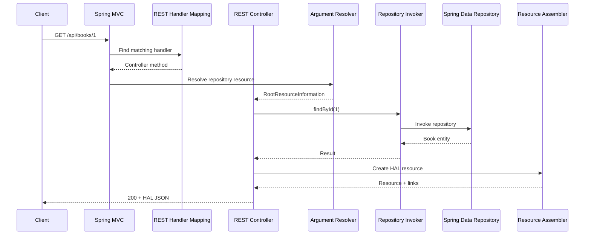

# Core Components of the REST Exporter and RepositoryRestMvcConfiguration

Spring Data REST turns Spring Data repositories into REST resources accessible over HTTP. To do this, the framework combines several components: repository discovery, metadata construction, request mapping, repository invocation, representation creation, and HTTP response writing. `RepositoryRestMvcConfiguration` wires the Spring MVC infrastructure serving REST resources; `RepositoryRestConfiguration` holds the options controlling the exporter's behavior.

Understanding the roles of these components helps trace a request from a URL to the database and back to the client. This also provides the foundation for choosing the right extension point when you need to customize paths, representations, validation, or event handling.

## 1. What does the REST exporter do?

The REST exporter is the mechanism that exposes export-eligible repositories as HTTP resources. For example, a repository managing the `Book` entity can provide a collection resource, an item resource, and search endpoints. If the base path is `/api` and the collection path is `books`, the basic URLs might be:

| HTTP method | Endpoint | Purpose |
|---|---|---|
| GET | `/api/books` | Read the book collection |
| POST | `/api/books` | Create a book |
| GET | `/api/books/{id}` | Read a single book |
| PUT | `/api/books/{id}` | Send a representation to update/replace |
| PATCH | `/api/books/{id}` | Partially update properties |
| DELETE | `/api/books/{id}` | Delete a book |
| GET | `/api/books/search/...` | Invoke an exported query method |

The URLs above are examples based on a specific configuration. Actual URLs also depend on the base path, repository metadata, annotations, and which methods are permitted to be exported.

The exporter does not automatically turn every table in the database into an API. It works with Spring Data repositories discovered in the application and adheres to the export policy. Hidden repositories or methods marked as not exported will not be exposed as corresponding endpoints.

## 2. Component groups in the architecture

The Spring Data REST pipeline can be divided into the following groups:

| Group | Representative components | Role |
|---|---|---|
| MVC configuration | `RepositoryRestMvcConfiguration` | Registers the Spring MVC infrastructure needed by the REST exporter |
| Behavior configuration | `RepositoryRestConfiguration` | Stores the base path, media types, pagination, and exporter options |
| Repository discovery | Spring Data `Repositories` | Looks up repositories by domain type |
| Resource metadata | `RepositoryResourceMappings`, `ResourceMetadata` | Determines paths, relations, and exported resources |
| Request mapping | Spring Data REST handler mapping | Matches URLs and HTTP methods to the appropriate handler |
| Request handling | REST controllers | Handles root, collection, item, search, and association requests |
| Repository invocation | `RepositoryInvokerFactory`, `RepositoryInvoker` | Provides a unified way to invoke repositories |
| Representation | `PersistentEntityResourceAssembler`, Spring HATEOAS | Converts entities into resources and adds links |
| Support | Event handlers, validation, exception handlers, message converters | Handles lifecycle, data, and HTTP responses |

These groups work together. Controllers do not need to manually locate each repository, build URLs, or write JSON for each entity. Metadata and supporting components provide the necessary information so a single mechanism can serve many repositories.

## 3. Distinguishing RepositoryRestMvcConfiguration and RepositoryRestConfiguration

The two class names are easily confused, but they have distinct responsibilities.

### RepositoryRestMvcConfiguration

`RepositoryRestMvcConfiguration` resides in the `org.springframework.data.rest.webmvc.config` package. It is Spring Data REST's Spring MVC infrastructure configuration class. It wires the components required so requests to repository resources can be recognized, processed, and returned as HTTP responses.

Conceptually, this configuration prepares components such as:

- Handler mappings to recognize requests belonging to the REST exporter.
- Controllers for root, collection, item, search, and association resources.
- Argument resolvers to supply repository/domain resource information to controllers.
- Components for building resources and HATEOAS links.
- Message converters to read request bodies and write response bodies.
- Exception handling mechanisms for exceptions raised during REST resource processing.

In a typical Spring Boot application, the Spring Data REST dependency and Boot's auto-configuration activate the appropriate infrastructure. You do not need to recreate these controllers or handler mappings manually.

### RepositoryRestConfiguration

`RepositoryRestConfiguration` is the configuration object for the REST exporter's behavior. It contains the options that the MVC infrastructure uses when exposing repositories.

Common option groups include:

- Common base path, for example `/api`.
- Discovery strategy for export-eligible repositories.
- Default media type and media type for JSON content.
- Pagination, sorting, and page size limits.
- How IDs and response bodies are represented.
- CORS along with several other representation options.

As a rule of thumb: `RepositoryRestMvcConfiguration` assembles the HTTP serving machinery; `RepositoryRestConfiguration` supplies settings for that machinery.

## 4. Repository discovery and resource metadata creation

When the application starts up, Spring Data discovers repository interfaces within the scan scope. The repository infrastructure maintains information about which repository manages which domain type, and then provides lookup capabilities for the corresponding repository.

Spring Data REST uses this information to determine which repositories are exported. The detection strategy can be based on annotations, explicit declarations, or the detection strategy configured in the application.

### What does repository metadata contain?

Metadata describes how a repository appears in the REST API, for example:

- The domain type managed by the repository.
- The collection path.
- The collection relation name in HAL.
- How item resources and links to items are created.
- Query methods exposed under the `search` branch.
- Repositories or methods not permitted to be exported.

`RepositoryResourceMappings` helps look up mappings between repositories and resource metadata. `ResourceMetadata` describes metadata for a specific resource. Annotations such as `@RepositoryRestResource` and `@RestResource` allow providing part of this metadata.

Example:

```java
@RepositoryRestResource(
    path = "books",
    collectionResourceRel = "books"
)
public interface BookRepository extends JpaRepository<Book, Long> {

    @RestResource(path = "by-title", rel = "by-title")
    List<Book> findByTitleContainingIgnoreCase(
        @Param("title") String title
    );
}
```

With the base path `/api`, the collection is accessed at `/api/books`. The exported query method can be called at `/api/books/search/by-title?title=java`.

Metadata lets the exporter know which URL belongs to which repository and which relations should appear in responses. As a result, a common pipeline can serve multiple domain types without creating a separate controller for each entity.

## 5. Handler mappings and REST controllers

Once metadata is prepared, Spring Data REST must determine which controller handles a request. The handler mapping matches the request to a handler based on the URL, HTTP method, and mapping conditions. The base path is taken into account so exporter endpoints sit under the configured prefix.

Controllers are divided by resource and operation group. Some representative classes in the architecture include:

- `RepositoryRestController`: serves the root resource and API discovery information.
- `RepositoryEntityController`: handles operations on collection and item resources.
- `RepositorySearchController`: handles query methods exposed under the `search` branch.
- `RepositoryPropertyReferenceController`: supports accessing or modifying links between entity resources.
- `RepositorySchemaController`: provides schema resources when the corresponding feature is enabled.

Class names and controller partitioning are implementation details that may change across versions. The key takeaway is that requests are routed by resource type and repository metadata; the controller handles the corresponding group of operations.

### Argument resolvers providing repository information

Controllers do not need to manually parse the URL to find the domain type or repository. Spring Data REST argument resolvers can resolve repository resource information into parameters for handler methods.

For example, `RootResourceInformationHandlerMethodArgumentResolver` helps supply the `RootResourceInformation` corresponding to the request. This information connects the controller with the repository, domain type metadata, and the repository invocation mechanism.

Thanks to this, a single controller can handle many domain types according to their respective metadata, rather than hard-coding `BookRepository`, `CustomerRepository`, or each individual repository.

## 6. RepositoryInvokerFactory and RepositoryInvoker

Spring Data REST does not require each controller to call a specific repository interface directly. `RepositoryInvokerFactory` creates the `RepositoryInvoker` suited to the repository identified from metadata.

The invoker provides an abstraction for common repository operations, such as:

- Finding an entity by ID.
- Retrieving a collection or page of data.
- Saving a new entity or updating an entity.
- Deleting an entity.
- Invoking supported query methods.

The benefit of this abstraction is that controllers can work with many repositories through a unified invocation approach. Final execution is still handled by the repository and the corresponding Spring Data module. For example, Spring Data JPA uses the persistence provider to interact with the database.

The invoker does not replace the repository and does not hold the application's entire business logic. It is a bridge between the exporter's web layer and the repository layer.

## 7. Converting entities into HAL resources

After the repository returns an entity, Spring Data REST needs to create an HTTP representation. The entity is not merely serialized into plain JSON; the exporter can also add links so clients can discover the API.

### PersistentEntityResourceAssembler

`PersistentEntityResourceAssembler` helps convert a persistent entity into a resource. It coordinates entity metadata with the link-generation mechanism to construct the appropriate representation.

HAL typically has two key sections:

- `_links`: contains links such as `self`, collection, and related associations.
- `_embedded`: contains embedded resources when required by the representation and configuration.

Illustrative example:

```json
{
  "title": "Effective Java",
  "author": "Joshua Bloch",
  "_links": {
    "self": {
      "href": "http://localhost:8080/api/books/1"
    },
    "books": {
      "href": "http://localhost:8080/api/books"
    }
  }
}
```

This JSON illustrates the HAL structure, not a fixed response for every application. Actual relations, data fields, URIs, and links depend on metadata, projections, data, and configuration.

### Link generation and content negotiation

HATEOAS components generate URIs and relations for resources. Spring MVC message converters write the representation to the response body according to the media type negotiated via the HTTP `Accept` header.

Clients typically request:

```http
Accept: application/hal+json
```

If a client requests a media type the server does not support, content negotiation can fail. When inspecting responses, check both `Accept` and `Content-Type`, not just the JSON body.

## 8. Processing flow of a GET request

Consider a request to read a single book:

```http
GET /api/books/1
Accept: application/hal+json
```

General processing flow:

1. The web server receives the HTTP request and forwards it to Spring MVC.
2. Spring Data REST's handler mapping inspects the base path, URL, and HTTP method to select a handler.
3. Argument resolvers look up metadata and provide repository/domain resource information to the controller.
4. The controller identifies the item read operation and uses the repository invoker to call the repository.
5. The repository executes the query through the Spring Data module and persistence provider.
6. The resulting entity is converted into a resource by the assembler; links are generated based on metadata and HATEOAS.
7. The message converter writes HAL JSON to the response and the server returns it to the client.

The following sequence diagram illustrates the relationship between components:



For a POST request, the initial steps are similar, but the controller reads the request body, converts the data into an entity, and invokes the save operation. Upon successful creation, the exporter builds a response for the new resource; the status is typically `201 Created` and the `Location` header points to the item's URI.

For a search request, the handler mapping selects the search handler group and the invoker calls the corresponding query method. For an association request, the controller handles links between resources.

## 9. Repository events, validation, and exception handling

The REST exporter provides extension points for the application to participate in the lifecycle of repository operations.

### Repository event handlers

You can listen to events before and after save, update, or delete operations. `@RepositoryEventHandler` combined with annotations like `@HandleBeforeCreate`, `@HandleAfterCreate`, `@HandleBeforeSave`, and `@HandleAfterSave` allows handling logic tied to repository events.

Example:

```java
@Component
@RepositoryEventHandler(Book.class)
public class BookEventHandler {

    @HandleBeforeCreate
    public void beforeCreate(Book book) {
        if (book.getTitle() != null) {
            book.setTitle(book.getTitle().trim());
        }
    }
}
```

The handler above illustrates trimming whitespace before creating an entity. In real applications, event handlers should focus on logic suited to the repository lifecycle, such as auditing or data normalization. Complex business workflows that require multi-step coordination or explicit transaction management should live in a dedicated service.

### Validation

Distinguish between three layers of validation:

- Database constraints protect data integrity at the storage layer.
- Bean Validation checks data constraints, such as `@NotBlank`, `@Size`, or `@Email`.
- Business validation checks business rules, such as whether a state transition is valid.

A field with `@Column(nullable = false)` does not automatically provide complete, client-friendly validation messages. Configure validation at the appropriate layer and return understandable errors.

### Exception handling

If an ID does not exist, the request body is malformed, validation fails, or the repository throws an error, the exporter translates the exception into an HTTP response. `RepositoryRestExceptionHandler` is an exception-handling component in Spring Data REST's web layer.

When troubleshooting errors, inspect the status code, response body, server logs, and root cause at the repository/database layer. Do not assume that every 4xx error comes from handler mapping or every 5xx error comes from a controller.

## 10. Customizing via RepositoryRestConfigurer

In typical applications, configure via `RepositoryRestConfigurer` instead of directly subclassing or replacing `RepositoryRestMvcConfiguration`. The configurer allows adjusting `RepositoryRestConfiguration` after the framework has prepared its defaults.

Example of setting a base path and exposing entity IDs:

```java
package com.example.books;

import org.springframework.context.annotation.Configuration;
import org.springframework.data.rest.core.config.RepositoryRestConfiguration;
import org.springframework.data.rest.webmvc.config.RepositoryRestConfigurer;
import org.springframework.web.servlet.config.annotation.CorsRegistry;

@Configuration
public class RestApiConfiguration implements RepositoryRestConfigurer {

    @Override
    public void configureRepositoryRestConfiguration(
            RepositoryRestConfiguration config,
            CorsRegistry cors) {

        config.setBasePath("/api");
        config.exposeIdsFor(Book.class);
    }
}
```

In the example:

- `@Configuration` registers the configuration class with Spring.
- `RepositoryRestConfigurer` is Spring Data REST's public extension point.
- `setBasePath("/api")` sets the prefix for repository resources.
- `exposeIdsFor(Book.class)` requests that `Book` IDs appear in representations under this configuration.

If CORS is enabled, declare specific origins and HTTP methods according to the clients allowed to access the API. Do not open all origins in production without an explicit requirement.

Other commonly used extension points include:

- `@RepositoryRestResource`: customizes the repository resource, collection path, and relation.
- `@RestResource`: customizes or hides a query method/resource.
- `@Projection` and excerpt projections: adjust the set of properties represented.
- `@RepositoryEventHandler`: handles repository events.
- Custom controller/service: implements endpoints with custom business workflows.

## 11. When should you create a custom controller?

The REST exporter fits CRUD operations with a relatively standard structure. When a request needs to coordinate multiple repositories, check multiple conditions, call external services, or execute a multi-step workflow, a dedicated endpoint is usually easier to control.

For example, an `approveOrder` operation may have to check order status, user permissions, credit limits, and inventory before changing status. This is more than updating a single entity. Place the logic in a service and expose an appropriate business endpoint.

You can combine Spring Data REST with custom controllers. When choosing annotations/controllers, pay attention to the base path and mapping rules to avoid URL conflicts with exported repository resources.

## 12. Tracing errors through the architecture

When an endpoint does not work, identify the first layer with an issue:

| Symptom | Layer to check | Hint |
|---|---|---|
| Repository does not appear at API root | Discovery/metadata | Check package scan, repository detection strategy, and `exported` |
| URL does not match or returns 404 | Resource mapping/handler mapping | Check base path, `path`, relation, and HTTP method |
| Right URL, but repository operation fails | Invoker/repository/persistence | Check query, transaction, ID, and database logs |
| Data saved, but response is missing fields | Representation/serialization | Check getters, projections, serialization, and entity metadata |
| Missing or wrong HAL links | Link generation/resource metadata | Check relations, associations, and resource mapping |
| Receiving 406 or 415 | Content negotiation/message converter | Check `Accept` and `Content-Type` |
| Receiving 400 or 500 | Validation/exception/persistence | Read error response and root cause in logs |

One way to trace a request is: URL and method → handler → metadata → repository invocation → persistence → representation → response. This narrows the scope of the error along the exact pipeline.

## 13. Things to keep in mind when reading the source code

1. **Prefer public extension points.** Internal controllers, resolvers, and mappings can change between versions. If you only need to change configuration, use `RepositoryRestConfigurer` or annotations.
2. **Do not confuse the two configuration classes.** `RepositoryRestMvcConfiguration` assembles MVC infrastructure; `RepositoryRestConfiguration` holds exporter options.
3. **Do not treat the exporter as the business layer.** The repository invoker provides data operations; business rules should be designed in the domain/service layer.
4. **Control exported repositories.** Every exposed resource increases the API surface that must be secured.
5. **Do not treat HAL links as an authorization mechanism.** The server must check permissions on every request, even when a client calls a URL directly.
6. **Check against the exact version.** When reading source code or debugging, check the actual Spring Data REST version in the project's dependency tree.

## 14. Conclusion

Spring Data REST's REST exporter is a pipeline consisting of repository discovery, resource metadata, handler mapping, controllers, repository invoker, and representation assembler. `RepositoryRestMvcConfiguration` wires the Spring MVC infrastructure so the pipeline serves HTTP requests; `RepositoryRestConfiguration` holds the options controlling exporter behavior.

Once you understand these components and the processing flow, you can trace a request from URL to repository and then to the HAL response, pinpoint the layer to adjust, and pick the right extension point. For typical applications, prefer `RepositoryRestConfigurer`, annotations, event handlers, and business services/controllers instead of directly replacing Spring Data REST's internal infrastructure.