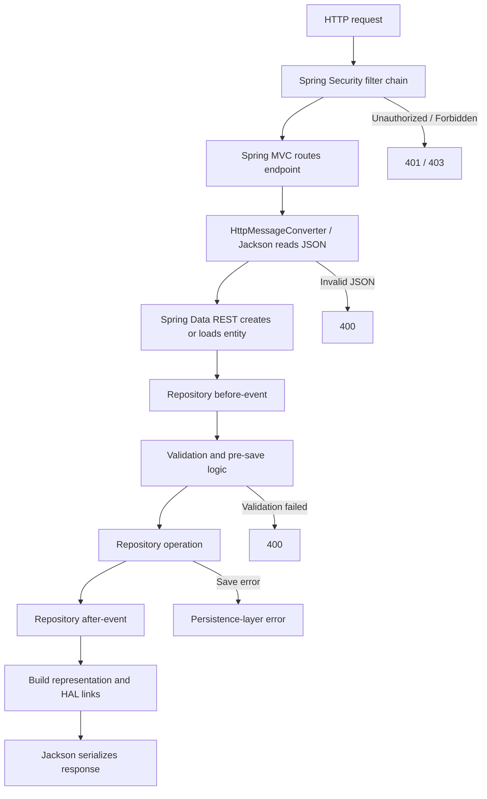

# Where Validation, Events, Security, and Serialization Sit in the Processing Flow

In Spring Data REST, a CRUD operation passes through multiple layers before data is persisted and returned. The four mechanisms—validation, repository events, security, and serialization—sit at different points in this flow. Understanding their exact positions helps choose the right extension point, avoid duplicating the same responsibility across multiple places, or avoid using one mechanism for a purpose it is not meant to serve.

## 1. Overview of a request

A write request typically follows this high-level sequence:



This is a model for locating responsibilities, not a guarantee that every request follows every step along the exact same branch. `GET` usually skips write steps, pre-save validation, and create/save event pairs. `DELETE` and association-modifying operations have their own event pairs.

Two security points must be distinguished: the filter chain checks requests at entry; method security checks permissions when a method is invoked. Similarly, serialization has two directions: Jackson reads input JSON before the repository handles the entity, and produces output JSON after the repository operation completes.

## 2. Validation: checking the entity before writing

Validation answers the question: **does the data satisfy the application's validity rules before being saved?**

In Spring Data REST, validation is tied to repository lifecycle events. You can register a Spring `Validator` by bean name corresponding to the event. Some commonly used points:

| Bean name | Timing |
|---|---|
| `beforeCreateValidator` | Before creating a new entity |
| `beforeSaveValidator` | Before saving an existing or updated entity |
| `beforeLinkSaveValidator` | Before saving an association change |
| `beforeDeleteValidator` | Before deleting, if business rules require checks |

Example validator running before creating a product:

```java
@Component("beforeCreateValidator")
public class ProductValidator implements Validator {

    @Override
    public boolean supports(Class<?> type) {
        return Product.class.isAssignableFrom(type);
    }

    @Override
    public void validate(Object target, Errors errors) {
        Product product = (Product) target;

        if (product.getName() == null || product.getName().isBlank()) {
            errors.rejectValue(
                "name",
                "product.name.required",
                "Product name is required"
            );
        }
    }
}
```

The validator receives the entity converted from the request body. If there are errors, Spring Data REST returns a validation error and the save operation does not proceed as a successful write. For typical input validation errors, the client usually receives HTTP 400 with field details and error codes.

Bean Validation annotations such as `@NotNull`, `@NotBlank`, and `@Size` express constraints close to the data; Spring `Validator` fits rules requiring Java logic or spanning multiple fields. You can combine both approaches, but make sure the validator is actually wired to the right Spring Data REST event in the application configuration.

Validation at the repository lifecycle does not replace all checks in other layers. Data from UI forms, custom APIs, batch jobs, or internal services may travel along other paths. Important business rules should be enforced in an appropriate shared layer, so checks are not limited solely to Spring Data REST endpoints.

## 3. Repository events: hooking before and after repository operations

Spring Data REST publishes repository events around create, save, delete, and link-change operations. You can listen to them using `@RepositoryEventHandler` together with `@Handle...` annotations.

Common event pairs:

| Operation | Before operation | After operation |
|---|---|---|
| POST create entity | `BeforeCreateEvent` | `AfterCreateEvent` |
| PUT/PATCH update entity | `BeforeSaveEvent` | `AfterSaveEvent` |
| Association/link change | `BeforeLinkSaveEvent` | `AfterLinkSaveEvent` |
| DELETE entity | `BeforeDeleteEvent` | `AfterDeleteEvent` |

Example handler scoped only to `Product`:

```java
@Component
@RepositoryEventHandler(Product.class)
public class ProductEventHandler {

    @HandleBeforeCreate
    public void beforeCreate(Product product) {
        // Prepare required data before creation.
    }

    @HandleAfterSave
    public void afterSave(Product product) {
        // Handle post-save logic after repository save returns.
    }
}
```

Use before-events when you need to prepare or inspect an entity right before the repository operation. Use after-events when you need to react after the repository has performed the operation, such as updating auxiliary data within the same application. If you need to reject data using structured field errors, Spring `Validator` is usually a clearer extension point.

Event handlers should focus on a single specific responsibility. Avoid putting core multi-step business logic, cascading queries, or long network calls into handlers, because they make requests unpredictable and error handling harder. In particular, the name `AfterSave` means the repository `save` has completed; do not assume the enclosing transaction has already committed. If an action must run only after commit, design around an appropriate transaction event, such as `@TransactionalEventListener(phase = TransactionPhase.AFTER_COMMIT)`, and verify the event is published within that transaction.

## 4. Security: deciding who can call and who can act

Security answers the question: **is the caller allowed to execute this request or perform this action on this resource?** Spring Data REST automatically exports endpoints from repositories, so you must protect both auto-generated endpoints and custom access paths.

### Request-level security

The Spring Security filter chain is the entry-level control layer. You can require authentication for the API, restrict certain paths by role/authority, and configure CORS/CSRF according to the type of client in use.

Illustrative example with modern Spring Security:

```java
@Configuration
@EnableMethodSecurity
public class SecurityConfig {

    @Bean
    SecurityFilterChain securityFilterChain(HttpSecurity http)
            throws Exception {
        http.authorizeHttpRequests(auth -> auth
            .requestMatchers("/api/admin/**").hasRole("ADMIN")
            .requestMatchers("/api/**").authenticated()
            .anyRequest().permitAll()
        );

        return http.build();
    }
}
```

The paths in the example depend on the application's base path and export configuration. Set matchers according to actual endpoints. CSRF configuration must also fit the authentication mechanism: applications using sessions and cookies need CSRF protection evaluated carefully; do not blindly disable CSRF just because the API accepts JSON.

### Method-level security

The filter chain usually protects by request path. Method security protects deeper at the point of method invocation, which is useful when an operation can be called from multiple endpoints or from internal code.

```java
@PreAuthorize("hasAuthority('product:write')")
Product save(Product product);
```

For annotations like `@PreAuthorize` to take effect, the application must enable method security and the method must be called through a Spring security proxy. Checks can be applied at the service or repository level depending on business boundaries; do not rely merely on endpoints or links being omitted from responses.

Rules must account for association operations and custom methods as well. If you only secure collection `GET` while forgetting item `GET`, `PUT`/`PATCH`, `DELETE`, or association endpoints, the resource can still be accessed through the open paths.

Hiding a field with `@JsonIgnore`, a projection, or omitting a link from a representation is not authorization. Serialization decides what data is presented; security decides whether the caller has permission to read or modify data.

## 5. Serialization: converting between HTTP representations and objects

Serialization sits at the HTTP boundary, not inside the repository.

**Request direction:** `HttpMessageConverter` (typically using Jackson) reads JSON and converts it into Java objects. If the JSON has syntax errors, type mismatches, or cannot be converted, the request can be rejected before repository events and validation lifecycles run.

**Response direction:** after repository processing, Spring Data REST builds a resource representation, usually in HAL with links such as `_links`; Jackson converts that representation into JSON to send back to the client.

You can adjust the represented data using several mechanisms:

- `@JsonIgnore`, `@JsonProperty`, and Jackson configuration adjust JSON properties.
- `@Projection` creates a view containing only the properties needed for a use case.
- Excerpt projections adjust the representation used in collections.
- `@RestResource(exported = false)` controls endpoint or method export depending on where the annotation is placed; this is API configuration, not a replacement for security.
- `RepositoryRestConfigurer` is Spring Data REST's configuration point, including customizations related to mapping and representation per the API of the version in use.

Example projection for a product list:

```java
@Projection(name = "productSummary", types = Product.class)
public interface ProductSummary {
    String getName();
    BigDecimal getPrice();
}
```

Clients can request a configured exported projection, for example `?projection=productSummary`. Projections make responses leaner and more stable for a screen, but they do not make hidden fields protected data. If a user group is not allowed to read sensitive data, enforce permissions on the server and design representations appropriate to those permissions.

## 6. Placing the right responsibility at the right point

| Need | Suitable mechanism | Position in the flow |
|---|---|---|
| Can JSON be parsed and converted into an object? | Jackson / HttpMessageConverter | When reading the request |
| Are field values and data rules valid? | Bean Validation / Spring `Validator` | Before writing |
| Need to react before or after CRUD/link operations? | Repository event handler | Around the repository operation |
| Is the caller authorized to invoke the endpoint or method? | Spring Security filter chain / method security | At request entry and at method call |
| Which fields, projections, and links does the client see? | Jackson / projection / HAL configuration | When building the response |

A few scenarios illustrate how to distinguish these mechanisms:

- JSON sends `price: "abc"` when the field is numeric: conversion error at the request-reading step; the repository does not run yet.
- JSON is valid, but `name` is blank: pre-save validation can reject the entity.
- Entity is valid, but the caller lacks authority: security rejects the request or method call.
- Caller is authorized and data is valid: the repository performs the operation, and event handlers may run before/after according to the lifecycle.
- Entity is saved, but the response only needs `name` and `price`: a projection shapes the returned representation.

## 7. Checklist when designing Spring Data REST endpoints

1. Identify which repository handles the request and which create, update, delete, and association operations are exported.
2. Put data constraints in Bean Validation or Spring `Validator`, and register them on the proper lifecycle event.
3. Use repository event handlers only for work genuinely tied to before/after repository operation timing.
4. Protect endpoints with the filter chain and protect sensitive methods with method security when needed.
5. Check collection, item, association, and custom repository methods; do not treat hidden links as a security layer.
6. Use projections and Jackson to design representations; do not use them instead of permission checks.
7. Distinguish JSON parsing errors, validation errors, authorization errors, and persistence errors so clients receive appropriate responses.

When all four mechanisms are placed in their proper positions, the processing flow becomes easy to follow: security controls access rights, Jackson converts HTTP data, validation protects data before writes, repository events provide extension points around persistence operations, and serialization determines the representation returned to the client.