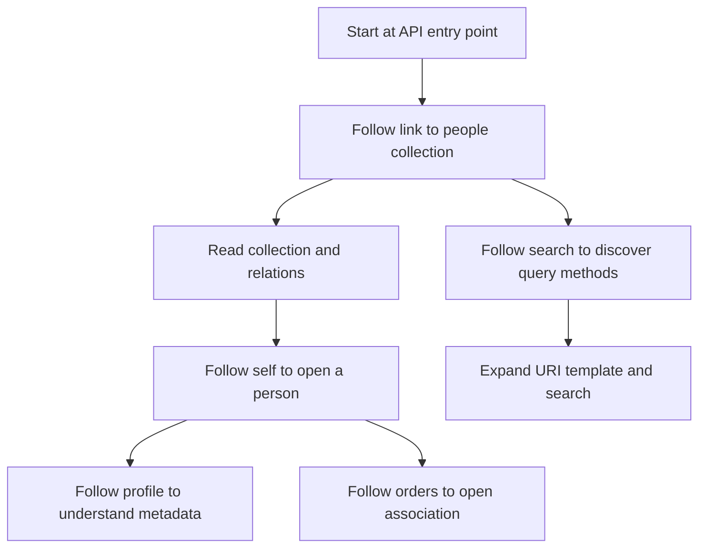

# Meaning of self, profile, search, and Association Links

Spring Data REST typically represents resources using HAL and provides links so clients can discover the API. Relations such as `self`, `profile`, `search`, and association link names indicate what each link is used for. Understanding these relations enables clients to navigate using server-published information instead of assembling URLs from controller names, paths, or IDs.

## 1. What Roles Do HATEOAS and HAL Play?

**HATEOAS** (Hypertext As The Engine Of Application State) is a REST constraint: responses provide hypermedia controls so the client knows which actions or resources it can access next. The client starts from a known entry point, reads the links in the response, and follows the link matching its current goal.

**HAL** (Hypertext Application Language) is a format for representing hypermedia in JSON. HAL defines two main sections:

- `_links`: links grouped by relation.
- `_embedded`: child resources embedded directly in the response, if provided by the representation.

Abbreviated example of a collection:

```json
{
  "_links": {
    "self": {
      "href": "https://api.example.test/people?page=0&size=20"
    },
    "profile": {
      "href": "https://api.example.test/profile/people"
    },
    "search": {
      "href": "https://api.example.test/people/search"
    }
  },
  "_embedded": {
    "people": [
      {
        "name": "An",
        "_links": {
          "self": {
            "href": "https://api.example.test/people/42"
          },
          "orders": {
            "href": "https://api.example.test/people/42/orders"
          }
        }
      }
    ]
  }
}
```

This is an illustrative structural example; actual hosts, paths, relations, and fields depend on the application's repository configuration, domain model, and representations. Spring Data REST uses HAL by default for common hypermedia representations.

A link object typically has an `href` property. Depending on the case, it may also include `templated`, `title`, `type`, `hreflang`, or other metadata. The relation is the key outside the link object, such as `self`, `profile`, or `orders`. The relation tells the client the purpose of the link; `href` gives the address to access.

## 2. `self`: Link to the Current Resource Itself

The `self` relation points to the resource that the representation describes.

For an item, `self` usually points to that item's URI. For a collection, `self` points to the current collection representation, which may include query parameters such as `page`, `size`, and `sort`.

Example:

```json
{
  "id": 42,
  "name": "An",
  "_links": {
    "self": {
      "href": "https://api.example.test/people/42"
    }
  }
}
```

Clients can store and follow this URI to reload the resource instead of constructing paths like `/people/{id}`. This reduces coupling to how the server organizes URLs. If the API changes its base path or route mapping while still providing the proper relation, clients can continue navigating via the new link.

`self` should not be assumed to always equal the exact request URL just sent in every situation. It is the link published by the server for the current representation. For paged collections, `self` typically reflects the current page and filters; relations like `next`, `prev`, `first`, or `last` may provide adjacent pages when available.

## 3. `profile`: Describing Semantics and Meaning

The `profile` relation points to a document describing the profile of a resource type or representation. It helps clients understand properties and business semantics that plain JSON cannot fully express.

In Spring Data REST, profiles are commonly served via an ALPS (Application-Level Profile Semantics) endpoint. ALPS describes descriptors that carry the semantic meaning of a resource, such as property names, descriptions, descriptor types, and child descriptors. Depending on configuration, the profile can describe the fields or operations exposed by the API.

Example link:

```json
{
  "_links": {
    "profile": {
      "href": "https://api.example.test/profile/people"
    }
  }
}
```

Clients can follow this link to retrieve ALPS metadata, usually with media type `application/alps+json`. A descriptor can indicate that a resource has `name` and `email` properties or an exported search operation. This gives clients additional information to render forms, explain data, or build appropriate interactions.

Keep these distinctions clear:

- `profile` describes the semantics of a resource or representation.
- `self` points to the current resource or representation itself.
- A profile is not a user account profile and does not contain actual data records for individuals.
- A profile does not grant access permissions. The server must still enforce authentication and authorization on every request.

If a client needs to understand an application-specific relation, the profile and API documentation are useful places to explain that relation's meaning rather than guessing from its name alone.

## 4. `search`: Discovering Exported Search Operations

The `search` relation usually appears on a collection when the repository has query methods exported by Spring Data REST. This link points to the repository's search resource.

Example collection having:

```json
{
  "_links": {
    "search": {
      "href": "https://api.example.test/people/search"
    }
  }
}
```

When a client accesses the search resource, the response may list each query method under its own relation. A link to search by last name might look like this:

```json
{
  "_links": {
    "findByLastName": {
      "href": "https://api.example.test/people/search/findByLastName{?lastName,page,size,sort}",
      "templated": true
    }
  }
}
```

Here:

- `findByLastName` is the relation of the exported query method.
- `href` is a URI template, not yet a complete URL.
- `templated: true` indicates that the client must fill in variables such as `lastName`, `page`, `size`, or `sort` before sending a request.

For example, the client expands the template with `lastName=Nguyen` to search. The actual method name, parameters, and template are determined by the repository method and Spring Data REST configuration.

`search` is not an arbitrary SQL query endpoint. It only lets clients discover the query methods that the application has defined and exported. If a repository has no exported search methods, the search resource or corresponding links may not appear.

An important point is that clients should discover query relations from the search resource. Do not guess method names or assemble URLs based on Java method names, because paths, parameters, and export behavior can change.

## 5. Association Links: Navigating Relationships Between Entities

An association is a relationship between entities in the domain model, for example:

- A `Person` has many `Order`s.
- An `Order` belongs to a `Customer`.
- A `Student` enrolls in many `Course`s.

Spring Data REST can publish association links in a resource's `_links`. The relation usually reflects the association exported by the API; the specific name can be customized.

Example of a person with a link to their order list:

```json
{
  "id": 42,
  "name": "An",
  "_links": {
    "self": {
      "href": "https://api.example.test/people/42"
    },
    "orders": {
      "href": "https://api.example.test/people/42/orders"
    }
  }
}
```

The client follows the `orders` relation to access the association resource. From there, it can explore the related orders according to the representation returned by the server. For a single-valued association, the link may lead to the related resource; for a collection-valued association, the link typically leads to a resource representing the related collection.

Association links and embedded resources have different meanings:

- An association link only provides a URI for the client to navigate to the relationship.
- An embedded resource resides in `_embedded`, meaning the related data has already been included in the current response.
- Having an association link does not mean all related entities have been embedded.
- Whether to embed or only provide a link depends on projections, excerpt projections, and representation configuration.

Operations to update an association also go through the association resource published by the API. The HTTP method and request content depend on cardinality, association type, and specific mappings. Clients should rely on the API contract and server responses rather than assuming every relationship is updated in the same way.

## 6. How Clients Combine Relations in a Real Workflow

Suppose an application needs to display a person and that person's orders. The client can proceed in the following sequence:



Each relation has a specific job:

| Relation | Question it answers | How to use |
|---|---|---|
| `self` | Where is the current resource or representation? | Follow the URI to open or reload |
| `profile` | What semantics and descriptors does this resource have? | Read ALPS metadata |
| `search` | Which search operations does the repository publish? | Explore the search resource and query links |
| Association relation such as `orders` | What data is the current resource related to? | Follow the link to open the association resource |

A generic HTTP client can implement the workflow: read `_links`, select the appropriate relation, check `templated`, expand the URI template when needed, send a request to `href`, and continue reading relations in the new response. The client only needs to know the initial entry point and the relations published by the application or described in the profile.

## 7. Common Misconceptions

**Confusing `self` with `profile`:** `self` points to the current resource; `profile` points to the document describing the semantics of the representation.

**Confusing `search` with free-form search:** the search resource lists exported query methods. It does not dynamically generate arbitrary queries for clients.

**Confusing association links with embedded data:** a link only provides navigability. To get the data immediately in the response, the representation must provide the content in `_embedded` or a corresponding projection.

**Confusing hidden links with security:** omitting a link can make an operation harder for a client to discover, but it does not replace server-side permission checks. A client can still send a request directly to a URI it knows; the server must authenticate and authorize on its own.

**Hard-coding URLs:** manually assembling `/people/{id}/orders` couples the client to the route structure. Following relations provided by the server makes the API more resilient when mappings change.

## 8. Key Takeaways When Designing and Using a HAL API

1. Use `self` to identify and navigate to the current resource.
2. Use `profile` to discover metadata and semantic meaning of resources.
3. Use `search` to discover the query methods published by a repository.
4. Use association relations to navigate through relationships between entities.
5. Distinguish links in `_links` from embedded data in `_embedded`.
6. Handle URI templates when a link has `templated: true`.
7. Always enforce permissions on the server; hypermedia links support API discovery, not authorization.

When clients rely on relations instead of building URLs themselves, Spring Data REST can change endpoint mappings while preserving navigation through the hypermedia contract. `self`, `profile`, `search`, and association links are therefore distinct yet complementary parts of a HAL API.
