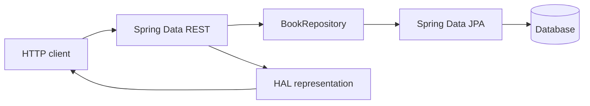

# Từ mô hình miền đến repository, tài nguyên tập hợp và tài nguyên đơn

Spring Data REST biến các Spring Data repository được cho phép export thành REST API có thể khám phá bằng liên kết hypermedia. Từ một entity **Book** và một interface **BookRepository**, ứng dụng có thể cung cấp tài nguyên tập hợp **/books**, tài nguyên đơn **/books/{id}**, các thao tác CRUD và tài nguyên tìm kiếm mà không cần viết controller CRUD riêng.

Bài này đi theo luồng: mô hình miền → repository → endpoint được export → biểu diễn HAL → thao tác trên collection và item resource.

## 1. Bốn khái niệm cần phân biệt

| Thành phần | Vai trò | Ví dụ |
|---|---|---|
| Domain model | Mô tả dữ liệu và quan hệ trong miền nghiệp vụ | **Book**, gồm **id**, **title**, **isbn** |
| Repository | Cung cấp thao tác truy vấn và lưu dữ liệu | **BookRepository extends JpaRepository<Book, Long>** |
| Collection resource | Đại diện cho một tập hợp entity | **GET /books**, **POST /books** |
| Item resource | Đại diện cho một entity cụ thể | **GET /books/1**, **PATCH /books/1** |

Luồng xử lý khái quát:



Entity và repository vẫn thuộc mô hình Spring Data. Spring Data REST là lớp export repository thành tài nguyên HTTP, ánh xạ các thao tác repository phù hợp sang HTTP method và tạo liên kết để client khám phá API.

## 2. Tạo ứng dụng mẫu

Ví dụ dùng Java 17, Spring Boot 3.5.x, Spring Data JPA và H2 để có thể chạy độc lập. Dùng Spring Boot parent để quản lý phiên bản các starter tương thích.

Cấu trúc tối thiểu:

```text
books-rest/
├── pom.xml
└── src/
    └── main/
        ├── java/com/example/books/
        │   ├── BookApiApplication.java
        │   ├── Book.java
        │   └── BookRepository.java
        └── resources/
            └── application.properties
```

**pom.xml**

```xml
<project xmlns="http://maven.apache.org/POM/4.0.0"
         xmlns:xsi="http://www.w3.org/2001/XMLSchema-instance"
         xsi:schemaLocation="http://maven.apache.org/POM/4.0.0
         https://maven.apache.org/xsd/maven-4.0.0.xsd">
    <modelVersion>4.0.0</modelVersion>

    <parent>
        <groupId>org.springframework.boot</groupId>
        <artifactId>spring-boot-starter-parent</artifactId>
        <version>3.5.5</version>
        <relativePath/>
    </parent>

    <groupId>com.example</groupId>
    <artifactId>books-rest</artifactId>
    <version>0.0.1-SNAPSHOT</version>

    <properties>
        <java.version>17</java.version>
    </properties>

    <dependencies>
        <dependency>
            <groupId>org.springframework.boot</groupId>
            <artifactId>spring-boot-starter-data-jpa</artifactId>
        </dependency>
        <dependency>
            <groupId>org.springframework.boot</groupId>
            <artifactId>spring-boot-starter-data-rest</artifactId>
        </dependency>
        <dependency>
            <groupId>com.h2database</groupId>
            <artifactId>h2</artifactId>
            <scope>runtime</scope>
        </dependency>
    </dependencies>
</project>
```

**src/main/resources/application.properties**

```properties
spring.datasource.url=jdbc:h2:mem:bookdb;DB_CLOSE_DELAY=-1
spring.datasource.username=sa
spring.datasource.password=
spring.jpa.hibernate.ddl-auto=create-drop
```

**spring-boot-starter-data-rest** kích hoạt cấu hình tự động của Spring Data REST trong ứng dụng Spring Boot. **spring-boot-starter-data-jpa** cung cấp repository JPA và kết nối cơ sở dữ liệu. H2 tạo database trong bộ nhớ để thử nghiệm.

## 3. Khai báo domain model

**Book.java**

```java
package com.example.books;

import jakarta.persistence.Column;
import jakarta.persistence.Entity;
import jakarta.persistence.GeneratedValue;
import jakarta.persistence.GenerationType;
import jakarta.persistence.Id;
import jakarta.persistence.Table;

@Entity
@Table(name = "books")
public class Book {

    @Id
    @GeneratedValue(strategy = GenerationType.IDENTITY)
    private Long id;

    @Column(nullable = false)
    private String title;

    @Column(nullable = false, unique = true)
    private String isbn;

    protected Book() {
        // Constructor không tham số cho JPA.
    }

    public Book(String title, String isbn) {
        this.title = title;
        this.isbn = isbn;
    }

    public Long getId() {
        return id;
    }

    public String getTitle() {
        return title;
    }

    public void setTitle(String title) {
        this.title = title;
    }

    public String getIsbn() {
        return isbn;
    }

    public void setIsbn(String isbn) {
        this.isbn = isbn;
    }
}
```

**Book** là entity được JPA ánh xạ vào bảng **books**. **id** là khóa chính do database sinh. Hai thuộc tính **title** và **isbn** là dữ liệu nghiệp vụ. Constructor không tham số cho phép JPA tạo entity; constructor còn lại giúp tạo dữ liệu mẫu.

Spring Data REST dùng mô hình domain và metadata của Spring Data để tạo representation. Với entity đơn giản này, **title** và **isbn** xuất hiện trong JSON. Khóa chính thường được thể hiện qua URI trong liên kết **self**, không xuất hiện như một thuộc tính JSON thông thường.

## 4. Khai báo repository và export thành REST resource

**BookRepository.java**

```java
package com.example.books;

import org.springframework.data.domain.Page;
import org.springframework.data.domain.Pageable;
import org.springframework.data.jpa.repository.JpaRepository;
import org.springframework.data.repository.query.Param;
import org.springframework.data.rest.core.annotation.RepositoryRestResource;
import org.springframework.data.rest.core.annotation.RestResource;

@RepositoryRestResource(
    collectionResourceRel = "books",
    path = "books"
)
public interface BookRepository extends JpaRepository<Book, Long> {

    @RestResource(path = "by-title", rel = "by-title")
    Page<Book> findByTitleContainingIgnoreCase(
        @Param("title") String title,
        Pageable pageable
    );
}
```

**JpaRepository<Book, Long>** cung cấp các thao tác lưu, tìm, phân trang và xóa cho entity **Book**. Spring Data tạo implementation lúc ứng dụng khởi động; ta không cần tự viết class triển khai repository.

**@RepositoryRestResource** đánh dấu repository được export và cho phép đặt tên quan hệ collection cùng đường dẫn. Ở đây:

- **path = "books"** đặt đường dẫn collection là **/books**.
- **collectionResourceRel = "books"** đặt tên quan hệ HAL của các phần tử trong collection là **books**.

Nếu không tùy chỉnh, Spring Data REST thường suy ra đường dẫn từ tên đơn giản của domain class bằng cách viết thường và chuyển sang dạng số nhiều. Vì vậy, entity **Book** thường có collection path **/books**.

Phương thức **findByTitleContainingIgnoreCase** là derived query method. Spring Data JPA suy ra điều kiện tìm kiếm từ tên phương thức. Spring Data REST export phương thức này thành query resource tại **/books/search/by-title**. **@RestResource** đặt tên path và relation dễ đọc; **@Param("title")** đặt tên query parameter ổn định.

## 5. Khởi động ứng dụng và tạo dữ liệu mẫu

**BookApiApplication.java**

```java
package com.example.books;

import java.util.List;

import org.springframework.boot.CommandLineRunner;
import org.springframework.boot.SpringApplication;
import org.springframework.boot.autoconfigure.SpringBootApplication;
import org.springframework.context.annotation.Bean;

@SpringBootApplication
public class BookApiApplication {

    public static void main(String[] args) {
        SpringApplication.run(BookApiApplication.class, args);
    }

    @Bean
    CommandLineRunner seedBooks(BookRepository repository) {
        return args -> {
            if (repository.count() == 0) {
                repository.saveAll(List.of(
                    new Book("Clean Code", "9780132350884"),
                    new Book("Effective Java", "9780134685991")
                ));
            }
        };
    }
}
```

Chạy ứng dụng từ thư mục có **pom.xml**:

```bash
mvn spring-boot:run
```

Sau khi ứng dụng khởi động, API mặc định nằm ở root path **/**. Ta có thể bắt đầu khám phá từ root resource:

```bash
curl -i -H "Accept: application/hal+json" http://localhost:8080/
```

Root resource trả về các liên kết tới những resource đã được export. Với repository ở trên, cần tìm relation **books** trong **_links**; client dùng URL của relation đó để truy cập collection. Root resource cũng có thể cung cấp relation **profile** để khám phá metadata của API.

## 6. Collection resource: /books

Collection resource đại diện cho tập hợp các **Book** được repository quản lý.

### Đọc danh sách

```bash
curl -i -H "Accept: application/hal+json" http://localhost:8080/books
```

Response HAL có cấu trúc khái quát như sau (URI và ID cụ thể phụ thuộc lần chạy):

```json
{
  "_embedded": {
    "books": [
      {
        "title": "Clean Code",
        "isbn": "9780132350884",
        "_links": {
          "self": {
            "href": "http://localhost:8080/books/1"
          }
        }
      },
      {
        "title": "Effective Java",
        "isbn": "9780134685991",
        "_links": {
          "self": {
            "href": "http://localhost:8080/books/2"
          }
        }
      }
    ]
  },
  "_links": {
    "self": {
      "href": "http://localhost:8080/books"
    }
  },
  "page": {
    "size": 20,
    "totalElements": 2,
    "totalPages": 1,
    "number": 0
  }
}
```

Các phần quan trọng:

- **_embedded.books** chứa các item được nhúng trong collection. Tên **books** đến từ **collectionResourceRel**.
- Mỗi item có liên kết **self** trỏ đến URI của tài nguyên đơn.
- **_links** chứa liên kết để client tiếp tục điều hướng.
- **page** chứa thông tin phân trang. Số trang bắt đầu từ **0**.

### Phân trang và sắp xếp

Khi repository hỗ trợ **Pageable** hoặc **PagingAndSortingRepository**, collection có thể nhận các tham số:

- **page**: số trang, mặc định **0**.
- **size**: số phần tử trên một trang, mặc định thường là **20**.
- **sort**: thuộc tính và chiều sắp xếp, ví dụ **title,asc** hoặc **title,desc**.

Ví dụ lấy trang đầu, tối đa 5 sách, sắp xếp theo tiêu đề tăng dần:

```bash
curl -H "Accept: application/hal+json" "http://localhost:8080/books?page=0&size=5&sort=title,asc"
```

Response phân trang có thể cung cấp các relation **first**, **prev**, **self**, **next**, **last** tùy vị trí trang. Hãy đọc các liên kết này từ response để điều hướng; không cần tự ghép URL trang tiếp theo.

### Tạo một entity

Dùng **POST** trên collection resource để tạo một **Book** mới:

```bash
curl -i -X POST http://localhost:8080/books -H "Content-Type: application/json" -H "Accept: application/hal+json" --data-raw '{"title":"Refactoring","isbn":"9780201485677"}'
```

Request body chứa các thuộc tính được phép ghi của entity. Spring Data REST chuyển request thành entity rồi gọi thao tác **save** của repository. Khi tạo thành công, response thường có status **201 Created** và header **Location** trỏ đến item resource mới. Việc trả response body còn phụ thuộc header **Accept** và cấu hình **returnBodyOnCreate**.

Collection resource hỗ trợ **GET** và **POST**. Gửi **PUT**, **PATCH** hoặc **DELETE** trực tiếp đến **/books** thường nhận **405 Method Not Allowed**; các thao tác đó thuộc item resource.

## 7. Item resource: /books/{id}

Item resource đại diện cho một entity duy nhất. Nếu response tạo sách trả **Location: http://localhost:8080/books/3**, URI đó là địa chỉ để đọc và cập nhật item vừa tạo.

### Đọc một entity

```bash
curl -i -H "Accept: application/hal+json" http://localhost:8080/books/1
```

Response có các thuộc tính của **Book** cùng liên kết **self**:

```json
{
  "title": "Clean Code",
  "isbn": "9780132350884",
  "_links": {
    "self": {
      "href": "http://localhost:8080/books/1"
    }
  }
}
```

**GET /books/1** được xử lý dựa trên phương thức tìm theo ID của repository, chẳng hạn **findById**. Nếu ID không tồn tại, client nhận response lỗi tương ứng thay vì một entity.

### Thay thế toàn bộ bằng PUT

**PUT** biểu thị việc gửi trạng thái thay thế cho item. Hãy gửi đầy đủ các thuộc tính cần giữ lại:

```bash
curl -i -X PUT http://localhost:8080/books/1 -H "Content-Type: application/json" -H "Accept: application/hal+json" --data-raw '{"title":"Clean Code, Revised","isbn":"9780132350884"}'
```

Không nên xem **PUT** như một bản cập nhật một trường. Nếu bỏ sót thuộc tính, trạng thái mới có thể làm mất giá trị cũ tùy cách binding và mô hình entity.

### Cập nhật một phần bằng PATCH

**PATCH** dùng khi chỉ muốn thay đổi một phần trạng thái:

```bash
curl -i -X PATCH http://localhost:8080/books/1 -H "Content-Type: application/merge-patch+json" -H "Accept: application/hal+json" --data-raw '{"title":"Clean Code: Updated"}'
```

Trong ví dụ này chỉ có **title** được gửi. Các thuộc tính khác không được yêu cầu thay đổi. Spring Data REST hỗ trợ các media type patch như **application/merge-patch+json** và **application/patch+json**; chọn media type phù hợp với định dạng patch mà client gửi.

### Xóa item

**DELETE /books/{id}** xóa entity tương ứng thông qua phương thức delete được export:

```bash
curl -i -X DELETE http://localhost:8080/books/1
```

Vì thao tác này có tác động lên dữ liệu, client cần có quyền phù hợp. Response thường là **204 No Content** hoặc **200 OK** tùy header **Accept** và cấu hình trả response body.

### Bảng ánh xạ HTTP method

| Resource | HTTP method | Ý nghĩa |
|---|---|---|
| **/books** | **GET** | Đọc danh sách, thường có phân trang |
| **/books** | **POST** | Tạo entity mới |
| **/books/{id}** | **GET** | Đọc một entity |
| **/books/{id}** | **PUT** | Thay thế trạng thái item |
| **/books/{id}** | **PATCH** | Cập nhật một phần item |
| **/books/{id}** | **DELETE** | Xóa item |

**GET** thường trả **200 OK**; **POST** tạo mới thường trả **201 Created**. Response của **PUT**, **PATCH** và **DELETE** có thể là **200 OK** hoặc **204 No Content** tùy cấu hình và header mà client gửi.

## 8. Query resource: tìm kiếm qua repository method

Spring Data REST có thể export các query method của repository thành endpoint chỉ đọc. Với phương thức **findByTitleContainingIgnoreCase** ở trên:

- **GET /books/search** liệt kê các query resource được export.
- **GET /books/search/by-title?title=clean** gọi truy vấn tìm tiêu đề có chứa **clean**, không phân biệt hoa thường.
- Có thể thêm **page**, **size** và **sort** vì phương thức nhận **Pageable** và trả về **Page<Book>**.

Ví dụ:

```bash
curl -H "Accept: application/hal+json" "http://localhost:8080/books/search/by-title?title=clean&page=0&size=10&sort=title,asc"
```

Đây là query resource chỉ hỗ trợ **GET**. Tên URL và tên relation có thể tùy chỉnh bằng **@RestResource** trên phương thức.

## 9. Liên kết giữa các domain object

Giả sử **Book** có thuộc tính quan hệ **author** trỏ đến entity **Author**, và ứng dụng cũng export **AuthorRepository**. Item resource của sách có thể cung cấp relation **author**, trỏ đến association resource:

```json
{
  "title": "Clean Code",
  "_links": {
    "self": {
      "href": "http://localhost:8080/books/1"
    },
    "author": {
      "href": "http://localhost:8080/books/1/author"
    }
  }
}
```

Client có thể gọi **GET /books/1/author** để đọc trạng thái quan hệ. Để gán một tác giả đã tồn tại cho sách, association resource nhận URI của tác giả dưới dạng **text/uri-list**:

```bash
curl -i -X PUT http://localhost:8080/books/1/author -H "Content-Type: text/uri-list" --data "http://localhost:8080/authors/1"
```

Với quan hệ một-nhiều hoặc nhiều-nhiều, **POST** lên association resource thêm một phần tử vào collection association. **PUT** gán URI cho association; **DELETE** bỏ liên kết nếu quan hệ cho phép bỏ trống. Đây là thao tác trên liên kết giữa các resource, khác với việc tạo một entity mới bằng **POST /books**.

## 10. Tùy chỉnh bề mặt API được export

Spring Data REST cung cấp annotation và cấu hình để kiểm soát API:

- **@RepositoryRestResource(path = "books")**: đặt collection path.
- **collectionResourceRel = "books"**: đặt relation dùng trong **_embedded**.
- **@RestResource(path = "by-title", rel = "by-title")**: đặt path và relation cho query method.
- **@RepositoryRestResource(exported = false)**: không export repository.
- **@RestResource(exported = false)**: không export method hoặc association tương ứng.
- **spring.data.rest.base-path=/api**: đặt base path, khi đó **/books** trở thành **/api/books**.

Ví dụ, để ẩn một method khỏi REST API nhưng vẫn giữ method trong repository cho code nội bộ:

```java
@RestResource(exported = false)
@Override
void deleteById(Long id);
```

Chỉ dùng ví dụ override này khi method tương ứng có trong interface cha và chữ ký khớp với phiên bản Spring Data đang dùng. Với yêu cầu kiểm soát exposure phức tạp hơn, có thể cấu hình **RepositoryRestConfigurer** hoặc exposure configuration.

## 11. Kiểm soát dữ liệu và ranh giới nghiệp vụ

Export repository có thể tạo CRUD API rất nhanh, nhưng cũng có nghĩa là các method được export trở thành bề mặt HTTP mà client có thể gọi. Trước khi đưa API ra môi trường dùng thật, cần quyết định rõ:

1. Repository nào được phép export. Không export repository chỉ vì nó tồn tại trong package.
2. Client nào được đọc, tạo, sửa hoặc xóa từng loại resource. Tích hợp Spring Security và quy tắc authorization theo nghiệp vụ.
3. Thuộc tính nào được phép xuất hiện trong JSON. Không để password, token, secret hoặc dữ liệu nội bộ lọt vào response.
4. Method nào được phép gọi qua HTTP. Có thể ẩn method bằng **exported = false** hoặc tắt HTTP method bằng exposure configuration.
5. Quy tắc nghiệp vụ nào cần chạy trước khi ghi. Nếu một thao tác phải kiểm tra nhiều điều kiện, phối hợp nhiều aggregate hoặc tạo side effect, hãy đặt logic trong service/domain layer và cung cấp endpoint phù hợp thay vì phụ thuộc hoàn toàn vào CRUD mặc định.

**@JsonIgnore** có thể ngăn một thuộc tính được serialize theo cách thông thường, nhưng projection có thể làm lộ lại thuộc tính đó nếu được khai báo không cẩn thận. Projection là cách tạo view có chọn lọc; nó không thay thế authorization. Hãy kiểm tra mọi projection và mọi response có chứa dữ liệu nhạy cảm.

Spring Data REST phù hợp khi repository CRUD phản ánh đúng thao tác mà client cần. Nó không tự động biến mọi quy tắc nghiệp vụ thành API có ngữ nghĩa tốt. Với nghiệp vụ như thanh toán, phê duyệt, chuyển trạng thái hoặc quy trình nhiều bước, một command endpoint qua controller/service thường diễn đạt ý định rõ ràng hơn việc mở trực tiếp **save** hay **delete**.

## 12. Lỗi thường gặp và cách kiểm tra

| Hiện tượng | Nguyên nhân thường gặp | Cách kiểm tra |
|---|---|---|
| Không thấy **/books** ở root | Repository không được export, không public hoặc bị đặt **exported = false** | Kiểm tra annotation và repository detection strategy |
| Nhận **405 Method Not Allowed** | Method tương ứng không có hoặc đã bị ẩn khỏi REST exposure | Kiểm tra method repository và **@RestResource(exported = false)** |
| POST không tạo được entity | JSON sai tên thuộc tính, thiếu dữ liệu bắt buộc hoặc vi phạm ràng buộc database | Kiểm tra request body, validation và log lỗi |
| Không thấy dữ liệu trong collection | Database chưa có dữ liệu hoặc truy vấn đang phân trang ở trang khác | Gọi collection với **page=0**, kiểm tra **page.totalElements** |
| Query resource không xuất hiện | Repository không có query method được export hoặc method bị ẩn | Gọi **/books/search** và kiểm tra annotation |
| Client ghép URL thủ công bị lỗi | Path hoặc relation đã được tùy chỉnh | Bắt đầu từ root resource và đi theo **_links** |
| Response không có body sau khi ghi | **Accept** header hoặc cấu hình return body | Gửi **Accept: application/hal+json**; đọc **Location** sau khi tạo |
| Lộ trường dữ liệu không mong muốn | Entity hoặc projection đang export trường đó | Kiểm tra JSON, Jackson annotation, projection và authorization |

Khi debug, kiểm tra theo thứ tự: root resource → collection resource → item resource → query/association link. Cách này giúp xác định lỗi nằm ở repository exposure, dữ liệu, method hay quan hệ giữa các resource.

## 13. Bài tập thực hành

1. Thêm thuộc tính **publicationYear** vào **Book**, khởi động lại ứng dụng và quan sát thay đổi ở **GET /books** và **GET /books/{id}**.
2. Thêm query method **findByIsbn** và kiểm tra link mới trong **GET /books/search**.
3. Ẩn một method bằng **@RestResource(exported = false)**, sau đó thử gọi HTTP method tương ứng và giải thích response.
4. Đặt **spring.data.rest.base-path=/api**, rồi khám phá lại API từ **/api**.
5. Tạo entity **Author**, thêm quan hệ **Book.author**, export **AuthorRepository** và thử đọc/gán quan hệ qua association resource.

## Tài liệu tham khảo

- [Spring Data REST — Getting Started](https://docs.spring.io/spring-data/rest/reference/introduction/getting-started.html)
- [Spring Data REST — Repository Resources](https://docs.spring.io/spring-data/rest/reference/repository-resources.html)
- [Spring Data REST — Paging and Sorting](https://docs.spring.io/spring-data/rest/reference/paging-and-sorting.html)
- [Spring Data REST — Projections and Excerpts](https://docs.spring.io/spring-data/rest/reference/projections-excerpts.html)
