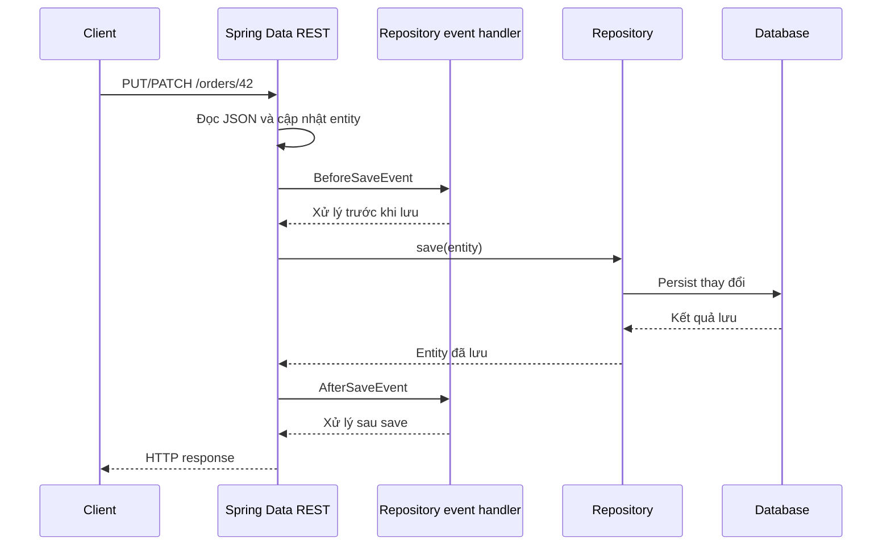

# BeforeSaveEvent và AfterSaveEvent khi cập nhật tài nguyên

Khi client cập nhật một tài nguyên được Spring Data REST export bằng PUT hoặc PATCH, repository cần nhận entity đã được thay đổi và thực hiện thao tác lưu. Spring Data REST phát các repository events quanh thao tác này để ứng dụng có thể gắn logic vào đúng thời điểm. Hai event quan trọng cho luồng cập nhật là `BeforeSaveEvent` và `AfterSaveEvent`.

`BeforeSaveEvent` được phát trước khi entity được lưu; `AfterSaveEvent` được phát sau khi thao tác save của repository đã được gọi và trả về. Chúng cung cấp extension point cho những công việc gắn với vòng đời cập nhật entity, chẳng hạn chuẩn bị dữ liệu phụ trợ hoặc ghi nhận thay đổi.

## 1. Vị trí của hai event trong luồng cập nhật

Với một request cập nhật item resource, luồng khái quát thường là:



Đây là sơ đồ định vị trách nhiệm ở mức khái quát. Các bước cụ thể còn phụ thuộc endpoint, repository implementation, transaction và cấu hình ứng dụng. GET không đi qua cặp event cập nhật này. POST tạo entity thường phát cặp `BeforeCreateEvent` / `AfterCreateEvent`. Thay đổi association có cặp `BeforeLinkSaveEvent` / `AfterLinkSaveEvent` riêng.

Hai event Save được dùng khi Spring Data REST xử lý một thao tác lưu entity theo lifecycle tương ứng. Một controller hoặc service tùy chỉnh tự gọi repository không mặc nhiên đi qua cùng luồng publish event của Spring Data REST; nếu cần event trong đường xử lý tùy chỉnh, ứng dụng phải thiết kế việc phát event phù hợp.

## 2. BeforeSaveEvent: xử lý trước khi repository lưu

`BeforeSaveEvent` cho phép ứng dụng can thiệp vào entity trước khi repository thực hiện save. Một handler có thể:

- Chuẩn hóa dữ liệu đầu vào, ví dụ loại bỏ khoảng trắng ở field văn bản.
- Gán metadata do server quản lý, nếu đây là trách nhiệm phù hợp của lifecycle handler.
- Tính hoặc cập nhật một giá trị dẫn xuất cần được lưu cùng entity.
- Thực hiện kiểm tra bổ sung cần thiết trước thao tác lưu.

Ví dụ:

```java
@Component
@RepositoryEventHandler(Order.class)
public class OrderEventHandler {

    @HandleBeforeSave
    public void beforeSave(Order order) {
        if (order.getReference() != null) {
            order.setReference(
                order.getReference().trim()
            );
        }
    }
}
```

`@RepositoryEventHandler(Order.class)` giới hạn handler cho domain type `Order`. Annotation `@HandleBeforeSave` đánh dấu method xử lý event trước khi lưu. Spring Data REST phát hiện handler đã được đăng ký trong application context và gọi method phù hợp với entity được xử lý.

Nếu logic chỉ là quy tắc dữ liệu cần trả lỗi field rõ ràng, nên cân nhắc Bean Validation hoặc Spring `Validator` được đăng ký bằng validator bean tương ứng, ví dụ `beforeSaveValidator`. Event handler phù hợp hơn với logic lifecycle hoặc thao tác chuẩn bị entity. Đừng dùng handler như một nơi thay thế toàn bộ validation của domain.

Nếu một handler ném exception trước khi save, luồng request không thể tiếp tục như một lần cập nhật thành công. Exception cần được ánh xạ thành response phù hợp; không trả stack trace hoặc thông tin nội bộ cho client.

## 3. AfterSaveEvent: phản ứng sau thao tác save

`AfterSaveEvent` được phát sau khi repository save trả về. Handler có thể dùng event này để thực hiện công việc hậu xử lý gắn với entity vừa được lưu, ví dụ:

- Ghi một bản ghi audit phụ trợ.
- Cập nhật một read model hoặc dữ liệu dẫn xuất trong cùng ứng dụng.
- Phát một application event cho thành phần khác xử lý.
- Chuẩn bị thông tin phục vụ một quy trình tiếp theo.

Ví dụ:

```java
@Component
@RepositoryEventHandler(Order.class)
public class OrderEventHandler {

    @HandleAfterSave
    public void afterSave(Order order) {
        // Ghi nhận thông tin cập nhật hoặc phát event nội bộ.
        // Giữ handler ngắn và tránh tác vụ mạng kéo dài.
    }
}
```

Tên `AfterSaveEvent` cho biết thao tác repository save đã hoàn tất ở mức API repository. Không nên tự suy ra rằng mọi transaction bao quanh request đã commit tại thời điểm handler chạy. Transaction có thể được quản lý ở tầng khác hoặc bao quanh thao tác repository.

Nếu một tác vụ chỉ được phép chạy sau khi transaction commit thành công, hãy dùng transaction-aware event phù hợp, chẳng hạn `@TransactionalEventListener(phase = TransactionPhase.AFTER_COMMIT)`, và bảo đảm event được phát trong một transaction đang hoạt động. Cơ chế này cần được thiết kế và kiểm tra theo transaction boundary thực tế của ứng dụng.

## 4. Đăng ký handler và phân tách method

Một handler có thể xử lý cả before và after event cho cùng entity:

```java
@Component
@RepositoryEventHandler(Order.class)
public class OrderEventHandler {

    @HandleBeforeSave
    public void beforeSave(Order order) {
        // Chuẩn bị entity trước khi lưu.
    }

    @HandleAfterSave
    public void afterSave(Order order) {
        // Phản ứng sau khi repository save trả về.
    }
}
```

Có thể tách handler theo trách nhiệm nếu một domain type có nhiều nhóm logic. Dù tổ chức theo cách nào, method handler nên nhỏ, dễ đọc và chỉ nhận những dependency thực sự cần thiết.

Một số lưu ý khi đăng ký:

- Class handler phải là Spring bean, thường dùng `@Component`.
- Dùng `@RepositoryEventHandler` để chỉ rõ domain type mà handler xử lý.
- Dùng annotation `@HandleBeforeSave` và `@HandleAfterSave` trên method tương ứng.
- Đảm bảo package được component scan và handler có trong application context.
- Kiểm tra đúng entity type được xử lý, đặc biệt khi có inheritance hoặc nhiều repository export cùng domain type.

Không cần tự đăng ký một listener chung cho mọi event nếu chỉ xử lý update của một entity. Giới hạn handler theo type và event giúp tránh logic chạy ngoài ý muốn ở các thao tác khác.

## 5. Phân biệt Save event với Create và Link event

Spring Data REST có nhiều repository event; chọn sai event có thể khiến logic không chạy hoặc chạy ở một thao tác khác với dự kiến.

| Event | Thời điểm | Tình huống thường gặp |
|---|---|---|
| `BeforeCreateEvent` | Trước khi tạo entity mới | POST tạo item |
| `AfterCreateEvent` | Sau thao tác tạo | Hậu xử lý sau create |
| `BeforeSaveEvent` | Trước khi lưu entity | PUT/PATCH cập nhật item |
| `AfterSaveEvent` | Sau thao tác save | Hậu xử lý sau update/save |
| `BeforeLinkSaveEvent` | Trước khi lưu thay đổi association | Thay đổi liên kết |
| `AfterLinkSaveEvent` | Sau khi lưu thay đổi association | Hậu xử lý liên kết |
| `BeforeDeleteEvent` | Trước khi xóa entity | DELETE |
| `AfterDeleteEvent` | Sau thao tác xóa | Hậu xử lý sau delete |

Nếu cần xử lý riêng lúc tạo mới, hãy dùng Create event. Nếu cần xử lý khi client gắn hoặc thay đổi association, hãy xem LinkSave event. Không nên giả định mọi thay đổi liên quan entity đều đi qua `BeforeSaveEvent` / `AfterSaveEvent`.

## 6. Save event và validator có trách nhiệm khác nhau

Validator và event handler đều có thể chạy trước save, nhưng mục đích của chúng khác nhau:

| Cơ chế | Trách nhiệm chính | Cách dùng |
|---|---|---|
| `beforeSaveValidator` | Kiểm tra entity có hợp lệ trước khi lưu | Tạo field/global errors và từ chối dữ liệu không hợp lệ |
| `@HandleBeforeSave` | Thực hiện logic lifecycle trước save | Chuẩn hóa hoặc chuẩn bị entity |
| `@HandleAfterSave` | Phản ứng sau khi repository save trả về | Audit, phát application event hoặc cập nhật dữ liệu phụ trợ |

Ví dụ, quy tắc `quantity phải lớn hơn 0` là validation. Việc chuẩn hóa một reference code trước khi lưu có thể là logic before-save. Ghi nhận một sự kiện “order đã được cập nhật” có thể là logic after-save hoặc một domain event tùy thiết kế.

Đặt validation ở đúng nơi giúp client nhận lỗi rõ ràng và tránh để dữ liệu không hợp lệ đi sâu xuống persistence. Event handler không nên âm thầm sửa mọi lỗi đầu vào để request trông như thành công.

## 7. Transaction, side effect và xử lý lỗi

Before/after event không tự tạo một transaction mới và tên event cũng không xác định toàn bộ transaction boundary. Repository method có thể chạy trong transaction riêng hoặc tham gia transaction bao quanh nó. Cần kiểm tra cấu hình thực tế trước khi dựa vào rollback hoặc commit timing.

Một số nguyên tắc thực tế:

1. Giữ handler ngắn; tránh gọi HTTP service hoặc thực hiện tác vụ mạng kéo dài trong request thread.
2. Nếu cập nhật dữ liệu trong cùng database và cần atomicity, xác định rõ transaction boundary của thao tác.
3. Nếu gửi email hoặc message ra hệ thống ngoài, thiết kế để xử lý retry và sự kiện trùng.
4. Nếu chỉ được gửi thông báo sau commit, dùng transaction-aware listener hoặc outbox phù hợp.
5. Không giả định exception trong after-save luôn có cùng kết quả rollback ở mọi cấu hình; điều đó phụ thuộc transaction boundary và exception policy.
6. Không thực hiện side effect không thể đảo ngược trước khi biết thay đổi chính có thể commit thành công.

Ví dụ, handler gửi email trực tiếp sau save có thể gửi email dù một transaction bên ngoài sau đó rollback, tùy cách transaction và event được cấu hình. Với tác vụ quan trọng, outbox pattern thường giúp ghi sự kiện cùng transaction dữ liệu rồi xử lý gửi ra ngoài một cách bền vững.

## 8. Kiểm thử BeforeSaveEvent và AfterSaveEvent

Nên kiểm thử cả việc handler được gọi đúng thời điểm lẫn kết quả cuối cùng của entity. Một số trường hợp cần bao phủ:

- PUT cập nhật một item hợp lệ: before-save và after-save handler được gọi theo lifecycle.
- PATCH cập nhật một phần field: handler nhận entity sau khi request được áp dụng theo cách endpoint hỗ trợ.
- POST tạo mới: xác nhận Create event được dùng theo contract, không nhầm với update event.
- Thay đổi association: xác nhận LinkSave event tương ứng.
- Validator từ chối dữ liệu: repository không hoàn tất một lần lưu thành công.
- Handler before-save ném exception: request bị từ chối theo exception mapping.
- Handler after-save thực hiện side effect: kiểm tra transaction timing và hành vi khi lỗi.
- Custom controller gọi repository trực tiếp: xác nhận đường xử lý có phát event hay không thay vì giả định Spring Data REST lifecycle tự áp dụng.

Có thể dùng integration test với HTTP client và repository test fixture để xác nhận event trong đúng cấu hình web đang chạy. Unit test gọi trực tiếp method handler không chứng minh rằng Spring Data REST đã phát event và đăng ký handler đúng.

## 9. Checklist triển khai

1. Xác định thao tác là update item, create, delete hay thay đổi association.
2. Dùng `@HandleBeforeSave` cho logic cần chạy trước repository save.
3. Dùng `@HandleAfterSave` cho phản ứng sau khi repository save trả về.
4. Đăng ký handler thành Spring bean và giới hạn bằng domain type phù hợp.
5. Đặt quy tắc dữ liệu vào validator hoặc domain layer; không dùng event handler thay cho validation.
6. Xác định transaction boundary trước khi thực hiện side effect.
7. Dùng after-commit listener hoặc outbox khi tác vụ ngoài chỉ được chạy sau commit.
8. Kiểm thử qua endpoint Spring Data REST thực tế, bao gồm PUT/PATCH và các event liên quan.

`BeforeSaveEvent` và `AfterSaveEvent` tạo hai điểm mở rộng rõ ràng quanh thao tác cập nhật tài nguyên: một điểm trước khi repository lưu entity và một điểm sau khi thao tác save trả về. Khi chọn đúng event, giữ validator, transaction và side effect ở đúng trách nhiệm, luồng cập nhật trong Spring Data REST dễ kiểm soát và dễ kiểm thử hơn.
