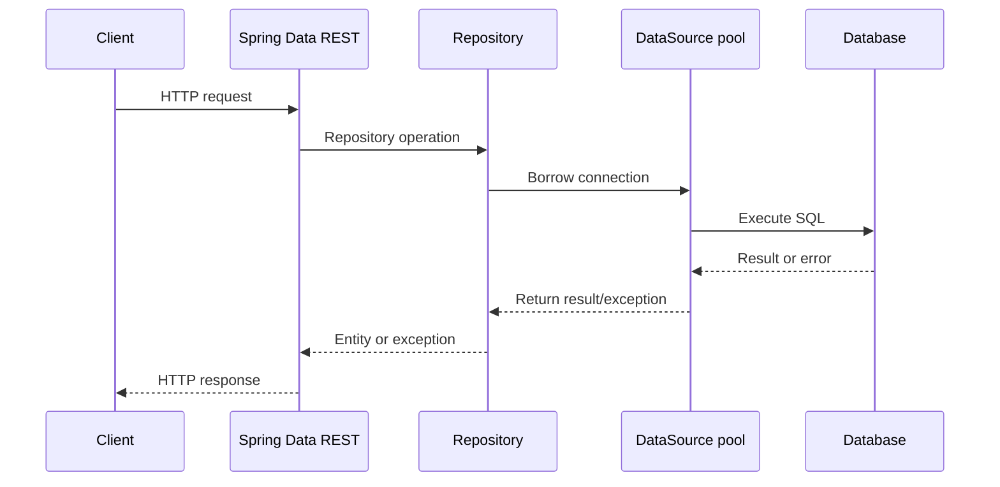

# Quản lý timeout, connection pool và lỗi kho dữ liệu trong Spring Data REST

Spring Data REST cung cấp HTTP endpoint từ Spring Data repository, nhưng bản thân exporter không quản lý connection pool của kho dữ liệu. Với Spring Data JPA/JDBC, đường đi thường là HTTP request → Spring Data REST → repository → DataSource/connection pool → JDBC driver → database. Khi request chậm hoặc lỗi, cần xác định nó đang chờ ở lớp nào trước khi thay đổi timeout hoặc tăng pool size.



## 1. Phân biệt các loại timeout

Các timeout có phạm vi khác nhau. Đặt một timeout không tự giới hạn tất cả các bước trong request.

| Loại timeout | Kiểm soát ở đâu | Ý nghĩa |
|---|---|---|
| Chờ connection trong pool | HikariCP `connection-timeout` hoặc thuộc tính tương ứng của pool đang dùng | Thời gian chờ một connection rảnh được trả về từ pool |
| Kết nối mạng tới database | JDBC driver, URL/driver properties, TCP/network | Thời gian mở kết nối mới hoặc chờ dữ liệu qua socket |
| Thực thi SQL/query | Database, JDBC statement, JPA provider hoặc query hint | Thời gian một câu lệnh hoặc truy vấn được phép chạy |
| Transaction | Transaction manager, ví dụ `@Transactional(timeout = 5)` | Giới hạn transaction tính bằng giây nếu transaction manager hỗ trợ |
| HTTP/client/gateway | HTTP client, reverse proxy, load balancer | Thời gian caller chờ response |

HikariCP `connection-timeout` chỉ giới hạn thời gian lấy connection từ pool. Khi pool đã đạt maximum size và không còn connection idle, lời gọi `getConnection()` chờ tối đa khoảng thời gian này rồi ném SQLException. Nó không thay thế connect timeout hoặc socket/read timeout của JDBC driver. Nếu database hoặc mạng không phản hồi, cần cấu hình timeout ở driver và hạ tầng mạng theo tài liệu của driver đang dùng.

Tương tự, HTTP client timeout hết hạn không bảo đảm câu SQL phía server đã bị hủy hoặc transaction đã rollback. Với thao tác ghi, hãy thiết kế tính idempotent và kiểm tra trạng thái trước khi retry nếu client không biết request đã commit hay chưa.

## 2. Cấu hình connection pool

### Spring Boot chọn pool nào?

Spring Boot ưu tiên HikariCP khi thư viện này có trên classpath; tiếp theo mới xét Tomcat JDBC pool, Commons DBCP2 và Oracle UCP. Các starter JDBC/JPA của Boot thường kéo HikariCP vào sẵn. Cấu hình chuẩn của DataSource nằm dưới `spring.datasource.*`; cấu hình riêng cho Hikari nằm dưới `spring.datasource.hikari.*`.

Nếu ứng dụng tự khai báo một bean DataSource, Spring Boot không còn thực hiện auto-configuration DataSource như thông thường. Khi đó cần kiểm tra cấu hình pool tự tạo và prefix thuộc implementation thực tế. Với Spring Data MongoDB, Redis hoặc datastore khác, dùng pool/client settings của driver tương ứng; `spring.datasource.hikari.*` chỉ áp dụng cho Hikari JDBC.

Ví dụ dưới đây minh họa các giá trị có giới hạn cho một ứng dụng JDBC. Các con số chỉ để minh họa; phải điều chỉnh theo database, số instance và kết quả load test:

```yaml
spring:
  datasource:
    url: jdbc:postgresql://localhost:5432/app
    hikari:
      connection-timeout: 3000
      validation-timeout: 1000
      maximum-pool-size: 12
      max-lifetime: 1740000
      leak-detection-threshold: 60000
```

| Thuộc tính | Ý nghĩa và cách dùng |
|---|---|
| `connection-timeout` | Thời gian tối đa chờ connection rảnh trong pool, đơn vị ms. Hikari mặc định 30 giây; giá trị tối thiểu hiện tại là 250 ms. Giảm giá trị này giúp request thất bại sớm khi pool bão hòa, nhưng không sửa được query chậm hoặc database mất kết nối. |
| `validation-timeout` | Thời gian kiểm tra connection còn hoạt động; phải nhỏ hơn `connection-timeout`. |
| `maximum-pool-size` | Tổng số connection tối đa, gồm cả connection đang dùng và đang idle. Khi đạt giới hạn, request mới phải chờ hoặc timeout. |
| `max-lifetime` | Tuổi tối đa của một connection trong pool. Đặt ngắn hơn một chút so với giới hạn tuổi connection do database, proxy hoặc network áp đặt. |
| `leak-detection-threshold` | Sau khoảng thời gian này Hikari ghi log nghi ngờ connection bị giữ quá lâu. Mặc định tắt; dùng tạm thời để điều tra, vì transaction hợp lệ nhưng lâu cũng có thể tạo cảnh báo. |

HikariCP có thể dùng `keepalive-time` để kiểm tra connection idle nhằm tránh bị database hoặc network đóng do không hoạt động. Giá trị này phải nhỏ hơn `max-lifetime`; keepalive chỉ tác động đến connection idle. Không bật hoặc chỉnh các tham số này theo cảm tính: đối chiếu giới hạn của database/proxy và driver trước.

### Chọn pool size

`maximum-pool-size` là giới hạn connection thật tới database, không phải số HTTP worker hoặc số người dùng đồng thời. Hãy tính tổng connection có thể mở từ tất cả instance ứng dụng, job nền, migration và công cụ vận hành; tổng đó phải nằm trong ngân sách `max_connections` của database.

Không tăng pool size ngay khi thấy timeout. Pool quá lớn có thể làm database tranh chấp CPU, I/O, lock và memory nhiều hơn, khiến throughput giảm. Hãy đo active/idle/waiting, thời gian query, CPU và lock ở database; sau đó thử vài cấu hình bằng load test với workload gần production. HikariCP khuyến nghị bắt đầu từ pool nhỏ và điều chỉnh theo benchmark thay vì cấp một connection cho mỗi request.

## 3. Giữ connection và transaction trong thời gian ngắn

Connection phải được trả về pool sau khi hoàn thành công việc. `JdbcTemplate` tự quản lý việc tạo và giải phóng JDBC resource; nếu dùng JDBC trực tiếp, đóng connection, statement và result set bằng try-with-resources:

```java
try (Connection connection = dataSource.getConnection();
     PreparedStatement statement = connection.prepareStatement(sql);
     ResultSet resultSet = statement.executeQuery()) {

    while (resultSet.next()) {
        // Map kết quả cần thiết
    }
}
```

Với JPA/repository, chú ý transaction dài, lazy loading ngoài transaction, stream/scroll chưa đóng và tác vụ nền giữ entity manager lâu. Tránh gọi HTTP service, ghi file hoặc chờ người dùng trong khi đang giữ transaction/connection. Nếu cần gọi dịch vụ ngoài, cân nhắc tách bước trước hoặc sau transaction.

Có thể đặt timeout transaction ở service method:

```java
@Transactional(timeout = 5)
public void updateInventory(...) {
    // Thực hiện các thao tác database ngắn gọn
}
```

Timeout của `@Transactional` tính bằng giây và phụ thuộc transaction manager. Nó không thay thế timeout của JDBC driver, statement hoặc HTTP client. Cũng cần xác minh transaction manager/provider đang dùng có áp dụng timeout xuống thao tác database theo cách mong muốn hay không.

## 4. Phân loại và xử lý lỗi kho dữ liệu

Spring chuyển nhiều lỗi công nghệ cụ thể như SQLException, JPA hoặc Hibernate exception sang hệ thống exception chung có gốc là `DataAccessException`. Exception đã dịch vẫn giữ exception gốc làm cause, giúp log và điều tra lỗi theo SQLState/vendor code mà tầng nghiệp vụ không phải phụ thuộc trực tiếp vào driver.

Một số nhóm thường gặp:

- `DataAccessResourceFailureException`: không truy cập được tài nguyên dữ liệu, ví dụ database hoặc connection gặp sự cố.
- `DataIntegrityViolationException`: vi phạm constraint, khóa duy nhất hoặc ràng buộc dữ liệu.
- `QueryTimeoutException` hoặc exception về lock: câu lệnh/query vượt thời gian hoặc không lấy được lock; loại cụ thể phụ thuộc provider và driver.
- `DataAccessException` khác: lỗi persistence không thuộc nhóm cụ thể hoặc chưa được translator nhận diện.

Không giả định mọi driver đều trả cùng một subclass. Khi chẩn đoán, ghi nhận exception type, root cause, SQLState/vendor code, tên pool, request ID và thời điểm; không ghi password hoặc thông tin kết nối bí mật.

Ở HTTP boundary, định nghĩa hợp đồng lỗi rõ ràng:

- Payload sai hoặc lỗi validation thuộc nhóm client error, theo status đã công bố.
- Resource không tồn tại dùng status phù hợp với contract.
- Database tạm thời không khả dụng có thể được ánh xạ thành 503 Service Unavailable nếu ứng dụng chủ động định nghĩa chính sách này.
- Lỗi không dự kiến trả 5xx; không gửi SQL, stack trace, hostname nội bộ, username hoặc connection URL ra response.

Spring Data REST có `RepositoryRestExceptionHandler` riêng. Nếu cần custom resource handler, `@RepositoryRestController` giúp dùng base path, message converter và exception handling của Spring Data REST. Không mặc định rằng một `@ControllerAdvice` bất kỳ sẽ ghi đè handler của exporter theo đúng thứ tự mong muốn; xác minh status và body bằng HTTP integration test.

Chỉ retry lỗi được xác định là transient, với số lần giới hạn và backoff có jitter. Không retry mọi `DataAccessException`; đặc biệt với thao tác ghi, nếu kết nối đứt sau khi server đã commit thì client có thể không biết kết quả. Retry cần idempotency key hoặc cơ chế kiểm tra trạng thái để tránh ghi trùng.

## 5. Quan sát pool và datastore khi chạy thật

Spring Boot Actuator cung cấp health indicator `db` để kiểm tra có lấy được connection từ DataSource hay không. Đây là tín hiệu hữu ích cho readiness/health, nhưng không thay thế metrics về độ bão hòa. Chi tiết health mặc định không được hiển thị công khai; chỉ bật chi tiết cho monitoring đã xác thực.

Actuator/Micrometer cung cấp:

- Metrics có prefix `jdbc.connections` với gauge active, idle, maximum và minimum connection của DataSource.
- Metrics riêng của Hikari với prefix `hikaricp`, được gắn tag theo tên pool.
- Metrics invocation của Spring Data repository với tên mặc định `spring.data.repository.invocations`; các tag gồm repository, method, state và exception.

Khi điều tra, ghép các số liệu pool với HTTP latency, repository invocation duration/error, slow query, lock wait, database CPU và số connection phía database. Mẫu dấu hiệu thường gặp: active bằng maximum, idle bằng 0 và request đang chờ tăng là dấu hiệu pool bão hòa; nếu query chậm hoặc lock kéo dài, tăng pool thường chỉ làm nhiều request cùng chờ database hơn.

Ví dụ bật các endpoint cần cho monitoring; phải giới hạn quyền truy cập theo chính sách môi trường:

```properties
management.endpoints.web.exposure.include=health,metrics
management.endpoint.health.show-details=when-authorized
```

## 6. Kiểm thử timeout, pool và lỗi

### Kiểm tra cấu hình pool được bind

Test này xác nhận các thuộc tính cấu hình đã đi vào HikariDataSource. Ví dụ giả định ứng dụng đang dùng HikariCP và test profile có database khả dụng:

```java
@SpringBootTest(properties = {
    "spring.datasource.hikari.maximum-pool-size=12",
    "spring.datasource.hikari.connection-timeout=3000"
})
class HikariPoolConfigurationTest {

    @Autowired
    private HikariDataSource pool;

    @Test
    void appliesPoolLimits() {
        assertThat(pool.getMaximumPoolSize()).isEqualTo(12);
        assertThat(pool.getConnectionTimeout()).isEqualTo(3000L);
    }
}
```

### Kiểm tra pool hết connection

Dùng pool riêng cho test với maximum size bằng 1. Giữ connection đầu tiên rồi yêu cầu connection thứ hai; lời gọi thứ hai phải thất bại sau khoảng timeout cấu hình. Test này không nên chạy trong transaction test đã giữ sẵn connection:

```java
@SpringBootTest(properties = {
    "spring.datasource.hikari.maximum-pool-size=1",
    "spring.datasource.hikari.connection-timeout=300"
})
class HikariPoolExhaustionIT {

    @Autowired
    private HikariDataSource pool;

    @Test
    void timesOutWhenEveryConnectionIsBorrowed() throws SQLException {
        try (Connection held = pool.getConnection()) {
            assertThatThrownBy(() -> pool.getConnection())
                .isInstanceOf(SQLException.class);
        }
    }
}
```

Giá trị 300 ms chỉ phù hợp cho test cô lập vì Hikari yêu cầu tối thiểu 250 ms. Test cần database thật đang chạy và HikariDataSource trực tiếp; nếu ứng dụng bọc DataSource bằng proxy lazy, hãy lấy bean pool đích hoặc buộc thực thi SQL để connection thực sự được mượn.

### Kiểm tra lỗi database và HTTP contract

- Dùng Testcontainers với cùng engine/version gần production để kiểm tra constraint, lock, query timeout và hành vi khi database khởi động lại. `@DataJpaTest` có thể kết hợp `@AutoConfigureTestDatabase(replace = Replace.NONE)` để không thay database container bằng embedded database.
- Với lỗi constraint, kiểm tra repository phát sinh exception thuộc nhóm `DataIntegrityViolationException` và transaction rollback đúng.
- Với timeout truy vấn/lock, dùng cơ chế timeout riêng của database/provider và xác minh statement kết thúc, transaction được giải phóng, connection trở lại pool. Đây là test phụ thuộc database, không nên khẳng định H2 đại diện cho mọi engine.
- Với REST error contract, tạo lỗi datastore có kiểm soát trong test profile hoặc test fixture, gửi request qua MockMvc, rồi xác minh status/body theo chính sách lỗi ứng dụng. Nếu ứng dụng map outage thành 503, kiểm tra 503 và body an toàn; đồng thời xác minh response không chứa SQL, stack trace hoặc credentials.
- Nếu kiểm tra mất kết nối và phục hồi, dùng database container riêng cho test. Không dừng database dùng chung hoặc môi trường đang có người khác sử dụng.

Chạy test bằng `./mvnw test` hoặc `./gradlew test`; integration test cần profile/container tương ứng. Giữ các test timeout độc lập, có thời gian chờ ngắn, giới hạn và dọn resource bằng try-with-resources.

## 7. Troubleshooting

| Triệu chứng | Nguyên nhân có thể | Cách điều tra |
|---|---|---|
| Log Hikari báo `Connection is not available, request timed out` | Pool đạt maximum; query/transaction lâu; connection bị giữ; database đang chậm | Xem active/idle/max, waiting/pending, repository latency, slow query và lock; xác minh mọi connection được đóng |
| `Connection refused` hoặc `Communications link failure` | Database down, DNS/firewall/TLS, driver connect/socket timeout hoặc network bị ngắt | Kiểm tra endpoint/port, DNS, route, credential, driver log và timeout mạng; `connection-timeout` của pool không thay thế socket timeout |
| Pool active cao nhưng database CPU thấp | Thread giữ connection trong transaction lâu, gọi dịch vụ ngoài khi đang giữ connection hoặc connection leak | Kiểm tra stack trace leak detection, transaction duration và call ngoài; rút ngắn transaction, đóng resource |
| Pool tăng size nhưng latency còn tăng | Database đang tranh chấp CPU/I/O/lock; số connection quá lớn | Đo load, query plan, lock và connection budget; thử pool nhỏ hơn trước khi tăng tiếp |
| Lỗi sau thời gian idle | Database/proxy đóng connection cũ hoặc TCP idle timeout | Căn chỉnh `max-lifetime` thấp hơn giới hạn phía server; cân nhắc keepalive theo Hikari/driver/network |
| `actuator/health/db` báo DOWN | Không lấy được connection hoặc database không phản hồi | Xem cause trong log và health details đã được bảo vệ; kiểm tra URL, driver, credential, pool và database |
| H2 chạy được nhưng production database lỗi | Khác dialect, constraint, isolation, lock hoặc native SQL | Chạy integration test với cùng engine/version qua Testcontainers |
| REST trả 500 khi datastore lỗi | Exception handler chưa ánh xạ theo API contract hoặc lỗi bị chuyển thành lỗi chung | Kiểm tra root cause và handler đang xử lý; test status/body bằng MockMvc; chỉ trả 503 khi có chính sách rõ ràng |
| Response để lộ SQL hoặc stack trace | Error response đang đưa chi tiết nội bộ ra client | Giữ chi tiết ở log nội bộ, trả message ổn định và không chứa credential/SQL; thêm assertion bảo mật cho body |
| Không thấy pool metrics | Actuator/Micrometer chưa có hoặc endpoint chưa được expose/authorize | Kiểm tra dependency, registry, endpoint exposure và quyền truy cập; xác minh DataSource được instrument |

## 8. Checklist vận hành

- [ ] Xác nhận implementation DataSource thực tế trước khi dùng prefix cấu hình.
- [ ] Phân biệt pool acquisition, driver/network, query, transaction và HTTP timeout.
- [ ] Cấu hình connection timeout hữu hạn và validation timeout nhỏ hơn connection timeout.
- [ ] Chọn maximum pool size theo ngân sách connection của database và số instance.
- [ ] Căn chỉnh max lifetime/keepalive với giới hạn database và network.
- [ ] Đóng JDBC resource; giữ transaction ngắn; không chờ dịch vụ ngoài khi đang giữ connection.
- [ ] Theo dõi active/idle/max, Hikari metrics, repository errors, query latency và lock.
- [ ] Bảo vệ Actuator health/metrics và không công khai chi tiết database.
- [ ] Có test pool exhaustion, database-specific failure và HTTP error contract trong môi trường cô lập.
- [ ] Retry có giới hạn, backoff và chỉ áp dụng cho thao tác transient/idempotent.

## 9. Tài liệu chính thức

- [Spring Boot: SQL Databases](https://docs.spring.io/spring-boot/reference/data/sql.html) — DataSource, pool auto-configuration và các prefix cấu hình.
- [HikariCP README: Configuration](https://github.com/brettwooldridge/HikariCP#configuration-knobs-baby) — connectionTimeout, maximumPoolSize, maxLifetime, validationTimeout và leakDetectionThreshold.
- [HikariCP: About Pool Sizing](https://github.com/brettwooldridge/HikariCP/wiki/About-Pool-Sizing) — cách suy nghĩ và benchmark pool size.
- [HikariCP: Handling Database Down](https://github.com/brettwooldridge/HikariCP/wiki/Bad-Behavior:-Handling-Database-Down) — hành vi timeout khi database/network gặp sự cố.
- [Spring Boot: Actuator Metrics](https://docs.spring.io/spring-boot/reference/actuator/metrics.html) — JDBC, HikariCP và Spring Data repository metrics.
- [Spring Boot: Actuator Endpoints](https://docs.spring.io/spring-boot/reference/actuator/endpoints.html) — health endpoint, DataSource health và kiểm soát chi tiết.
- [Spring Framework: DAO Support](https://docs.spring.io/spring-framework/reference/data-access/dao.html) — exception hierarchy và `DataAccessException`.
- [Spring Framework: JDBC Core](https://docs.spring.io/spring-framework/reference/data-access/jdbc/core.html) — quản lý JDBC resource và SQLExceptionTranslator.
- [Spring Framework: Using @Transactional](https://docs.spring.io/spring-framework/reference/data-access/transaction/declarative/annotations.html) — transaction timeout và semantics.
- [Spring Data REST: RepositoryRestExceptionHandler](https://docs.spring.io/spring-data/rest/reference/api/java/org/springframework/data/rest/webmvc/RepositoryRestExceptionHandler.html) — exception handler của REST exporter.
- [Spring Data REST: Overriding Response Handlers](https://docs.spring.io/spring-data/rest/reference/customizing/overriding-sdr-response-handlers.html) — custom resource handler tích hợp với cấu hình Spring Data REST.
