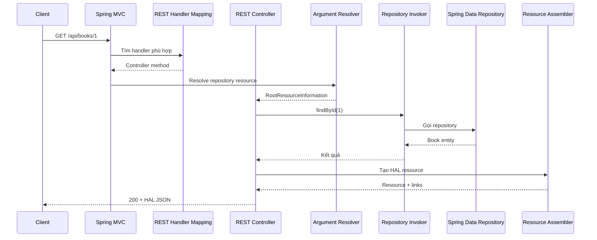

# Các thành phần chính của REST exporter và RepositoryRestMvcConfiguration

Spring Data REST biến các Spring Data repository thành tài nguyên REST có thể truy cập qua HTTP. Để thực hiện việc đó, framework kết hợp nhiều thành phần: phát hiện repository, xây dựng metadata, ánh xạ request, gọi repository, tạo representation và ghi HTTP response. `RepositoryRestMvcConfiguration` kết nối hạ tầng Spring MVC phục vụ REST resource; `RepositoryRestConfiguration` giữ các tùy chọn điều khiển hành vi của exporter.

Hiểu vai trò của các thành phần này giúp ta lần theo một request từ URL tới database rồi trở lại client. Đây cũng là cơ sở để chọn đúng extension point khi cần thay đổi đường dẫn, representation, validation hoặc xử lý sự kiện.

## 1. REST exporter làm nhiệm vụ gì?

REST exporter là cơ chế công bố các repository được phép export thành HTTP resource. Ví dụ, một repository quản lý entity `Book` có thể cung cấp collection resource, item resource và các endpoint tìm kiếm. Nếu base path là `/api` và collection path là `books`, các URL cơ bản có thể là:

| HTTP method | Endpoint | Tác dụng |
|---|---|---|
| GET | `/api/books` | Đọc collection sách |
| POST | `/api/books` | Tạo một quyển sách |
| GET | `/api/books/{id}` | Đọc một quyển sách |
| PUT | `/api/books/{id}` | Gửi representation để cập nhật/thay thế |
| PATCH | `/api/books/{id}` | Cập nhật một phần thuộc tính |
| DELETE | `/api/books/{id}` | Xóa một quyển sách |
| GET | `/api/books/search/...` | Gọi query method được export |

Các URL trên là ví dụ dựa trên cấu hình cụ thể. URL thực tế còn phụ thuộc base path, metadata của repository, annotation và những phương thức được phép export.

Exporter không tự biến mọi bảng trong database thành API. Nó làm việc với các Spring Data repository được phát hiện trong ứng dụng và tuân theo chính sách export. Repository bị ẩn hoặc phương thức được đánh dấu không export sẽ không được công bố như endpoint tương ứng.

## 2. Các nhóm thành phần trong kiến trúc

Có thể chia pipeline của Spring Data REST thành những nhóm sau:

| Nhóm | Thành phần tiêu biểu | Vai trò |
|---|---|---|
| Cấu hình MVC | `RepositoryRestMvcConfiguration` | Đăng ký hạ tầng Spring MVC cần cho REST exporter |
| Cấu hình hành vi | `RepositoryRestConfiguration` | Lưu base path, media type, phân trang và các tùy chọn exporter |
| Repository discovery | Spring Data `Repositories` | Tra cứu repository theo domain type |
| Resource metadata | `RepositoryResourceMappings`, `ResourceMetadata` | Xác định path, relation và resource được export |
| Request mapping | Handler mapping của Spring Data REST | Ghép URL và HTTP method với handler phù hợp |
| Request handling | Các REST controller | Xử lý root, collection, item, search và association |
| Repository invocation | `RepositoryInvokerFactory`, `RepositoryInvoker` | Cung cấp cách gọi repository thống nhất |
| Representation | `PersistentEntityResourceAssembler`, Spring HATEOAS | Chuyển entity thành resource và bổ sung liên kết |
| Hỗ trợ | Event handler, validation, exception handler, message converter | Xử lý vòng đời, dữ liệu và HTTP response |

Các nhóm này phối hợp với nhau. Controller không cần tự tìm từng repository, tự dựng URL hay tự viết JSON cho mỗi entity. Metadata và các thành phần hỗ trợ cung cấp thông tin cần thiết để cùng một cơ chế phục vụ nhiều repository.

## 3. Phân biệt RepositoryRestMvcConfiguration và RepositoryRestConfiguration

Hai tên lớp dễ gây nhầm lẫn nhưng chúng có trách nhiệm khác nhau.

### RepositoryRestMvcConfiguration

`RepositoryRestMvcConfiguration` nằm trong package `org.springframework.data.rest.webmvc.config`. Đây là lớp cấu hình hạ tầng Spring MVC của Spring Data REST. Nó kết nối các thành phần cần thiết để request tới repository resource có thể được nhận diện, xử lý và trả về dưới dạng HTTP response.

Ở mức khái niệm, cấu hình này chuẩn bị các thành phần như:

- Handler mapping để nhận diện request thuộc REST exporter.
- Controller cho tài nguyên gốc, collection, item, search và association.
- Argument resolver để đưa thông tin repository/domain resource vào controller.
- Các thành phần tạo resource và liên kết HATEOAS.
- Message converter để đọc request body và ghi response body.
- Cơ chế xử lý exception phát sinh trong quá trình xử lý REST resource.

Trong ứng dụng Spring Boot thông thường, dependency Spring Data REST và auto-configuration của Boot kích hoạt hạ tầng phù hợp. Ta không cần tự tạo lại các controller hay handler mapping này.

### RepositoryRestConfiguration

`RepositoryRestConfiguration` là đối tượng cấu hình hành vi của REST exporter. Nó chứa các tùy chọn mà hạ tầng MVC sử dụng khi công bố repository.

Các nhóm tùy chọn thường gặp gồm:

- Base path chung, ví dụ `/api`.
- Chiến lược phát hiện repository được phép export.
- Default media type và media type cho nội dung JSON.
- Phân trang, sắp xếp và giới hạn kích thước trang.
- Cách biểu diễn ID và response body.
- CORS cùng một số tùy chọn representation khác.

Có thể ghi nhớ: `RepositoryRestMvcConfiguration` lắp ráp bộ máy phục vụ HTTP; `RepositoryRestConfiguration` cung cấp thiết lập cho bộ máy đó.

## 4. Phát hiện repository và tạo resource metadata

Khi ứng dụng khởi động, Spring Data phát hiện các repository interface trong phạm vi scan. Hạ tầng repository duy trì thông tin về repository nào quản lý domain type nào, sau đó cung cấp khả năng tra cứu repository tương ứng.

Spring Data REST dùng thông tin này để xác định repository nào được export. Chiến lược phát hiện có thể dựa trên annotation, khai báo tường minh hoặc chiến lược detection được cấu hình trong ứng dụng.

### Repository metadata chứa gì?

Metadata mô tả cách một repository xuất hiện trong REST API, ví dụ:

- Domain type mà repository quản lý.
- Collection path.
- Tên relation của collection trong HAL.
- Cách tạo item resource và liên kết đến item.
- Query method được công bố dưới nhánh `search`.
- Repository hoặc phương thức không được phép export.

`RepositoryResourceMappings` hỗ trợ tra cứu mapping giữa repository và resource metadata. `ResourceMetadata` mô tả metadata của resource cụ thể. Các annotation như `@RepositoryRestResource` và `@RestResource` cho phép cung cấp một phần metadata này.

Ví dụ:

```java
@RepositoryRestResource(
    path = "books",
    collectionResourceRel = "books"
)
public interface BookRepository extends JpaRepository<Book, Long> {

    @RestResource(path = "by-title", rel = "by-title")
    List<Book> findByTitleContainingIgnoreCase(
        @Param("title") String title
    );
}
```

Với base path `/api`, collection được truy cập tại `/api/books`. Query method được export có thể được gọi tại `/api/books/search/by-title?title=java`.

Metadata cho phép exporter biết URL nào thuộc repository nào và relation nào cần xuất hiện trong response. Nhờ đó, một pipeline chung có thể phục vụ nhiều domain type mà không phải tạo controller riêng cho từng entity.

## 5. Handler mapping và REST controller

Sau khi metadata được chuẩn bị, Spring Data REST phải xác định controller nào xử lý request. Handler mapping ghép request với handler dựa trên URL, HTTP method và các điều kiện mapping. Base path được tính đến để endpoint exporter nằm dưới tiền tố đã cấu hình.

Các controller được chia theo nhóm tài nguyên và thao tác. Một số lớp tiêu biểu trong kiến trúc gồm:

- `RepositoryRestController`: phục vụ tài nguyên gốc và thông tin khám phá API.
- `RepositoryEntityController`: xử lý các thao tác trên collection và item resource.
- `RepositorySearchController`: xử lý query method được công bố dưới nhánh `search`.
- `RepositoryPropertyReferenceController`: hỗ trợ truy cập hoặc thay đổi liên kết giữa các entity resource.
- `RepositorySchemaController`: cung cấp schema resource khi chức năng tương ứng được bật.

Tên lớp và cách phân chia controller là chi tiết triển khai có thể thay đổi theo phiên bản. Ý nghĩa cần nắm là request được định tuyến theo loại resource và metadata của repository; controller xử lý nhóm thao tác phù hợp.

### Argument resolver cung cấp thông tin repository

Controller không cần tự phân tích URL để tìm domain type hay repository. Argument resolver của Spring Data REST có thể phân giải thông tin repository resource thành tham số cho handler method.

Ví dụ, `RootResourceInformationHandlerMethodArgumentResolver` hỗ trợ cung cấp `RootResourceInformation` tương ứng với request. Thông tin này kết nối controller với repository, metadata của domain type và cơ chế gọi repository.

Nhờ vậy, một controller có thể xử lý nhiều domain type theo metadata tương ứng, thay vì hard-code `BookRepository`, `CustomerRepository` hay từng repository riêng lẻ.

## 6. RepositoryInvokerFactory và RepositoryInvoker

Spring Data REST không yêu cầu mỗi controller gọi trực tiếp một interface repository cụ thể. `RepositoryInvokerFactory` tạo `RepositoryInvoker` phù hợp với repository được xác định từ metadata.

Invoker cung cấp abstraction cho các thao tác repository phổ biến, chẳng hạn:

- Tìm entity theo ID.
- Lấy collection hoặc trang dữ liệu.
- Lưu entity mới hoặc cập nhật entity.
- Xóa entity.
- Gọi query method được hỗ trợ.

Lợi ích của abstraction này là controller có thể làm việc với nhiều repository thông qua một cách gọi thống nhất. Việc thực thi cuối cùng vẫn do repository và module Spring Data tương ứng đảm nhiệm. Ví dụ, Spring Data JPA sẽ sử dụng persistence provider để thao tác với database.

Invoker không thay thế repository và không chứa toàn bộ nghiệp vụ của ứng dụng. Nó là cầu nối giữa web layer của exporter và repository layer.

## 7. Chuyển entity thành HAL resource

Sau khi repository trả về entity, Spring Data REST cần tạo representation HTTP. Entity không chỉ được serialize thành JSON thuần; exporter còn có thể bổ sung liên kết để client khám phá API.

### PersistentEntityResourceAssembler

`PersistentEntityResourceAssembler` hỗ trợ chuyển persistent entity thành resource. Nó phối hợp metadata của entity với cơ chế tạo liên kết để xây dựng representation phù hợp.

HAL thường có hai phần quan trọng:

- `_links`: chứa các liên kết như `self`, collection và quan hệ liên quan.
- `_embedded`: chứa resource được nhúng khi representation và cấu hình yêu cầu.

Ví dụ minh họa:

```json
{
  "title": "Effective Java",
  "author": "Joshua Bloch",
  "_links": {
    "self": {
      "href": "http://localhost:8080/api/books/1"
    },
    "books": {
      "href": "http://localhost:8080/api/books"
    }
  }
}
```

Đây là JSON minh họa cấu trúc HAL, không phải response cố định cho mọi ứng dụng. Các relation, trường dữ liệu, URI và liên kết thực tế phụ thuộc metadata, projection, dữ liệu và cấu hình.

### Link generation và content negotiation

Các thành phần HATEOAS tạo URI và relation cho resource. Spring MVC message converter ghi representation thành response body theo media type được thương lượng qua HTTP header `Accept`.

Client thường yêu cầu:

```http
Accept: application/hal+json
```

Nếu client yêu cầu media type server không hỗ trợ, content negotiation có thể thất bại. Khi xem response, cần kiểm tra cả `Accept` và `Content-Type`, không chỉ JSON body.

## 8. Luồng xử lý một request GET

Xét request đọc một quyển sách:

```http
GET /api/books/1
Accept: application/hal+json
```

Luồng xử lý tổng quát:

1. Web server nhận HTTP request và chuyển request vào Spring MVC.
2. Handler mapping của Spring Data REST kiểm tra base path, URL và HTTP method để chọn handler.
3. Argument resolver tra metadata và cung cấp thông tin repository/domain resource cho controller.
4. Controller xác định thao tác đọc item và dùng repository invoker để gọi repository.
5. Repository thực hiện truy vấn thông qua module Spring Data và persistence provider.
6. Entity kết quả được chuyển thành resource bằng assembler; các liên kết được tạo dựa trên metadata và HATEOAS.
7. Message converter ghi HAL JSON vào response và server trả về client.

Sequence diagram sau mô tả mối quan hệ giữa các thành phần:



Với request POST, các bước đầu tương tự nhưng controller đọc request body, chuyển dữ liệu thành entity và gọi thao tác lưu. Khi lưu thành công, exporter tạo response cho resource mới; status thường là `201 Created` và header `Location` trỏ tới URI của item.

Với search request, handler mapping chọn nhóm xử lý search và invoker gọi query method tương ứng. Với association request, controller xử lý liên kết giữa các resource.

## 9. Repository events, validation và exception handling

REST exporter có các điểm mở rộng để ứng dụng tham gia vào vòng đời thao tác repository.

### Repository event handler

Có thể lắng nghe sự kiện trước và sau thao tác lưu, cập nhật hoặc xóa. `@RepositoryEventHandler` kết hợp với các annotation như `@HandleBeforeCreate`, `@HandleAfterCreate`, `@HandleBeforeSave` và `@HandleAfterSave` cho phép xử lý logic gắn với repository event.

Ví dụ:

```java
@Component
@RepositoryEventHandler(Book.class)
public class BookEventHandler {

    @HandleBeforeCreate
    public void beforeCreate(Book book) {
        if (book.getTitle() != null) {
            book.setTitle(book.getTitle().trim());
        }
    }
}
```

Handler trên minh họa việc chuẩn hóa khoảng trắng trước khi tạo entity. Trong ứng dụng thực tế, event handler nên tập trung vào logic phù hợp với vòng đời repository như audit hoặc chuẩn hóa dữ liệu. Quy trình nghiệp vụ phức tạp, cần phối hợp nhiều bước hoặc quản lý transaction rõ ràng nên nằm trong service chuyên biệt.

### Validation

Cần phân biệt ba lớp kiểm tra:

- Ràng buộc database bảo vệ tính hợp lệ ở tầng lưu trữ.
- Bean Validation kiểm tra các constraint của dữ liệu, ví dụ `@NotBlank`, `@Size` hoặc `@Email`.
- Business validation kiểm tra quy tắc nghiệp vụ, chẳng hạn trạng thái chuyển đổi có hợp lệ hay không.

Một trường có `@Column(nullable = false)` không tự động cung cấp đầy đủ thông báo validation thân thiện cho client. Hãy cấu hình validation ở tầng phù hợp và trả lỗi có thể hiểu được.

### Exception handling

Nếu ID không tồn tại, request body sai, validation thất bại hoặc repository phát sinh lỗi, exporter chuyển exception thành HTTP response. `RepositoryRestExceptionHandler` là một thành phần xử lý exception trong web layer của Spring Data REST.

Khi tìm lỗi, hãy xem status code, response body, log server và nguyên nhân gốc ở repository/database. Không nên suy luận rằng mọi lỗi 4xx đều do handler mapping hoặc mọi lỗi 5xx đều do controller.

## 10. Tùy chỉnh qua RepositoryRestConfigurer

Trong ứng dụng thông thường, nên cấu hình qua `RepositoryRestConfigurer` thay vì kế thừa hoặc thay thế trực tiếp `RepositoryRestMvcConfiguration`. Configurer cho phép điều chỉnh `RepositoryRestConfiguration` sau khi framework đã chuẩn bị các mặc định.

Ví dụ đặt base path và công bố ID của entity:

```java
package com.example.books;

import org.springframework.context.annotation.Configuration;
import org.springframework.data.rest.core.config.RepositoryRestConfiguration;
import org.springframework.data.rest.webmvc.config.RepositoryRestConfigurer;
import org.springframework.web.servlet.config.annotation.CorsRegistry;

@Configuration
public class RestApiConfiguration implements RepositoryRestConfigurer {

    @Override
    public void configureRepositoryRestConfiguration(
            RepositoryRestConfiguration config,
            CorsRegistry cors) {

        config.setBasePath("/api");
        config.exposeIdsFor(Book.class);
    }
}
```

Trong ví dụ:

- `@Configuration` đăng ký lớp cấu hình với Spring.
- `RepositoryRestConfigurer` là extension point công khai của Spring Data REST.
- `setBasePath("/api")` đặt tiền tố cho repository resource.
- `exposeIdsFor(Book.class)` yêu cầu ID của `Book` xuất hiện trong representation theo cấu hình này.

Nếu bật CORS, hãy khai báo origin và HTTP method cụ thể theo client được phép truy cập. Không nên mở tất cả origin trong production nếu không có yêu cầu rõ ràng.

Các extension point thường dùng khác gồm:

- `@RepositoryRestResource`: tùy chỉnh repository resource, collection path và relation.
- `@RestResource`: tùy chỉnh hoặc ẩn query method/resource.
- `@Projection` và excerpt projection: điều chỉnh tập thuộc tính được biểu diễn.
- `@RepositoryEventHandler`: xử lý sự kiện repository.
- Custom controller/service: triển khai endpoint có quy trình nghiệp vụ riêng.

## 11. Khi nào nên tạo custom controller?

REST exporter phù hợp với thao tác CRUD có cấu trúc tương đối chuẩn. Khi một request cần phối hợp nhiều repository, kiểm tra nhiều điều kiện, gọi dịch vụ bên ngoài hoặc thực hiện một quy trình nhiều bước, endpoint chuyên biệt thường dễ kiểm soát hơn.

Ví dụ, thao tác `approveOrder` có thể phải kiểm tra trạng thái đơn, quyền người dùng, hạn mức và tồn kho trước khi thay đổi trạng thái. Đây không chỉ là thao tác cập nhật một entity. Nên đặt logic trong service và công bố endpoint nghiệp vụ phù hợp.

Có thể kết hợp Spring Data REST với controller tùy chỉnh. Khi chọn annotation/controller, cần chú ý base path và quy tắc mapping để tránh xung đột URL với repository resource đã được export.

## 12. Lần theo lỗi trong kiến trúc

Khi endpoint không hoạt động, hãy xác định tầng đầu tiên có vấn đề:

| Triệu chứng | Tầng cần kiểm tra | Gợi ý |
|---|---|---|
| Repository không xuất hiện ở API root | Discovery/metadata | Kiểm tra package scan, repository detection strategy và `exported` |
| URL không khớp hoặc nhận 404 | Resource mapping/handler mapping | Kiểm tra base path, `path`, relation và HTTP method |
| Đúng URL nhưng thao tác repository thất bại | Invoker/repository/persistence | Kiểm tra query, transaction, ID và database log |
| Dữ liệu lưu được nhưng response thiếu trường | Representation/serialization | Kiểm tra getter, projection, serialization và entity metadata |
| Thiếu hoặc sai liên kết HAL | Link generation/resource metadata | Kiểm tra relation, association và resource mapping |
| Nhận 406 hoặc 415 | Content negotiation/message converter | Kiểm tra `Accept` và `Content-Type` |
| Nhận 400 hoặc 500 | Validation/exception/persistence | Đọc response lỗi và nguyên nhân gốc trong log |

Một cách lần theo request là: URL và method → handler → metadata → repository invocation → persistence → representation → response. Cách này giúp thu hẹp phạm vi lỗi theo đúng pipeline.

## 13. Những điều cần lưu ý khi đọc source code

1. **Ưu tiên extension point công khai.** Controller, resolver và mapping nội bộ có thể thay đổi giữa các phiên bản. Nếu chỉ cần đổi cấu hình, hãy dùng `RepositoryRestConfigurer` hoặc annotation.
2. **Không nhầm hai lớp cấu hình.** `RepositoryRestMvcConfiguration` lắp ráp MVC infrastructure; `RepositoryRestConfiguration` chứa tùy chọn của exporter.
3. **Không xem exporter là tầng nghiệp vụ.** Repository invoker cung cấp thao tác dữ liệu; quy tắc nghiệp vụ cần được thiết kế ở domain/service.
4. **Kiểm soát repository được export.** Mỗi resource công bố làm tăng bề mặt API cần được bảo vệ.
5. **Không xem HAL link là cơ chế phân quyền.** Server phải kiểm tra quyền trên mỗi request, kể cả khi client gọi URL trực tiếp.
6. **Đối chiếu đúng phiên bản.** Khi đọc source code hoặc debug, hãy xem phiên bản Spring Data REST thực tế trong dependency tree của dự án.

## 14. Kết luận

REST exporter của Spring Data REST là một pipeline gồm repository discovery, resource metadata, handler mapping, controller, repository invoker và representation assembler. `RepositoryRestMvcConfiguration` kết nối hạ tầng Spring MVC để pipeline phục vụ HTTP request; `RepositoryRestConfiguration` giữ các tùy chọn điều khiển hành vi exporter.

Khi hiểu rõ các thành phần và luồng xử lý, ta có thể lần theo request từ URL tới repository rồi tới HAL response, xác định tầng cần điều chỉnh và chọn đúng extension point. Với ứng dụng thông thường, hãy ưu tiên `RepositoryRestConfigurer`, annotation, event handler và service/controller nghiệp vụ thay vì thay thế trực tiếp hạ tầng nội bộ của Spring Data REST.