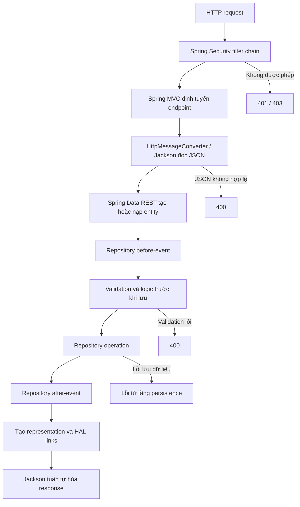

# Vị trí của validation, sự kiện, phân quyền và tuần tự hóa trong luồng xử lý

Trong Spring Data REST, một thao tác CRUD đi qua nhiều lớp trước khi dữ liệu được lưu và trả về. Bốn cơ chế validation, repository events, security và serialization nằm ở những điểm khác nhau của luồng này. Hiểu đúng vị trí giúp chọn đúng extension point, tránh đặt cùng một trách nhiệm vào nhiều nơi hoặc dùng một cơ chế cho mục đích mà nó không đảm nhiệm.

## 1. Toàn cảnh một request

Một request ghi dữ liệu thường đi theo trình tự khái quát sau:



Đây là mô hình để định vị trách nhiệm, không phải cam kết rằng mọi request đều đi qua từng bước theo cùng một nhánh. GET thường không có bước ghi, validation trước khi lưu hoặc cặp sự kiện create/save. DELETE và thao tác thay đổi association có cặp sự kiện riêng.

Có hai điểm security cần phân biệt: filter chain kiểm tra request ở đầu vào; method security kiểm tra quyền tại lúc một method được gọi. Tương tự, serialization có hai chiều: Jackson đọc JSON đầu vào trước khi repository xử lý entity, rồi tạo JSON đầu ra sau khi thao tác repository hoàn tất.

## 2. Validation: kiểm tra entity trước khi ghi

Validation trả lời câu hỏi: **dữ liệu có thỏa mãn quy tắc hợp lệ của ứng dụng trước khi được lưu hay không?**

Trong Spring Data REST, validation gắn với repository lifecycle events. Có thể đăng ký Spring `Validator` theo tên bean tương ứng với event. Một số điểm thường dùng:

| Bean name | Thời điểm |
|---|---|
| `beforeCreateValidator` | Trước khi tạo entity mới |
| `beforeSaveValidator` | Trước khi lưu entity đã tồn tại hoặc cập nhật |
| `beforeLinkSaveValidator` | Trước khi lưu thay đổi association |
| `beforeDeleteValidator` | Trước khi xóa, nếu nghiệp vụ cần kiểm tra |

Ví dụ validator chạy trước khi tạo một sản phẩm:

```java
@Component("beforeCreateValidator")
public class ProductValidator implements Validator {

    @Override
    public boolean supports(Class<?> type) {
        return Product.class.isAssignableFrom(type);
    }

    @Override
    public void validate(Object target, Errors errors) {
        Product product = (Product) target;

        if (product.getName() == null || product.getName().isBlank()) {
            errors.rejectValue(
                "name",
                "product.name.required",
                "Tên sản phẩm là bắt buộc"
            );
        }
    }
}
```

Validator nhận entity đã được chuyển đổi từ request body. Nếu có lỗi, Spring Data REST trả lỗi validation và thao tác lưu không được tiếp tục như một lần ghi thành công. Với lỗi dữ liệu đầu vào thông thường, client thường nhận HTTP 400 cùng thông tin field và mã lỗi.

Bean Validation như `@NotNull`, `@NotBlank`, `@Size` mô tả ràng buộc gần với dữ liệu; Spring `Validator` phù hợp cho quy tắc cần logic Java hoặc phụ thuộc nhiều trường. Có thể kết hợp hai cách, nhưng cần bảo đảm validator thực sự được nối vào đúng event của Spring Data REST trong cấu hình ứng dụng.

Validation tại repository lifecycle không thay thế mọi kiểm tra ở các lớp khác. Dữ liệu từ giao diện, API tùy chỉnh, batch job hoặc service nội bộ có thể đi theo đường khác. Quy tắc nghiệp vụ quan trọng nên được bảo vệ ở lớp dùng chung phù hợp, để không chỉ endpoint Spring Data REST mới được kiểm tra.

## 3. Repository events: móc vào trước và sau thao tác repository

Spring Data REST phát các repository events quanh các thao tác tạo, lưu, xóa và thay đổi liên kết. Có thể lắng nghe chúng bằng `@RepositoryEventHandler` cùng các annotation `@Handle...`.

Các cặp event thường gặp:

| Thao tác | Trước thao tác | Sau thao tác |
|---|---|---|
| POST tạo entity | `BeforeCreateEvent` | `AfterCreateEvent` |
| PUT/PATCH cập nhật entity | `BeforeSaveEvent` | `AfterSaveEvent` |
| Thay đổi association/link | `BeforeLinkSaveEvent` | `AfterLinkSaveEvent` |
| DELETE entity | `BeforeDeleteEvent` | `AfterDeleteEvent` |

Ví dụ handler chỉ áp dụng cho `Product`:

```java
@Component
@RepositoryEventHandler(Product.class)
public class ProductEventHandler {

    @HandleBeforeCreate
    public void beforeCreate(Product product) {
        // Chuẩn bị dữ liệu cần thiết trước khi tạo.
    }

    @HandleAfterSave
    public void afterSave(Product product) {
        // Xử lý phản ứng sau khi repository save trả về.
    }
}
```

Dùng before-event khi cần chuẩn bị hoặc kiểm tra entity ngay trước thao tác repository. Dùng after-event khi cần phản ứng với việc repository đã thực hiện thao tác, chẳng hạn cập nhật một dữ liệu phụ trợ trong cùng ứng dụng. Nếu cần từ chối dữ liệu theo quy tắc có cấu trúc field error, Spring `Validator` thường là extension point rõ ràng hơn.

Event handler nên tập trung vào một trách nhiệm cụ thể. Tránh đặt toàn bộ nghiệp vụ quan trọng, truy vấn dây chuyền hoặc tác vụ mạng dài vào handler vì chúng làm request khó dự đoán và khó kiểm soát lỗi. Đặc biệt, tên `AfterSave` có nghĩa là repository save đã chạy xong; không nên mặc định rằng transaction bên ngoài đã commit. Nếu phải kích hoạt tác vụ chỉ sau commit, hãy thiết kế theo transaction event phù hợp, chẳng hạn `@TransactionalEventListener(phase = TransactionPhase.AFTER_COMMIT)`, và xác nhận event được phát trong transaction tương ứng.

## 4. Security: quyết định ai được gọi và ai được thao tác

Security trả lời câu hỏi: **người gọi có được phép thực hiện request hoặc hành động trên tài nguyên này hay không?** Spring Data REST tự xuất endpoint từ repository, vì vậy cần bảo vệ cả endpoint được sinh tự động lẫn các đường truy cập tùy chỉnh.

### Request-level security

Spring Security filter chain là lớp kiểm soát ở đầu vào. Có thể yêu cầu đăng nhập cho API, giới hạn một số đường dẫn theo role/authority và cấu hình CORS/CSRF theo kiểu client đang sử dụng.

Ví dụ minh họa với Spring Security hiện đại:

```java
@Configuration
@EnableMethodSecurity
public class SecurityConfig {

    @Bean
    SecurityFilterChain securityFilterChain(HttpSecurity http)
            throws Exception {
        http.authorizeHttpRequests(auth -> auth
            .requestMatchers("/api/admin/**").hasRole("ADMIN")
            .requestMatchers("/api/**").authenticated()
            .anyRequest().permitAll()
        );

        return http.build();
    }
}
```

Các đường dẫn trong ví dụ phụ thuộc vào base path và cấu hình export của ứng dụng. Cần đặt matcher theo endpoint thực tế. Việc cấu hình CSRF cũng phải phù hợp với cách xác thực: ứng dụng dùng session và cookie cần xem xét CSRF; không nên tắt CSRF một cách máy móc chỉ vì API nhận JSON.

### Method-level security

Filter chain thường bảo vệ theo request path. Method security bảo vệ sâu hơn ở điểm gọi method, hữu ích khi một thao tác có thể được gọi từ nhiều endpoint hoặc từ code nội bộ.

```java
@PreAuthorize("hasAuthority('product:write')")
Product save(Product product);
```

Để annotation như `@PreAuthorize` có hiệu lực, ứng dụng phải bật method security và method phải được gọi qua proxy security của Spring. Có thể áp dụng kiểm tra ở service hoặc repository tùy ranh giới nghiệp vụ; không nên chỉ dựa vào việc endpoint hay liên kết không xuất hiện trong response.

Các quy tắc cần tính cả thao tác trên association và method tùy chỉnh. Nếu chỉ bảo vệ GET collection nhưng quên GET item, PUT/PATCH, DELETE hoặc endpoint association, tài nguyên vẫn có thể bị truy cập qua đường còn mở.

Ẩn một field bằng `@JsonIgnore`, projection hoặc bỏ một link khỏi representation không phải là authorization. Serialization quyết định dữ liệu được trình bày; security quyết định caller có quyền đọc hoặc thay đổi dữ liệu.

## 5. Serialization: chuyển đổi giữa HTTP representation và object

Serialization nằm ở ranh giới HTTP, không phải ở bên trong repository.

**Chiều request:** `HttpMessageConverter` (thường dùng Jackson) đọc JSON và chuyển thành Java object. Nếu JSON sai cú pháp, sai kiểu hoặc không thể chuyển đổi, request có thể bị từ chối trước khi repository event và validation lifecycle chạy.

**Chiều response:** sau khi xử lý repository, Spring Data REST tạo representation của tài nguyên, thường theo HAL với các liên kết như `_links`; Jackson chuyển representation đó thành JSON để gửi về client.

Có thể điều chỉnh dữ liệu được biểu diễn bằng nhiều cơ chế:

- `@JsonIgnore`, `@JsonProperty` và cấu hình Jackson điều chỉnh thuộc tính JSON.
- `@Projection` tạo góc nhìn chỉ gồm các thuộc tính cần thiết cho một use case.
- Excerpt projection điều chỉnh representation dùng trong collection.
- `@RestResource(exported = false)` điều chỉnh việc export endpoint hoặc method theo vị trí annotation; đây là cấu hình API, không phải thay thế security.
- `RepositoryRestConfigurer` là điểm cấu hình Spring Data REST, bao gồm các tùy chỉnh liên quan đến mapping và representation theo API của phiên bản đang dùng.

Ví dụ projection cho danh sách sản phẩm:

```java
@Projection(name = "productSummary", types = Product.class)
public interface ProductSummary {
    String getName();
    BigDecimal getPrice();
}
```

Client có thể yêu cầu projection đã được export theo cấu hình, ví dụ `?projection=productSummary`. Projection giúp response gọn và ổn định hơn cho một màn hình, nhưng không làm cho các field bị ẩn trở thành dữ liệu được bảo vệ. Nếu một nhóm người dùng không được đọc một dữ liệu nhạy cảm, phải kiểm tra quyền ở server và thiết kế representation phù hợp với quyền đó.

## 6. Đặt đúng trách nhiệm vào đúng điểm

| Nhu cầu | Cơ chế phù hợp | Vị trí trong luồng |
|---|---|---|
| JSON có thể đọc và chuyển thành object không? | Jackson / HttpMessageConverter | Khi đọc request |
| Giá trị và quy tắc dữ liệu có hợp lệ không? | Bean Validation / Spring `Validator` | Trước khi ghi |
| Cần phản ứng trước hoặc sau CRUD/link? | Repository event handler | Quanh thao tác repository |
| Caller có quyền gọi endpoint hoặc method không? | Spring Security filter chain / method security | Đầu request và tại method |
| Client nhìn thấy field, projection và link nào? | Jackson / projection / HAL configuration | Khi tạo response |

Một vài tình huống giúp phân biệt các cơ chế:

- JSON gửi `price: "abc"` trong khi field là số: lỗi chuyển đổi ở bước đọc request; repository chưa cần chạy.
- JSON hợp lệ nhưng `name` để trống: validation trước khi lưu có thể từ chối entity.
- Entity hợp lệ nhưng caller thiếu authority: security từ chối request hoặc method call.
- Caller có quyền và dữ liệu hợp lệ: repository thực hiện thao tác, event handler có thể chạy trước/sau theo lifecycle.
- Entity được lưu nhưng response chỉ cần `name` và `price`: projection điều chỉnh representation trả về.

## 7. Checklist khi thiết kế endpoint Spring Data REST

1. Xác định request đi qua repository nào và các thao tác create, update, delete, association nào được export.
2. Đặt ràng buộc dữ liệu vào Bean Validation hoặc Spring `Validator`, rồi đăng ký đúng lifecycle event.
3. Chỉ dùng repository event handler cho công việc thực sự gắn với thời điểm trước/sau repository operation.
4. Bảo vệ endpoint bằng filter chain và bảo vệ method nhạy cảm bằng method security khi cần.
5. Kiểm tra cả collection, item, association và custom repository methods; không xem link bị ẩn là một lớp bảo mật.
6. Dùng projection và Jackson để thiết kế representation; không dùng chúng thay cho kiểm tra quyền.
7. Phân biệt lỗi parse JSON, lỗi validation, lỗi authorization và lỗi persistence để client nhận được phản hồi phù hợp.

Khi bốn cơ chế được đặt đúng chỗ, luồng xử lý trở nên dễ đọc: security kiểm soát quyền truy cập, Jackson chuyển đổi dữ liệu HTTP, validation bảo vệ dữ liệu trước khi ghi, repository events cung cấp điểm mở rộng quanh thao tác lưu, còn serialization quyết định representation gửi lại client.
