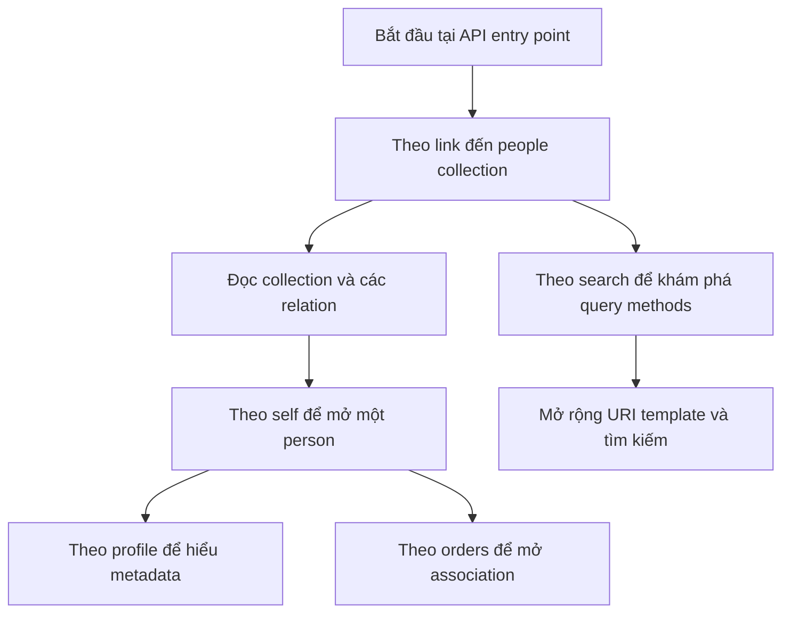

# Ý nghĩa của self, profile, search và liên kết quan hệ

Spring Data REST thường biểu diễn tài nguyên bằng HAL và cung cấp các liên kết để client khám phá API. Các relation như `self`, `profile`, `search` và tên của association links cho biết mỗi liên kết dùng để làm gì. Khi hiểu các relation này, client có thể điều hướng theo thông tin server công bố thay vì tự ghép URL từ tên controller, đường dẫn hoặc id.

## 1. HATEOAS và HAL có vai trò gì?

**HATEOAS** (Hypermedia As The Engine Of Application State) là một ràng buộc của REST: response cung cấp hypermedia controls để client biết những hành động hoặc tài nguyên có thể tiếp tục truy cập. Client bắt đầu từ một entry point đã biết, đọc các liên kết trong response, rồi theo liên kết phù hợp với mục tiêu hiện tại.

**HAL** (Hypertext Application Language) là một định dạng biểu diễn hypermedia trong JSON. HAL quy ước hai khu vực chính:

- `_links`: các liên kết được nhóm theo relation.
- `_embedded`: các tài nguyên con được nhúng trực tiếp trong response, nếu representation có cung cấp.

Ví dụ rút gọn của một collection:

```json
{
  "_links": {
    "self": {
      "href": "https://api.example.test/people?page=0&size=20"
    },
    "profile": {
      "href": "https://api.example.test/profile/people"
    },
    "search": {
      "href": "https://api.example.test/people/search"
    }
  },
  "_embedded": {
    "people": [
      {
        "name": "An",
        "_links": {
          "self": {
            "href": "https://api.example.test/people/42"
          },
          "orders": {
            "href": "https://api.example.test/people/42/orders"
          }
        }
      }
    ]
  }
}
```

Đây là ví dụ minh họa cấu trúc; host, path, relation và các field thực tế phụ thuộc cấu hình repository, domain model và representation của ứng dụng. Spring Data REST mặc định sử dụng HAL cho các representation hypermedia thông dụng.

Một link object thường có thuộc tính `href`. Tùy trường hợp, nó còn có thể có `templated`, `title`, `type`, `hreflang` hoặc metadata khác. Relation là tên đứng bên ngoài link object, chẳng hạn `self`, `profile` hoặc `orders`. Relation cho client biết mục đích của link; `href` cho biết địa chỉ cần truy cập.

## 2. `self`: liên kết đến chính tài nguyên hiện tại

Relation `self` trỏ đến tài nguyên mà representation đang mô tả.

Với một item, `self` thường trỏ đến URI của item đó. Với collection, `self` trỏ đến collection representation hiện tại, có thể chứa query parameters như `page`, `size` và `sort`.

Ví dụ:

```json
{
  "id": 42,
  "name": "An",
  "_links": {
    "self": {
      "href": "https://api.example.test/people/42"
    }
  }
}
```

Client có thể lưu và theo URI này để tải lại tài nguyên, thay vì tự tạo đường dẫn dạng `/people/{id}`. Điều này giảm sự phụ thuộc vào cách server tổ chức URL. Nếu API đổi base path hoặc cách ánh xạ route nhưng vẫn cung cấp relation đúng, client có thể tiếp tục điều hướng theo link mới.

Không nên hiểu `self` là URL của request vừa gửi trong mọi tình huống. Nó là liên kết mà server công bố cho representation hiện tại. Với collection có phân trang, `self` thường phản ánh trang và bộ lọc hiện tại; các relation như `next`, `prev`, `first` hoặc `last` có thể cung cấp những trang lân cận khi có.

## 3. `profile`: mô tả ý nghĩa và cấu trúc ngữ nghĩa

Relation `profile` trỏ đến tài liệu mô tả profile của một loại tài nguyên hoặc representation. Nó giúp client hiểu các thuộc tính và ý nghĩa nghiệp vụ mà JSON thuần túy không thể diễn đạt đầy đủ.

Trong Spring Data REST, profile thường được cung cấp qua endpoint ALPS (Application-Level Profile Semantics). ALPS mô tả các descriptor mang ý nghĩa ngữ nghĩa của tài nguyên, chẳng hạn tên thuộc tính, mô tả, kiểu descriptor và các descriptor con. Tùy cấu hình, profile có thể mô tả những field hoặc thao tác mà API công bố.

Ví dụ link:

```json
{
  "_links": {
    "profile": {
      "href": "https://api.example.test/profile/people"
    }
  }
}
```

Client có thể theo link này để lấy metadata ALPS, thường với media type `application/alps+json`. Một descriptor có thể cho biết tài nguyên có thuộc tính `name`, `email` hoặc một thao tác tìm kiếm được công bố. Nhờ vậy, client có thêm thông tin để hiển thị form, giải thích dữ liệu hoặc xây dựng cách tương tác phù hợp.

Cần phân biệt rõ:

- `profile` mô tả ngữ nghĩa của tài nguyên hoặc representation.
- `self` trỏ đến chính tài nguyên hoặc representation hiện tại.
- Profile không phải hồ sơ tài khoản người dùng và cũng không chứa bản ghi dữ liệu thực tế của từng người.
- Profile không cấp quyền truy cập. Server vẫn phải kiểm tra authentication và authorization trên từng request.

Nếu client cần hiểu một relation riêng của ứng dụng, profile và tài liệu API là nơi hữu ích để giải thích ý nghĩa relation đó thay vì chỉ suy đoán từ tên.

## 4. `search`: khám phá các thao tác tìm kiếm được export

Relation `search` thường xuất hiện trên collection khi repository có các query method được Spring Data REST export. Link này trỏ đến search resource của repository.

Ví dụ collection có:

```json
{
  "_links": {
    "search": {
      "href": "https://api.example.test/people/search"
    }
  }
}
```

Khi client truy cập search resource, response có thể liệt kê từng query method bằng relation riêng. Một link tìm theo họ có thể trông như sau:

```json
{
  "_links": {
    "findByLastName": {
      "href": "https://api.example.test/people/search/findByLastName{?lastName,page,size,sort}",
      "templated": true
    }
  }
}
```

Ở đây:

- `findByLastName` là relation của query method được export.
- `href` là URI template, chưa phải URL hoàn chỉnh.
- `templated: true` báo rằng client cần điền các biến như `lastName`, `page`, `size` hoặc `sort` trước khi gửi request.

Ví dụ, client mở rộng template với `lastName=Nguyen` để tìm kiếm. Tên method, tham số và template thực tế được quyết định bởi repository method cùng cấu hình Spring Data REST.

`search` không phải một endpoint truy vấn SQL tùy ý. Nó chỉ giúp khám phá những query method mà ứng dụng đã định nghĩa và export. Nếu repository không có search method được export, search resource hoặc link tương ứng có thể không xuất hiện.

Một điểm quan trọng là client nên khám phá query relation từ search resource. Không nên tự đoán tên method hoặc tự ghép URL dựa trên tên Java method vì path, tham số và cách export có thể thay đổi.

## 5. Association links: điều hướng qua quan hệ giữa các entity

Association là quan hệ giữa các entity trong domain model, ví dụ:

- Một `Person` có nhiều `Order`.
- Một `Order` thuộc về một `Customer`.
- Một `Student` tham gia nhiều `Course`.

Spring Data REST có thể công bố các liên kết quan hệ trong `_links` của tài nguyên. Relation thường phản ánh association mà API export; tên cụ thể có thể được tùy chỉnh.

Ví dụ một person có liên kết đến danh sách order:

```json
{
  "id": 42,
  "name": "An",
  "_links": {
    "self": {
      "href": "https://api.example.test/people/42"
    },
    "orders": {
      "href": "https://api.example.test/people/42/orders"
    }
  }
}
```

Client theo relation `orders` để truy cập association resource. Từ đó có thể khám phá các order liên quan theo representation mà server trả về. Với association đơn, link có thể dẫn đến tài nguyên liên quan; với association nhiều phần tử, link thường dẫn đến resource biểu diễn tập hợp liên quan.

Association link và embedded resource có ý nghĩa khác nhau:

- Association link chỉ cung cấp URI để client điều hướng đến quan hệ.
- Embedded resource nằm trong `_embedded`, tức dữ liệu liên quan đã được đưa vào response hiện tại.
- Một association có link không đồng nghĩa toàn bộ entity liên quan đã được nhúng.
- Việc nhúng hay chỉ cung cấp link phụ thuộc projection, excerpt projection và cấu hình representation.

Các thao tác cập nhật association cũng đi qua association resource mà API công bố. HTTP method và nội dung request phụ thuộc cardinality, kiểu association và mapping cụ thể. Client nên dựa vào API contract và response của server, không suy ra rằng mọi quan hệ đều cập nhật theo cùng một cách.

## 6. Cách client kết hợp các relation trong một luồng thực tế

Giả sử ứng dụng cần hiển thị một người và các đơn hàng của người đó. Client có thể thực hiện theo trình tự:



Mỗi relation có một nhiệm vụ:

| Relation | Câu hỏi nó trả lời | Cách dùng |
|---|---|---|
| `self` | Tài nguyên hoặc representation hiện tại ở đâu? | Theo URI để mở hoặc tải lại |
| `profile` | Tài nguyên này có ý nghĩa và descriptor nào? | Đọc metadata ALPS |
| `search` | Repository công bố những thao tác tìm kiếm nào? | Khám phá search resource và các query links |
| Association relation như `orders` | Tài nguyên hiện tại liên hệ với dữ liệu nào? | Theo link để mở association resource |

Một HTTP client tổng quát có thể triển khai quy trình: đọc `_links`, chọn relation phù hợp, kiểm tra `templated`, mở rộng URI template khi cần, gửi request theo `href`, rồi tiếp tục đọc các relation trong response mới. Client chỉ cần biết entry point ban đầu và các relation mà ứng dụng công bố hoặc mô tả trong profile.

## 7. Những nhầm lẫn thường gặp

**Nhầm `self` với `profile`:** `self` trỏ đến tài nguyên hiện tại; `profile` trỏ đến tài liệu mô tả ngữ nghĩa của representation.

**Nhầm `search` với tìm kiếm tự do:** search resource liệt kê query methods được export. Nó không tự sinh truy vấn tùy ý cho client.

**Nhầm association link với dữ liệu đã nhúng:** link chỉ là khả năng điều hướng. Muốn có dữ liệu ngay trong response, representation phải cung cấp nội dung trong `_embedded` hoặc projection tương ứng.

**Nhầm link bị ẩn với bảo mật:** không hiển thị link có thể làm client khó khám phá thao tác, nhưng không thay thế kiểm tra quyền ở server. Một client vẫn có thể gửi request trực tiếp đến URI mà nó biết; server phải tự xác thực và phân quyền.

**Hard-code URL:** tự ghép `/people/{id}/orders` khiến client phụ thuộc vào cấu trúc route. Theo relation do server cung cấp giúp API linh hoạt hơn khi mapping thay đổi.

## 8. Ghi nhớ khi thiết kế và sử dụng HAL API

1. Dùng `self` để nhận diện và điều hướng đến tài nguyên hiện tại.
2. Dùng `profile` để khám phá metadata và ý nghĩa ngữ nghĩa của tài nguyên.
3. Dùng `search` để khám phá các query method mà repository công bố.
4. Dùng association relation để điều hướng qua quan hệ giữa các entity.
5. Phân biệt link trong `_links` với dữ liệu nhúng trong `_embedded`.
6. Xử lý URI template khi link có `templated: true`.
7. Luôn kiểm tra quyền ở server; hypermedia links giúp khám phá API, không phải cơ chế authorization.

Khi client dựa vào các relation thay vì tự xây dựng URL, Spring Data REST có thể thay đổi cách ánh xạ endpoint mà vẫn giữ được cách điều hướng theo hợp đồng hypermedia. `self`, `profile`, `search` và association links vì vậy là những phần khác nhau nhưng bổ trợ cho nhau trong một HAL API.
