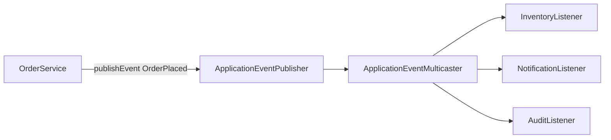

# Event-Driven Architecture Within a Single Spring Application

## 1. Objectives and Scope

Spring Application Events allow Spring beans to exchange information by **publishing an event and letting interested beans subscribe to handle it**. The event-publishing bean does not need to know how many listeners exist, which classes they belong to, or what work the listeners will perform.

In this lesson, event-driven means communication **inside the same Spring application and the same JVM process**. This mechanism helps reduce direct dependencies between beans, but it is not a message broker itself, does not automatically persist events into a durable queue, and does not transmit events to another application.

After this lesson, you will be able to:

- Explain the roles of event, publisher, listener, and event multicaster.
- Publish events with `ApplicationEventPublisher` and receive events with `@EventListener`.
- Understand default synchronous behavior, listener ordering, and how to handle asynchronous listeners.
- Choose `@TransactionalEventListener` properly when processing depends on commit or rollback outcomes.
- Recognize when to use Application Events and when to call a service directly or use a messaging system.

## 2. The Problem: Reducing Coupling Between Components

Suppose an e-commerce application has an order creation feature. After an order is recorded, the application needs to update inventory, send a confirmation email, and log the activity.

If `OrderService` calls all of these services directly, it must know each auxiliary component. Whenever a new task is added, such as updating a search index, you have to modify `OrderService`. The service's dependencies and responsibilities continue to grow.

With Application Events, `OrderService` simply publishes the `OrderPlaced` event. Independent listeners subscribe to receive that event:



The publisher simply expresses a fact: the order has been placed. Listeners decide how to react to that fact. When adding `AuditListener`, you do not need to modify the event-publishing logic inside `OrderService`.

This organization fits auxiliary tasks that can be decoupled. If a step is a mandatory condition for the main business operation to succeed, such as validating a credit limit before creating an order, call that service directly and handle the result explicitly. Do not hide a mandatory business step behind an event where the publisher cannot control the outcome.

## 3. Key Components

### Event

An event is data describing something that has happened. It should be named in the past tense to express that the event is a fact, such as `OrderPlaced`, `UserRegistered`, `PaymentCaptured`.

An event typically contains the minimal data listeners need to process it: an identifier, timestamp, change type, or reference details. Prefer immutable data, such as a Java `record`, so a listener does not accidentally mutate data that another listener is using.

Since Spring Framework 4.2, you can publish a plain Java object as an event. Extending `ApplicationEvent` is not required. Extending this class remains useful when you need compatibility with legacy listeners or need an event model with `source` and timestamp provided by the base class.

Spring also publishes ApplicationContext lifecycle events such as `ContextRefreshedEvent`, `ContextStartedEvent`, `ContextStoppedEvent`, and `ContextClosedEvent`. You can use listeners to react to context initialization, start, stop, or close milestones.

### Publisher

`ApplicationEventPublisher` is the API used to publish events:

```java
publisher.publishEvent(new OrderPlaced("ORD-1001"));
```

`ApplicationContext` implements `ApplicationEventPublisher`, so Spring can inject this interface into a bean via constructor. You should depend on `ApplicationEventPublisher` instead of injecting the entire `ApplicationContext` just to call `publishEvent()`.

### Listener

A listener is a Spring bean registered to handle events. The common way to declare one is to place `@EventListener` on a method whose parameter has the event type to receive:

```java
@EventListener
public void onOrderPlaced(OrderPlaced event) {
    // handle event
}
```

Spring also supports implementing the `ApplicationListener<E>` interface. This approach is useful when you want to represent a listener with a dedicated class or need to use the traditional listener API:

```java
public class InventoryListener
        implements ApplicationListener<OrderPlaced> {

    @Override
    public void onApplicationEvent(OrderPlaced event) {
        // handle event
    }
}
```

Either way, the listener must be registered as a bean in the ApplicationContext for Spring to manage and invoke it. With `@EventListener` methods, avoid marking the listener bean as lazy: the ApplicationContext might not have instantiated that bean yet and therefore would not register the method as a listener.

### ApplicationEventMulticaster

ApplicationEventMulticaster is the component that dispatches events to matching listeners in the ApplicationContext. By default, Spring uses `SimpleApplicationEventMulticaster`. You usually do not need to create a multicaster manually; only configure one separately when you need to change execution behavior or error handling across the entire application.

## 4. Runnable Example with Java 17+ and Spring Framework

The following example uses Spring Context directly without depending on Spring Boot. An `OrderService` publishes `OrderPlaced`; two listeners handle inventory and notification in turn.

### Maven Configuration

Create a Maven project, place the source code at `src/main/java/demo/ApplicationEventsDemo.java`, and add the following configuration sections inside the root `<project>` element of `pom.xml`. The example uses Spring Framework 6.2.19 and Java 17:

```xml
<properties>
    <maven.compiler.release>17</maven.compiler.release>
    <project.build.sourceEncoding>UTF-8</project.build.sourceEncoding>
    <spring-framework.version>6.2.19</spring-framework.version>
</properties>

<dependencies>
    <dependency>
        <groupId>org.springframework</groupId>
        <artifactId>spring-context</artifactId>
        <version>${spring-framework.version}</version>
    </dependency>
</dependencies>

<build>
    <plugins>
        <plugin>
            <groupId>org.apache.maven.plugins</groupId>
            <artifactId>maven-compiler-plugin</artifactId>
            <version>3.14.0</version>
        </plugin>
        <plugin>
            <groupId>org.codehaus.mojo</groupId>
            <artifactId>exec-maven-plugin</artifactId>
            <version>3.5.0</version>
        </plugin>
    </plugins>
</build>
```

### Source Code

```java
package demo;

import org.springframework.context.ApplicationEventPublisher;
import org.springframework.context.annotation.AnnotationConfigApplicationContext;
import org.springframework.context.annotation.Bean;
import org.springframework.context.annotation.Configuration;
import org.springframework.context.event.EventListener;
import org.springframework.core.annotation.Order;

@Configuration
public class ApplicationEventsDemo {

    @Bean
    OrderService orderService(ApplicationEventPublisher publisher) {
        return new OrderService(publisher);
    }

    @Bean
    InventoryListener inventoryListener() {
        return new InventoryListener();
    }

    @Bean
    NotificationListener notificationListener() {
        return new NotificationListener();
    }

    public static void main(String[] args) {
        try (var context =
                     new AnnotationConfigApplicationContext(
                             ApplicationEventsDemo.class)) {
            context.getBean(OrderService.class).place("ORD-1001");
        }
    }

    record OrderPlaced(String orderId) {
    }

    static class OrderService {
        private final ApplicationEventPublisher publisher;

        OrderService(ApplicationEventPublisher publisher) {
            this.publisher = publisher;
        }

        void place(String orderId) {
            System.out.println("OrderService: save order " + orderId);
            publisher.publishEvent(new OrderPlaced(orderId));
            System.out.println("OrderService: publishEvent() returned");
        }
    }

    static class InventoryListener {
        @EventListener
        @Order(10)
        public void reserveInventory(OrderPlaced event) {
            System.out.println(
                    "InventoryListener: reserve stock for "
                            + event.orderId());
        }
    }

    static class NotificationListener {
        @EventListener
        @Order(20)
        public void sendConfirmation(OrderPlaced event) {
            System.out.println(
                    "NotificationListener: send confirmation for "
                            + event.orderId());
        }
    }
}
```

The beans are registered via `@Bean` methods in the configuration. Spring discovers the `@EventListener` methods on those beans during ApplicationContext initialization. `@Order(10)` and `@Order(20)` set the processing order between the two listeners receiving the event; lower values take higher priority.

### Compiling and Running

From the directory containing `pom.xml`, run:

```bash
mvn -q compile exec:java -Dexec.mainClass=demo.ApplicationEventsDemo
```

Stdout output:

```text
OrderService: save order ORD-1001
InventoryListener: reserve stock for ORD-1001
NotificationListener: send confirmation for ORD-1001
OrderService: publishEvent() returned
```

Both listeners run before the `publishEvent() returned` line because events are processed synchronously in the default configuration. The output also shows that the publisher does not need to call each listener directly.

## 5. Processing Flow of an Event

A typical event publication follows this sequence:

1. Spring injects `ApplicationEventPublisher` into the event-publishing bean.
2. The bean creates an event object with data describing the occurrence that just happened.
3. The bean calls `publishEvent(event)`.
4. The event multicaster finds registered listeners that match the event type.
5. The listeners are invoked in the configured order, if any.
6. Once the synchronous listeners finish, the `publishEvent()` call returns.

Events can be sent to matching listeners within the ApplicationContext. In systems using hierarchical contexts, an event published from a child context can also be forwarded to the parent context. Therefore, a listener in the parent context may receive events from a child context; keep this in mind if the application has multiple ApplicationContexts.

## 6. Default Behavior: Synchronous and Same Thread

By default, listeners are invoked synchronously on the thread publishing the event. This has three important consequences:

- `publishEvent()` waits until synchronous listeners finish processing before returning.
- Slow work inside a listener slows down the business flow publishing the event.
- The listener runs on the same thread and can therefore see the current transaction context if the publisher is inside a transaction.

Synchronous execution makes the flow easy to understand and test. It also means exceptions from a listener can propagate back to the publisher. With the default multicaster configuration without a dedicated ErrorHandler, an exception can interrupt dispatching before subsequent listeners are invoked. Therefore, clearly decide whether a listener error should be allowed to fail the calling operation, and design error handling accordingly.

Do not place long-running tasks such as sending emails over the network, calling external APIs, or processing large images inside a synchronous listener if the publisher does not need to wait for those results. Consider an executor or an appropriate messaging system.

## 7. Customizing Listeners

### Filtering by Event Type

The method parameter specifies the event type the listener receives. A listener receiving `OrderPlaced` will not automatically receive events of unrelated types. You can have multiple listeners for the same event type; all matching listeners have an opportunity to be invoked.

### Ordering

Use `@Order` on a listener method or use `Ordered` to specify relative order. Lower order numbers are processed first. Rely on this order only when steps genuinely require a deterministic sequence; if listeners are independent, avoid creating implicit dependencies between them.

### Conditional Processing

`@EventListener` supports the `condition` attribute with a Spring Expression Language (SpEL) expression. This allows a listener to process only a subset of events that satisfy a condition, such as sending notifications only for VIP orders. You can reference method parameters in the expression, for example `#orderPlaced.orderId == 'ORD-VIP-01'` when the parameter is named `orderPlaced`. Keep conditions simple and readable; if business rules are complex, move them into a dedicated service.

### Publishing Follow-up Events

A synchronous `@EventListener` method can return another object; Spring will publish the returned object as a new event. This feature can be useful in small processing chains, but can easily make the event flow hard to trace if overused. Asynchronous listeners do not support publishing follow-up events via return values; when needed, inject `ApplicationEventPublisher` and call `publishEvent()` explicitly.

## 8. Running Listeners Asynchronously

When a listener does not need to finish before the publisher continues, you can use `@Async` combined with `@EnableAsync`:

```java
@Configuration
@EnableAsync
class AsyncConfiguration {
}

@Component
class SearchIndexListener {

    @Async
    @EventListener
    public void updateSearchIndex(
            ApplicationEventsDemo.OrderPlaced event) {
        // update search index in the background
    }
}
```

You need to import `org.springframework.scheduling.annotation.EnableAsync`, `org.springframework.scheduling.annotation.Async`, and `org.springframework.stereotype.Component`. This configuration must reside in the ApplicationContext managing the listener.

When a listener method runs via an executor:

- The publisher can continue before the listener's work finishes.
- You should not assume completion order across multiple asynchronous listeners.
- Exceptions in the listener are not thrown back to the event-publishing thread. For methods returning `void`, configure or monitor asynchronous exception handling; by default, errors are usually only logged.
- The publisher's transaction context and ThreadLocals do not automatically carry over to another thread.
- Choose an executor with thread bounds, queue capacity, and rejection policies suitable for actual load.

`@Async` only works when Spring enables async processing and the call goes through a Spring-managed proxy. An internal call from one method to another within the same object does not go through the proxy in default mode, and therefore does not trigger `@Async`.

Asynchronous execution within the same application still does not provide durable persistence or retry guarantees. If the application stops before the task is processed, the work may be lost.

## 9. Binding Listeners to Transactions

A common scenario is sending an email or updating an auxiliary system only after the order creation transaction has successfully committed. If you use a regular `@EventListener`, the synchronous listener may run inside the transaction, before commit. If the transaction rolls back afterward, the listener may already have performed an irreversible side effect.

Use `@TransactionalEventListener` to bind processing timing to the transaction lifecycle:

```java
import org.springframework.stereotype.Component;
import org.springframework.transaction.event.TransactionPhase;
import org.springframework.transaction.event.TransactionalEventListener;

@Component
class OrderReceiptListener {

    @TransactionalEventListener(
            phase = TransactionPhase.AFTER_COMMIT)
    public void sendReceipt(ApplicationEventsDemo.OrderPlaced event) {
        // send receipt after transaction commit
    }
}
```

This snippet assumes `OrderPlaced` is declared as in the main example and the listener is in the same `demo` package. To use transaction-bound listeners, the project needs the `org.springframework:spring-tx` dependency matching the Spring version, an appropriate transaction manager, and transaction management configuration (such as `@EnableTransactionManagement` in plain Spring configuration). With Spring Boot, the transaction manager is usually auto-configured when the corresponding data starter is present.

Supported phases:

| Phase | When the Listener Runs |
|---|---|
| `BEFORE_COMMIT` | Before the transaction commits |
| `AFTER_COMMIT` | After a successful commit; this is the default |
| `AFTER_ROLLBACK` | After the transaction rolls back |
| `AFTER_COMPLETION` | After the transaction completes, regardless of commit or rollback |

If there is no active transaction at the time of event publication, `@TransactionalEventListener` does not run by default. Only set `fallbackExecution = true` when you genuinely want the listener to still run when there is no transaction:

```java
@TransactionalEventListener(
        phase = TransactionPhase.AFTER_COMMIT,
        fallbackExecution = true)
public void handle(ApplicationEventsDemo.OrderPlaced event) {
    // run after commit, or run immediately via fallback when there is no transaction
}
```

Notes:

- The event must be published within the scope of the transaction that the listener needs to observe. The publisher method must be invoked through Spring's transaction mechanism for the transaction to actually take effect.
- `AFTER_COMMIT` ensures the listener only runs after a successful commit, but does not turn the event into durable data. If the process stops after commit but before the listener finishes, the side effect may still not have been executed.
- When a listener needs to write data in a new transaction after commit, consider a separate transaction boundary, such as a service invoked with appropriate propagation. Do not assume the old transaction can still commit additional changes after it has already completed.

## 10. How Do Application Events Differ from a Message Broker?

| Criterion | Spring Application Events | Message Broker (e.g., Kafka or RabbitMQ) |
|---|---|---|
| Scope | Beans within a single Spring application | Can connect multiple processes and services |
| Mechanism | Invokes listeners through ApplicationContext | Sends/receives messages via a broker |
| Storage | Does not automatically persist events durably | Can persist messages according to broker configuration |
| Retry and replay | Does not automatically provide durable mechanisms | Can support retries, consumer groups, and replay depending on the system |
| Latency | Low, no network needed when running in the same process | Additional communication and operational overhead |
| Best fit | Decoupling beans and side effects within an application | Inter-service communication, distributed processing, or durable queues |

Application Events do not replace Kafka, RabbitMQ, or Spring Integration. If your requirements demand reliable delivery between services, retries after failures, history storage, or event replay, use an appropriate messaging infrastructure. For synchronizing database state and a message broker, explore Transactional Outbox instead of relying solely on a post-commit listener.

## 11. When to Use and Common Mistakes

### Use When

- An action has happened and multiple independent beans need to react to it.
- You want to add auxiliary tasks without modifying the publisher every time a listener is added.
- Tasks can be handled separately, such as audit logging, cache invalidation, or notifications.
- You need to run side effects after commit using `@TransactionalEventListener`.

### Consider Alternatives When

- The publisher must receive the processing result immediately to decide success or failure.
- Mandatory business steps have an order and require explicit orchestration.
- Durable delivery, retries, replay, or communication across multiple applications is required.
- Events only add an extra layer of indirection without actually reducing coupling.

### Common Design Mistakes

1. **Using an event instead of a mandatory service call:** the publisher has no explicit result contract from the listener. Call the service directly when the result is part of the core business logic.
2. **Putting mutable objects into an event:** an earlier listener may alter the data received by a later listener. Use a record or an immutable object.
3. **Putting large entities or lazy relationships into an event:** a listener may access data outside a transaction or trigger unintended queries. Usually you only need to pass IDs and a small data snapshot.
4. **Assuming events automatically run asynchronously:** listeners run synchronously by default. Async execution must be configured explicitly.
5. **Assuming `@TransactionalEventListener` runs even without a transaction:** by default the listener is skipped if there is no transaction, unless `fallbackExecution` is enabled.
6. **Assuming a published event is guaranteed to be processed:** Application Events have no durable queue, retries, or automatic replay.
7. **Creating cyclic event chains:** listener A publishes event B, and listener B publishes event A again. Model the business flow clearly and control stopping conditions.
8. **Letting synchronous listeners do too much work:** the publisher is held up while the listener runs. Move suitable tasks to an executor or messaging.
9. **Hiding listener errors:** logs, metrics, and exception handling must reflect which listener failed and the related event.

## 12. Testing and Debugging

Both parts should be tested: whether the publisher publishes the right event and whether the listener reacts correctly to the received data.

- Unit test listeners by calling the method with a specific event, then verifying interactions with mocked dependencies.
- Test the publisher and Spring configuration with an ApplicationContext to confirm that the event is actually dispatched to registered listeners.
- For integration tests using Spring Test, you can use `@RecordApplicationEvents` and `ApplicationEvents` to record and inspect published events.
- For synchronous listeners, check the results after `publishEvent()` returns.
- For async listeners, wait for completion conditions using synchronization mechanisms in tests; do not use fixed `Thread.sleep()` as it easily causes flaky tests.
- When debugging, log the event name, business identifier, and handling listener. Avoid logging the entire payload if the payload contains sensitive data.

## 13. Pre-Production Checklist

- [ ] Event describes something that has happened and has a clear name.
- [ ] Payload is small, immutable, and contains only the data listeners need.
- [ ] Publisher depends on `ApplicationEventPublisher`, not on specific listeners.
- [ ] Listeners are registered as Spring beans and receive the right event type.
- [ ] Clearly decided whether listeners need to be synchronous or asynchronous.
- [ ] Behavior when a listener throws an exception is defined.
- [ ] Use `@TransactionalEventListener` if side effects must wait for transaction commit/rollback.
- [ ] Do not rely on Application Events for durable delivery, retries, or inter-service communication.

## 14. References

- [Spring Framework Reference — Additional Capabilities of the ApplicationContext](https://docs.spring.io/spring/reference/6.2/core/beans/context-introduction.html)
- [Spring Framework Reference — Transaction-bound Events](https://docs.spring.io/spring-framework/reference/data-access/transaction/event.html)
- [Spring Framework Reference — Task Execution and Scheduling](https://docs.spring.io/spring-framework/reference/integration/scheduling.html)

