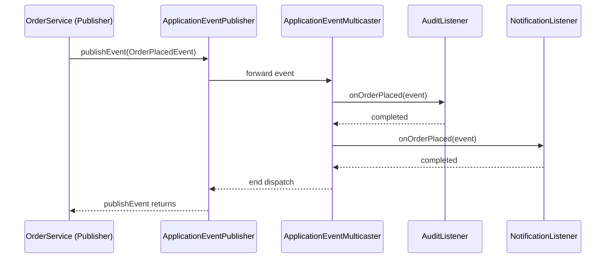

# Publisher, Event, and Listener in a Single Processing Flow

In Spring Framework, a Publisher announces that a business occurrence has happened, an Event carries the data describing that occurrence, and a Listener receives the notification to perform the related work. This mechanism prevents the event-originating service from having to call each dependent service directly, such as writing an audit log, sending a notification, or updating a read model.

Example used throughout this lesson: `OrderService` processes an order, publishes `OrderPlacedEvent`, and then `AuditListener` records the history while `NotificationListener` creates a notification.

## 1. Three Core Components

### Publisher

The Publisher is the component that publishes the event. In Spring, business code typically receives `ApplicationEventPublisher` via constructor injection and calls `publishEvent(event)` when reaching a defined business milestone.

- The publisher decides **when** the event is published and which data is included in the event.
- The publisher depends only on the `ApplicationEventPublisher` interface; it does not need to know which listeners are subscribed.
- `ApplicationContext` also implements `ApplicationEventPublisher`, so Spring can inject this interface directly into a bean.

Example:

```java
public class OrderService {
    private final ApplicationEventPublisher eventPublisher;

    public OrderService(ApplicationEventPublisher eventPublisher) {
        this.eventPublisher = eventPublisher;
    }

    public void placeOrder(String orderId) {
        // Process order business logic...
        eventPublisher.publishEvent(new OrderPlacedEvent(orderId));
    }
}
```

This example illustrates how to call the publisher; the complete event and runnable program are in section 4.

### Event

An Event is an object describing something that has happened. Event names usually use the past tense, such as `OrderPlacedEvent`, `PaymentCapturedEvent`, or `CustomerRegisteredEvent`. This naming convention distinguishes an event that has occurred from a request to be executed, such as `PlaceOrderCommand`.

In Spring Framework 4.2 and later, `publishEvent(Object event)` allows publishing a plain Java object, including a POJO or `record`; an event is not required to extend `ApplicationEvent`. With modern Java, an immutable `record` is usually a concise and clear choice.

```java
public record OrderPlacedEvent(String orderId, BigDecimal total) {
}
```

An event should:

- Contain the minimal data a listener needs to process it, such as the order ID and total amount.
- Prefer immutability so one listener does not accidentally modify data that another listener is reading.
- Represent a meaningful business event, without turning every internal method call into an event.
- Avoid carrying an entire large object graph or mutable entity if the listener only needs a few data fields.

Before Spring Framework 4.2, events were typically created by extending `ApplicationEvent` and passing `source` to the constructor. That approach is still supported when a traditional event type or `ApplicationListener<E>` is needed. For POJO/record events, `@EventListener` is a more convenient way to register listeners.

### Listener

A Listener is a Spring-managed bean that receives a matching event and performs the next action. There are two common approaches:

1. Using `@EventListener` on a method. The method parameter specifies the event type the method receives. This approach works with POJOs/records.
2. Implementing `ApplicationListener<E>` where `E` is a subclass of `ApplicationEvent`. This approach represents the listener with an explicit Java type.

Annotation-based listener example:

```java
@EventListener
public void onOrderPlaced(OrderPlacedEvent event) {
    System.out.println("Received order " + event.orderId());
}
```

A listener must be registered in the ApplicationContext, for example with `@Component` within component scan scope or via a `@Bean` method. A class instantiated with `new` outside Spring will not automatically become a managed listener.

## 2. How Does Spring Deliver Events to Listeners?

In the ApplicationContext, `ApplicationEventMulticaster` is the component responsible for coordinating event dispatch to registered listeners. If the application does not provide a custom multicaster bean, Spring uses the default `SimpleApplicationEventMulticaster`.

Basic processing flow:

1. A business bean, such as `OrderService`, completes the business step represented by the event.
2. The publisher creates an event with the necessary data and calls `ApplicationEventPublisher.publishEvent(event)`.
3. The ApplicationContext forwards the event to `ApplicationEventMulticaster`.
4. The multicaster finds listeners whose receiving type is compatible with the event type and invokes those listeners.
5. Listeners perform their work. One event can be received by multiple listeners.
6. After synchronous listeners finish, the `publishEvent` call returns control to the publisher and the business flow continues.



### Synchronous by Default

With the default `SimpleApplicationEventMulticaster` and no executor configured, listeners are invoked synchronously on the thread publishing the event. Therefore:

- `publishEvent` returns only after synchronous listeners have finished processing.
- A slow listener will lengthen the publisher's processing time.
- Exceptions from a synchronous listener can propagate back out of the `publishEvent` call; with the default configuration without an `ErrorHandler`, an error can interrupt the dispatch pass.
- A synchronous listener can see the same transaction/thread context of the calling thread, though commit timing still depends on the application's transaction boundaries.

This is an in-application event-publishing mechanism. It does not automatically create a message queue, persist events durably, retry automatically, or guarantee that events will be processed if the process stops abruptly.

### Listener Ordering

Do not rely on bean registration order to infer processing order. If listeners require an explicit order, place `@Order` on the `@EventListener` method or implement `Ordered`/`@Order` as appropriate for the listener type. Lower order values take precedence; in the example below, audit runs before notification.

## 3. When to Use Synchronous, Asynchronous, and Transaction-Bound Listeners?

### Synchronous Listeners

This is the default option and is suitable when work is lightweight, needs to complete immediately in the current thread, or when listener errors need to be reflected back to the event publisher. For example, updating an in-memory data structure or recording a small processing step.

Do not place slow network calls, time-consuming email sending, or heavy processing inside a synchronous listener if business response time is important.

### Asynchronous Listeners

You can combine `@EnableAsync` on configuration and `@Async` on an `@EventListener` method to process on a Spring-managed executor:

```java
@Configuration
@EnableAsync
public class AsyncConfig {
}

@Component
public class NotificationListener {
    @Async
    @EventListener
    public void onOrderPlaced(OrderPlacedEvent event) {
        // Work that may take time
    }
}
```

When using asynchronous execution, the publisher does not wait for the listener's processing to finish. You need to configure a suitable executor, monitor errors on background threads, and not assume that transaction, security context, or execution order is automatically propagated to another thread. For `void` methods running via `@Async`, exceptions cannot be thrown back to the caller; an appropriate asynchronous error-handling mechanism is required.

`@Async` is still in-process execution. It does not replace a message broker if durable storage, retries after restarts, or communication across multiple services is needed.

### Transaction-Bound Listeners

A regular `@EventListener` is invoked at the moment the event is published. If an event is published inside a transaction, the listener may run before the transaction commits; a subsequent transaction rollback does not automatically undo external side effects that the listener has already performed.

If you only want to run a listener after a transaction commits, use `@TransactionalEventListener` with an appropriate phase, typically `TransactionPhase.AFTER_COMMIT`:

```java
@TransactionalEventListener(phase = TransactionPhase.AFTER_COMMIT)
public void onOrderPlaced(OrderPlacedEvent event) {
    // Process only after the transaction containing the event commits successfully
}
```

This type of listener requires an active transaction at the time the event is published. By default, if there is no transaction, the listener does not run; only enable `fallbackExecution` when that behavior is genuinely appropriate. `AFTER_COMMIT` helps avoid sending notifications for rolled-back transactions, yet it is still not a durable event-persistence mechanism itself. For requirements where notifications must not be lost between commit and sending, a design such as transactional outbox combined with a message broker is required.

## 4. Complete Runnable Example

This example uses Java 17 and Spring Framework 6.2.0. The program creates an ApplicationContext, registers a publisher and two listeners, and then publishes an order event.

### Directory Structure

```text
spring-events-demo/
├── pom.xml
└── src/
    └── main/
        └── java/
            └── demo/
                └── ApplicationEventsDemo.java
```

### pom.xml

```xml
<project xmlns="http://maven.apache.org/POM/4.0.0"
         xmlns:xsi="http://www.w3.org/2001/XMLSchema-instance"
         xsi:schemaLocation="http://maven.apache.org/POM/4.0.0 https://maven.apache.org/xsd/maven-4.0.0.xsd">
    <modelVersion>4.0.0</modelVersion>
    <groupId>demo</groupId>
    <artifactId>spring-events-demo</artifactId>
    <version>1.0.0</version>

    <properties>
        <maven.compiler.release>17</maven.compiler.release>
        <project.build.sourceEncoding>UTF-8</project.build.sourceEncoding>
    </properties>

    <dependencies>
        <dependency>
            <groupId>org.springframework</groupId>
            <artifactId>spring-context</artifactId>
            <version>6.2.0</version>
        </dependency>
    </dependencies>

    <build>
        <plugins>
            <plugin>
                <groupId>org.apache.maven.plugins</groupId>
                <artifactId>maven-compiler-plugin</artifactId>
                <version>3.13.0</version>
            </plugin>
            <plugin>
                <groupId>org.codehaus.mojo</groupId>
                <artifactId>exec-maven-plugin</artifactId>
                <version>3.3.0</version>
            </plugin>
        </plugins>
    </build>
</project>
```

### src/main/java/demo/ApplicationEventsDemo.java

```java
package demo;

import java.math.BigDecimal;

import org.springframework.context.ApplicationEventPublisher;
import org.springframework.context.annotation.AnnotationConfigApplicationContext;
import org.springframework.context.annotation.Bean;
import org.springframework.context.annotation.Configuration;
import org.springframework.context.event.EventListener;
import org.springframework.core.annotation.Order;

public class ApplicationEventsDemo {

    public record OrderPlacedEvent(String orderId, BigDecimal total) {
        public OrderPlacedEvent {
            if (orderId == null || orderId.isBlank()) {
                throw new IllegalArgumentException("orderId must not be blank");
            }
            if (total == null || total.signum() < 0) {
                throw new IllegalArgumentException("total must be non-negative");
            }
        }
    }

    public static class OrderService {
        private final ApplicationEventPublisher eventPublisher;

        public OrderService(ApplicationEventPublisher eventPublisher) {
            this.eventPublisher = eventPublisher;
        }

        public void placeOrder(String orderId, BigDecimal total) {
            System.out.println("1. Service: starting to process " + orderId);

            // Demo does not use a database; here the business step is assumed complete.
            eventPublisher.publishEvent(new OrderPlacedEvent(orderId, total));

            System.out.println("4. Service: publishEvent has returned");
        }
    }

    public static class AuditListener {
        @EventListener
        @Order(1)
        public void onOrderPlaced(OrderPlacedEvent event) {
            System.out.println("2. AuditListener: recorded " + event.orderId());
        }
    }

    public static class NotificationListener {
        @EventListener
        @Order(2)
        public void onOrderPlaced(OrderPlacedEvent event) {
            System.out.println("3. NotificationListener: created notification for " + event.orderId());
        }
    }

    @Configuration(proxyBeanMethods = false)
    public static class AppConfig {
        @Bean
        public OrderService orderService(ApplicationEventPublisher publisher) {
            return new OrderService(publisher);
        }

        @Bean
        public AuditListener auditListener() {
            return new AuditListener();
        }

        @Bean
        public NotificationListener notificationListener() {
            return new NotificationListener();
        }
    }

    public static void main(String[] args) {
        try (var context = new AnnotationConfigApplicationContext(AppConfig.class)) {
            OrderService orderService = context.getBean(OrderService.class);
            orderService.placeOrder("ORD-1001", new BigDecimal("125000"));
        }
    }
}
```

### Running the Program

From the `spring-events-demo/` directory, run:

```bash
mvn -q compile exec:java -Dexec.mainClass=demo.ApplicationEventsDemo
```

Stdout output:

```text
1. Service: starting to process ORD-1001
2. AuditListener: recorded ORD-1001
3. NotificationListener: created notification for ORD-1001
4. Service: publishEvent has returned
```

### Reading the Output

- `OrderService` knows only `ApplicationEventPublisher`; it does not call `AuditListener` or `NotificationListener` directly.
- `OrderPlacedEvent` is a record, so event data is immutable after creation.
- Both listeners receive the same event because the parameter type is `OrderPlacedEvent`.
- `@Order(1)` and `@Order(2)` explicitly order audit before notification.
- Both listeners run synchronously in the example. Therefore, line 4 appears only after both listeners finish.

## 5. Common Errors and How to Handle Them

| Symptom | Common Cause | How to Check or Fix |
|---|---|---|
| No listener runs | Listener is not registered as a bean or is not in component scan | Register with `@Component`, `@Bean`, or configure scanning for the right package |
| Listener does not receive the event | Parameter type is incompatible with the published event type | Check the event class, parameter type, and the actual event passed to `publishEvent` |
| Injecting `ApplicationEventPublisher` fails | Bean is being instantiated manually outside ApplicationContext or context configuration is incorrect | Let Spring create the bean and use constructor injection |
| Publisher waits too long | Synchronous listener performs I/O or heavy work | Trim the listener, move suitable parts to asynchronous processing or a queue |
| Listener error breaks the event-publishing flow | Exception thrown in a synchronous listener | Handle errors deliberately, log/collect metrics, and configure an `ErrorHandler` if another policy is needed |
| Notification sent despite transaction rollback | Regular `@EventListener` used inside a transaction | Use `@TransactionalEventListener` with an appropriate phase, usually `AFTER_COMMIT` |
| Listener runs more times than expected | One event has multiple matching listeners or a listener publishes another event | Inspect all registered listeners and avoid event-publishing loops |

## 6. Design Principles to Apply

1. **Publish events at a clear business milestone.** Clarify whether the event means a request was accepted, an order was saved, or a transaction committed. The name and publication timing must express the same fact.
2. **Keep events small and immutable.** Include only the data listeners need; prefer IDs and a stable data snapshot rather than sharing mutable objects.
3. **Keep the publisher lightly coupled.** The publisher only publishes events via `ApplicationEventPublisher`; avoid injecting all listeners directly into the business service if the goal is decoupling.
4. **Keep listeners focused.** Each listener should have an easy-to-understand single responsibility, such as audit or notification. Do not bundle unrelated tasks into one method.
5. **Specify ordering only when genuinely needed.** If listeners are independent, do not depend on order. If there is a dependency, use `@Order` and document the reason.
6. **Choose the right synchronization and transaction boundaries.** Use synchronous listeners for short work that must finish immediately; use `@Async` for appropriate background tasks; use `@TransactionalEventListener` when actions depend on commit outcomes.
7. **Do not treat ApplicationContext events as durable queues.** When inter-process communication, retries, persistence, or guaranteed non-loss of messages is needed, use a message broker and consider transactional outbox.

## 7. Debugging Checklist

- [ ] Publisher actually calls `publishEvent` with the right event object.
- [ ] Listener is registered by Spring in the ApplicationContext.
- [ ] Event type and listener parameter type are compatible.
- [ ] No exception is swallowed or halts the dispatch pass.
- [ ] If using `@Async`, the executor and background error handling are configured.
- [ ] If using transactions, the listener uses the right annotation type and phase.
- [ ] If ordering is needed, the listener explicitly declares `@Order` or `Ordered`.

## 8. Takeaways

`Publisher` announces a notification, `Event` describes what has happened, and `Listener` reacts to that notification. Spring uses `ApplicationEventPublisher` and `ApplicationEventMulticaster` to connect these components. By default, listeners run synchronously in the same process; running in the background or binding to transactions must be configured explicitly. This mechanism helps decouple components within a Spring application, whereas reliable messaging across processes requires a dedicated messaging solution.
