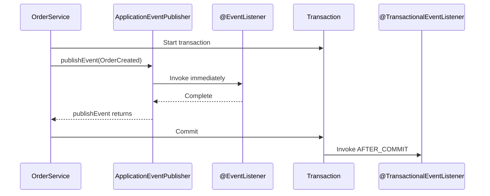

# Differences Between @EventListener and @TransactionalEventListener

## 1. Objectives and Scope

This lesson belongs to the **Transaction-bound Events** group in Spring Application Events. Both `@EventListener` and `@TransactionalEventListener` are used to handle application events with a method in a bean. The core difference lies in **when the listener is invoked and the relationship of that invocation to the transaction**.

- `@EventListener` processes the event when the multicaster dispatches the event. By default, the listener runs synchronously on the event-publishing thread, without waiting for the transaction to commit.
- `@TransactionalEventListener` registers event handling for a phase of the transaction. By default, the listener only runs after the transaction commits successfully.

If the side effect is only valid once the data has committed—such as sending an "order created" notification, updating a cache based on persisted data, or emitting a signal for the next step—`@TransactionalEventListener` is usually more appropriate.

This lesson uses Java 17+ and Spring Framework 6.2.x. After this lesson, you will be able to:

- Distinguish the processing timing of the two annotations.
- Choose the appropriate transaction phase.
- Understand the behavior when there is no transaction or when a transaction rolls back.
- Combine event listeners with async execution properly.
- Recognize the difference between imperative and reactive transactions.
- Test both commit and rollback branches.

## 2. How Does @EventListener Work?

`@EventListener` marks a method that receives an application event. Spring registers the method through `EventListenerMethodProcessor` and the corresponding adapter.

Example:

```java
@Component
class OrderEventListener {

    @EventListener
    public void onOrderCreated(OrderCreated event) {
        System.out.println("Received order " + event.orderId());
    }
}
```

When a component calls:

```java
publisher.publishEvent(new OrderCreated("ORD-127"));
```

Spring finds matching listeners and invokes them. With the default configuration:

- Events are dispatched synchronously.
- The listener runs on the event-publishing thread.
- `publishEvent()` waits for synchronous listeners to complete.
- If a listener throws a `RuntimeException`, the exception can propagate back to the publisher and affect the calling flow.
- The listener does not automatically wait for a transaction commit or rollback.

If an event is published inside a transaction, a synchronous listener usually runs immediately within the current transaction context. Therefore, the listener can see uncommitted data and may perform side effects before the transaction finishes.

This is a point to consider carefully. For example, if a listener sends an email immediately upon receiving `OrderCreated`, the email could be sent even if the transaction later rolls back. The database cannot automatically recall an email that was already sent.

### Filtering Conditions and Ordering

`@EventListener` supports filtering by event type and SpEL conditions:

```java
@EventListener(condition = "#root.args[0].orderId().startsWith('ORD-')")
public void handle(OrderCreated event) {
    // only handle orders whose ID starts with ORD-
}
```

`@Order` can be used to order the invocation of listeners matching the same event:

```java
@EventListener
@Order(10)
public void updateLocalState(OrderCreated event) {
    // invoked before listeners with a higher order value
}
```

A smaller `@Order` number takes precedence. Invocation order does not mean completion order if listeners are executed asynchronously.

### Return Values

An `@EventListener` method can return an object. Spring treats that value as the next event and publishes it further. If an array or `Collection` is returned, each element is published as a separate event.

```java
@EventListener
public OrderValidated validate(OrderCreated event) {
    return new OrderValidated(event.orderId());
}
```

This mechanism is suitable for synchronous processing chains. An async listener cannot use a return value to publish the next event; in that case, inject `ApplicationEventPublisher` and call `publishEvent()` explicitly.

## 3. How Does @TransactionalEventListener Work?

`@TransactionalEventListener` is an annotation for listeners that need to be bound to a transaction phase. This annotation is built on top of Spring's event listener mechanism and adds the `phase` attribute.

Example:

```java
@Component
class OrderCommittedListener {

    @TransactionalEventListener
    public void onOrderCreated(OrderCreated event) {
        System.out.println("Order committed " + event.orderId());
    }
}
```

By default, `phase = TransactionPhase.AFTER_COMMIT`. The listener is only invoked after the transaction that published the event commits successfully.

When an event is published inside an active transaction, Spring registers the listener with transaction synchronization. The listener is invoked when the transaction reaches the selected phase.

This means:

- The listener does not run immediately at the time `publishEvent()` is called.
- If the transaction commits, the `AFTER_COMMIT` listener runs.
- If the transaction rolls back, the `AFTER_COMMIT` listener does not run.
- If there is no transaction, the listener is skipped by default.
- `fallbackExecution = true` allows the listener to run even when there is no transaction.

### The Four Transaction Phases

| Phase | Timing | Use cases |
|---|---|---|
| `BEFORE_COMMIT` | Before commit | Checks or preparatory work that must complete before commit |
| `AFTER_COMMIT` | After successful commit; default | Sending notifications, refreshing caches, or triggering side effects after data is saved |
| `AFTER_ROLLBACK` | After rollback | Recording failures or releasing auxiliary resources |
| `AFTER_COMPLETION` | After the transaction ends, regardless of commit or rollback | Cleanup or recording the final outcome |

Example of declaring a phase explicitly:

```java
@TransactionalEventListener(
        phase = TransactionPhase.AFTER_COMMIT)
public void sendConfirmation(OrderCreated event) {
    // runs only after a successful commit
}

@TransactionalEventListener(
        phase = TransactionPhase.AFTER_ROLLBACK)
public void recordFailure(OrderCreated event) {
    // runs only after a rollback
}
```

`AFTER_COMMIT` is a common choice when the event describes a change that has been successfully persisted. `BEFORE_COMMIT` is suitable for work that must participate in deciding whether the transaction can commit. `AFTER_COMPLETION` does not indicate commit or rollback outcome through the phase alone; if you need to distinguish them, use a specific phase or inspect the appropriate status in a dedicated callback.

## 4. Direct Comparison

| Criterion | `@EventListener` | `@TransactionalEventListener` |
|---|---|---|
| Default timing | When the event is dispatched | After the transaction commits |
| Transaction required | No | Yes, unless fallback is enabled |
| When transaction rolls back | The listener may have already run earlier | AFTER_COMMIT phase does not run; AFTER_ROLLBACK can run |
| Relationship to transaction | Not phase-bound | Bound to transaction synchronization |
| Default thread | Event-publishing thread | Transaction callback runs on the original transaction thread |
| Usage outside a transaction | Runs normally | Skipped if fallbackExecution=false |
| Phase selection | No | BEFORE_COMMIT, AFTER_COMMIT, AFTER_ROLLBACK, AFTER_COMPLETION |
| Event filtering and conditions | Yes | Yes, through the corresponding EventListener attributes |
| Typical purpose | Reacting immediately to an event | Reacting based on transaction outcome |

The two annotations do not replace each other in every situation. Choose based on the business meaning of the event:

- If the listener must run immediately when the event is published, use `@EventListener`.
- If the listener should only run when the transaction has reached a specific outcome, use `@TransactionalEventListener`.

## 5. Clear Example: Commit and Rollback

Suppose a service creates an order and then publishes `OrderCreated`. Two listeners receive the event:

1. A regular listener using `@EventListener`.
2. A transaction-bound listener using `@TransactionalEventListener(AFTER_COMMIT)`.

When the transaction commits, the regular listener runs before the transaction finishes, while the transaction-bound listener runs after commit. On rollback, the regular listener has already run, whereas the AFTER_COMMIT listener does not run.



If the transaction rolls back, the `AFTER_COMMIT` callback is not invoked. You can register a listener with the `AFTER_ROLLBACK` phase to handle this branch separately.

## 6. Complete Example with Java 17 and Spring Framework 6.2

The example uses Spring Context, Spring JDBC, a JDBC transaction manager, and in-memory H2. It runs two cases: a committed transaction and a rolled-back transaction. The configuration enables `@EnableTransactionManagement` so Spring registers the processor factory for `@TransactionalEventListener` in a plain ApplicationContext.

The results demonstrate:

- `@EventListener` runs immediately in both cases.
- `BEFORE_COMMIT` only runs in the commit case.
- `AFTER_COMMIT` only runs after a successful commit.
- `AFTER_ROLLBACK` only runs after a rollback.
- Data exists in the database only after the transaction commits.

### Project Structure

```text
src/
└── main/
    └── java/
        └── demo/
            └── EventListenerComparisonDemo.java
pom.xml
```

### pom.xml

```xml
<project xmlns="http://maven.apache.org/POM/4.0.0"
         xmlns:xsi="http://www.w3.org/2001/XMLSchema-instance"
         xsi:schemaLocation="http://maven.apache.org/POM/4.0.0 https://maven.apache.org/xsd/maven-4.0.0.xsd">
    <modelVersion>4.0.0</modelVersion>

    <groupId>demo</groupId>
    <artifactId>event-listener-comparison</artifactId>
    <version>1.0.0</version>

    <properties>
        <maven.compiler.release>17</maven.compiler.release>
        <project.build.sourceEncoding>UTF-8</project.build.sourceEncoding>
    </properties>

    <dependencies>
        <dependency>
            <groupId>org.springframework</groupId>
            <artifactId>spring-context</artifactId>
            <version>6.2.18</version>
        </dependency>
        <dependency>
            <groupId>org.springframework</groupId>
            <artifactId>spring-jdbc</artifactId>
            <version>6.2.18</version>
        </dependency>
        <dependency>
            <groupId>org.springframework</groupId>
            <artifactId>spring-tx</artifactId>
            <version>6.2.18</version>
        </dependency>
        <dependency>
            <groupId>com.h2database</groupId>
            <artifactId>h2</artifactId>
            <version>2.3.232</version>
            <scope>runtime</scope>
        </dependency>
    </dependencies>

    <build>
        <plugins>
            <plugin>
                <groupId>org.apache.maven.plugins</groupId>
                <artifactId>maven-compiler-plugin</artifactId>
                <version>3.14.0</version>
            </plugin>
            <plugin>
                <groupId>org.codehaus.mojo</groupId>
                <artifactId>exec-maven-plugin</artifactId>
                <version>3.5.0</version>
            </plugin>
        </plugins>
    </build>
</project>
```

### Source Code

Create `src/main/java/demo/EventListenerComparisonDemo.java`:

```java
package demo;

import javax.sql.DataSource;

import org.springframework.context.ApplicationEventPublisher;
import org.springframework.context.annotation.AnnotationConfigApplicationContext;
import org.springframework.context.annotation.Bean;
import org.springframework.context.annotation.Configuration;
import org.springframework.context.event.EventListener;
import org.springframework.jdbc.core.JdbcTemplate;
import org.springframework.jdbc.datasource.DataSourceTransactionManager;
import org.springframework.jdbc.datasource.DriverManagerDataSource;
import org.springframework.transaction.PlatformTransactionManager;
import org.springframework.transaction.TransactionDefinition;
import org.springframework.transaction.annotation.EnableTransactionManagement;
import org.springframework.transaction.event.TransactionPhase;
import org.springframework.transaction.event.TransactionalEventListener;
import org.springframework.transaction.support.TransactionTemplate;

public class EventListenerComparisonDemo {

    public static void main(String[] args) {
        try (var context =
                     new AnnotationConfigApplicationContext(Config.class)) {

            JdbcTemplate jdbc = context.getBean(JdbcTemplate.class);
            jdbc.execute(
                    "CREATE TABLE orders (id VARCHAR(64) PRIMARY KEY)");

            OrderService service = context.getBean(OrderService.class);

            System.out.println("--- COMMIT ---");
            service.createAndCommit("ORD-127-C");
            System.out.println(
                    "Main: committed rows="
                            + jdbc.queryForObject(
                                    "SELECT COUNT(*) FROM orders",
                                    Integer.class));

            System.out.println("--- ROLLBACK ---");
            service.createAndRollback("ORD-127-R");
            System.out.println(
                    "Main: rollback rows="
                            + jdbc.queryForObject(
                                    "SELECT COUNT(*) FROM orders WHERE id = ?",
                                    Integer.class,
                                    "ORD-127-R"));
        }
    }

    record OrderCreated(String orderId) {
    }

    @Configuration
    @EnableTransactionManagement
    static class Config {

        @Bean
        DataSource dataSource() {
            DriverManagerDataSource dataSource =
                    new DriverManagerDataSource();
            dataSource.setDriverClassName("org.h2.Driver");
            dataSource.setUrl("jdbc:h2:mem:eventdemo;DB_CLOSE_DELAY=-1");
            dataSource.setUsername("sa");
            dataSource.setPassword("");
            return dataSource;
        }

        @Bean
        JdbcTemplate jdbcTemplate(DataSource dataSource) {
            return new JdbcTemplate(dataSource);
        }

        @Bean
        PlatformTransactionManager transactionManager(
                DataSource dataSource) {
            return new DataSourceTransactionManager(dataSource);
        }

        @Bean
        TransactionTemplate transactionTemplate(
                PlatformTransactionManager transactionManager) {
            TransactionTemplate template =
                    new TransactionTemplate(transactionManager);
            template.setPropagationBehavior(
                    TransactionDefinition.PROPAGATION_REQUIRED);
            return template;
        }

        @Bean
        OrderService orderService(
                JdbcTemplate jdbc,
                TransactionTemplate transactionTemplate,
                ApplicationEventPublisher publisher) {
            return new OrderService(jdbc, transactionTemplate, publisher);
        }

        @Bean
        OrderEventListeners orderEventListeners() {
            return new OrderEventListeners();
        }
    }

    static class OrderService {
        private final JdbcTemplate jdbc;
        private final TransactionTemplate transactionTemplate;
        private final ApplicationEventPublisher publisher;

        OrderService(
                JdbcTemplate jdbc,
                TransactionTemplate transactionTemplate,
                ApplicationEventPublisher publisher) {
            this.jdbc = jdbc;
            this.transactionTemplate = transactionTemplate;
            this.publisher = publisher;
        }

        void createAndCommit(String orderId) {
            transactionTemplate.executeWithoutResult(status -> {
                jdbc.update(
                        "INSERT INTO orders (id) VALUES (?)",
                        orderId);

                System.out.println(
                        "Service: publishing " + orderId);
                publisher.publishEvent(new OrderCreated(orderId));

                System.out.println(
                        "Service: transaction work finished " + orderId);
            });
        }

        void createAndRollback(String orderId) {
            transactionTemplate.executeWithoutResult(status -> {
                jdbc.update(
                        "INSERT INTO orders (id) VALUES (?)",
                        orderId);

                System.out.println(
                        "Service: publishing " + orderId);
                publisher.publishEvent(new OrderCreated(orderId));

                System.out.println(
                        "Service: mark rollback " + orderId);
                status.setRollbackOnly();
            });
        }
    }

    static class OrderEventListeners {

        @EventListener
        public void onPublished(OrderCreated event) {
            System.out.println(
                    "EventListener: received " + event.orderId());
        }

        @TransactionalEventListener(
                phase = TransactionPhase.BEFORE_COMMIT)
        public void beforeCommit(OrderCreated event) {
            System.out.println(
                    "TransactionalEventListener BEFORE_COMMIT: "
                            + event.orderId());
        }

        @TransactionalEventListener(
                phase = TransactionPhase.AFTER_COMMIT)
        public void afterCommit(OrderCreated event) {
            System.out.println(
                    "TransactionalEventListener AFTER_COMMIT: "
                            + event.orderId());
        }

        @TransactionalEventListener(
                phase = TransactionPhase.AFTER_ROLLBACK)
        public void afterRollback(OrderCreated event) {
            System.out.println(
                    "TransactionalEventListener AFTER_ROLLBACK: "
                            + event.orderId());
        }
    }
}
```

### Compile and Run

From the directory containing `pom.xml`, run:

```bash
mvn -q compile exec:java -Dexec.mainClass=demo.EventListenerComparisonDemo
```

Expected stdout:

```text
--- COMMIT ---
Service: publishing ORD-127-C
EventListener: received ORD-127-C
Service: transaction work finished ORD-127-C
TransactionalEventListener BEFORE_COMMIT: ORD-127-C
TransactionalEventListener AFTER_COMMIT: ORD-127-C
Main: committed rows=1
--- ROLLBACK ---
Service: publishing ORD-127-R
EventListener: received ORD-127-R
Service: mark rollback ORD-127-R
TransactionalEventListener AFTER_ROLLBACK: ORD-127-R
Main: rollback rows=0
```

Explanation:

1. The service starts a transaction with `TransactionTemplate` and inserts data.
2. `publishEvent()` invokes the regular listener immediately. Therefore, the `EventListener: received ...` line appears before the transaction finishes.
3. For the committed transaction, the `BEFORE_COMMIT` listener runs before the database commits, and then the `AFTER_COMMIT` listener runs when the commit succeeds.
4. For the rolled-back transaction, the `AFTER_COMMIT` listener does not run. The `AFTER_ROLLBACK` listener is invoked after the rollback.
5. The final query confirms the committed order remains in the database; the rolled-back order does not exist.

The example uses `TransactionTemplate` to make the transaction boundaries clearly visible. In real applications, services can use `@Transactional` if the methods and transaction manager are configured properly.

## 7. Without a Transaction: fallbackExecution

By default, `@TransactionalEventListener` requires an active transaction at the time the event is published. If the publisher publishes an event outside a transaction, the listener will not run.

```java
@TransactionalEventListener
public void afterCommit(OrderCreated event) {
    // skipped by default if there is no transaction
}
```

If the business logic accepts immediate processing even without a transaction, `fallbackExecution` can be enabled:

```java
@TransactionalEventListener(fallbackExecution = true)
public void handle(OrderCreated event) {
    // runs via fallback if the event is published outside a transaction
}
```

When fallback is used, there is no commit or rollback phase to wait for. The listener executes via fallback immediately upon receiving the event. Only enable this option when out-of-transaction behavior genuinely makes business sense; if you need to guarantee that data has committed, fallback can defeat that guarantee.

## 8. Async Listeners and Transaction Listeners

Two concepts must be kept separate:

- **Transaction phase** determines at which point in the transaction lifecycle the listener is invoked.
- **Async execution** determines which thread the method actually runs on.

`@Async` can be combined with a transactional listener for post-commit tasks:

```java
@Async
@TransactionalEventListener(
        phase = TransactionPhase.AFTER_COMMIT)
public void sendConfirmation(OrderCreated event) {
    notificationService.send(event.orderId());
}
```

Async processing must be enabled with `@EnableAsync` and an appropriate executor configured. In Spring Framework 6.2, transactional listeners are invoked on the transaction's original thread regardless of whether the multicaster is configured with an executor; `@Async` on the method is how you offload the execution to an executor.

When the async method runs, the original transaction has already completed. If the listener needs to write data, open a new transaction in the called service, for example using `@Transactional(propagation = Propagation.REQUIRES_NEW)`. Do not rely on the old transaction or the publisher's ThreadLocal in the worker thread.

With an async listener, exceptions in the worker do not propagate back to the caller of `publishEvent()`. Configure appropriate async error handling, logging, and monitoring. For async methods returning `void`, `AsyncUncaughtExceptionHandler` can be used.

## 9. Reactive Transactions Since Spring 6.1

Since Spring Framework 6.1, `@TransactionalEventListener` supports both:

- Imperative transactions managed by `PlatformTransactionManager`.
- Reactive transactions managed by `ReactiveTransactionManager`.

With imperative transactions, the listener can detect the transaction bound to the current thread. With reactive transactions, the transaction context lives in the Reactor Context, not in ThreadLocal. Therefore, an event published in a reactive transaction needs to carry the transaction context as the event source.

Use `TransactionalEventPublisher` to publish events in a reactive pipeline:

```java
TransactionalEventPublisher eventPublisher =
        new TransactionalEventPublisher(applicationEventPublisher);

return repository.save(order)
        .then(eventPublisher.publishEvent(
                new OrderCreated(order.id())));
```

`publishEvent()` returns `Mono<Void>`, so that Mono must be composed into the pipeline. Do not call `subscribe()` separately inside the service. This section applies to reactive transactions; the JDBC example in section 6 is an imperative transaction.

## 10. Post-Commit Considerations

When a listener runs at `AFTER_COMMIT`, the transaction has already committed. Transaction resources may still be bound during the callback, but further writes to those resources will not be committed by the already-completed transaction.

If a listener needs to update the database after commit:

- Call a service that opens a new transaction, typically with `REQUIRES_NEW`.
- Keep the listener short and only pass the necessary data to the service.
- If the side effect requires durable delivery across restarts or needs retries, consider a Transactional Outbox or a message broker.

Transactional event listeners provide transaction-scoped synchronization within the same application. They do not durably persist events, retry, replay, or guarantee delivery after the process stops.

## 11. Common Pitfalls

1. **Using `@EventListener` for side effects valid only after commit:** the listener can run before commit and the side effect still occurs if the transaction rolls back.
2. **Assuming `@TransactionalEventListener` always runs:** if there is no transaction and `fallbackExecution=false`, the event is skipped.
3. **Choosing the wrong phase:** `AFTER_COMMIT` does not run on rollback; use `AFTER_ROLLBACK` if you need to handle the failure branch.
4. **Using `BEFORE_COMMIT` to send emails or call external APIs:** the transaction may roll back afterward, causing external systems to receive notifications about uncommitted data.
5. **Writing to the database in AFTER_COMMIT without opening a new transaction:** changes may not be committed.
6. **Assuming a multicaster executor automatically makes transactional listeners async:** Spring 6.2 keeps transactional listeners on the original thread; configure async separately if truly needed.
7. **Assuming async exceptions propagate back to the publisher:** the worker thread handles exceptions separately; logging and an error handler are required.
8. **Confusing imperative and reactive transactions:** reactive transactions use Reactor Context; since Spring 6.1 the context must be included in the event source.
9. **Enabling fallbackExecution arbitrarily:** the listener may run without a transaction phase.
10. **Treating in-memory events as a durable queue:** an outbox or broker is needed if the business requires retries and durable delivery.

## 12. Testing

Behavior on both sides of the transaction should be tested:

- With `@EventListener`, verify the listener is invoked immediately when the publisher publishes the event.
- With `BEFORE_COMMIT`, verify the listener runs as the transaction is about to commit.
- With `AFTER_COMMIT`, verify the listener only runs when the transaction commits successfully.
- With `AFTER_ROLLBACK`, verify the listener runs when the transaction rolls back.
- When there is no transaction, verify the listener is skipped by default.
- When `fallbackExecution=true` is enabled, verify the listener runs via fallback.
- With async listeners, wait using `CountDownLatch`, `CompletableFuture`, or Awaitility with a timeout; do not use `Thread.sleep()`.
- Verify database side effects by querying after the transaction ends.

In integration tests, use a real transaction manager and test database to verify transaction synchronization. Mocking only `ApplicationEventPublisher` will not test the commit/rollback phases.

## 13. Annotation Selection Checklist

- [ ] Must the listener run immediately when the event is received? Use `@EventListener`.
- [ ] Must the listener only run after a successful commit? Use `@TransactionalEventListener(AFTER_COMMIT)`.
- [ ] Need preparation before commit? Consider `BEFORE_COMMIT`.
- [ ] Need to handle the rollback branch? Use `AFTER_ROLLBACK`.
- [ ] Need cleanup after any outcome? Use `AFTER_COMPLETION`.
- [ ] Can the event be published outside a transaction? Consider `fallbackExecution`.
- [ ] Does the listener need to run async? Configure `@Async` and an executor; verify the transaction has already completed at the chosen phase.
- [ ] Reactive transaction? Use `TransactionalEventPublisher` to attach the transaction context to the event source.
- [ ] Does the side effect require retries or durable delivery? Design an outbox or broker.

## 14. References

- [Spring Framework 6.2 Reference — Additional Capabilities of the ApplicationContext](https://docs.spring.io/spring/reference/6.2/core/beans/context-introduction.html)
- [Spring Framework 6.2 Reference — Transaction-bound Events](https://docs.spring.io/spring-framework/reference/6.2/data-access/transaction/event.html)
- [Spring Framework 6.2 API — EventListener](https://docs.spring.io/spring-framework/docs/6.2.18/javadoc-api/org/springframework/context/event/EventListener.html)
- [Spring Framework 6.2 API — TransactionalEventListener](https://docs.spring.io/spring-framework/docs/6.2.18/javadoc-api/org/springframework/transaction/event/TransactionalEventListener.html)
- [Spring Framework 6.2 API — TransactionPhase](https://docs.spring.io/spring-framework/docs/6.2.18/javadoc-api/org/springframework/transaction/event/TransactionPhase.html)
- [Spring Framework 6.2 Release Notes — Transactional listeners and async multicaster](https://github.com/spring-projects/spring-framework/wiki/What's-New-in-Spring-Framework-6.x)

