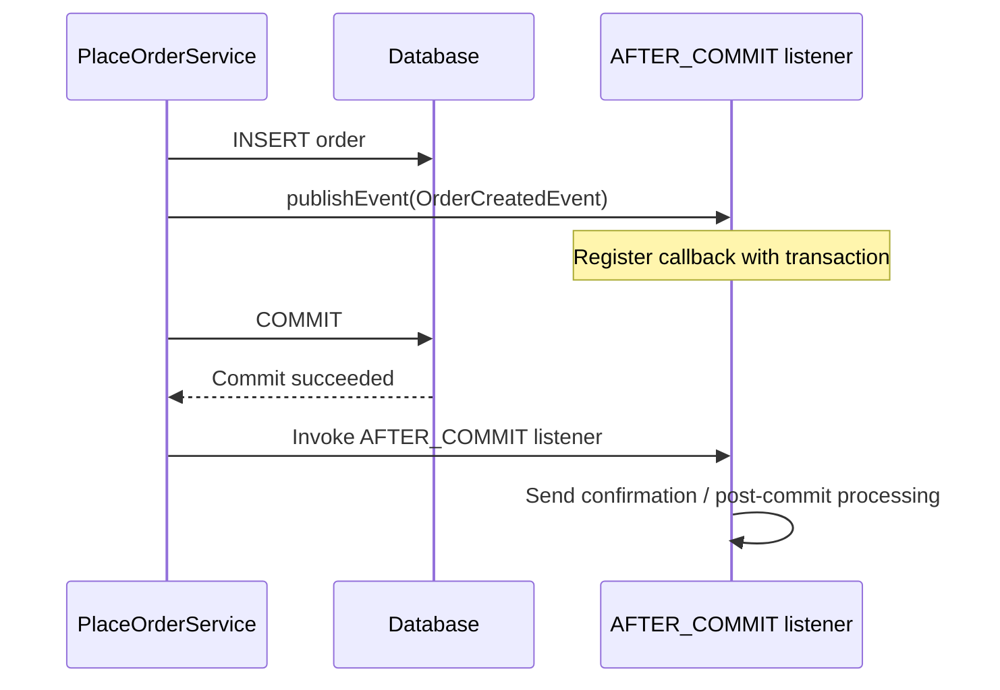

# Transaction Phase AFTER_COMMIT

`TransactionPhase.AFTER_COMMIT` is the `@TransactionalEventListener` phase used to handle an event after a transaction has committed successfully. It is the default value of the annotation. Spring only invokes the listener if the event was published inside an active transaction and that transaction ends with a commit; if the transaction rolls back, the `AFTER_COMMIT` listener does not run.

Important point: `AFTER_COMMIT` is implemented within the `afterCompletion` chain, not the `TransactionSynchronization.afterCommit()` callback. When the listener runs, the original transaction has already completed, but resources such as a JDBC connection or JPA `EntityManager` may still be bound. Additional write operations using those resources will not be committed again. If the listener needs to write to the database, open a new transaction using `Propagation.REQUIRES_NEW`.

## 1. Why Is AFTER_COMMIT Needed?

A common use case saves data and then publishes an event so another component can send an email, update a search index, or call an external service. If a regular `@EventListener` is used, the listener runs immediately at publish time while the transaction may not have committed yet. If the transaction later rolls back, the external side effect has already happened for a change that does not exist.

`@TransactionalEventListener(AFTER_COMMIT)` binds the listener to the transaction outcome: it only processes after a successful commit.



If the transaction rolls back, this listener is not invoked. This is the right approach when an action only makes sense after the business change has been confirmed in the database.

## 2. Declaring the Listener

```java
@Component
public class OrderNotificationListener {
    private final NotificationService notificationService;

    public OrderNotificationListener(NotificationService notificationService) {
        this.notificationService = notificationService;
    }

    @TransactionalEventListener(phase = TransactionPhase.AFTER_COMMIT)
    public void onOrderCreated(OrderCreatedEvent event) {
        notificationService.sendConfirmation(event.orderId());
    }
}
```

`AFTER_COMMIT` is the default, so `@TransactionalEventListener` can be written without passing `phase`. Declaring it explicitly is helpful in code reviews because it clearly shows that the listener depends on a successful commit.

The publisher typically publishes the event inside a `@Transactional` method:

```java
@Service
public class PlaceOrderService {
    private final OrderRepository repository;
    private final ApplicationEventPublisher publisher;

    public PlaceOrderService(OrderRepository repository,
                             ApplicationEventPublisher publisher) {
        this.repository = repository;
        this.publisher = publisher;
    }

    @Transactional
    public void placeOrder(String orderId) {
        repository.insert(orderId);
        publisher.publishEvent(new OrderCreatedEvent(orderId));
    }
}
```

The event is published while the transaction is still active. Spring registers the listener as a transaction synchronization; invoking the listener method is deferred until the selected phase.

## 3. Position in the Transaction Lifecycle

`@TransactionalEventListener` supports four phases:

| Phase | Timing | Condition |
|---|---|---|
| `BEFORE_COMMIT` | Before commit | The transaction reaches the commit step; an error can cause a rollback |
| `AFTER_COMMIT` | After successful commit | Completion status is committed |
| `AFTER_ROLLBACK` | After rollback | Completion status is rolled back |
| `AFTER_COMPLETION` | After the transaction ends | Invoked on either commit or rollback |

`AFTER_COMMIT` is a specialization of `AFTER_COMPLETION`: it runs in the same `afterCompletion` chain and only executes when the status is `STATUS_COMMITTED`.

```text
Transaction starts
    |
    +-- publishEvent(event): register listener
    +-- perform database work
    |
    +-- COMMIT succeeds -> AFTER_COMMIT
    |
    +-- ROLLBACK        -> AFTER_ROLLBACK
```

Do not confuse `TransactionPhase.AFTER_COMMIT` with `TransactionSynchronization.afterCommit()`. The two callbacks have different exception contracts: `afterCommit()` can propagate exceptions back to the caller; `@TransactionalEventListener`'s `AFTER_COMMIT` runs via `afterCompletion`.

## 4. Comparison with Regular @EventListener

| Criterion | `@EventListener` | `@TransactionalEventListener(AFTER_COMMIT)` |
|---|---|---|
| Invocation time | Immediately upon publish | After the transaction commits successfully |
| Transaction required | No | Yes, by default |
| Transaction rollback | The listener may have already run | The listener does not run |
| Publish outside transaction | Still processed | Skipped, unless fallback is enabled |
| Use for post-commit notifications | Risk of running too early | Better suited for the purpose |

Use `@EventListener` for reactions that do not depend on the transaction outcome. Use `AFTER_COMMIT` when the side effect must only occur after commit.

## 5. When Is the Listener Not Invoked?

### Transaction Rollback

If the publisher publishes an event but the transaction ends with a rollback, `AFTER_COMMIT` does not run. To handle the rollback case separately, register `AFTER_ROLLBACK`:

```java
@TransactionalEventListener(phase = TransactionPhase.AFTER_ROLLBACK)
public void onOrderRollback(OrderCreatedEvent event) {
    auditService.recordRollback(event.orderId());
}
```

### No Active Transaction

By default, if an event is published outside a transaction, Spring does not invoke a transactional listener because there is no phase to wait for. `fallbackExecution = true` can be enabled:

```java
@TransactionalEventListener(
        phase = TransactionPhase.AFTER_COMMIT,
        fallbackExecution = true)
public void onOrderCreated(OrderCreatedEvent event) {
    notificationService.sendConfirmation(event.orderId());
}
```

When fallback is enabled, if there is no transaction, the listener runs immediately via the fallback mechanism; no commit occurs to wait for. Therefore, do not assume every execution of the callback means a transaction has committed successfully. Only enable it when the business logic accepts publishing outside a transaction.

The event must be published while the transaction is active. Publishing after the transaction has already completed cannot retroactively register a callback on the old transaction.

## 6. Resources May Still Be Bound After Commit

With a standard imperative transaction manager, when `AFTER_COMMIT` runs, the database has committed the original transaction, but resources such as a JDBC connection or JPA `EntityManager` may still remain bound during completion.

Code accessing the database in the callback might still use the old transaction's resource. Those changes will not be committed again because the transaction has already finished. The following example can mislead readers into thinking the audit has been durably saved:

```java
@TransactionalEventListener(phase = TransactionPhase.AFTER_COMMIT)
public void afterCommit(OrderCreatedEvent event) {
    auditRepository.insert(event.orderId());
}
```

Spring warns that any data access at this phase may still participate in the original resource, with no subsequent commit.

## 7. Using REQUIRES_NEW to Write to the Database

If the callback needs to write to the database, call a separate bean with a `REQUIRES_NEW` transaction:

```java
@Service
public class AuditWriter {
    private final AuditRepository repository;

    public AuditWriter(AuditRepository repository) {
        this.repository = repository;
    }

    @Transactional(propagation = Propagation.REQUIRES_NEW)
    public void recordOrderCreated(String orderId) {
        repository.insert(orderId);
    }
}

@Component
public class OrderAuditListener {
    private final AuditWriter auditWriter;

    public OrderAuditListener(AuditWriter auditWriter) {
        this.auditWriter = auditWriter;
    }

    @TransactionalEventListener(phase = TransactionPhase.AFTER_COMMIT)
    public void afterCommit(OrderCreatedEvent event) {
        auditWriter.recordOrderCreated(event.orderId());
    }
}
```

`REQUIRES_NEW` suspends bound resources/synchronizations and opens an independent transaction for the audit. The new transaction commits separately; it does not make the audit an atomic part of the already-committed order transaction.

Make `AuditWriter` a separate bean so the call goes through the Spring transaction proxy. Calling `this.recordOrderCreated(...)` within the same object via self-invocation usually bypasses the proxy and the annotation may not be applied.

If the new transaction fails, the original order transaction has still committed. Only use `REQUIRES_NEW` when two independent outcomes are acceptable; data that must be atomic with the order must be written within the original transaction.

## 8. Exceptions in AFTER_COMMIT

`AFTER_COMMIT` runs in the `afterCompletion` chain, so its exception handling differs from `BEFORE_COMMIT` or `TransactionSynchronization.afterCommit()`.

With Spring's standard imperative transaction manager:

- An exception from `BEFORE_COMMIT` can propagate to the commit caller and cause the transaction to roll back.
- An exception from `TransactionSynchronization.afterCommit()` can propagate to the caller, even though the transaction has committed.
- A runtime exception from `@TransactionalEventListener(AFTER_COMMIT)` is handled inside `afterCompletion`; per the `TransactionSynchronization.afterCompletion(int)` contract, the error is logged and does not propagate to the caller.

Therefore, the caller should not rely on exceptions to know whether the email or audit failed. Log the error in the listener, emit metrics, and design explicit retries:

```java
@TransactionalEventListener(phase = TransactionPhase.AFTER_COMMIT)
public void sendConfirmation(OrderCreatedEvent event) {
    try {
        notificationService.sendConfirmation(event.orderId());
    } catch (RuntimeException ex) {
        log.error("Cannot send confirmation for {}", event.orderId(), ex);
        retryRecorder.recordFailure(event.orderId(), ex.getMessage());
    }
}
```

If the retry record must persist durably, write it using a separate transaction or use an outbox. Logging alone does not create automatic retries.

## 9. AFTER_COMMIT and Asynchronous Processing

An `AFTER_COMMIT` listener runs synchronously by default in the transaction completion flow. If the callback sends an email or makes a slow HTTP call, the completion time of the transactional call may increase.

`@Async` can be combined to offload the method body to an executor:

```java
@Async
@TransactionalEventListener(phase = TransactionPhase.AFTER_COMMIT)
public void sendConfirmation(OrderCreatedEvent event) {
    notificationService.sendConfirmation(event.orderId());
}
```

The trigger timing is still after commit; the worker thread does not inherit the publisher's transaction. Exceptions from an async method are not thrown back to the caller. For methods returning `void`, configure an `AsyncUncaughtExceptionHandler` or an appropriate error recording mechanism.

`@Async` does not automatically provide retries or durable storage. The executor can reject tasks and the process can stop after commit. Bound the queue, configure a rejection policy, timeouts, metrics, and retries as required.

## 10. AFTER_COMMIT Is Not a Durable Message Queue

`@TransactionalEventListener` registers callbacks in the process's memory. If the database commits successfully but the process stops before the callback finishes, the old callback is not automatically recovered after restart.

For critical messages that must not be lost, use a transactional outbox:

```text
Within a single database transaction:
    INSERT INTO orders (...)
    INSERT INTO outbox (event_id, type, payload, status)
    COMMIT

Outbox worker:
    read pending events
    publish to broker or call target service
    mark as processed
    retry on error according to policy
```

The order and the outbox record commit together. If the transaction rolls back, both roll back. If the commit succeeds, the worker can find the outbox record again after a process restart.

An outbox typically provides at-least-once delivery. Consumers need an event ID or idempotency key to avoid duplicate side effects when the worker retries.

| Need | Suitable approach |
|---|---|
| Lightweight post-commit callback, acceptable to run in-process | `@TransactionalEventListener(AFTER_COMMIT)` |
| Dispatch background task after commit | `AFTER_COMMIT` + executor and error handling |
| Must not lose events when process stops | Transactional outbox + worker/broker |
| Safe retry on duplicate delivery | Event ID, idempotency key, and idempotent consumer |

## 11. Ordering Across Multiple AFTER_COMMIT Listeners

Multiple listeners can receive the same event and register for the `AFTER_COMMIT` phase. Use `@Order` to order listeners:

```java
@TransactionalEventListener(phase = TransactionPhase.AFTER_COMMIT)
@Order(10)
public void updateSearchIndex(OrderCreatedEvent event) {
    // Listener with higher priority order
}

@TransactionalEventListener(phase = TransactionPhase.AFTER_COMMIT)
@Order(20)
public void sendNotification(OrderCreatedEvent event) {
    // Processed after listener with order 10
}
```

Smaller order values take precedence. If listeners are offloaded to an async executor, submission order does not guarantee completion order. If a later step needs the result of an earlier step, use an explicit coordinating service or workflow.

## 12. Reactive Transactions

Since Spring Framework 6.1, `@TransactionalEventListener` supports both imperative and reactive transactions. With reactive transactions, the transaction context resides in the Reactor Context rather than `ThreadLocal`.

When publishing an event in a reactive transaction, the event needs to carry the transaction context in `source`. `TransactionalEventPublisher` helps create events with the right context; its publisher must be composed into the reactive pipeline managed by `ReactiveTransactionManager`. Calling a plain `ApplicationEventPublisher.publishEvent(payload)` may not provide the source required for a reactive transactional listener.

```java
Mono<Void> publishAfterCommit(OrderCreatedEvent event) {
    return transactionalEventPublisher.publishEvent(event);
}
```

Do not call `subscribe()` to create a detached subscription. Details of Reactor Context and event source belong to the reactive transaction topic.

## 13. Complete Example: Writing Audit Only After Commit

The example uses Java 17, Spring Framework 6.2.0, Spring JDBC, and H2. The use case saves an order and then publishes an event. The `AFTER_COMMIT` listener calls `AuditWriter` with `REQUIRES_NEW`. Another order placement intentionally rolls back to prove the `AFTER_COMMIT` listener does not run for that transaction.

### Directory Structure

```text
after-commit-demo/
├── pom.xml
└── src/
    └── main/
        └── java/
            └── demo/
                └── AfterCommitDemo.java
```

### pom.xml

```xml
<project xmlns="http://maven.apache.org/POM/4.0.0"
         xmlns:xsi="http://www.w3.org/2001/XMLSchema-instance"
         xsi:schemaLocation="http://maven.apache.org/POM/4.0.0 https://maven.apache.org/xsd/maven-4.0.0.xsd">
    <modelVersion>4.0.0</modelVersion>
    <groupId>demo</groupId>
    <artifactId>after-commit-demo</artifactId>
    <version>1.0.0</version>
    <properties>
        <maven.compiler.release>17</maven.compiler.release>
        <project.build.sourceEncoding>UTF-8</project.build.sourceEncoding>
    </properties>
    <dependencies>
        <dependency>
            <groupId>org.springframework</groupId>
            <artifactId>spring-context</artifactId>
            <version>6.2.0</version>
        </dependency>
        <dependency>
            <groupId>org.springframework</groupId>
            <artifactId>spring-jdbc</artifactId>
            <version>6.2.0</version>
        </dependency>
        <dependency>
            <groupId>com.h2database</groupId>
            <artifactId>h2</artifactId>
            <version>2.2.224</version>
            <scope>runtime</scope>
        </dependency>
    </dependencies>
    <build>
        <plugins>
            <plugin>
                <groupId>org.apache.maven.plugins</groupId>
                <artifactId>maven-compiler-plugin</artifactId>
                <version>3.13.0</version>
            </plugin>
            <plugin>
                <groupId>org.codehaus.mojo</groupId>
                <artifactId>exec-maven-plugin</artifactId>
                <version>3.3.0</version>
            </plugin>
        </plugins>
    </build>
</project>
```

### src/main/java/demo/AfterCommitDemo.java

```java
package demo;

import javax.sql.DataSource;

import org.springframework.context.ApplicationEventPublisher;
import org.springframework.context.annotation.AnnotationConfigApplicationContext;
import org.springframework.context.annotation.Bean;
import org.springframework.context.annotation.Configuration;
import org.springframework.jdbc.core.JdbcTemplate;
import org.springframework.jdbc.datasource.DataSourceTransactionManager;
import org.springframework.jdbc.datasource.DriverManagerDataSource;
import org.springframework.transaction.PlatformTransactionManager;
import org.springframework.transaction.annotation.EnableTransactionManagement;
import org.springframework.transaction.annotation.Propagation;
import org.springframework.transaction.annotation.Transactional;
import org.springframework.transaction.event.TransactionPhase;
import org.springframework.transaction.event.TransactionalEventListener;

public class AfterCommitDemo {

    public record OrderCreatedEvent(String orderId) {
    }

    public static class OrderRepository {
        private final JdbcTemplate jdbc;

        public OrderRepository(JdbcTemplate jdbc) {
            this.jdbc = jdbc;
        }

        public void createSchema() {
            jdbc.execute("CREATE TABLE orders (id VARCHAR(64) PRIMARY KEY)");
            jdbc.execute("CREATE TABLE audits (order_id VARCHAR(64) NOT NULL)");
        }

        public void insertOrder(String orderId) {
            jdbc.update("INSERT INTO orders(id) VALUES (?)", orderId);
        }

        public void insertAudit(String orderId) {
            jdbc.update("INSERT INTO audits(order_id) VALUES (?)", orderId);
        }

        public int countOrders() {
            return jdbc.queryForObject("SELECT COUNT(*) FROM orders", Integer.class);
        }

        public int countAudits() {
            return jdbc.queryForObject("SELECT COUNT(*) FROM audits", Integer.class);
        }
    }

    public static class AuditWriter {
        private final OrderRepository repository;

        public AuditWriter(OrderRepository repository) {
            this.repository = repository;
        }

        @Transactional(propagation = Propagation.REQUIRES_NEW)
        public void record(String orderId) {
            repository.insertAudit(orderId);
            System.out.println("AuditWriter: saved " + orderId);
        }
    }

    public static class OrderListener {
        private final AuditWriter auditWriter;

        public OrderListener(AuditWriter auditWriter) {
            this.auditWriter = auditWriter;
        }

        @TransactionalEventListener(phase = TransactionPhase.AFTER_COMMIT)
        public void afterCommit(OrderCreatedEvent event) {
            System.out.println("AFTER_COMMIT: " + event.orderId());
            auditWriter.record(event.orderId());
        }

        @TransactionalEventListener(phase = TransactionPhase.AFTER_ROLLBACK)
        public void afterRollback(OrderCreatedEvent event) {
            System.out.println("AFTER_ROLLBACK: " + event.orderId());
        }
    }

    public static class OrderService {
        private final OrderRepository repository;
        private final ApplicationEventPublisher publisher;

        public OrderService(OrderRepository repository,
                            ApplicationEventPublisher publisher) {
            this.repository = repository;
            this.publisher = publisher;
        }

        @Transactional
        public void createOrder(String orderId) {
            repository.insertOrder(orderId);
            System.out.println("OrderService: inserted " + orderId);
            publisher.publishEvent(new OrderCreatedEvent(orderId));
        }

        @Transactional
        public void createOrderAndFail(String orderId) {
            repository.insertOrder(orderId);
            System.out.println("OrderService: inserted " + orderId);
            publisher.publishEvent(new OrderCreatedEvent(orderId));
            throw new IllegalStateException("forced rollback");
        }
    }

    @Configuration(proxyBeanMethods = false)
    @EnableTransactionManagement
    public static class AppConfig {

        @Bean
        DataSource dataSource() {
            var dataSource = new DriverManagerDataSource();
            dataSource.setDriverClassName("org.h2.Driver");
            dataSource.setUrl("jdbc:h2:mem:after_commit_demo;DB_CLOSE_DELAY=-1");
            dataSource.setUsername("sa");
            dataSource.setPassword("");
            return dataSource;
        }

        @Bean
        JdbcTemplate jdbcTemplate(DataSource dataSource) {
            return new JdbcTemplate(dataSource);
        }

        @Bean
        PlatformTransactionManager transactionManager(DataSource dataSource) {
            return new DataSourceTransactionManager(dataSource);
        }

        @Bean
        OrderRepository orderRepository(JdbcTemplate jdbc) {
            return new OrderRepository(jdbc);
        }

        @Bean
        AuditWriter auditWriter(OrderRepository repository) {
            return new AuditWriter(repository);
        }

        @Bean
        OrderListener orderListener(AuditWriter auditWriter) {
            return new OrderListener(auditWriter);
        }

        @Bean
        OrderService orderService(OrderRepository repository,
                                  ApplicationEventPublisher publisher) {
            return new OrderService(repository, publisher);
        }
    }

    public static void main(String[] args) {
        try (var context =
                     new AnnotationConfigApplicationContext(AppConfig.class)) {
            OrderRepository repository = context.getBean(OrderRepository.class);
            OrderService service = context.getBean(OrderService.class);

            repository.createSchema();
            service.createOrder("ORD-1281");

            try {
                service.createOrderAndFail("ORD-ROLLBACK");
            } catch (IllegalStateException ex) {
                System.out.println("Main: caught " + ex.getMessage());
            }

            System.out.println("Committed orders: " + repository.countOrders());
            System.out.println("Committed audits: " + repository.countAudits());
        }
    }
}
```

### Running the Program

In the `after-commit-demo/` directory, run:

```bash
mvn -q compile exec:java -Dexec.mainClass=demo.AfterCommitDemo
```

Expected stdout:

```text
OrderService: inserted ORD-1281
AFTER_COMMIT: ORD-1281
AuditWriter: saved ORD-1281
OrderService: inserted ORD-ROLLBACK
AFTER_ROLLBACK: ORD-ROLLBACK
Main: caught forced rollback
Committed orders: 1
Committed audits: 1
```

### Analysis

1. `@EnableTransactionManagement` enables transaction proxies; the call `service.createOrder(...)` from `main` goes through the proxy.
2. The use case inserts an order and then publishes the event inside an active transaction.
3. When the use case completes normally, Spring commits the order first and then invokes the `AFTER_COMMIT` listener.
4. The listener calls the `AuditWriter` bean; the proxy applies `REQUIRES_NEW` and commits the audit in a separate transaction.
5. With `ORD-ROLLBACK`, the use case throws an unchecked exception before commit. The order rolls back and the `AFTER_ROLLBACK` listener runs; the `AFTER_COMMIT` listener does not run.
6. The database contains one order and one audit from the successful run.

The example uses an in-memory H2 database to demonstrate transactions. In a real application, use the database and transaction manager appropriate for your system.

## 14. Testing AFTER_COMMIT

Integration tests should verify actual behavior with the appropriate transaction manager and database:

- **Successful commit:** the `AFTER_COMMIT` listener is invoked and expected side effects appear.
- **Rollback:** the `AFTER_COMMIT` listener is not invoked; the `AFTER_ROLLBACK` listener can be invoked.
- **No transaction:** the listener does not run by default; if fallback is enabled, verify it runs immediately outside a transaction.
- **Post-commit database write:** verify the `REQUIRES_NEW` collaborator commits independently.
- **Callback failure:** check logs/metrics/retry state; do not assume exceptions are thrown back to the caller.
- **Process restart:** if durability is required, verify the outbox worker recovers and retries pending events.

Avoid wrapping an entire test in an auto-rolling-back test transaction and expecting the `AFTER_COMMIT` callback to run. If the test framework keeps the transaction open and rolls it back at the end of the test, the commit phase never happens. You can explicitly commit the transaction in the test or run the use case across an independent transaction boundary.

## 15. Common Pitfalls

| Symptom | Cause | Solution |
|---|---|---|
| Listener does not run | Event was published outside a transaction | Publish inside a transaction or consider `fallbackExecution` |
| Listener runs even without a commit | `fallbackExecution=true` | Understand that fallback runs immediately outside a transaction |
| Listener runs even when the use case rolls back | Using a regular `@EventListener` | Use `@TransactionalEventListener(AFTER_COMMIT)` |
| Wrote audit but data does not appear | Wrote using the already-completed transaction's resource | Call a `REQUIRES_NEW` service |
| `REQUIRES_NEW` has no effect | Self-invocation bypasses the proxy | Extract the writer into a separate Spring bean |
| Caller does not receive listener exception | `AFTER_COMMIT` runs in `afterCompletion`; errors are logged | Track errors in the listener, metrics, and retries |
| Duplicate emails sent after retry | Side effect is not idempotent | Use an event ID/idempotency key |
| Event lost after process crash | Callback is stored only in memory | Use a transactional outbox |
| Request completes slowly | Listener runs synchronously and performs slow I/O | Use a managed executor or outbox worker |

## 16. Design Checklist

- [ ] Event is published while a transaction is active.
- [ ] Listener should only run after a successful commit.
- [ ] Use `@TransactionalEventListener(phase = TransactionPhase.AFTER_COMMIT)`.
- [ ] Do not confuse `AFTER_COMMIT` with `TransactionSynchronization.afterCommit()`.
- [ ] Do not rely on the callback to roll back an already-committed transaction.
- [ ] If the listener writes to the database, call a `REQUIRES_NEW` service through the Spring proxy.
- [ ] Do not use `REQUIRES_NEW` for data that must be atomic with the original transaction.
- [ ] Log/record exceptions in the callback; do not expect the caller to receive errors from `afterCompletion`.
- [ ] Limit synchronous work and manage the executor if using `@Async`.
- [ ] Use an outbox if important events must not be lost.
- [ ] Design idempotency for retries.
- [ ] Separately test commit, rollback, no-transaction, and callback failure.

## 17. Key Takeaways

`AFTER_COMMIT` only processes an event when the transaction has committed successfully; it is the default phase of `@TransactionalEventListener`. Spring executes it in the `afterCompletion` chain, not `TransactionSynchronization.afterCommit()`. Resources may still be bound, but there is no subsequent commit, so any database writes require a `REQUIRES_NEW` transaction. Exceptions in the callback are logged rather than propagated back to the caller per the `afterCompletion` contract. For work that must not be lost when the process stops, write an outbox record in the main transaction and process it with a retrying worker.

## References

- [Spring Framework 6.2 Reference — Transaction-bound Events](https://docs.spring.io/spring-framework/reference/6.2/data-access/transaction/event.html)
- [TransactionPhase — Spring Framework 6.2 API](https://docs.spring.io/spring-framework/docs/6.2.0/javadoc-api/org/springframework/transaction/event/TransactionPhase.html)
- [TransactionalEventListener — Spring Framework 6.2 API](https://docs.spring.io/spring-framework/docs/6.2.0/javadoc-api/org/springframework/transaction/event/TransactionalEventListener.html)
- [TransactionSynchronization — Spring Framework 6.2 API](https://docs.spring.io/spring-framework/docs/6.2.0/javadoc-api/org/springframework/transaction/support/TransactionSynchronization.html)
- [Propagation — Spring Framework 6.2 API](https://docs.spring.io/spring-framework/docs/6.2.0/javadoc-api/org/springframework/transaction/annotation/Propagation.html)
- [Transactional outbox pattern — microservices.io](https://microservices.io/patterns/data/transactional-outbox.html)
