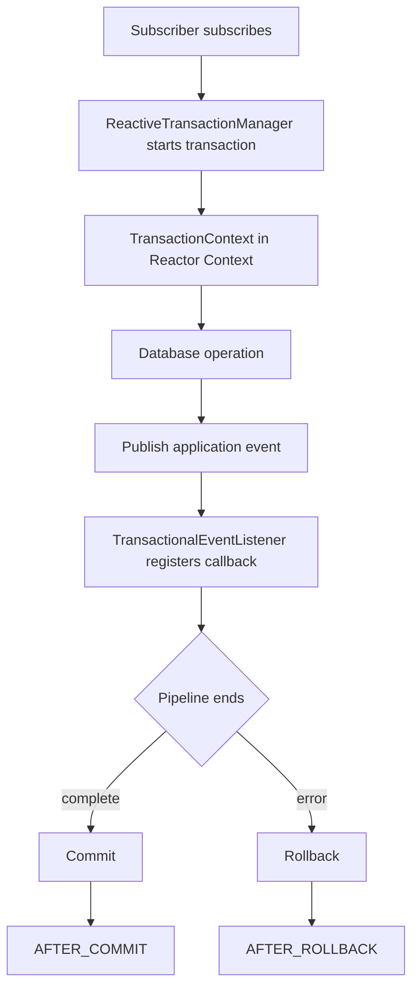

# Publishing Events in a Reactive Pipeline with Spring Framework

Spring Framework supports binding application events to transactions in both imperative and reactive models. However, reactive transactions are not stored in ThreadLocal like synchronous transactions. Transaction state resides in the **Reactor Context** and follows the subscription of the reactive pipeline.

Since Spring Framework 6.1, **@TransactionalEventListener** can participate in transactions managed by **ReactiveTransactionManager**. For a listener to find the right transaction, the event must carry **TransactionContext** as its source. The **TransactionalEventPublisher** API supports this and returns a **Mono<Void>** to compose directly into the pipeline.

The most important point when publishing events in a reactive pipeline is: create the event inside the right subscription, place the publish step in the same reactive chain as the database operation, and do not subscribe on a separate branch yourself. If you drop the transaction context or split the pipeline, the listener may fail to associate the event with the transaction it should track.

## 1. How do reactive transactions differ from synchronous transactions?

With imperative transactions, Spring typically binds transaction state to the current thread via ThreadLocal. Operations on the same thread can find the active transaction.

Reactive pipelines do not guarantee every operator runs on the same thread. Reactor can switch execution between threads via publishOn, subscribeOn, or other components in the pipeline. Therefore, relying on ThreadLocal cannot accurately represent a subscription's transaction.

Spring uses **Reactor Context** to hold the transaction context for a reactive pipeline:

- The transaction is initialized when the reactive publisher is subscribed to.
- The transaction manager places transaction state and resources into the Reactor Context.
- Database operations participate in the transaction if they continue within the same context.
- When the pipeline completes or errors, the transaction manager commits or rolls back and then runs synchronization callbacks.



Reactor Context is tied to the subscription, not to a specific thread. Switching threads in the pipeline does not automatically lose the transaction context as long as the operators remain in the same reactive chain.

## 2. Why does the event need to carry TransactionContext?

In the imperative model, a transaction listener can find the current transaction through thread-bound transaction synchronization. With reactive transactions, there is no fixed thread on which to look up that state.

Spring solves this by placing **TransactionContext** into the event's source. Upon receiving the event, the transactional listener mechanism checks this source and registers the callback with the corresponding transaction synchronization.

Since Spring Framework 6.1, reactive transactional events must be published with the transaction context as the event source. If you only call the regular ApplicationEventPublisher with an object payload, Spring can still wrap the payload in a PayloadApplicationEvent, but the default source does not automatically become the reactive TransactionContext.

This is why you should use **TransactionalEventPublisher** instead of a direct publishEvent call when you want an event bound to a reactive transaction.

## 3. TransactionalEventPublisher

**org.springframework.transaction.reactive.TransactionalEventPublisher** is the delegate provided by Spring since version 6.1 to publish transactional events in reactive setups.

It has two primary methods:

```java
Mono<Void> publishEvent(Object payload);

Mono<Void> publishEvent(
        Function<TransactionContext, ApplicationEvent> eventCreationFunction
);
```

- **publishEvent(Object):** accepts a POJO or record as payload. The delegate creates a PayloadApplicationEvent with TransactionContext as source.
- **publishEvent(Function):** accepts a function that creates an ApplicationEvent. Spring passes TransactionContext into the function so the custom event uses the context as source.

Both methods return Mono<Void>. Event publication is part of the pipeline and executes only when the pipeline is subscribed to.

### Publishing a POJO or record payload

```java
return transactionalEventPublisher.publishEvent(
        new OrderCreatedPayload(orderId)
);
```

Spring automatically creates a PayloadApplicationEvent whose source is TransactionContext and whose payload is OrderCreatedPayload. Listeners can still declare a parameter of type OrderCreatedPayload.

### Publishing a custom ApplicationEvent

If the event needs to extend ApplicationEvent, use the Function overload:

```java
return transactionalEventPublisher.publishEvent(
        transactionContext ->
                new OrderCreatedEvent(transactionContext, orderId)
);
```

In the constructor, transactionContext becomes the event's source. Do not pass an ApplicationEvent into the Object overload; that overload is for payloads and does not accept custom ApplicationEvents.

## 4. Putting the publish step into the same reactive pipeline

A reactive transaction is typically created with **TransactionalOperator** or with a @Transactional method returning Mono/Flux.

Example with TransactionalOperator:

```java
Mono<Void> work =
        databaseClient.sql("INSERT INTO orders(id) VALUES (:id)")
                .bind("id", orderId)
                .fetch()
                .rowsUpdated()
                .then()
                .then(transactionalEventPublisher.publishEvent(
                        new OrderCreatedPayload(orderId)
                ));

return transactionalOperator.transactional(work);
```

The insert and event-publish operations sit inside the same publisher wrapped by TransactionalOperator. On subscribe, the transaction starts; both the database operation and TransactionalEventPublisher see the transaction's Reactor Context.

Do not call subscribe separately for the event:

```java
// Avoid: creates an independent subscription outside the transaction chain.
transactionalEventPublisher.publishEvent(
        new OrderCreatedPayload(orderId)
).subscribe();
```

An independent subscription does not automatically inherit the Reactor Context of the original transaction pipeline. It may fail to find the required transaction context and lose the link between the event and the transaction.

Also do not call block inside the pipeline. Return Mono/Flux to the caller and let a single place at the application boundary perform subscribe or block when needed.

## 5. @TransactionalEventListener in reactive transactions

Listeners still use the **@TransactionalEventListener** annotation just like with imperative transactions:

```java
@Component
public class OrderEventListener {

    @TransactionalEventListener(
            phase = TransactionPhase.AFTER_COMMIT
    )
    public void onOrderCreated(OrderCreatedPayload event) {
        System.out.println("Committed: " + event.orderId());
    }
}
```

Spring supports the following phases:

| Phase | Timing |
|---|---|
| BEFORE_COMMIT | Before the transaction commits |
| AFTER_COMMIT | After commit; this is the default |
| AFTER_ROLLBACK | After rollback |
| AFTER_COMPLETION | After the transaction finishes, whether commit or rollback |

With reactive transactions, the listener is registered with transaction synchronization based on the TransactionContext in the event's source.

If the event is not published inside a suitable transaction, the listener does not run by default. You can enable **fallbackExecution = true** if business logic accepts running the listener even without a transaction, but fallback neither creates a new transaction nor recovers a lost transaction context.

```java
@TransactionalEventListener(
        phase = TransactionPhase.AFTER_COMMIT,
        fallbackExecution = true
)
public void notifyOrder(OrderCreatedPayload event) {
    // Runs as fallback if the event is not bound to a transaction.
}
```

Only enable fallback when handling outside a transaction is desired behavior. If the event must strictly be tied to commit/rollback, keep fallbackExecution=false.

## 6. Complete example with Java 17, Reactor, and R2DBC

This example uses Spring Framework 6.2, R2DBC, and in-memory H2. A service inserts a row and publishes an event within the same reactive transaction.

The program runs two cases:

- ORD-1001: the transaction commits, and the AFTER_COMMIT listener is called.
- ORD-1002: the pipeline publishes the event then throws an error, the transaction rolls back, and the AFTER_ROLLBACK listener is called.

The example uses TransactionalOperator so the entire reactive pipeline is clearly visible. The H2 database runs in memory, requiring no separate database server installation.

### 6.1. Project structure

```text
spring-reactive-transaction-event/
├── pom.xml
└── src/
    └── main/
        └── java/
            └── dev/
                └── example/
                    └── reactiveevent/
                        └── Application.java
```

### 6.2. Maven dependencies

```xml
<project xmlns="http://maven.apache.org/POM/4.0.0"
         xmlns:xsi="http://www.w3.org/2001/XMLSchema-instance"
         xsi:schemaLocation="http://maven.apache.org/POM/4.0.0 https://maven.apache.org/xsd/maven-4.0.0.xsd">
    <modelVersion>4.0.0</modelVersion>

    <groupId>dev.example</groupId>
    <artifactId>spring-reactive-transaction-event</artifactId>
    <version>1.0.0</version>

    <properties>
        <maven.compiler.release>17</maven.compiler.release>
        <project.build.sourceEncoding>UTF-8</project.build.sourceEncoding>
    </properties>

    <dependencies>
        <dependency>
            <groupId>org.springframework</groupId>
            <artifactId>spring-context</artifactId>
            <version>6.2.6</version>
        </dependency>
        <dependency>
            <groupId>org.springframework</groupId>
            <artifactId>spring-tx</artifactId>
            <version>6.2.6</version>
        </dependency>
        <dependency>
            <groupId>org.springframework</groupId>
            <artifactId>spring-r2dbc</artifactId>
            <version>6.2.6</version>
        </dependency>
        <dependency>
            <groupId>io.r2dbc</groupId>
            <artifactId>r2dbc-h2</artifactId>
            <version>1.0.0.RELEASE</version>
        </dependency>
    </dependencies>

    <build>
        <plugins>
            <plugin>
                <groupId>org.apache.maven.plugins</groupId>
                <artifactId>maven-compiler-plugin</artifactId>
                <version>3.13.0</version>
                <configuration>
                    <release>17</release>
                </configuration>
            </plugin>
            <plugin>
                <groupId>org.codehaus.mojo</groupId>
                <artifactId>exec-maven-plugin</artifactId>
                <version>3.5.0</version>
                <configuration>
                    <mainClass>dev.example.reactiveevent.Application</mainClass>
                </configuration>
            </plugin>
        </plugins>
    </build>
</project>
```

### 6.3. Source code

Create the file src/main/java/dev/example/reactiveevent/Application.java:

```java
package dev.example.reactiveevent;

import io.r2dbc.spi.ConnectionFactories;
import io.r2dbc.spi.ConnectionFactory;
import reactor.core.publisher.Mono;

import org.springframework.context.ApplicationEventPublisher;
import org.springframework.context.annotation.AnnotationConfigApplicationContext;
import org.springframework.context.annotation.Bean;
import org.springframework.context.annotation.Configuration;
import org.springframework.r2dbc.connection.R2dbcTransactionManager;
import org.springframework.r2dbc.core.DatabaseClient;
import org.springframework.transaction.ReactiveTransactionManager;
import org.springframework.transaction.event.TransactionPhase;
import org.springframework.transaction.event.TransactionalEventListener;
import org.springframework.transaction.reactive.TransactionalEventPublisher;
import org.springframework.transaction.reactive.TransactionalOperator;

public class Application {

    public static void main(String[] args) {
        try (var context =
                     new AnnotationConfigApplicationContext(AppConfig.class)) {

            DatabaseClient databaseClient =
                    context.getBean(DatabaseClient.class);

            databaseClient.sql(
                    "CREATE TABLE orders (id VARCHAR(64) PRIMARY KEY)"
            ).fetch().rowsUpdated().block();

            OrderService service = context.getBean(OrderService.class);

            System.out.println("=== COMMIT ===");
            service.createOrder("ORD-1001", false).block();

            System.out.println("=== ROLLBACK ===");
            try {
                service.createOrder("ORD-1002", true).block();
            } catch (RuntimeException ex) {
                System.out.println(
                        "Publisher observed rollback: " + ex.getMessage()
                );
            }
        }
    }

    @Configuration(proxyBeanMethods = false)
    public static class AppConfig {

        @Bean
        public ConnectionFactory connectionFactory() {
            return ConnectionFactories.get(
                    "r2dbc:h2:mem:///reactiveevents"
                            + "?options=DB_CLOSE_DELAY=-1;DB_CLOSE_ON_EXIT=FALSE"
            );
        }

        @Bean
        public DatabaseClient databaseClient(ConnectionFactory factory) {
            return DatabaseClient.create(factory);
        }

        @Bean
        public ReactiveTransactionManager transactionManager(
                ConnectionFactory factory
        ) {
            return new R2dbcTransactionManager(factory);
        }

        @Bean
        public TransactionalOperator transactionalOperator(
                ReactiveTransactionManager transactionManager
        ) {
            return TransactionalOperator.create(transactionManager);
        }

        @Bean
        public TransactionalEventPublisher transactionalEventPublisher(
                ApplicationEventPublisher publisher
        ) {
            return new TransactionalEventPublisher(publisher);
        }

        @Bean
        public OrderService orderService(
                DatabaseClient databaseClient,
                TransactionalOperator transactionalOperator,
                TransactionalEventPublisher eventPublisher
        ) {
            return new OrderService(
                    databaseClient,
                    transactionalOperator,
                    eventPublisher
            );
        }

        @Bean
        public OrderEventListener orderEventListener() {
            return new OrderEventListener();
        }
    }

    public record OrderCreatedPayload(String orderId) {}

    public static class OrderService {
        private final DatabaseClient databaseClient;
        private final TransactionalOperator transactionalOperator;
        private final TransactionalEventPublisher eventPublisher;

        public OrderService(
                DatabaseClient databaseClient,
                TransactionalOperator transactionalOperator,
                TransactionalEventPublisher eventPublisher
        ) {
            this.databaseClient = databaseClient;
            this.transactionalOperator = transactionalOperator;
            this.eventPublisher = eventPublisher;
        }

        public Mono<Void> createOrder(
                String orderId,
                boolean forceRollback
        ) {
            Mono<Void> insertOrder = databaseClient
                    .sql("INSERT INTO orders(id) VALUES (:id)")
                    .bind("id", orderId)
                    .fetch()
                    .rowsUpdated()
                    .then();

            Mono<Void> publishEvent = eventPublisher.publishEvent(
                    new OrderCreatedPayload(orderId)
            );

            Mono<Void> work = insertOrder
                    .then(publishEvent)
                    .then(Mono.fromRunnable(() -> {
                        if (forceRollback) {
                            throw new IllegalStateException(
                                    "simulated rollback"
                            );
                        }
                    }));

            return transactionalOperator.transactional(work);
        }
    }

    public static class OrderEventListener {

        @TransactionalEventListener(
                phase = TransactionPhase.AFTER_COMMIT
        )
        public void afterCommit(OrderCreatedPayload event) {
            System.out.println(
                    "AFTER_COMMIT: " + event.orderId()
            );
        }

        @TransactionalEventListener(
                phase = TransactionPhase.AFTER_ROLLBACK
        )
        public void afterRollback(OrderCreatedPayload event) {
            System.out.println(
                    "AFTER_ROLLBACK: " + event.orderId()
            );
        }
    }
}
```

### 6.4. Running the program

Open a terminal in the directory containing pom.xml, then run:

```bash
mvn -q compile exec:java
```

Expected stdout:

```text
=== COMMIT ===
AFTER_COMMIT: ORD-1001
=== ROLLBACK ===
AFTER_ROLLBACK: ORD-1002
Publisher observed rollback: simulated rollback
```

Explanation of the ORD-1001 flow:

1. Main calls createOrder and blocks at the application boundary to wait for the result.
2. TransactionalOperator starts a reactive transaction when the pipeline is subscribed to.
3. DatabaseClient executes the INSERT inside the transaction.
4. TransactionalEventPublisher retrieves TransactionContext from Reactor Context and publishes OrderCreatedPayload with the context as source.
5. The AFTER_COMMIT listener registers a callback with the transaction; it does not run immediately at publish time.
6. The pipeline completes normally, the transaction commits, and the AFTER_COMMIT listener is invoked.

For ORD-1002, the insert and event-publish steps still occur. Then Mono.fromRunnable throws an error. TransactionalOperator rolls back the transaction and the AFTER_ROLLBACK listener is invoked. Because the event was registered with the transaction, the callback matching the rollback outcome executes.

The example uses a real database via R2DBC to demonstrate the transaction manager. In-memory H2 is suitable for learning and experimenting; production environments require the driver, connection pool, and transaction configuration matching the database in use.

## 7. Using a custom ApplicationEvent instead of a payload record

If you need an event class extending ApplicationEvent, use the overload taking Function<TransactionContext, ApplicationEvent>:

```java
public class OrderCreatedEvent extends ApplicationEvent {
    private final String orderId;

    public OrderCreatedEvent(Object source, String orderId) {
        super(source);
        this.orderId = orderId;
    }

    public String getOrderId() {
        return orderId;
    }
}
```

Publishing the event in the pipeline:

```java
Mono<Void> publish = transactionalEventPublisher.publishEvent(
        transactionContext ->
                new OrderCreatedEvent(transactionContext, orderId)
);
```

Listener receiving the event:

```java
@TransactionalEventListener(phase = TransactionPhase.AFTER_COMMIT)
public void afterCommit(OrderCreatedEvent event) {
    System.out.println(event.getOrderId());
}
```

The Function receives TransactionContext from TransactionalEventPublisher. Using the context as source lets Spring associate the custom ApplicationEvent with the reactive transaction.

Do not call publishEvent(Object) with an object that already extends ApplicationEvent. The Object overload is for payloads; for custom ApplicationEvents, use the Function overload to specify the source explicitly.

## 8. Alternative: obtaining TransactionContextManager directly

TransactionalEventPublisher is a convenient API, yet you can manually retrieve the transaction context and construct the event:

```java
TransactionContextManager.currentContext()
        .map(source ->
                new PayloadApplicationEvent<>(
                        source,
                        new OrderCreatedPayload(orderId)
                )
        )
        .doOnSuccess(applicationEventPublisher::publishEvent)
        .then();
```

This approach clearly shows the underlying mechanism: TransactionContextManager.currentContext() retrieves the current context from Reactor Context, and that source is attached to PayloadApplicationEvent before publishing.

In typical applications, prefer TransactionalEventPublisher because the API is shorter and involves fewer manual steps. Only use the direct approach when you need explicit control over event creation or integration with a custom publisher.

## 9. When to use ApplicationEventPublisher directly?

Not every event published in a reactive pipeline needs to be bound to a transaction.

If you only want to notify an internal event and do not need to wait for commit/rollback, you can use ApplicationEventPublisher inside the pipeline:

```java
Mono<Void> publishOrdinaryEvent =
        Mono.fromRunnable(() ->
                applicationEventPublisher.publishEvent(
                        new CacheRefreshRequested(orderId)
                )
        );
```

This is a regular hand-off. It does not guarantee the listener runs only after commit, nor does it put reactive TransactionContext into the event source.

If the listener uses @TransactionalEventListener and needs to bind to a reactive transaction, use TransactionalEventPublisher or manually construct an event with TransactionContext as source.

| Need | Suitable API |
|---|---|
| Regular internal event inside a reactive chain | ApplicationEventPublisher inside Mono.fromRunnable |
| POJO/record that needs binding to a reactive transaction | TransactionalEventPublisher.publishEvent(Object) |
| Custom ApplicationEvent that needs binding to a reactive transaction | TransactionalEventPublisher.publishEvent(Function) |
| Event processed only after commit/rollback | Combine TransactionalEventPublisher with @TransactionalEventListener |

## 10. Using @Transactional on reactive methods

In addition to TransactionalOperator, Spring can manage reactive transactions via the **@Transactional** annotation if the method returns a reactive type such as Mono or Flux and the configured transaction manager is a ReactiveTransactionManager.

Example:

```java
@Transactional
public Mono<Void> createOrder(String orderId) {
    return databaseClient
            .sql("INSERT INTO orders(id) VALUES (:id)")
            .bind("id", orderId)
            .fetch()
            .rowsUpdated()
            .then(transactionalEventPublisher.publishEvent(
                    new OrderCreatedPayload(orderId)
            ));
}
```

Spring determines the transaction model based on the transaction manager type and the method's return type. For reactive transactions, return Mono/Flux so the transaction attaches to the subscription.

Do not write a reactive @Transactional method returning void and expect Spring to maintain a reactive transaction. Void methods belong to the traditional imperative transaction model.

TransactionalOperator is useful when you want to wrap a specific pipeline segment, whereas @Transactional is convenient when the transaction aligns with a service method boundary.

## 11. Common errors when publishing events in a reactive pipeline

| Symptom | Cause | Solution |
|---|---|---|
| @TransactionalEventListener is not invoked | Event does not carry TransactionContext as source | Use TransactionalEventPublisher |
| Listener runs immediately or does not wait for commit | Used regular ApplicationEventPublisher instead of transactional publisher | Attach the event to the reactive transaction context |
| TransactionalEventPublisher reports missing context | Published outside a reactive transaction or the pipeline split subscriptions | Place publication inside the same pipeline managed by TransactionalOperator |
| Event lost when calling subscribe separately | Created an independent subscription lacking the transaction's Reactor Context | Compose Mono<Void> via then/flatMap and return the pipeline |
| Using ThreadLocal to read transaction but getting null | Reactive transactions use Reactor Context | Use reactive transaction APIs and stay in the same subscriber context |
| Event published yet transaction rolled back | Event was published inside the transaction, but the chosen listener phase was unsuitable | Use AFTER_COMMIT for side effects valid only after commit |
| Listener receives payload of wrong type | Used custom ApplicationEvent with Object overload or declared wrong parameter type | Use Function overload for ApplicationEvent; use Object for POJO payload |
| Data outside database does not roll back | Listener called external system before commit or used a regular listener | Use @TransactionalEventListener with the appropriate phase |
| Calling block or subscribe inside a service | Splits the pipeline and breaks composition | Return Mono/Flux to the caller; only block at the application boundary |

## 12. Limitations to understand clearly

### Event listeners are not message brokers

TransactionalEventPublisher only links events to transactions within the current application. It does not persist events into a durable queue and does not guarantee events are replayed after a process restart.

If you need cross-service communication, retries after application shutdown, or a dead-letter queue, use a message broker and consider a transactional outbox.

### Transactional listeners do not automatically create a new transaction

AFTER_COMMIT or AFTER_ROLLBACK runs after the source transaction's outcome. If a listener needs to write new data and wants those changes committed, design an appropriate independent transaction rather than assuming it continues writing into the finished transaction.

### Do not publish events before the pipeline is subscribed to

Reactive publishers are lazy. Creating a Mono neither executes the insert nor publishes the event. Only upon subscription does the transaction start and do operators execute.

Therefore, return a Mono containing both the database operation and event publication. Do not call a separate publish method and discard the returned publisher.

### Do not share transaction context as a business payload

TransactionContext is internal metadata for Spring to associate events with transaction synchronization. Do not serialize it, store it in a database as business data, or send it over a message broker. Event payloads should contain immutable business data such as orderId, customerId, or eventId.

## 13. Checklist when publishing events in a reactive pipeline

- A ReactiveTransactionManager, such as R2dbcTransactionManager, is used.
- Database operations and event publication are in the same reactive pipeline.
- TransactionalOperator or @Transactional on a method returning Mono/Flux is used.
- TransactionalEventPublisher is used for events that must bind to a reactive transaction.
- When using a POJO/record, call publishEvent(Object).
- When using a custom ApplicationEvent, call publishEvent(Function) to set TransactionContext as source.
- ThreadLocal is not used to look up the reactive transaction context.
- No separate branch is subscribed to or blocked inside the service.
- The right phase is selected: BEFORE_COMMIT, AFTER_COMMIT, AFTER_ROLLBACK, or AFTER_COMPLETION.
- Behavior when no transaction exists and the fallbackExecution value are explicitly decided.
- Listeners perform side effects only in phases matching the transaction outcome.
- A separate transaction exists if a listener must write new data after completion.
- In-memory events are not treated as durable messages or a retry mechanism.

## 14. References

- [Spring Framework 6.2 — Transaction-bound Events](https://docs.spring.io/spring/reference/6.2/data-access/transaction/event.html)
- [TransactionalEventPublisher Javadoc 6.2](https://docs.spring.io/spring-framework/docs/6.2.x/javadoc-api/org/springframework/transaction/reactive/TransactionalEventPublisher.html)
- [ApplicationEventPublisher Javadoc 6.2](https://docs.spring.io/spring-framework/docs/6.2.x/javadoc-api/org/springframework/context/ApplicationEventPublisher.html)
- [Spring Framework 6.2 — Data Access with R2DBC](https://docs.spring.io/spring-framework/reference/6.2/data-access/r2dbc.html)

Publishing events in a reactive pipeline requires preserving the subscription's transaction context. With Spring Framework 6.1 and later, **TransactionalEventPublisher** helps place TransactionContext into the event's source so **@TransactionalEventListener** registers the right callbacks. Compose the publish operation's Mono<Void> into the same pipeline as the database work, choose phases matching the transaction outcome, and avoid creating independent subscriptions that lose the Reactor Context.