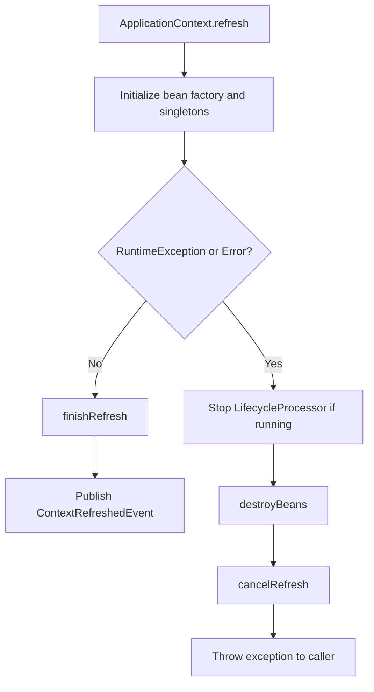

# ContextFailedEvent

## 1. Purpose and scope

In the **ApplicationContext Lifecycle** topic, when a context fails to initialize or refresh successfully, the application needs to record the cause, clean up initialized resources, and notify monitoring systems if needed. The name `ContextFailedEvent` is often used to describe such a notification.

You must distinguish the exact origin of this name:

- **Spring Framework 6.2 does not provide a built-in event named `ContextFailedEvent`.** The standard list of `ApplicationContext` lifecycle events includes `ContextRefreshedEvent`, `ContextStartedEvent`, `ContextStoppedEvent`, and `ContextClosedEvent`.
- When `ApplicationContext.refresh()` fails, Spring stops any `Lifecycle` beans that had started, destroys already-created singletons, sets the refresh status to inactive, and rethrows the exception back to the caller. The framework does not automatically publish a `ContextFailedEvent`.
- **Spring Boot has `ApplicationFailedEvent`**, published by `SpringApplication` when the startup process fails. This is the standard event to prefer in Spring Boot applications.
- If you only use Spring Framework and need a notification named `ContextFailedEvent`, the application can define that event itself and publish it via an independent publisher or event dispatcher.

After this lesson, you can:

- Distinguish Spring Framework refresh errors from Spring Boot startup failure events.
- Understand the cleanup steps when `refresh()` throws an exception.
- Recognize why a listener inside the failing context is not a reliable place to handle failure notifications.
- Define and publish a custom `ContextFailedEvent` when the application needs one.
- Register a listener receiving `ApplicationFailedEvent` at the right time in Spring Boot.
- Preserve the original exception and avoid letting listener errors mask the cause of startup failure.

## 2. Is ContextFailedEvent a standard Spring Framework event?

No. In Spring Framework 6.2, `ContextFailedEvent` is not part of the built-in `ApplicationContext` lifecycle event group.

Standard events directly related to the context lifecycle:

| Event | Meaning |
|---|---|
| `ContextRefreshedEvent` | Context has initialized or refreshed successfully and completed the refresh step |
| `ContextStartedEvent` | Context received `start()`; beans implementing `Lifecycle` received the start signal |
| `ContextStoppedEvent` | Context received `stop()`; beans implementing `Lifecycle` received the stop signal |
| `ContextClosedEvent` | Context is closing via `close()` or a JVM shutdown hook |
| `ContextFailedEvent` | Not a built-in event of Spring Framework 6.2; only exists if defined by the application or a library |

Do not confuse an event with an exception:

- `ApplicationContextException` is a Spring exception used to express certain errors at the ApplicationContext level.
- `ContextFailedEvent`, if defined by the application, is an event object used to notify listeners about a failure.
- `ApplicationFailedEvent` is a Spring Boot event representing that `SpringApplication` failed to start successfully.

An exception can be thrown without a corresponding event. Similarly, an event can carry an exception as data, but the event itself does not replace the exception and does not make startup continue.

## 3. How does Spring handle errors during refresh()?

`AbstractApplicationContext.refresh()` is the main procedure for creating or refreshing the active state of a context. During this process, Spring prepares the environment, creates the bean factory, registers post-processors, initializes special components, registers listeners, and creates non-lazy singletons.

When refresh completes, Spring calls `finishRefresh()`. This step finishes lifecycle processing and publishes `ContextRefreshedEvent`.

If a step during refresh throws a `RuntimeException` or `Error`, Spring performs cleanup:

1. Records that the context initialization attempt failed.
2. If `LifecycleProcessor` is running, asks already-started lifecycle components to stop.
3. Calls `destroyBeans()` to destroy singletons that were already created, avoiding leaving half-built resources behind.
4. Calls `cancelRefresh(ex)` to set the active state back to inactive.
5. Throws the original exception back to the caller.

Overview flow:



Consequences to remember:

- `ContextRefreshedEvent` is only published when refresh reaches the completion step.
- Spring Framework does not automatically publish `ContextFailedEvent` in this cleanup branch.
- The caller of `refresh()` still receives the exception to decide whether to log, notify, exit the process, or try another initialization strategy.
- A context after a failed refresh should not be treated as a normally operating context.

Do not manually call `context.publishEvent(...)` after refresh fails and expect listener beans inside that same context to always work. The bean factory just went through cleanup, and listeners may not have been created yet or may have been destroyed. Use a pre-registered listener or an independent event dispatcher if failure notifications are needed.

## 4. Distinguishing ContextRefreshedEvent, ContextClosedEvent, and refresh failure

The following three situations describe different moments:

### ContextRefreshedEvent

Published when the context has finished refreshing. This is the right moment for listeners to perform work requiring a ready context, such as checking configuration state or initializing a cache that depends on created beans.

Do not use this event to detect startup failure, because a failed refresh will never reach the completion event-publishing step.

### ContextClosedEvent

Published when the context is closed via `close()` or a shutdown hook. This is a signal for a normal shutdown process, not a substitute signal for refresh failure.

For example, a listener can release auxiliary resources:

```java
@Component
class ContextShutdownListener {

    @EventListener
    public void onClosed(ContextClosedEvent event) {
        System.out.println(
                "Closing context: "
                        + event.getApplicationContext().getDisplayName());
    }
}
```

### Refresh failure

When `refresh()` fails, the caller receives the exception. The framework stops running lifecycle components and destroys created singletons. No built-in `ContextFailedEvent` is published automatically in Spring Framework 6.2.

If you want to publish a domain/operational event to an observability system, create a custom event at the bootstrap layer after catching the exception. That event must be sent via a dispatcher that remains operational independently of the failed context.

## 5. Spring Boot uses ApplicationFailedEvent

If the application is launched using `SpringApplication`, Spring Boot provides a standard event:

`org.springframework.boot.context.event.ApplicationFailedEvent`

This event is published when `SpringApplication` fails during startup. It contains:

- `getException()`: the exception that caused startup failure.
- `getApplicationContext()`: the context being created or already created before failure; the value can be `null` if the context is not ready yet.

This is a Spring Boot event, not an event in Spring Framework's `org.springframework.context.event` package.

### Registering the listener before running SpringApplication

Some startup events are published before an ApplicationContext exists. Therefore, you cannot rely on a listener bean created inside the context to receive every startup failure.

Register the listener early using `SpringApplication.addListeners(...)`:

```java
import org.springframework.boot.SpringApplication;
import org.springframework.boot.context.event.ApplicationFailedEvent;
import org.springframework.context.ApplicationListener;
import org.springframework.context.ConfigurableApplicationContext;

public class StartupFailureListener
        implements ApplicationListener<ApplicationFailedEvent> {

    @Override
    public void onApplicationEvent(ApplicationFailedEvent event) {
        Throwable failure = event.getException();

        ConfigurableApplicationContext failedContext =
                event.getApplicationContext();

        String contextName = failedContext == null
                ? "<context not created>"
                : failedContext.getDisplayName();

        System.err.printf(
                "Application startup failed: context=%s, cause=%s%n",
                contextName,
                failure.getClass().getSimpleName());
    }
}
```

Registering the listener in main:

```java
@SpringBootApplication
public class DemoApplication {

    public static void main(String[] args) {
        SpringApplication application =
                new SpringApplication(DemoApplication.class);

        application.addListeners(new StartupFailureListener());

        application.run(args);
    }
}
```

This is a Spring Boot integration snippet; the project requires the corresponding Spring Boot dependencies. The listener is added before `run()`, so it can receive the event even when context creation fails before listener beans are initialized.

An example log might look like:

```text
Application startup failed: context=application, cause=BeanCreationException
```

The context name and exception type depend on where the error occurred. If the context has not been created yet, the listener must handle the case where `getApplicationContext()` returns `null`.

### ApplicationFailedEvent is not a runtime failure event

`ApplicationFailedEvent` is about errors during Spring Boot startup. It is not automatically published whenever a request fails, a service throws an exception, or a scheduled task fails after the application is already running.

For runtime errors, use mechanisms suited to the error scope: application exception handling, logging, metrics, observability, or a custom business event. Do not use the startup failure event to represent every error in the application lifecycle.

## 6. Defining a custom ContextFailedEvent in Spring Framework

If an application uses Spring Framework only or needs a custom-structured event, you can define `ContextFailedEvent` extending `ApplicationEvent`.

Example:

```java
public final class ContextFailedEvent extends ApplicationEvent {

    private final ConfigurableApplicationContext failedContext;
    private final Throwable failure;

    public ContextFailedEvent(
            ConfigurableApplicationContext failedContext,
            Throwable failure) {
        super(failedContext);
        this.failedContext = failedContext;
        this.failure = failure;
    }

    public ConfigurableApplicationContext getFailedContext() {
        return failedContext;
    }

    public Throwable getFailure() {
        return failure;
    }
}
```

This design stores two pieces of information:

- The context that failed, so listeners know which context encountered the issue.
- The original exception, so listeners can log or classify the cause.

Do not store only an exception message string. Keeping the `Throwable` object allows the observability system to retrieve the class, cause, and stack trace when needed.

### Using an independent dispatcher

When a context has just failed to refresh, a dispatcher outside that context is more reliable than a listener bean inside the failed context. `SimpleApplicationEventMulticaster` can be used as an independent dispatcher for this example.

```java
SimpleApplicationEventMulticaster failureBus =
        new SimpleApplicationEventMulticaster();

failureBus.addApplicationListener(
        (ApplicationListener<ContextFailedEvent>) event -> {
            System.err.println(
                    "Failed context: "
                            + event.getFailedContext().getDisplayName());

            System.err.println(
                    "Failure type: "
                            + event.getFailure().getClass().getSimpleName());
        });
```

After catching the exception from `refresh()`, bootstrap code creates and dispatches the event:

```java
try {
    context.refresh();
} catch (RuntimeException ex) {
    failureBus.multicastEvent(
            new ContextFailedEvent(context, ex));

    throw ex;
}
```

This snippet illustrates an important boundary: the exception is caught where `refresh()` is called, the custom event is sent through an independent dispatcher, and then the original exception is still rethrown. The listener only receives notification and performs observation side effects; it does not turn a failed-initialization context into a working context.

## 7. Complete runnable example using Spring Context

The example below intentionally registers a bean that throws an exception upon creation. Context refresh will fail. Bootstrap code catches the exception, publishes a custom `ContextFailedEvent` through an independent `SimpleApplicationEventMulticaster`, and preserves the original exception type for the caller.

### Maven configuration

Create a project with the structure:

```text
src/
└── main/
    └── java/
        └── demo/
            └── ContextFailureEventDemo.java
pom.xml
```

Contents of `pom.xml`:

```xml
<project xmlns="http://maven.apache.org/POM/4.0.0"
         xmlns:xsi="http://www.w3.org/2001/XMLSchema-instance"
         xsi:schemaLocation="http://maven.apache.org/POM/4.0.0 https://maven.apache.org/xsd/maven-4.0.0.xsd">
    <modelVersion>4.0.0</modelVersion>

    <groupId>demo</groupId>
    <artifactId>context-failure-event</artifactId>
    <version>1.0.0</version>

    <properties>
        <maven.compiler.release>17</maven.compiler.release>
        <project.build.sourceEncoding>UTF-8</project.build.sourceEncoding>
        <spring-framework.version>6.2.18</spring-framework.version>
    </properties>

    <dependencies>
        <dependency>
            <groupId>org.springframework</groupId>
            <artifactId>spring-context</artifactId>
            <version>${spring-framework.version}</version>
        </dependency>
    </dependencies>

    <build>
        <plugins>
            <plugin>
                <groupId>org.apache.maven.plugins</groupId>
                <artifactId>maven-compiler-plugin</artifactId>
                <version>3.14.0</version>
            </plugin>
            <plugin>
                <groupId>org.codehaus.mojo</groupId>
                <artifactId>exec-maven-plugin</artifactId>
                <version>3.5.0</version>
            </plugin>
        </plugins>
    </build>
</project>
```

### Java source code

Create the file `src/main/java/demo/ContextFailureEventDemo.java`:

```java
package demo;

import org.springframework.context.ApplicationEvent;
import org.springframework.context.ApplicationListener;
import org.springframework.context.annotation.AnnotationConfigApplicationContext;
import org.springframework.context.event.SimpleApplicationEventMulticaster;

public class ContextFailureEventDemo {

    public static void main(String[] args) {
        SimpleApplicationEventMulticaster failureBus =
                new SimpleApplicationEventMulticaster();

        failureBus.addApplicationListener(
                (ApplicationListener<ContextFailedEvent>) event -> {
                    System.out.println(
                            "FailureListener: context="
                                    + event.getFailedContext().getDisplayName());

                    System.out.println(
                            "FailureListener: exception="
                                    + event.getFailure().getClass()
                                            .getSimpleName());
                });

        try (var context = new AnnotationConfigApplicationContext()) {
            context.setId("demo-failed-context");
            context.setDisplayName("demo-failed-context");

            context.registerBean(
                    "brokenBean",
                    Object.class,
                    () -> {
                        throw new IllegalStateException(
                                "missing external configuration");
                    });

            try {
                try {
                    context.refresh();
                } catch (RuntimeException ex) {
                    try {
                        failureBus.multicastEvent(
                                new ContextFailedEvent(context, ex));
                    } catch (RuntimeException reportingFailure) {
                        ex.addSuppressed(reportingFailure);
                    }

                    throw ex;
                }
            } catch (RuntimeException ex) {
                System.out.println(
                        "Bootstrap: refresh failure observed "
                                + ex.getClass().getSimpleName());
            }
        }
    }

    static final class ContextFailedEvent extends ApplicationEvent {

        private final AnnotationConfigApplicationContext failedContext;
        private final Throwable failure;

        ContextFailedEvent(
                AnnotationConfigApplicationContext failedContext,
                Throwable failure) {
            super(failedContext);
            this.failedContext = failedContext;
            this.failure = failure;
        }

        AnnotationConfigApplicationContext getFailedContext() {
            return failedContext;
        }

        Throwable getFailure() {
            return failure;
        }
    }
}
```

### Compile and run

From the directory containing `pom.xml`, run:

```bash
mvn -q compile exec:java -Dexec.mainClass=demo.ContextFailureEventDemo
```

Expected stdout:

```text
FailureListener: context=demo-failed-context
FailureListener: exception=BeanCreationException
Bootstrap: refresh failure observed BeanCreationException
```

Explanation:

1. `failureBus` is created independently of the ApplicationContext to be refreshed.
2. The listener is registered directly with the independent dispatcher.
3. `brokenBean` intentionally throws `IllegalStateException` while Spring is creating singletons.
4. Spring wraps the bean creation error in `BeanCreationException`, performs refresh cleanup, and throws the exception to the caller.
5. Bootstrap code creates a custom `ContextFailedEvent` containing the failed context and the original exception.
6. The dispatcher sends the event to the listener to record the context name and exception type.
7. If the notification listener also throws a `RuntimeException`, the bootstrap code adds that error to the suppressed list of the original exception. The cause of the refresh failure is still preserved.

This is a custom event of the demo project, not a class provided by Spring Framework itself. The independent dispatcher only illustrates how to emit a notification after refresh fails; in a real application, it can be replaced with a logger, metrics, alert client, or an external event publisher.

## 8. Designing failure-handling listeners safely

Listeners receiving failure events typically perform observation or notification tasks:

- Logging along with the context name and original exception.
- Sending metrics or alerts to a monitoring system.
- Recording the active configuration or profiles if that information is still available.
- Notifying a bootstrap supervisor or external management process.

Some principles:

1. **Preserve the original exception:** do not replace the startup exception with an exception thrown by a logging or alert listener.
2. **Do not depend on beans of the failed context:** singletons may have been destroyed and listener beans may never have been created.
3. **Keep listeners short:** avoid running long tasks on the initialization thread. If remote alerts need to be sent, use an independent observability component with timeouts.
4. **Do not auto-retry refresh infinitely:** a configuration or dependency error usually does not resolve on its own. Retries need bounds and backoff if the cause may be transient.
5. **Do not treat the event as a recovery mechanism:** publishing a failure event does not fix configuration, recreate beans, or restart the context automatically.
6. **Protect sensitive data:** exception logs may contain URLs, usernames, or configuration. Only output information compliant with the application's logging policy.

If the application needs to restart after an error, let a supervisor or orchestration mechanism manage the process lifecycle. Do not call `refresh()` repeatedly from a listener of the failed context itself without confirming whether that context type supports re-refreshing.

## 9. Choosing the right event or mechanism

| Need | Recommended mechanism |
|---|---|
| Know the context refreshed successfully | `ContextRefreshedEvent` |
| Know the context was requested to start or stop | `ContextStartedEvent`, `ContextStoppedEvent` |
| Know the context is closing | `ContextClosedEvent` |
| Track Spring Boot startup failure | `ApplicationFailedEvent` |
| Track refresh errors in plain Spring Framework | Catch the exception at the bootstrap boundary |
| Want a notification named `ContextFailedEvent` in a plain Spring app | Define custom event and publish via an independent dispatcher |
| Analyze Spring Boot startup errors for operators | `FailureAnalyzer` and startup failure reports |
| Track errors occurring after the application is running | Exception handling, logging, metrics, or custom runtime events |

Do not use `ContextClosedEvent` to simulate failure. Closing a context and a refresh failure are two different situations, with different cleanup sequences and operational meanings.

## 10. Common mistakes

1. **Thinking ContextFailedEvent is a built-in event:** Spring Framework 6.2 does not provide this class. Use `ApplicationFailedEvent` in Spring Boot or define your own custom event.
2. **Registering a failure listener as a bean of the failing context:** the bean may not have been created or may already be destroyed. Register the listener early or use an external dispatcher.
3. **Waiting for ContextRefreshedEvent when refresh fails:** the `finishRefresh()` step does not complete, so this event is never published.
4. **Confusing ApplicationContextException with ContextFailedEvent:** one is an exception, the other is an event object.
5. **Confusing ApplicationFailedEvent with a Spring Framework event:** `ApplicationFailedEvent` belongs to Spring Boot and is published by `SpringApplication`.
6. **Not handling null context in Spring Boot:** `ApplicationFailedEvent.getApplicationContext()` can return null if the context has not been created yet.
7. **Swallowing the original exception when sending alerts:** errors in notification listeners must not mask the cause of refresh failure.
8. **Retrying infinitely automatically:** configuration or bean definition errors are not fixed by continuous refreshing.
9. **Using failure events for runtime errors:** startup failure and errors after the application is ready are two different lifecycles.
10. **Assuming the event makes the context active again:** the event only notifies; recovery requires a separate mechanism.

## 11. Testing

You should test the successful refresh branch, the failed refresh branch, and errors inside the notification listener.

### Testing custom ContextFailedEvent

- Register a bean supplier that intentionally throws an exception.
- Call `refresh()` and verify the exception is thrown back to the caller.
- Verify the independent dispatcher receives exactly one `ContextFailedEvent`.
- Verify the event holds the right context and original exception.
- Verify listener errors are added to suppressed exceptions if the bootstrap policy chooses to preserve the original error.

### Testing Spring Boot ApplicationFailedEvent

- Register the listener via `SpringApplication.addListeners(...)` before calling `run()`.
- Create a test configuration that causes startup to fail.
- Verify `getException()` contains the startup failure cause.
- Check that the listener handles the case where `getApplicationContext()` is null.

### Testing successful lifecycle events

- When the context refreshes successfully, verify `ContextRefreshedEvent` is published.
- When `close()` is called, verify `ContextClosedEvent` is published.
- Do not use these two events as proof of the refresh failure branch.

In unit tests, you can use a listener that records received events into a list or `AtomicReference`. For integration tests, instantiate a real ApplicationContext to test the actual bean lifecycle and cleanup.

## 12. Implementation checklist

- [ ] Clearly distinguish Spring Framework and Spring Boot events.
- [ ] Do not assume Spring Framework has a built-in `ContextFailedEvent`.
- [ ] Use `ApplicationFailedEvent` if tracking Spring Boot startup failure is needed.
- [ ] Register the Boot failure listener before `SpringApplication.run()`.
- [ ] Handle the case where ApplicationContext in `ApplicationFailedEvent` is null.
- [ ] In plain Spring Framework, catch exceptions where `refresh()` is called.
- [ ] If defining a custom `ContextFailedEvent`, store both the context and the original exception.
- [ ] Use a dispatcher independent of the failing context.
- [ ] Preserve the original exception when the notification listener encounters an error.
- [ ] Distinguish refresh failure from close events and runtime failures.
- [ ] Include tests for cleanup, notification, null context, and listener errors.

## 13. References

- [Spring Framework 6.2 Reference — Standard and Custom Application Events](https://docs.spring.io/spring/reference/6.2/core/beans/context-introduction.html)
- [Spring Framework 6.2 API — AbstractApplicationContext](https://docs.spring.io/spring-framework/docs/6.2.18/javadoc-api/org/springframework/context/support/AbstractApplicationContext.html)
- [Spring Framework 6.2 API — ContextRefreshedEvent](https://docs.spring.io/spring-framework/docs/6.2.18/javadoc-api/org/springframework/context/event/ContextRefreshedEvent.html)
- [Spring Boot 4.0 API — ApplicationFailedEvent](https://docs.spring.io/spring-boot/4.0/api/java/org/springframework/boot/context/event/ApplicationFailedEvent.html)
- [Spring Boot 4.0 Reference — SpringApplication Events and Startup Failure](https://docs.spring.io/spring-boot/reference/features/spring-application.html)


