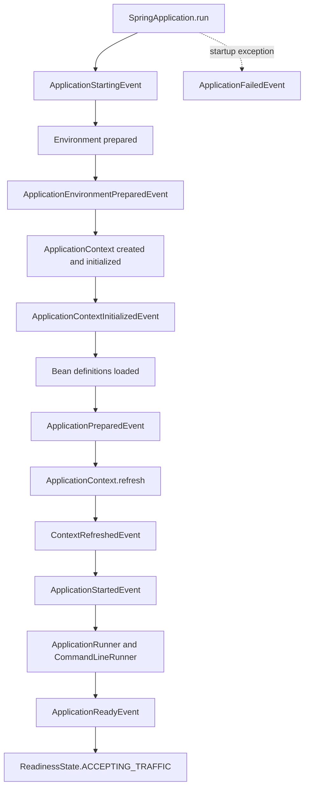

# SpringApplication and the Event Lifecycle

## 1. When Does SpringApplication Publish Events?

`SpringApplication` is the standard entry point for starting a Spring Boot application. While running, Boot publishes a sequence of application events to signal key milestones: startup beginning, Environment ready, ApplicationContext prepared, context refreshed, runners completed, and the application ready to accept traffic.

These events allow other components to react at the right stage of startup without modifying code directly inside `SpringApplication`.

Common needs:

- Read or record configuration after the Environment is prepared.
- Observe the context after bean definitions are loaded.
- Initialize caches or verify components after the context refreshes.
- Run final tasks before marking the application ready.
- Record errors if the startup process fails.
- Track liveness and readiness to coordinate with deployment systems.

Spring Boot's lifecycle events are application-level events. Some events are published very early, before beans in the ApplicationContext exist; some are only published after the context refreshes and runners complete. When a listener is registered is therefore very important.

## 2. Order of Main Startup Events

In a normal startup flow, Spring Boot publishes the main events in the following order:

| Order | Event | Timing |
|---:|---|---|
| 1 | `ApplicationStartingEvent` | SpringApplication begins running, before the Environment and ApplicationContext are prepared. |
| 2 | `ApplicationEnvironmentPreparedEvent` | The Environment has been prepared, but the ApplicationContext has not yet been created. |
| 3 | `ApplicationContextInitializedEvent` | The ApplicationContext has been created and ApplicationContextInitializers have run, before bean definitions are loaded. |
| 4 | `ApplicationPreparedEvent` | Bean definitions have been loaded into the context, but the context has not yet refreshed. |
| 5 | `ContextRefreshedEvent` | The ApplicationContext finishes the refresh step in Spring Framework. |
| 6 | `ApplicationStartedEvent` | The context has finished refreshing, before ApplicationRunner and CommandLineRunner execute. |
| 7 | `AvailabilityChangeEvent` with `LivenessState.CORRECT` | Boot transitions liveness state after the started milestone. |
| 8 | `ApplicationReadyEvent` | All ApplicationRunners and CommandLineRunners have completed; the application is considered ready. |
| 9 | `AvailabilityChangeEvent` with `ReadinessState.ACCEPTING_TRAFFIC` | Boot publishes the readiness state indicating it is accepting traffic. |

In addition to the successful startup sequence, `ApplicationFailedEvent` is published when an exception causes startup to fail. This event is not a subsequent step of successful startup; it is the failure-branch signal.

Simplified diagram:



The table and diagram show the common logical order. Events specific to a web server or context, such as `ServletWebServerInitializedEvent`, may occur during refresh and do not replace `ApplicationReadyEvent`.

## 3. Meaning of Each Stage

### ApplicationStartingEvent

This is a very early event, published right when SpringApplication starts running. At this point, the Environment has not been prepared and the ApplicationContext has not been created.

Listeners should usually do only lightweight work independent of application beans, such as recording the start milestone or setting up a simple observation mechanism. Do not try to inject services or repositories because the context is not ready yet.

### ApplicationEnvironmentPreparedEvent

This event is published once the Environment has been prepared, including the property sources and profiles Boot has loaded at that stage. The ApplicationContext has not been created yet.

It can be used to observe active profiles or startup configuration. If you need to modify the Environment, make sure you understand property source precedence and subsequent configuration steps; avoid overriding application configuration arbitrarily.

### ApplicationContextInitializedEvent

The ApplicationContext has been created and `ApplicationContextInitializer`s have run, but application bean definitions have not been fully loaded yet. This event is suitable for observing the context at a very early stage or coordinating with infrastructure that must be prepared before reading bean definitions.

### ApplicationPreparedEvent

Bean definitions have been loaded into the ApplicationContext, but the context has not refreshed yet. Regular singletons have not finished initializing. Do not interpret this event as meaning all beans are ready for use.

### ContextRefreshedEvent

This is a Spring Framework event, published when the ApplicationContext finishes refreshing. Non-lazy singletons have been created during the refresh. However, lazy beans may not be initialized yet, and Spring Boot's runner tasks have not executed yet.

### ApplicationStartedEvent

Published after the context refreshes successfully and before Boot invokes `ApplicationRunner` and `CommandLineRunner`. This is an appropriate milestone to know the container has finished initializing, while the application is not yet marked ready.

### ApplicationReadyEvent

Published after all `ApplicationRunner` and `CommandLineRunner` beans complete. This is the right milestone for actions that should only run once Boot's startup sequence has completed.

### ApplicationFailedEvent

Published when startup fails. Depending on when the failure occurred, the ApplicationContext may not have been created or may not have finished refreshing. Listeners should handle the case where the context is unavailable and avoid assuming all beans were initialized.

## 4. Registering Early Listeners vs. Bean Listeners

Not every listener can receive every lifecycle event.

Events such as `ApplicationStartingEvent` and `ApplicationEnvironmentPreparedEvent` are published before application beans are instantiated. A class annotated with `@Component` cannot receive events that were published before that bean existed.

To receive early events, register the listener directly with `SpringApplication` before calling `run`:

```java
SpringApplication application = new SpringApplication(DemoApplication.class);
application.addListeners(new BootLifecycleListener());
application.run(args);
```

A listener added via `addListeners` is present from the start of the startup sequence. This is the right option for events before the ApplicationContext refreshes.

For late events, you can use a `@Component` bean combined with `@EventListener`:

```java
@Component
public class ReadyObserver {

    @EventListener
    public void onReady(ApplicationReadyEvent event) {
        System.out.println("Application is ready");
    }
}
```

A bean listener is created during refresh, so it receives events published afterward, such as `ApplicationStartedEvent` or `ApplicationReadyEvent`. It cannot retroactively receive events published before the bean was registered.

Another option is implementing `ApplicationListener<E>` and registering the listener through the appropriate mechanism. Whether using an annotation or an interface, the rule remains that the listener must be registered before the event is published.

## 5. Distinguishing ApplicationRunner, CommandLineRunner, and ApplicationReadyEvent

`ApplicationRunner` and `CommandLineRunner` are callbacks for running work after the ApplicationContext refreshes, but before the application publishes `ApplicationReadyEvent`.

| Component | Role |
|---|---|
| `ApplicationRunner` | Receives `ApplicationArguments`, convenient when you need access to parsed option and non-option arguments. |
| `CommandLineRunner` | Directly receives the raw `String[]` command-line arguments array. |
| `ApplicationStartedEvent` | Signals that the context has refreshed, before runners execute. |
| `ApplicationReadyEvent` | Signals that all runners have completed and the startup sequence has reached the ready milestone. |

Runner example:

```java
@Component
public class InitialDataLoader implements ApplicationRunner {

    @Override
    public void run(ApplicationArguments args) {
        System.out.println("Load initial data");
    }
}
```

If an `ApplicationReadyEvent` listener depends on data loaded by a runner, this order guarantees that the runner has finished before the ready event is published.

You can use `@Order` or `Ordered` to order multiple runners. Do not rely on bean declaration order or class scanning order to coordinate dependent tasks.

## 6. Liveness and Readiness

Spring Boot uses application availability state to represent two distinct aspects:

- **Liveness:** whether the process is still healthy in a way that allows it to continue running.
- **Readiness:** whether the application is ready to accept traffic yet.

After `ApplicationStartedEvent`, Boot publishes `AvailabilityChangeEvent` with `LivenessState.CORRECT`. After `ApplicationReadyEvent`, Boot publishes the readiness state `ACCEPTING_TRAFFIC`.

This is useful when an application runs in an environment with health checks or an orchestrator. A process may be alive but not yet ready to receive requests because runners are still loading data or initializing resources.

Do not use liveness to represent every transient dependency error. If liveness repeatedly fails due to a flaky external service, the orchestrator may unnecessarily restart the application. Choose readiness or liveness according to the operational meaning of each signal.

## 7. Filtering Events and Listener Ordering

A listener can receive only one specific event type using a generic type parameter:

```java
@Component
public class ReadyListener
        implements ApplicationListener<ApplicationReadyEvent> {

    @Override
    public void onApplicationEvent(ApplicationReadyEvent event) {
        System.out.println("Ready for traffic");
    }
}
```

With `@EventListener`, the method parameter determines the event type:

```java
@EventListener
public void onReady(ApplicationReadyEvent event) {
    // Handle when Boot publishes the ready event.
}
```

You can use `@Order` if multiple listeners listen to the same event and require synchronous invocation order. Smaller order values have higher priority. If listeners run asynchronously, task start order does not guarantee completion order.

Do not use event listeners to build a multi-step workflow with strict result dependencies. When a later step should only run if an earlier step succeeds, use an explicit service or orchestrating workflow.

## 8. Context Hierarchy and Events

An application may have multiple ApplicationContexts, especially in web applications with a root context and a servlet child context. Events published in a context may be forwarded to its parent context according to Spring's mechanism.

With Spring Boot lifecycle events, pay attention to which context publishes the event and where the listener is registered. A listener might receive events associated with a child context. If you only want to handle the root context or a specific context, check the context in the event rather than checking only the event class.

Example with an event that has an ApplicationContext accessor:

```java
@EventListener
public void onContextRefreshed(ContextRefreshedEvent event) {
    ApplicationContext sourceContext = event.getApplicationContext();
    // Filter by context ID or parent-child relationship if needed.
}
```

Do not assume every Spring Boot event has the same accessor or the same context rules. Use the API of the exact event class. For `ApplicationFailedEvent`, the context may not exist yet depending on the stage of failure.

## 9. Runnable Java 17 + Spring Boot Example

This example uses Java 17 and Spring Boot 3.4.0. The listener is registered before calling `SpringApplication.run`, so it observes even the very early startup events. An `ApplicationRunner` prints a message between `ApplicationStartedEvent` and `ApplicationReadyEvent`.

Project structure:

```text
springapplication-lifecycle-demo/
├── pom.xml
└── src/main/
    ├── java/com/example/lifecycle/
    │   ├── DemoApplication.java
    │   ├── BootLifecycleListener.java
    │   └── StartupTask.java
    └── resources/
        └── application.properties
```

**pom.xml**

```xml
<project xmlns="http://maven.apache.org/POM/4.0.0"
         xmlns:xsi="http://www.w3.org/2001/XMLSchema-instance"
         xsi:schemaLocation="http://maven.apache.org/POM/4.0.0 https://maven.apache.org/xsd/maven-4.0.0.xsd">
    <modelVersion>4.0.0</modelVersion>

    <groupId>com.example</groupId>
    <artifactId>springapplication-lifecycle-demo</artifactId>
    <version>1.0.0</version>

    <parent>
        <groupId>org.springframework.boot</groupId>
        <artifactId>spring-boot-starter-parent</artifactId>
        <version>3.4.0</version>
        <relativePath/>
    </parent>

    <properties>
        <java.version>17</java.version>
    </properties>

    <dependencies>
        <dependency>
            <groupId>org.springframework.boot</groupId>
            <artifactId>spring-boot-starter</artifactId>
        </dependency>
    </dependencies>

    <build>
        <plugins>
            <plugin>
                <groupId>org.springframework.boot</groupId>
                <artifactId>spring-boot-maven-plugin</artifactId>
            </plugin>
        </plugins>
    </build>
</project>
```

**application.properties**

```properties
spring.main.banner-mode=off
logging.level.root=OFF
```

**DemoApplication.java**

```java
package com.example.lifecycle;

import org.springframework.boot.Banner;
import org.springframework.boot.SpringApplication;
import org.springframework.boot.autoconfigure.SpringBootApplication;

@SpringBootApplication
public class DemoApplication {

    public static void main(String[] args) {
        SpringApplication application =
                new SpringApplication(DemoApplication.class);

        application.setBannerMode(Banner.Mode.OFF);
        application.addListeners(new BootLifecycleListener());
        application.run(args);
    }
}
```

**BootLifecycleListener.java**

```java
package com.example.lifecycle;

import org.springframework.boot.context.event.ApplicationContextInitializedEvent;
import org.springframework.boot.context.event.ApplicationEnvironmentPreparedEvent;
import org.springframework.boot.context.event.ApplicationFailedEvent;
import org.springframework.boot.context.event.ApplicationPreparedEvent;
import org.springframework.boot.context.event.ApplicationReadyEvent;
import org.springframework.boot.context.event.ApplicationStartedEvent;
import org.springframework.boot.context.event.ApplicationStartingEvent;
import org.springframework.context.ApplicationEvent;
import org.springframework.context.ApplicationListener;

public class BootLifecycleListener
        implements ApplicationListener<ApplicationEvent> {

    @Override
    public void onApplicationEvent(ApplicationEvent event) {
        if (event instanceof ApplicationStartingEvent) {
            System.out.println("boot: starting");
        } else if (event instanceof ApplicationEnvironmentPreparedEvent) {
            System.out.println("boot: environment prepared");
        } else if (event instanceof ApplicationContextInitializedEvent) {
            System.out.println("boot: context initialized");
        } else if (event instanceof ApplicationPreparedEvent) {
            System.out.println("boot: context prepared");
        } else if (event instanceof ApplicationStartedEvent) {
            System.out.println("boot: started");
        } else if (event instanceof ApplicationReadyEvent) {
            System.out.println("boot: ready");
        } else if (event instanceof ApplicationFailedEvent) {
            System.out.println("boot: failed");
        }
    }
}
```

**StartupTask.java**

```java
package com.example.lifecycle;

import org.springframework.boot.ApplicationArguments;
import org.springframework.boot.ApplicationRunner;
import org.springframework.stereotype.Component;

@Component
public class StartupTask implements ApplicationRunner {

    @Override
    public void run(ApplicationArguments args) {
        System.out.println("runner: application runner");
    }
}
```

Build and run with Java 17 and Maven:

```bash
mvn -q package
java -jar target/springapplication-lifecycle-demo-1.0.0.jar
```

Stdout:

```text
boot: starting
boot: environment prepared
boot: context initialized
boot: context prepared
boot: started
runner: application runner
boot: ready
```

Explanation:

- `BootLifecycleListener` is added before `run`, so it receives events starting from the `ApplicationStartingEvent` stage.
- `ApplicationContextInitializedEvent` and `ApplicationPreparedEvent` reflect the context preparation milestones before refresh.
- After the context refreshes, Boot publishes `ApplicationStartedEvent`.
- `StartupTask` runs after the started event.
- Once runners finish, Boot publishes `ApplicationReadyEvent`.

The example disables the banner and root logs so the demonstration output shows only the lines printed by the program. In a real application, do not turn off logging globally just to tidy output; configure logging appropriately for the environment.

## 10. Bean Listeners for Late Events

If you only care about `ApplicationReadyEvent`, you can register the listener as a bean. This lets you inject other services from Spring:

```java
package com.example.lifecycle;

import org.springframework.boot.context.event.ApplicationReadyEvent;
import org.springframework.context.event.EventListener;
import org.springframework.stereotype.Component;

@Component
public class ReadyNotification {

    private final StartupMetrics metrics;

    public ReadyNotification(StartupMetrics metrics) {
        this.metrics = metrics;
    }

    @EventListener
    public void onReady(ApplicationReadyEvent event) {
        metrics.markApplicationReady();
    }
}
```

The example assumes `StartupMetrics` is a bean provided by the application. A bean listener does not receive `ApplicationStartingEvent` because the bean is only created during refresh, after the very early event has already been published.

If a listener needs to receive an early event while still needing dependencies, design a lightweight dependency that can be provided before the context, or use an early listener that only records a signal and passes data to a bean after the context is ready. Do not try to access uninitialized beans from an early event.

## 11. Events on Startup Failure

`ApplicationFailedEvent` is published when SpringApplication fails to complete startup. An early listener registered via `SpringApplication.addListeners` can observe the failure branch even when the context is incomplete.

A few notes:

- Do not assume the ApplicationContext always exists in the failure event.
- Do not call services/repositories from the context when it has not refreshed or is closing.
- Keep error handlers short with minimal dependencies.
- Record the original exception and startup stage if possible.
- Avoid throwing additional exceptions from the failure listener, which makes diagnosis harder.

You can use this event to send telemetry or record startup failures. If you need to persist failure details reliably, use logging/monitoring that can operate independently of the failing ApplicationContext.

## 12. Common Mistakes

| Symptom | Common Cause | Resolution |
|---|---|---|
| Not receiving ApplicationStartingEvent | Listener registered as a bean after the context starts refreshing | Add the listener via `SpringApplication.addListeners` before `run`. |
| Listener does not see the prepared Environment | Observing an event that is too early or reading the wrong event | Use `ApplicationEnvironmentPreparedEvent` for the Environment milestone. |
| Using ApplicationPreparedEvent but beans are not ready | The event occurs before context refresh | Move bean-dependent logic to a later event or a runner. |
| Work runs before runners | Logic placed on ApplicationStartedEvent | Use ApplicationReadyEvent if you must wait for runners to finish. |
| Ready listener does not run | Bean listener not registered or context startup failed before ready | Check component scanning and ApplicationFailedEvent. |
| Startup task runs multiple times | Multiple listeners/contexts or non-idempotent logic | Filter by context and design operations to be safe on re-execution. |
| Application reports ready too early | Critical work runs asynchronously without being awaited | Put mandatory work into a runner or a controlled readiness workflow. |
| Not seeing ApplicationFailedEvent | Listener registered too late or failure happened before listener was added | Register the listener before `run` and check the original logs. |

## 13. Checklist for Choosing the Right Event

1. Need to observe startup before the Environment exists? Use `ApplicationStartingEvent`.
2. Need to read the prepared Environment? Use `ApplicationEnvironmentPreparedEvent`.
3. Need to intervene in the context before bean definitions are loaded? Consider `ApplicationContextInitializer` and `ApplicationContextInitializedEvent`.
4. Need to know bean definitions are loaded but the context has not refreshed yet? Use `ApplicationPreparedEvent`.
5. Need to know the container has refreshed? Use `ContextRefreshedEvent`.
6. Need to know the context has refreshed while runners have not run yet? Use `ApplicationStartedEvent`.
7. Need to run initialization tasks with command-line arguments? Use `ApplicationRunner` or `CommandLineRunner`.
8. Need to wait for runners to finish before marking ready? Use `ApplicationReadyEvent`.
9. Need to observe startup failures? Register an early listener for `ApplicationFailedEvent`.
10. Need long-lived start/stop control of beans? Consider `Lifecycle` or `SmartLifecycle`; do not turn startup events into a place to manage every lifecycle concern.

`SpringApplication` publishes events at specific milestones of the startup sequence. Choosing the right event and registering listeners at the right time helps avoid depending on beans that do not exist yet, prevents reporting ready before runners complete, and makes startup easier to observe, test, and operate.
