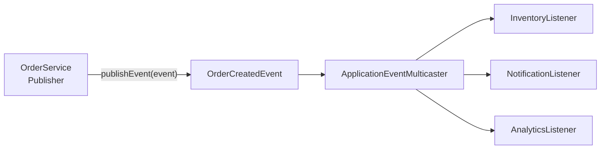

# One Publisher with Multiple Listeners in Spring Framework

In the Spring Framework, a **publisher** emits an event to announce that something has happened. Multiple **listeners** can simultaneously register to receive that event. The publisher only needs to know **ApplicationEventPublisher**; Spring finds the matching listeners and delivers the event to each registered listener in the **ApplicationContext**.

For example, when an order is created, the same **OrderCreatedEvent** can be handled by a listener that reserves inventory, a listener that sends confirmation to the customer, and a listener that records metrics. When a new listener is added, the event-publishing service does not need to know that the listener exists.

After this lesson, you will be able to explain the publisher–event–listener flow, write multiple listeners for the same event type, control processing order, and recognize when asynchronous processing or transaction binding is needed.

## 1. One-Publisher, Many-Listeners Model

Each component has its own role:

- **Publisher:** the component that emits the event using **ApplicationEventPublisher.publishEvent(...)**.
- **Event:** an immutable object carrying data describing what just happened, such as order ID and product quantity.
- **Event multicaster:** the mechanism inside **ApplicationContext** that finds and invokes matching listeners.
- **Listener:** a Spring bean with an **@EventListener** method, or a listener implementing the corresponding API, to handle the event.

General processing flow:



A single **publishEvent(event)** call can trigger multiple listeners. Each listener receives the same event's data and performs its own responsibility. The publisher does not need to call each listener directly, so components are less coupled to one another.

Under the default configuration, Spring uses **SimpleApplicationEventMulticaster**. A listener must be registered as a bean in the **ApplicationContext**; a class annotated with **@EventListener** that is not managed by Spring will not automatically receive events.

## 2. How Does Spring Find Matching Listeners?

Spring identifies listeners based on the event type they declare. With **@EventListener**, the method's parameter type is the event type that the method wants to receive:

```java
@EventListener
public void onOrderCreated(OrderCreatedEvent event) {
    System.out.println("Received order: " + event.orderId());
}
```

When the publisher emits an **OrderCreatedEvent**, Spring invokes listeners whose accepted type is compatible with that event. Another listener accepting **PaymentCompletedEvent** will not be called merely because it also uses **@EventListener**.

Spring Framework supports publishing a regular Java object as an event. Therefore, in the example using a Java record below, **OrderCreatedEvent** does not need to extend **ApplicationEvent**. This approach keeps event definitions concise and easy to keep immutable.

Listeners can reside in different beans. A single bean can also have multiple **@EventListener** methods. Those methods simply need to accept the right event type and belong to a Spring-registered bean.

## 3. Complete Example with Java 17 and Spring Framework

The following example uses plain Spring Context to clarify the event mechanism. A single **OrderService** publishes exactly one **OrderCreatedEvent**; three independent listeners reserve inventory, send a confirmation, and record statistics respectively.

### 3.1. Project Structure

```text
spring-events-many-listeners/
├── pom.xml
└── src/
    └── main/
        └── java/
            └── dev/
                └── example/
                    └── events/
                        └── Application.java
```

### 3.2. Declaring Dependencies in pom.xml

```xml
<project xmlns="http://maven.apache.org/POM/4.0.0"
         xmlns:xsi="http://www.w3.org/2001/XMLSchema-instance"
         xsi:schemaLocation="http://maven.apache.org/POM/4.0.0 https://maven.apache.org/xsd/maven-4.0.0.xsd">
    <modelVersion>4.0.0</modelVersion>

    <groupId>dev.example</groupId>
    <artifactId>spring-events-many-listeners</artifactId>
    <version>1.0.0</version>

    <properties>
        <maven.compiler.release>17</maven.compiler.release>
        <project.build.sourceEncoding>UTF-8</project.build.sourceEncoding>
    </properties>

    <dependencies>
        <dependency>
            <groupId>org.springframework</groupId>
            <artifactId>spring-context</artifactId>
            <version>6.2.6</version>
        </dependency>
    </dependencies>

    <build>
        <plugins>
            <plugin>
                <groupId>org.apache.maven.plugins</groupId>
                <artifactId>maven-compiler-plugin</artifactId>
                <version>3.13.0</version>
                <configuration>
                    <release>17</release>
                </configuration>
            </plugin>
            <plugin>
                <groupId>org.codehaus.mojo</groupId>
                <artifactId>exec-maven-plugin</artifactId>
                <version>3.5.0</version>
                <configuration>
                    <mainClass>dev.example.events.Application</mainClass>
                </configuration>
            </plugin>
        </plugins>
    </build>
</project>
```

### 3.3. Creating the Event, Publisher, and Three Listeners

Create the file **src/main/java/dev/example/events/Application.java**:

```java
package dev.example.events;

import org.springframework.context.ApplicationEventPublisher;
import org.springframework.context.annotation.AnnotationConfigApplicationContext;
import org.springframework.context.annotation.Bean;
import org.springframework.context.annotation.Configuration;
import org.springframework.context.event.EventListener;
import org.springframework.core.annotation.Order;

public class Application {

    public static void main(String[] args) {
        try (var context =
                     new AnnotationConfigApplicationContext(AppConfig.class)) {
            OrderService orderService = context.getBean(OrderService.class);
            orderService.createOrder("ORD-1001", "Laptop", 2);
        }
    }

    @Configuration(proxyBeanMethods = false)
    public static class AppConfig {

        @Bean
        public OrderService orderService(ApplicationEventPublisher publisher) {
            return new OrderService(publisher);
        }

        @Bean
        public InventoryListener inventoryListener() {
            return new InventoryListener();
        }

        @Bean
        public CustomerNotificationListener customerNotificationListener() {
            return new CustomerNotificationListener();
        }

        @Bean
        public AnalyticsListener analyticsListener() {
            return new AnalyticsListener();
        }
    }

    // Immutable event: all listeners only read order data.
    public record OrderCreatedEvent(
            String orderId,
            String product,
            int quantity
    ) {}

    public static class OrderService {
        private final ApplicationEventPublisher eventPublisher;

        public OrderService(ApplicationEventPublisher eventPublisher) {
            this.eventPublisher = eventPublisher;
        }

        public void createOrder(String orderId, String product, int quantity) {
            System.out.println("Created order " + orderId);

            OrderCreatedEvent event =
                    new OrderCreatedEvent(orderId, product, quantity);

            // Publish the event only once; Spring dispatches it to listeners.
            eventPublisher.publishEvent(event);
        }
    }

    public static class InventoryListener {

        @EventListener
        @Order(1)
        public void reserveInventory(OrderCreatedEvent event) {
            System.out.printf(
                    "1. Inventory: reserved %d %s for order %s%n",
                    event.quantity(),
                    event.product(),
                    event.orderId()
            );
        }
    }

    public static class CustomerNotificationListener {

        @EventListener
        @Order(2)
        public void sendConfirmation(OrderCreatedEvent event) {
            System.out.printf(
                    "2. Notification: sent confirmation for order %s to customer%n",
                    event.orderId()
            );
        }
    }

    public static class AnalyticsListener {

        @EventListener
        @Order(3)
        public void recordOrder(OrderCreatedEvent event) {
            System.out.printf(
                    "3. Analytics: recorded %d %s in order %s%n",
                    event.quantity(),
                    event.product(),
                    event.orderId()
            );
        }
    }
}
```

### 3.4. Running the Program

Open a terminal in the directory containing **pom.xml**, then run:

```bash
mvn -q compile exec:java
```

Expected output:

```text
Created order ORD-1001
1. Inventory: reserved 2 Laptop for order ORD-1001
2. Notification: sent confirmation for order ORD-1001 to customer
3. Analytics: recorded 2 Laptop in order ORD-1001
```

The output shows that **OrderService** calls **publishEvent** only once. All three listeners receive **OrderCreatedEvent** and read the same order ID, product, and quantity. **@Order(1)**, **@Order(2)**, and **@Order(3)** determine the listener invocation order in this synchronous example; smaller numbers are invoked first.

## 4. Analyzing Key Points

### The Publisher Only Depends on the Event-Publishing API

**OrderService** receives **ApplicationEventPublisher** through its constructor. The service does not create **InventoryListener**, does not call **sendConfirmation()**, and does not need to know how many listeners are active.

When a new listener is needed, we register a new bean with an **@EventListener** method accepting **OrderCreatedEvent**. There is no need to modify **OrderService** or add another publish call. This is the main benefit of the one-publisher, many-listeners model: the publishing side and receiving sides can evolve more independently.

### Events Should Carry Clear and Immutable Data

An event should describe something that has happened, such as **OrderCreatedEvent**, rather than having a vague action name like **DoSomethingEvent**. Its data fields should be sufficient for listeners to fulfill their responsibilities without depending on the internal state of the publisher.

The example uses a **record**, so data components cannot be reassigned after the event is created. This is helpful because multiple listeners receive the same event during dispatch. Avoid letting listeners mutate a shared event object; if new data is needed, create a different event describing the next occurrence.

### @Order Controls Invocation Order

Spring can order listeners using **@Order** or the **Ordered** mechanism. In the example, the inventory listener is called before the notification listener, followed by the analytics listener.

This ordering should only be used when the invocation sequence genuinely matters. If listeners are independent, do not create business dependencies between them just because they can be numbered. With asynchronous processing, execution start order does not guarantee completion order.

### Synchronous by Default

If no executor is configured, event listeners are invoked synchronously on the thread calling **publishEvent**. The **publishEvent** call finishes only after all synchronous listeners finish executing. Therefore, a slow listener can slow down the publisher.

Under the default configuration, an unhandled exception thrown by a listener can propagate back to the thread calling **publishEvent** and interrupt the dispatch process. If a listener performs work that can fail independently, design appropriate error handling and retry strategies; do not assume every listener always completes successfully.

### When Asynchronous Execution Is Needed

You can use **@Async** together with **@EnableAsync** to process a listener on a separate executor:

```java
@Configuration
@EnableAsync
public class AsyncConfiguration {
}
```

```java
@Async
@EventListener
public void sendConfirmation(OrderCreatedEvent event) {
    // Perform notification sending work.
}
```

You need to import **org.springframework.scheduling.annotation.EnableAsync** and **org.springframework.scheduling.annotation.Async**. The listener bean must be managed by Spring for the async mechanism to work. In real-world applications, configure a **TaskExecutor** with thread and queue limits appropriate for the system load.

When a listener runs asynchronously, the publisher does not wait for the listener's work to finish. Errors occurring in the async task are also not automatically returned to the **publishEvent** caller; separate logging, error handling, and retry mechanisms must be designed. Do not rely on **@Order** to guarantee the completion order of async tasks.

## 5. When a Listener Needs to Bind to a Transaction

Some listeners should run only after a data-writing transaction succeeds. For example, only send an order notification after the order-creation transaction has committed.

For that case, you can use **@TransactionalEventListener**:

```java
@TransactionalEventListener(phase = TransactionPhase.AFTER_COMMIT)
public void sendConfirmation(OrderCreatedEvent event) {
    // Runs only after the transaction commits successfully.
}
```

You need to import **org.springframework.transaction.event.TransactionalEventListener** and **org.springframework.transaction.event.TransactionPhase**. This mechanism requires an active transaction at the time the event is published. If there is no transaction, the listener is not called by default; only enable **fallbackExecution = true** when the desired behavior has been clearly established.

**@TransactionalEventListener** is suitable when a listener needs to react according to the transaction lifecycle. It does not turn an in-memory event into a durable message. If business requirements demand guaranteeing that messages are not lost when the process stops, consider a transactional outbox or an appropriate message broker.

## 6. @EventListener and ApplicationListener

The main example uses **@EventListener** because the event is a regular Java record and the declaration is concise. Spring also provides the interface-based listener API **ApplicationListener<E extends ApplicationEvent>**. With this approach, the event type must extend **ApplicationEvent**:

```java
public class OrderCreatedApplicationEvent extends ApplicationEvent {
    private final String orderId;

    public OrderCreatedApplicationEvent(Object source, String orderId) {
        super(source);
        this.orderId = orderId;
    }

    public String getOrderId() {
        return orderId;
    }
}
```

```java
public class InventoryApplicationListener
        implements ApplicationListener<OrderCreatedApplicationEvent> {

    @Override
    public void onApplicationEvent(OrderCreatedApplicationEvent event) {
        System.out.println("Reserving inventory for order " + event.getOrderId());
    }
}
```

Register **InventoryApplicationListener** as a Spring bean so it receives events. When the publisher calls **publishEvent(new OrderCreatedApplicationEvent(this, "ORD-1001"))**, the listener above can receive that event.

Both approaches are valid. **@EventListener** is convenient for multiple handler methods and events that are regular objects. **ApplicationListener** expresses the listener contract explicitly via an interface and is suitable when extending the traditional **ApplicationEvent** model is needed.

## 7. Common Errors and Troubleshooting

| Symptom | Common Cause | How to Check |
|---|---|---|
| No listener is called | Listener is not registered as a bean or context does not manage the bean | Check **@Component**, **@Bean**, and component scan configuration |
| One listener does not receive the event | Parameter type is incompatible with the published event type | Compare the type in **publishEvent** with the **@EventListener** parameter |
| Publisher is slow | Synchronous listener performs I/O or long-running processing | Measure duration of each listener; consider async or a message broker |
| Subsequent listeners do not run when an earlier listener fails | Unhandled exception during synchronous dispatch | Handle exceptions inside the listener or configure an **ErrorHandler** for the multicaster |
| Notification is sent even though transaction rolled back | Regular listener runs immediately when the event is published | Use **@TransactionalEventListener** with the appropriate phase |
| Completion order differs from @Order | Listeners are running asynchronously | Rely on **@Order** only for synchronous invocation order; design separate coordination if completion order matters |

## 8. Limitations of Application Events

Spring application events are a communication mechanism scoped to the **ApplicationContext** and application process. They are suitable for decoupling components within the same application, but by themselves they are not a durable message queue.

Do not assume that events will be persisted when the application shuts down, automatically retried after a listener fails, or processed exactly once. If you need communication across multiple services, message persistence for processing after a restart, or retry and consumption acknowledgments, evaluate a message broker and transactional outbox.

## 9. Implementation Checklist

- Name events after what happened and include all necessary data.
- Use **ApplicationEventPublisher** via dependency injection so the publisher does not depend on specific listeners.
- Register every listener as a Spring bean and declare the exact event type.
- Keep events immutable when multiple listeners read the data concurrently.
- Use **@Order** only when invocation order has business significance.
- Remember that synchronous listeners are the default; long-running work blocks the thread calling **publishEvent**.
- Choose **@Async** when off-thread processing is acceptable and error monitoring is in place.
- Use **@TransactionalEventListener** when processing must be tied to commit or rollback timing.
- Use a message broker or outbox when durability and cross-process message delivery are required.

Once you understand these points, you can have a single publisher emit a single event and scale the number of listeners as needed without modifying event-publishing logic every time a new handling feature is added.
