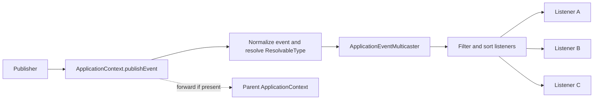

# ApplicationEventMulticaster in the Overall Model

## 1. Position and Responsibilities

Spring Application Events is a mechanism for publishing events within the same Spring ApplicationContext. The event-publishing component only needs to know that an event has occurred; it does not need to call each interested component directly. Spring finds the matching listeners and delivers the event to them.

`ApplicationEventMulticaster` is the central coordinator of this mechanism. It receives an event along with the event's type information, finds registered listeners capable of handling that event, and invokes each listener according to the configured execution policy.

Core components:

- **Publisher**: the component that emits the event, typically using `ApplicationEventPublisher` or `ApplicationContext`.
- **Event**: the object describing what happened. It can be a class extending `ApplicationEvent`, or any regular object such as a record/POJO.
- **ApplicationEventMulticaster**: the infrastructure that receives events, selects matching listeners, and dispatches the events.
- **Listener**: the component that handles events, typically implementing `ApplicationListener<E>` with the appropriate event class or declaring a method with `@EventListener`.
- **ApplicationContext**: manages the multicaster's lifecycle, registers listeners, and provides the event-publishing point.

Overview diagram:



The publisher does not need to hold references to individual listeners. The multicaster is the intermediary layer that decouples where events are published from where events are handled.

## 2. How Does an Event Flow Through the System?

When `ApplicationEventPublisher.publishEvent(event)` is called, the typical processing flow proceeds as follows:

1. **The publisher emits an event.** For example, a service emits `OrderPlaced` after creating an order.
2. **ApplicationContext normalizes the event.** If the passed object is already an `ApplicationEvent`, the context uses it directly. If it is a regular object, Spring wraps it in a `PayloadApplicationEvent`.
3. **Spring determines the event type.** The context uses `ResolvableType` to retain type information, including generic type information when determinable.
4. **The context calls the multicaster.** `AbstractApplicationContext.publishEvent(...)` forwards the event and event type to `ApplicationEventMulticaster.multicastEvent(...)`.
5. **The multicaster finds matching listeners.** It inspects the event type, source type, and event-support conditions declared by the listeners.
6. **The multicaster invokes listeners.** Invocation occurs on the event-publishing thread by default, or through an executor if configured and the listener supports asynchronous execution.
7. **The parent context may receive the event.** In a hierarchical context model, the event is forwarded up to the parent context if present.

Publishing an event only confirms that the event has been handed to the in-application handling mechanism. It does not automatically produce a durable message, nor does it guarantee persistence, retries after a process stops, or delivery across multiple processes.

## 3. Where Is ApplicationEventMulticaster Created?

During `ApplicationContext.refresh()`, `AbstractApplicationContext` initializes the event infrastructure in the `initApplicationEventMulticaster()` step. The relevant sequence during refresh can be summarized as follows:

1. Prepare the context and create the BeanFactory.
2. Register and execute `BeanFactoryPostProcessor`s and `BeanPostProcessor`s.
3. Initialize `MessageSource`.
4. Initialize `ApplicationEventMulticaster`.
5. Execute the context's `onRefresh()` hook.
6. Register listeners.
7. Instantiate remaining singletons and complete refresh.

Spring looks for a bean with the exact name `applicationEventMulticaster` in the BeanFactory:

- If this bean is already declared, Spring uses that bean.
- If not present, Spring creates a default `SimpleApplicationEventMulticaster` and registers it as a singleton in the context.

The default bean name is provided by the constant `AbstractApplicationContext.APPLICATION_EVENT_MULTICASTER_BEAN_NAME`.

During the listener registration step, the context adds listeners registered via the API and beans implementing `ApplicationListener` to the multicaster. Listener beans can be registered by bean name so Spring retrieves the instance only when needed, avoiding unnecessary eager initialization.

Events emitted before the multicaster is ready during the refresh phase are stored in the context's early events list. Once listeners are registered, the context replays these events through the multicaster and clears the list. This mechanism supports events produced early during context initialization.

## 4. SimpleApplicationEventMulticaster and Listener Selection

`ApplicationEventMulticaster` is the interface defining the event dispatching contract. `SimpleApplicationEventMulticaster` is Spring's default implementation.

The multicaster manages directly registered listeners and listener beans. When an event arrives, it finds listeners that can handle that event. Selection is not based solely on class name:

- **Event type**: the listener must support the published event type.
- **Generic type**: a listener may accept only a specific generic payload or event type. Spring uses `ResolvableType` to support type matching.
- **Source type**: advanced listeners can restrict the type of object originating the event.
- **Support conditions**: `GenericApplicationListener` allows implementing custom logic to check both event type and source type.
- **Ordering**: listeners can declare order via `Ordered` or `@Order`. Ordering is useful when synchronous listeners have dependencies, but it should not be used to build a complex business pipeline.

For event classes extending `ApplicationEvent`, listeners can typically implement `ApplicationListener<MyEvent>`. For payload objects such as records, you can declare an `@EventListener` method accepting the payload type directly; Spring's adapter handles the `PayloadApplicationEvent` wrapper.

## 5. Example Path from Publisher to Listener

An event can be a regular Java record. There is no requirement to create a class extending `ApplicationEvent`.

**Event — OrderPlaced.java**

```java
public record OrderPlaced(String orderId) {
}
```

**Publisher — OrderService.java**

```java
import org.springframework.context.ApplicationEventPublisher;
import org.springframework.stereotype.Service;

@Service
public class OrderService {
    private final ApplicationEventPublisher eventPublisher;

    public OrderService(ApplicationEventPublisher eventPublisher) {
        this.eventPublisher = eventPublisher;
    }

    public void placeOrder(String orderId) {
        // Execute order-creation business logic before publishing the event.
        eventPublisher.publishEvent(new OrderPlaced(orderId));
    }
}
```

**Listener — OrderAuditListener.java**

```java
import org.springframework.context.event.EventListener;
import org.springframework.stereotype.Component;

@Component
public class OrderAuditListener {
    @EventListener
    public void onOrderPlaced(OrderPlaced event) {
        System.out.println("Audit order: " + event.orderId());
    }
}
```

When `placeOrder("ORD-100")` calls `publishEvent`, the context passes the event to the multicaster. The multicaster finds the adapter for the `onOrderPlaced` method and invokes it. The publisher does not need to know which class contains the listener.

The code snippets above are separate classes in a Spring application with appropriate component scanning and Spring context; they illustrate the event path rather than a standalone Java program runnable directly with the `java` command.

## 6. Synchronous by Default

If no executor is configured, `SimpleApplicationEventMulticaster` invokes listeners immediately on the event-publishing thread. Consequently, the `publishEvent` call typically returns only after synchronous listeners finish.

Practical consequences:

- Slow listeners delay the publisher and the request calling the publisher.
- Exceptions from a synchronous listener can propagate back to the `publishEvent` caller. If no `ErrorHandler` is configured, an error can interrupt event delivery to subsequent listeners.
- Synchronous listeners share the publisher's thread and execution context. This can matter for transactions, security context, or thread-bound data.
- Even if a listener only performs secondary work, its processing time is still included in the completion time of the event publish call.

Synchronous execution is appropriate when listeners need to run immediately, when execution order matters, or when the listener's work belongs to the same transaction flow as the publisher. It is also the most predictable default behavior when debugging.

## 7. Configuring Asynchronous Execution

You can configure `SimpleApplicationEventMulticaster` with a `TaskExecutor`. In that case, the multicaster submits listener invocation tasks to the executor instead of invoking listeners directly on the event-publishing thread.

Java configuration example:

```java
import org.springframework.context.ApplicationEventMulticaster;
import org.springframework.context.event.SimpleApplicationEventMulticaster;
import org.springframework.context.support.AbstractApplicationContext;
import org.springframework.context.annotation.Bean;
import org.springframework.context.annotation.Configuration;
import org.springframework.scheduling.concurrent.ThreadPoolTaskExecutor;

@Configuration
public class EventMulticasterConfiguration {

    @Bean
    public ThreadPoolTaskExecutor applicationEventExecutor() {
        ThreadPoolTaskExecutor executor = new ThreadPoolTaskExecutor();
        executor.setCorePoolSize(2);
        executor.setMaxPoolSize(8);
        executor.setQueueCapacity(200);
        executor.setThreadNamePrefix("application-event-");
        executor.setWaitForTasksToCompleteOnShutdown(true);
        executor.setAwaitTerminationSeconds(10);
        return executor;
    }

    @Bean(name = AbstractApplicationContext.APPLICATION_EVENT_MULTICASTER_BEAN_NAME)
    public ApplicationEventMulticaster applicationEventMulticaster(
            ThreadPoolTaskExecutor applicationEventExecutor) {
        SimpleApplicationEventMulticaster multicaster =
                new SimpleApplicationEventMulticaster();
        multicaster.setTaskExecutor(applicationEventExecutor);
        return multicaster;
    }
}
```

Spring recognizes the bean named `applicationEventMulticaster` and uses it instead of the default implementation. `ThreadPoolTaskExecutor` is initialized and lifecycle-managed by Spring when declared as a bean.

Distinguish between two mechanisms:

- **Multicaster executor**: determines how the multicaster invokes listeners in the event infrastructure.
- **`@Async`**: uses Spring's proxy mechanism to run an annotated method asynchronously. This mechanism requires enabling async processing, typically via `@EnableAsync`.

You do not need `@EnableAsync` merely to configure `SimpleApplicationEventMulticaster#setTaskExecutor`. Both mechanisms can coexist, but design clearly to avoid creating unnecessary layers of threading.

Asynchronous execution changes important characteristics:

- The publisher may return before listeners finish.
- Exceptions in asynchronous tasks do not automatically propagate back to the publisher thread; an appropriate error-handling policy is needed.
- Task submission order does not equate to listener completion order.
- You must bound thread counts and queue sizes, and monitor rejected tasks, timeouts, and application shutdown behavior.
- Do not assume the publisher's transaction or thread-local context will automatically appear in the listener's execution thread.

In Spring Framework 6.1 and later, `ApplicationListener` can declare asynchronous execution capability via `supportsAsyncExecution()`. A listener that does not support async is invoked on the current thread even if the multicaster has an executor. This mechanism allows listeners that need to preserve thread context, such as transactional listeners, to maintain proper execution semantics.

## 8. Error Handling and Transaction Boundaries

`SimpleApplicationEventMulticaster` allows configuring an `ErrorHandler` to decide how exceptions thrown while invoking listeners are handled. If no handler is set, exceptions from synchronous listeners propagate outward. If a handler is set, it receives the exception and decides whether to log, ignore, or rethrow the error.

Choose an error policy based on business requirements:

- If a listener is mandatory for completing the business operation, do not silently ignore errors.
- If a listener only writes logs or updates secondary data, a log-and-continue policy may be used, provided skipping it is acceptable.
- For asynchronous listeners, monitor errors at the executor or `ErrorHandler`; the publisher cannot rely on exceptions to know whether a listener failed.

Publishing an event inside a transaction does not automatically mean the listener will run after the transaction commits. Regular listeners are invoked via the multicaster at the time of publishing. If you need to bind a listener to a transaction phase, use `@TransactionalEventListener` and choose the appropriate phase, such as `AFTER_COMMIT`. By default, this type of listener is processed only when an active transaction exists; `fallbackExecution` can be enabled if business rules permit processing without a transaction.

Since Spring Framework 6.1, transactional application listeners do not support async execution via the multicaster's executor, because execution needs to preserve the proper transaction context. If background work must run after commit, explicitly design a handoff to an executor or queue after the transaction completes.

## 9. Relationship with @EventListener and Hierarchical Contexts

`@EventListener` is an application-level way to declare a listener; it does not replace the multicaster. Spring detects methods marked with the annotation, creates adapters for them, and registers the adapters into the event infrastructure. When an event is published, the multicaster remains the component that dispatches to the adapters.

`@TransactionalEventListener` adds binding to a transaction phase. It uses transaction synchronization to decide when to invoke the listener method, while the event is still published through `ApplicationContext`.

In systems with parent-child `ApplicationContext`s, events published from a child context can be forwarded up to the parent context. Therefore, listeners in the parent context can receive events published from a child context. When organizing multiple contexts, pay attention to registering the same listener across multiple levels to avoid duplicate processing.

## 10. When Should You Customize the Multicaster?

Keep the default implementation when events are only used to decouple components within the same application and synchronous handling meets requirements. Customize only when there is a specific infrastructure need:

- Use a dedicated executor to offload listener processing time from request threads.
- Set an `ErrorHandler` to standardize how listener errors are recorded.
- Tune pool and queue settings according to event throughput, resource limits, and shutdown timeouts.
- Use conditional or ordered listeners when dispatching rules are genuinely needed.

Do not use `ApplicationEventMulticaster` as a message broker. It is an in-memory event mechanism of the Spring context, tied to the application lifecycle, and does not provide durable storage, delivery acknowledgments, durable retries, or cross-process event delivery. For reliable delivery across services, consider a message broker and transactional outbox.

## 11. Common Misconceptions

| Misconception | Correct Understanding |
|---|---|
| `ApplicationEventPublisher` and `ApplicationEventMulticaster` are the same | Publisher is the event-emitting API; multicaster is the infrastructure that dispatches to listeners. |
| Every event must extend `ApplicationEvent` | Spring supports publishing regular objects and wraps them in `PayloadApplicationEvent`. |
| Event listeners run in the background by default | By default, listeners run synchronously on the event-publishing thread. |
| Adding `@Async` means the multicaster is configured asynchronously | `@Async` and the multicaster's executor are two different mechanisms. |
| Publishing an event means the transaction has committed | Regular events are dispatched at publish time; use `@TransactionalEventListener` if binding to a transaction phase is needed. |
| Events in Spring can replace a message queue | Application events are an in-process mechanism without durable storage and delivery guarantees. |

## 12. How to Trace When Debugging

When a listener is not called or is called at the wrong time, check in order:

1. Confirm the publisher calls the right `ApplicationContext` and the event is actually published.
2. Confirm the event is the exact expected object/payload type and there is no confusion between an event wrapper and its payload.
3. Confirm the listener was detected by Spring and registered in the right context.
4. Check the listener's generic type, event-support conditions, and source type.
5. Check listener ordering, executor configuration, and the listener's async capability.
6. Check exceptions, `ErrorHandler`, executor logs, and whether the queue is rejecting tasks.
7. If using a transactional listener, verify whether a transaction is active and whether the chosen phase actually occurred.
8. If using parent-child contexts, check which context the listener belongs to and whether the event is forwarded to that level.

Understanding the role of `ApplicationEventMulticaster` helps pinpoint the exact event dispatch point, explain why listeners run synchronously or asynchronously, and choose the right place to configure when execution behavior needs to change.
