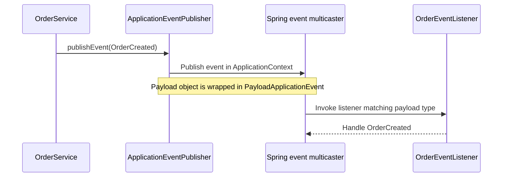

# Publishing an Arbitrary Object as an Event

## 1. Concept

Spring Application Events allow one component to notify that something has occurred so other components can process it. The event-publishing component only needs to know about `ApplicationEventPublisher`; it does not need to call each listener directly. As a result, a business operation can broadcast notifications to multiple handlers without depending on how those handlers are implemented.

Since Spring Framework 4.2, the published object is not required to extend `ApplicationEvent`. You can pass any arbitrary object directly into `ApplicationEventPublisher.publishEvent(Object event)`, such as a Java record, DTO, or POJO.

When the object is not an `ApplicationEvent`, Spring automatically wraps it in `PayloadApplicationEvent<T>`. A listener declaring the payload type receives the original object directly via its method parameter. You do not need to create `PayloadApplicationEvent` manually or write an event class extending `ApplicationEvent` for typical cases.

For example: after creating an order, the service publishes `new OrderCreated(...)`. A listener receives `OrderCreated` and sends a notification. The service does not need to know which listeners are listening.

## 2. Processing Flow



1. The service creates an object containing the event data.
2. The service calls `publishEvent(object)` through `ApplicationEventPublisher`.
3. Spring passes the event to the `ApplicationContext` multicaster mechanism. If the object is not an `ApplicationEvent`, Spring creates a `PayloadApplicationEvent` to hold that object.
4. Spring finds listeners matching the event/payload type and invokes the registered listeners.
5. The `@EventListener` method whose parameter matches the payload type receives the original object.

An event describes something that has happened, such as `OrderCreated`, `PaymentReceived`, or `UserRegistered`. Name it after the event and include enough data for listeners to understand what occurred.

## 3. Runnable Example with Java 17

The example below uses plain Spring Context, without Spring Boot. `OrderService` receives `ApplicationEventPublisher` via its constructor and publishes a record. `OrderEventListener` is a Spring bean with an `@EventListener` method that receives that record directly.

### Directory Structure

```text
arbitrary-event/
├── pom.xml
└── src/
    └── main/
        └── java/
            └── demo/
                └── App.java
```

### pom.xml

```xml
<project xmlns="http://maven.apache.org/POM/4.0.0"
         xmlns:xsi="http://www.w3.org/2001/XMLSchema-instance"
         xsi:schemaLocation="http://maven.apache.org/POM/4.0.0 https://maven.apache.org/xsd/maven-4.0.0.xsd">
    <modelVersion>4.0.0</modelVersion>
    <groupId>demo</groupId>
    <artifactId>arbitrary-event</artifactId>
    <version>1.0.0</version>

    <properties>
        <maven.compiler.release>17</maven.compiler.release>
        <project.build.sourceEncoding>UTF-8</project.build.sourceEncoding>
        <spring-framework.version>6.2.0</spring-framework.version>
    </properties>

    <dependencies>
        <dependency>
            <groupId>org.springframework</groupId>
            <artifactId>spring-context</artifactId>
            <version>${spring-framework.version}</version>
        </dependency>
    </dependencies>

    <build>
        <plugins>
            <plugin>
                <groupId>org.apache.maven.plugins</groupId>
                <artifactId>maven-compiler-plugin</artifactId>
                <version>3.13.0</version>
            </plugin>
            <plugin>
                <groupId>org.codehaus.mojo</groupId>
                <artifactId>exec-maven-plugin</artifactId>
                <version>3.5.0</version>
                <configuration>
                    <mainClass>demo.App</mainClass>
                </configuration>
            </plugin>
        </plugins>
    </build>
</project>
```

### src/main/java/demo/App.java

```java
package demo;

import java.math.BigDecimal;
import java.util.Objects;

import org.springframework.context.ApplicationEventPublisher;
import org.springframework.context.annotation.AnnotationConfigApplicationContext;
import org.springframework.context.annotation.Bean;
import org.springframework.context.annotation.Configuration;
import org.springframework.context.event.EventListener;

public class App {

    public static void main(String[] args) {
        try (var context = new AnnotationConfigApplicationContext(AppConfig.class)) {
            context.getBean(OrderService.class).createOrder();
        }
    }

    @Configuration
    static class AppConfig {

        @Bean
        OrderService orderService(ApplicationEventPublisher publisher) {
            return new OrderService(publisher);
        }

        @Bean
        OrderEventListener orderEventListener() {
            return new OrderEventListener();
        }
    }

    static class OrderService {
        private final ApplicationEventPublisher publisher;

        OrderService(ApplicationEventPublisher publisher) {
            this.publisher = publisher;
        }

        void createOrder() {
            var event = new OrderCreated(
                "ORD-2026-001",
                new BigDecimal("1250000")
            );

            publisher.publishEvent(event);
        }
    }

    static class OrderEventListener {

        @EventListener
        public void onOrderCreated(OrderCreated event) {
            System.out.println(
                "Handled order " + event.orderId()
                    + " total=" + event.total().toPlainString()
            );
        }
    }

    public record OrderCreated(String orderId, BigDecimal total) {
        public OrderCreated {
            if (orderId == null || orderId.isBlank()) {
                throw new IllegalArgumentException("orderId must not be blank");
            }
            Objects.requireNonNull(total, "total");
        }
    }
}
```

### Running the Program

From the directory containing `pom.xml`, run:

```bash
mvn -q compile exec:java
```

Output printed by the listener:

```text
Handled order ORD-2026-001 total=1250000
```

In this example:

- `ApplicationEventPublisher` is injected by Spring into `OrderService`.
- `OrderCreated` is a normal Java record and does not extend `ApplicationEvent`.
- `publishEvent(event)` publishes that record. Spring creates `PayloadApplicationEvent<OrderCreated>` as an internal wrapper.
- `@EventListener` declares an `OrderCreated` parameter, so the listener works directly with the payload.
- `OrderEventListener` is registered as a Spring bean. A method annotated only with `@EventListener` inside an object not managed by Spring will not be discovered automatically.

## 4. Receiving Payloads in Listeners

For a plain object, the clearest way to declare it is to use the payload type as the parameter:

```java
@EventListener
public void handle(OrderCreated event) {
    System.out.println(event.orderId());
}
```

There is no need to declare `ApplicationEvent` in the method signature. Spring uses the parameter type to identify matching listeners. Therefore, use a specific type instead of `Object` to narrow the kinds of messages the listener receives.

If the published object already extends `ApplicationEvent`, Spring handles it as that application event without wrapping it like a plain payload. Extending `ApplicationEvent` remains valid, commonly seen in older code or when an application needs that event model; for new payload events, a record/POJO is usually simpler.

## 5. One Event Can Have Multiple Listeners

Multiple Spring beans can listen for the same payload type. For example, after `OrderCreated` is published, one listener can write an audit log, another can update metrics, and a third can send a notification. `OrderService` does not need to know that list.

```java
@Component
class OrderAuditListener {
    @EventListener
    public void record(OrderCreated event) {
        // Record the newly created order.
    }
}

@Component
class OrderMetricsListener {
    @EventListener
    public void count(OrderCreated event) {
        // Update order metrics.
    }
}
```

This is an illustrative example of listener beans; in a real application, ensure the classes are component-scanned or declared with `@Bean`. If processing order between multiple listeners is needed, `@Order` or `Ordered` can be used. Ordering only controls listener invocation order within Spring's event mechanism; it does not create a transaction mechanism or storage guarantee.

## 6. Synchronous, Asynchronous, and Event Scope

**The default is synchronous.** With the default event multicaster configuration, listeners are invoked on the thread publishing the event. The `publishEvent` call only completes after all matching synchronous listeners have finished running. Therefore, an error thrown in a listener can propagate back to the publisher caller if no other `ErrorHandler` is configured.

You can run a listener asynchronously with `@Async` and enable async processing with `@EnableAsync`: 

```java
@Configuration
@EnableAsync
class AsyncConfig {
}

@Component
class NotificationListener {
    @Async
    @EventListener
    public void send(OrderCreated event) {
        // Send notification on the configured executor.
    }
}
```

When using `@Async`, the publisher does not wait for the listener to finish. Configure an appropriate executor, handle asynchronous errors, and avoid assuming the listener has finished right after `publishEvent`. The payload should be immutable because multiple listeners may read the same object; if the object is mutable, one listener modifying it can affect other listeners.

Application Event is a communication mechanism scoped to a single application's Spring `ApplicationContext`. It does not automatically send events to another JVM, another service, or a message broker, nor does it persist events across restarts. If you need inter-process communication, durable retries, replay, or delivery guarantees, use an appropriate messaging solution such as Kafka or RabbitMQ.

## 7. Common Pitfalls

| Issue | Cause and Resolution |
|---|---|
| Listener is not invoked | The listener object is not managed by Spring, `@EventListener` is missing, or the parameter type does not match the published payload. |
| Listener unexpectedly receives `PayloadApplicationEvent` | The method was declared to accept the wrapper class. For typical needs, change the parameter to the specific payload type such as `OrderCreated`. |
| Assuming objects must extend `ApplicationEvent` | Since Spring 4.2, any object can be published directly using `publishEvent(Object)`. |
| Calling `publishEvent` but seeing no logs | Check whether the listener is in the same `ApplicationContext` or appropriate context scope, whether the bean is registered, and whether execution reaches the publish call. |
| Listener slows down the calling business logic | Listeners run synchronously by default. Switch to `@Async` only when asynchronous processing is acceptable and an appropriate executor/error handling is configured. |
| Using application events as a message queue | Application Events do not provide durable persistence, inter-process distribution, or broker retries. Use a messaging platform if those guarantees are needed. |

## 8. When to Use It

Use a payload object event when a business operation needs to notify one or more components within the same application, and the publisher does not need to know who will handle it. Payloads such as `OrderCreated`, `PaymentReceived`, or `CustomerAddressChanged` clearly express the event and its associated data.

If one component needs to call another component to get an immediate result, a direct method/service call is usually clearer. Events fit one-way notifications; they are not a request/response API replacement for business calls.

## 9. Key Takeaways

- You can call `ApplicationEventPublisher.publishEvent(anyObject)` with any arbitrary object.
- An object that is not an `ApplicationEvent` is wrapped by Spring in `PayloadApplicationEvent`.
- `@EventListener` can receive the payload type directly, such as `OrderCreated`.
- Listeners must be Spring-managed beans.
- Events are processed synchronously within the application by default; `@Async` changes the execution model.
- Application Events do not replace a message broker when inter-process communication or durable delivery is required.