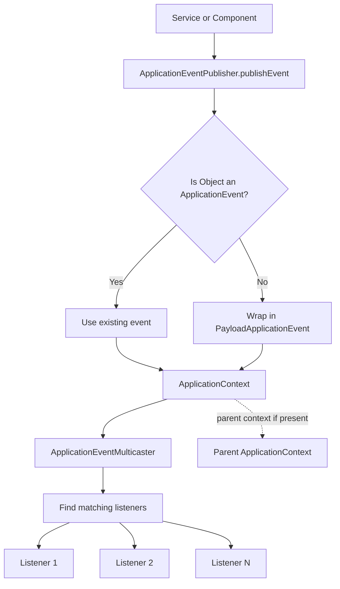

# ApplicationEventPublisher and publishEvent

## 1. The Role of ApplicationEventPublisher

`ApplicationEventPublisher` is an interface provided by Spring that allows a component to publish application events to listeners within the ApplicationContext. It establishes a clear boundary between where an event is published and where it is handled.

For example, after a service creates an order, other components may need to record an audit entry, send a notification, or update a read model. If the service calls each component directly, it must know their classes and APIs. Whenever a new action is added, the service has to be modified again. With application events, the service simply publishes `OrderPlaced`; listeners register independently to react to that event.

Related roles:

- **Publisher:** the component that decides to publish an event when a meaningful occurrence has happened.
- **ApplicationEventPublisher:** the API the publisher uses to pass the event into Spring.
- **Event:** the object describing what happened and carrying the data listeners need.
- **ApplicationEventMulticaster:** the context infrastructure that finds matching listeners and dispatches the event.
- **Listener:** the method or bean that receives the event and performs the corresponding reaction.

`ApplicationContext` also implements `ApplicationEventPublisher`, so you can call `context.publishEvent(...)`. However, a service usually only needs the event-publishing API; constructor injection of `ApplicationEventPublisher` expresses a narrower and clearer dependency than injecting the entire `ApplicationContext`.

## 2. Two Overloads of publishEvent

In Spring Framework 6.x, `ApplicationEventPublisher` provides two ways to publish an event:

```java
void publishEvent(ApplicationEvent event);

default void publishEvent(Object event);
```

Meaning of the two overloads:

- **`publishEvent(ApplicationEvent)`:** used when the object is an instance of a class extending `ApplicationEvent`.
- **`publishEvent(Object)`:** allows publishing a plain payload object, such as a record, POJO, or domain object. Spring wraps this payload in a `PayloadApplicationEvent` to pass it into the event infrastructure.

Therefore, it is not mandatory to create an event class extending `ApplicationEvent`. For new applications, an immutable record or POJO is usually a concise and easily testable choice.

Example of an event extending `ApplicationEvent`:

```java
import org.springframework.context.ApplicationEvent;

public class OrderPlacedEvent extends ApplicationEvent {
    private final String orderId;

    public OrderPlacedEvent(Object source, String orderId) {
        super(source);
        this.orderId = orderId;
    }

    public String getOrderId() {
        return orderId;
    }
}
```

Publishing this event:

```java
eventPublisher.publishEvent(
        new OrderPlacedEvent(this, "ORD-100")
);
```

Example of a plain payload object:

```java
public record OrderPlaced(String orderId) {
}
```

Publishing the payload:

```java
eventPublisher.publishEvent(new OrderPlaced("ORD-100"));
```

With a plain payload, a listener can receive `OrderPlaced` directly. Spring's event adapter handles the `PayloadApplicationEvent` wrapper; application code does not need to create the wrapper manually.

## 3. What Does publishEvent Actually Do?

A call to `publishEvent(event)` hands the event over to the ApplicationContext for dispatch. In the typical flow of `AbstractApplicationContext`, the main steps are:

1. Receive the published object.
2. If necessary, wrap the payload object in a `PayloadApplicationEvent`.
3. Determine the `ResolvableType` of the event to support type-based listener selection.
4. Call `ApplicationEventMulticaster.multicastEvent(...)`.
5. The multicaster finds matching listeners and invokes them according to the execution policy.
6. In a hierarchical context, the event may be forwarded to the parent context.

Diagram:



The publisher does not receive a list of listeners, does not receive return values from listeners, and has no API to confirm that all business side effects have completed. `publishEvent` has a `void` return type; it is neither an RPC call nor a request-response mechanism.

The Javadoc of `ApplicationEventPublisher` describes event publication as a handoff operation to the event multicaster. The publisher contract itself does not dictate whether listeners run synchronously, asynchronously, or immediately. The exact behavior depends on the context implementation and configuration.

## 4. Injecting the Publisher into a Service

The most common approach is constructor injection:

```java
import org.springframework.context.ApplicationEventPublisher;
import org.springframework.stereotype.Service;

@Service
public class OrderService {
    private final ApplicationEventPublisher eventPublisher;

    public OrderService(ApplicationEventPublisher eventPublisher) {
        this.eventPublisher = eventPublisher;
    }

    public void placeOrder(String orderId) {
        // Perform and confirm the order creation business logic.
        eventPublisher.publishEvent(new OrderPlaced(orderId));
    }
}
```

Spring provides the publisher corresponding to the ApplicationContext managing the bean. There is no need to manually instantiate a multicaster or look up beans with `getBean()`.

Constructor injection has the following benefits:

- The dependency is explicitly declared in the constructor.
- The field can be `final`, preventing the publisher from being modified after initialization.
- Unit tests can pass a mock or fake publisher.
- The class depends only on the event-publishing API and does not need to know the event-dispatch implementation.

A service typically publishes an event after the business state has been confirmed. For example, only publish `OrderPlaced` after the order has been successfully created. If published too early and the primary operation subsequently fails, listeners could perform side effects based on an event that never actually occurred.

## 5. Publishing Events from a Component

`ApplicationEventPublisher` is not restricted to `@Service`. Any Spring-managed bean can inject the publisher, including coordinator components, adapters, or technical components:

```java
import org.springframework.context.ApplicationEventPublisher;
import org.springframework.stereotype.Component;

@Component
public class ImportCoordinator {
    private final ApplicationEventPublisher eventPublisher;

    public ImportCoordinator(ApplicationEventPublisher eventPublisher) {
        this.eventPublisher = eventPublisher;
    }

    public void complete(String batchId, int rowCount) {
        eventPublisher.publishEvent(
                new ImportCompleted(batchId, rowCount)
        );
    }
}
```

Payload event:

```java
public record ImportCompleted(String batchId, int rowCount) {
}
```

The difference between a service and a component lies in the responsibility of the class. Both use the same publisher API and the same event infrastructure. A class instantiated with `new` outside the Spring container will not automatically have dependencies injected; if that class needs the publisher, let Spring manage the bean or pass the publisher explicitly through its constructor.

## 6. Designing the Published Payload

An event should represent something that has already happened, typically named in the past tense such as `OrderPlaced`, `PaymentCaptured`, `UserRegistered`, or `ImportCompleted`.

The payload should:

- Be immutable if possible, for example using a Java record.
- Contain the IDs and data that listeners actually need.
- Include a timestamp or correlation ID when tracing is needed.
- Avoid carrying services, ApplicationContext, repositories, or objects whose lifecycle is bound to a thread.
- Avoid passing mutable JPA entities if a listener might run after the persistence context closes.

Example:

```java
import java.math.BigDecimal;
import java.time.Instant;

public record PaymentCaptured(
        String paymentId,
        BigDecimal amount,
        Instant occurredAt
) {
}
```

A listener can use `paymentId` to fetch the latest data from a repository within its own transaction. This reduces reliance on stale entity state or lazy relationships.

If an event uses a generic type and listeners need to retain the generic type information at runtime, it may be necessary to provide the explicit type via `ResolvableTypeProvider`. Java type erasure can leave generic parameter information incomplete when relying solely on the runtime class.

## 7. Runnable Java 17 + Spring Context Example

This example uses Java 17 and Spring Context 6.2.0. The service publishes a payload record; the listener receives the event and prints a line to the console.

Project structure:

```text
publish-event-demo/
├── pom.xml
└── src/main/java/com/example/events/
    ├── Application.java
    ├── PaymentCaptured.java
    ├── PaymentService.java
    └── PaymentAuditListener.java
```

**pom.xml**

```xml
<project xmlns="http://maven.apache.org/POM/4.0.0"
         xmlns:xsi="http://www.w3.org/2001/XMLSchema-instance"
         xsi:schemaLocation="http://maven.apache.org/POM/4.0.0 https://maven.apache.org/xsd/maven-4.0.0.xsd">
    <modelVersion>4.0.0</modelVersion>

    <groupId>com.example</groupId>
    <artifactId>publish-event-demo</artifactId>
    <version>1.0.0</version>

    <properties>
        <maven.compiler.release>17</maven.compiler.release>
        <project.build.sourceEncoding>UTF-8</project.build.sourceEncoding>
        <spring.version>6.2.0</spring.version>
    </properties>

    <dependencies>
        <dependency>
            <groupId>org.springframework</groupId>
            <artifactId>spring-context</artifactId>
            <version>${spring.version}</version>
        </dependency>
    </dependencies>

    <build>
        <plugins>
            <plugin>
                <groupId>org.apache.maven.plugins</groupId>
                <artifactId>maven-compiler-plugin</artifactId>
                <version>3.13.0</version>
            </plugin>
            <plugin>
                <groupId>org.codehaus.mojo</groupId>
                <artifactId>exec-maven-plugin</artifactId>
                <version>3.5.0</version>
                <configuration>
                    <mainClass>com.example.events.Application</mainClass>
                </configuration>
            </plugin>
        </plugins>
    </build>
</project>
```

**PaymentCaptured.java**

```java
package com.example.events;

import java.math.BigDecimal;

public record PaymentCaptured(String paymentId, BigDecimal amount) {
}
```

**PaymentService.java**

```java
package com.example.events;

import java.math.BigDecimal;
import org.springframework.context.ApplicationEventPublisher;
import org.springframework.stereotype.Service;

@Service
public class PaymentService {
    private final ApplicationEventPublisher eventPublisher;

    public PaymentService(ApplicationEventPublisher eventPublisher) {
        this.eventPublisher = eventPublisher;
    }

    public void capture(String paymentId, BigDecimal amount) {
        // In a real application, confirm the capture result before publishing.
        eventPublisher.publishEvent(
                new PaymentCaptured(paymentId, amount)
        );
    }
}
```

**PaymentAuditListener.java**

```java
package com.example.events;

import org.springframework.context.event.EventListener;
import org.springframework.stereotype.Component;

@Component
public class PaymentAuditListener {

    @EventListener
    public void record(PaymentCaptured event) {
        System.out.println(
                "Payment captured: " + event.paymentId()
                        + ", amount=" + event.amount().toPlainString()
        );
    }
}
```

**Application.java**

```java
package com.example.events;

import java.math.BigDecimal;
import org.springframework.context.annotation.AnnotationConfigApplicationContext;

public class Application {
    public static void main(String[] args) {
        try (var context = new AnnotationConfigApplicationContext(
                PaymentService.class,
                PaymentAuditListener.class
        )) {
            context.getBean(PaymentService.class)
                    .capture("pay-42", new BigDecimal("125.00"));
        }
    }
}
```

Run the project with Java 17 and Maven:

```bash
mvn -q compile exec:java
```

Stdout:

```text
Payment captured: pay-42, amount=125.00
```

In this example, `AnnotationConfigApplicationContext` registers the service and listener as beans. Spring creates the event infrastructure, injects the publisher into the service, and publishes the event when `capture` is called. The synchronous listener is invoked before the publish call completes.

## 8. Synchronous, Asynchronous, and Return Timing

The `ApplicationEventPublisher` API does not promise whether listeners run synchronously or asynchronously. With the default `SimpleApplicationEventMulticaster` implementation when no executor is configured, listeners are invoked in the thread that publishes the event. Therefore, `publishEvent` usually returns only after synchronous listeners have finished.

You can configure a `TaskExecutor` on the multicaster or use `@Async` on a listener method together with `@EnableAsync`. These two approaches are different mechanisms:

- The multicaster's executor affects how the multicaster dispatches listener calls.
- `@Async` uses Spring's async method execution to run the method through an executor.
- When running asynchronously, the publisher can continue before the listener finishes.
- Exceptions in an async task do not automatically propagate back to the publisher thread.
- Task submission order does not guarantee completion order.
- Thread-local state, security context, and transaction context are not automatically propagated across threads.

Do not assume that adding an event automatically offloads work to the background. Choose sync or async based on requirements for latency, ordering, transactions, and error observability.

## 9. Exceptions and Handling Results

`publishEvent` returns `void`, so the publisher does not receive business results from listeners. If a direct result is needed, use a service method with an explicit return type instead of turning an event into request-response.

With synchronous listeners, an exception can escape the listener and propagate back to the publisher, depending on the multicaster's `ErrorHandler` configuration. A failing listener can also interrupt dispatch to subsequent listeners. With asynchronous listeners, the publisher typically does not see exceptions; you need to monitor the executor, error handler, and task logs.

Decide explicitly:

- Is the listener a mandatory part of completing the business operation?
- Is a listener failure allowed to be ignored?
- Are retries or processing-state persistence needed?
- Is a correlation ID needed to trace the event?

Do not catch and silently discard every exception. If a listener only performs secondary work, log the error and apply an agreed-upon policy.

## 10. Publishing Events Inside a Transaction

If a `@Transactional` service calls `publishEvent`, a regular `@EventListener` may run before the transaction commits. If the transaction rolls back, side effects already performed by the listener are not automatically undone.

When a listener must run only after a successful commit, use `@TransactionalEventListener`:

```java
import org.springframework.stereotype.Component;
import org.springframework.transaction.event.TransactionPhase;
import org.springframework.transaction.event.TransactionalEventListener;

@Component
public class ReceiptListener {

    @TransactionalEventListener(phase = TransactionPhase.AFTER_COMMIT)
    public void sendReceipt(PaymentCaptured event) {
        // Send or schedule sending the receipt after commit.
    }
}
```

Available phases:

- `BEFORE_COMMIT`: before the transaction commits.
- `AFTER_COMMIT`: after a successful commit; this is the default.
- `AFTER_ROLLBACK`: after a rollback.
- `AFTER_COMPLETION`: after the transaction completes, whether committed or rolled back.

By default, a transactional listener does not run if there is no active transaction. `fallbackExecution = true` allows execution even without a transaction, but should only be enabled if the business logic accepts that behavior.

A transactional event listener helps choose the right execution timing, but does not provide durable storage. If the application must guarantee that an event is sent to an external system after a database commit even if the process stops abruptly, consider a transactional outbox or a message broker.

## 11. Testing publishEvent

You can test the publisher at two levels:

**Unit test for the service:** mock `ApplicationEventPublisher`, call the service method, and verify that the event and payload are published. This test focuses on the service's decision to publish the event, without checking whether Spring registers any listener.

Conceptual example with Mockito:

```java
@ExtendWith(MockitoExtension.class)
class PaymentServiceTest {
    @Mock
    ApplicationEventPublisher eventPublisher;

    @Test
    void publishesPaymentCaptured() {
        PaymentService service = new PaymentService(eventPublisher);

        service.capture("pay-42", new BigDecimal("125.00"));

        verify(eventPublisher).publishEvent(
                new PaymentCaptured("pay-42", new BigDecimal("125.00"))
        );
    }
}
```

This test requires importing JUnit Jupiter, Mockito, and the corresponding static matchers; it assumes the imports for `PaymentService`, `PaymentCaptured`, and `BigDecimal` are present in the test file.

**Integration test:** start a real ApplicationContext, retrieve the service from the context, invoke the event-publishing method, and verify the listener's side effects. This tests the full chain: publisher → context → multicaster → listener.

For async listeners, use a `CountDownLatch`, Future, or explicit synchronization mechanism to wait for results. Avoid fixed `Thread.sleep` calls because they make tests flaky. For transactional listeners, test after commit/rollback according to the phase instead of only calling the method directly.

## 12. Common Misconceptions

| Misconception | Correct Understanding |
|---|---|
| You must extend `ApplicationEvent` to publish an event | You can publish a record/POJO; Spring wraps the payload in `PayloadApplicationEvent`. |
| `ApplicationEventPublisher` is the multicaster | The publisher is the publishing API; the multicaster is the dispatch infrastructure. |
| `publishEvent` returns the listener's result | The method returns `void`; it is not request-response. |
| Calling `publishEvent` always runs listeners synchronously | The API does not guarantee execution mode; by default the multicaster is typically synchronous when no executor is configured. |
| Events are equivalent to a message queue | Application events are an in-process mechanism with no durable storage or cross-process delivery guarantees. |
| Listeners run after commit simply because the publisher has `@Transactional` | Regular listeners can run before commit; use `@TransactionalEventListener` if a specific phase is needed. |
| Injecting ApplicationContext is the only way to publish | Injecting `ApplicationEventPublisher` directly is sufficient and expresses a narrower dependency. |

## 13. Checklist for Using ApplicationEventPublisher

1. Identify which business occurrence has actually happened.
2. Name the event in the past tense and design an immutable payload.
3. Inject `ApplicationEventPublisher` via constructor into a Spring-managed bean.
4. Use the appropriate overload: `ApplicationEvent` or a payload object.
5. Publish the event after the business operation meets its success condition.
6. Do not expect `publishEvent` to return a processing result.
7. Decide explicitly whether listeners should be synchronous, asynchronous, or bound to a transaction phase.
8. Design policies for exceptions, observability, and retries.
9. Test the publish call and listener side effects in an ApplicationContext.
10. Use an outbox/message broker when durable delivery across processes or services is required.

`ApplicationEventPublisher` enables services and components to publish notifications without depending directly on listeners. Understanding the `publishEvent` overloads, how Spring wraps payloads, and the boundaries around execution, exceptions, and transactions will help you use application events for their intended purpose and avoid false expectations about delivery guarantees.
