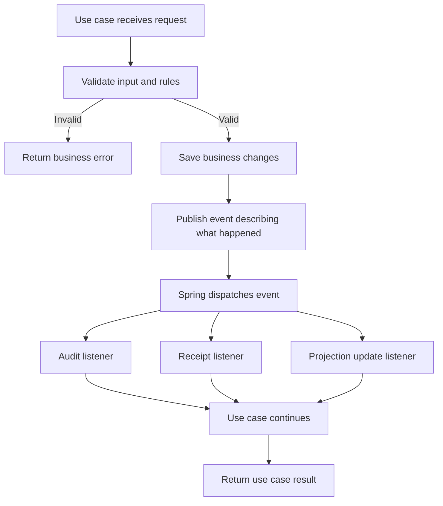

# Publishing Events Within the Same Use Case

## 1. Objectives and Scope

In a Spring application, a use case typically performs multiple steps to fulfill a business request: validating input data, applying rules, persisting changes, and notifying related components. Spring Application Events allow a use case to **publish an event when a business occurrence has happened**, so other Spring beans can react without the use case calling each of those beans directly.

For example, an order placement use case can save the order and then publish `OrderPlaced`. Listeners receive the event to record an audit log, prepare a receipt, or update a search projection. All of these components still run within the same Spring application and the same JVM process.

After this lesson, you will be able to:

- Choose the right place to publish events within a use case.
- Inject and use `ApplicationEventPublisher` in an application service.
- Distinguish an event describing a fact that occurred from a command requesting an action.
- Understand execution order when listeners are synchronous, asynchronous, and transaction-bound.
- Decide when to publish an event and when to call a service directly.

## 2. Where Are Events Published in a Use Case?

A use case is where a specific business flow is coordinated. In application architecture, it is typically represented by an application service, command handler, or a class with methods such as `placeOrder()`, `registerUser()`, or `approveRequest()`.

A simple order placement flow might include:

1. Receive the order request and validate input data.
2. Apply business rules to verify the order is valid.
3. Create and save the order.
4. Once the order has been created successfully, publish the `OrderPlaced` event.
5. Listeners handle the appropriate supporting tasks.

The publication point must accurately reflect when the occurrence is established. If `OrderPlaced` is published before validating or saving the order, listeners may receive an event stating the order was placed while the actual operation still fails.

The following diagram illustrates the default synchronous listener flow:



With the default synchronous listeners, listeners finish before `publishEvent()` returns, and only then does the use case continue. With asynchronous listeners, the use case can proceed while listeners are still processing.

## 3. Distinguishing Events and Commands

An event name should describe a fact that has already happened, typically in the past tense:

- `OrderPlaced`: the order has been placed.
- `UserRegistered`: the user has registered.
- `RequestApproved`: the request has been approved.
- `PaymentCaptured`: the payment has been captured.

A command expresses intent or requests an action:

- `PlaceOrder`: request to place an order.
- `RegisterUser`: request to register a user.
- `ApproveRequest`: request to approve a request.
- `CapturePayment`: request to capture a payment.

A command is typically sent to a single handler responsible for processing it and returning a result. An event can interest multiple listeners and does not require the publisher to know each listener.

Do not name an event as if an action succeeded when it was only requested. For instance, `PaymentCaptured` should only be published after the system confirms the payment was actually captured. If a request was merely sent to a payment gateway, an appropriate name could be `PaymentRequested` or a dedicated command depending on the domain model.

## 4. Publishing Events with ApplicationEventPublisher

Spring provides the `ApplicationEventPublisher` interface for beans to publish events. `ApplicationContext` implements this interface, so Spring can inject it into an application service via constructor.

An event can be a regular Java object. Since Spring Framework 4.2, extending `ApplicationEvent` is no longer mandatory. With Java 17+, a record is a convenient choice for creating immutable payloads:

```java
public record OrderPlaced(
        String orderId,
        String customerId,
        int itemCount) {
}
```

An application service can publish the event as follows:

```java
public class PlaceOrderUseCase {
    private final ApplicationEventPublisher publisher;

    public PlaceOrderUseCase(ApplicationEventPublisher publisher) {
        this.publisher = publisher;
    }

    public void publishOrderPlaced(String orderId) {
        publisher.publishEvent(
                new OrderPlaced(orderId, "CUS-100", 2));
    }
}
```

In a real application, the event-publishing call usually sits right inside the method executing the use case. Making the publisher a constructor dependency clearly communicates that the use case needs event-publishing capability and makes it easy to replace or mock in unit tests.

Keep the event payload small and include only the data listeners actually need. Usually only an order ID, user ID, quantity, or a small snapshot is required. Avoid passing entire entities with lazy relationships or mutable objects shared across multiple listeners. Listeners can query a repository by ID when they need additional data.

## 5. Complete Example: Placing an Order and Publishing an Event in the Same Use Case

The example below uses Spring Context directly, without Spring Boot. The use case validates the item count, saves the order to an illustrative repository, and then publishes `OrderPlaced`. Two independent listeners receive the same event to prepare a receipt and record an audit entry.

### Maven Configuration

Create a Maven project with the structure:

```text
src/
└── main/
    └── java/
        └── demo/
            └── PublishEventInUseCaseDemo.java
pom.xml
```

Contents of `pom.xml`:

```xml
<project xmlns="http://maven.apache.org/POM/4.0.0"
         xmlns:xsi="http://www.w3.org/2001/XMLSchema-instance"
         xsi:schemaLocation="http://maven.apache.org/POM/4.0.0 https://maven.apache.org/xsd/maven-4.0.0.xsd">
    <modelVersion>4.0.0</modelVersion>

    <groupId>demo</groupId>
    <artifactId>publish-event-in-use-case</artifactId>
    <version>1.0.0</version>

    <properties>
        <maven.compiler.release>17</maven.compiler.release>
        <project.build.sourceEncoding>UTF-8</project.build.sourceEncoding>
        <spring-framework.version>6.2.19</spring-framework.version>
    </properties>

    <dependencies>
        <dependency>
            <groupId>org.springframework</groupId>
            <artifactId>spring-context</artifactId>
            <version>6.2.19</version>
        </dependency>
        <dependency>
            <groupId>org.springframework</groupId>
            <artifactId>spring-tx</artifactId>
            <version>6.2.19</version>
        </dependency>
    </dependencies>

    <build>
        <plugins>
            <plugin>
                <groupId>org.apache.maven.plugins</groupId>
                <artifactId>maven-compiler-plugin</artifactId>
                <version>3.14.0</version>
            </plugin>
            <plugin>
                <groupId>org.codehaus.mojo</groupId>
                <artifactId>exec-maven-plugin</artifactId>
                <version>3.5.0</version>
            </plugin>
        </plugins>
    </build>
</project>
```

### Java Source Code

Create the file `src/main/java/demo/PublishEventInUseCaseDemo.java`:

```java
package demo;

import org.springframework.context.ApplicationEventPublisher;
import org.springframework.context.annotation.AnnotationConfigApplicationContext;
import org.springframework.context.annotation.Bean;
import org.springframework.context.annotation.Configuration;
import org.springframework.context.event.EventListener;
import org.springframework.core.annotation.Order;

@Configuration
public class PublishEventInUseCaseDemo {

    @Bean
    OrderRepository orderRepository() {
        return new InMemoryOrderRepository();
    }

    @Bean
    PlaceOrderUseCase placeOrderUseCase(
            OrderRepository repository,
            ApplicationEventPublisher publisher) {
        return new PlaceOrderUseCase(repository, publisher);
    }

    @Bean
    ReceiptListener receiptListener() {
        return new ReceiptListener();
    }

    @Bean
    AuditListener auditListener() {
        return new AuditListener();
    }

    public static void main(String[] args) {
        try (var context =
                     new AnnotationConfigApplicationContext(
                             PublishEventInUseCaseDemo.class)) {
            context.getBean(PlaceOrderUseCase.class)
                    .execute("ORD-2001", "CUS-100", 2);
        }
    }

    record Order(
            String id,
            String customerId,
            int itemCount) {
    }

    record OrderPlaced(
            String orderId,
            String customerId,
            int itemCount) {
    }

    interface OrderRepository {
        void save(Order order);
    }

    static class InMemoryOrderRepository implements OrderRepository {
        @Override
        public void save(Order order) {
            System.out.println(
                    "Repository: saved " + order.id());
        }
    }

    static class PlaceOrderUseCase {
        private final OrderRepository repository;
        private final ApplicationEventPublisher publisher;

        PlaceOrderUseCase(
                OrderRepository repository,
                ApplicationEventPublisher publisher) {
            this.repository = repository;
            this.publisher = publisher;
        }

        void execute(
                String orderId,
                String customerId,
                int itemCount) {
            if (itemCount <= 0) {
                throw new IllegalArgumentException(
                        "itemCount must be greater than zero");
            }

            Order order = new Order(
                    orderId, customerId, itemCount);

            repository.save(order);

            publisher.publishEvent(new OrderPlaced(
                    order.id(),
                    order.customerId(),
                    order.itemCount()));

            System.out.println(
                    "PlaceOrderUseCase: event dispatch returned");
        }
    }

    static class ReceiptListener {
        @EventListener
        @Order(10)
        public void prepareReceipt(OrderPlaced event) {
            System.out.println(
                    "ReceiptListener: prepare receipt for "
                            + event.orderId());
        }
    }

    static class AuditListener {
        @EventListener
        @Order(20)
        public void recordOrderPlaced(OrderPlaced event) {
            System.out.println(
                    "AuditListener: recorded ORDER_PLACED for "
                            + event.orderId());
        }
    }
}
```

### Compiling and Running

From the directory containing `pom.xml`, run:

```bash
mvn -q compile exec:java -Dexec.mainClass=demo.PublishEventInUseCaseDemo
```

Expected stdout:

```text
Repository: saved ORD-2001
ReceiptListener: prepare receipt for ORD-2001
AuditListener: recorded ORDER_PLACED for ORD-2001
PlaceOrderUseCase: event dispatch returned
```

The output clearly demonstrates where the event is published in the use case:

- The repository saves the order first.
- The use case calls `publishEvent()`.
- Spring invokes the synchronous listeners in `@Order` sequence.
- Once both listeners finish, `publishEvent()` returns and the use case continues.

The repository in this example only prints a message to illustrate the persistence boundary. In a real application, it typically interacts with a database via JPA, JDBC, or another persistence mechanism.

If `itemCount` is invalid, the use case throws an exception before saving and before publishing the event. Therefore, no listener receives `OrderPlaced` for an invalid request.

## 6. Can One Use Case Publish Multiple Events?

Yes. A use case can modify multiple parts of business state and publish corresponding events. For instance, a registration completion use case can publish `UserRegistered` and `WelcomeMessageRequested` if both occurrences have actually happened according to the application model.

However, each event should express a clear fact. Do not publish a chain of events merely to replace calling internal methods of the use case. If a step depends on the result of the previous step to decide whether to proceed or stop, call the corresponding service directly.

When publishing multiple events synchronously, each `publishEvent()` call dispatches its event before the use case proceeds to the next call. When listeners run asynchronously, completion order across listeners or across events is not guaranteed. If the business logic depends on ordering, coordinate it with explicit code or use an appropriate workflow mechanism.

Snippet illustrating two independent facts after completing an operation:

```java
record OrderReceiptRequested(String orderId) {
}

publisher.publishEvent(new OrderPlaced(orderId, customerId, itemCount));
publisher.publishEvent(new OrderReceiptRequested(orderId));
```

This is an illustrative snippet; the records and variables must be declared within the corresponding use case scope. Only publish `OrderReceiptRequested` if the use case has genuinely decided and recorded the receipt creation request. Do not use an event to request an action while naming it as if the action had already completed.

## 7. Event Publication Timing and Transactions

In applications using database transactions, the point where an event is published affects consistency.

### Default `@EventListener`

A regular `@EventListener` runs immediately when the event is published. If the use case is inside a transaction, synchronous listeners are called before the transaction commits. This can be appropriate if the listener is part of the same unit of work and a listener failure should cause the use case to fail.

The following snippet illustrates publishing an event inside a transactional method; dependencies and types are declared in the application's use case class:

```java
import org.springframework.transaction.annotation.Transactional;

@Transactional
public void execute(PlaceOrderCommand command) {
    Order order = orderRepository.save(createOrder(command));
    publisher.publishEvent(toOrderPlaced(order));
}
```

When a synchronous listener throws a runtime exception and the exception propagates out of the transactional method, the transaction may roll back according to Spring's rollback rules. Check the transaction's rollback policy and the actual exception type; not every exception triggers a transaction rollback by default.

### `@TransactionalEventListener`

If a listener should run only after data has committed, use `@TransactionalEventListener`:

```java
import demo.PublishEventInUseCaseDemo.OrderPlaced;
import org.springframework.stereotype.Component;
import org.springframework.transaction.event.TransactionPhase;
import org.springframework.transaction.event.TransactionalEventListener;

@Component
class ReceiptAfterCommitListener {

    @TransactionalEventListener(
            phase = TransactionPhase.AFTER_COMMIT)
    public void prepareReceipt(OrderPlaced event) {
        // process after the transaction commits successfully
    }
}
```

This listener snippet resides in package `demo`, the same package as the main example. The project requires the `org.springframework:spring-tx` dependency, a suitable transaction manager, and transaction management configuration (such as `@EnableTransactionManagement` in plain Spring configuration). With Spring Boot, the transaction manager is usually auto-configured when a corresponding data starter is present.

Key phases:

| Phase | Timing |
|---|---|
| `BEFORE_COMMIT` | Before the transaction commits |
| `AFTER_COMMIT` | After a successful commit; default |
| `AFTER_ROLLBACK` | After the transaction rolls back |
| `AFTER_COMPLETION` | After the transaction completes, whether committed or rolled back |

For the listener to work properly, the event must be published within a Spring-managed transaction. If there is no active transaction, the listener does not run by default. You can enable `fallbackExecution = true` when you genuinely want to handle the no-transaction case as well:

```java
@TransactionalEventListener(
        phase = TransactionPhase.AFTER_COMMIT,
        fallbackExecution = true)
public void handle(PublishEventInUseCaseDemo.OrderPlaced event) {
    // run after commit, or via fallback if there is no transaction
}
```

Two points to keep in mind:

- An `AFTER_COMMIT` listener runs after the database transaction has committed. If the listener fails, the transaction is already complete and committed data cannot be rolled back.
- In-memory events are not a durable queue. If the process stops after commit but before the listener finishes, the supporting task may not be executed.

If the listener needs to write data using a new transaction after commit, call a service with an appropriate new transaction boundary. If you must guarantee external message delivery is not lost when the application stops, look into Transactional Outbox: write an outbox record in the same business transaction, then have a separate process forward that record to a broker and manage retries.

## 8. Synchronous or Asynchronous?

### Synchronous Listeners

This is the default behavior of Spring Application Events:

- The listener runs in the thread publishing the event.
- `publishEvent()` waits for synchronous listeners to complete.
- Exceptions can propagate back to the use case.
- The listener can participate in the current transaction context.

Use this approach when the work is fast, can be handled immediately, and the use case needs to know that listener dispatch has completed.

### Asynchronous Listeners

You can use `@Async` with `@EnableAsync` to hand listeners off to an executor:

```java
import demo.PublishEventInUseCaseDemo.OrderPlaced;
import org.springframework.context.annotation.Bean;
import org.springframework.context.annotation.Configuration;
import org.springframework.context.event.EventListener;
import org.springframework.scheduling.annotation.Async;
import org.springframework.scheduling.annotation.EnableAsync;

@Configuration
@EnableAsync
class AsyncEventConfiguration {

    @Bean
    SearchProjectionListener searchProjectionListener() {
        return new SearchProjectionListener();
    }
}

class SearchProjectionListener {

    @Async
    @EventListener
    public void updateSearchProjection(OrderPlaced event) {
        // update projection in the background
    }
}
```

Register the configuration and listener in the ApplicationContext managing the use case. This example is an additional configuration snippet; it is not enabled in the synchronous program in section 5.

When running asynchronously:

- The use case does not wait for the listener to finish.
- The order in which listeners start can be configured, but completion order across tasks is not guaranteed.
- Exceptions in the task do not propagate back to the event-publishing thread. For `void` methods, configure and monitor asynchronous error handling.
- The publishing thread's transaction context and ThreadLocal values are not automatically propagated to the executor.
- You need to configure the executor, queue bounds, thread count, and task rejection policy to prevent overload.

`@Async` works through a Spring proxy in default mode. A method directly calling another `@Async` method on the same object bypasses the proxy and will not execute asynchronously as expected.

## 9. When to Publish an Event and When to Call a Service Directly?

| Scenario in Use Case | Appropriate Approach |
|---|---|
| Need to validate credit limit before creating an order | Call the service directly and handle the result |
| Need to calculate pricing to decide if the order is valid | Call the service directly |
| The order was created and needs an audit log entry | Publish `OrderPlaced` and let the audit listener handle it |
| The order committed and a notification needs to be sent | Use `@TransactionalEventListener(AFTER_COMMIT)` or an outbox depending on reliability needs |
| Multiple independent beans need to react to the same fact | Publish a shared event |
| Need to communicate with another service over the network with durable retries | Use a broker or appropriate messaging mechanism |

A practical rule of thumb: the use case retains orchestration of mandatory steps; events announce facts for other components to react to. If the use case needs to know the result of a listener to decide whether to proceed, that listener may not fit the event model.

## 10. Common Mistakes

1. **Publishing events too early:** listeners receive facts before business conditions are confirmed. Only publish after the corresponding occurrence has actually happened.
2. **Using events instead of commands:** an event is not a call requesting a listener to perform a mandatory action and return a result.
3. **Putting too much logic in the publisher:** the use case ends up handling supporting tasks too. Move independent reactions into listeners.
4. **Using listeners for mandatory steps:** the publisher does not control a listener's processing result the way it controls a normal service call.
5. **Assuming events are automatically asynchronous:** listeners run synchronously by default. Async requires explicit configuration.
6. **Confusing publication time with commit time:** `publishEvent()` does not mean the transaction has committed. Use transaction-bound listeners when needed.
7. **Assuming AFTER_COMMIT is durable:** the listener runs after commit, but there is no durable queue or automatic retry.
8. **Sending mutable payloads or large entities:** listeners may observe mutated data or run into lazy loading issues. Prefer immutable records and IDs.
9. **Creating hard-to-trace event chains:** multiple listeners continuously publishing new events can create loops and hard-to-debug business flows.
10. **Failing to observe listener errors:** log with event type, business ID, and listener name; add metrics for critical tasks.

## 11. Testing the Use Case and Listeners

Test the use case's business decisions and the listeners' reactions separately.

### Testing the Use Case

Mock `OrderRepository` and `ApplicationEventPublisher`, then verify:

- Valid input causes the repository to be called to save the order.
- The use case publishes the right event type with the right order ID, customer ID, and item count.
- Invalid input prevents both the repository and publisher from being called.
- The event is published only after the save step succeeds in the expected order.

Example with Mockito (snippet, assuming mocks and imports are declared):

```java
import demo.PublishEventInUseCaseDemo.Order;
import demo.PublishEventInUseCaseDemo.OrderPlaced;

verify(repository).save(any(Order.class));
verify(publisher).publishEvent(
        new OrderPlaced("ORD-2001", "CUS-100", 2));
```

If verifying order between two dependencies, you can use Mockito's `InOrder` to confirm the save operation occurs before event publication.

### Testing Listeners

Invoke the listener method directly with a specific event and verify the dependencies the listener uses. For integration tests, start an ApplicationContext to confirm the listener is registered and receives events via `publishEvent()`.

For async listeners, do not use fixed `Thread.sleep()`. Use a latch, future, or timed wait condition so tests are deterministic and do not depend on machine speed.

For transaction-bound listeners, test commit, rollback, and no-transaction cases to confirm that the phase and `fallbackExecution` behave as expected.

## 12. Design Checklist

- [ ] The event describes a fact that has occurred in the use case.
- [ ] The event is published only after the corresponding business condition is confirmed.
- [ ] The use case injects `ApplicationEventPublisher` via constructor.
- [ ] The payload is small, immutable, and does not carry unnecessary entities or mutable objects.
- [ ] Mandatory steps are still called directly with explicit results.
- [ ] Synchronous vs. asynchronous listener execution has been decided.
- [ ] The right listener timing relative to transaction commit/rollback has been chosen.
- [ ] An error-handling and observability strategy for listeners is in place.
- [ ] Application Events are not relied upon for durable persistence, retries, or replay.

## 13. References

- [Spring Framework Reference — Application Events](https://docs.spring.io/spring/reference/6.2/core/beans/context-introduction.html)
- [Spring Framework Reference — Transaction-bound Events](https://docs.spring.io/spring-framework/reference/data-access/transaction/event.html)
- [Spring Framework Reference — Task Execution and Scheduling](https://docs.spring.io/spring-framework/reference/integration/scheduling.html)

