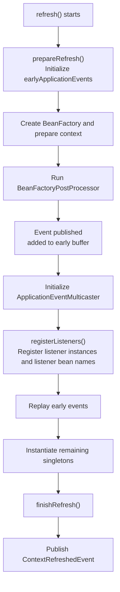

# Handling Early Events Published During Spring Framework Startup

During the startup of a Spring ApplicationContext, a component may need to publish an event before the context's event multicaster and all listeners are ready. For example, a BeanFactoryPostProcessor might announce a configuration preparation step, or an initialization component might need to notify listeners that a resource has been discovered.

Spring Framework provides a mechanism to temporarily hold application events published in the early stages of refresh. Once the listener registration step is reached, the context replays the buffered events to matching ApplicationListeners. This mechanism is commonly referred to as **early application events**.

It is important to distinguish events published during refresh from events published before calling refresh. The early buffer is initialized inside the refresh process; therefore, you should not call publishEvent on an unrefreshed context and expect the event to be replayed afterward.

## 1. Why Handle Early Events?

A context does not initialize all components at the same moment. During refresh, Spring sequentially prepares the Environment, creates the BeanFactory, executes BeanFactoryPostProcessors, registers BeanPostProcessors, initializes the event multicaster, registers listeners, instantiates the remaining singletons, and finally publishes ContextRefreshedEvent.

Some extension steps may publish events before the multicaster is set up or before listeners are registered. If Spring discarded those events, listeners registered at a later step would never know the occurrence happened.

For example:

- A BeanFactoryPostProcessor publishes a notification after reading or adjusting bean definitions.
- An extension component emits a signal upon discovering a configuration or plugin.
- A context preparation step publishes information for registered listeners to receive and process afterward.

The early event buffer bridges this window during a refresh. It holds events until the context registers listeners, then dispatches the waiting events.

## 2. The Refresh Lifecycle and Where the Early Event Buffer Fits

This mechanism lives within the refresh process of AbstractApplicationContext. The main flow can be viewed in the following sequence:



Key milestones:

1. **prepareRefresh():** Spring prepares the context for refresh and initializes the collection storing early-published events.
2. **invokeBeanFactoryPostProcessors():** BeanFactoryPostProcessors are invoked before regular application singletons are instantiated. A processor may publish events during this phase.
3. **initApplicationEventMulticaster():** Spring creates or retrieves the ApplicationEventMulticaster used to dispatch events.
4. **registerListeners():** Spring adds directly registered ApplicationListeners and discovers beans implementing ApplicationListener.
5. **Replay early events:** After listeners are registered, Spring takes the buffered events and passes them through the multicaster.
6. **finishBeanFactoryInitialization():** Spring instantiates the remaining singletons.
7. **finishRefresh():** Spring finishes the refresh and publishes ContextRefreshedEvent.

Before registerListeners(), publishEvent places events into the early buffer. Once registerListeners() finishes registering listeners, Spring resets the buffer so it stops collecting and replays the saved events.

Thus, an event published from a BeanFactoryPostProcessor can be received by a listener even if the listener bean has not yet been instantiated at publication time. Spring registers the listener bean names first, and the multicaster retrieves the instance when dispatch is needed.

## 3. Early Events vs. Events Published Before Refresh

These two cases are easily confused:

### Events Published During Refresh

Once refresh has started, prepareRefresh() has created the early event buffer. If an event is published before registerListeners() completes, Spring holds the event and dispatches it to listeners after registration.

For instance, a BeanFactoryPostProcessor runs during refresh and calls publishEvent. This is the scenario the early event buffer is designed to handle.

### Events Published Before Refresh Begins

If you create a context and call publishEvent before refresh(), the context has not yet initialized the early event buffer or the event multicaster. That event is not retained by the context for automatic replay after refresh.

```java
var context = new AnnotationConfigApplicationContext();

// Do not expect this event to be retained for listeners after refresh.
context.publishEvent(new StartupMarkerEvent(context, "too-early"));

context.register(AppConfig.class);
context.refresh();
```

If listeners must receive an event during startup, publish the event from a callback that actually runs inside refresh, or register listeners before refresh and choose an appropriate publication point. Do not use publishEvent before refresh as a startup queue.

## 4. Who Receives Early Events?

Early events are replayed through the ApplicationEventMulticaster after Spring registers the listeners the context knows about at the registerListeners() step.

There are two main groups:

- **Directly registered listener instances:** for example, context.addApplicationListener(listener) called before refresh.
- **Listener beans implementing ApplicationListener:** Spring detects the bean type in the context and registers the bean name with the multicaster.

A listener implementing ApplicationListener can receive an early event even if the listener instance has not yet been created when the publisher emits the event. During replay, the multicaster can retrieve the bean from the BeanFactory and invoke the listener.

### Note on @EventListener

Methods annotated with @EventListener are converted into listener adapters by EventListenerMethodProcessor. This processor registers method listeners inside the afterSingletonsInstantiated() callback, at the end of singleton instantiation.

Early events are replayed during registerListeners(), before Spring finishes instantiating regular singletons. Therefore, do not rely on @EventListener methods to receive events published very early during refresh. If you need to handle such events, use a pre-registered ApplicationListener or a bean implementing ApplicationListener that the context discovers at registerListeners().

## 5. Complete Example: BeanFactoryPostProcessor Publishing an Early Event

The example below uses Java 17 and Spring Framework 6.2. A BeanFactoryPostProcessor publishes a StartupMarkerEvent during refresh. A bean implementing ApplicationListener receives the event when Spring replays the early buffer.

The example uses plain Spring Context, without Spring Boot.

### 5.1. Project Structure

```text
spring-early-application-event/
├── pom.xml
└── src/
    └── main/
        └── java/
            └── dev/
                └── example/
                    └── earlyevent/
                        └── Application.java
```

### 5.2. Maven Dependencies

```xml
<project xmlns="http://maven.apache.org/POM/4.0.0"
         xmlns:xsi="http://www.w3.org/2001/XMLSchema-instance"
         xsi:schemaLocation="http://maven.apache.org/POM/4.0.0 https://maven.apache.org/xsd/maven-4.0.0.xsd">
    <modelVersion>4.0.0</modelVersion>

    <groupId>dev.example</groupId>
    <artifactId>spring-early-application-event</artifactId>
    <version>1.0.0</version>

    <properties>
        <maven.compiler.release>17</maven.compiler.release>
        <project.build.sourceEncoding>UTF-8</project.build.sourceEncoding>
    </properties>

    <dependencies>
        <dependency>
            <groupId>org.springframework</groupId>
            <artifactId>spring-context</artifactId>
            <version>6.2.6</version>
        </dependency>
    </dependencies>

    <build>
        <plugins>
            <plugin>
                <groupId>org.apache.maven.plugins</groupId>
                <artifactId>maven-compiler-plugin</artifactId>
                <version>3.13.0</version>
                <configuration>
                    <release>17</release>
                </configuration>
            </plugin>
            <plugin>
                <groupId>org.codehaus.mojo</groupId>
                <artifactId>exec-maven-plugin</artifactId>
                <version>3.5.0</version>
                <configuration>
                    <mainClass>dev.example.earlyevent.Application</mainClass>
                </configuration>
            </plugin>
        </plugins>
    </build>
</project>
```

### 5.3. Source Code

Create the file src/main/java/dev/example/earlyevent/Application.java:

```java
package dev.example.earlyevent;

import org.springframework.beans.factory.config.BeanFactoryPostProcessor;
import org.springframework.beans.factory.config.ConfigurableListableBeanFactory;
import org.springframework.context.ApplicationEvent;
import org.springframework.context.ApplicationEventPublisher;
import org.springframework.context.ApplicationEventPublisherAware;
import org.springframework.context.ApplicationListener;
import org.springframework.context.annotation.AnnotationConfigApplicationContext;
import org.springframework.context.annotation.Bean;
import org.springframework.context.annotation.Configuration;

public class Application {

    public static void main(String[] args) {
        try (var context = new AnnotationConfigApplicationContext()) {
            context.register(AppConfig.class);

            // EarlyEventPublisher publishes the event inside refresh().
            context.refresh();
        }
    }

    @Configuration(proxyBeanMethods = false)
    public static class AppConfig {

        // BeanFactoryPostProcessor should be declared with a static @Bean method.
        @Bean
        public static EarlyEventPublisher earlyEventPublisher() {
            return new EarlyEventPublisher();
        }

        // Spring detects beans implementing ApplicationListener
        // during the registerListeners() step.
        @Bean
        public StartupListener startupListener() {
            return new StartupListener();
        }
    }

    public static class StartupMarkerEvent extends ApplicationEvent {
        private final String marker;

        public StartupMarkerEvent(Object source, String marker) {
            super(source);
            this.marker = marker;
        }

        public String getMarker() {
            return marker;
        }
    }

    public static class EarlyEventPublisher
            implements BeanFactoryPostProcessor,
                       ApplicationEventPublisherAware {

        private ApplicationEventPublisher eventPublisher;

        @Override
        public void setApplicationEventPublisher(
                ApplicationEventPublisher eventPublisher
        ) {
            this.eventPublisher = eventPublisher;
        }

        @Override
        public void postProcessBeanFactory(
                ConfigurableListableBeanFactory beanFactory
        ) {
            System.out.println(
                    "BeanFactoryPostProcessor: publishing event during refresh"
            );

            eventPublisher.publishEvent(
                    new StartupMarkerEvent(this, "catalog-index-ready")
            );
        }
    }

    public static class StartupListener
            implements ApplicationListener<StartupMarkerEvent> {

        @Override
        public void onApplicationEvent(StartupMarkerEvent event) {
            System.out.println(
                    "StartupListener received early event: "
                            + event.getMarker()
            );
        }
    }
}
```

### 5.4. Why Does This Example Receive the Event?

When the context calls refresh(), Spring initializes the early event buffer in prepareRefresh(). Spring then creates the BeanFactory and invokes EarlyEventPublisher.postProcessBeanFactory(...).

EarlyEventPublisher receives ApplicationEventPublisher via ApplicationEventPublisherAware. When publishEvent() is called, the event is placed in the buffer because the registerListeners() step has not yet occurred.

Next, Spring initializes the event multicaster, discovers beans implementing ApplicationListener, and registers StartupListener. During registerListeners(), Spring replays the buffered event. StartupListener receives the event and prints the marker to the console.

The @Bean method for EarlyEventPublisher is declared static to avoid instantiating the configuration class prematurely just to create a BeanFactoryPostProcessor. This is the proper declaration style for BeanFactoryPostProcessor beans.

### 5.5. Running the Program

Open a terminal in the directory containing pom.xml and run:

```bash
mvn -q compile exec:java
```

Expected stdout:

```text
BeanFactoryPostProcessor: publishing event during refresh
StartupListener received early event: catalog-index-ready
```

The first line appears when the BeanFactoryPostProcessor publishes the event. The second line appears when Spring replays the event after registering StartupListener. The listener does not need to be instantiated before publication; the context only needs to know about the listener bean to register it during registerListeners().

## 6. Early Events and ContextRefreshedEvent

Early events should not be used as a substitute for ContextRefreshedEvent.

An **early application event** is a business or custom event published in the early stage of refresh. Spring temporarily buffers the event and replays it during registerListeners().

**ContextRefreshedEvent** is Spring's standard lifecycle event, published during finishRefresh() after non-lazy singletons have been instantiated. It signals that the context has completed its refresh process.

| Characteristic | Early application event | ContextRefreshedEvent |
|---|---|---|
| Source | Application or framework component during refresh | Spring context |
| Timing | Before or during registerListeners(), while the buffer is active | End of refresh |
| Purpose | Preserve information emitted before listeners are ready | Announce that the context has finished refreshing |
| Regular singletons | Not guaranteed to be fully instantiated | Non-lazy singletons have finished instantiation |
| Automatically replayed? | Yes, within the same refresh | Not an event log; emitted when refresh completes |

If a listener needs to run after regular singletons have been instantiated, consider listening for ContextRefreshedEvent. If it needs to run right at the end of singleton instantiation, consider SmartInitializingSingleton. Choose the callback matching the lifecycle milestone you actually need.

In Spring Boot applications, ApplicationStartedEvent and ApplicationReadyEvent belong to Spring Boot's event hierarchy, not Spring Framework's core lifecycle events. Only use them when the application actually runs on Spring Boot and the requirement aligns with Boot's startup milestones.

## 7. Limitations and Risks When Handling Early Events

### Listeners May Run Before the Entire Application Is Ready

Early events are replayed during registerListeners(), before finishBeanFactoryInitialization(). Therefore, even though the listener successfully receives the event, do not assume all other singletons have been instantiated.

A listener with dependencies on other services can cause those services to be instantiated early when the multicaster retrieves the listener bean. Avoid calling components that depend on incomplete startup state or performing heavy work in this callback.

If work is only valid after all singletons are ready, use ContextRefreshedEvent or a more appropriate lifecycle callback.

### Synchronous Listeners Can Affect the Refresh Process

The default multicaster processes listeners synchronously. When early events are replayed, listeners are invoked right on the refresh thread. If a listener takes a long time, the entire startup slows down.

If a listener throws an unhandled exception, the error can escape dispatch and cause refresh to fail. Keep early event handling brief, define clear error handling, and avoid relying on external services that are not yet ready.

### Not a Durable Queue

The early event buffer is only an in-memory buffer for a single context and a single refresh. It does not persist events to a database, does not retry after a process stops, and does not provide historical replay for a restarted context.

If durability, retries, or cross-process delivery are needed, use a message broker or transactional outbox. Do not use the early event buffer as a substitute messaging mechanism.

### Do Not Publish Events Before Refresh Expecting Replay

Before refresh begins, the early buffer has not been initialized. If you need to notify listeners during startup, place the publishEvent call inside an appropriate refresh phase or use an official lifecycle callback.

### Do Not Rely on @EventListener for the Early Replay Window

@EventListener method adapters are registered by EventListenerMethodProcessor at the end of singleton pre-instantiation. Meanwhile, early events have already been replayed earlier in registerListeners(). Use ApplicationListener if you must receive events emitted from a BeanFactoryPostProcessor or similarly early stages.

## 8. Common Errors

| Symptom | Common Cause | Resolution |
|---|---|---|
| Listener does not receive event published before refresh | The event was published before the buffer was initialized and before the multicaster was ready | Publish the event inside a callback that belongs to refresh |
| Listener does not receive an early event | The listener was not registered prior to the replay point | Register ApplicationListener directly before refresh or declare a bean implementing ApplicationListener |
| @EventListener method misses the early event | The adapter is registered after singletons are instantiated | Use ApplicationListener for very early events |
| Listener accesses a service that is not ready | Early replay happens before finishBeanFactoryInitialization | Only use dependencies safe at this stage or move processing to ContextRefreshedEvent |
| Refresh fails when replaying events | A synchronous listener throws an unhandled exception | Handle exceptions and keep startup callbacks short |
| Event is processed twice | The same listener was registered via multiple mechanisms or publish logic runs repeatedly | Check registration sources and ensure idempotency when needed |
| Expecting events to replay after a process restart | Confusing the early buffer with a message broker | Use a durable event persistence mechanism |

## 9. Checklist for Publishing Events During Startup

- Determine whether the event is published during refresh or before refresh begins.
- If early replay is needed, publish the event after prepareRefresh() has initialized the buffer and before registerListeners() completes.
- Register listeners via ApplicationListener before refresh or declare a bean implementing ApplicationListener.
- Do not depend on @EventListener methods for very early events.
- Keep listener callbacks short and do not assume all singletons are ready.
- Handle exceptions to avoid breaking the refresh process.
- Use ContextRefreshedEvent if you need the milestone where context refresh has finished.
- Use SmartInitializingSingleton if work must run after regular singletons are created.
- Use a message broker or transactional outbox if durable storage, retries, or replay are required.

Early application events prevent Spring from losing events emitted in the initial stages of refresh simply because the event multicaster and listeners are not yet ready. Understand the buffering window accurately, register listeners with ApplicationListener when early receipt is needed, and choose ContextRefreshedEvent for work that should only run after the context has finished refreshing.
