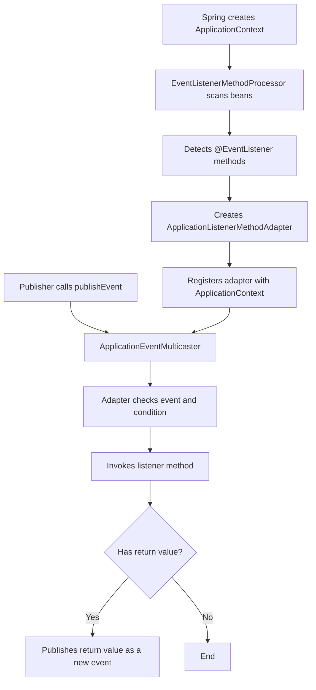

# The @EventListener Annotation

## 1. What Is @EventListener Used For?

`@EventListener` is a Spring annotation used to mark a method that receives and handles an application event. When Spring creates the ApplicationContext, the event annotation infrastructure detects the annotated methods, creates corresponding adapters, and registers those adapters with the context's event dispatch mechanism.

A service or component emits an event using `ApplicationEventPublisher.publishEvent(...)`. The ApplicationEventMulticaster dispatches the event to matching listeners; the adapter created from `@EventListener` invokes the annotated method.

As a result, the publisher only needs to know the event type and the data to emit. The publisher does not need to look up listener beans, invoke listener methods directly, or manage a list of interested components.

Minimal example:

```java
@Component
public class OrderListener {

    @EventListener
    public void onOrderPlaced(OrderPlaced event) {
        System.out.println("Received: " + event.orderId());
    }
}
```

When `publishEvent(new OrderPlaced("ORD-100"))` is called somewhere, Spring invokes `onOrderPlaced` if the listener is registered in the context and the event type matches.

`@EventListener` belongs to the listener declaration layer. It is not a publisher, not a standalone event bus, and does not automatically make a method run asynchronously.

## 2. How Does Spring Detect and Register Listener Methods?

During ApplicationContext initialization, Spring registers the infrastructure components that process annotations. `EventListenerMethodProcessor` scans beans for methods annotated with `@EventListener`. For each valid method, Spring creates an `ApplicationListenerMethodAdapter` and registers that adapter as an application listener.

Overview flow:



You do not need to manually create adapters or call `addApplicationListener` for regular annotated methods. Let Spring manage the beans and the annotation infrastructure.

Conditions for a listener to work:

- The class containing the method must be a Spring-managed bean, such as one annotated with `@Component`, `@Service`, or declared via `@Bean`.
- The ApplicationContext must have the event annotation infrastructure enabled. Annotation-based contexts such as `AnnotationConfigApplicationContext` register this infrastructure automatically.
- The event must be published in the context where the listener is registered, or propagated through an appropriate context hierarchy.
- The event type and the listener's condition must match the published event.

Placing `@EventListener` on a class does not turn the whole class into a listener. The annotation must be placed on the event-handling method.

## 3. Listener Method Parameters

The common usage is to declare a single parameter with the event type to receive:

```java
@EventListener
public void handle(OrderPlaced event) {
    // Handle the event.
}
```

The parameter type determines which kind of event the method wants to receive. For example, a listener accepting `OrderPlaced` does not automatically receive every other event type.

Spring supports both forms of events:

- **ApplicationEvent subclass:** an event class extending `ApplicationEvent`; the method accepts that exact event class or a compatible supertype.
- **Payload object:** a record, POJO, or ordinary object published directly. Spring wraps the object in `PayloadApplicationEvent`, while an annotated listener can receive the payload type directly.

Payload example:

```java
public record OrderPlaced(String orderId, BigDecimal total) {
}
```

```java
@EventListener
public void handle(OrderPlaced event) {
    System.out.println(event.orderId());
}
```

You do not need an `ApplicationEvent` parameter if you are publishing a payload record. Declare the actual data type that the listener needs to handle.

A typical method accepts one event parameter. The annotation also has a `classes` attribute (an alias for `value`) to explicitly specify one or more event classes; when using this attribute, the method is expected to declare no parameters. This is useful when the same method only needs to perform a common action for multiple event classes without reading their payloads.

## 4. Filtering Events with the condition Attribute

The `condition` attribute accepts a Spring Expression Language (SpEL) expression. Spring invokes the method only when the expression evaluates to `true`.

Event example:

```java
public record OrderPlaced(String orderId, BigDecimal total) {
    public boolean isHighValue() {
        return total.compareTo(new BigDecimal("100")) >= 0;
    }
}
```

A listener that only records audits for orders valued at 100 or more:

```java
@Component
public class HighValueOrderListener {

    @EventListener(condition = "#root.args[0].isHighValue()")
    public void audit(OrderPlaced event) {
        System.out.println("High-value order: " + event.orderId());
    }
}
```

Inside the expression:

- `#root.event` references the event currently being processed.
- `#root.args` contains the arguments passed to the listener method.
- `#a0` or `#p0` can reference the first parameter.
- A parameter name such as `#event` can be used when parameter names are preserved in compilation metadata.

Using `#root.args[0]` keeps the example independent of whether the compiler preserves parameter names. Expressions can invoke methods, read properties, and use SpEL operators.

`condition` is well suited for short, easy-to-understand predicates such as status, event type, or value thresholds. If a condition involves multiple queries, many branches, or complex business logic, move that decision into a clearly named service or component. Conditions are evaluated while the listener is being considered; you should not place side effects inside the expression.

## 5. Processing Order with @Order

An event can be received by multiple `@EventListener` methods. If you need to specify the invocation order, you can place `@Order` on the listener method or class:

```java
@Component
public class InventoryListener {

    @EventListener
    @Order(1)
    public void reserve(OrderPlaced event) {
        System.out.println("Reserve inventory");
    }
}

@Component
public class AuditListener {

    @EventListener
    @Order(2)
    public void record(OrderPlaced event) {
        System.out.println("Record audit");
    }
}
```

Smaller order values have higher priority. This ordering is useful when synchronous listeners must be called in a deterministic sequence.

Do not treat `@Order` as a workflow orchestration mechanism. When listeners run asynchronously, task submission order does not guarantee completion order. If step B may only run after step A succeeds, express that relationship explicitly in a service or workflow.

## 6. A Listener Method Can Return a New Event

An `@EventListener` method can return an object. Spring publishes the returned value as a new application event. If it returns a collection or array, the elements are published as separate events.

Example:

```java
@Component
public class OrderAcknowledgementListener {

    @EventListener
    public OrderAcknowledged acknowledge(OrderPlaced event) {
        return new OrderAcknowledged(event.orderId());
    }
}
```

The follow-up event:

```java
public record OrderAcknowledged(String orderId) {
}
```

Another listener can receive `OrderAcknowledged`:

```java
@Component
public class AcknowledgementLogListener {

    @EventListener
    public void log(OrderAcknowledged event) {
        System.out.println("Acknowledged: " + event.orderId());
    }
}
```

This creates a small event chain without directly calling the next listener. However, avoid event loops: listener A emitting event B while listener B emits event A without a stopping condition.

A method returns `void` when it does not need to emit a new event. If a listener is annotated with `@Async`, its return value is not used to publish a new event via `@EventListener`'s return-value mechanism; publish events explicitly when coordinating with asynchronous processing.

## 7. Runnable Java 17 + Spring Context Example

The example below uses Java 17, Spring Context 6.2.0, and Maven. A service publishes `OrderPlaced`; two listeners handle the event, with the second listener only accepting high-value orders. The first listener returns `OrderAcknowledged`, and then a third listener receives this new event.

Directory structure:

```text
event-listener-demo/
├── pom.xml
└── src/main/java/com/example/events/
    ├── Application.java
    ├── OrderPlaced.java
    ├── OrderAcknowledged.java
    ├── OrderService.java
    ├── InventoryListener.java
    ├── HighValueOrderListener.java
    └── AcknowledgementLogListener.java
```

**pom.xml**

```xml
<project xmlns="http://maven.apache.org/POM/4.0.0"
         xmlns:xsi="http://www.w3.org/2001/XMLSchema-instance"
         xsi:schemaLocation="http://maven.apache.org/POM/4.0.0 https://maven.apache.org/xsd/maven-4.0.0.xsd">
    <modelVersion>4.0.0</modelVersion>

    <groupId>com.example</groupId>
    <artifactId>event-listener-demo</artifactId>
    <version>1.0.0</version>

    <properties>
        <maven.compiler.release>17</maven.compiler.release>
        <project.build.sourceEncoding>UTF-8</project.build.sourceEncoding>
        <spring.version>6.2.0</spring.version>
    </properties>

    <dependencies>
        <dependency>
            <groupId>org.springframework</groupId>
            <artifactId>spring-context</artifactId>
            <version>${spring.version}</version>
        </dependency>
    </dependencies>

    <build>
        <plugins>
            <plugin>
                <groupId>org.apache.maven.plugins</groupId>
                <artifactId>maven-compiler-plugin</artifactId>
                <version>3.13.0</version>
            </plugin>
            <plugin>
                <groupId>org.codehaus.mojo</groupId>
                <artifactId>exec-maven-plugin</artifactId>
                <version>3.5.0</version>
                <configuration>
                    <mainClass>com.example.events.Application</mainClass>
                </configuration>
            </plugin>
        </plugins>
    </build>
</project>
```

**OrderPlaced.java**

```java
package com.example.events;

import java.math.BigDecimal;

public record OrderPlaced(String orderId, BigDecimal total) {
    public boolean isHighValue() {
        return total.compareTo(new BigDecimal("100")) >= 0;
    }
}
```

**OrderAcknowledged.java**

```java
package com.example.events;

public record OrderAcknowledged(String orderId) {
}
```

**OrderService.java**

```java
package com.example.events;

import java.math.BigDecimal;
import org.springframework.context.ApplicationEventPublisher;
import org.springframework.stereotype.Service;

@Service
public class OrderService {
    private final ApplicationEventPublisher eventPublisher;

    public OrderService(ApplicationEventPublisher eventPublisher) {
        this.eventPublisher = eventPublisher;
    }

    public void placeOrder(String orderId, BigDecimal total) {
        eventPublisher.publishEvent(new OrderPlaced(orderId, total));
    }
}
```

**InventoryListener.java**

```java
package com.example.events;

import org.springframework.context.event.EventListener;
import org.springframework.core.annotation.Order;
import org.springframework.stereotype.Component;

@Component
public class InventoryListener {

    @EventListener
    @Order(1)
    public OrderAcknowledged reserve(OrderPlaced event) {
        System.out.println("Inventory reserved: " + event.orderId());
        return new OrderAcknowledged(event.orderId());
    }
}
```

**HighValueOrderListener.java**

```java
package com.example.events;

import org.springframework.context.event.EventListener;
import org.springframework.core.annotation.Order;
import org.springframework.stereotype.Component;

@Component
public class HighValueOrderListener {

    @EventListener(condition = "#root.args[0].isHighValue()")
    @Order(2)
    public void audit(OrderPlaced event) {
        System.out.println("High-value audit: " + event.orderId());
    }
}
```

**AcknowledgementLogListener.java**

```java
package com.example.events;

import org.springframework.context.event.EventListener;
import org.springframework.stereotype.Component;

@Component
public class AcknowledgementLogListener {

    @EventListener
    public void log(OrderAcknowledged event) {
        System.out.println("Acknowledged: " + event.orderId());
    }
}
```

**Application.java**

```java
package com.example.events;

import java.math.BigDecimal;
import org.springframework.context.annotation.AnnotationConfigApplicationContext;

public class Application {
    public static void main(String[] args) {
        try (var context = new AnnotationConfigApplicationContext(
                OrderService.class,
                InventoryListener.class,
                HighValueOrderListener.class,
                AcknowledgementLogListener.class
        )) {
            context.getBean(OrderService.class)
                    .placeOrder("ORD-100", new BigDecimal("150.00"));
        }
    }
}
```

Run from the project directory using Java 17 and Maven:

```bash
mvn -q compile exec:java
```

Stdout:

```text
Inventory reserved: ORD-100
Acknowledged: ORD-100
High-value audit: ORD-100
```

In the example, `InventoryListener.reserve` is called first according to `@Order(1)`. The method returns `OrderAcknowledged`, Spring publishes that object as a new event, and `AcknowledgementLogListener` receives it. Then the remaining listener for the original event is called in the declared order. The entire example runs synchronously on the same thread.

## 8. Synchronous and Asynchronous Execution with @Async

By default, an `@EventListener` method runs synchronously on the thread that publishes the event. The publisher continues only after all synchronous listeners finish. Long-running listeners increase the processing time of the request or task emitting the event; synchronous exceptions can propagate back to the publisher.

You can combine `@Async` with `@EventListener` to run the method on a Spring-managed executor:

```java
import org.springframework.context.annotation.Configuration;
import org.springframework.scheduling.annotation.EnableAsync;

@Configuration
@EnableAsync
public class AsyncConfiguration {
}
```

```java
import org.springframework.scheduling.annotation.Async;
import org.springframework.stereotype.Component;
import org.springframework.context.event.EventListener;

@Component
public class EmailListener {

    @Async
    @EventListener
    public void sendEmail(OrderPlaced event) {
        // Send email in a thread managed by the async executor.
    }
}
```

Points to remember:

- `@EnableAsync` enables async annotation processing; without this configuration, `@Async` will not move the method onto an executor.
- Exceptions in an async listener do not propagate back to the publisher thread. For `void` methods, configure an `AsyncUncaughtExceptionHandler` to handle errors not returned through a Future.
- Bound the thread pool and queue, monitor rejected tasks, and establish a proper shutdown policy.
- Do not assume completion order among async listeners.
- Transaction, security context, and thread-local state are not automatically propagated to another thread.
- The return value of an `@EventListener` method annotated with `@Async` is not used to emit a subsequent event; if needed, call the publisher explicitly in the appropriate processing flow.

In addition to `@Async`, you can configure a `TaskExecutor` directly on `SimpleApplicationEventMulticaster`. That is a dispatch-layer mechanism, distinct from method-level async proxying. Choose one approach clearly so you do not accidentally create multiple executor layers.

## 9. Relationship with Transactions

A regular `@EventListener` runs immediately when the event is dispatched by the multicaster. If a service publishes an event inside a `@Transactional` method, the listener may run before the transaction commits. If the transaction rolls back, side effects already performed by the listener are not automatically undone.

When you need execution tied to a transaction phase, use `@TransactionalEventListener`, which is a listener variant bound to transaction synchronization:

```java
import org.springframework.stereotype.Component;
import org.springframework.transaction.event.TransactionPhase;
import org.springframework.transaction.event.TransactionalEventListener;

@Component
public class SearchIndexListener {

    @TransactionalEventListener(phase = TransactionPhase.AFTER_COMMIT)
    public void updateIndex(OrderPlaced event) {
        // Update index only after the transaction commits.
    }
}
```

Common phases:

- `BEFORE_COMMIT`: before the transaction commits.
- `AFTER_COMMIT`: after a successful commit; this is the default.
- `AFTER_ROLLBACK`: after a rollback.
- `AFTER_COMPLETION`: after the transaction completes, whether committed or rolled back.

By default, a transactional listener does not run if there is no active transaction. `fallbackExecution = true` allows fallback execution when no transaction is present, but should only be enabled if the business logic accepts running the listener immediately in that case.

A transactional listener does not turn an event into a durable message. If you need guaranteed delivery to external systems across process crashes or network failures, consider a transactional outbox or a message broker.

## 10. Exceptions, Conditions, and Design Considerations

For synchronous listeners, an exception thrown by a method can escape the event publishing call and interrupt further dispatch, depending on the multicaster's ErrorHandler. Therefore, distinguish mandatory business errors from auxiliary listener errors. Do not catch and silently ignore all exceptions without recording them.

Some practical guidelines:

- Keep listener methods short, clearly expressing a single reaction to an event.
- Do not use conditions to perform side effects or complex queries.
- Do not infinitely re-publish the same input event.
- Avoid building dependency chains between listeners using `@Order`; use a workflow/service if business ordering is required.
- Payloads should be immutable and contain required IDs/data rather than holding mutable entities or application dependencies.
- Use a correlation ID or business ID in logs to trace an event across multiple listeners.
- If a listener performs work that must be retried or reliably delivered, implement proper state persistence and retry mechanisms; in-memory events do not provide those guarantees.

## 11. Testing Listeners

Tests should cover both that the method is invoked properly and that filtering conditions behave correctly:

- **Listener unit test:** call the method directly with a sample event to test handling logic. This tests the method logic, not Spring's annotation detection.
- **Integration test:** initialize the Spring context, publish an event via `ApplicationEventPublisher`, and verify side effects to test both the annotation infrastructure and the multicaster.
- **Condition test:** publish events that satisfy and do not satisfy the condition, verifying that only matching events are processed.
- **Return-value test:** verify that an event returned by a listener is published and that listeners for the new event are invoked.
- **Async test:** use `CountDownLatch`, futures, or explicit synchronization mechanisms; avoid `Thread.sleep` as it can make tests flaky.
- **Transactional test:** test the listener at the appropriate phase after commit or rollback, rather than just calling the listener method directly.

For example, testing a condition at the integration-test level should create a context with `HighValueOrderListener`, publish two `OrderPlaced` events with different total amounts, and verify that the audit side effect appears only for orders valued at 100 or more.

## 12. Common Pitfalls

| Symptom | Common Cause | How to Check |
|---|---|---|
| Method is not invoked | Class is not a Spring bean or annotation infrastructure is inactive | Check component scanning and how ApplicationContext is created. |
| Listener does not receive event | Parameter type is incompatible with event payload | Check the published object and the listener parameter type. |
| Listener receives only some events | SpEL condition returns false | Check the expression and event arguments. |
| Returned event does not trigger another listener | Method returns void, or async listener prevents return value from being published | Check the return type and execution mode. |
| Publisher is slow | Listener runs synchronously and takes a long time | Measure listener duration; consider controlled async execution. |
| Listener runs before commit | Standard `@EventListener` is used | Use `@TransactionalEventListener` with the appropriate phase. |
| Listeners run in unexpected order | Order not declared or running asynchronously | Check `@Order`; do not rely on completion order of async tasks. |
| Listener fails but publisher receives no exception | Listener runs asynchronously or ErrorHandler handled the error | Check executor, ErrorHandler, and logs. |

## 13. Checklist When Using @EventListener

1. Place the listener method inside a Spring-managed bean.
2. Choose the right event or payload type as the parameter.
3. Use `condition` for short, clear SpEL filters.
4. Use `@Order` only when synchronous listener invocation order is required.
5. Return an object only when intentionally emitting a subsequent event.
6. Explicitly decide whether the listener runs synchronously, asynchronously, or tied to a transaction phase.
7. Design exception logging and task observability.
8. Test through ApplicationContext when you need to verify annotation infrastructure.
9. Avoid using in-memory application events as a durable cross-service messaging solution.

`@EventListener` makes it straightforward to declare reactions to application events directly on handling methods. When you understand how Spring detects adapters, selects events by type and condition, and how return values, async execution, and transactions affect execution timing, you can write concise listeners while maintaining full control over the entire event flow.