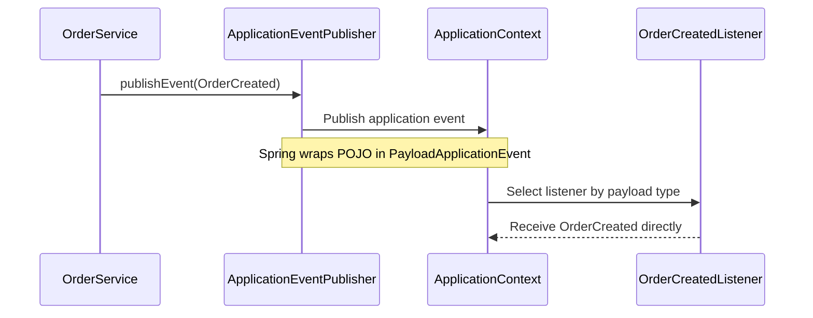

# Listeners Receiving Payloads Directly

## 1. Purpose of Payload Listeners

Spring Application Events allows a bean to broadcast a notification about an occurrence so other beans can handle it. The publishing bean uses `ApplicationEventPublisher`; it does not need to call individual listeners directly or know which listeners exist.

Since Spring Framework 4.2, the published object does not have to extend `ApplicationEvent`. You can pass a Java record, DTO, or POJO directly into `publishEvent(Object event)`. Listeners can then declare that exact object type as their parameter:

```java
@EventListener
public void onOrderCreated(OrderCreated event) {
    System.out.println(event.orderId());
}
```

This is direct payload listening. The method does not need to accept `ApplicationEvent`, cast types, or unwrap Spring's envelope manually. The parameter type clearly expresses which business data the listener cares about.

## 2. Flow of Publishing and Receiving Payloads



The process unfolds as follows:

1. The service creates an object containing event data, such as `new OrderCreated("ORD-59")`.
2. The service calls `publisher.publishEvent(event)`.
3. If the object is not an `ApplicationEvent`, Spring creates a `PayloadApplicationEvent<T>` to carry that object within the event system.
4. Spring finds registered listeners whose parameter type is compatible with the payload.
5. The `@EventListener` adapter extracts the payload from the wrapper and invokes the method with the original object.

`PayloadApplicationEvent` is an internal Spring integration detail. For typical listeners, declare the concrete payload type so the code stays readable and easy to test.

## 3. How Spring Matches Payload Types to Listeners

The parameter type of an `@EventListener` method is used to determine which kind of event the method wants to receive. For example:

| Listener Parameter | Receivable Payloads |
|---|---|
| `OrderCreated` | Objects of type `OrderCreated`. |
| `DomainEvent` | Objects implementing `DomainEvent`, such as `OrderCreated` if the record implements that interface. |
| `Object` | Very broad scope; can receive many kinds of payloads. |

Example using a common interface:

```java
public interface DomainEvent {
}

public record OrderCreated(String orderId) implements DomainEvent {
}

public record PaymentReceived(String paymentId) implements DomainEvent {
}

@EventListener
public void audit(DomainEvent event) {
    // Receives payloads implementing DomainEvent.
}
```

The `audit` listener can receive both `OrderCreated` and `PaymentReceived` because both types implement `DomainEvent`. If a listener serves only one event type, use the concrete type to avoid receiving unintended data.

Do not declare `Object` and cram every business concern into a single method with many `instanceof` branches. That forfeits type safety and forces the listener to know about too many event types.

## 4. Complete Runnable Example with Java 17

This example uses plain Spring Context without Spring Boot. `OrderService` publishes an `OrderCreated` record; `OrderCreatedListener` receives the record directly and prints the order ID.

### Directory Structure

```text
direct-payload-event/
├── pom.xml
└── src/
    └── main/
        └── java/
            └── demo/
                └── App.java
```

### pom.xml

```xml
<project xmlns="http://maven.apache.org/POM/4.0.0"
         xmlns:xsi="http://www.w3.org/2001/XMLSchema-instance"
         xsi:schemaLocation="http://maven.apache.org/POM/4.0.0 https://maven.apache.org/xsd/maven-4.0.0.xsd">
    <modelVersion>4.0.0</modelVersion>
    <groupId>demo</groupId>
    <artifactId>direct-payload-event</artifactId>
    <version>1.0.0</version>

    <properties>
        <maven.compiler.release>17</maven.compiler.release>
        <project.build.sourceEncoding>UTF-8</project.build.sourceEncoding>
        <spring-framework.version>6.2.0</spring-framework.version>
    </properties>

    <dependencies>
        <dependency>
            <groupId>org.springframework</groupId>
            <artifactId>spring-context</artifactId>
            <version>${spring-framework.version}</version>
        </dependency>
    </dependencies>

    <build>
        <plugins>
            <plugin>
                <groupId>org.apache.maven.plugins</groupId>
                <artifactId>maven-compiler-plugin</artifactId>
                <version>3.13.0</version>
            </plugin>
            <plugin>
                <groupId>org.codehaus.mojo</groupId>
                <artifactId>exec-maven-plugin</artifactId>
                <version>3.5.0</version>
                <configuration>
                    <mainClass>demo.App</mainClass>
                </configuration>
            </plugin>
        </plugins>
    </build>
</project>
```

### src/main/java/demo/App.java

```java
package demo;

import org.springframework.context.ApplicationEventPublisher;
import org.springframework.context.annotation.AnnotationConfigApplicationContext;
import org.springframework.context.annotation.Bean;
import org.springframework.context.annotation.Configuration;
import org.springframework.context.event.EventListener;

public class App {

    public static void main(String[] args) {
        try (var context = new AnnotationConfigApplicationContext(AppConfig.class)) {
            context.getBean(OrderService.class).createOrder();
        }
    }

    @Configuration
    static class AppConfig {

        @Bean
        OrderService orderService(ApplicationEventPublisher publisher) {
            return new OrderService(publisher);
        }

        @Bean
        OrderCreatedListener orderCreatedListener() {
            return new OrderCreatedListener();
        }
    }

    static class OrderService {
        private final ApplicationEventPublisher publisher;

        OrderService(ApplicationEventPublisher publisher) {
            this.publisher = publisher;
        }

        void createOrder() {
            publisher.publishEvent(new OrderCreated("ORD-2026-059", 3));
        }
    }

    static class OrderCreatedListener {

        @EventListener
        public void handle(OrderCreated event) {
            System.out.println(
                "Received order=" + event.orderId()
                    + ", itemCount=" + event.itemCount()
            );
        }
    }

    public record OrderCreated(String orderId, int itemCount) {
    }
}
```

### Running the Program

From the directory containing `pom.xml`, run:

```bash
mvn -q compile exec:java
```

Output:

```text
Received order=ORD-2026-059, itemCount=3
```

In this example:

- `ApplicationEventPublisher` is injected by Spring into `OrderService`.
- `OrderCreated` is a plain Java record and does not extend `ApplicationEvent`.
- `publishEvent` accepts that record; Spring automatically wraps the payload in `PayloadApplicationEvent`.
- `@EventListener` declares an `OrderCreated` parameter, so the listener receives the original object.
- `OrderCreatedListener` is registered via `@Bean`, so Spring manages it and detects the listener method.

## 5. Listeners Must Be Spring Beans

Simply adding `@EventListener` to an object instantiated with `new` outside the container does not make Spring automatically discover that method. The listener must belong to a bean inside the `ApplicationContext` participating in event processing.

You can register it using `@Bean` as in the example, or use component scanning:

```java
@Component
class InventoryListener {

    @EventListener
    public void updateInventory(OrderCreated event) {
        // Update inventory.
    }
}
```

If a listener does not run, verify whether the class is scanned or declared as a bean, whether the bean resides in the right context, and whether the parameter type is compatible with the published payload.

## 6. One Payload Can Have Multiple Listeners

Multiple beans can listen for the same `OrderCreated` type. Each listener receives the same payload and performs its own responsibility:

```java
@Component
class OrderAuditListener {
    @EventListener
    public void record(OrderCreated event) {
        // Write audit log.
    }
}

@Component
class OrderNotificationListener {
    @EventListener
    public void notifyCustomer(OrderCreated event) {
        // Send notification.
    }
}
```

Ensure that the listeners are component-scanned or declared as beans. If invocation order is needed, you can use `@Order` or `Ordered`. This ordering only controls the order in which listeners are called; it does not provide transaction guarantees or event persistence.

Payloads should be immutable, such as Java records. If multiple listeners receive the same mutable object and one listener mutates it, another listener might observe modified data.

## 7. Notes on Generic Types

Java uses type erasure, so element type information of collections is often no longer available at runtime. If you publish a `List<Order>` directly, listeners have difficulty relying on the collection object to reliably distinguish whether it is a list of `Order` or another element type.

When a generic type carries business meaning, create a named payload:

```java
public record OrdersImported(List<Order> orders) {
}

@EventListener
public void onOrdersImported(OrdersImported event) {
    System.out.println("Imported orders=" + event.orders().size());
}
```

This snippet requires importing `java.util.List` and defining the application's `Order` type. The `OrdersImported` record gives listeners a clear event type while making payload data easy to extend.

## 8. Synchronous and Asynchronous Execution

With default configuration, listeners are invoked synchronously on the thread that emits the event. When `publishEvent` returns, all matching synchronous listeners have finished executing. A slow listener can lengthen the duration of the request or business flow that emitted the event.

You can move a listener onto an executor using `@Async` and enabling `@EnableAsync`:

```java
@Configuration
@EnableAsync
class AsyncConfiguration {
}

@Component
class ReportListener {
    @Async
    @EventListener
    public void createReport(OrderCreated event) {
        // Generate report on executor.
    }
}
```

When using `@Async`, the publisher does not wait for the listener to finish. Configure the executor, monitor errors, and do not assume the listener has finished immediately after `publishEvent`. Async calls must go through the Spring proxy; self-invocation within the same object does not trigger the proxy.

Application Events remain a context/application-scoped mechanism. They do not natively provide durable queues, retries after process shutdown, or delivery to another JVM. When durable delivery is required, use a message broker or an appropriate Transactional Outbox.

## 9. Common Pitfalls

| Symptom | Cause and Resolution |
|---|---|
| Listener is not invoked | Bean is not registered in `ApplicationContext`, `@EventListener` is missing, or parameter type is incompatible. |
| Listener unexpectedly receives `PayloadApplicationEvent` | Method declares the wrapper type. For ordinary payload objects, declare the payload type directly such as `OrderCreated`. |
| Having to cast the payload manually | Parameter is too general. Use a concrete payload type or domain interface. |
| Listener receives many unwanted event types | Using `Object` or an overly broad interface. Narrow the type or split listeners by responsibility. |
| Cannot distinguish generic collections | Type erasure drops element type information at runtime. Wrap the collection in a named payload record. |
| Listener does not run despite having annotation | Object is not a Spring bean or bean is outside the receiving context. Check component scanning and bean configuration. |
| Request slows down when publishing events | Listeners run synchronously by default. Use `@Async` only after configuring an executor and proper error handling. |

## 10. Key Takeaways

- `publishEvent(Object)` lets you publish records, DTOs, or POJOs directly.
- Spring wraps objects that do not extend `ApplicationEvent` in `PayloadApplicationEvent`.
- `@EventListener` methods can receive the original payload type directly.
- The parameter type helps Spring choose compatible listeners; interfaces/superclasses can receive groups of related payloads.
- Listeners must be Spring-managed beans in the appropriate context.
- Use named payload types when generic collections require clear routing.
- Events run synchronously by default; `@Async` changes execution behavior but does not provide durable messaging.